# 论文中文解读：《Switch Transformers: Scaling to Trillion Parameter Models with Simple and Efficient Sparsity》

> **基本信息**：William Fedus、Barret Zoph、Noam Shazeer（Google），Journal of Machine Learning Research 23(120): 1–39，2022（2021 年 8 月投稿，2022 年 3 月修改，2022 年 4 月发表）；论文原文 [官方页面](https://www.jmlr.org/papers/v23/21-0998.html)；代码为 Mesh TensorFlow 中的 `moe.py`。
>
> **本文的读法**：图均为从论文 PDF 中按图裁出的原图，表为逐格核对后的中文转录（数字与原文一致，表头和行名译成中文，模型名、任务名保持原样）。每张图后有中文图题、图例与坐标轴翻译和读图结论；“约”表示从图上读出的近似值，正文给出的数字优先使用原文数字。凡是笔者自己推导、举的例子或发现的原文不一致之处，都会明确标注。原文所有表里 ↑ 表示该指标越大越好，↓ 表示越小越好。

## 一、一句话结论

稠密 Transformer 对每个 token 都用同一套参数；MoE（Mixture of Experts，专家混合）让每个 token 使用不同的参数，因此参数量可以增长而每个 token 的计算量（FLOPs）不变，但长期受复杂度、通信成本和训练不稳定所困。Switch Transformer 的做法有三层：

1. **简化路由**：把 top-$k$ 路由改成 $k=1$，每个 token 只送给一个专家，专家输出乘以路由器给出的概率；
2. **固定专家容量**：每个专家只处理固定数量的 token（容量 = 每专家平均 token 数 × 容量因子），溢出的 token 绕过专家，经残差连接直达下一层；再配一个简单可微的负载均衡辅助损失；
3. **稳定训练的三招**：路由函数内部用 float32 而其余用 bfloat16（选择性精度）、把初始化尺度缩小 10 倍、微调时只对专家内部使用更高的 dropout。

主要结果：

- 与 FLOPs 对齐的稠密 T5-Base 相比，Switch-Base（64 专家）在同样的 32 个 TPUv3 核上，用约 1/7 的时间达到 T5-Base 的最终质量（图 5）；相对 T5-Large 加速 2.5 倍（图 6）。
- 多语言预训练（mC4，101 种语言）：所有 101 种语言的最终负对数困惑度都优于 mT5-Base，平均步数加速 5 倍，91% 的语言加速 4 倍以上。
- 最大模型 Switch-C 共 1571B（约 1.6 万亿）参数、2048 个专家，在同等算力预算下达到固定困惑度的速度是 T5-XXL 的 4 倍（表 9 说明）。
- 稀疏大模型可蒸馏回稠密小模型：保留约 30% 的质量增益，参数压缩最高 99%（表 6、表 7、表 8）。

## 二、背景与动机

### 2.1 第四条扩展轴：参数量，而不增加每个 token 的计算

Kaplan 等人（2020）发现模型性能与模型大小、数据集大小、计算预算呈幂律关系，并主张在相对少量的数据上训练大模型才是计算最优。论文据此研究“第四条轴”：**保持每个样本的 FLOPs 不变，增加参数量**。假设是：参数量独立于总计算量，本身就是一条值得单独扩展的轴。

实现方法是稀疏激活：模型有大量参数，但每个 token 只用其中一小部分。论文的实现面向 TPU，也可以在 GPU 集群上训练；稀疏激活的层把独有的权重分布在不同设备上，所以模型权重随设备数增加，而每个设备的显存和计算量保持可控。

### 2.2 MoE 的做法与问题

论文用下面的记号复述 Shazeer 等人（2017）提出的自然语言 MoE 层（见 [Sparsely-Gated MoE](../sparsely_gated_moe/论文中文解读.md)；注意 2017 年原文的门控还带噪声，并且只对保留下来的 top-$k$ 个打分做 softmax，与下面“先对全部专家做 softmax、再取 top-$k$”的写法略有不同，3.1 节会再提到）：输入 token 表示 $x$，路由器权重 $W_r$ 产生 logits $h(x)=W_r\cdot x$，在 $N$ 个专家 $\{E_i(x)\}_{i=1}^{N}$ 上做 softmax，得到专家 $i$ 的门控值

$$
p_i(x)=\frac{e^{h(x)_i}}{\sum_{j=1}^{N}e^{h(x)_j}}\qquad(\text{式 }1)
$$

取门控值最大的 $k$ 个专家，记其下标集合为 $\mathcal{T}$，层输出是这些专家输出按门控值的线性加权：

$$
y=\sum_{i\in\mathcal{T}}p_i(x)\,E_i(x)\qquad(\text{式 }2)
$$

Shazeer 等人曾推测必须 $k>1$ 才能让路由函数得到非平凡的梯度，直觉是“不能比较至少两个专家，就学不会路由”；Ramachandran 与 Le（2018）进一步发现，路由层很多时，较低层需要较大的 $k$。MoE 在机器翻译上有过成功（Shazeer 等人 2017、2018；Lepikhin 等人 2020），但广泛采用被三个问题阻碍：复杂度、通信成本和训练不稳定。

### 2.3 术语速查

| 术语 | 含义 |
|---|---|
| token | 序列中的一个位置（词元）。Switch 层对序列里的每个 token 独立路由 |
| 专家（expert） | 一个独立的前馈网络（FFN），有自己的参数，分布在不同设备上 |
| 路由器（router） | 一个小的线性层加 softmax，决定每个 token 去哪个专家 |
| 专家容量（expert capacity） | 每个专家一次处理的 token 数，即该专家的 batch 大小 |
| 容量因子（capacity factor） | 在“平均每专家 token 数”之上留出的缓冲倍数 |
| 溢出 / dropped token | 路由到某专家的 token 超过其容量时，多出的 token 不经过该专家，表示经残差连接直接送到下一层 |
| FLOP-matched（FLOPs 对齐） | 稀疏模型与稠密基线每个 token 的 FLOPs 相同（专家个数不影响 FLOPs，只增加参数） |
| 负对数困惑度（Neg. Log Perp.） | 预训练质量指标，以 nat 为单位（自然对数）；越大（越接近 0）越好 |
| 样本效率（sample efficiency） | 达到同样质量所需的训练步数或 token 数，越少越高效 |

## 三、方法：Switch 路由与高效稀疏实现

### 3.1 Switch 路由：只选一个专家（图 2、式 1–2）

Switch 层把 Transformer 里的稠密 FFN 层换成稀疏的 Switch FFN 层，并令 $k=1$：每个 token 只被路由到概率最高的**一个**专家。设 $i^{*}(x)=\operatorname*{arg\,max}_i p_i(x)$，则

$$
y=p_{i^{*}}(x)\,E_{i^{*}}(x)
$$

注意专家输出被乘上了路由器的门控值 $p_{i^{*}}(x)$。论文强调：无论是 MoE 还是 Switch，式 2 里的门控值 $p_i(x)$ 都使路由器可微。这与 2017 年工作的差别在于：2017 年的 MoE 先取 top-$k$ 再只对这 $k$ 个打分做 softmax（$k=1$ 时门控值恒为 1，没有梯度）；这里先对**全部 $N$ 个专家**做 softmax 再取最大者，所以即使 $k=1$，门控值（一般小于 1）依然随路由器权重变化（这一对比为笔者整理）。论文的立场与 Shazeer 等人的推测相反：只路由到一个专家既保持模型质量，又减少路由计算，而且表现更好。

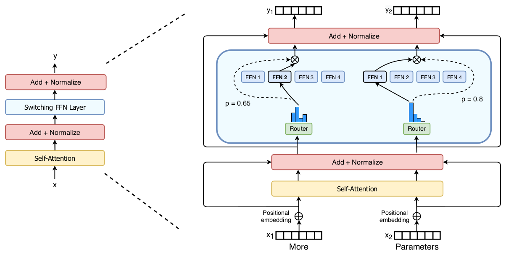

*图 2（原文 Figure 2，第 4 页）：Switch Transformer 编码器块。把 Transformer 里的稠密 FFN 层换成稀疏的 Switch FFN 层（浅蓝色），该层对序列中的每个 token 独立运算。图中两个 token（$x_1=$“More”，$x_2=$“Parameters”）被路由（实线）到四个 FFN 专家中的一个，路由器独立地为每个 token 路由；Switch FFN 层返回被选中 FFN 的输出乘以路由器门控值（虚线）。*

**图中文字翻译与读法**：

- **左半部分**：一个标准 Transformer 块自下而上为：输入 $x$、Self-Attention、Add + Normalize（残差加和与层归一化）、Switching FFN Layer（Switch FFN 层，取代原来的 Feed Forward Layer）、Add + Normalize、输出 $y$。
- **右半部分（放大）**：下方两个 token（More、Parameters）各自加上 Positional embedding（位置嵌入）后经过 Self-Attention 与 Add + Normalize，然后进入浅蓝色的 Switch FFN 层。每个 token 有自己的 Router（路由器，绿色），路由器输出柱状图表示对 4 个专家（FFN 1–FFN 4）的概率分布。第一个 token 的概率最大者是 FFN 2，$p=0.65$；第二个 token 的最大者是 FFN 1，$p=0.8$。被选中的专家（粗体）的输出乘以对应的 $p$（虚线箭头指向圆圈里的乘号），再回到 Add + Normalize 得到 $y_1$、$y_2$。
- **读图结论**：同一层里不同 token 走不同专家，参数随专家数增加，而每个 token 只经过一个 FFN，计算量与稠密 FFN 相同；输出乘门控值是路由器获得梯度的途径。

Switch 层的三点好处（论文原文）：（1）只把 token 送到一个专家，路由计算减少；（2）每个专家的 batch 大小（专家容量）至少可以减半，因为每个 token 只路由到一个专家；（3）路由的实现更简单，通信成本更低。

### 3.2 专家容量与 token 溢出（式 3，图 3）

论文使用 Mesh-TensorFlow（MTF，Shazeer 等人 2018）：它把物理核抽象成逻辑上的处理器网格，张量与计算可以按命名维度切分，便于把模型划分到多个维度。模型为 TPU 设计，而 TPU 要求静态声明的张量形状：**所有张量形状在编译时静态确定，但计算是动态的**（路由决策在训练与推理时才产生）。因此必须决定每个专家的容量，即每个专家计算多少个 token：把 batch 内的 token 数平均分给各专家，再乘以容量因子。

$$
\text{expert capacity}=\left(\frac{\text{tokens per batch}}{\text{number of experts}}\right)\times\text{capacity factor}\qquad(\text{式 }3)
$$

容量因子大于 1.0 时留出额外缓冲，容纳 token 在专家之间分布不均的情况。如果路由到某专家的 token 太多（称为 dropped tokens，被丢弃的 token），该专家对它们的计算被跳过，token 表示通过残差连接直接传到下一层。增大专家容量并非没有代价：容量大会浪费计算和显存。论文的经验是：保证较低的丢弃率对稀疏专家模型的扩展很重要；在所有实验中，丢弃的 token 比例通常小于 1%，并且没有观察到它与专家数有关；配合足够大系数的辅助负载均衡损失即可得到良好的负载均衡。

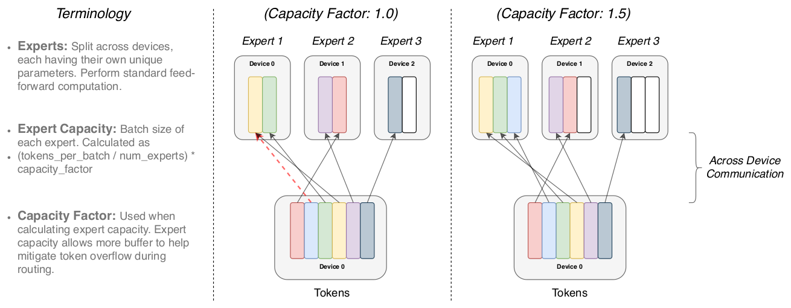

*图 3（原文 Figure 3，第 5 页）：token 路由动态。每个专家处理固定大小的一批 token，大小由容量因子调节。每个 token 被路由到路由器概率最高的专家，但每个专家的批大小固定为（总 token 数 / 专家数）× 容量因子。如果 token 分配不均，某些专家会溢出（红色虚线），这些 token 不被该层处理。更大的容量因子缓解溢出，但增加计算与通信成本（图中白色空槽）。*

**图中文字翻译与读法**：

- **左侧 Terminology（术语）**：Experts（专家）：分布在各设备上，每个有自己独有的参数，执行标准前馈计算；Expert Capacity（专家容量）：每个专家的 batch 大小，计算为 `(tokens_per_batch / num_experts) * capacity_factor`；Capacity Factor（容量因子）：计算专家容量时使用，容量留出更多缓冲以缓解路由时的 token 溢出。
- **中图 Capacity Factor: 1.0（容量因子 1.0）**：Device 0 上的 Tokens 有 6 个（6 种颜色），要分给 Expert 1、2、3（各在 Device 0、1、2）。容量 $=6/3\times1.0=2$，每个专家只有 2 个槽位。有 3 个 token（图中：黄、绿以及蓝色那个）被路由到 Expert 1，超出 2 个槽位，溢出的 token 用红色虚线箭头标出，该层不处理它；Expert 3 只收到 1 个 token，剩下一个槽位是空白。
- **右图 Capacity Factor: 1.5（容量因子 1.5）**：每个专家有 $6/3\times1.5=3$ 个槽位。Expert 1 接收 3 个 token，不再溢出，代价是 Expert 2、3 里出现更多空槽（白色），这些是 padding；跨设备通信的数据量（右侧 Across Device Communication）和计算量都随槽位数增加。
- **读图结论**：总槽位数 $=N\times$ 每专家容量 $=$ token 数 $\times$ 容量因子（笔者推出），所以容量因子 1.5 意味着专家计算和通信量约为理想值的 1.5 倍。容量因子是质量（少丢 token）与硬件效率（少 padding）之间的直接交换。

### 3.3 可微的负载均衡损失（式 4–6）

为了鼓励专家之间负载均衡，论文加一个辅助损失（Shazeer 等人 2017、2018；Lepikhin 等人 2020）。Switch Transformer 沿用 Shazeer 等人 2018 与 Lepikhin 等人 2020 的简化，不再像 2017 年的原设计那样分别使用 load 损失与 importance 损失两项。每个 Switch 层都有这样一个辅助损失，训练时加到模型总损失上。给定 $N$ 个专家（$i=1,\dots,N$）和一个含 $T$ 个 token 的 batch $\mathcal{B}$，辅助损失是向量 $f$ 与 $P$ 的缩放点积：

$$
\text{loss}=\alpha\cdot N\cdot\sum_{i=1}^{N}f_i\cdot P_i\qquad(\text{式 }4)
$$

其中 $f_i$ 是分给专家 $i$ 的 token 比例，

$$
f_i=\frac{1}{T}\sum_{x\in\mathcal{B}}\mathbb{1}\{\operatorname*{arg\,max}p(x)=i\}\qquad(\text{式 }5)
$$

$P_i$ 是路由器分配给专家 $i$ 的概率比例（即所有 token 对专家 $i$ 的路由概率的平均）：

$$
P_i=\frac{1}{T}\sum_{x\in\mathcal{B}}p_i(x)\qquad(\text{式 }6)
$$

论文脚注提醒：$p_i(x)$ 是把 token $x$ 路由到专家 $i$ 的概率，$P_i$ 是 batch 内所有 token 的概率比例，二者容易混淆。

**怎么理解**：

- 希望把一个 batch 的 token 均匀分给 $N$ 个专家，所以希望 $f$ 与 $P$ 的每个分量都是 $1/N$。式 4 在均匀分布下取最小值，所以鼓励均匀路由。
- $f$ 来自 argmax，不可微；$P$ 来自 softmax 概率，可微。因此整个目标是可微的，梯度只经过 $P$ 回到路由器。
- 损失乘以专家数 $N$ 是为了让损失在专家数变化时保持不变：均匀路由时 $\sum_{i=1}^{N}f_iP_i=\sum_{i=1}^{N}\frac{1}{N}\cdot\frac{1}{N}=\frac{1}{N}$，乘以 $N$ 后恒为 1，再乘 $\alpha$ 即 $\alpha$。
- **笔者补充：数值例子（不是论文数据）**：$N=4$，$T=8$。若完全均匀，$f=P=(0.25,0.25,0.25,0.25)$，$N\sum f_iP_i=4\times4\times0.0625=1$，损失为 $\alpha$。若 $f=(0.5,0.25,0.25,0)$、$P=(0.4,0.3,0.2,0.1)$，则 $\sum f_iP_i=0.2+0.075+0.05+0=0.325$，$N\sum f_iP_i=1.3$，损失为 $1.3\alpha$，高于均匀情形，说明失衡被惩罚。
- **笔者补充：梯度方向**：$\partial\,\text{loss}/\partial p_i(x)=\alpha N f_i/T$（$f_i$ 视为常数）。被分到 token 越多的专家（$f_i$ 越大），其路由概率被压得越狠；这是式 4 把“实际 dispatch 比例”和“可微概率”相乘的原因。
- **系数 $\alpha$**：全文使用 $\alpha=10^{-2}$，它足够大以保证负载均衡，又足够小，不会压过主要的交叉熵目标。论文在 $10^{-1}$ 到 $10^{-5}$（以 10 的幂为步长）扫描，发现 $10^{-2}$ 能很快平衡负载，同时不干扰训练损失。

论文附录 F 的图 14 给出了这个损失的 Mesh TensorFlow 伪代码，译注如下（原文为伪代码，变量名保持原样）：

```python
import mesh_tensorflow as mtf

def load_balance_loss(router_probs, expert_mask):
    """计算负载均衡损失，促使路由在各专家之间分散。"""
    # router_probs：每个 token 对每个专家的路由概率
    #   形状 [num_cores, tokens_per_core, num_experts]
    # expert_mask：每个 token 概率最高的专家，one-hot 形式
    #   形状 [num_cores, tokens_per_core, num_experts]

    # 每个 core 上被路由到各专家的 token 比例（即 f），形状 [num_cores, num_experts]
    density_1 = mtf.reduce_mean(expert_mask, reduced_dim=tokens_per_core)

    # 每个 core 上各专家分到的路由概率质量（即 P），形状 [num_cores, num_experts]
    density_1_proxy = mtf.reduce_mean(router_probs, reduced_dim=tokens_per_core)

    # 两个向量各自的和都是 1；希望它们都是均匀分配（每项 1/num_experts）。
    # 两个向量的点积最小时，二者被推向均匀分配。
    loss = mtf.reduce_mean(density_1_proxy * density_1) * (num_experts ** 2)  # 原文写作 num_experts ^ 2
    return loss
```

### 3.4 一个 Switch 层的完整数据流（附录 F，图 15、图 16）

下面按原文伪代码整理一个分布式 Switch 层的执行流程（原文图 15 的 router 与图 16 的 switch_layer，不含模型并行）。变量约定：`num_cores` 为 core 数，`tokens_per_core` 为每个 core 的 token 数，`d_model` 为隐层大小。

```python
def router(inputs, capacity_factor):
    """产生 combine 与 dispatch 张量，用来把 token 发给概率最高的专家，并把结果收回。"""
    # inputs 形状：[num_cores, tokens_per_core, d_model]
    router_weights = mtf.Variable(shape=[d_model, num_experts])

    # router_logits 形状：[num_cores, tokens_per_core, num_experts]
    router_logits = mtf.einsum([inputs, router_weights], reduced_dim=d_model)

    if is_training:
        # 加噪声，鼓励在专家之间探索
        router_logits += mtf.random_uniform(shape=router_logits.shape, minval=1-eps, maxval=1+eps)

    # 为了稳定，softmax 之前把 bfloat16 转成 float32
    router_logits = mtf.to_float32(router_logits)

    # 每个 token 应该被送往各专家的概率
    router_probs = mtf.softmax(router_logits, axis=-1)

    # 每个 token 的 top-1 专家：expert_gate 是 top-1 概率，expert_index 是专家编号
    expert_gate, expert_index = mtf.top_1(router_probs, reduced_dim=num_experts)

    # expert_mask 形状：[num_cores, tokens_per_core, num_experts]
    expert_mask = mtf.one_hot(expert_index, dimension=num_experts)

    # 计算负载均衡损失
    aux_loss = load_balance_loss(router_probs, expert_mask)

    # 专家容量固定，保证不被超出：position_in_expert 是 token 在所选专家队列中的位置
    position_in_expert = mtf.cumsum(expert_mask, dimension=tokens_per_core) * expert_mask

    # 只保留容量以内的 token
    expert_mask *= mtf.less(position_in_expert, expert_capacity)
    expert_mask_flat = mtf.reduce_sum(expert_mask, reduced_dim=experts_dim)

    # 屏蔽超出容量的 token（这些 token 的 gate 变为 0）
    expert_gate *= expert_mask_flat

    # combine 张量：合并专家输出，并按路由概率缩放
    # 形状：[num_cores, tokens_per_core, num_experts, expert_capacity]
    combine_tensor = (
        expert_gate * expert_mask_flat *
        mtf.one_hot(expert_index, dimension=num_experts) *
        mtf.one_hot(position_in_expert, dimension=expert_capacity))

    # 转回 bfloat16，供该层其余部分使用
    combine_tensor = mtf.to_bfloat16(combine_tensor)

    # dispatch 张量：二值，token 被路由到对应专家的对应槽位时为 1
    dispatch_tensor = mtf.cast(combine_tensor, tf.bool)

    return dispatch_tensor, combine_tensor, aux_loss


def switch_layer(inputs, n, capacity_factor, num_experts):
    """分布式 Switch Transformer 前馈层。"""
    batch, seq_len, d_model = inputs.get_shape()

    # 每个 core 负责把 tokens_per_core 个 token 路由到对应的专家
    tokens_per_core = batch * seq_len / num_cores

    # 每个 core 要向每个专家发送 expert_capacity 个 token
    expert_capacity = tokens_per_core * capacity_factor / num_experts

    # 重排成按 core 分发的形状：[num_cores, tokens_per_core, d_model]
    inputs = mtf.reshape(inputs, [num_cores, tokens_per_core, d_model])

    # 原文这里把 expert_capacity 传给了形参 capacity_factor，属于伪代码笔误
    dispatch_tensor, combine_tensor, aux_loss = router(inputs, expert_capacity)

    # 与大的布尔张量做矩阵乘，把 token 分配给对应专家
    # expert_inputs 形状：[num_experts, num_cores, expert_capacity, d_model]
    expert_inputs = mtf.einsum([inputs, dispatch_tensor], reduce_dims=[tokens_per_core])

    # All-to-All 通信：core 原来按 num_cores 切分，现在要按 num_experts 切分，
    # 即把本地路由好的 token 发到各自专家所在的 core
    expert_inputs = mtf.reshape(expert_inputs, [num_experts, num_cores, expert_capacity, d_model])

    # 标准前馈计算，每个专家有自己独有的一套参数
    # 独有参数总数：num_experts * (d_model * d_ff * 2)
    expert_outputs = feed_forward(expert_inputs)

    # 再做一次 All-to-All：切分维度从 experts 换回 num_cores
    expert_outputs = mtf.reshape(expert_outputs, [num_experts, num_cores, expert_capacity, d_model])

    # 转回输入形状，并把专家输出乘以路由概率
    expert_outputs_combined = mtf.einsum([expert_outputs, combine_tensor], reduce_dims=[tokens_per_core])

    outputs = mtf.reshape(expert_outputs_combined, [batch, seq_len, d_model])
    return outputs, aux_loss
```

读法：

- **dispatch 与 combine 张量**：形状都是 [core 数, 每 core token 数, 专家数, 专家容量]。dispatch 是 0/1 的，表示“某 token 被放进某专家的第几个槽位”；combine 在相同位置存放门控值 $p_{i^{*}}(x)$。前者用于把 token 搬到专家，后者用于把专家输出搬回并乘以概率。
- **容量是按 core 局部执行的**：`expert_capacity = tokens_per_core * capacity_factor / num_experts` 是每个 core 向每个专家最多发送的 token 数；各专家实际槽位数为 `num_cores * expert_capacity`，等于式 3 中全 batch 的容量。也就是说，溢出的判断发生在各 core 本地（笔者据代码整理）。
- **溢出的 token**：被 `expert_mask *= less(position_in_expert, expert_capacity)` 屏蔽后，对应的 `expert_gate` 为 0，combine 张量对应行全为 0，所以专家输出的贡献为 0，Switch 层输出为 0，token 表示只靠残差连接前进。
- **两次 All-to-All**：一次把 token 送到专家所在设备，一次把专家输出送回。论文第 5.4 节指出，这需要在前向传播中额外传输大小为 $E\times C\times d_{model}$ 的 bfloat16 张量。
- **路由内部用 float32**：路由函数里的 softmax 用 float32，而返回的 dispatch、combine 张量在函数末尾转回 bfloat16，所以不会有昂贵的 float32 张量参与 all-to-all 通信（见第五节）。
- 伪代码中 `router_logits += uniform(1-eps, 1+eps)` 写的是加法，而附录 C 正文称“乘性抖动噪声”（multiplicative jitter noise），两者不一致，见第九节。

### 3.5 预训练设置

第一组实验在 “Colossal Clean Crawled Corpus”（C4，Raffel 等人 2019）上预训练。预训练目标是掩码语言建模：随机丢弃 15% 的 token，然后把被遮盖的序列替换成单个哨兵（sentinel）token，模型预测被丢掉的 token（遵循 T5 的最优设置）。比较模型时记录负对数困惑度（以 e 为底，单位 nat）。本文所有模型的对比汇总见表 9。

## 四、Switch 与 MoE（top-2）的正面比较（表 1）

Switch 模型与 T5-Base 做 FLOPs 对齐（每个 token 的计算量相同）。MoE Transformer 使用 top-2 路由，每个 token 要经过两个专家，各自对它施加不同的 FFN，所以它的 FLOPs 更大。所有模型在相同硬件上训练相同步数。

表 1 设置：所有 MoE 与 Switch 模型都使用 128 个专家，每隔一层 FFN 放专家；训练 100k 步后测量质量；“时间阈值”指达到任意选定的质量阈值（负对数困惑度 $=-1.50$）所需的训练时间；速度为每秒样本数。Switch-Base+ 把模型加大到与 MoE 模型速度相当：隐层大小从 768 增大到 896，head 数从 14 增大到 16（这是原文表注的写法）。所有模型用同样的算力（32 个核）和同样的硬件（TPUv3）。所有模型都需要预训练超过 100k 步才能达到 $-1.50$ 的阈值。

| 模型 | 容量因子 | 100k 步后质量（↑，负对数困惑度） | 达到质量阈值的时间（↓，小时） | 速度（↑，examples/sec） |
|---|---:|---:|---:|---:|
| T5-Base | — | -1.731 | Not achieved† | 1600 |
| T5-Large | — | -1.550 | 131.1 | 470 |
| MoE-Base | 2.0 | -1.547 | 68.7 | 840 |
| Switch-Base | 2.0 | -1.554 | 72.8 | 860 |
| MoE-Base | 1.25 | -1.559 | 80.7 | 790 |
| Switch-Base | 1.25 | -1.553 | 65.0 | 910 |
| MoE-Base | 1.0 | -1.572 | 80.1 | 860 |
| Switch-Base | 1.0 | -1.561 | **62.8** | 1000 |
| Switch-Base+ | 1.0 | **-1.534** | 67.6 | 780 |

（原文表 1，第 7 页。† 表示 T5-Base 在训练的 100k 步内没有达到该阈值。）论文总结了三点发现：

1. 在速度与质量的综合上，Switch Transformer 优于精心调过的稠密模型和 MoE Transformer：给定计算量与墙钟时间，Switch Transformer 取得最好结果。
2. Switch 的计算足迹小于 MoE：若把它加大到与 MoE 相同的训练速度（Switch-Base+），按每步质量它也优于所有 MoE 与稠密模型。
3. Switch 在较低的容量因子（1.0、1.25）下表现更好。小容量对应大模型体制下显存十分紧张、容量因子要尽量小的场景。

读表要点（笔者核对）：

- 并不是所有行里 Switch 都更好：容量因子 2.0 时 MoE-Base（-1.547，68.7 小时）在质量和达到阈值的时间上都略好于 Switch-Base（-1.554，72.8 小时），只是 Switch-Base 速度略快（860 对 840）。优势出现在容量因子 1.25 与 1.0：例如容量因子 1.0 时，Switch-Base 速度 1000 对 860，达到阈值时间 62.8 对 80.1 小时（约少 22%），每步质量 -1.561 对 -1.572。
- 论文脚注 5：速度既取决于算法也取决于实现细节。Switch 在算法上比 MoE 少算，但最终速度差异受底层优化影响；论文也承认 MoE 容量因子从 2.0 降到 1.25 时速度反而下降（840 到 790）是意料之外的。
- T5-Base 吞吐最高（1600）但 100k 步内质量只有 -1.731，没有达到阈值；T5-Large 质量 -1.550 却只有 470 的吞吐。
- 原文表 1 的说明写 Switch-Base+ 把 head 数从“14 增到 16”，而表 9 中 Switch-Base 的 head 数是 12，原文此处自相矛盾，这里照录并标注。

## 五、让大型稀疏模型稳定训练的三招（第 2.4 节）

稀疏专家模型比普通 Transformer 更难训练。不稳定的来源之一是每层的硬切换（路由）决策；bfloat16 等低精度格式又会加剧路由器里 softmax 的计算问题（笔者补充：bfloat16 只有约 8 位有效数字，softmax 里的指数运算对 logits 的舍入误差很敏感；论文原文只说低精度会加剧这个问题）。

### 5.1 选择性精度

模型不稳定阻碍了用高效的 bfloat16 训练，所以 Lepikhin 等人（2020）在整个 MoE Transformer 里使用 float32。论文的做法是**只在模型的局部范围内**转成 float32：把路由器的输入转成 float32。路由函数以 token 为输入，产生用于选择和重组专家计算的 dispatch 与 combine 张量。float32 只用于路由函数体内部、在本设备上做的计算；函数结束时 dispatch、combine 张量被转回 bfloat16，所以没有昂贵的 float32 张量参与 all-to-all 通信，却仍享有 float32 的稳定性。这与现代混合精度训练（Micikevicius 等人 2017）的思路一致。

表 2 设置：一个 32 专家的 Switch-Base，在训练早期固定步数后测量质量，并测速度。

| 模型（精度） | 质量（↑，负对数困惑度） | 速度（↑，Examples/sec） |
|---|---:|---:|
| Switch-Base (float32) | -1.718 | 1160 |
| Switch-Base (bfloat16) | -3.780 [diverged] | **1390** |
| Switch-Base (Selective precision) | **-1.716** | 1390 |

（原文表 2，第 8 页。）读法：纯 bfloat16 训练发散（质量 -3.780）；纯 float32 稳定但慢（1160 examples/sec）；选择性精度与 float32 的学习动态相近（-1.716 对 -1.718），速度与不稳定的 bfloat16 几乎一样（1390）。

### 5.2 更小的参数初始化

合适的初始化对训练成功至关重要，对 Switch Transformer 尤其如此。论文从截断正态分布采样权重：均值 $\mu=0$，标准差 $\sigma=\sqrt{s/n}$，其中 $s$ 是尺度超参数，$n$ 是权重张量的输入单元数（fan-in）；超过均值两个标准差的值被重采样。作为不稳定的补救，建议把默认的 Transformer 初始化尺度 $s=1.0$ 缩小 10 倍（即 $s=0.1$）。论文称这既提高了质量，又降低了训练失稳的可能。

表 3 设置：32 个专家的模型，训练 3.5k 步后，3 个随机种子的负对数困惑度均值与标准差。

| 模型（初始化尺度） | 平均质量（负对数困惑度） | 质量的标准差（负对数困惑度） |
|---|---:|---:|
| Switch-Base (0.1x-init) | **-2.72** | **0.01** |
| Switch-Base (1.0x-init) | -3.60 | 0.68 |

（原文表 3，第 9 页。）读法：缩小初始化后，平均质量显著提高（-2.72 对 -3.60），不同随机种子间的方差大幅降低（0.01 对 0.68）。论文还说这套初始化在跨越几个数量级的模型上普遍有效：从 223M 参数的基线到超过一万亿参数的巨型模型都用同样的方式稳定训练。论文没有给出“为什么缩小初始化有效”（例如激活或梯度爆炸）的机理解释，只报告了上述经验效果。

### 5.3 对大型稀疏模型做正则：专家 dropout

先预训练再在较小的下游任务上微调，是常见做法。很多微调任务样本很少，而 Switch Transformer 的参数量远多于 FLOPs 对齐的稠密基线，更容易过拟合。标准 Transformer 微调时（Raffel 等人 2019）在每一层使用 dropout。论文提出**专家 dropout**（expert dropout）：微调时，只在每个专家层内部的中间前馈计算处把 dropout 率大幅提高。

表 4 设置：在 C4 的 34B token 上预训练的 Switch 模型的微调结果，扫描 dropout 率；数字越大越好。`d` 为非专家层的 dropout，`ed` 为专家层的 dropout。原文粗体照录。

| 模型（dropout） | GLUE | CNNDM | SQuAD | SuperGLUE |
|---|---:|---:|---:|---:|
| T5-Base (d=0.1) | 82.9 | **19.6** | 83.5 | 72.4 |
| Switch-Base (d=0.1) | 84.7 | 19.1 | **83.7** | **73.0** |
| Switch-Base (d=0.2) | 84.4 | 19.2 | **83.9** | **73.2** |
| Switch-Base (d=0.3) | 83.9 | 19.6 | 83.4 | 70.7 |
| Switch-Base (d=0.1, ed=0.4) | **85.2** | **19.6** | **83.7** | **73.0** |

（原文表 4，第 10 页。）读法：把所有层的 dropout 一起加大（0.3）会变差（SuperGLUE 70.7，低于 0.1 的 73.0）；而在非专家层使用较小的 0.1、在专家层使用大得多的 0.4，在四个较小的下游任务上都带来改进，GLUE 最好（85.2）。后面所有微调实验都用这个协议：除 Switch 层外各层 dropout 为 0.1，Switch 层为 0.4。

## 六、扩展性质（第 3 节）

按 Kaplan 等人（2020）的设定，考虑模型既不受计算预算也不受数据量限制的体制：用超过 180B 目标 token 的大型 C4 语料，训练到出现收益递减。**专家数是扩展模型最有效的维度**：增加专家数，计算成本近似不变（每个 token 只选一个专家，不管有多少候选）；路由器必须在更多专家上计算概率分布，但这是代价为 $O(d_{model}\times\text{num\_experts})$ 的轻量计算（$d_{model}$ 是层间传递的 token 嵌入维度）。本节分别从步数和时间两种口径考察。

### 6.1 按步数：更多专家就更快（图 1 / 图 4）

固定训练步数时，随着专家数增加，质量持续改善：在每个 token 的 FLOPs 固定的前提下，参数（专家）越多，训练越快。

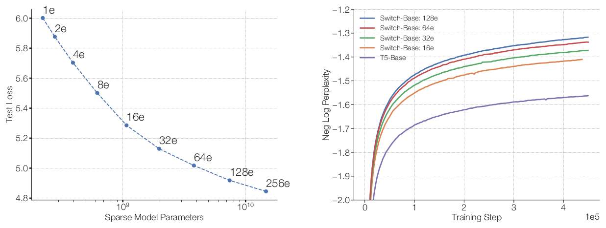

*图 1（原文 Figure 1，第 2 页；第 11 页的 Figure 4 是同一组曲线）：左，越来越稀疏（专家越多）的 Switch Transformer 的扩展性质；右，Switch Transformer 与使用同样算力预算的 T5 模型的负对数困惑度对比。*

**图中文字翻译与读法**：

- **左图**：横轴 Sparse Model Parameters（稀疏模型参数量，对数轴，$10^{9}$ 到 $10^{10}$ 附近），纵轴 Test Loss（测试损失）。左上角第一个点标 1e，是 223M 参数的 T5-Base；沿虚线向右下每次把专家数翻倍：2e、4e、8e、16e、32e、64e、128e，直到 256e（256 个专家，14.7B 参数）。所有模型使用相同的计算预算。测试损失从 1e 的约 6.0 单调下降到 256e 的约 4.85（从图读出），但曲线越往右越平缓。
- **右图**：横轴 Training Step（训练步数，单位 $10^{5}$），纵轴 Neg Log Perplexity（负对数困惑度）。紫色为稠密基线 T5-Base，其余四条为 FLOPs 对齐的 Switch-Base：16e（橙）、32e（绿）、64e（红）、128e（蓝）。同一训练步，专家越多的曲线越靠上。在约 $4.5\times10^{5}$ 步处，T5-Base 约 -1.56，Switch-Base 16e、32e、64e、128e 约分别为 -1.41、-1.37、-1.34、-1.32（图上读出的近似值）。
- **读图结论**：左图表明沿“稀疏参数”这条额外的轴扩展带来一致的好处；右图表明增加专家数让模型样本效率更高。并且与 Kaplan 等人（2020）的发现一致，更大的模型样本效率也更高：对固定数量的观测 token 学得更快。

正文给出的一个数：Switch-Base 64 专家模型达到 T5-Base 的水平所需步数少了 7.5 倍。原文该句把两个步数写反了（写成“T5-Base 在 60k 步的性能，Switch 在 450k 步达到”）。按 7.5 $=450/60$ 以及图 6 左（Switch-Base 64e 在约 60k 步的质量约等于 T5-Base 在 450k 步的质量，约 -1.56）应理解为：Switch-Base 64 专家在约 60k 步就达到 T5-Base 在 450k 步的质量（笔者按图纠正）。

### 6.2 按时间：同样算力下训练得更快（图 5）

按步数看，增加专家数性能持续提升。但 Switch 虽然每个 token 的 FLOPs 与基线大致相同，却有设备之间的额外通信成本和路由机制的额外计算，所以步数口径下的样本效率提升不一定转化为墙钟口径下更好的质量。论文提出的问题是：给定固定的训练时长与计算预算，应该训练稠密模型还是稀疏模型？

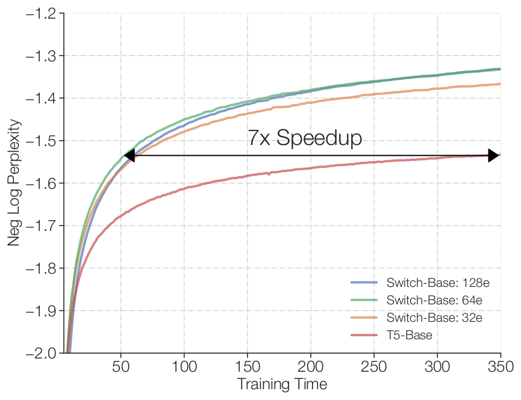

*图 5（原文 Figure 5，第 12 页）：Switch Transformer 的速度优势。所有模型在 32 个 TPUv3 核上训练，每个样本的 FLOPs 相同。在固定的计算量与训练时间下，Switch Transformer 明显优于稠密 Transformer 基线；64 专家的 Switch-Base 用 T5-Base 七分之一的时间达到同样的质量，并继续改善。*

**图中文字翻译与读法**：

- 横轴 Training Time（训练时间，原图未标单位，约 50 到 350），纵轴 Neg Log Perplexity（负对数困惑度，-2.0 到 -1.2）。图例：Switch-Base: 128e / 64e / 32e（蓝、绿、橙）与 T5-Base（红）。
- 图中黑色双向箭头标注 “7x Speedup（7 倍加速）”：T5-Base 训练到时间轴末端约 350 才达到的质量（约 -1.53），Switch-Base 64e 约在 50 附近就达到了。
- **读图结论**：同样的 32 核预算下，三个 Switch-Base 的曲线都在 T5-Base 之上，且在整个时间轴上保持优势；图中 64e 与 128e 几乎重合，32e 略低。

### 6.3 与更大的稠密模型比较（图 6）

另一种用法：把资源分给一个更大的稠密模型。论文把 Switch-Base 与下一个强基线 T5-Large 比较。尽管 T5-Large 每个 token 多用约 3.5 倍的 FLOPs（表 9 中 425B 对 124B，约 3.4 倍），Switch-Base 仍然样本效率更高，并带来 2.5 倍的加速。进一步，设计一个与 T5-Large FLOPs 对齐的更大稀疏版本 Switch-Large，能获得更好的扩展与微调表现（见第七节）。

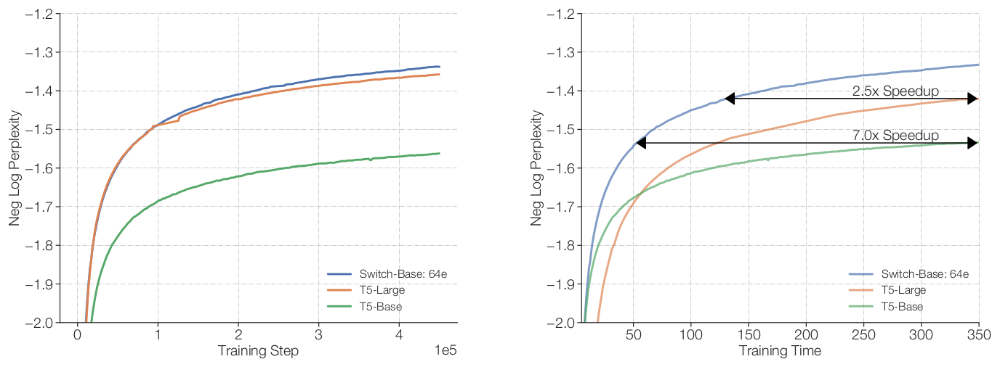

*图 6（原文 Figure 6，第 13 页）：用 Switch 层扩展 Transformer 与用标准稠密方式扩展的比较。左：Switch-Base 比 T5-Base 和 T5-Large 都更样本高效，而 T5-Large 每个 token 多用 3.5 倍 FLOPs；右：同样按墙钟时间，Switch-Base 仍然更快，相对 T5-Large 加速 2.5 倍。*

**图中文字翻译与读法**：

- **左图**：横轴 Training Step（单位 $10^{5}$），纵轴 Neg Log Perplexity。蓝：Switch-Base: 64e；橙：T5-Large；绿：T5-Base。蓝橙两条线在前 $10^{5}$ 步几乎重合，之后 Switch-Base 逐渐略高；T5-Base 明显低得多。
- **右图**：横轴 Training Time，纵轴相同。图中两个箭头：上面标 2.5x Speedup，指 Switch-Base 比 T5-Large 更快达到 T5-Large 在时间轴末端的质量（约 -1.42）；下面标 7.0x Speedup，指相对 T5-Base（约 -1.53）。
- **读图结论**：每步样本效率上 Switch-Base 64e 与计算量为其 3.5 倍的 T5-Large 相当或略胜；按墙钟时间，较大的 T5-Large 每步更慢（表 1：吞吐 470，T5-Base 为 1600 examples/sec），所以在时间轴上落后，Switch-Base 相对 T5-Large 有 2.5 倍加速。

## 七、下游任务结果（第 4 节）

### 7.1 微调（表 5）

**基线与 Switch 模型**：基线是精心调过的 223M 参数 T5-Base 与 739M 参数 T5-Large；对两者各设计一个 FLOPs 对齐、参数多得多的 Switch Transformer（表 9）。基线与 Raffel 等人（2019）略有差别：这里在改进过的 C4 语料上预训练，去掉了样本内部重复的文本。**预训练协议**：每个 batch $2^{20}$（1,048,576）个 token，训练 550k 步，共 576B token。**微调**：除 Switch 层外所有层 dropout 为 0.1，Switch 层为 0.4（表 4）；batch 大小 1M，训练 16k 步；每 200 步评估一次，报告验证集上的峰值性能。

**微调任务**：GLUE 与 SuperGLUE 作为组合混合任务处理，各子任务按 token 数量成比例混合，涵盖情感分析（SST-2）、词义消歧（WIC）、句子相似度（MRPC、STS-B、QQP）、自然语言推理（MNLI、QNLI、RTE、CB）、问答（MultiRC、RECORD、BoolQ）、指代消解（WNLI、WSC）、句子补全（COPA）与句子可接受性（CoLA）；摘要用 CNNDM 与 BBC XSum；问答用 SQuAD 与 ARC 推理挑战；知识通过三个闭卷问答数据集 Natural Questions、Web Questions 与 Trivia QA 评估（闭卷指提问时不给任何补充参考资料）；常识推理用 Winogrande；自然语言推理能力用对抗 NLI 基准 ANLI。**指标**：GLUE、SuperGLUE 报告各子任务平均；CNNDM、XSum 用 Rouge-2；SQuAD 和闭卷任务报告与目标完全匹配的答案百分比（EM）；ARC Easy、ARC Challenge、ANLI、Winogrande 报告生成回答的准确率。

表 5 设置：验证集结果，越大越好；每对 T5 与 Switch 模型是 FLOPs 对齐的（Base 对 Base，Large 对 Large）。原文粗体标出每对中的较好者（并列都加粗）。

| 模型 | GLUE | SQuAD | SuperGLUE | Winogrande (XL) |
|---|---:|---:|---:|---:|
| T5-Base | 84.3 | 85.5 | 75.1 | 66.6 |
| Switch-Base | **86.7** | **87.2** | **79.5** | **73.3** |
| T5-Large | 87.8 | 88.1 | 82.7 | 79.1 |
| Switch-Large | **88.5** | **88.6** | **84.7** | **83.0** |

| 模型 | XSum | ANLI (R3) | ARC Easy | ARC Chal. |
|---|---:|---:|---:|---:|
| T5-Base | 18.7 | 51.8 | 56.7 | **35.5** |
| Switch-Base | **20.3** | **54.0** | **61.3** | 32.8 |
| T5-Large | 20.9 | 56.6 | **68.8** | **35.5** |
| Switch-Large | **22.3** | **58.6** | 66.0 | **35.5** |

| 模型 | CB Web QA | CB Natural QA | CB Trivia QA |
|---|---:|---:|---:|
| T5-Base | 26.6 | 25.8 | 24.5 |
| Switch-Base | **27.4** | **26.8** | **30.7** |
| T5-Large | 27.7 | 27.6 | 29.5 |
| Switch-Large | **31.3** | **29.5** | **36.9** |

（原文表 5，第 14 页。CB 为 closed-book，闭卷。）读法：

- 论文：SuperGLUE 上 FLOPs 对齐的 Switch 变体比 T5-Base 和 T5-Large 分别提高 4.4 与 2 个百分点（79.5 对 75.1，84.7 对 82.7）；Winogrande、闭卷 Trivia QA 与 XSum 也有很大提升（Trivia QA：30.7 对 24.5，36.9 对 29.5）。
- 唯一没有看到收益的是 ARC：ARC Challenge 上 T5-Base（35.5）优于 Switch-Base（32.8），ARC Easy 上 T5-Large（68.8）优于 Switch-Large（66.0）；Switch-Large 与 T5-Large 在 ARC Challenge 上并列 35.5。
- 总体上，显著改进同时覆盖推理类和知识密集类任务。这说明该架构不仅预训练得好，质量改进还能通过微调转化到下游任务。
- 脚注 8：T5 与 Switch 模型都在修订后的 C4 上预训练，每 batch $2^{20}$ 个 token，550k 步，保证对比公平。

### 7.2 蒸馏：把稀疏大模型压回稠密小模型（表 6、表 7、表 8）

部署数十亿甚至万亿参数的网络很不方便。论文研究把大型稀疏模型蒸馏（Hinton 等人 2015）成小型稠密模型，并建议未来研究把大模型蒸馏成更小的稀疏模型。技术建立在 Sanh 等人（2019）对 BERT 的蒸馏方法之上：

1. **用教师的非专家权重初始化学生**：由于所有模型 FLOPs 对齐，非专家层维度相同；而专家层通常只加在每个或每隔一个 FFN 层，所以很多权重可以用训练好的参数初始化。这带来适度的提升。
2. **损失里混合教师概率与真实标签**：教师概率权重 0.25，真实标签权重 0.75，得到进一步提升。

两者结合，可以保留大型稀疏模型约 30% 的质量增益，而参数只有约 1/20。这里“质量增益”是指 Switch-Base（教师）与 T5-Base（学生）之间质量差距的百分比，因此 100% 意味着学生与教师性能相当。

表 6 设置：预训练语言建模任务上的质量（负对数困惑度，越大越好）；括号里的百分比是保留的教师质量增益。

| 技术 | 参数量 | 质量（↑） |
|---|---:|---:|
| T5-Base | 223M | -1.636 |
| Switch-Base | 3,800M | -1.444 |
| Distillation（蒸馏） | 223M | (3%) -1.631 |
| + Init. non-expert weights from teacher（用教师的非专家权重初始化） | 223M | (20%) -1.598 |
| + 0.75 mix of hard and soft loss（硬标签与软标签损失按 0.75 混合） | 223M | (29%) -1.580 |
| Initialization Baseline (no distillation)：Init. non-expert weights from teacher（初始化基线，不蒸馏） | 223M | -1.639 |

（原文表 6，第 16 页。）读法：笔者按 (学生 − T5-Base)/(Switch-Base − T5-Base) 核对三个百分比：0.005/0.192 约 2.6%、0.038/0.192 约 19.8%、0.056/0.192 约 29.2%，与表中 3%、20%、29% 一致。最后一行说明：单纯用专家权重初始化 T5-Base 而不蒸馏，没有改进（-1.639，略差于 -1.636）。表的说明写“100x more parameters”，但表内教师 Switch-Base 为 3,800M（约为 223M 的 17 倍），说明与表内数字不符（笔者注）。

**可达到的压缩率**：用上面最好的蒸馏技术，把一系列 Switch-Base（专家数递增，对应参数量 1.1B 到 14.7B）蒸馏成稠密模型。

| 项目 | 稠密 | 稀疏 1.1B | 稀疏 2.0B | 稀疏 3.8B | 稀疏 7.4B | 稀疏 14.7B |
|---|---:|---:|---:|---:|---:|---:|
| 参数量 | 223M | 1.1B | 2.0B | 3.8B | 7.4B | 14.7B |
| 预训练负对数困惑度（↑） | -1.636 | -1.505 | -1.474 | -1.444 | -1.432 | -1.427 |
| 蒸馏后负对数困惑度（↑） | — | -1.587 | -1.585 | -1.579 | -1.582 | -1.578 |
| 保留的教师性能百分比 | — | 37% | 32% | 30% | 27% | 28% |
| 压缩百分比 | — | 82% | 90% | 95% | 97% | 99% |

（原文表 7，第 16 页。）读法：对 1.1B 参数的模型，可以保留 37% 的质量增益同时压缩 82%；极端情形压缩 99%（14.7B 到 223M）仍保留教师改进的 28%。论文提醒：对于显著更好、更大的预训练教师，预计需要更大的学生模型才能达到这些压缩率。

**蒸馏微调后的模型**：表 8 把在 SuperGLUE 上微调过的 7.4B 参数 Switch-Base 蒸馏到 223M 的 T5-Base。

| 模型 | 参数量 | FLOPS | SuperGLUE（↑） |
|---|---:|---:|---:|
| T5-Base | 223M | 124B | 74.6 |
| Switch-Base | 7410M | 124B | 81.3 |
| Distilled T5-Base | 223M | 124B | (30%) 76.6 |

（原文表 8，第 17 页。）读法：与预训练的结果类似，蒸馏到 FLOPs 对齐的稠密模型可保留稀疏模型 30% 的增益（(76.6-74.6)/(81.3-74.6) 约 30%，笔者核对），模型压缩 97%。论文提出一个未来方向：研究微调任务具体使用了哪些专家，把它们抽出来可能达到更好的压缩。

### 7.3 多语言学习（图 7、图 8）

最后一组下游实验在 101 种语言的混合语料上预训练，建立在 mT5（Xue 等人 2020，T5 的多语言扩展）之上。使用 mT5 引入的多语言 Common Crawl 数据集（mC4）覆盖 101 种语言，由于某些语言有多种文字变体，混合语料包含 107 个任务。比较 FLOPs 对齐的 mSwitch-Base 与 mT5-Base。

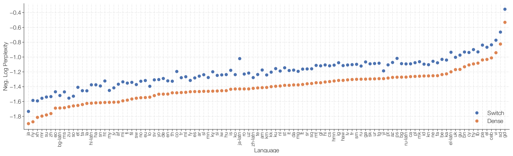

*图 7（原文 Figure 7，第 17 页）：101 种语言的多语言预训练。多任务训练时 Switch T5 Base 相对稠密基线的改进。Switch Transformer 在多任务训练设置中表现很好，在全部 101 种语言上都有改进。*

**图中文字翻译与读法**：横轴 Language（语言代码，按稠密基线质量由低到高排序，如 ja、ny、xh … sd、gd），纵轴 Neg. Log Perplexity（负对数困惑度，约 -1.9 到 -0.3）。蓝点为 Switch，橙点为 Dense（稠密基线）；每种语言（或文字变体）一对点。**读图结论**：每一对点中蓝点都高于橙点，即预训练 1M 步后，所有 101 种语言上 Switch 的最终负对数困惑度都超过基线；基线质量最差的一端（左侧）与最好的一端（右侧）都有改进。

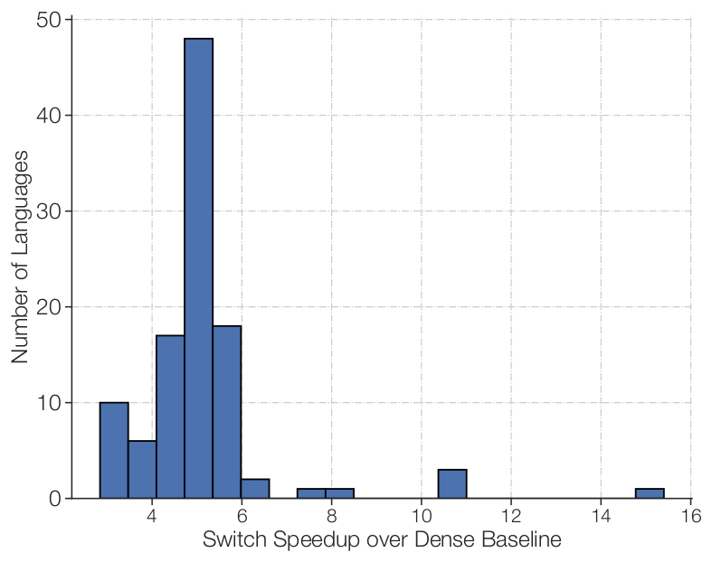

*图 8（原文 Figure 8，第 18 页）：多语言预训练。对每种语言，统计 Switch Transformer 相对 FLOPs 对齐的 T5 稠密基线达到相同质量所需的步数加速比的直方图。在全部 101 种语言上，相对 mT5-Base 的平均步数加速为 5 倍，91% 的语言达到最终困惑度时加速 4 倍或更多。*

**图中文字翻译与读法**：横轴 Switch Speedup over Dense Baseline（Switch 相对稠密基线的加速比，约 3 到 16），纵轴 Number of Languages（语言数）。柱子集中在 4–6 倍：最高的一根（约 48 种）在约 5 倍附近，其次约 17 与 18 种分别在约 4.4 倍与 5.7 倍附近；尾部有少数语言达到 7–8 倍、约 10.5 倍（3 种）甚至约 15 倍；左侧约 16 种语言在约 2.8–4.1 倍之间（均为图上读出的近似数；各柱高度之和约为 107，对应 107 个任务，即 101 种语言含文字变体）。**读图结论**：论文原话是，在全部 101 种语言上平均加速 5 倍，91% 的语言至少 4 倍，这证明 Switch Transformer 是有效的多任务、多语言学习者。脚注 9：步数加速比 $=$ 基线所需步数 / 达到相同质量所需的 Switch 步数。

## 八、数据、模型、专家并行的设计与万亿参数模型（第 5 节）

盲目增加专家数会遇到收益递减（图 4），所以需要互补的扩展策略。扩展 Transformer 的通常方法是同步增大 $d_{model}$、$d_{ff}$ 等维度，这同时增加参数和计算，最终受限于每个加速器的显存；超过单个加速器的显存后可以用 SPMD 模型并行。这一节研究数据、模型和专家并行组合的取舍。

### 8.1 回顾 FFN 与并行记号

设一个 batch 有 $B$ 个 token，每个维度 $d_{model}$。FFN 的输入 $x$、输出 $y$ 大小均为 $[B,d_{model}]$，中间量 $h$ 大小为 $[B,d_{ff}]$，$d_{ff}$ 通常是 $d_{model}$ 的数倍。$h=xW_{in}$，层输出 $y=\operatorname{ReLU}(h)W_{out}$，$W_{in}$、$W_{out}$ 逐 token 独立作用，大小为 $[d_{model},d_{ff}]$ 与 $[d_{ff},d_{model}]$。划分分两个方面：权重和数据 batch 如何分到各 core（图 9）。所有 core 记为 $N$，Mesh TensorFlow 把它们映射成一个二维逻辑网格：一维是数据并行切分的份数 $n$，另一维是模型并行切分的份数 $m$，且 $N=n\times m$。batch 的 $B$ 个 token 被切到 $n$ 个数据并行 core 上（每个 core $B/n$ 个 token），带 $d_{ff}$ 的张量和变量被切到 $m$ 个模型并行 core 上。带专家层的变体里有 $E$ 个专家，每个最多处理 $C$ 个 token。

| 记号 | 含义 |
|---|---|
| $B$ | batch 中的 token 数 |
| $N$ | core 总数 |
| $n$ | 数据并行切分的份数 |
| $m$ | 模型并行切分的份数 |
| $E$ | Switch 层中的专家数 |
| $C$ | 专家容量，即每个专家的 batch 大小 |

### 8.2 五种并行策略（图 9）

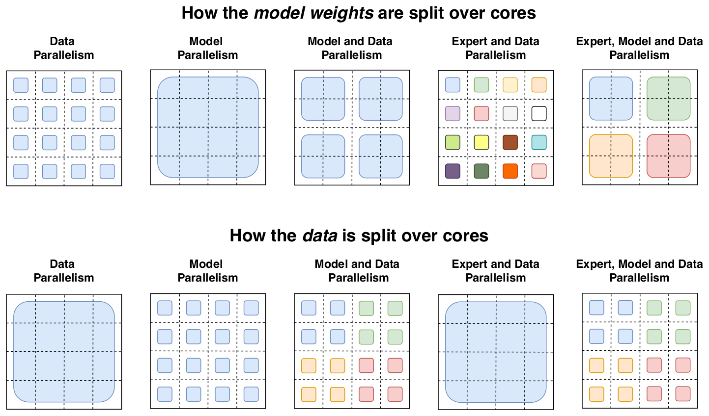

*图 9（原文 Figure 9，第 20 页）：数据与权重的划分策略。每个 4×4 的虚线网格代表 16 个 core，带阴影的方块是该 core 上持有的数据（模型权重或 token batch）。图中同时画出每种策略下模型权重和数据张量如何切分。第一行：模型权重如何在各 core 上切分；不同大小的形状表示 FFN 层中更大的权重矩阵（如更大的 $d_{ff}$），每种颜色标识一个独有的权重矩阵，每个 core 的参数量固定，但更大的权重矩阵会对每个 token 施加更多计算。第二行：数据 batch 如何在各 core 上切分；每个 core 持有相同数量的 token，使各策略下显存占用固定；不同策略允许各 core 持有相同的 token 或不同的 token，这就是不同颜色的含义。*

**图中文字翻译与读法**：上排标题 How the model weights are split over cores（模型权重如何在 core 上切分），下排 How the data is split over cores（数据如何在 core 上切分）；五列自左向右为 Data Parallelism（数据并行）、Model Parallelism（模型并行）、Model and Data Parallelism（模型加数据并行）、Expert and Data Parallelism（专家加数据并行）、Expert, Model and Data Parallelism（专家、模型加数据并行）。

- **数据并行**：权重行里 16 个 core 每个有一份相同的小权重（同色）；数据行里整块 batch 被切开分给 16 个 core，每个 core 持有不同的 token。
- **模型并行**：权重行里一个大矩阵跨 16 个 core 切开（可以容纳更大的 $d_{ff}$）；数据行里 16 个 core 都持有同一份完整 batch（同色）。
- **模型加数据并行**：权重行里是 4 个同色的大块（4 个数据并行副本，权重相同），每个副本又跨 4 个 core 切开；数据行里分成 4 种颜色，每种颜色占 4 个 core，同一组内的 core 持有相同的 token。
- **专家加数据并行**：权重行里 16 个 core 各持有不同的专家（16 种颜色，各专家独有参数）；数据行里 batch 被完整切开分给所有 core。
- **专家、模型加数据并行**：权重行里 4 个不同颜色的大块（4 个专家），每个专家再跨 4 个 core 做模型并行；数据行里与“模型加数据并行”类似分成 4 组。
- **读图结论**：越往右，权重的“种类”（专家数）与“大小”（模型并行）越多，而每个 core 的参数量与 token 数保持不变；代价是通信变得更复杂（8.3 节）。

### 8.3 通信开销（第 5.1–5.5 节）

- **数据并行**（$n=N$，$m=1$）：这是分布式训练的标准做法。直到整个前向与反向传播结束、需要在所有 core 间汇总梯度之前都不需要通信。
- **模型并行**（$n=1$，$m=N$）：所有 core 必须保留全部 $B$ 个 token，每个 core 持有权重的一个独有切片。每次前向与反向都要有通信：因为 $d_{ff}$ 维被切开且必须求和，每个 core 为计算第二个矩阵乘 $\operatorname{ReLU}(h)W_{out}$ 要发送一个 $[B,d_{model}]$ 的张量。一般规则：只要被切分的某个维度必须求和，前向和反向都要增加一次 all-reduce；这不同于纯数据并行只在整个前向反向结束后做一次 all-reduce。
- **模型加数据并行**（$N=n\times m$）：这是大规模模型常用的混合方式，用在最大的 T5 模型（Raffel 等人 2019；Xue 等人 2020）和 GPT-3（Brown 等人 2020）中。每个 core 负责 $B/n$ 个 token 以及权重和中间激活里 $d_{ff}/m$ 的部分；前向和反向中每个 core 在 all-reduce 里通信大小为 $[B/n,d_{model}]$ 的张量。
- **专家加数据并行**：Switch Transformer 把所有 core 分配给数据切分维度 $n$，它同时等于模型的专家数（每个 core 一个专家）。每个 core 上的每个 token，路由器在本地计算专家分配，输出是一个大小为 $[n,B/n,E,C]$ 的二值矩阵，沿第一维切分，决定专家分配。再用它与输入张量 $[n,B/n,d_{model}]$ 做一次矩阵乘形式的聚集（gather），即式 7：$\operatorname{einsum}([n,B/n,d_{model}],\,[n,B/n,E,C],\,\text{dimension}=[B/n])$，结果是形状为 $[n,E,C,d_{model}]$、沿第一维切分的张量。因为每个 core 有自己的专家，要做一次大小为 $[E,C,d_{model}]$ 的 all-to-all 通信，把切分的维度从 $n$ 换成 $E$。前向传播中还要有额外的通信成本来接收来自不同 core 上各专家的 token（bfloat16 张量，大小 $E\times C\times d_{model}$）。
- **专家、模型加数据并行**：设计最佳模型时，要在每个 token 的 FLOPs 与参数量之间平衡。增加专家数会增加参数而不改变每个 token 的 FLOPs；要增加 FLOPs 必须增大 $d_{ff}$（同样增加参数，但速度较慢）。这带来取舍：增大 $d_{ff}$ 会使每个 core 的显存耗尽，从而必须增大 $m$；而 core 总数固定且 $N=n\times m$，只能减小 $n$，这迫使使用更小的 batch（为了保持每个 core 的 token 数不变）。同时结合模型并行与专家并行时，既有把 token 路由到正确专家的 all-to-all 通信，也有模型并行内部的 all-reduce 通信。在三种方法组合时，平衡 FLOPs、通信成本与每 core 显存相当复杂，最佳映射要靠经验确定。

### 8.4 迈向万亿参数（表 9）

组合专家、模型和数据并行，论文设计了两个大型 Switch Transformer：分别有 3950 亿参数与 1.6 万亿参数，研究它们作为语言模型在上游预训练以及下游微调的表现。表 9 列出两个模型与对比模型的参数、每序列 FLOPs 与超参数；$FFN_{GEGLU}$ 指 FFN 层的一种变体：扩展矩阵被换成两组权重，再非线性组合（Shazeer 2020）。

**Switch-C** 只用专家并行、不用模型并行（论文第 5.4 节，即上文“专家加数据并行”），所以控制宽度、深度、head 数等的超参数都比 T5-XXL 小得多。**Switch-XXL** 与 T5-XXL FLOPs 对齐，因此可以使用更大的超参数，代价是模型并行带来的额外通信。

表 9（上）设置：模型的规模与超参数。✓ 表示使用 $FFN_{GEGLU}$，Switch-C 一栏在原文为空。

| 模型 | 参数量 | FLOPs/seq | $d_{model}$ | $FFN_{GEGLU}$ | $d_{ff}$ | $d_{kv}$ | head 数 |
|---|---:|---:|---:|:---:|---:|---:|---:|
| T5-Base | 0.2B | 124B | 768 | ✓ | 2048 | 64 | 12 |
| T5-Large | 0.7B | 425B | 1024 | ✓ | 2816 | 64 | 16 |
| T5-XXL | 11B | 6.3T | 4096 | ✓ | 10240 | 64 | 64 |
| Switch-Base | 7B | 124B | 768 | ✓ | 2048 | 64 | 12 |
| Switch-Large | 26B | 425B | 1024 | ✓ | 2816 | 64 | 16 |
| Switch-XXL | 395B | 6.3T | 4096 | ✓ | 10240 | 64 | 64 |
| Switch-C | 1571B | 890B | 2080 | — | 6144 | 64 | 32 |

表 9（下）设置：结构配置与在 C4 上预训练 250k 与 500k 步后的负对数困惑度（越大越好）。**注意：原文这张表的两个列名写反了**：列名写作“Num. Experts”的那一列，T5 行也有数字（12、24、24），显然是层数，而标作“Num Layers”的那一列才是专家数（128、128、64、2048，与正文“Switch-C 有 2048 个专家”、表 1“128 个专家”一致）。下表按内容改正列名。

| 模型 | 专家频率（Expert Freq.） | 层数 | 专家数 | 负对数困惑度 @250k | 负对数困惑度 @500k |
|---|---:|---:|---:|---:|---:|
| T5-Base | — | 12 | — | -1.599 | -1.556 |
| T5-Large | — | 24 | — | -1.402 | -1.350 |
| T5-XXL | — | 24 | — | -1.147 | -1.095 |
| Switch-Base | 1/2 | 12 | 128 | -1.370 | -1.306 |
| Switch-Large | 1/2 | 24 | 128 | -1.248 | -1.177 |
| Switch-XXL | 1/2 | 24 | 64 | **-1.086** | **-1.008** |
| Switch-C | 1 | 15 | 2048 | -1.096 | -1.043 |

（原文表 9，第 22 页。专家频率 1/2 表示每隔一层 FFN 放一个专家层，1 表示每层都放。）原文的说明：Switch-C 在同样算力预算下达到固定困惑度的速度是 T5-XXL 的 4 倍，且随训练推进差距增大。

**对 T5-XXL 的样本效率**：250k 步时，两个 Switch 变体的负对数困惑度都高于 T5-XXL。论文写“by over 0.061”；核对表中数字：Switch-XXL 为 -1.086 对 -1.147，高 0.061，而 Switch-C 为 -1.096 对 -1.147，高 0.051，所以“超过 0.061”只对 Switch-XXL 成立（笔者核对）。为了说明 0.061 的意义：T5-XXL 要再训练 250k 步才能提升 0.052（-1.147 到 -1.095）。差距随训练继续增大：到 500k 步，Switch-XXL 比 T5-XXL 高 0.087（-1.008 对 -1.095）。脚注 10：这个差距是下界，实际可能更大，因为 T5-XXL 是在更容易的 C4（包含样本内部重复、易于复制的片段）上预训练的。关于“4 倍”：表中可以核对的是 Switch-C 在 250k 步（-1.096）与 T5-XXL 在 500k 步（-1.095）质量相当，即步数减半；“4 倍”的墙钟倍数并不能由该表直接算出，是论文的结论性说法。

**训练不稳定**：大型稀疏模型可能不稳定，随着规模增大会遇到零星问题。1.6T 参数、2048 个专家的更大模型 Switch-C 完全没有出现训练不稳定；反而是每序列 FLOPs 大近 10 倍的 Switch-XXL 有时不稳定（按表 9，$6.3\text{T}/890\text{B}\approx7.1$ 倍，原文写“nearly 10x”，笔者注）。因此，尽管它在步数口径下是更好的模型，论文没有把它预训练到 1M 步，与 T5 的最终结果（Raffel 等人 2019）一致。

**推理类微调表现**：用一个只预训练了 503B token（约为 T5-XXL 所用文本的一半）的 Switch-XXL 检查点做多任务训练（所有任务联合学习，而非各自微调）：SQuAD 验证集准确率提高到 89.7，对比此前最好的 91.3；SuperGLUE 平均测试分数 87.5，对比 T5 版本 89.3、此前最好 90.0（Wang 等人 2019）；ANLI 上 Switch-XXL 超过此前最好的 49.4，达到 65.7。论文注意到：Switch-XXL 虽然在上游预训练任务上有最先进的负对数困惑度，增益还没有完全转化为下游 SOTA（附录 E，见本文 9.5）。

**知识类微调表现**：三个闭卷知识任务 Natural Questions、WebQuestions、TriviaQA，没有用 Salient Span Masking 额外预训练（Guu 等人 2020）：三项都超过此前最好的 T5-XXL（无 SSM）：Natural Questions 精确匹配 34.4（此前 32.8）、Web Questions 41.0（此前 37.2）、TriviaQA 47.5（此前 42.9）。

总结（论文）：尽管只用了其他模型不到一半的数据训练，质量已经相当，有时是最先进的；目前 Switch Transformer 把上游增益转化到知识类任务比推理类任务更好。

## 九、附录实验

### 9.1 Switch 用在注意力层（附录 A，图 10、表 10）

Shazeer 等人（2018）与 Lepikhin 等人（2020）把 MoE 层放进 Transformer 的稠密 FFN。论文简短探索另一种设计：把 Switch 层放进 Self-Attention 层，即把产生查询、键、值的可训练权重矩阵换成 Switch 层。

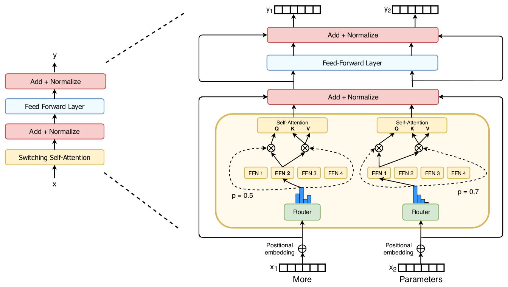

*图 10（原文 Figure 10，第 27 页）：注意力里的 Switch 层。图示如何把 Switch 层并入 Self-Attention Transformer 块。对每个 token（这里画出两个 token，$x_1=$“More”，$x_2=$“Parameters”），一组权重产生查询，另一组独有权重产生共享的键和值。论文试过每个专家是线性运算，以及像全文那样是 FFN；虽然发现质量有改进，但在低精度数字格式下更不稳定，因此留作未来工作。*

**图中文字翻译与读法**：左侧块自下而上：输入 $x$、Switching Self-Attention（Switch 自注意力）、Add + Normalize、Feed Forward Layer（普通前馈层）、Add + Normalize、输出 $y$。右侧放大：路由器（Router）为每个 token 选一个专家（FFN 1–4 里的一个，粗体），选中专家的输出乘以概率（图中 $p=0.5$、$p=0.7$），结果送入 Self-Attention 的 Q、K、V，也就是用专家来产生 Q、K、V。

表 10 设置：所有模型 32 个专家，每个 batch 524k 个 token。Experts FF 是专家替换 FFN（本文标准设置）；Experts FF + Attention 是专家同时替换 FFN 和 Self-Attention。“@16H”为训练 16 小时后的质量。

| 模型 | 精度 | 100k 步质量（↑） | 16 小时质量（↑） | 速度（ex/sec，↑） |
|---|---|---:|---:|---:|
| Experts FF | float32 | -1.548 | -1.614 | 1480 |
| Expert Attention | float32 | -1.524 | **-1.606** | 1330 |
| Expert Attention | bfloat16 | [diverges] | [diverges] | — |
| Experts FF + Attention | float32 | **-1.513** | -1.607 | 1240 |
| Expert FF + Attention | bfloat16 | [diverges] | [diverges] | — |

（原文表 10，第 27 页。）读法：用 float32 时，把专家放到注意力里确有改善（-1.524、-1.513 优于 -1.548），但速度下降；用 bfloat16 时，含专家注意力的模型都发散。所以论文没有把它放进最终方案。

### 9.2 防止丢 token：No-Token-Left-Behind（附录 B，图 11）

由于 TPU 的软件限制，张量形状必须静态确定，每个专家的容量有限且固定。当送到某专家的 token 少于容量，可以简单填充（低效但数学上正确）；当多于容量（专家溢出）则需要协议处理。Lepikhin 等人（2020）通过残差连接把溢出 token 的表示直接传给下一层而不经处理，论文也如此。

论文怀疑完全不对 token 计算很浪费，尤其是某个专家溢出时必有别的专家有空余容量。于是提出 No-Token-Left-Behind：迭代地重新路由那些最初被路由到溢出专家的 token，几乎可以保证训练与推理中没有 token 被丢弃。论文假设这可以提升性能并进一步稳定训练，但**没有发现经验上的收益**。论文猜测：一旦网络学会了不同 token 与专家的关联，若把这种关联改变（例如把 token 发给它的第二高概率专家），性能反而可能下降。

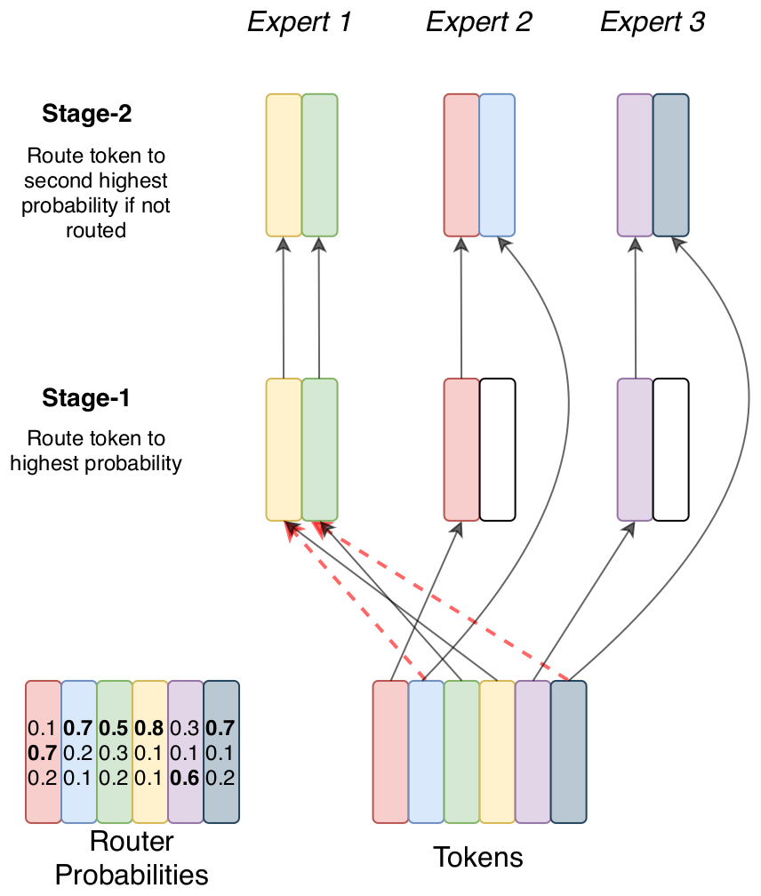

*图 11（原文 Figure 11，第 28 页）：No-Token-Left-Behind 路由示意。阶段 1 等价于 Switch 路由，token 被路由到路由器给出概率最高的专家；阶段 2 检查所有溢出的 token，把它们路由到概率第二高的专家。如果第二高的专家也有太多 token，token 仍可能溢出，但这能让绝大多数 token 被路由。该过程可以迭代，保证几乎没有 token 被丢弃。*

**图中文字翻译与读法**：图下方左侧 Router Probabilities（路由器概率）是 3 行 6 列的数表（3 个专家 × 6 个 token，列对应右侧 6 个彩色 token）：

| 专家 | 红 | 蓝 | 绿 | 黄 | 紫 | 灰蓝 |
|---|---:|---:|---:|---:|---:|---:|
| Expert 1 | 0.1 | **0.7** | **0.5** | **0.8** | 0.3 | **0.7** |
| Expert 2 | **0.7** | 0.2 | 0.3 | 0.1 | 0.1 | 0.1 |
| Expert 3 | 0.2 | 0.1 | 0.2 | 0.1 | **0.6** | 0.2 |

（笔者据图整理的数表，粗体为每个 token 的最大概率。）阶段 1（Stage-1，Route token to highest probability）：红 token 去专家 2，紫 token 去专家 3，蓝、绿、黄、灰蓝 4 个 token 都想去专家 1，但专家 1 只有 2 个槽位，图中放进了黄、绿，另外两个（蓝、灰蓝）溢出，用红色虚线标出。阶段 2（Stage-2，Route token to second highest probability if not routed）：溢出的蓝 token 第二高概率是专家 2（0.2），被放进专家 2 的空槽；灰蓝 token 第二高概率是专家 3（0.2），被放进专家 3 的空槽，于是所有 6 个 token 都被处理。图中哪些 token 保留在专家 1 里只是示意，论文没有说明保留规则。

### 9.3 鼓励探索：路由噪声（附录 C，表 11）

每个专家层里路由器决定把 token 送到哪个专家。这是在可选专家上的离散决策，条件是 token 表示的信息；路由器只知道选了这个专家的结果，得不到“如果选了别的专家会怎样”的反事实信息。如同强化学习，出现经典的探索与利用的困境；这个设定最接近上下文多臂老虎机（contextual bandit）。确定性地选最高概率专家总是纯粹的利用，所以论文考虑平衡探索。

论文比较四种方式：（1）确定性 argmax；（2）从 softmax 分布采样；（3）对传入表示做输入 dropout；（4）对传入表示加乘性抖动噪声（multiplicative jitter noise）。

| 模型（探索方式） | 质量（负对数困惑度，↑） |
|---|---:|
| Argmax | -1.471 |
| Sample softmax | -1.570 |
| Input dropout | -1.480 |
| Input jitter | **-1.468** |

（原文表 11，第 29 页。）读法：输入抖动最好（-1.468），按分布采样明显更差（-1.570），确定性 argmax 已经很强；不同方式之间没有实质性的速度差异。全文使用输入抖动。注意：原文表注写“(lower is better)”，与表头的 ↑ 以及“-1.468 最好”相矛盾，应以越大越好为准（笔者注）。伪代码里这行写作 `router_logits += uniform(1-eps, 1+eps)`（加法），而正文称乘性抖动，原文不一致；按正文意图应理解为乘以 $[1-\epsilon,1+\epsilon]$ 区间内的均匀随机数。

### 9.4 低算力体制：只有很少专家也有收益（附录 D，图 12）

Switch Transformer 在小规模下同样有效。此前许多实验是 10B+ 参数级别，但图 12 显示，只有 2 个专家就比 FLOPs 对齐的对照有明显收益。即使没有超级计算机，训练 2、4、8 个专家的 Switch Transformer（论文通常建议每个核一个专家）也能比 T5 稠密基线有稳固改进。

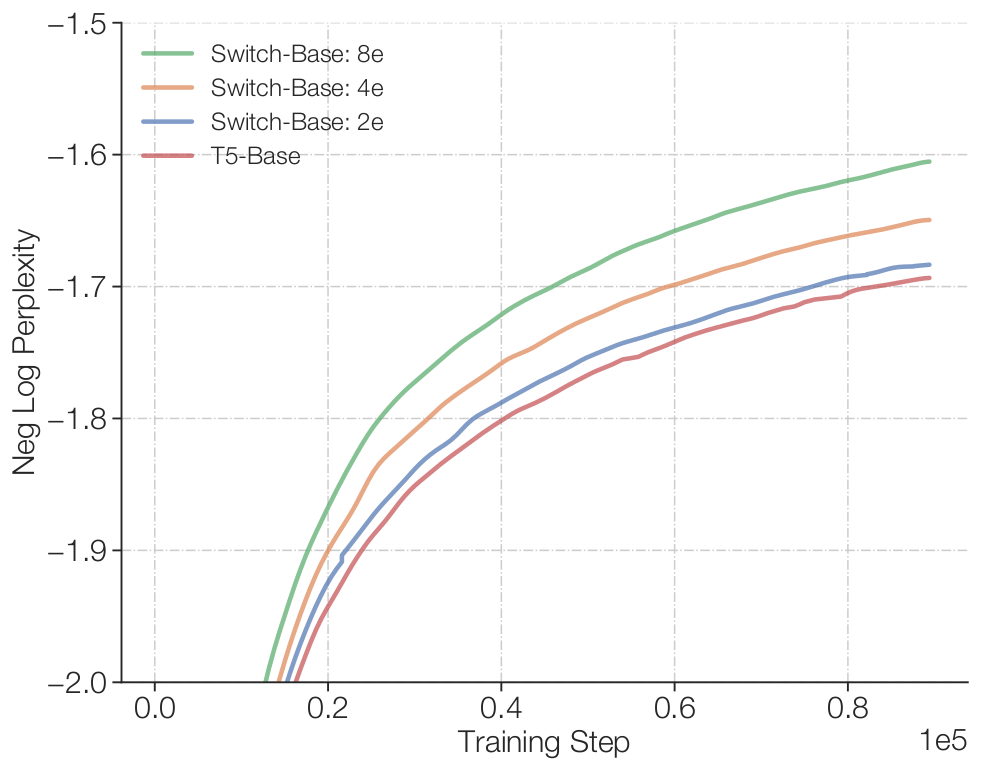

*图 12（原文 Figure 12，第 30 页）：专家很少的 Switch Transformer。Switch Transformer 即使只有很少的专家也优于基线。图中显示非常小规模下的扩展性质：用 2、4、8 个专家就能超过 T5-Base。*

**图中文字翻译与读法**：横轴 Training Step（单位 $10^{5}$，到约 $0.9\times10^{5}$ 步），纵轴 Neg Log Perplexity（-2.0 到 -1.5）。图例：Switch-Base: 8e（绿）、4e（橙）、2e（蓝）、T5-Base（红）。**读图结论**：专家越多越靠上，8e 最好；2e 也始终高于 T5-Base，但幅度很小（$0.9\times10^{5}$ 步处约 0.01，图上读出）。

### 9.5 上游预训练质量与下游质量（附录 E，图 13）

预训练目标上的质量并不保证转化为下游结果。图 13 用 C4 预训练任务的负对数困惑度与两个下游指标（SuperGLUE 平均分、TriviaQA 分数）做相关；这两个任务一个考察推理，另一个考察事实知识。

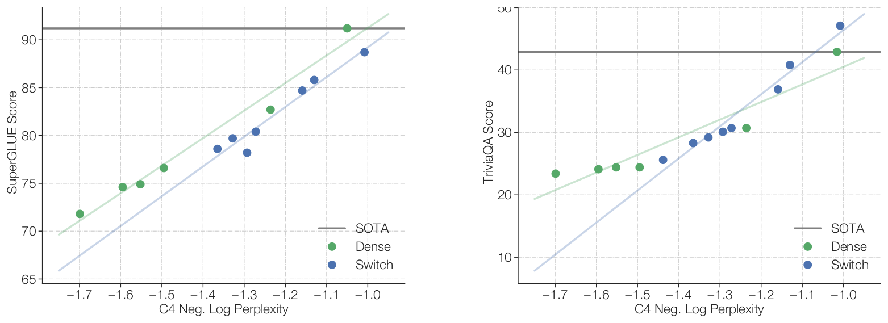

*图 13（原文 Figure 13，第 31 页）：上游预训练质量与下游模型质量。把上游表现与 SuperGLUE（推理）和 TriviaQA（知识，SOTA 为无 SSM 的记录）的下游质量关联起来（验证集）。与基线一样，Switch 模型随上游预训练任务改善而扩展。SuperGLUE 上，负对数困惑度与平均 SuperGLUE 分数大致呈线性关系，但在固定困惑度下稠密模型往往更好，尤其在大规模体制；相反，在知识密集的 TriviaQA 上，Switch Transformer 可能遵循更好的扩展关系：给定上游困惑度，它比稠密对应模型做得更好。需要更多统计（收集成本高，留待未来）来确认这些观察。*

**图中文字翻译与读法**：横轴 C4 Neg. Log Perplexity（C4 负对数困惑度，约 -1.7 到 -1.0），纵轴 SuperGLUE Score（左图，约 65–92）与 TriviaQA Score（右图，约 10–50）。绿点 Dense（稠密）、蓝点 Switch，水平灰线 SOTA；浅色斜线是对两类点各自的线性拟合。**读图结论**：两类模型都随上游质量提高而下游变好（正相关）。左图（SuperGLUE）同一上游困惑度下，绿线（稠密）常常高于蓝线（Switch）；右图（TriviaQA）则相反，蓝线在高质量端比绿线更陡且更高。论文强调这只是初步观察。

论文的结论：对基线和 Switch 模型都存在一致相关，预训练越好，下游越好；固定上游困惑度时，小到中等规模下 Switch 与稠密表现相近；但在最大体制（T5-11B/T5-XXL 量级），最大的 Switch 模型不总是把上游困惑度很好地转化为 SuperGLUE 微调表现，这需要未来研究。理解专家模型的微调动态很复杂，取决于正则化、负载均衡和微调超参数。

## 十、讨论与未来工作（第 6–8 节）

**相关工作要点**：规模的重要性已广泛公认，已有方法包括模型并行、流水线并行（Harlap 等人 2018；Huang 等人 2019）、Product Key 网络（Lample 等人 2019）。条件计算方面：Cho 与 Bengio（2014）按隐状态的比特模式自适应选择权重；Eigen 等人（2013）堆叠专家层；Puigcerver 等人（2020）在视觉里按语义类别手动路由。现代深度学习里的 MoE 由 Shazeer 等人（2017）证明有效，经 Mesh TensorFlow（2018）放进 Transformer，GShard（Lepikhin 等人 2020）借助 XLA 把 MoE Transformer 用于 100 种语言的翻译。序列长度上的注意力稀疏技术与本文稀疏（权重稀疏）互补，本文版本不含注意力稀疏。

**论文自问自答（第 7 节）**：

- “Switch 更好是因为参数多吗？”是的，而且是设计使然：参数独立于总 FLOPs，是扩展语言模型的有用维度；同时它在相同计算资源下样本效率更高、更快。
- “我没有超算，还有用吗？”只有 2 个专家就有提升，且能放进常见 GPU/TPU 显存（附录 D）。
- “稀疏模型在速度-精度 Pareto 曲线上胜过稠密模型吗？”是：在各种模型规模上，按步数和墙钟时间稀疏模型都优于稠密。
- “我无法部署万亿参数模型，能压缩吗？”无法完全保留质量，但蒸馏成稠密模型可达到 10 到 100 倍压缩，同时保留专家模型约 30% 的质量增益。
- “为什么不用模型并行的稠密模型？”按时间看 Switch 可以比参数分片的稠密模型高效得多（图 6）；而且二者不互斥，Switch 里也可以用模型并行，代价是增加 FLOPs 并承受传统模型并行的减速。
- “稀疏模型为什么还没有被广泛使用？”稠密模型扩展的巨大成功（部分源自与深度学习硬件的协同适应，Hooker 2020）；稀疏模型自身还有复杂性、训练困难、通信成本三个问题，Switch 试图缓解。

**未来工作（第 8 节，论文列出 6 条）**：（1）进一步提升最大模型的训练稳定性：稳定性技术对 Switch-Base、Switch-Large、Switch-C 有效（未观察到不稳定），但对 Switch-XXL 还不够，论文已初步尝试用正则项和改造的梯度裁剪，仍未解决；（2）上游预训练质量通常带来更好的下游，但有显著异常：困惑度相近时，1.6T 的 Switch-C 在 SQuAD 上只有 87.7 的精确匹配，而小得多的 Switch-XXL 为 89.6（论文第 5.6 节写作 89.7，原文两处有细微不一致），原因是后者每 token 的 FLOPs 约是前者的 10 倍而独有参数约少 4 倍（395B 对 1.6T），说明微调质量、每 token FLOPs 与参数数量之间的依赖关系还很不清楚；（3）系统研究扩展关系，指导结合数据、模型与专家并行的架构设计，反过来也可能指导硬件设计；（4）异构专家：路由到更大的专家以便给更难的样本更多计算；（5）在 FFN 之外使用专家层（附录 A 的初步证据）；（6）其他模态与多模态网络。

## 十一、局限、证据边界与常见误读

### 11.1 局限与证据边界

1. **“加速”有多种口径，不能混用**：约 7.5 倍是按训练步数（Switch-Base 64e，图 4/图 6 左）；7 倍是按墙钟时间相对 T5-Base（图 5）；2.5 倍是按时间相对 T5-Large（图 6 右）；4 倍是 Switch-C 相对 T5-XXL 达到固定困惑度（表 9 的说明）；多语言的 5 倍是步数口径的平均加速比（图 8）。摘要里的“最高 7 倍”和“相对 T5-XXL 4 倍”来自不同模型和不同目标。
2. **FLOPs 对齐不等于吞吐相同**：Switch-Base 与 T5-Base FLOPs 相同，但表 1 里吞吐为 1000 对 1600 examples/sec（容量因子 1.0），额外的路由与通信让每步更慢；论文用“同样时间的质量”来证明收益。
3. **top-1 的优势依赖容量因子**：表 1 里容量因子 2.0 时 MoE（top-2）反而略好；Switch 的优势出现在 1.0、1.25。
4. **预训练收益并不总是转化为下游收益**：ARC 上没有改进；Switch-XXL 的上游困惑度是最好的，但下游没有全面超过 SOTA；Switch-C（1.6T）的 SQuAD 反而低于更小的 Switch-XXL。
5. **最大模型仍不稳定**：论文的稳定性技术对 Switch-XXL 还不够，它没有被训练到完整的 1M 步。
6. **蒸馏的收益有限**：只保留约 30% 的质量增益；对更大、更强的教师，需要更大的学生。
7. **多数大规模结果来自 TPU 与特定的 Mesh TensorFlow 映射**：论文也说类似模型可在 GPU 集群上训练，但没有验证。
8. **原文自身的不一致（笔者发现）**：表 1 说明里的 head 数“14 到 16”与表 9 的 12 不符；表 9 下半部分的“Num. Experts”与“Num Layers”两个列名写反；表 6 说明里的“100x”与表内 17 倍不符；表 11 说明“lower is better”与 ↑ 相矛盾；第 3.1 节“7.5×”那句的两个步数写反；第 5.6 节“两个 Switch 变体都超过 0.061”只对 Switch-XXL 成立（Switch-C 为 0.051）；第 5.6 节与第 8 节对 Switch-XXL 的 SQuAD 写作 89.7 与 89.6；“nearly 10x”FLOPs 与表 9 的约 7.1 倍不符；图 15 伪代码的 `+=` 与正文“乘性抖动”不符。
9. **本文没有 router z-loss**：路由器的数值稳定靠 float32 路由、小初始化与专家 dropout；z-loss 是后续工作（ST-MoE）才提出的（笔者补充，不属于本文内容）。

### 11.2 常见误读

- **“Top-1 一定比 top-2 好。”** 论文在其规模与设置下展示了 top-1 更简单、更高效、质量有竞争力（表 1）；它不是对所有模型和任务的普遍定理，容量因子 2.0 时 top-2 的 MoE-Base 还略好。
- **“被丢弃的 token 被彻底丢掉。”** 它只是跳过专家的计算，表示仍通过残差连接传给下一层；论文报告丢弃比例通常小于 1%，但这是其设置下的观察，不是保证。
- **“万亿参数等于万亿参数稠密模型的算力。”** 错。Switch-C 有 1571B 参数，但每序列只有 890B FLOPs，只是 Switch-XXL（395B 参数）的约 1/7；存储与通信依然非常昂贵。
- **“选择性精度就是把整个模型用 float32。”** 不是：只有路由函数内部用 float32，其结果转回 bfloat16。
- **“专家 dropout 就是整体提高 dropout。”** 不是：整体提高会变差（表 4），要对专家层内部使用大得多的 dropout（0.4），其余层保持 0.1。

## 十二、复现检查清单

- 报告总参数、每 token 的激活参数与 FLOPs；与稠密基线 FLOPs 对齐时给出表 9 这样的结构表。
- 记录每层的 token 丢弃率、专家负载直方图与辅助损失；固定容量因子、batch 的 token 数与专家并行规模（$E$、$C$、$n$、$m$）。
- 路由器 logits 与 softmax 用 float32，并把 dispatch、combine 张量转回 bfloat16；比较纯 bfloat16、纯 float32 与选择性精度。
- 初始化：截断正态，$\sigma=\sqrt{s/n}$，$s=0.1$；对多个随机种子检查早期训练方差。
- 辅助损失系数 $\alpha=10^{-2}$，并按 $10^{-1}$ 到 $10^{-5}$ 扫描确认；注意 $f_i$ 由 argmax 得到，不回传梯度。
- 伪代码里 `less(position_in_expert, expert_capacity)` 的边界（是否保留第 `expert_capacity` 个 token）取决于 cumsum 是否从 0 开始，复现时要单元测试。
- 区分按步数与按墙钟时间的曲线；报告 all-to-all 与 all-reduce 的时间占比以及专家 GEMM 的形状。
- 微调：非专家层 dropout 0.1，专家层 0.4；报告验证集峰值时注明评估间隔（每 200 步）。

## 十三、与相关论文的关系

- [Sparsely-Gated MoE](../sparsely_gated_moe/论文中文解读.md)：Switch 的出发点。它的噪声 top-$k$ 门控、importance 与 load 两个损失被简化为 top-1 加单一辅助损失。
- [MegaBlocks](../megablocks/论文中文解读.md)：Switch 的固定容量让所有专家 batch 形状相同，便于批量 GEMM，却带来 padding 或丢 token；MegaBlocks 用 block-sparse 内核直接计算动态、负载不均的专家分配，不再丢 token。
- [DeepSeekMoE](../deepseek_moe/论文中文解读.md)：细粒度专家切分与共享专家，进一步提升专家专业化。
- [T5](../t5/论文中文解读.md)：本文的稠密基线与预训练设置来源（C4、span corruption）。
- [知识蒸馏](../knowledge_distillation/论文中文解读.md)：本文用蒸馏把稀疏模型压回稠密模型（表 6–8）。

## 原文证据导航

- [原论文 PDF](paper.pdf)
- [原文提取文本](paper.txt)
- [论文概要](论文概要.md)
