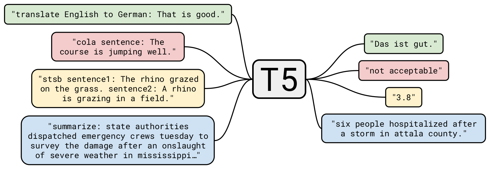
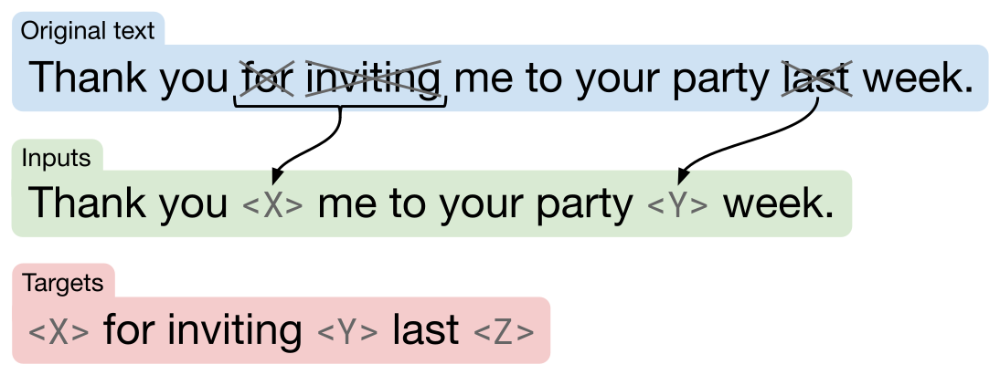
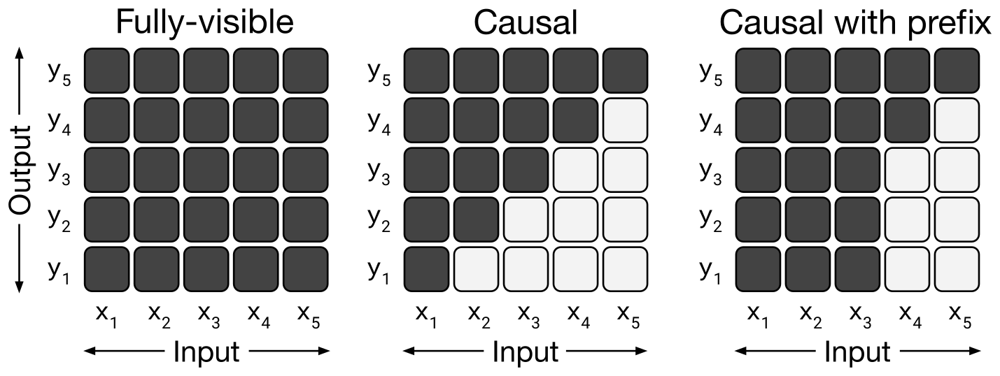
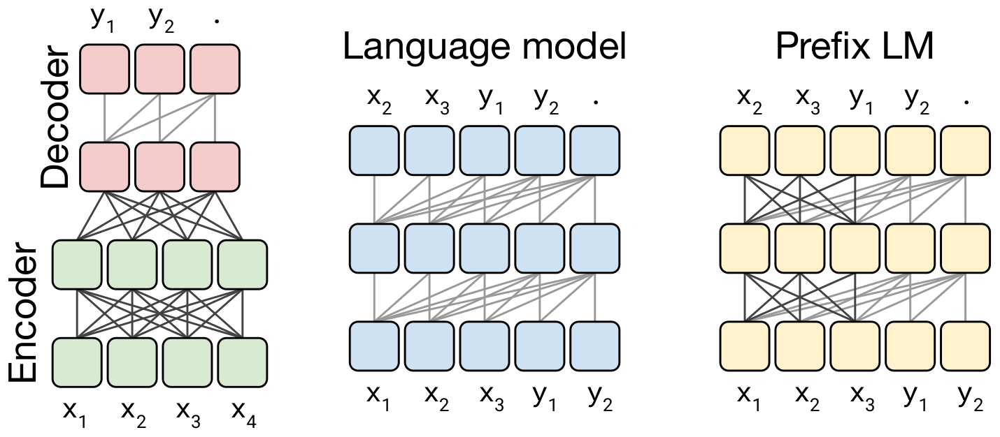
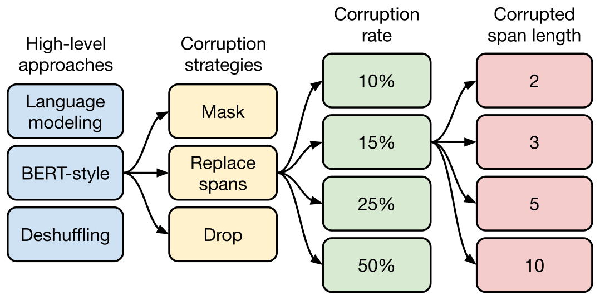
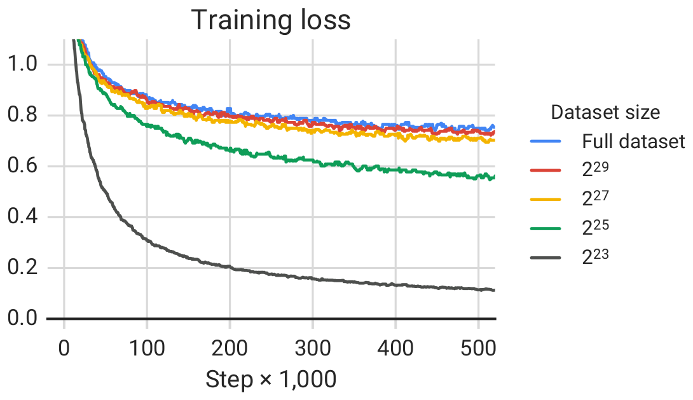

# 论文中文解读：《Exploring the Limits of Transfer Learning with a Unified Text-to-Text Transformer》

> **基本信息**：Colin Raffel、Noam Shazeer、Adam Roberts、Katherine Lee（前四位同等贡献）、Sharan Narang、Michael Matena、Yanqi Zhou、Wei Li、Peter J. Liu（Google，Mountain View），Journal of Machine Learning Research 21 (2020) 1-67，arXiv:1910.10683（本地 PDF 为 v4，2023 年 9 月 19 日）；[官方页面](https://arxiv.org/abs/1910.10683)；代码、C4 数据集和预训练模型：github.com/google-research/text-to-text-transfer-transformer。模型和框架被作者称为 “Text-to-Text Transfer Transformer”，简称 T5（五个 T）。
>
> **本文的读法**：图取自论文原文 PDF，表为逐格核对后的中文转录（数字与原文一致；原文用粗体标出“与该列最佳值相差不超过两个标准差”的分数，转录时保留；模型名、数据集名保持英文，表头译为中文）。这篇论文有 67 页，大量表格是逐任务、逐配置的完整结果：正文中的表 1 到表 15 本文全部转录；附录的超大表 16 只摘录基线行并用文字概括。每张图、表后有读法和结论。凡标注“推算”“推断”“本文的判断”的内容是本文自己的整理，不是原文数字或原话。

## 一、一句话结论

这篇论文**不是提出一个新模型**，而是一次迁移学习的**系统性实验综述**：作者把所有文本任务都改写成“输入一段文本，输出一段文本”的统一格式（text-to-text），这样同一个模型、同一个损失、同一套超参数和解码方式就能用于翻译、问答、摘要和分类，也就能在**同一个平台**上公平比较预训练目标、模型架构、无标注数据集、迁移方式和规模等因素。

做法：先定一个合理的基线（220M 参数的编码器-解码器 Transformer，在新构造的 C4 语料上预训练），然后**每次只改动一个因素**（“坐标上升”式）。主要结论：编码器-解码器加去噪目标最好；各种去噪目标差别不大，应选目标序列短的（因此最终用 span corruption）；有清洗的 C4 比未清洗的好，在小的同领域数据上预训练能提升对应任务，但数据太小被反复重复会损害效果；全参数微调优于只更新少量参数的方法；多任务训练不如“预训练再微调”；加大计算量时，增大模型、延长训练、增大批大小、集成都有效且互补。把这些结论与规模（最大 110 亿参数、约 1 万亿 token 预训练）结合，T5 在论文所考察的 24 个任务里的 18 个上刷新当时最好成绩，GLUE 90.3、SuperGLUE 88.9（人类 89.8），但在 WMT 翻译上没有达到最好水平。

## 二、背景与动机

迁移学习（先在数据丰富的任务上预训练，再在下游任务上微调）已经成为 NLP 的强大技术。在计算机视觉里，预训练通常是在 ImageNet 这样的大型标注集上做有监督学习；NLP 里的现代做法则多是在无标注文本上做无监督预训练，因为互联网上的无标注文本取之不尽（例如 Common Crawl 每月产出约 20 TB 从网页抽取的文本），并且神经网络有很好的可扩展性：更大的模型加更大的数据往往直接带来更好的效果。

这种结合催生了大量工作：各式预训练目标、无标注数据集、基准、微调方法。进展太快、技术太多样，使得**很难比较不同算法、分清各项新贡献的作用、也看不清已有方法的全貌**。论文的出发点就是用一个统一的方法来系统地研究，并把当前的极限往前推。

作者明确说：**目标不是提出新方法，而是给出这个领域所处位置的全面视角**，工作主要由对已有技术的调研、探索和实证比较组成；同时通过把结论放大到最多 110 亿参数的模型来探索极限，为此构造了 “Colossal Clean Crawled Corpus”（C4）：数百 GB 的干净英文网页文本。论文还发布了代码、数据集和预训练模型。

原文的结构：第 2 节介绍基础模型、把一切问题表述成 text-to-text 的方法、任务集；第 3 节是大规模实验（3.1 基线，3.2 架构，3.3 无监督目标，3.4 预训练数据集，3.5 迁移与训练策略，3.6 规模，3.7 综合所有结论的最终实验）；第 4 节总结与展望。下文凡写“原文第 X 节”都指论文自己的章节号，本文自己的小节号不带“原文”二字。

## 三、Text-to-text 框架

### 3.1 统一的输入输出格式

为了用单个模型处理各种任务，所有任务都转成 “text-to-text”：模型读入一段文本作为上下文或条件，然后产生输出文本。这样预训练和微调有**一致的训练目标**：无论什么任务，都用最大似然训练（teacher forcing：训练时给解码器输入的是真实的前一个目标 token，而不是模型自己的预测）。要告诉模型做哪个任务，就在输入前加一个**任务专用的文本前缀**。



*图 1（原文 Figure 1，第 3 页）：text-to-text 框架示意图。论文考察的每个任务，包括翻译、问答和分类，都被表述成“把文本喂给模型，训练它生成某段目标文本”。这使得所有任务可以使用同一个模型、损失函数、超参数等，也为论文的实证调研提供了标准试验台。“T5” 指本文的模型。*

**图中文字翻译与读法**：中间的 T5 是同一个模型，左侧四个框是输入，右侧四个框是对应输出，四种颜色对应四类任务：

- 绿色（翻译）：输入 `translate English to German: That is good.`，输出 `Das ist gut.`；
- 红色（分类，CoLA 语法可接受性）：输入 `cola sentence: The course is jumping well.`，输出 `not acceptable`（不可接受）；
- 黄色（回归，STS-B 语义相似度）：输入 `stsb sentence1: The rhino grazed on the grass. sentence2: A rhino is grazing in a field.`，输出 `3.8`（把数字当作文本输出）；
- 蓝色（摘要）：输入 `summarize: state authorities dispatched emergency crews tuesday to survey the damage after an onslaught of severe weather in mississippi…`，输出 `six people hospitalized after a storm in attala county.`
- **读图结论**：不同类型的任务（生成、分类、回归）在接口上完全一样，差别只在前缀和字段名。

具体处理方式：

- **分类**：模型只需预测一个对应标签的词。例如 MNLI（判断前提是否蕴含、矛盾或中立于假设）的输入变成 `mnli premise: I hate pigeons. hypothesis: My feelings towards pigeons are filled with animosity.`，目标词是 `entailment`。如果模型输出了不属于任何合法标签的文本（比如 `hamburger`），就一律算错，不过作者从未在训练好的模型上观察到这种情况；
- **前缀只是超参数**：改变前缀的具体措辞影响有限，作者没有做大量前缀选择实验；
- **STS-B（回归，相似度 1 到 5 分）**：发现大多数分数以 0.2 为步长标注，所以把分数四舍五入到最近的 0.2 的倍数，再转成数字字符串（浮点数 2.57 变成 `2.6`）。测试时，如果模型输出的字符串对应 1 到 5 之间的数，就转回浮点数，否则按预测错误处理。这等于把回归问题改写成了 21 类分类；
- **Winograd 类任务（WNLI、WSC、DPR）**：这类样本是一段含有指代不明代词的文字，要判断代词指哪个名词短语。做法是在文中把歧义代词用星号标出，要求模型输出它指代的名词。例如 “The city councilmen refused the demonstrators a permit because they feared violence.” 变成输入 `The city councilmen refused the demonstrators a permit because *they* feared violence.`，目标文本是 `The city councilmen`；
- **WSC**：样本包含段落、歧义代词、候选名词和 True/False 标签。训练时只用标签为 True 的样本（False 样本不知道正确名词）；评测时，如果模型输出的词是候选名词短语中词的子集（或反过来）就判为 True，否则为 False。这去掉了约一半的 WSC 训练集，但加入的 DPR 数据集补充了约 1,000 个已标注正确指代名词的样本；
- **WNLI**：它的训练集和验证集与 WSC 训练集有显著重叠，而且验证样本是训练样本的微小改动并带有相反标签（对抗性）。所以**从不在 WNLI 上训练，也不报告 WNLI 验证集结果**；在验证集上报告 GLUE 平均分时不含 WNLI（只有原文第 3.7 节的测试集结果才包含）。WNLI 测试集的转换方式见附录 B：在含歧义代词的句子（前提）里找出代词；在另一句（假设）里找与代词前后词相匹配的最长子串；用星号标出代词；候选名词取假设去掉匹配子串后剩下的名词短语（必要时去掉所有格）；最后用在 WSC 和 DPR 上训练的模型来评测。附录 B 的文字里对哪句是“前提”、哪句是“假设”的指派与它自己的示例并不一致，这里只概括做法。

### 3.2 与已有统一框架的区别

- McCann 等人（decaNLP）把十个任务统一成问答格式，并要求模型是多任务的（同时处理所有任务）；T5 允许对每个任务单独微调，并用简短前缀而不是显式的问答格式；
- Radford 等人（GPT-2）研究语言模型的零样本能力：把输入作为前缀喂进去再自回归采样输出，例如摘要是在文档后加 `TL;DR:`。T5 主要研究先用编码器处理输入、再由独立解码器生成输出的模型，并关注**迁移学习**而不是零样本；
- Keskar 等人把很多任务统一成“跨度抽取”：把候选输出文本拼到输入后，让模型抽取对应的输入片段；T5 的框架还能处理无法穷举所有可能输出的生成任务（翻译、摘要）。

### 3.3 各任务的预处理格式（原文附录 D）

下表整理自附录 D 各任务的预处理例子（原输入经预处理变成带前缀的输入，数字标签变成文字标签）：

| 任务 | 处理后的输入格式 | 目标（附录里的例子） |
|---|---|---|
| CoLA | `cola sentence: ...` | `acceptable`（标签 1；图 1 里不可接受的是 `not acceptable`） |
| RTE | `rte sentence1: ... sentence2: ...` | `not_entailment` |
| MNLI | `mnli hypothesis: ... premise: ...` | `contradiction` |
| MRPC | `mrpc sentence1: ... sentence2: ...` | `equivalent` |
| QNLI | `qnli question: ... sentence: ...` | `entailment` |
| QQP | `qqp question1: ... question2: ...` | `not_duplicate` |
| SST-2 | `sst2 sentence: ...` | `positive` |
| STS-B | `stsb sentence1: ... sentence2: ...` | `3.2`（原分数 3.25，取整到 0.2 的倍数） |
| CB | `cb hypothesis: ... premise: ...` | `contradiction` |
| COPA | `copa choice1: ... choice2: ... premise: ... question: effect` | `True`（附录原样如此） |
| MultiRC | `multirc question: ... answer: ... paragraph: ...` | `True` |
| WiC | `wic pos: N sentence1: ... sentence2: ... word: deliberation` | `False` |
| WSC 与 DPR | `wsc: ...带 *代词* 的文本...` | `stable`（指代的名词） |
| CNN/Daily Mail | `summarize: ...文章...` | 摘要文本 |
| SQuAD | `question: ... context: ...` | `carbon monoxide`（答案文本） |
| WMT 英译德、英译法、英译罗 | `translate English to German: ...`（或 French、Romanian） | 目标语言译文 |

## 四、模型

所有被研究的模型都基于 Transformer（Vaswani 等 2017）。除了下面提到的细节以及原文第 3.2 节要探索的变体外，论文没有明显偏离原始结构。

**编码器-解码器 Transformer 的实现**：

1. 输入 token 序列先映射成嵌入序列，送入编码器；
2. 编码器由若干“块”堆成，每块包含两个子组件：自注意力层，后接一个小的前馈网络；
3. **LayerNorm 作用在每个子组件的输入上**，用简化版本：只对激活做缩放，**不加偏置**；归一化之后，残差连接把子组件的输入加到其输出上；
4. Dropout 用在前馈网络内部、残差连接上、注意力权重上，以及整个堆栈的输入和输出处；
5. 解码器结构与编码器类似，但在每个自注意力层后加一个标准注意力机制去关注编码器输出；解码器里的自注意力是自回归的（因果）的，只允许看到过去的输出；
6. 最终解码器块的输出送入一个带 softmax 的稠密层，其权重与输入嵌入矩阵**共享**；
7. 所有注意力机制被拆成独立的“头”，输出再拼接。

**位置编码**：自注意力对顺序不敏感，需要显式的位置信号。原始 Transformer 用正弦位置信号或学习的位置嵌入，近来更常用相对位置嵌入（Shaw 等 2018）：不是给每个绝对位置一个固定嵌入，而是根据自注意力中“键”与“查询”的偏移量给出不同的学习嵌入。本文用一个**简化形式：每个“嵌入”只是一个标量，加到计算注意力权重的对应 logit 上**。为了效率，**位置嵌入参数在所有层之间共享**，但在每一层内每个注意力头用不同的位置嵌入。所有模型用 **32 个嵌入**，其对应的偏移范围按对数增长，一直到偏移 128，更远的相对位置都用同一个嵌入。因此某一层对超过 128 个 token 的相对位置不敏感，但后续层可以通过组合前面层的局部信息获得对更大偏移的敏感度。

总结：这个模型大致等同于原始 Transformer，区别只有三点：去掉了 LayerNorm 的偏置、把 LayerNorm 放在残差路径之外（即子层输入处，常称 pre-norm）、使用不同的位置嵌入方案。这些架构改动与论文要研究的因素正交，作者把对它们的消融留给了以后。

**训练基础设施**：用模型并行与数据并行相结合，在 Cloud TPU Pod 的“切片”上训练（TPU Pod 是包含 1,024 个 TPU v3 芯片、用高速二维网格互联的多机架超级计算机），使用 Mesh TensorFlow 库实现。

## 五、C4 数据集

以前很多迁移学习工作用大规模无标注数据，而本文关心无标注数据的质量、特性和规模的影响，因此以 Common Crawl 为来源自己构造数据。Common Crawl 是公开的网页存档，提供去掉标记等非文本内容的“网页抽取文本”，每月约 20 TB。但**其中大部分不是自然语言**，而是乱码或模板文本（菜单、错误信息、重复文本），还有大量对下游任务无益的内容（冒犯性语言、占位文字、源代码等）。作者用下面的启发式规则清洗：

1. 只保留以句末标点（句号、感叹号、问号或结束引号）结尾的行；
2. 丢弃少于 3 个句子的页面，并只保留至少含 5 个词的行；
3. 去掉包含 “List of Dirty, Naughty, Obscene or Otherwise Bad Words” 中任何词的页面；
4. 许多页面含有要求开启 Javascript 的警告，所以去掉含 Javascript 一词的行；
5. 有些页面含占位文本 “lorem ipsum”，去掉含该短语的页面；
6. 有些页面无意中含有代码；花括号 `{` 在许多编程语言里常见而自然文本里没有，所以去掉含花括号的页面；
7. 一些页面来自 Wikipedia，带有引用标记（如 `[1]`、`[citation needed]`），去掉这类标记；
8. 许多页面有样板式政策声明，去掉含有 “terms of use”、“privacy policy”、“cookie policy”、“uses cookies”、“use of cookies”、“use cookies” 字符串的行；
9. **去重**：对数据集中出现不止一次的任何三句话片段，只保留其中一次；

此外，因为多数下游任务是英文，用 langdetect 过滤掉没有被判定为英文（概率至少 0.99）的页面。

作者说，这些启发式受以往使用 Common Crawl 的工作启发；之所以另建数据集，是因为以前的数据集用的过滤规则更少、不公开、或者范围不同（只限新闻、只含 Creative Commons 内容、或专用于机器翻译平行语料）。**组装方式**：下载 2019 年 4 月的网页抽取文本并应用上述过滤，得到比多数预训练数据集大几个数量级的集合（约 750 GB，表 8 里写作 745GB），且是相当干净自然的英文文本。该数据集称作 C4，作为 TensorFlow Datasets 的一部分发布。

## 六、下游任务

论文用一组多样的基准来衡量通用语言学习能力：机器翻译、问答、摘要和文本分类。具体是 GLUE 与 SuperGLUE 文本分类元基准，CNN/Daily Mail 抽象式摘要，SQuAD 问答，以及 WMT 英译德、法、罗马尼亚语翻译（所有数据取自 TensorFlow Datasets）。

| 基准 | 包含的任务（按表 14、表 16 的归属） |
|---|---|
| GLUE | CoLA（语法可接受性判断）、SST-2（情感分析）、MRPC、STS-B、QQP（复述/句子相似度）、MNLI、QNLI、RTE（自然语言推断）、WNLI（指代消解，训练和验证都不使用，见第三节） |
| SuperGLUE | BoolQ、MultiRC、ReCoRD（问答）、CB、RTE（自然语言推断）、COPA（句子补全）、WiC（词义消歧）、WSC（指代消解；论文还按 Kocijan 等的建议并入 DPR 数据集） |
| 摘要 | CNN/Daily Mail：最初是问答任务，经 Nallapati 等改成摘要任务；用 See 等的非匿名版本，作为抽象式摘要任务 |
| 问答 | SQuAD：模型读入问题及其上下文，逐 token 生成答案 |
| 翻译 | WMT 英译德：训练数据与 Vaswani 等一致（News Commentary v13、Common Crawl、Europarl v7），newstest2013 作验证集；英译法：2015 年标准训练数据，newstest2014 作验证集；英译罗马尼亚语（标准低资源翻译基准）：WMT 2016 的训练集和验证集 |

微调 GLUE 时，把 GLUE 的所有任务（SuperGLUE 同理）当作一个任务，把各子数据集**拼接**起来。因为只用英文预训练，要学会翻译，模型必须学会生成一种新语言的文本。

## 七、实验设计与基线（原文第 3.1 节）

### 7.1 实验思路

论文用“坐标上升”式的做法：取一个合理的基线，每次只改变一个方面。例如原文第 3.3 节在保持其余流程不变的前提下比较不同的无监督目标。这样可能错过二阶效应（例如某个目标在比基线更大的模型上才最好），但对所有因素做组合探索代价太高。为了让比较可控，作者在某些情况下并没有精确复现已有方法，例如 BERT 这样的 “encoder-only” 模型对每个输入 token 或整个序列做单个预测，不适用于翻译、摘要等生成任务，因此论文中没有任何一种架构与 BERT 完全相同或是只有编码器；而是考察精神相似的做法，如原文第 3.3 节里类似 BERT 的 “掩码语言模型” 目标，和第 3.2 节里在分类任务上行为类似 BERT 的 prefix LM 架构。

### 7.2 基线模型

基线的目标是反映典型的现代实践：用简单的去噪目标预训练一个标准 Transformer，再在每个下游任务上分别微调。

- **模型**：标准编码器-解码器，编码器和解码器各自的大小和配置相当于一个 “BERT_BASE” 的堆栈：各 **12 个块**；前馈网络的内层维度 $d_{\mathrm{ff}}=3072$，后接 ReLU 和另一个稠密层；所有注意力的键、值矩阵的内部维度 $d_{kv}=64$，**12 个头**；其余子层和嵌入的维度 $d_{\mathrm{model}}=768$；总计约 **2.2 亿参数**，约为 BERT_BASE 的两倍（因为有两个堆栈）；所有用到 dropout 的地方概率为 0.1；
- **优化器与解码**：AdaFactor（Shazeer and Stern 2018）；测试时用**贪心解码**（每步取概率最高的 logit）；
- **预训练规模**：在 C4 上预训练 $2^{19}=524{,}288$ 步，最大序列长度 512，批大小 128 条序列；尽可能把多个序列“打包”进批的每一项，所以每批约 $2^{16}=65{,}536$ 个 token。总计预训练约 $2^{35}\approx 34\text{B}$ token，远少于 BERT（约 1370 亿）和 RoBERTa（约 2.2 万亿），这样计算预算合理，又有足够的预训练得到可接受的表现。$2^{35}$ 个 token 只覆盖 C4 的一小部分，所以**预训练中不重复任何数据**；
- **学习率**：预训练用“逆平方根”调度：学习率为 $1/\sqrt{\max(n,k)}$，其中 $n$ 是当前训练迭代，$k$ 是 warm-up 步数，所有实验里取 $k=10^4$。这使前 $10^4$ 步的学习率恒为 0.01，之后按 $1/\sqrt{n}$ 衰减（原文写作 “exponentially decays”）。作者也试过三角形学习率，结果略好，但需要预先知道总步数；由于实验中要改变训练步数，就用更通用的逆平方根；
- **微调**：所有任务微调 $2^{18}=262{,}144$ 步，这是对高资源任务（受益于更多微调）和低资源任务（很快过拟合）的折中；仍用每批 128 条长度 512 的序列（每批 $2^{16}$ 个 token）；微调用恒定学习率 0.001；每 5,000 步存一个检查点，报告验证集成绩最高的检查点；多任务微调时每个任务独立选最佳检查点；除原文第 3.7 节外，所有实验都报告验证集结果，避免在测试集上做模型选择；
- **词表**：用 SentencePiece 把文本编码成 WordPiece token，词表 **32,000** 个。因为最终要在英译德、法、罗马尼亚语上微调，词表需要覆盖这些语言：作者把 C4 所用 Common Crawl 抓取中的页面分类为德语、法语、罗马尼亚语，用 10 份英语 C4 数据加上这三种语言各 1 份的混合来训练 SentencePiece。词表在输入和输出间共享。这使模型只能处理预先确定的一组固定语言。

### 7.3 基线的预训练目标：span 级去噪

利用无标注数据预训练需要一个不需要标签、但（大致上）能教模型可泛化知识的目标。早期的预训练用因果语言建模目标，后来发现“去噪”目标（BERT 的掩码语言模型，也叫完形填空）表现更好，已成为标准。去噪目标训练模型预测输入中缺失或被破坏的 token。受 BERT 掩码语言模型和 “word dropout” 正则的启发，作者设计的基线目标是：

1. **随机采样并丢弃输入序列中 15% 的 token**；
2. **每一段连续被丢弃的 token 用一个 sentinel token（哨兵标记）替换**，每个 sentinel 在该序列内有唯一的 token ID。sentinel ID 是加入词表的特殊 token，不对应任何 wordpiece；
3. **目标**由所有被丢弃的片段组成，每个片段前面带上输入里替换它的同一个 sentinel，最后再加一个**结束 sentinel** 标记目标序列结束。

选择“遮盖连续片段”和“只预测被丢弃的 token”，是为了降低预训练的计算成本。



*图 2（原文 Figure 2，第 13 页）：基线模型使用的目标的示意图。示例处理句子 “Thank you for inviting me to your party last week.” 其中 for、inviting、last（图中划掉的词）被随机选中破坏。每个连续被破坏的 token 段被替换为一个在该样本内唯一的 sentinel token（图中的 `<X>` 和 `<Y>`）。因为 for 和 inviting 连续出现，它们被单个 `<X>` 替换。输出序列由被丢弃的片段组成，用输入中替换它们的 sentinel 分隔，最后加上结束 sentinel `<Z>`。*

**图中文字翻译与读法**：三行分别是 Original text（原文）、Inputs（输入）、Targets（目标）：

```text
原文：  Thank you for inviting me to your party last week.
输入：  Thank you <X> me to your party <Y> week.
目标：  <X> for inviting <Y> last <Z>
```

**读图结论**：`<X>`、`<Y>`、`<Z>` 是三个互不相同的 sentinel；目标里 sentinel 的顺序与输入一致，`<Z>` 只起结束标记作用。开源实现里 sentinel 写作 `<extra_id_0>`、`<extra_id_1>` 等（论文本身没有出现这个写法，是本文凭对代码的了解补充，未在本仓库核对）。训练损失是标准的 teacher forcing 交叉熵：

$$
\mathcal L(\theta)=-\sum_{t}\log p_\theta\big(y_t\mid y_{<t},\,x\big),
$$

其中 $x$ 是被破坏的输入，$y$ 是目标序列。

### 7.4 基线表现（表 1）

先说明表的约定：所有表（除表 14 外）报告的都是**验证集**成绩。为了让表简洁，主表只报告各基准的一个汇总数：GLUE 和 SuperGLUE 报告所有子任务的平均分（分别标作 GLUE、SGLUE）；翻译报告 SacreBLEU（v1.3.0，“exp” 平滑、“intl” 分词），记作 EnDe、EnFr、EnRo；CNN/Daily Mail 的 ROUGE-1-F、ROUGE-2-F、ROUGE-L-F 高度相关，只报告 ROUGE-2-F，记作 CNNDM；SQuAD 的精确匹配（EM）和 F1 高度相关，只报告 EM。每行是一个实验配置，基线配置用 ★ 标出。**粗体表示与该列最佳值相差不超过两个标准差的分数**（原文的约定；个别格子并未严格遵守，如表 8 里 83.65 比最佳 84.03 只低 0.38，却没有加粗）。所有分数越大越好。每个任务的全部分数见原文附录表 16。

为了估计方差，作者把基线模型**从头训练 10 次**（不同随机初始化和数据打乱），假设其他变体的方差与此相同。另外还测了**不预训练**、直接用微调相同步数（$2^{18}$）训练的结果。

| 配置 | GLUE | CNNDM | SQuAD | SGLUE | EnDe | EnFr | EnRo |
|---|---:|---:|---:|---:|---:|---:|---:|
| ★ 基线（10 次运行的平均） | **83.28** | **19.24** | **80.88** | **71.36** | **26.98** | **39.82** | **27.65** |
| 基线标准差 | 0.235 | 0.065 | 0.343 | 0.416 | 0.112 | 0.090 | 0.108 |
| 不预训练 | 66.22 | 17.60 | 50.31 | 53.04 | 25.86 | **39.77** | 24.04 |

（原文表 1，第 14 页。）读法：

- 与相近大小的现有模型相比，结果相当：BERT_BASE 在 SQuAD 上精确匹配 80.8，在 MNLI-matched 上准确率 84.4，而本文基线是 80.88 和 84.24（见表 16）。不能直接比较，因为本文是编码器-解码器，且预训练步数约为 BERT 的四分之一；
- 预训练在几乎所有基准上都带来显著提升，**唯一例外是 WMT 英译法**（39.82 对 39.77）：它的数据量足够大，预训练收益有限；作者特意把它放进来是为了测试迁移学习在高资源场景下的表现；
- 由于做了早停（选最好的检查点），基线与“不预训练”的巨大差距反映了预训练在数据有限的任务上的帮助（如 SQuAD 从 50.31 到 80.88）；
- 多数任务的运行间标准差小于该任务基线得分的 1%，例外包括 CoLA、CB、COPA 这些低资源任务。例如 CB 的 F1 平均 91.22，标准差 3.237（部分原因是 CB 验证集只有 56 个例子）。因此 GLUE 和 SuperGLUE 的平均分会受这些任务的高方差影响，不宜仅凭平均分比较模型。

下表摘自附录表 16 的前三行（基线均值、标准差、不预训练），把 33 列转置成行，便于看各子任务的水平和方差（原文第 57 页；缩写：Acc 准确率、MCC Matthews 相关系数、PCC Pearson 相关系数、SCC Spearman 相关系数、R-1/2/L-F 为 ROUGE-1/2/L 的 F 值）：

| 任务（指标） | 基线均值 | 基线标准差 | 不预训练 |
|---|---:|---:|---:|
| GLUE 平均 | 83.28 | 0.235 | 66.22 |
| CoLA（MCC） | 53.84 | 1.111 | 12.29 |
| SST-2（Acc） | 92.68 | 0.569 | 80.62 |
| MRPC（F1） | 92.07 | 0.729 | 81.42 |
| MRPC（Acc） | 88.92 | 1.019 | 73.04 |
| STS-B（PCC） | 88.02 | 0.374 | 72.58 |
| STS-B（SCC） | 87.94 | 0.418 | 72.97 |
| QQP（F1） | 88.67 | 0.108 | 81.94 |
| QQP（Acc） | 91.56 | 0.070 | 86.62 |
| MNLI-m（Acc） | 84.24 | 0.291 | 68.02 |
| MNLI-mm（Acc） | 84.57 | 0.231 | 67.98 |
| QNLI（Acc） | 90.48 | 0.361 | 75.69 |
| RTE（Acc，GLUE） | 76.28 | 1.393 | 58.84 |
| CNN/DM R-1-F | 41.33 | 0.065 | 39.19 |
| CNN/DM R-2-F | 19.24 | 0.065 | 17.60 |
| CNN/DM R-L-F | 38.77 | 0.058 | 36.69 |
| SQuAD EM | 80.88 | 0.343 | 50.31 |
| SQuAD F1 | 88.81 | 0.226 | 61.97 |
| SuperGLUE 平均 | 71.36 | 0.416 | 53.04 |
| BoolQ（Acc） | 76.62 | 0.365 | 65.38 |
| CB（F1） | 91.22 | 3.237 | 71.61 |
| CB（Acc） | 91.96 | 2.560 | 76.79 |
| COPA（Acc） | 66.20 | 2.741 | 62.00 |
| MultiRC（F1） | 66.13 | 0.716 | 59.10 |
| MultiRC（EM） | 25.78 | 1.011 | 0.84 |
| ReCoRD（F1） | 69.05 | 0.370 | 20.33 |
| ReCoRD（EM） | 68.16 | 0.379 | 17.95 |
| RTE（Acc，SuperGLUE） | 75.34 | 1.228 | 54.15 |
| WiC（Acc） | 68.04 | 0.850 | 54.08 |
| WSC（Acc） | 78.56 | 2.029 | 65.38 |
| WMT 英译德（BLEU） | 26.98 | 0.112 | 25.86 |
| WMT 英译法（BLEU） | 39.82 | 0.090 | 39.77 |
| WMT 英译罗（BLEU） | 27.65 | 0.108 | 24.04 |

（原文表 16 前三行。）按此表自己计算，标准差超过该任务得分 1% 的还有 RTE、WSC、MultiRC EM 等小数据集任务（本文的核算），原文说的 “CoLA、CB、COPA” 只是其中几个例子（原文用词是 “include”）。

## 八、架构比较（原文第 3.2 节）

现代迁移学习工作常用非原始 Transformer 的架构。这一节比较各变体。区分它们的主要因素是各注意力机制使用的**掩码（mask）**：自注意力的输出 $y_i=\sum_j w_{i,j}x_j$，权重 $w_{i,j}$ 由 $x_i$ 和 $x_j$ 决定，掩码把某些权重置零，限制每个输出时刻能看到哪些输入。



*图 3（原文 Figure 3，第 16 页）：表示不同注意力掩码模式的矩阵。自注意力机制的输入和输出分别记作 $x$ 和 $y$。第 $i$ 行第 $j$ 列的深色格表示自注意力机制被允许在输出时刻 $i$ 关注输入元素 $j$，浅色格表示不允许。左：fully-visible（完全可见）掩码允许自注意力在每个输出时刻关注全部输入。中：causal（因果）掩码使第 $i$ 个输出元素不依赖“未来”的任何输入元素。右：带前缀的因果掩码允许自注意力对输入序列的一部分使用完全可见的掩码。*

**图中文字翻译与读法**：三个 $5\times5$ 矩阵，纵轴 Output（输出，$y_1$ 到 $y_5$，自下而上），横轴 Input（输入，$x_1$ 到 $x_5$）：

- **Fully-visible**：25 格全是深色，每个输出都能看所有输入（BERT 的编码器、T5 的编码器用这种）；
- **Causal**：下三角为深色（$y_i$ 只能看 $x_j$，$j\le i$），上三角为浅色，即因果掩码令 $w_{i,j}=0$（$j>i$）；
- **Causal with prefix**：前 3 个输入 $x_1$ 到 $x_3$ 对所有输出完全可见（图中前三列全深色），其余部分是因果的（如 $y_4$ 不能看 $x_5$）。

### 8.1 三种模型结构



*图 4（原文 Figure 4，第 17 页）：本文考察的 Transformer 架构变体示意图。图中的方块表示序列的元素，线条表示注意力可见性。不同颜色的方块组表示不同的 Transformer 层堆栈。深灰色线对应完全可见掩码，浅灰色线对应因果掩码。用“.”表示特殊的序列结束 token，代表一次预测的结束。输入和输出序列分别记作 $x$ 和 $y$。左：标准编码器-解码器架构，在编码器和编码器-解码器注意力中用完全可见掩码，在解码器里用因果掩码。中：语言模型由单个 Transformer 层堆栈组成，输入是输入和目标的拼接，全程用因果掩码。右：给语言模型加前缀，相当于在输入上允许完全可见的掩码。*

**图中文字翻译与读法**：

- **左（Encoder 编码器 / Decoder 解码器）**：下面绿色块是编码器（输入 $x_1$ 到 $x_4$，两层，层间深色线表示全连接的完全可见注意力），上面红色块是解码器（输出 $y_1$、$y_2$、“.”）；解码器内部是浅灰色的因果连线，编码器顶层到解码器的深色线是编码器-解码器注意力；
- **中（Language model 语言模型）**：蓝色单个堆栈，输入是 $x_1,x_2,x_3,y_1,y_2$，预测的是下一个 token（顶端依次是 $x_2,x_3,y_1,y_2$ 和 “.”），所有连线都是浅灰色因果的；
- **右（Prefix LM）**：黄色堆栈，结构同语言模型，但对前缀 $x_1$ 到 $x_3$ 部分用深色的完全可见连线，对其后的 $y_1$、$y_2$ 仍用因果连线。

三种模型的细节：

1. **编码器-解码器**：原始 Transformer 的结构，编码器用完全可见掩码，解码器自回归地生成输出序列；
2. **语言模型（LM，仅解码器）**：单个 Transformer 堆栈。要用于 text-to-text，只要把输入和目标拼起来：例如英译德训练样本，输入 “That is good.”、目标 “Das ist gut.”，就在拼接序列 `translate English to German: That is good. target: Das ist gut.`上做下一个 token 预测。要得到该样本的预测，就把前缀 `translate English to German: That is good. target:` 喂给模型，自回归生成剩下的部分。因果掩码的**缺点**是前缀中第 $i$ 个位置的表示只依赖前面的元素，而前缀其实不需要这种限制，也就是说预测输出时，模型关注的前缀表示被不必要地限制了（类似于 seq2seq 里不该用单向 RNN 编码器）；
3. **Prefix LM**：只改掩码，对前缀部分用完全可见掩码，对目标部分用因果掩码。它与参数在编码器和解码器之间共享、且把编码器-解码器注意力换成对输入和目标全体的完全注意力的编码器-解码器模型相似。按 text-to-text 的做法，prefix LM 在分类任务上很像 BERT：例如 MNLI 的输入被写成 `mnli premise: ... hypothesis: ... target: entailment`，`target:` 之前的完全可见前缀整体相当于 BERT 的“分类 token”所见的内容，之后输出类别词；主要区别是分类器被集成到了 Transformer 解码器的输出层里。

### 8.2 如何公平比较

两个模型“等价”可以指参数量相同，或处理一个（输入，目标）对的计算量相同，但编码器-解码器与仅解码器的语言模型**无法同时满足这两条**：$L$ 层编码器加 $L$ 层解码器的模型参数量约等于 $2L$ 层语言模型，但计算量约等于 $L$ 层语言模型（因为语言模型的 $L$ 层要同时应用于输入和输出，而编码器只用于输入、解码器只用于输出）。实践中 $L$ 层语言模型和 $L+L$ 层编码器-解码器的步时间几乎相同；而且对本文的规模，编码器-解码器注意力层的参数量约为总数的 10%，于是做简化假设：$L+L$ 层编码器-解码器的参数量与 $2L$ 层语言模型相同。

记一个 BERT_BASE 大小的 12 层堆栈的参数量为 $P$，处理一个输入-目标对所需的 FLOPs（对 $L+L$ 编码器-解码器或 $L$ 层仅解码器）为 $M$。比较：

- 编码器-解码器，编码器、解码器各 $L$ 层：$2P$ 参数，$M$ FLOPs；
- 同样的模型但**参数在编码器与解码器之间共享**：$P$ 参数，$M$ FLOPs；
- 编码器-解码器，各 $L/2$ 层：$P$ 参数，$M/2$ FLOPs；
- 仅解码器的语言模型，$L$ 层：$P$ 参数，$M$ FLOPs；
- 仅解码器的 prefix LM，同样架构（参数和计算量相同），但对输入用完全可见的自注意力。

目标有两种：基础的语言建模目标，和基线的去噪目标（原文第 3.1.4 节，即本文 7.3）。对接收前缀的模型（编码器-解码器与 prefix LM），从无标注数据里采样一段文字，随机选一个点分成前缀和目标；标准语言模型则预测整段文字。去噪目标用于语言模型时，把输入和目标拼接。

### 8.3 结果（表 2）

表 2：不同架构变体的表现。P 是 12 层基础 Transformer 层堆栈的参数量，M 是用编码器-解码器模型处理一个序列所需的 FLOPs；“去噪”是基线目标，LM 是自回归目标。

| 架构 | 目标 | 参数量 | 计算量 | GLUE | CNNDM | SQuAD | SGLUE | EnDe | EnFr | EnRo |
|---|---|---|---|---:|---:|---:|---:|---:|---:|---:|
| ★ 编码器-解码器 | 去噪 | 2P | M | **83.28** | **19.24** | **80.88** | **71.36** | **26.98** | **39.82** | **27.65** |
| 编码器-解码器，共享参数 | 去噪 | P | M | 82.81 | 18.78 | **80.63** | **70.73** | 26.72 | 39.03 | **27.46** |
| 编码器-解码器，各 6 层 | 去噪 | P | M/2 | 80.88 | 18.97 | 77.59 | 68.42 | 26.38 | 38.40 | 26.95 |
| 语言模型 | 去噪 | P | M | 74.70 | 17.93 | 61.14 | 55.02 | 25.09 | 35.28 | 25.86 |
| Prefix LM | 去噪 | P | M | 81.82 | 18.61 | 78.94 | 68.11 | 26.43 | 37.98 | 27.39 |
| 编码器-解码器 | LM | 2P | M | 79.56 | 18.59 | 76.02 | 64.29 | 26.27 | 39.17 | 26.86 |
| 编码器-解码器，共享参数 | LM | P | M | 79.60 | 18.13 | 76.35 | 63.50 | 26.62 | 39.17 | 27.05 |
| 编码器-解码器，各 6 层 | LM | P | M/2 | 78.67 | 18.26 | 75.32 | 64.06 | 26.13 | 38.42 | 26.89 |
| 语言模型 | LM | P | M | 73.78 | 17.54 | 53.81 | 56.51 | 25.23 | 34.31 | 25.38 |
| Prefix LM | LM | P | M | 79.68 | 17.84 | 76.87 | 64.86 | 26.28 | 37.51 | 26.76 |

（原文表 2，第 20 页。）读法：

- **所有任务上，编码器-解码器 + 去噪目标最好**。这个变体参数最多（2P），但计算量与 $P$ 参数的仅解码器模型相同；
- **在编码器和解码器之间共享参数几乎一样好**（GLUE 82.81 对 83.28），参数量减半；并行工作（ALBERT）也发现跨 Transformer 块共享参数可以在损失很少性能的情况下降低参数量；
- 把编码器和解码器的层数各减半**显著损害性能**（GLUE 80.88，SQuAD 77.59）；
- 共享参数的编码器-解码器优于仅解码器的 prefix LM，说明**显式的编码器-解码器注意力是有益的**；
- 证实了普遍看法：**去噪目标比语言建模目标带来更好的下游表现**。原文说“总是”更好；对照表中成对的行，绝大多数格子确实如此，少数例外都是 LM 目标略高（共享参数模型的 EnFr 39.17 对 39.03、6 层模型的 EnFr 38.42 对 38.40、仅解码器语言模型的 SGLUE 56.51 对 55.02 和 EnDe 25.23 对 25.09，本文核对）。

## 九、无监督目标比较（原文第 3.3 节）

无监督目标的选择是核心，因为它是模型获取通用知识的机制。所有目标都吃进一段已分词文本的 token ID 序列，得到一个（被破坏的）输入序列和对应目标，然后照常用最大似然训练。表 3 用同一个例句展示了其中许多目标。

表 3：本文考察的部分无监督目标在输入文本 “Thank you for inviting me to your party last week .” 上产生的输入和目标。所有目标都处理分词后的文本；这个句子里每个词都对应单个 token。`(原文)` 表示目标是还原整段输入；`<M>` 是共享的 mask token，`<X>`、`<Y>`、`<Z>` 是 ID 唯一的 sentinel token；BERT-style 的第二行含有把某个 token 替换成随机 token ID 的破坏，原文用灰色的 apple 表示。

| 目标 | 输入 | 目标 |
|---|---|---|
| Prefix language modeling | `Thank you for inviting` | `me to your party last week .` |
| BERT-style（Devlin 等 2018） | `Thank you <M> <M> me to your party apple week .` | （原文） |
| Deshuffling（打乱后还原） | `party me for your to . last fun you inviting week Thank` | （原文） |
| MASS-style（Song 等 2019） | `Thank you <M> <M> me to your party <M> week .` | （原文） |
| I.i.d. 噪声，替换片段 | `Thank you <X> me to your party <Y> week .` | `<X> for inviting <Y> last <Z>` |
| I.i.d. 噪声，丢弃 token | `Thank you me to your party week .` | `for inviting last` |
| Random spans（随机片段） | `Thank you <X> to <Y> week .` | `<X> for inviting me <Y> your party last <Z>` |

（原文表 3，第 21 页。）

### 9.1 三类差异很大的做法（表 4）

先比较三种受常用目标启发、但做法差别很大的目标：

1. **前缀语言建模**：把一段文字分成两部分，一部分作为编码器输入，另一部分作为解码器要预测的目标（同原文第 3.2.3 节）；
2. **BERT-style**（受 BERT 的掩码语言模型启发）：破坏 15% 的 token，其中 90% 换成特殊 mask token，10% 换成随机 token。BERT 是仅编码器的，预训练时在编码器输出处重建被遮的 token；在编码器-解码器里就让**整个未被破坏的序列作为目标**（这与基线只用被破坏 token 作目标不同，原文第 3.3.2 节，即本文 9.2，比较两者）。（注意：BERT 论文自己的做法是 80% mask、10% 随机词、10% 保持不变，见 [BERT 解读](../bert/论文中文解读.md)；这里按 90/10 实现是 T5 的简化，原文没有强调这一差别。）
3. **Deshuffling**：把一段 token 打乱，用原始顺序作为目标。

表 4：三种差异很大的预训练目标的表现。

| 目标 | GLUE | CNNDM | SQuAD | SGLUE | EnDe | EnFr | EnRo |
|---|---:|---:|---:|---:|---:|---:|---:|
| Prefix language modeling | 80.69 | 18.94 | 77.99 | 65.27 | **26.86** | 39.73 | **27.49** |
| BERT-style | **82.96** | **19.17** | **80.65** | **69.85** | **26.78** | **40.03** | **27.41** |
| Deshuffling | 73.17 | 18.59 | 67.61 | 58.47 | 26.11 | 39.30 | 25.62 |

（原文表 4，第 22 页。）读法：**BERT-style 最好**，prefix LM 在翻译任务上表现相近；deshuffling 明显更差。

### 9.2 简化 BERT 目标（表 5）

BERT 目标原本是为仅编码器的分类和跨度预测模型设计的，在编码器-解码器的 text-to-text 设定里也许可以改得更好或更高效。作者考虑了三种变体：

- **MASS-style**：去掉随机替换 token 这一步，只把 15% 的 token 换成 mask，目标仍是还原未破坏序列（类似 Song 等的 MASS）；
- **替换被破坏的片段（Replace corrupted spans）**：不再给每个被破坏的 token 换一个 mask，而是把每个连续被破坏的片段整体换成一个唯一的 mask token，目标是被破坏片段的拼接，每段前带上输入里替换它的 mask token。这就是基线目标，它避免了在解码器里对长序列做自注意力；
- **丢弃被破坏的 token（Drop corrupted tokens）**：直接把被破坏的 token 从输入序列里整个删掉，让模型按顺序重建被丢弃的 token（无 sentinel）。

表 5：BERT-style 预训练目标的变体比较。前两个变体里模型被训练去重建原始未破坏文本段，后两个里模型只预测被破坏 token 的序列。

| 目标 | GLUE | CNNDM | SQuAD | SGLUE | EnDe | EnFr | EnRo |
|---|---:|---:|---:|---:|---:|---:|---:|
| BERT-style | 82.96 | 19.17 | **80.65** | 69.85 | 26.78 | **40.03** | 27.41 |
| MASS-style | 82.32 | 19.16 | 80.10 | 69.28 | 26.79 | **39.89** | 27.55 |
| ★ 替换被破坏的片段 | 83.28 | **19.24** | **80.88** | **71.36** | **26.98** | 39.82 | **27.65** |
| 丢弃被破坏的 token | **84.44** | **19.31** | **80.52** | 68.67 | **27.07** | 39.76 | **27.82** |

（原文表 5，第 22 页。）读法：

- 在本文设定下，所有这些变体表现相近；
- 唯一例外是**丢弃被破坏 token 在 GLUE 上略好**，原因是 CoLA 得分显著更高（60.04，对基线平均 53.84，见表 16）。作者推测这可能是因为 CoLA 要判断句子在语法上是否可接受，而能判断 token 是否缺失与判断可接受性密切相关；但它在 SuperGLUE 上比替换为 sentinel 差；
- 两个不需要预测完整原文的变体（替换片段、丢弃 token）都有吸引力：目标序列更短，训练更快。今后探索的是“用 sentinel 替换片段并只预测被破坏 token”的变体（即基线目标）。

### 9.3 破坏率（表 6）

迄今一直破坏 15% 的 token（BERT 用的值）。因为 text-to-text 框架与 BERT 不同，作者比较了 10%、15%、25%、50%。

表 6：i.i.d. 破坏目标在不同破坏率下的表现。

| 破坏率 | GLUE | CNNDM | SQuAD | SGLUE | EnDe | EnFr | EnRo |
|---|---:|---:|---:|---:|---:|---:|---:|
| 10% | **82.82** | 19.00 | **80.38** | 69.55 | **26.87** | 39.28 | **27.44** |
| ★ 15% | **83.28** | 19.24 | **80.88** | **71.36** | **26.98** | **39.82** | **27.65** |
| 25% | **83.00** | **19.54** | **80.96** | 70.48 | **27.04** | **39.83** | **27.47** |
| 50% | 81.27 | 19.32 | 79.80 | 70.33 | **27.01** | **39.90** | **27.49** |

（原文表 6，第 23 页。）读法：破坏率对表现的影响有限；唯一例外是最大的 50% 在 GLUE 和 SQuAD 上显著变差；更高的破坏率还使目标更长、可能拖慢训练。综合这些结果和 BERT 的先例，之后沿用 15%。

### 9.4 破坏连续片段（表 7）

为了通过预测更短的目标来加速训练，作者考虑直接破坏连续的、位置随机的片段，而不是对每个 token 独立随机决定。这个目标由“被破坏 token 的比例”和“被破坏片段的总数”两个参数决定，片段长度随机选取以满足这些参数。例如处理一个 500 个 token 的序列，要求破坏 15%、共 25 个片段，则被破坏 token 共 $500\times0.15=75$ 个，平均片段长度 $75/25=3$。给定原序列长度和破坏率，这个目标也可以等价地用平均片段长度或片段总数来参数化。（Joshi 等的 SpanBERT 也考虑过破坏片段，发现能提升性能。）

表 7：span 破坏目标（受 Joshi 等 2019 启发）在不同平均片段长度下的表现；所有情形都破坏原文本序列的 15%。

| 平均片段长度 | GLUE | CNNDM | SQuAD | SGLUE | EnDe | EnFr | EnRo |
|---|---:|---:|---:|---:|---:|---:|---:|
| ★ 基线（i.i.d.） | **83.28** | 19.24 | 80.88 | 71.36 | **26.98** | **39.82** | **27.65** |
| 2 | **83.54** | 19.39 | **82.09** | **72.20** | **26.76** | **39.99** | **27.63** |
| 3 | **83.49** | **19.62** | **81.84** | **72.53** | **26.86** | 39.65 | **27.62** |
| 5 | **83.40** | 19.24 | **82.05** | **72.23** | **26.88** | 39.40 | **27.53** |
| 10 | 82.85 | 19.33 | **81.84** | 70.44 | **26.79** | 39.49 | **27.69** |

（原文表 7，第 24 页。）读法：不同目标间差别有限，平均长度为 10 的版本在某些情形下略差；平均长度 3 在大多数非翻译基准上**略微但显著**优于 i.i.d. 目标；span 破坏因为平均产生更短的序列，训练也更快。

### 9.5 探索路径总览（图 5）与讨论



*图 5（原文 Figure 5，第 25 页）：对无监督目标的探索流程图。首先在原文 3.3.1 节考察几种差异很大的做法，发现 BERT-style 的去噪目标表现最好；然后在 3.3.2 节考察各种简化 BERT 目标、使其产生更短目标序列的方法；鉴于用 sentinel 替换被丢弃片段表现良好且目标序列短，在 3.3.3 节试验不同的破坏率；最后在 3.3.4 节评估有意破坏连续 token 片段的目标。*

**图中文字翻译与读法**：四列从左到右：High-level approaches（高层做法：Language modeling 语言建模、BERT-style、Deshuffling）；Corruption strategies（破坏策略：Mask 逐 token 掩盖、Replace spans 替换片段、Drop 丢弃）；Corruption rate（破坏率：10%、15%、25%、50%）；Corrupted span length（被破坏片段长度：2、3、5、10）。箭头表示每一步选择的出发点：BERT-style 展开到三种策略，Replace spans 展开到四种破坏率，15% 再展开到四种片段长度。

**讨论（原文第 3.3.5 节）**：最显著的差别是**去噪目标优于语言建模和 deshuffling**；在各种去噪变体之间没有显著差别。但不同目标（或参数化）会产生不同序列长度，进而有不同训练速度，所以**在各去噪目标之间选择主要应依据计算成本**。结果还表明，对类似目标继续探索可能不会在本文的任务和模型上带来显著收益，也许应该探索完全不同的利用无标注数据的方式。

## 十、预训练数据集（原文第 3.4 节）

新预训练数据集通常不单独被当作重要贡献，也很少随模型和代码一起发布，因此缺乏对不同预训练数据集的比较和“标准”数据集。这一节比较 C4 的各种变体和其他可能的预训练数据来源（所有变体都随 TensorFlow Datasets 发布）。

### 10.1 无标注数据集

- **C4**：基线，即原文第 2.2 节（本文第五节）的数据集；
- **C4, unfiltered（未过滤的 C4）**：用来衡量启发式过滤的影响，不做去重、去不良词、只保留句子等过滤。注意仍使用 langdetect 提取英文，而 langdetect 有时对非自然英文文本给低概率，所以“未过滤”版本仍含一些过滤；
- **RealNews-like**：近期工作用新闻网站文本（Zellers 等 2019）。把 C4 进一步过滤，只保留 “RealNews” 数据集所用域名之一的内容，仍保留 C4 的启发式过滤；
- **WebText-like**：GPT-2 的 WebText 只用提交到 Reddit 且得分至少 3 的网页。先尝试只保留 C4 里 URL 在 OpenWebText 列表上的内容，但只剩约 2 GB（大多数页面从未出现在 Reddit 上）；C4 只基于一个月的 Common Crawl，所以改为下载 2018 年 8 月到 2019 年 7 月共 12 个月的数据，应用 C4 的启发式过滤再做 Reddit 过滤，得到 **17 GB** 的 WebText-like 数据集，大小与原 40 GB 的 WebText 相当；
- **Wikipedia**：TensorFlow Datasets 里的英文 Wikipedia 文本，去掉标记和参考文献部分；
- **Wikipedia + Toronto Books Corpus（TBC）**：Wikipedia 只代表一种文本领域（百科文章），BERT 把它和 TBC（取自电子书，是另一个领域）结合，该组合后来被许多工作使用。

### 10.2 结果（表 8）

表 8：在不同数据集上预训练的结果；前四个变体基于本文新的 C4 数据集。

| 数据集 | 大小 | GLUE | CNNDM | SQuAD | SGLUE | EnDe | EnFr | EnRo |
|---|---:|---:|---:|---:|---:|---:|---:|---:|
| ★ C4 | 745GB | 83.28 | **19.24** | 80.88 | 71.36 | **26.98** | **39.82** | **27.65** |
| C4, unfiltered | 6.1TB | 81.46 | 19.14 | 78.78 | 68.04 | 26.55 | 39.34 | 27.21 |
| RealNews-like | 35GB | **83.83** | **19.23** | 80.39 | 72.38 | **26.75** | **39.90** | **27.48** |
| WebText-like | 17GB | **84.03** | **19.31** | **81.42** | 71.40 | **26.80** | **39.74** | **27.59** |
| Wikipedia | 16GB | 81.85 | **19.31** | 81.29 | 68.01 | **26.94** | 39.69 | **27.67** |
| Wikipedia + TBC | 20GB | 83.65 | **19.28** | **82.08** | **73.24** | **26.77** | 39.63 | **27.57** |

（原文表 8，第 27 页。）读法：

- **去掉启发式过滤，一致地降低了表现**：未过滤的 C4 在每一列上都低于 C4。原文说它在每个任务上都最差，按表中数字只有 SuperGLUE 例外（Wikipedia 的 68.01 比未过滤 C4 的 68.04 还低 0.03，本文核对）；
- 在某些情形下，更窄领域的预训练数据集优于多样的 C4：用 Wikipedia + TBC 得到的 SuperGLUE 73.24 超过基线 71.36，几乎完全来自 MultiRC 精确匹配从 25.78（基线 C4）升到 50.93（Wikipedia + TBC；MultiRC 的最大数据来源是小说，正是 TBC 覆盖的领域）；用 RealNews-like 预训练使 ReCoRD（新闻阅读理解）精确匹配从 68.16 升到 73.72；用 Wikipedia 使 SQuAD（段落取自 Wikipedia）有明显（但不那么戏剧性）的提升；
- 主要教训：**在同领域无标注数据上预训练能提升下游表现**。这不意外，但如果目标是预训练出能迅速适应任意领域任务的模型，就让人不满意；Liu 等（RoBERTa）也发现在更多样的数据集上预训练能带来提升；
- 只在单一领域预训练的缺点是数据集往往小得多：WebText-like 的表现与 C4 相当或更好，但 Reddit 过滤得到的数据集比 C4 **小约 40 倍**，尽管基于多 12 倍的 Common Crawl 数据。另外在基线设定里只预训练 $2^{35}\approx34\text{B}$ token，只比所考虑的最小预训练数据集大约 8 倍，下一节研究小数据集在什么时候开始成为问题。

### 10.3 预训练数据集大小与重复（表 9、图 6）

C4 的流水线可以创建极大的数据集，因此预训练无需重复样本。重复样本对下游表现有益还是有害并不清楚（因为预训练目标本身是随机的，有助于避免模型看到完全相同的数据）。为了测试无标注数据集大小有限的影响，作者在人工截断的 C4 上预训练基线：只取 C4 的前 $N$ 个 token，但仍然预训练 $2^{35}$ 个 token，数据集因此被反复重复。

表 9：预训练中重复数据的影响。

| 数据集 token 数 | 重复次数 | GLUE | CNNDM | SQuAD | SGLUE | EnDe | EnFr | EnRo |
|---|---:|---:|---:|---:|---:|---:|---:|---:|
| ★ 完整数据集 | 0 | **83.28** | **19.24** | **80.88** | **71.36** | **26.98** | **39.82** | **27.65** |
| $2^{29}$ | 64 | **82.87** | **19.19** | **80.97** | **72.03** | **26.83** | **39.74** | **27.63** |
| $2^{27}$ | 256 | 82.62 | **19.20** | 79.78 | 69.97 | **27.02** | **39.71** | 27.33 |
| $2^{25}$ | 1,024 | 79.55 | 18.57 | 76.27 | 64.76 | 26.38 | 39.56 | 26.80 |
| $2^{23}$ | 4,096 | 76.34 | 18.33 | 70.92 | 59.29 | 26.37 | 38.84 | 25.81 |

（原文表 9，第 28 页。）



*图 6（原文 Figure 6，第 29 页）：原始 C4 数据集和 4 个人工截断版本的预训练损失。所列大小指各数据集的 token 数；这四种大小对应在预训练过程中将数据集重复 64 到 4,096 次。数据集越小，训练损失值越小，这可能说明模型对无标注数据集有一定记忆。*

**图中文字翻译与读法**：标题 Training loss（训练损失），横轴 Step × 1,000（训练步数，单位千步，约到 524），纵轴损失；图例 Dataset size：Full dataset（完整数据集）、$2^{29}$、$2^{27}$、$2^{25}$、$2^{23}$。训练到最后，从图上读出的近似值：完整数据集约 0.75，$2^{29}$ 约 0.73，$2^{27}$ 约 0.70，$2^{25}$ 约 0.55，$2^{23}$ 约 0.11。

读法：

- 数据集缩小则下游表现下降；作者怀疑是模型开始**记忆预训练数据**。图 6 证实：数据集越小，训练损失显著越低（最小的 $2^{23}$ 的损失降到约 0.1），暗示可能的记忆；
- 重复仅 64 次时影响有限（GLUE 82.87，SGLUE 甚至 72.03），说明一定程度的重复也许无害；
- 但鉴于更多预训练可能有益（原文第 3.6 节，即本文第十二节），且获取更多无标注数据既便宜又容易，建议**尽可能使用大的预训练数据集**；这个影响对更大的模型可能更明显（更大的模型更可能过拟合小的预训练数据集）。

## 十一、训练策略（原文第 3.5 节）

此前所有实验是“先在无监督任务上预训练全部参数，再在各个有监督任务上分别微调”。这一节比较其他训练方式。

### 11.1 微调方法（表 10）

有人认为微调全部参数可能得到次优结果，特别是在低资源任务上（Peters 等 2019）。早期文本分类迁移学习主张只微调一个小分类器（输入固定的预训练模型产生的句子嵌入），但这对编码器-解码器不适用，因为整个解码器都要被训练去输出目标序列。所以作者考虑两种只更新部分参数的做法：

1. **适配器层（adapter layers）**（Houlsby 等；Bapna 等）：目标是微调时保持大部分原模型不变。适配器层是加在 Transformer 每个块里每个已有前馈网络**之后**的额外“稠密-ReLU-稠密”块，设计成输出维度等于输入维度，所以可以不改变结构和参数就插入。微调时**只更新适配器层和 LayerNorm 的参数**。主要超参数是前馈网络的内部维度 $d$，它决定新增参数的数量；
2. **逐层解冻（gradual unfreezing）**（Howard and Ruder）：随时间让越来越多的参数被微调。适配到编码器-解码器：在编码器和解码器里从顶部开始并行逐层解冻。输入嵌入矩阵与输出分类矩阵共享，全程更新。基线有 12 层、微调 $2^{18}$ 步，所以把微调分成 12 段、每段 $2^{18}/12$ 步，第 $n$ 段训练第 $12-n$ 层到第 12 层。

表 10：只更新部分参数的几种替代微调方法的比较。适配器层里 $d$ 指适配器的内部维度。

| 微调方法 | GLUE | CNNDM | SQuAD | SGLUE | EnDe | EnFr | EnRo |
|---|---:|---:|---:|---:|---:|---:|---:|
| ★ 全部参数 | **83.28** | **19.24** | **80.88** | **71.36** | **26.98** | **39.82** | **27.65** |
| 适配器层，$d=32$ | 80.52 | 15.08 | 79.32 | 60.40 | 13.84 | 17.88 | 15.54 |
| 适配器层，$d=128$ | 81.51 | 16.62 | 79.47 | 63.03 | 19.83 | 27.50 | 22.63 |
| 适配器层，$d=512$ | 81.54 | 17.78 | 79.18 | 64.30 | 23.45 | 33.98 | 25.81 |
| 适配器层，$d=2048$（原文表 10 印刷值） | 81.51 | 16.62 | 79.47 | 63.03 | 19.83 | 27.50 | 22.63 |
| 适配器层，$d=2048$（附录表 16 的值） | 82.62 | 18.30 | 79.40 | 68.61 | 25.64 | 36.92 | 26.93 |
| 逐层解冻 | 82.50 | 18.95 | 79.17 | **70.79** | 26.71 | 39.02 | 26.93 |

（原文表 10，第 30 页。）**原文的一处错误**：表 10 里 $d=2048$ 一行的数字与 $d=128$ 一行逐格完全相同，应是排版错误；附录表 16 中 $d=2048$ 的数字是上表第二个 2048 行（GLUE 82.62、CNNDM 18.30、SQuAD 79.40、SGLUE 68.61、EnDe 25.64、EnFr 36.92、EnRo 26.93）。本表同时给出两行，读法以表 16 的数字为准。

读法：

- 与以往结果一致：低资源任务如 SQuAD 用小的 $d$ 就行，高资源任务需要大的维度才能取得合理表现。这说明适配器层是用更少参数微调的有前景技术，前提是维度随任务规模缩放。本文把 GLUE 和 SuperGLUE 各当作单个任务（拼接子数据集），所以虽包含一些低资源子数据集，合并后的数据集足够大，需要大的 $d$；
- 逐层解冻使所有任务的表现略有下降（如 GLUE 82.50，SQuAD 79.17），但微调时有一定加速；也许更仔细地调解冻调度会更好；
- **总体上全参数微调最好**。

### 11.2 多任务学习与混合比例（表 11）

“多任务学习”（Ruder 2017；Caruana 1997）是同时在多个任务上训练模型。通常目标是训练单个模型同时执行很多任务，模型和绝大多数参数在所有任务间共享。本文放宽了这个目标：研究同时在多个任务上训练、最终为每个任务得到各自表现良好的参数设置的方法，例如训练单个模型，但报告成绩时允许每个任务选不同的检查点。在统一的 text-to-text 框架里，“多任务学习”就是把数据集混在一起；**还可以把无监督任务也作为被混合的任务之一**，所以多任务学习时仍可训练无标注数据。

多任务学习里极重要的因素是**各任务数据取多少**：既不能欠训练，也不能见到太多而记住训练集。还有“任务干扰”或“负迁移”的可能。作者比较了几种设置各任务比例的策略：

- **Examples-proportional mixing（按样本数比例混合）**：按各任务数据集大小的比例采样，相当于把所有数据集拼起来随机采样。但无监督去噪任务的数据集比其他任务大几个数量级，若直接按大小比例采样，模型看到的绝大多数数据将是无标注的、对所有有监督任务欠训练；一些任务（如 WMT 英译法）也太大。所以先给数据集大小设一个人工上限 $K$。设共有 $N$ 个任务，各数据集样本数为 $e_n$，则从第 $m$ 个任务采样的概率为

$$
r_m=\frac{\min(e_m,K)}{\sum_{n=1}^{N}\min(e_n,K)}.
$$

- **Temperature-scaled mixing（温度缩放混合）**：把每个任务的混合率 $r_m$ 取 $1/T$ 次幂再重新归一化使总和为 1。$T=1$ 时等价于按样本数比例混合，$T$ 增大时比例趋近均等。仍保留数据集大小上限 $K$（在温度缩放前用于得到 $r_m$），但设为大值 $K=2^{21}$；
- **Equal mixing（等比例混合）**：每个任务以相同概率采样。很可能是次优策略（低资源任务很快过拟合、高资源任务欠拟合），主要作为参考点。

为了与基线“预训练再微调”公平比较，多任务模型训练**相同的总步数 $2^{19}+2^{18}=786{,}432$**。

表 11：不同混合策略的多任务训练比较。按样本数比例混合指根据各数据集的总大小采样，并对数据集最大尺寸设人工上限 $K$；温度缩放混合则用温度 $T$ 重新缩放采样率，此时的数据集大小上限是 $K=2^{21}$。

| 混合策略 | GLUE | CNNDM | SQuAD | SGLUE | EnDe | EnFr | EnRo |
|---|---:|---:|---:|---:|---:|---:|---:|
| ★ 基线（预训练再微调） | **83.28** | **19.24** | **80.88** | **71.36** | **26.98** | **39.82** | **27.65** |
| 等比例混合 | 76.13 | 19.02 | 76.51 | 63.37 | 23.89 | 34.31 | 26.78 |
| 按样本数比例，$K=2^{16}$ | 80.45 | 19.04 | 77.25 | 69.95 | 24.35 | 34.99 | 27.10 |
| 按样本数比例，$K=2^{17}$ | 81.56 | 19.12 | 77.00 | 67.91 | 24.36 | 35.00 | 27.25 |
| 按样本数比例，$K=2^{18}$ | 81.67 | 19.07 | 78.17 | 67.94 | 24.57 | 35.19 | 27.39 |
| 按样本数比例，$K=2^{19}$ | 81.42 | **19.24** | 79.78 | 67.30 | 25.21 | 36.30 | **27.76** |
| 按样本数比例，$K=2^{20}$ | 80.80 | **19.24** | **80.36** | 67.38 | 25.66 | 36.93 | **27.68** |
| 按样本数比例，$K=2^{21}$ | 79.83 | 18.79 | 79.50 | 65.10 | 25.82 | 37.22 | 27.13 |
| 温度缩放，$T=2$ | 81.90 | **19.28** | 79.42 | 69.92 | 25.42 | 36.72 | 27.20 |
| 温度缩放，$T=4$ | 80.56 | **19.22** | 77.99 | 69.54 | 25.04 | 35.82 | 27.45 |
| 温度缩放，$T=8$ | 77.21 | 19.10 | 77.14 | 66.07 | 24.55 | 35.35 | 27.17 |

（原文表 11，第 33 页。）读法：

- **多任务训练在大多数任务上不如“预训练再微调”**；
- “等比例”混合尤其差（GLUE 76.13），可能因为低资源任务过拟合、高资源任务没见到足够数据，或模型没见到足够无标注数据来学通用语言能力；
- 按样本数比例混合时，多数任务有一个 $K$ 的“最佳点”，更大或更小都变差；例外是 WMT 英译法（这么高资源的任务总是受益于更高的混合比例，EnFr 随 $K$ 增大而上升到 37.22）；
- 温度缩放混合也能让多数任务取得合理表现，**$T=2$ 在多数情形下最好**；
- 多任务模型被单任务模型超越的现象此前也有人观察到（Arivazhagan 等；McCann 等），尽管在很相似的任务间多任务设定可带来好处。

### 11.3 多任务学习与微调结合（表 12）

可以先在所有任务上一起预训练，再在各个有监督任务上分别微调（这是 MT-DNN 的做法，它在提出时在 GLUE 等基准上达到当时最好）。论文考虑三种变体：

1. **多任务预训练再微调**：在 $K=2^{19}$ 的按样本数比例混合上预训练，再在每个下游任务上微调。这衡量预训练时把有监督任务和无监督目标放在一起，是否让模型更早接触下游任务、获得更通用的“技能”；
2. **留一法（leave-one-out）多任务训练**：同样的混合，但预训练混合里去掉一个下游任务，然后在被去掉的那个任务上微调，对每个下游任务重复。这模拟现实中预训练模型在它没见过的任务上微调的情形；
3. **有监督多任务预训练**：只在所有有监督任务的按样本数比例混合（$K=2^{19}$）上预训练，不含无监督任务。因为其他领域（如计算机视觉）用有监督数据集预训练。

所有变体都按标准流程：预训练 $2^{19}$ 步，再微调 $2^{18}$ 步。

表 12：无监督预训练、多任务学习和各种形式多任务预训练的比较。

| 训练策略 | GLUE | CNNDM | SQuAD | SGLUE | EnDe | EnFr | EnRo |
|---|---:|---:|---:|---:|---:|---:|---:|
| ★ 无监督预训练 + 微调 | **83.28** | **19.24** | **80.88** | **71.36** | **26.98** | 39.82 | 27.65 |
| 多任务训练 | 81.42 | **19.24** | 79.78 | 67.30 | 25.21 | 36.30 | 27.76 |
| 多任务预训练 + 微调 | **83.11** | **19.12** | **80.26** | **71.03** | **27.08** | 39.80 | **28.07** |
| 留一法多任务训练 | 81.98 | 19.05 | 79.97 | **71.68** | **26.93** | 39.79 | **27.87** |
| 有监督多任务预训练 | 79.93 | 18.96 | 77.38 | 65.36 | 26.81 | **40.13** | **28.04** |

（原文表 12，第 34 页。）读法：

- **多任务预训练后再微调，表现与基线相当**，说明多任务学习之后再微调可以缓解不同混合比例间的一些取舍；
- 留一法训练只略差一点，说明在多样任务上训练的模型仍能适应新任务（多任务预训练不一定带来严重的任务干扰）；
- 有监督多任务预训练在几乎所有情形下显著更差，**翻译任务除外**（EnFr 40.13、EnRo 28.04 反而最好）。这可能说明翻译任务从（英语）预训练中受益较少，而无监督预训练对其他任务很重要。

## 十二、规模（原文第 3.6 节）

“苦涩的教训”（bitter lesson）认为能利用额外计算的通用方法最终胜过依赖人类专家知识的方法。但扩大规模有很多方式：更大的模型、训练更多步、集成。这一节回答问题：**“你刚得到 4 倍的计算量，该怎么用？”**

基线是 220M 参数、预训练 $2^{19}$ 步、微调 $2^{18}$ 步，编码器和解码器的大小都类似 “BERT_BASE”。为了增大模型，按 “BERT_LARGE” 的原则取 $d_{\mathrm{ff}}=4096$、$d_{\mathrm{model}}=1024$、$d_{kv}=64$、16 头注意力；再得到编码器和解码器各 16 层与各 32 层的两个变体，参数量分别是原模型的 2 倍和 4 倍，计算量也大致是 2 倍和 4 倍。用 4 倍计算量的三种做法：训练 4 倍步数、用 2 倍大的模型训练 2 倍步数、用 4 倍大的模型训练基线步数。增加训练步数时，预训练和微调步数一起放大。注意增加预训练步数就等于用了更多预训练数据（C4 太大，即使训练到 $2^{23}$ 步也没把数据过完一遍）。另一种让模型看 4 倍数据的方式是把**批大小增大 4 倍**，可能因并行更高效而更快，但结果可能与 4 倍步数不同，所以也加了这个实验。

很多基准上常用**集成**榨取性能，它提供了使用额外计算的另一个正交方式。作者测了 4 个**分别独立预训练和微调**的模型的集成（把各模型的 logits 取平均，再送入输出 softmax）；一个更便宜的替代是用单个预训练模型产生 4 个**分别微调**的版本，虽然不用满 4 倍预算，也加进来对比。

表 13：几种放大基线模型的方法比较。除了集成微调模型以外，所有方法的计算量都是基线的 4 倍。“规模”指模型参数量，“训练时间”指预训练和微调使用的步数。

| 放大策略 | GLUE | CNNDM | SQuAD | SGLUE | EnDe | EnFr | EnRo |
|---|---:|---:|---:|---:|---:|---:|---:|
| ★ 基线 | 83.28 | 19.24 | 80.88 | 71.36 | 26.98 | 39.82 | 27.65 |
| 1× 规模，4× 训练步数 | 85.33 | 19.33 | 82.45 | 74.72 | 27.08 | 40.66 | 27.93 |
| 1× 规模，4× 批大小 | 84.60 | 19.42 | 82.52 | 74.64 | 27.07 | 40.60 | 27.84 |
| 2× 规模，2× 训练步数 | **86.18** | 19.66 | **84.18** | 77.18 | 27.52 | **41.03** | 28.19 |
| 4× 规模，1× 训练步数 | **85.91** | 19.73 | **83.86** | **78.04** | 27.47 | 40.71 | 28.10 |
| 4× 集成 | 84.77 | **20.10** | 83.09 | 71.74 | **28.05** | 40.53 | **28.57** |
| 4× 集成，仅微调 | 84.05 | 19.57 | 82.36 | 71.55 | 27.55 | 40.22 | 28.09 |

（原文表 13，第 35 页。）读法：

- 增加训练时间和（或）模型规模**一致地**改善基线；4 倍步数和 4 倍批大小**没有明显的胜者**，两者都有益；
- 一般来说增大模型比单纯增加训练时间或批大小多带来一个额外的提升；训练 2 倍大的模型 2 倍时间与训练 4 倍大的模型在所有任务上没有大的差别，说明**增加训练时间与增大模型规模可以互补**；
- **集成**是正交而有效的提升方式：在 CNN/DM、WMT 英译德和英译罗马尼亚语上，集成 4 个完全独立训练的模型显著优于所有其他放大方式；一起预训练、分别微调的集成也比基线好很多，是更便宜的办法；唯一例外是 SuperGLUE，两种集成都没有显著改善基线（71.74、71.55 对 71.36）；
- 不同放大方式的取舍与表现无关：更大的模型使下游微调和推理更昂贵；而把小模型预训练更久的代价如果应用于很多下游任务就被摊薄了；集成 $N$ 个模型的代价与使用计算量高 $N$ 倍的模型相似。选择时要考虑模型的最终用途。

## 十三、综合：T5 的最终配方与结果（原文第 3.7 节）

### 13.1 相对基线的改动

作者把前面的结论用起来，看性能能推到多高，并在大量数据上训练更大模型探索迁移学习的极限。从基线出发做了以下改动：

1. **目标**：把基线的 i.i.d. 去噪换成原文第 3.3.4 节的 **span 破坏**（受 SpanBERT 的启发，即本文 9.4），**平均片段长度 3、破坏 15%**；表 7 显示它略好，且目标序列更短、计算更高效；
2. **更长的预训练**：基线的预训练量只有 BERT 的 1/4、XLNet 的 1/16、RoBERTa 的 1/64 等。C4 足够大，可以训练更久而不重复数据。最终**预训练 100 万步，批大小 $2^{11}$ 条长度 512 的序列，共约 1 万亿个预训练 token（约为基线的 32 倍）**。虽然原文第 3.4.1 节里 RealNews-like、WebText-like、Wikipedia + TBC 在某些任务上优于 C4，但这些变体小到会在 1 万亿 token 的预训练中被重复几百次，而第 3.4.2 节显示重复可能有害，所以继续用 C4；
3. **多种模型规模**（下表）。选择放大 $d_{\mathrm{ff}}$ 是因为现代加速器（如 TPU）最擅长大的稠密矩阵乘，如 Transformer 前馈网络里的那些；
4. **多任务预训练**：原文第 3.5.3 节显示先在无监督与有监督任务的混合上预训练再微调，表现不输只做无监督预训练，这是 MT-DNN 的做法，还有可以在整个训练过程中监控下游表现的实际好处。作者假设更大、训练更久的模型更适合更高比例的无标注数据（它们更容易在小训练集上过拟合），所以在使用标准按样本数比例混合前，把无标注数据的人工数据集大小换成：Small 710,000，Base 2,620,000，Large 8,660,000，3B 33,500,000，11B 133,000,000；所有变体还把 WMT 英译法和英译德的有效数据集大小在预训练时限制在 100 万个样本；
5. **在各个 GLUE 与 SuperGLUE 任务上单独微调**：以前为方便把各基准的数据集拼起来微调一次，这会在某些任务上牺牲一点点性能。单独微调时低资源任务可能很快过拟合（大批大小 $2^{11}$ 条长度 512 的序列会让许多低资源任务的整个数据集在每个批里出现多次），所以微调时改用较小的批大小 **8 条长度 512 的序列**，并每 1,000 步（而不是 5,000 步）存检查点；
6. **束搜索**：此前都用贪心解码；对输出序列长的任务（WMT 翻译和 CNN/DM 摘要）用**束宽 4、长度惩罚 $\alpha=0.6$** 的束搜索（Wu 等 2016）；
7. **测试集**：这是最后一组实验，报告测试集结果而非验证集。CNN/DM 用数据集自带的标准测试集；WMT 用 newstest2014（英译德）、newstest2015（英译法）、newstest2016（英译罗）；GLUE 和 SuperGLUE 用基准评测服务器计算官方测试集分数；SQuAD 测试集评测需要在基准服务器上跑推理，但服务器资源不够跑最大的模型，所以**仍报告 SQuAD 验证集**（取得 SQuAD 测试集最高成绩的模型也报告了验证集成绩，所以仍可与当前最好比较）。

除此以外，训练流程和超参数与基线相同（AdaFactor、预训练用逆平方根学习率、微调用恒定学习率、dropout、词表等）。

模型变体的超参数（整理自原文第 3.7 节正文）：

| 变体 | 编码器与解码器层数（各） | $d_{\mathrm{model}}$ | $d_{\mathrm{ff}}$ | $d_{kv}$ | 注意力头数 | 参数量（原文） | 多任务预训练里无标注数据的人工大小 |
|---|---:|---:|---:|---:|---:|---|---:|
| Small | 6 | 512 | 2,048 | 64（沿用基线，原文未单独写） | 8 | 约 6 千万 | 710,000 |
| Base | 12 | 768 | 3,072 | 64 | 12 | 约 2.2 亿（即基线） | 2,620,000 |
| Large | 24 | 1,024 | 4,096 | 64 | 16 | 约 7.7 亿 | 8,660,000 |
| 3B | 24 | 1,024 | 16,384 | 128 | 32 | 约 28 亿 | 33,500,000 |
| 11B | 24 | 1,024 | 65,536 | 128 | 128 | 约 110 亿 | 133,000,000 |

### 13.2 主结果（表 14）

表 14：T5 各变体在本文研究的每个任务上的表现。Small、Base、Large、3B、11B 分别指 6 千万、2.2 亿、7.7 亿、30 亿（原文表注写作 3 billion）、110 亿参数的配置。每个子表的第一行是该任务当时（2019 年 10 月 24 日）最好成绩，右上角的小字母标注来源（a：Lan 等 2019，即 ALBERT；b：Wang 等 2019c；c：Zhu 等 2019；d：Liu 等 2019c，即 RoBERTa；e：Edunov 等 2018；f：Lample and Conneau 2019；g：Dong 等 2019）。**所有结果都是测试集结果，SQuAD 除外（用验证集）**。粗体是该列的最好值（可能来自此前最好）。

GLUE，第一部分：

| 模型 | GLUE 平均 | CoLA（Matthew 相关系数） | SST-2（准确率） | MRPC（F1） | MRPC（准确率） | STS-B（Pearson） | STS-B（Spearman） |
|---|---:|---:|---:|---:|---:|---:|---:|
| 此前最好 | 89.4<sup>a</sup> | 69.2<sup>b</sup> | 97.1<sup>a</sup> | **93.6**<sup>b</sup> | **91.5**<sup>b</sup> | 92.7<sup>b</sup> | 92.3<sup>b</sup> |
| T5-Small | 77.4 | 41.0 | 91.8 | 89.7 | 86.6 | 85.6 | 85.0 |
| T5-Base | 82.7 | 51.1 | 95.2 | 90.7 | 87.5 | 89.4 | 88.6 |
| T5-Large | 86.4 | 61.2 | 96.3 | 92.4 | 89.9 | 89.9 | 89.2 |
| T5-3B | 88.5 | 67.1 | 97.4 | 92.5 | 90.0 | 90.6 | 89.8 |
| T5-11B | **90.3** | **71.6** | **97.5** | 92.8 | 90.4 | **93.1** | **92.8** |

GLUE，第二部分：

| 模型 | QQP（F1） | QQP（准确率） | MNLI-m（准确率） | MNLI-mm（准确率） | QNLI（准确率） | RTE（准确率） | WNLI（准确率） |
|---|---:|---:|---:|---:|---:|---:|---:|
| 此前最好 | 74.8<sup>c</sup> | **90.7**<sup>b</sup> | 91.3<sup>a</sup> | 91.0<sup>a</sup> | **99.2**<sup>a</sup> | 89.2<sup>a</sup> | 91.8<sup>a</sup> |
| T5-Small | 70.0 | 88.0 | 82.4 | 82.3 | 90.3 | 69.9 | 69.2 |
| T5-Base | 72.6 | 89.4 | 87.1 | 86.2 | 93.7 | 80.1 | 78.8 |
| T5-Large | 73.9 | 89.9 | 89.9 | 89.6 | 94.8 | 87.2 | 85.6 |
| T5-3B | 74.4 | 89.7 | 91.4 | 91.2 | 96.3 | 91.1 | 89.7 |
| T5-11B | **75.1** | 90.6 | **92.2** | **91.9** | 96.9 | **92.8** | **94.5** |

SQuAD 与 SuperGLUE，第一部分：

| 模型 | SQuAD（EM） | SQuAD（F1） | SuperGLUE 平均 | BoolQ（准确率） | CB（F1） | CB（准确率） | COPA（准确率） |
|---|---:|---:|---:|---:|---:|---:|---:|
| 此前最好 | 90.1<sup>a</sup> | 95.5<sup>a</sup> | 84.6<sup>d</sup> | 87.1<sup>d</sup> | 90.5<sup>d</sup> | 95.2<sup>d</sup> | 90.6<sup>d</sup> |
| T5-Small | 79.10 | 87.24 | 63.3 | 76.4 | 56.9 | 81.6 | 46.0 |
| T5-Base | 85.44 | 92.08 | 76.2 | 81.4 | 86.2 | 94.0 | 71.2 |
| T5-Large | 86.66 | 93.79 | 82.3 | 85.4 | 91.6 | 94.8 | 83.4 |
| T5-3B | 88.53 | 94.95 | 86.4 | 89.9 | 90.3 | 94.4 | 92.0 |
| T5-11B | **91.26** | **96.22** | **88.9** | **91.2** | **93.9** | **96.8** | **94.8** |

SuperGLUE，第二部分：

| 模型 | MultiRC（F1a） | MultiRC（EM） | ReCoRD（F1） | ReCoRD（准确率） | RTE（准确率） | WiC（准确率） | WSC（准确率） |
|---|---:|---:|---:|---:|---:|---:|---:|
| 此前最好 | 84.4<sup>d</sup> | 52.5<sup>d</sup> | 90.6<sup>d</sup> | 90.0<sup>d</sup> | 88.2<sup>d</sup> | 69.9<sup>d</sup> | 89.0<sup>d</sup> |
| T5-Small | 69.3 | 26.3 | 56.3 | 55.4 | 73.3 | 66.9 | 70.5 |
| T5-Base | 79.7 | 43.1 | 75.0 | 74.2 | 81.5 | 68.3 | 80.8 |
| T5-Large | 83.3 | 50.7 | 86.8 | 85.9 | 87.8 | 69.3 | 86.3 |
| T5-3B | 86.8 | 58.3 | 91.2 | 90.4 | 90.7 | 72.1 | 90.4 |
| T5-11B | **88.1** | **63.3** | **94.1** | **93.4** | **92.5** | **76.9** | **93.8** |

WMT 翻译与 CNN/Daily Mail 摘要：

| 模型 | WMT 英译德（BLEU） | WMT 英译法（BLEU） | WMT 英译罗（BLEU） | CNN/DM ROUGE-1 | CNN/DM ROUGE-2 | CNN/DM ROUGE-L |
|---|---:|---:|---:|---:|---:|---:|
| 此前最好 | **33.8**<sup>e</sup> | **43.8**<sup>e</sup> | **38.5**<sup>f</sup> | 43.47<sup>g</sup> | 20.30<sup>g</sup> | 40.63<sup>g</sup> |
| T5-Small | 26.7 | 36.0 | 26.8 | 41.12 | 19.56 | 38.35 |
| T5-Base | 30.9 | 41.2 | 28.0 | 42.05 | 20.34 | 39.40 |
| T5-Large | 32.0 | 41.5 | 28.1 | 42.50 | 20.68 | 39.75 |
| T5-3B | 31.8 | 42.6 | 28.2 | 42.72 | 21.02 | 39.94 |
| T5-11B | 32.1 | 43.4 | 28.1 | **43.52** | **21.55** | **40.69** |

（原文表 14，第 39 页。）读法（原文的分析加表中数字）：

- 总体上在论文考察的 **24 个任务中的 18 个**取得当时最好成绩（原文没有列出这 24 个任务；按表中数字，T5-11B 低于此前最好的有 MRPC 两项、QQP 准确率、QNLI 和三个 WMT 任务）；最大的 110 亿参数模型在原文看来在所有任务上都是 T5 各变体中最好的（按表中数字，唯一例外是 WMT 英译罗：T5-3B 的 28.2 高于 T5-11B 的 28.1，本文核对）；3B 变体在少数任务上超过了此前最好，但最重要的是把模型放大到 110 亿；
- **GLUE 平均 90.3**（此前 89.4），在自然语言推断任务 MNLI、RTE、WNLI 上显著好于此前最好；RTE 和 WNLI 是机器表现历来落后于人类的任务（人类分别为 93.6 和 95.9）。T5-11B 是提交到 GLUE 的最大模型，但得分最高的提交大多使用大量集成和计算：ALBERT 的最好变体与 T5-3B 的大小和结构类似（因巧妙的参数共享，参数量少得多），GLUE 上它按任务集成了 6 到 17 个模型，所以用 ALBERT 集成做预测可能比用 T5-11B 更耗计算；
- **SQuAD**：精确匹配比此前最好的 ALBERT 高出 1 分以上（91.26 对 90.1）。SQuAD 已有三年多，近年的提升只有零点几个百分点；测试集结果通常基于集成和（或）借助 TriviaQA、NewsQA 等外部数据；人类在 SQuAD 上估计为 EM 82.30、F1 91.22，所以是否还有进一步提升的意义并不清楚；
- **SuperGLUE**：从此前最好的 84.6（Liu 等）大幅提升到 88.9，几乎追平人类的 89.8。在阅读理解任务 MultiRC 和 ReCoRD 上以很大幅度超过人类，这可能说明这些任务的评测指标偏向机器预测；而人类在 COPA 和 WSC 上都是 100% 准确，明显优于模型，说明仍有模型难以做到完美的语言任务，尤其是低资源情形；
- **WMT 翻译：没有在任何一项上达到最好**。可能部分因为只用了英文的无标注数据；最好的结果多用了回译（backtranslation）这种复杂的数据增强方案；英译罗这个低资源基准的最好结果还用了额外的跨语言无监督训练；英译德 newstest2014 的最好结果用了大得多的 WMT 2018 训练集，难以直接比较。结果表明规模和英文预训练可能不足以匹配这些更复杂的方法；
- **CNN/Daily Mail**：取得最好成绩，但只在 ROUGE-2-F 上有显著优势（21.55 对 20.30）。ROUGE 的提升不一定对应更连贯的摘要；虽然 CNN/DM 被当作抽象式摘要基准，但纯抽取式方法也被证明效果很好；最大似然训练的生成模型容易产生重复的摘要。尽管如此，作者发现模型确实生成了连贯且基本正确的摘要，附录 C 给出了几个不经挑选的验证集例子（从 T5-11B 随机选取），例如第一例：真值摘要是“豹子在克鲁格国家公园与豪猪打斗，豪猪不肯退让，豹子放弃”，模型预测的是 “leopard tried to make lunch out of a plucky porcupine in kruger national park, south africa . but the predator was put firmly in its place after the spiky creature refused to back down during a fight . ...”，内容与真值一致、文字有改写。

### 13.3 增益来自规模还是来自“非规模”的改动（表 15）

T5 的强结果结合了系统研究得到的结论与空前的规模。作者想衡量“非规模”改动贡献了多少，为此对比三种配置：标准基线（预训练约 34B token）；用与 T5 相同的预训练量（约 1 万亿 token）训练的基线，称作 “baseline-1T”；以及 T5-Base。baseline-1T 与 T5-Base 的差别正是设计 T5 时的“非规模”改动。

表 15：T5-Base 与本文其余部分所用基线设置的表现比较；结果为验证集成绩。“Baseline-1T” 指把基线模型预训练 1 万亿 token（与 T5 各变体相同）而非 $2^{35}\approx34\text{B}$ token 所得的表现。

| 模型 | GLUE | CNNDM | SQuAD | SGLUE | EnDe | EnFr | EnRo |
|---|---:|---:|---:|---:|---:|---:|---:|
| ★ 基线 | 83.28 | 19.24 | 80.88 | 71.36 | 26.98 | 39.82 | 27.65 |
| 基线-1T | 84.80 | 19.62 | 83.01 | 73.90 | 27.46 | 40.30 | 28.34 |
| T5-Base | **85.97** | **20.90** | **85.44** | **75.64** | **28.37** | **41.37** | **28.98** |

（原文表 15，第 41 页。）读法：与原文第 3.6 节一致，更多预训练比基线好；但 **T5-Base 在所有下游任务上都大幅超过 baseline-1T**，说明规模不是 T5 成功的唯一因素；作者推测，更大的模型不仅受益于规模，也受益于这些非规模因素（span 目标、多任务预训练、束搜索等）。

## 十四、总结与展望（原文第 4 节）

**主要收获（Takeaways）**：

| 方面 | 论文的结论 |
|---|---|
| Text-to-text | 提供了用同样的损失函数和解码流程在多种文本任务上训练单个模型的简单方式，成功用于生成任务（摘要）、分类任务（自然语言推断）甚至回归任务（STS-B）；尽管简单，它取得了与任务专用架构相当的表现，结合规模得到最好结果 |
| 架构 | 原始的编码器-解码器形式在 text-to-text 框架里最好；它的参数量是仅编码器（BERT）或仅解码器（语言模型）的两倍，但计算量相近；在编码器与解码器间共享参数没有显著降低性能，却把总参数量减半 |
| 无监督目标 | 大多数“去噪”目标（训练模型重建被随机破坏的文本）在 text-to-text 里表现相近；建议选能产生短目标序列的目标，使无监督预训练更省计算 |
| 数据集 | 引入 C4（对 Common Crawl 做启发式清洗得到）；与用了额外过滤的数据集相比，在同领域无标注数据上训练可以提升少数下游任务，但限制在单一领域通常会得到更小的数据集；无标注数据集小到被反复重复时表现会下降，这促使用 C4 这样大而多样的数据集做通用语言理解 |
| 训练策略 | 更新全部参数的基本微调方法优于设计成只更新更少参数的方法（尽管它最昂贵）；多任务训练在 text-to-text 里就是混合不同数据集的样本，主要问题是各任务的比例，没有找到能匹配“无监督预训练再有监督微调”的混合比例策略；但在混合任务上预训练后再微调，表现与无监督预训练相当 |
| 规模 | 比较了利用额外计算的各种策略（更多数据、更大模型、集成），每种都带来显著提升，但“把小模型训练更多数据”常被“训练更大模型更少步数”超过；集成提供了利用额外计算的正交方式；一起预训练、分别微调的集成不如完全分开预训练和微调的，但仍显著优于单个模型 |
| 突破极限 | 综合以上洞察训练了大得多的模型（最多 110 亿参数），在许多基准上取得最好结果：从 C4 抽取文本，用破坏连续 token 片段的去噪目标，在多任务混合上预训练再在单个任务上微调，总共训练了超过 1 万亿 token；发布代码、C4 数据集和各 T5 变体的预训练权重 |

**展望（Outlook）**：

- **大模型的不便**：更大的模型表现更好，硬件越来越便宜强大，继续放大可能仍是提升的好办法；但总有需要更小、更便宜模型的场景（客户端推理、联邦学习）。迁移学习的一个有益用途是在低资源任务上取得好表现，而低资源应用往往也缺计算资源，所以作者提倡研究用更便宜的模型取得更强表现的方法（蒸馏、参数共享、条件计算等）；
- **更有效的知识提取**：去噪被破坏的文本片段这种常见做法可能不是教给模型通用知识的高效方式，若能不先在 1 万亿 token 上训练也达到好的微调表现就好了（并行工作如 ELECTRA 让模型区分真实文本与机器生成文本来提高效率）；
- **形式化任务间的相似性**：在同领域无标注数据上预训练能提升下游表现，但这个发现只依赖像“SQuAD 用了 Wikipedia 数据”这样的基本观察；需要更严格的预训练任务与下游任务“相似性”概念，才能更有原则地选无标注数据来源；
- **与语言无关的模型**：只用英文预训练在翻译任务上没有达到最好成绩让作者失望；也想避免预先指定词表能编码哪些语言的麻烦；有兴趣研究不管文本是什么语言都能做好 NLP 任务的“语言无关”模型（英语并非世界多数人口的母语）。

## 十五、局限、证据边界与常见误读

**论文自己承认的局限**：

- “坐标上升”的做法可能错过二阶效应（某个目标可能在比基线大的模型上才最好）；大规模结论是从 220M 参数、34B token 的基线外推到大模型的，作者也提醒更大的模型可能更容易对小的预训练数据集过拟合；
- 没有对每个变体重复实验（原文说这样代价过高），方差只靠基线的 10 次运行估计，并假设对其他变体同样成立；
- 英文单语预训练，翻译没有达到最好成绩；
- 表 14 的比较里，某些此前最好的系统用了集成、回译或额外数据，不能直接比较；SQuAD 因服务器限制只报验证集；
- 最大的 110 亿参数模型微调和推理成本很高，作者在展望里也承认大模型使用不便。

**证据边界**（本文的判断，不是原文的话）：

- 验证集结果是在多个检查点中按验证集挑最优得来的，略偏乐观；
- 表 10 的 $d=2048$ 行有印刷错误（本文已用表 16 的数字对照），读原文时要小心；
- 表 14 里 T5 的结果是否是单模型，原文没有明说；从文字对比 “most of the best-scoring submissions use ... ensembling” 看应是单模型（本文的推断）；
- 论文没有做“只去掉 span 目标”之类对最终配方各改动的逐项消融，表 15 只给出整体的“非规模改动”的贡献；
- T5 论文里的 BERT-style 按 90% mask、10% 随机词实现，是对 BERT 论文 80/10/10 做法的简化。

**常见误读**：

- **“T5 提出了 span corruption”**：论文明说目标不是提出新方法，span 破坏是受 SpanBERT（Joshi 等）启发的做法，贡献在于系统比较；
- **“T5 证明了编码器-解码器在所有情况下优于仅解码器”**：不对。结论是在特定设定（去噪目标、控制了参数量或计算量、约 220M 规模、单任务微调）下得到的，论文没有评测少样本或上下文学习；
- **“text-to-text 意味着所有任务都一样”**：任务仍有各自的前缀、标签词和后处理（如 STS-B 取整成 21 类、Winograd 类任务的特殊改写、WNLI 不训练）；
- **“T5 的最好成绩只靠规模”**：表 15 说明非规模改动也起了作用；
- **“C4 就是整个互联网”**：C4 只是 2019 年 4 月的 Common Crawl 经语言检测、一系列启发式清洗（句末标点、最少词数、不良词、花括号、去重等）后得到的约 750 GB 英文文本；
- **“论文做了去重实验”**：论文没有单独的去重消融：表 8 是“整体过滤 对 不过滤”，表 9 是对数据重复的影响，两者都不等于去重实验。

## 十六、复现检查清单

- 输入输出格式：任务前缀和字段名、分类标签词、STS-B 取整到 0.2 再转字符串、Winograd 类任务的星号标记与 WSC 只训练 True 样本；
- 数据：C4（2019 年 4 月 Common Crawl，langdetect ≥ 0.99，9 条启发式规则），注意清洗版本会改变 token 数与数据分布；
- 词表：SentencePiece 32,000，按 10 份英文 + 德、法、罗各 1 份的混合训练；
- 模型：编码器-解码器，pre-norm、无偏置的简化 LayerNorm，相对位置标量偏置（32 个桶，对数间隔，最远到 128，跨层共享），输入输出嵌入共享，dropout 0.1；
- 基线预训练：AdaFactor，$2^{19}$ 步，批 128 条长度 512 的序列（打包后约 $2^{16}$ token），逆平方根学习率（$k=10^4$，前 $10^4$ 步恒为 0.01），15% 破坏、sentinel 替换；
- 微调：$2^{18}$ 步，恒定学习率 0.001，每 5,000 步存检查点，按验证集选最优；
- 最终 T5：span 破坏（平均长度 3、15%），100 万步、批 $2^{11}$ 条序列，多任务预训练（按样本数比例混合，人工大小见 13.1），GLUE/SuperGLUE 单独微调（批 8 条序列、每 1,000 步存检查点），翻译与摘要用束宽 4、长度惩罚 0.6；
- 混合多任务时要记录数据集大小上限 $K$ 或温度 $T$，避免大数据集淹没小任务；
- 评测：SacreBLEU（exp 平滑、intl 分词）、ROUGE-2-F、SQuAD 精确匹配；注意 CoLA、CB、COPA 等小任务方差大（见 7.4 的表），要多次运行；
- 比较模型规模时尽量固定总训练 FLOPs，而不只固定步数；
- 注意区分验证集与测试集：只有原文第 3.7 节（表 14）报告测试集成绩（SQuAD 除外），其余表都是验证集。

## 十七、与相关论文的关系

- 前驱：[GPT-1](../gpt1/论文中文解读.md) 的“预训练加微调”、[BERT](../bert/论文中文解读.md) 的掩码语言模型是 T5 论文所考察的预训练目标的来源；[Transformer](../transformer/论文中文解读.md) 是模型基础；
- 对照：[GPT-2](../gpt2/论文中文解读.md) 把任务表述成语言建模并做零样本（如 `TL;DR:`）；T5 则用显式的任务前缀加编码器-解码器，并做微调；
- 后续（本文的判断，不是原文的话）：把任务统一表述为文本、再多任务训练的思路，影响了后来的指令微调；本文的 span 破坏、C4 数据集和 T5 系列模型被广泛使用。

## 原文证据导航

- [原论文 PDF](paper.pdf)
- [原文提取文本](paper.txt)
- [论文概要](论文概要.md)
