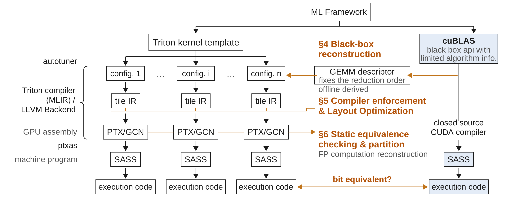
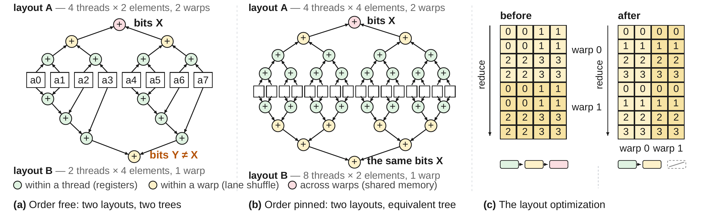
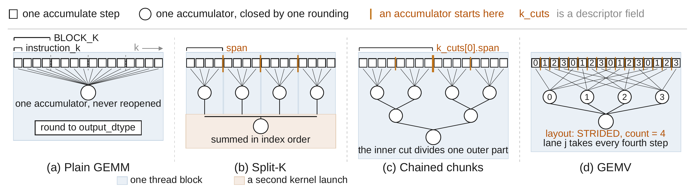
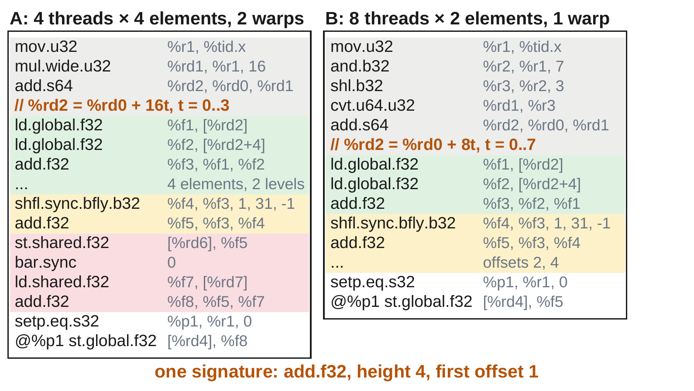
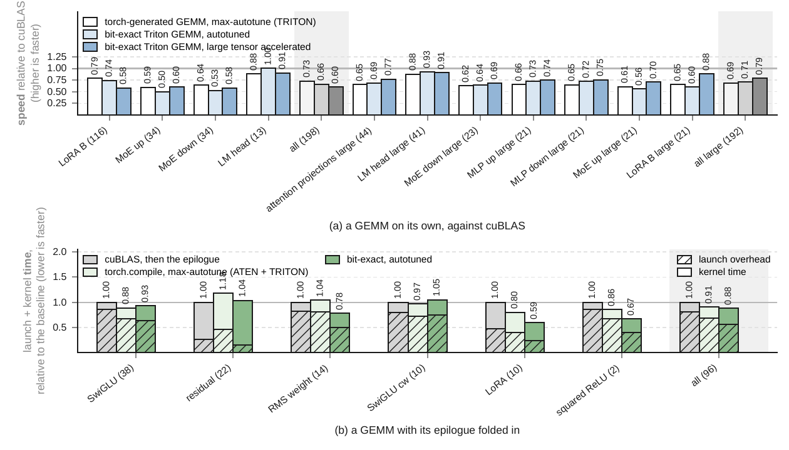
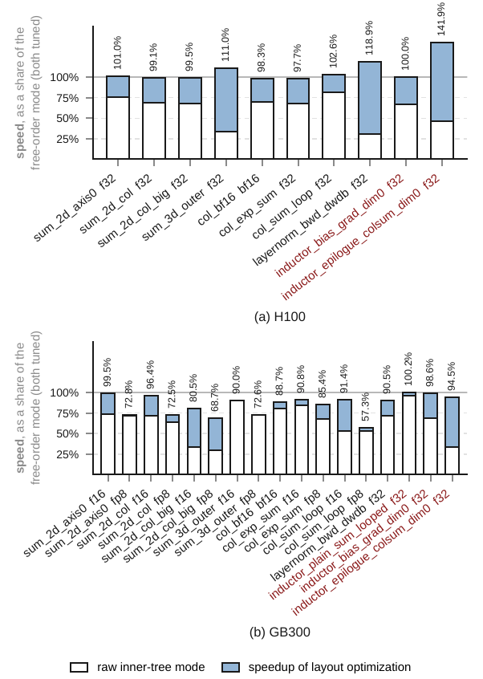
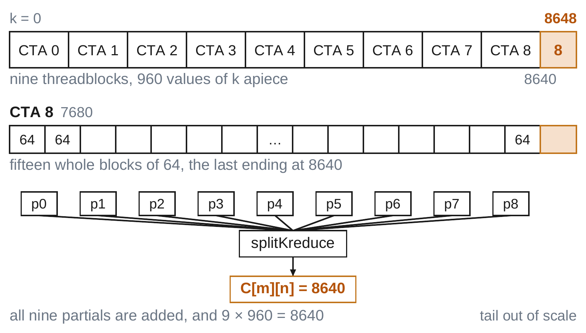

# 论文中文解读：《Taming Bitwise Behavior in GPU Kernels with Tensor Core: Black-Box Reconstruction, Compiler Enforcement, and Static Verification》

> **基本信息**：Ziteng Yang（Georgia Institute of Technology）、Nicholas J. Riasanovsky（Meta）、Warren Deng（Meta）、Vivek Sarkar（Georgia Institute of Technology），arXiv:2609.11356v1 [cs.DC]，2026 年 9 月 10 日；论文原文 [官方页面](https://arxiv.org/abs/2609.11356)。
>
> **本文的读法**：图 1、2、4–8 取自论文源码里的矢量图（已导出为 PNG，保存在 `rendered_figures/`），图 3 在论文里是一段 Triton 后端的 C++ 代码，本文转成代码块；表 1–6 与 Algorithm 1 逐项对照 LaTeX 源码和 PDF 页面转录成中文，数字与原文一致，页码指 `paper.pdf` 的页码。每张图后有图中文字的中文翻译和读图结论；从图上读出的近似数值写“约”。凡是解读者自己的补充、推断或判断，文中都明确标出，以免和论文结论混淆。论文的正文只有 11 页左右，其余是附录 A–F；本文按论文章节顺序讲解，附录内容放在第八节。
>
> **阅读路线**：5 分钟抓主线读第一、二节和第十节；系统学习按第三至七节顺序读；工程落地直接读第十一至十三节。

> [!IMPORTANT]
> **版本提示**：本文对应 arXiv v1（2026-09-10）。公开的 LaTeX 源码里还留着 20 处 `TODO` / `task` 标记，其中明确写着两个尚未写完的附录：1,400 个性能 fuzz shape 的生成细节，以及静态检查器把未建模指令转成 opaque syntax 的实例；另有若干对引文的待核对项（例如 2098/4288 位定点累加器的位宽、Ozaki 方案的细节、全局内存与共享内存约 20 倍的延迟比）。因此，下文把“论文已经给出证据的结论”“实验观察”“作者据此作出的推广”分开写，不能把 v1 的所有主张都当作已经完成 artifact evaluation 的定论。

## 一、一句话结论

GPU 上两个各自“确定性”的 kernel 数学上算同一个结果，比特却常常不同，根因是浮点加法可交换但不可结合：归约的加法顺序（依赖树）一变，舍入就变。这篇论文不走“提高精度”或“关掉调优”的老路，而是把“决定比特的结构”变成可操作的对象：

1. **黑盒重建**：用描述符 `GEMMDesc` 写下决定 GEMM 比特的全部参数，再用运行时 profiling 加特制的数值探针，从闭源库 cuBLAS 里把“它到底按什么顺序算”挖出来，用 Triton 写出与 cuBLAS 逐位相同的 GEMM 族。在 GB300、GB200、H100 上，排除已定位的 cuBLAS 自身缺陷后，匹配率为 100%。
2. **编译器强制**：在 Triton 后端加入平衡树归约模式（`inner_tree`）和数据布局优化，使 GB300 与 H100 共 27 个 kernel 中的 19 个落在“顺序自由模式”性能的 10% 以内。
3. **静态判定**：从编译后的 PTX 或 AMDGCN 汇编静态判断两个 kernel 是否逐位等价，判“等价”时保证可靠（sound），并把它作为 pruning predicate 接进 Triton autotuner，使搜索只在同一个逐位等价类里进行。

结论是：固定归约顺序不必然付出常被引用的约 20% 吞吐代价；在融合 epilogue 的真实 LLM shape 上，逐位一致的 Triton kernel 相对“cuBLAS 加单独 epilogue kernel”的基线达到 95%–168% 的速度。但证据限定在 kernel 层、特定的三种 GPU 和特定软件版本，论文自己也承认尚未测跨机器稳健性和对训练/强化学习任务的实际收益。

## 二、背景与动机

### 2.1 术语速查

| 术语 | 含义 |
| --- | --- |
| reduction（归约） | 把许多数加成一个数的运算：求和、GEMM 沿 $K$ 轴的累加、softmax 的分母等 |
| 归约顺序 / 依赖树（dependence tree） | 一次归约里“哪些数先加、怎样结合”，画成一棵加法树；树不同，舍入不同，比特可能不同 |
| batch invariant（批不变性） | 一个请求的输出与同一批里还有哪些请求无关 |
| split-K | 把 GEMM 的 $K$ 轴切成几段，分给不同 threadblock 各自累加，再由第二个 kernel 合并 |
| `GEMMDesc` | 论文提出的 GEMM 计算描述符：只记录决定归约顺序与舍入位置的字段，不含纯速度旋钮 |
| arch profile | 对一个 SM 版本、一代 cuBLAS，把它每个“可达的 cost-model 答案”对应的 `GEMMDesc` 列成的表 |
| `inner_tree` | 论文在 Triton 后端加入的“钉死平衡树”归约模式 |
| signature（签名） | 静态检查器对一个 kernel 的依赖树做规范化、哈希后得到的值；签名相同即判为逐位等价 |
| sound / over-split / over-merge | sound：判等价就一定真等价；over-split：把真等价的配置拆成多类（偏保守）；over-merge：把不等价的并成一类（必须为 0） |
| PTX / AMDGCN / SASS | NVIDIA 的虚拟汇编 / AMD 的 GPU 汇编 / NVIDIA 的实际机器码；本文的检查器读前两者，不读 SASS |
| CTA（threadblock） | 线程块；一个线程块整块落在一个 SM（AMD 为 CU）上 |

### 2.2 确定性不等于逐位一致

“确定性”通常只保证：同一台机器、同一条代码路径、同样输入，多次运行结果一样。它不保证下面这些变化之后结果仍是同一串比特：

- 换一个 tile 形状（`BLOCK_M/N/K`）；
- 换一个 batch size（一起服务的请求变多或变少）；
- 换一个 vendor library 的启发式选择；
- 换一套编译参数。

原因是浮点加法满足交换律，却不满足结合律：

$$
(a \oplus_{\mathrm{fp32}} b) \oplus_{\mathrm{fp32}} c \neq a \oplus_{\mathrm{fp32}} (b \oplus_{\mathrm{fp32}} c)
$$

其中 $\oplus_{\mathrm{fp32}}$ 表示在 fp32 累加器里做的一次加法。一个小例子（解读者补充，非论文原文）：取 fp32 的 $a=10^8$、$b=-10^8$、$c=1$。$10^8$ 附近 fp32 的数值间隔是 8，所以 $b+c=-99999999$ 会舍入回 $-10^8$，于是 $(a+b)+c=0+1=1$，而 $a+(b+c)=10^8-10^8=0$。“数学上同一个求和”因此对应许多棵不同的加法树，每棵树给出不同的比特。

除了加法顺序（主因），下列因素也会推动结果：部分和（partial sum）用什么精度保存；乘和加是否被合并成一条 FMA 指令；舍入到输出类型发生在哪一步。这些选择可能写在手写 CUDA 里，可能被 Triton 这类 block-level 语言交给编译器，也可能被 cuBLAS、rocBLAS 这类闭源库藏在启发式后面。**为性能选择的 tile 形状，同时也选择了算术。**

### 2.3 后果：推理、训练与强化学习

| 场景 | 发生了什么 | 后果 |
| --- | --- | --- |
| LLM 推理 | 一个请求和别的请求拼进同一个 batch，kernel 一次归约的行数变了，合并部分和的算法变了，加法树随之改变 | 同一权重、同一 seed，答案可以不同。论文引用的工作在一个 7B bf16 模型上测过：跨 batch size、GPU 数量、GPU 代际，精度最多相差 9 个百分点，生成长度能差几千个 token |
| 训练 | 两次“同一配置”的运行只在这类微小效应上不同 | 收敛到有意义地不同的模型；重训后模型对个别原本答对的样本改了主意 |
| 强化学习 | rollout 引擎生成 token，训练引擎打分，两个引擎同时运行 | 两边对同一个 token 的 log-probability 不一致时，被优化的目标已经不是写下的那个目标 |

论文特别强调批不变性：现役的 serving kernel 往往不具备这个性质。

### 2.4 现有对策各缺什么

论文（第 1 节）把业界对策分成四类，并指出各自的代价：

1. **提高计算精度**：用 2098 位（求和）或 4288 位（点积）的定点累加器可以容纳每一个 fp64 量级，所有加法精确，最后只舍入一次；Ozaki 方案把矩阵乘的每个输入拆成 int8 片段，让 GPU 的整数矩阵单元精确相乘、用 int32 累加。两者都要付数倍的工作量。
2. **库模式开关**：Intel oneMKL 只在可执行文件、指令集路径、线程数都不变时才保证逐次运行比特相同，并警告钉死代码路径可能让速度降到不足一半；PyTorch 的 deterministic mode 换成确定性算子，没有就报错，保证范围限定在“某一发行版、某一平台”。代价是这些条件要由调用方来守住。
3. **重写 kernel**：Thinking Machines 的工作把推理里随 batch 改变的归约顺序钉死，相对 cuBLAS 大约损失 20% 的矩阵乘吞吐（这就是摘要里“reported at up to 20%”的来源）；RepDL 强制正确舍入和顺序不变，使训练和推理在不同机器上比特相同；LayerCast 把权重存成 16 位但所有计算用 fp32，代价在带宽而非 kernel 结构；DeepSeek-V4 把整个前沿训练栈做成端到端的逐位批不变且确定的：(a) cuBLAS 在封闭的 cost model 之后按问题维度选 kernel，算术随 batch 变化，所以改用自己写的矩阵乘库，并去掉只在小 batch 启用（因而同样随 batch 变化）的 split-K；(b) 原子加按线程到达顺序落地，所以反向里给每个 SM 单独的缓冲区，再按固定顺序求和；(c) 编译器默认关闭 fast-math，让降低（lowering）与参考 CUDA 工具链对齐以免任何变换挪动比特，并调用 SMT 求解器验证 layout 推断所依赖的整数事实。据报告它的矩阵乘在多数主要场景下持平或超过标准 split-K。论文的评语是：这些工作都没有复现闭源库自己遵循的那套算术纪律。
4. **对齐两套引擎**：强化学习里 rollout 引擎和训练引擎对 log-probability 不一致，一种回答是把整条流水线从 bf16 改成 fp16，用动态范围换取让两者一致的舍入余量。这是算法层的妥协，不是 kernel 层的解法。

### 2.5 论文的范围与四项贡献

保持比特不变在不同层次都有挑战：训练算法层（策略更新用两个概率的比值给每个 token 加权，两个引擎不一致时比值就取在两个不同模型之间）、ML 系统基础设施层（栈由独立构建的部件拼成，一个部件累加方式不同就破坏所有部件之间的一致）、kernel 以下（厂商 assembler 可能重新结合它认为可以挪动的累加，在没有预编译机器码时驱动还会在加载时汇编，驱动更新可能改变程序没有变过的比特语义）。**本文只管 GPU kernel 这一层**，这一层的障碍有三个：

1. 厂商库不完全公开它做了什么算术，在别处写的 kernel 很难与之对齐；
2. 限制计算顺序会削减面向并行的优化空间（PyTorch 的 deterministic mode 会停止调优归约 kernel 的配置，开启完整搜索时也会拿厂商的矩阵乘代替生成的矩阵乘），对不上的地方牺牲的就是速度；
3. 同一份源码被同一个编译器用不同参数编译两次，结果可能一致也可能不一致，而 autotuner 在几百个配置里为速度搜索，却没有办法做等价划分。

论文因此声称四项贡献，后文各节可以用它们当目录：

| 贡献 | 内容 | 对应章节 |
| --- | --- | --- |
| 逐位行为的机制刻画 | 证明浮点归约顺序是决定比特的主因，给出归约与 GEMM 的理论刻画；核心产物 `GEMMDesc` 只记录决定归约顺序的参数（例如 split-K 在 $K$ 轴哪里切开），不记录纯速度旋钮；两台机器拿到同一份描述符，就欠对方同一串比特 | 第 3 节 |
| 第一套与闭源库逐位相同的 Triton GEMM 族 | 对 cuBLAS 做黑盒重建，得到 fp16、bf16、fp8 e4m3 的 Triton GEMM 族，在 GB300、GB200、H100 上与 cuBLAS 的匹配率为 100%（脚注：该 100% 不含 cuBLAS 自身的一个缺陷）；顺带发现 cuBLAS 的逻辑错误（附录 D） | 第 4 节 |
| Triton 里第一次强制平衡树归约与布局优化 | 在编译器后端加入 `inner_tree` 模式；分析并实现由此打开的数据布局优化；GB300 与 H100 的 27 个 kernel 中 19 个落在自由顺序模式的 10% 以内 | 第 5 节 |
| 第一个针对已编译 kernel 的可靠静态等价检查器，并接入 autotuner | 分别读 NVIDIA PTX 和 AMD GCN，从构造上保证 sound；接入 Triton autotuner 作为 pruning predicate；在 GEMM 族和 Inductor 融合 kernel 上恢复精确划分，在 reduction 与 normalization 上划分粒度在真实划分的 2.5 倍以内 | 第 6 节 |

注意源码里的一条作者批注：关于“第一个在 Triton 编译器里强制平衡树归约”的主张，作者在 TODO 里写明“归约顺序机制本身是已有的，需要在最终稿之前精确而谦逊地写出这里什么是新的”。读到“first”时请带着这个保留。

### 2.6 总图：四项机制在编译链上的位置（图 7）

下面这张图在论文里放在附录 A，但它是全文的路线图，先看它有助于把后面各节放回位置。



*图 7（原文 Figure 7，第 13 页）：本文四项机制所处的位置：从 kernel 模板到最终字节，旁边是闭源 cuBLAS 的路径。*

**图中文字翻译与读法**：

- **顶部 ML Framework（机器学习框架）** 向下分成两条路：左边是开放的 Triton 路径，右边是闭源的 cuBLAS。
- **左路**：Triton kernel template（Triton kernel 模板）→ autotuner（自动调优器）展开出 config. 1 … config. i … config. n（多个候选配置）→ 每个配置经 Triton compiler（MLIR）/ LLVM Backend 先变成 tile IR（分块中间表示）→ GPU assembly（GPU 汇编）PTX/GCN → ptxas（NVIDIA 的汇编器）→ machine program（机器程序）SASS → execution code（可执行代码）。
- **右路**：cuBLAS（black box api with limited algorithm info.，只给出有限算法信息的黑盒 API）→ closed source CUDA compiler（闭源 CUDA 编译器）→ SASS → execution code。
- **橙色标注是本文的贡献**：第 4 节 Black-box reconstruction（黑盒重建）：从 cuBLAS 离线（offline derived）推出 GEMM descriptor（GEMM 描述符，fixes the reduction order，固定归约顺序），并作用到左路的各个配置上；第 5 节 Compiler enforcement & Layout Optimization（编译器强制与布局优化）：作用在 tile IR 一层，横跨所有配置；第 6 节 Static equivalence checking & partition（静态等价检查与划分，FP computation reconstruction，即还原浮点计算）：作用在各个配置的 PTX/GCN 上；最底部 bit equivalent?（是否逐位等价？）的双向箭头连接 Triton 路径与 cuBLAS 路径的 execution code，这是最终要验证的问题。

**读图结论**：这张图说明三点。第一，重建 cuBLAS 是离线完成的，不是每次调用时现场探测。第二，编译器强制发生在 tile IR 到后端降低之间，静态检查发生在 PTX/GCN 层，在 `ptxas` 之前；因此检查器的 soundness 只相对于 PTX/AMDGCN，图上 PTX 到 SASS 之间没有橙色标注，那一段就是论文承认尚未检查的信任边界（见论文第 8 节 Discussion 第 iii 条）。第三，每个 autotuner 配置对应一条独立的编译链，检查器要回答的就是这些配置的最终字节能否合并成一个等价类。

### 2.7 GPU 编程模型与 autotuning（论文第 2.1 节）

读后文需要记住三层并行和几种内存：

- **Grid、thread block、warp**：kernel 由主机以 grid of thread blocks 的形式 launch，每个线程运行同一个函数体，用线程号找到自己的数据。一个 block 最多 1024 个线程，整块放在一个 SM（NVIDIA）或一个 CU（AMD）上，直到结束；SM 里有执行矩阵乘指令的 tensor core（AMD 叫 matrix core），寄存器和 scratchpad 够用时最多 32 个 block 共享一个 SM。block 内的线程再被切成固定的组：NVIDIA 的 warp（32 个线程）和 AMD CDNA 的 wavefront（64 个），它是指令发射的单位；自 Volta 起每个 lane 有自己的程序计数器，所以经内存在 lane 之间传值需要显式的 `__syncwarp()`。grid 之上，跨 launch 的顺序来自 kernel 结束，跨 GPU 合并结果是 NCCL、RCCL 这类集合通信库的事。
- **内存**：寄存器是线程私有的（每线程最多 255 个，每个 SM 共 64K）；shared memory（AMD 叫 local data share）是程序自己填充和清空的片上高速 scratchpad，从 SM 的 228 KB 里按驻留 block 划分；global memory 是片外 DRAM，约为一次 shared memory 读取的二十倍。只有 block 范围需要 barrier：`__syncthreads()` 发布一个 block 的 shared memory 写入；lane 之间的 shuffle 是免费的；grid 范围的顺序只能靠结束 kernel。

写 kernel 有两种方式，它们决定“谁来决定算术”：

| 方式 | 你写什么 | 谁决定算术 |
| --- | --- | --- |
| 线程级（CUDA C++） | 单个线程的函数体，协作（哪个线程读哪个元素、何时把 tile 搬进 shared memory、barrier 放哪）要手写；或者直接调用闭源库 cuBLAS、cuDNN（NVIDIA）、rocBLAS（AMD） | 你自己；调用闭源库时是库，调用者只选结果，库选产生结果的算术 |
| 块级（Triton、TileLang、cuTile；TPU 上的 Pallas，AWS 芯片上的 Neuron Kernel Interface） | 一个线程块覆盖一块 tile 的数据，线程细节交给编译器 | 编译器：tile 级 IR 给每个张量固定一种 layout，用代数方式说明哪个 lane、哪个寄存器持有哪个元素 |

块级编译流水线是：tile 操作 → tile-level IR（归约顺序在这里第一次变得可见）→ LLVM 后端按线程降低 → GPU 汇编（PTX 或 AMDGCN，机器码之前最后的文本形式，也是论文能读到的最低层）。

**Autotuning** 是第 6 节要接管的对象。tile 大小、软件流水深度（loop 的 load 比算术提前多少轮）、warp 数可以留作模板参数（knob，旋钮）。这样写的 kernel 叫 kernel template；对旋钮的一组赋值叫 configuration；按某个配置编出的是 kernel instance；所有合法赋值的集合是 configuration space（一个 GEMM 可有上千个）。autotuner 在运行时靠实测从中挑选，因为胜者取决于 occupancy、tile 形状与 tensor core 是否匹配、`ptxas` 里的寄存器分配，这些都不能直接从源码读出来。Triton 把它写成 kernel 上的一个注解：

```python
@triton.autotune(configs=[
  triton.Config({'BLOCK_M': 128, 'BLOCK_K': 64},
                num_warps=8, ...),
  triton.Config({'BLOCK_M': 64, 'BLOCK_K': 32},
                num_warps=4, ...)],
  ..., key=['M', 'N', 'K'])
@triton.jit
def matmul(a, b, c, M, N, K, BLOCK_M, BLOCK_K): ...
```

这个装饰器会把列出的每个配置都编译并计时，缓存最快的；遇到新的 shape 重新测量。PyTorch 的编译器（Inductor）生成带 autotune 装饰器的 Triton kernel 并对它们做 autotune。**同一模板的两个 instance 算的是同一道数学题，但不一定是同一串比特**，这就是整篇论文的出发点。

### 2.8 相关的编译正确性工作（论文第 2.2 节）

论文列了三类经典路线，并指出它们都没有回答“两个已编译 GPU kernel 是否逐位相同”，更没有接到 autotuner 上：

1. **Correct by construction（构造即正确）**：整条编译器带机器检查的证明。CompCert 是第一个面向 C 的实用实例，其浮点语义在 Coq（现名 Rocq）里被验证，因而 IEEE-754 算术在编译器本想做的变换下保持不变；类似的工作后来覆盖了指令调度、张量语言降低、GPU 内存一致性模型和 GPU 汇编语义。代价是证明工作量，以及要在自己的一套工具链下运行。
2. **Translation validation（翻译验证）**：不对编译器本身下断言，只检查眼前的这一次编译：把两边的 IR 编码，让求解器判断输出是否精化输入。Alive2 用于 LLVM IR，MLIR-TV 用于深度学习编译器所建立的多层 IR，Alive-FP 把浮点引入进来，在一套 SMT 编码下验证 LLVM 的浮点与 fast-math peephole（针对符号零、NaN、无穷大周围的欠规范，每种读法一个编码）。代价是编码所能容纳的范围：MLIR-TV 为了让求解器在有界时间内结束，对浮点算术和 reduction 做了过近似。
3. **Fuzzing（模糊测试）**：证明不了什么，但能找到真实的错误。Csmith 生成没有未定义行为的随机 C 程序，在编译器之间做差分测试；MLIRSmith 把这个思路带到多层 IR；浮点把目标从“一次错误编译”变成“两次编译不一致”。代价是所有基于测试的方法共有的：什么都没找到不等于什么都不存在。

所以第 6 节另起炉灶：不编码成 SMT，而是直接从汇编里抽出依赖树，比较签名。

## 三、理论：GPU 并行下，比特到底由谁决定（论文第 3 节）

这是整篇论文的理论内核，后面三节都建立在这里。

### 3.1 归约的依赖树

把一次归约画成一张有向无环图（DAG）：

- **数据结点**：持有一个浮点值；
- **运算结点**：一次浮点加法；
- **边**：数据依赖，从一个结点指向消费它的运算，方向就是值流动的方向。

对一个归约结果，这张图在多数情况下是一棵树（或能展开成树），论文称之为这次归约的**依赖树**。**归约顺序就是这棵树**：交换一个运算结点的两条入边，得到的是仍然表达同一关系的**等价树**（加法可交换，比特不变）；改变结合方式则得到另一棵树，比特可能改变。一个 kernel 可以有多个输出，记 $\mathcal{T}(K)$ 为各输出依赖树构成的族。**两个 kernel 对同一输入返回相同比特，当且仅当每个输出坐标上的树等价。**

这棵树同时决定可并行度。$n$ 个数的归约，运算结点数永远是 $n-1$（工作量）；并行度等于工作量除以最长依赖链，所以只由最长链决定。编译器可以对同样的值建出许多棵树，最长链从 $n-1$（左折叠，并行度为 1）到 $\lceil\log_2 n\rceil$（平衡树）不等。例如 $n=8$：左折叠的链长为 7，并行度 1；平衡树的链长为 3，并行度约 $7/3$。第 5 节钉死的就是平衡树，所以论文认为**强制它在理论上不放弃任何并行机会，还保住数据局部性**。

### 3.2 GPU 上的三层结构（图 1）

GPU 分三层拼出这棵树：

1. 一个线程在自己的寄存器里，按下标顺序折叠它持有的结点；
2. 同一个 warp 的各线程通过 lane 交换（shuffle）折叠各自的部分和；
3. 持有部分和的各 warp 通过 shared memory 折叠它们的部分和。

三层都确定，树才确定：

$$
\mathcal{T} = \mathcal{T}_{\mathrm{smem}} \circ \mathcal{T}_{\mathrm{warp}} \circ \mathcal{T}_{\mathrm{reg}}
$$

线程数、每个线程持有的元素数、warp 数，各自决定“哪些结点在某一层共享一个累加器”，因此每一个都会改变树。图 1 的 (a)(b) 两个小图就是这个意思；图的 (c) 是第 5.2 节的布局优化，放到那里再讲。



*图 1（原文 Figure 1，第 4 页）：固定归约顺序，以及这样做换来什么。(a) 顺序自由时，两种 layout 给出两棵不同的树；(b) 顺序钉死后，两种 layout 给出等价的树；(c) 钉死之后才安全的布局优化。*

**图中文字翻译与读法**：

- **颜色编码三个物理层级**（图例，位于 (a)(b) 下方）：绿色圆圈 within a thread (registers)（线程内，寄存器）、黄色圆圈 within a warp (lane shuffle)（warp 内，lane 交换）、粉色圆圈 across warps (shared memory)（跨 warp，shared memory）。每个圆圈里的 `+` 是一次浮点加法；叶子是逻辑输入 $a_0,a_1,\ldots$，根旁边的 bits X / bits Y 是最终的浮点比特。
- **(a) Order free: two layouts, two trees（顺序自由：两种 layout，两棵树）**：同样 8 个叶子 $a_0\ldots a_7$。上面的 layout A 是 4 threads × 2 elements, 2 warps（4 个线程、每线程 2 个元素、2 个 warp）：每个线程先加自己的两项，同一 warp 的两个线程再在 warp 内合并，最后两个 warp 经 shared memory 合并，得到平衡的树，根是 bits X。下面的 layout B 是 2 threads × 4 elements, 1 warp（2 个线程、每线程 4 个元素、1 个 warp）：每个线程把自己的 4 个元素从左到右折成一条链，再在 warp 内合并两个线程的结果，根是 **bits Y ≠ X**。叶子相同、数学上的和相同，只是括号结构不同，比特就不同。图的目的不是说“线程越少越不准”，而是说明 **layout 改变了哪些叶子先共享累加器**。
- **(b) Order pinned: two layouts, equivalent tree（顺序钉死：两种 layout，等价的树）**：这次是 16 个叶子，layout A 为 4 threads × 4 elements, 2 warps，layout B 为 8 threads × 2 elements, 1 warp，后者的线程数是前者的两倍。两种实现的线程/warp 分界不同、物理上的交换次数也不同，但在钉死顺序后，相邻的叶子先配成对，两边都得到同一棵高度为 4 的平衡树，根是 **the same bits X（同一个比特 X）**。
- **(c) The layout optimization（布局优化）**：见第 5.2 节。

**读图结论**：“layout 变了比特就一定变”并不成立，也不是“一定不变”；关键是树等不等价。这正是第 6 节检查器要识别的情况：**物理实现不同，逻辑树相同**。若检查器只比较指令序列、线程数或 warp 数，会错误地把图 (b) 的两种实现拆开。

### 3.3 不改变树的两项优化

论文（第 3.1 节）论证了两项常见优化不会改变依赖树，后面的加速都会用到：

- **软件流水深度**（Triton 里的 `num_stages`）：流水线化的循环在前面的迭代计算时已经发射了后面迭代的 load，流水深度就是同时在飞的迭代数。它改变的只是**到达时间**：第 $i$ 轮仍然把第 $i$ 轮的值按同样的顺序累进同一个累加器，每个结点到达的累加器与之前相同，树不变。前提是：流水线只挪 load，不挪循环里的累加链。
- **Warp specialization（warp 特化）**：把一个 block 的 warp 分成 producer 集合 $P$（发射异步拷贝到 shared memory）和 consumer 集合 $C$（做算术）。三个事实：树的结点是浮点加法，producer warp 一条也不执行，所以 $P$ 不贡献结点；$\mathcal{T}_{\mathrm{reg}}$ 由“结点到持有它的 lane”的映射决定，这个映射由 tile 形状和 layout 算出，特化不改动它；特化是在 consumer 旁边增加 producer，而不是拿走 consumer，$\mathcal{T}_{\mathrm{smem}}$ 跨越的是同样的部分和。三层都不变，树就不变，比特也不变。**第三个事实是关于编译器的前提，而不是关于硬件的前提**：如果编译器在特化时把一个 tile 重新划分到更少的计算 warp 上，这个论断就破了。

### 3.4 Tensor Core 的语义假设（论文第 3.2.1 节）

一条矩阵指令取 $A$ 的一块、$B$ 的一块，相乘后把乘积加进一个已经有值的累加器。指令内部舍入发生在哪里是黑盒。对 fp16、bf16 和 tf32 输入，论文采用下面的语义假设，并说第 7 节的每一项测量都与之吻合：**一条指令把 `instruction_k` 个乘积和进来的累加器一起折成一次舍入**。论文给出的式子是

$$
\mathrm{acc} \leftarrow \mathrm{acc}\Big(\sum^{\oplus_{\mathrm{fp32}}}_{j<\mathtt{instruction\_k}} a_j b_j\Big)
$$

其中求和是精确的，所以这条指令唯一的一次舍入就是 $\oplus_{\mathrm{fp32}}$ 本身。按这句话，它的含义等价于下面的写法（解读者整理）：

$$
\mathrm{acc} \leftarrow \mathrm{round}_{\mathrm{fp32}}\Big(\mathrm{acc}+\sum_{j<\mathtt{instruction\_k}} a_j b_j\Big),\qquad \text{内部的和是精确的}
$$

这意味着：一条指令内部的各个乘积**没有自己的顺序**；真正留下的归约顺序，是**指令与指令之间**那条 $\oplus_{\mathrm{fp32}}$ 链，每条指令一步。作为对照，标量路径每个元素舍入一次，$\mathrm{acc}\leftarrow\mathrm{fma}(a,b,\mathrm{acc})$；如果乘法没有被合并（contract）进 FMA，就是两次舍入。

NVIDIA 上有三条矩阵路径：

- `mma.sync`：一个 warp 执行；
- `wgmma`：Hopper 的 warpgroup 执行；
- `tcgen05.mma`：Blackwell 上由单个线程发射，累加器放在 tensor memory 里。

在 GB300 上，fp16 与 bf16 时 `mma.sync` 和 `tcgen05.mma` 逐位等价；**fp8 时两者不等价**，因为 fp8 的累加在降低的精度下进行，带着一种提升（promotion）节奏，两种降低方式的节奏不一定对得上（脚注）。所以描述符必须**逐条点名指令**，而不能只写一个“用了 Tensor Core”。

### 3.5 四类 GEMM 算法与 `GEMMDesc`（论文第 3.2.2 节）

区分两种 GEMM 的，是**收缩轴 $K$ 在哪里被切开，以及每一刀之后发生什么**。论文说四类算法覆盖了所用库里实际出现的全部 kernel。先看图 2 再读文字。



*图 2（原文 Figure 2，第 5 页）：每一类 GEMM 算法在收缩维 $K$ 的什么位置“关掉”一个累加器。*

**图中文字翻译与读法**：

- **图例（顶部）**：小方格 one accumulate step（一次累加步）；圆圈 one accumulator, closed by one rounding（一个累加器，由一次舍入收尾）；橙色竖线 an accumulator starts here（一个累加器从这里开始）；橙色字 `k_cuts` is a descriptor field（是描述符字段）。底部图例：浅蓝底 one thread block（一个线程块），浅橙底 a second kernel launch（第二次 kernel launch）。图中方格个数只是示意，不是实际参数。
- **(a) Plain GEMM（普通 GEMM）**：所有累加步都扇入同一个圆圈，标注 one accumulator, never reopened（一个累加器，从不重开），最后 round to output_dtype（舍入到输出类型）。顶部两个括号：较长的是 `BLOCK_K`，长度恰好等于被虚线分开的一圈主循环；较短的是 `instruction_k`，对应一条矩阵指令折叠的那一小段；箭头 k 表示收缩方向。
- **(b) Split-K（沿 $K$ 切分再合并）**：$K$ 被切成连续的几段，橙色竖线是各段起点，`span` 括号是一段的长度；每段一个线程块、一个累加器（四个圆圈）；下方浅橙底区域表示第二次 kernel launch，标注 summed in index order（按下标顺序求和）。
- **(c) Chained chunks（链式分块）**：仍在同一个线程块内。`k_cuts[0].span` 是外层切分的段长，橙色竖线中较粗的一条是外层切分、较细的是内层切分；图下方的文字 the inner cut divides one outer part（内层切分把一个外层段再分开）。4 个累加器先在各自的外层段内两两合并，再得到最终结果。
- **(d) GEMV（矩阵乘向量）**：方格上标着 lane 编号 0,1,2,3,0,1,2,3…，即 lane $j$ 取每隔 4 个的步（lane j takes every fourth step），`layout: STRIDED, count = 4`（跨步布局，间隔 4）；最后把 4 个 lane 的结果折成一个。

**读图结论**：这张图的横轴都是收缩维 $K$。图 2 的四个小图对应下面的四类算法，橙色标记的就是 `GEMMDesc` 必须记录的切分。

#### Plain GEMM（不切 $K$）

一个 threadblock 拿一块输出 tile，tile 里每个元素一个累加器，在块内走完整条 $K$ 轴。决定顺序的有三件事：

| 字段 | 含义 | 为什么影响比特 |
| --- | --- | --- |
| `instruction_k` | 一条矩阵指令折进一次舍入的乘积个数 | 决定舍入链有多长 |
| `use_fast_accum` | 指令自己的结果是并进同一次舍入，还是之后再单独加一次 | 每步一次舍入还是两次 |
| `k_loop_step` | $K$ 通常不是主循环步长的整数倍，所以有一圈是短的；短的那一圈放在最前还是最后 | 哪些乘积共享第一次舍入，其后每个部分和都跟着变 |

**不是**决定顺序的（纯速度旋钮）：

- `BLOCK_M` 与 `BLOCK_N`：决定哪个线程拥有哪个输出元素，而每个元素都有自己的累加器，所以重新分 tile 只是在线程之间挪活，每个累加器的链原样不动。
- `BLOCK_K`：决定主循环一圈发射几条指令；累加器跨圈携带，按第 3.4 节的语义，不论怎样分圈，同样的指令结果都按同样的顺序到达累加器。所以描述符记的是 `instruction_k`，不是 `BLOCK_K`。例如 $K=64$、`instruction_k` $=16$ 时，累加链永远是 4 次舍入，与 `BLOCK_K` 取 16、32 还是 64 无关（解读者的小例子）。

#### Split-K

把 $K$ 切成连续的几段，每段交给不同的 threadblock，各自从 0 起在自己的累加器里累加，再由第二个 kernel 合并（图 2(b)）。需要记录：

- `span`：一段的长度；
- `k_cuts`：有的 kernel 在一段内部还要再切，每隔若干元素关闭一次累加器，所以切分记成一个嵌套，由外到内；
- `partial_dtype` 与 `merge_dtype`：一段结果以什么类型写出、合并时累加器用什么类型，两者各自独立：段用 fp32、合并用 fp32；段用输出类型、合并用 fp32；或两者都用输出类型。

（解读者的提醒）不能把第二次 launch 当作单纯的调度细节：它引入了新的归约层，还带来新的舍入精度（`partial_dtype`、`merge_dtype`）。

#### Chained chunks（块内两级切）

切两次但仍在一个 threadblock 里（图 2(c)）。若干线程共享一个输出元素：外层切分给每个线程一段连续的 $K$，内层切分再把这一段分成若干子块，每个子块由一个累加器收尾。两层的长度分别是嵌套里各层的 `span`。这是 kernel 走**标量路径**时的做法：没有矩阵指令替它打包乘积，累加就是显式的一串 FMA。它不是 split-K 的同义词：不跨 block，也不一定写 workspace。

#### GEMV（矩阵乘向量）

每行只有一个输出元素，没有输出 tile 可以铺给线程，所以只能把**折叠本身**铺开，这使它的顺序在四类里最暴露（图 2(d)）。一个 warp 里的各 lane 每隔 `count` 个 tile 取一个（跨步分配），而不是取一段连续的切片；某一刀采用哪种分配，记为 `layout`。各 lane 再通过 shuffle 把各自的总和折成一个，**这一步顺序不再是链**：butterfly 把相距 2 的幂的 lane 配成对，是一棵平衡树；如果 butterfly 的偏移是从大往小数，则是对**按位反转（bit-reversed）顺序**的 lane 建的平衡树。这两个和不同，而这些 kernel 做的是后者，所以描述符把每一轮记成“一次两段的切分”，而不是“整个 lane 上的一棵树”。

用 8 个 lane 举例（解读者的小例子，设各 lane 的值为 $e_0,\ldots,e_7$）：偏移按 1、2、4 递增时，结果是 $((e_0+e_1)+(e_2+e_3))+((e_4+e_5)+(e_6+e_7))$；偏移按 4、2、1 递减时，lane 0 得到的是 $((e_0+e_4)+(e_2+e_6))+((e_1+e_5)+(e_3+e_7))$。两者都是平衡树，但配对的方式不同，浮点结果一般不同。

#### `GEMMDesc`：把上述因素冻成一条记录

论文把上面整套因素形式化为 **GEMM 计算描述符 `GEMMDesc`**，它是只含这些因素、不含任何纯速度旋钮的冻结记录，**两条相等的记录彼此欠同一串比特**。论文正文没有给出一段正式的数据结构定义，字段是由第 3 节各处文字定义的；下面是解读者按文字整理的示意：

```text
GEMMDesc（示意，非论文原文的数据结构）
├── instruction          点名具体的矩阵指令：mma.sync / wgmma / tcgen05.mma 等，逐条列出
├── instruction_k        一条矩阵指令折进一次舍入的乘积个数
├── use_fast_accum       指令结果并进同一次舍入，还是之后再来一次舍入
├── k_loop_step          主循环步长除不尽 K 时，短的那一圈放在开头还是结尾
├── k_cuts               K 轴切分的嵌套，由外到内；每一层记录
│   ├── span             这一层每段的长度
│   ├── layout           连续切片，还是跨步分配（GEMV 的 lane 分配）
│   └── count            跨步时每隔几个 tile 取一个
├── partial_dtype        每个分段的结果写成什么类型
└── merge_dtype          合并各段时用什么累加类型
```

因此“描述符是否完整”主要靠三类证据支撑：被省略的速度旋钮被论证为不改变树（第 3.3、3.5 节）；被保留的字段能被数值探针区分（第 4 节）；最终重建在测试集上逐字节命中（第 7 节）。需要注意的是，源码里引言贡献列表处有一条 TODO：作者还没有决定描述符是作为“两边编译器上都实现了的 artifact”还是“只有一个实现的规格”来呈现，也没有写明怎样论证它的完备性（被省略的每个参数都要证明不挪比特，被保留的每个参数都要证明会挪比特）。所以 v1 里这种完备性只有上面三类间接证据。

### 3.6 Attention 先挂起来（论文第 3.3 节）

Flash Attention 更复杂：中间还有带缩放因子的在线 softmax 累加。正文只给一个指针，完整的理论描述放在附录 F（本文第 8.4 节），**实现留空**。读到这里只要知道：GEMM 的描述符不足以覆盖 attention，但分析框架还是“依赖树加舍入落点”。

## 四、黑盒重建 cuBLAS 的算术（论文第 4 节）

### 4.1 目标：恢复一个函数，而不是一个点

cuBLAS 对外提供了一个 cost model API，能告诉你“这个 shape 它会运行哪类 GEMM 算法”，但这个答案停在第 3.5 节那些真正钉死比特的参数之前（`k_cuts`、`span`、`partial_dtype`、`merge_dtype` 等）。论文恢复的是**一整代库所计算的函数**：

$$
(\text{SM 版本},\ \text{张量形状}) \longmapsto \texttt{GEMMDesc}
$$

单个 shape 的描述符只是这个函数上的一个点。对一代固定的库（cuBLAS 12 或 cuBLAS 13）分别恢复。（脚注：完成本文时 CUDA 13.3 是最新版本。）

### 4.2 两件仪器

**仪器一：运行时 profiling（便宜，定家族）**。看库实际 launch 了几个 kernel、grid 多大、有没有拿 workspace，先把一个 shape 收窄到某个算法家族。

**仪器二：数值实验（贵，定算术）**。在一条本来全空的 $K$ 轴上只放三个值：一个极大值 $+L$、它的相反数 $-L$、一个极小值 $r$。对 fp16，取 $L=1024$、$r=2^{-15}$。$r$ 的选法要点：在 fp32 里 1024 附近的数值间隔是 $2^{-13}$，半个间隔是 $2^{-14}$，而 $r=2^{-15}$ 小于它，所以 $r$ 加到一个仍持有 $L$ 的累加器上会被吞掉（解读者用 fp32 验证过：$1024+r$ 舍入后仍是 $1024$，而 $(1024-1024)+r$ 恰好是 $r$）。

原理：$+L$ 与 $-L$ 精确抵消。若 $r$ 到达输出时累加器里的这一对已经抵消完，$r$ 完整地出现在输出里；若 $r$ 先遇到一个还握着一个 $L$ 的累加器，就被吞掉，输出为 0。Tensor Core 会先在指令内部折完自己的 $k$，所以 $r$ 要放在“隔一个指令组”的位置，而不是紧挨着它的 $L$。输出只可能是 $0$ 或 $r$，把浮点舍入变成了离散的观测信号。两种放置方式读出两种分组形状。

**(i) 连续分组**，例如 $(a_0+a_1+a_2+a_3)+(a_4+a_5+a_6+a_7)$。要找的是一个组在哪里结束。把 $r$ 钉在下标 0，让 $+L$、$-L$ 作为相邻的一对从 $(1,2)$、$(2,3)$ 起沿轴向后走：

| 这一对所在的位置 | 对与 $r$ 的关系 | 输出 |
| --- | --- | --- |
| $(1,2)$ | 整对与 $r$ 同在第一组，$+L$ 晚于 $r$ 到达并吞掉它 | $0$ |
| $(2,3)$ | 同上 | $0$ |
| $(3,4)$ | $+L$ 仍在第一组并吞掉 $r$，$-L$ 在第二组 | $0$ |
| $(4,5)$ | 整对落在第二组，自己抵消为 0，$r$ 完整到达输出 | $r$ |

第一次返回 $r$ 的位置是 4，所以第一组是 $a_0$ 到 $a_3$；把 $r$ 钉到 4 再走一遍，就得到下一个边界。

**(ii) 跨步分组**，例如 $(a_0+a_2+a_4+a_6)+(a_1+a_3+a_5+a_7)$。要找的是一个组里有哪些项。这次把这一对钉住，让 $r$ 走。对要测试的 layout，把 $+L$ 放在一个组的第一项、$-L$ 放在最后一项（这里是 0 和 6），使这个组全程带着一个没抵消的 $L$，然后让 $r$ 依次取其余每个下标：

| $r$ 的位置 | 与 $+L$ 同组吗 | 输出 |
| --- | --- | --- |
| 1、3、5、7 | 否（在另一组） | $r$（存活） |
| 2、4 | 是 | $0$（被吞掉） |

于是这个组是 $\{0,2,4,6\}$：步长为 2，共两组。如果猜错了 layout，$-L$ 就会落在 $+L$ 所在组之外，返回的模式不再是周期性的，这就说明假设错了。

### 4.3 以 split-K 为例走一遍

split-K 里有三样决定比特的东西是 profiling 给不出的：`k_cuts`（轴怎么切）、`span`（嵌套每一层的段长）、以及 `partial_dtype` 与 `merge_dtype`。读出 `span` 只需要在 GB300 上对一个 fp16 GEMM 的一行走一遍：取 $K=576$，一行里其余元素为空，$r$ 放在 $k=0$，$+L$、$-L$ 放在 $k=m$ 和 $k=m+1$，让 $m$ 沿轴走：

| $m$ 的范围 | 这一对与 $r$ 的关系 | 输出 |
| --- | --- | --- |
| $1\ldots191$ | 整对与 $r$ 同在第一段，或（$m=191$）骑在第一、第二段的边界上：$+L$ 在第一段先吞掉 $r$，$-L$ 在第二段，直到合并才相遇 | $0$ |
| $192\ldots382$ | 整对落在后面的某一段里，段内自己抵消 | $r$ |
| $383$ | 整对骑在第二、第三段的边界上，两半分开到达 merge，$+L$ 在 merge 处吞掉 $r$ | $0$ |
| $384$ 到轴末 | 整对落在第三段内 | $r$ |

一次走查就给出两个边界（192 与 384），轴被切成三段，每段 192。

恢复一个点的完整流程是：先用 profiling 把这个 shape 收窄到一个家族，并去掉与实际 launch 不符的候选；再用 $+L$、$-L$、$r$ 把仍未确定的每个分组从轴上读出来；如果还有剩余候选，就把每个候选自己的走查与库在新鲜随机输入上对跑，直到只剩一个存活。

### 4.4 从“点”到“函数”：arch profile

shape 是无界的，而 cost model 可以对每个 shape 换一个答案，一个点一个点地恢复永远做不完。让函数变成有限的关键观察是：**描述符对 shape 的依赖只经过 cost model 对它的答案，而这些答案的种类是有限的**。于是恢复函数就等于“为每个可达的答案恢复一条描述符”，也就是一张表，论文称这样的表为 **arch profile**。

依据这个原则，论文为 fp16、bf16 与 fp8 e4m3，在 GB300、GB200、H100 上，针对 cuBLAS 12 和 13，按 SM 版本和库代数各重建了一张表。表的键是枚举出来的，而不是抽样得到的：在向量长度扫到 $10^6$ 的范围内做了 825 万次 cost-model 查询，找出向量家族会走到的全部答案，其中有 7 个只在极长的向量或极深的 $K$ 上才出现。

排除一个已定位的 cuBLAS 缺陷后，在 GB300、GB200、H100 上，用 Triton（块级编程）写的重建，凡是 cuBLAS kernel 把全部求和算完的 shape，都返回 cuBLAS 自己的字节，匹配率保持 100%。

### 4.5 本节先行给出的性能结论

论文在这一节先报一个摘要，细节在第 7 节。关键观察是：一个不是 cuBLAS 的 GEMM，单独拿来比，无论是否要求逐位一致，都比高度优化的 cuBLAS 慢；**真正翻盘的是融合**。

| 设定 | torch.compile 生成的自由顺序 Triton GEMM | 本文逐位一致的 Triton GEMM |
| --- | --- | --- |
| 单独 GEMM，大于 5 GFLOP | cuBLAS 的 61%–88%（按层组） | 56%–93%；GB300 大张量加速版 69%–91% |
| 单独 GEMM，小于 5 GFLOP | 59%–88% | 50%–100%（这里钉顺序更贵） |
| 真实 LLM shape 加融合 epilogue（96 个） | 相对“cuBLAS GEMM 加第二个 epilogue kernel”的 85%–125% | 95%–168% |

融合后反而能赢，是因为省掉一次 launch（基线里 launch 占 82%，见第 7.4 节）。论文据此说：固定归约顺序通常被预期要付约 20% 的矩阵乘吞吐，而这些结果打开了相反的前景，即逐位一致与性能可以一起追求。

## 五、编译器强制平衡树与布局优化（论文第 5 节）

Triton 原来没有平衡树归约：它的降低把一个线程持有的值从左到右一个一个地折叠，layout 决定这些值是哪几个，所以 kernel 算出的树会随 autotuner 试的每一种 layout 而变。论文给 Triton 的编译器加了一种平衡树归约，再在其上加一个数据布局优化 pass，使相对于 autotuning 下的无序模式的性能代价可以接受。

### 5.1 后端 lowering：怎样钉住树（图 3）

树是在 lane 交换（shuffle）里长出来的。两种模式走**同一串 shuffle-xor 步骤，只是方向相反**：钉死模式把偏移量从 1 往上数，所以相邻的 lane 先配对，不论 warp 数是多少，树的形状都一样；默认模式则从 lane 数的一半往下数。图 3 就是发射这些 shuffle 的函数。

**图 3（原文 Figure 3，第 7 页）：lane 交换里的两种顺序。** 这是论文里以“图”的名义给出的一段 Triton C++ 代码，下面照录（原文在最后用 `...` 省略了其余部分，其中绿色底的是钉死模式的路径）：

```cpp
void warpReduce(ConversionPatternRewriter &rw, Location loc,
  SmallVector<Value> &acc, ReduceOp op, unsigned nLane, ...) {
  if (targetInfo.warpReduce(rw, loc, acc, op, nLane, ...)) return;
  if (isInnerTree(op)) { // count up: neighbours pair first
    for (unsigned N = 1; N <= nLane / 2; N <<= 1) {
      SmallVector<Value> shfl(acc.size());
      for (unsigned i = 0; i < acc.size(); ++i)
        shfl[i] = targetInfo.shuffleXor(
                    rw, loc, acc[i], N * interleave);
      accumulate(loc, rw, op.getCombineOp(),
                 acc, shfl, pred);
  ...
```

**逐行读法**：

1. 第一个 `if`：先问目标后端（`targetInfo`）能不能用专门的指令完成这次 warp 归约，能就直接返回，不走下面的通用路径。
2. `isInnerTree(op)`：这个归约算子是否要求钉死的平衡树（`reduction_ordering = inner_tree`）。是的话，进入注释写的“往上数：邻居先配对”分支。
3. `for (N = 1; N <= nLane / 2; N <<= 1)`：偏移量 $N$ 取 $1,2,4,\ldots,\mathrm{nLane}/2$。每一轮用 `shuffleXor` 与 lane 编号异或 `N * interleave` 的那个 lane 交换自己的累加值（`interleave` 处理 lane 间交错持有元素的 layout），再用算子自己的 combine 把交换来的值累加进去。
4. 默认模式的代码没有画出来，它按相反方向，从 $\mathrm{nLane}/2$ 起往下数。

用 8 个 lane 看区别（解读者举例，结论与第 3.5 节 GEMV 一节的例子相同）：往上数时先配 $(0,1),(2,3),(4,5),(6,7)$，再配相距 2 的，最后相距 4 的，得到按自然顺序的平衡树；往下数时先配 $(0,4),(1,5),\ldots$，是对按位反转顺序的 lane 建的平衡树。两者都是平衡树，但配对不同，和不同。

**读这段代码的三个要点**：

- `shuffleXor` 的集合没变，变的只是执行的顺序，浮点 combine 的括号因此改变；
- “邻居先配对”让最底层的子树由逻辑上相邻的元素决定，更容易跨 layout 保持；
- 只改 warp 内这一层不够：在第 3.2 节的三层层级里，每一层都有一个这种形状的开关，所以线程内的折叠和跨 warp 的阶段用同样方式钉死。

进入钉死路径有两条路：一是算子上的属性；二是某种 layout：归约轴上“寄存器 × lane”的范围仍大于 1，默认降低无法表达它，只能走同一条钉死路径，并得到同一棵树。

**AMD 后端**用不同的指令到达同一棵树。wave64 的归约在行内用 `row_shr` 步骤折叠，两种顺序是同一串步骤的两个方向：默认模式是 8、4、2、1 往下数，钉死模式是 1、2、4、8 往上数；随后的跨行 broadcast 步骤保持树不变，两种模式下一样。当这个序列所依赖的假设不成立（wave32 目标或 partial warp），后端放弃指令级路径，改走共享的“往上数”shuffle 树，它还是同一棵树，只是更慢。这说明论文承诺的是**逻辑依赖树**一致，不是指令文本一致。

### 5.2 数据布局优化：钉死之后才敢放心改 layout

一个归约轴铺在多个 warp 上的归约，要付一个跨 warp 阶段：两次 barrier、一次 shared memory 往返、第二串 shuffle。把操作数换到“归约轴落在一个 warp 里”的 layout，就能逃掉这一级；但这样做通常会把树一起搬走，所以逃掉的代价是丢掉逐位等价。

**树被钉死之后，这个动作才变得安全**：上面的降低使结合方式与元素住在哪里无关，所以对一个树已被钉死的归约，整个合法 layout 空间都变成了纯粹的性能旋钮。附录 B 的 Algorithm 1 就是把这个旋钮花掉的 pass。它构造“把轴放进一个 warp 里归约”的 layout，让 warp 只铺在保留维上以保持 warp 同步，把轴上剩余的长度放在寄存器里做线程内折叠，再问“值不值得为此插入一次 `convert_layout`”。**算子、轴、轴的长度、顺序一律不动，所以结果在构造上就逐位相同。**

回到图 1(c)，现在可以读懂它了（读图要点见下面的文字，图见第 3.2 节）：

- **before（优化前）**：这是一块 $8\times4$ 的操作数，竖直的 reduce 箭头表示归约沿行方向走，一条归约就是一列的 8 个元素；格子里的数字是 lane 编号，每个 lane 持有一个 $2\times2$ 的块；上半（浅色）的 4 行属于 warp 0，下半（深色）的 4 行属于 warp 1。所以**同一列的 8 个元素跨过了 warp 边界**，需要 shared memory 往返、barrier 和第二串 shuffle。图下方的色块条是 绿（线程内）→ 黄（warp 内）→ 粉（跨 warp）三级。
- **after（优化后）**：每个 lane 持有的是保留维上的一行，每个 warp 拥有若干条完整的归约：左边两列（浅色）归 warp 0，右边两列（深色）归 warp 1，每条归约的 8 个元素都落在同一个 warp 里（4 个 lane，每个 lane 在寄存器里再折 2 个元素）。色块条变成 绿 → 黄 → 被划掉的虚线粉块，即**跨 warp 阶段消失**。
- 这项重排只有在树已经由 `inner_tree` 固定后才安全；否则“把轴塞进一个 warp”同时会改变括号结构。
- 论文还指出：如果直接用归约友好的 layout 去 load，同样能到达这个状态，而且不需要转换，但 pass 拒绝这样做：跨步 load 每次 launch 都要付，转换只对每个 tile 付一次。

Algorithm 1 在附录 B（第 12 页）。pass 除了模块之外还有三个参数：warp 大小 $w$、转换后每个线程最多持有的元素数上限 $c$、铺开因子 $u$。**每一条检查都是“跳过”**，所以放不下去的归约原样保留；跨 thread block 的归约不在范围内，已经在一个 warp 内的归约没有收益可拿；最后两条守卫问转换是否划算。

**Algorithm 1：钉死归约的布局优化**（原文 Algorithm 1，第 12 页；中文转录）：

```text
输入：模块 M，warp 大小 w，每线程元素上限 c，铺开因子 u
对 M 中每个 reduction_ordering = inner_tree 的归约 r：
  1. L ← r 的操作数 layout；若 L 不是 blocked layout，则跳过
  2. 若 r 跨 thread block，或已经是 warp 同步的，则跳过
  3. 若 |tile| / (w · n_warps) > c，则跳过        # 重排会 spill
  4. C ← Ideal(r)：先把 lane 铺到轴上，其余铺到保留维；
                    warp 只铺到保留维；轴上剩下的长度放进寄存器
  5. 若 C = L，或 C 放在轴上的 lane 数不多于 L，则跳过
  6. 若 extent(axis) < u · L.lanes(axis)，则跳过   # 已经铺得够开
  7. 把每个操作数转换到 C，在其上克隆 r，再把结果转换回来
```

第 6 条的读法：只有当轴的长度至少是“当前 lane 数的 $u$ 倍”（也就是现有 layout 下轴铺得不够开）时，转换才值得；否则跳过。效果摘要：GB300 上，这项优化拿回了约束吃掉的大部分；H100 上 10 个 kernel 里有 6 个达到或超过无序模式（详见第 7.5 节的图 6）。

## 六、静态等价检查：从汇编判断两个 kernel 是否逐位等价（论文第 6 节）

检查器回答的问题收得很窄：给定两个**已编译**的 kernel，它们是否逐位等价？它静态地从汇编回答；NVIDIA 读 PTX，AMD 读 AMDGCN。

### 6.1 算法：走一遍汇编，抽出依赖树，比签名（图 4）

对入口函数按程序序走一遍一个**符号线程**（线程号保持为符号），手里拿一张“寄存器 → 结点”的映射。每条指令是这张映射上的转移函数：它查找操作数（而不是往回追踪），并往目的寄存器写入一个结点。图 4 给出两段汇编的走查，先看图再读文字。



*图 4（原文 Figure 4，第 8 页）：同一个归约的两种 layout，一个签名。*

**图中文字翻译与读法**：

- **左 A：4 threads × 4 elements, 2 warps（4 线程、每线程 4 个元素、2 个 warp）；右 B：8 threads × 2 elements, 1 warp（8 线程、每线程 2 个元素、1 个 warp）。** 两边都在把 16 个 `f32` 加成一个数。
- **颜色**：灰色底是地址计算，绿色底是线程内（thread），黄色底是 warp 内（warp），粉色底是跨 warp 的 shared memory，白色底是谓词与写回。
- **A 的汇编**：地址 `%rd2 = %rd0 + 16t, t = 0..3`；线程内 `ld.global.f32` 两次、`add.f32`，省略号处注明 `4 elements, 2 levels`（4 个元素、2 层）；warp 内一次 `shfl.sync.bfly.b32`（偏移 1）加一次 `add.f32`；跨 warp 一次 `st.shared.f32`、`bar.sync 0`、`ld.shared.f32`、`add.f32`；最后 `setp.eq.s32 %p1, %r1, 0` 与 `@%p1 st.global.f32`，只有线程 0 写回。
- **B 的汇编**：地址 `%rd2 = %rd0 + 8t, t = 0..7`（用 `and.b32 %r2, %r1, 7` 与 `shl.b32 %r3, %r2, 3` 算出）；线程内 `ld.global.f32` 两次、`add.f32`；warp 内 `shfl.sync.bfly.b32`（偏移 1）加 `add.f32`，省略号处注明 `offsets 2, 4`（偏移 2、4）；没有 shared memory，也没有 barrier；同样只有线程 0 写回。
- **底部橙字**：one signature: add.f32, height 4, first offset 1（同一个签名：合并运算 `add.f32`、归约高度 4、最靠近叶子的偏移 1）。

**读图结论**：表面差异非常大：地址计算指令不同（乘 16 与“mask 后移位乘 8”）；线程内工作量不同；A 有 shared memory 和 barrier，B 没有；launch 的几何不同。检查器不比较这些表面结构，而是恢复叶子的地址和 combine 的关系，两边最终都得到“`add.f32`、归约高度 4（$2^4=16$ 个逻辑输入）、最近叶子偏移 1”，所以签名相同。高度 4 的核算如下（解读者核算）：A 是线程内 2 层、warp 内 1 层、跨 warp 1 层，共 4；B 是线程内 1 层、三轮 butterfly（偏移 1、2、4）3 层，共 4。高度不是“做了几条 shuffle”，而是树从叶到根有几层；shared memory 交换只搬运部分和、不执行 combine，因此不增加高度。

下面把检查器的各个部件讲清楚。

**1. 转移函数把汇编现象变成树上的结点**：

| 汇编现象 | 变成树上的什么 |
| --- | --- |
| 全局 load | 数据结点，带着它读取的地址 |
| 浮点 combine | 算术结点，孩子是其操作数寄存器里已有的结点 |
| lane shuffle，其结果再与被 shuffle 的部分和 combine | 一个 warp 内交换结点 |
| shared store，接 barrier，接 load | 一个跨 warp 交换结点 |
| 往一个循环携带的寄存器上累加的循环 | 对“一轮迭代的贡献”的 fold（折叠） |
| 谓词只是线程/块坐标的函数 | 丢掉（哪些线程运行是 launch 的事实） |
| 谓词带着从内存 load 来的值 | 当作数据；它守护的入口按配置分别比较 |

到达全局 store 的结点就是**根**，每个输出元素一个，每个根带着该元素的依赖树。

**2. 地址用符号求值**。对于 kernel 能读到的整数符号集合 $\mathcal{S}$（线程与 block 坐标、block 大小、参数、基址指针），每个整数寄存器的取值落在

$$
\mathcal{A} = \Big\{\, c_0 + \sum_{s \in \mathcal{S}} c_s\, s \,\Big\} \cup \{\, \top_e \,\}
$$

也就是一个仿射形式，或者一个不透明 token $\top_e$（它带着产生它的表达式）。搬移与地址空间转换是恒等，加法按项相加，乘以字面量或左移字面量就把每个系数放缩；**位运算只在有规则证明它精确时才被接受**。记 $\mathrm{tz}(a)$ 为 $c_0$ 和所有 $c_s$ 共有的尾零个数：右移 $k$ 位在每一项都是 $2^k$ 的倍数时精确，即 $\mathrm{tz}(a)\ge k$ 时 $a\gg k=(c_0\gg k)+\sum_s(c_s\gg k)s$；mask 在它覆盖 $a$ 能置位的所有位时是恒等；两个没有共同置位的值做 or 就是加法。剩下的是对线程下标的 mask 或移位，而 launch 的边界使它也能精确：`%ntid.d` $=N_d$ 是 2 的幂，所以

$$
\mathtt{\%tid}.d = \sum_{i < \log_2 N_d} 2^i\, \mathtt{\%tid}.d.\mathrm{bit}_i
$$

恰好覆盖 $[0,N_d)$，在这个基下 mask 保留它选中的位，移位把这些位重新编号。以图 4 的 B 为例：block 只有 8 个线程，`%tid.x` 的取值是 $[0,8)$，只用低 3 位，所以 `and.b32 %r2, %r1, 7` 是恒等，再左移 3 位就得到地址 $\%\mathrm{rd0}+8t$（解读者按文字推演）。

一个叶子的身份是它读取的地址的仿射式，所以两个 kernel 用不同的下标算术走到同一个元素，仍得到同一片叶子；不透明 token 只和完全相同的 token 相等，这会把一个类**拆开**，而不会把两个类**合并**，这是检查器 sound 的来源之一。

**3. 规范化与签名**：对每个可交换结点的孩子排序，因此比较一棵树恰好是在第 3.1 节允许的交换律之内；然后自底向上做哈希，把树约成一个**签名**，两个 kernel 的签名一致，就判为逐位等价。

**4. 平衡树再塌一步**：平衡树归约的形状由逻辑元素顺序决定，所以塌缩后的结点只保留四件事，并丢掉产生它们的物理结构：保留 combine 及其舍入、叶子的计算（把坐标抹掉）、**归约高度**（折进去的元素数的以 2 为底的对数）、最靠近叶子的 butterfly 步的偏移；丢掉“交换了几次、哪个线程持有哪个元素”。因为 shared memory 交换只搬一个值而不 combine，它不增加高度，高度因此是在数元素，warp 数变了也不变。图 1(b) 的两种 layout（16 个元素，4 线程 2 warp 与 8 线程 1 warp）读出来是同一个签名：线程与 warp 之间的分界在移动，高度 4 不动。**卫兵是每次 combine 两边的高度相等**：左折叠不满足这一条，所以它保留物理结构，自成一类。

**5. 走不了的构造变成 opaque syntax（不透明语法）**：按指令自己的文本匹配。宁可拆开，也不乱合并，这保持了 sound（论文在这里写“见附录”，但对应的 opaque-syntax 示例附录在 v1 里还没有写，见文首的版本提示）。

### 6.2 实现与接入 autotuner

- NVIDIA 检查器约 2,500 行 Python，架在一个 PTX 解析器上，包括：遍历、符号地址求值、树及其规范形、循环摘要。AMDGCN 检查器是它的孪生：树的表示相同，换掉地址求值器和交换识别器，用自己的语料评分。
- Triton 的 autotuner 本来就接受一个 pruning predicate（剪枝谓词），PTX 检查器无需改动 autotuner 就能变成其中一个：搜索只保留与某个参考配置逐位等价的配置（参考可以是它自己的第一个配置，也可以是调用方编好送进来的），并只对这些配置测速。论文称这是第一次在真正的剪枝发生之前做静态剪枝。

**循环的处理**：

- 循环携带的累加按它在汇编里的形状识别：一条 MMA 或 combine，其目的寄存器同时也是它的一个源，例如 `fma.rn.f32 %f5, %f1, %f2, %f5`。此时检查器把本来会产生的单次迭代 `add(seed, chunk)` 换成对 chunk 的**单个 fold 结点**，并丢掉循环前的 seed（同一个 kernel 的各配置共享它）；
- 这个结点的键是循环自己的步长，例如分块归约的 `BLOCK_N`，因为对标量 fold 重新分块就是重新分组；
- 对于 tensor core 精确累加（第 3.4 节）、且累加器在循环结束前没有被 MMA 之外的东西碰过的 $K$ 循环，键被去掉：不同的 `BLOCK_K` 都是把同样的乘积按同样的顺序送进同一个累加器，所以块大小不进入签名，这些配置合并；
- 检查器没能重建出归约的入口，以它的 launch 几何作为签名，所以两个都“什么也没重建出来”的 kernel 保持分开；
- 跨越循环回边的归约，从一次迭代出发做摘要，对单个 fold 是精确的；而一个嵌套的 fold，摘要就成了猜测，所以把循环自己的 trip 常数写进签名，只在 split 次数上不同的两个 kernel 因此被分开。

**健全性的总结证据**：在 GB300 上编译出的 51,152 个配置、gfx942 上的 4,500 个，以及 GB200 和 H100 上小规模的基准里，检查器认证为等价的，硬件都确认等价。多数 kernel（包括 TorchInductor 生成的）上，它给出的类数是真实存在的类数的 1.0 到 2.5 倍（第 7.3 节）。

## 七、实验：先问比特有没有说对，再问保住比特要付多少性能（论文第 7 节）

### 7.1 平台、shape 与 kernel

**平台**：GB300（sm_103）承担所有测量；cuBLAS 重建和检查器的健全性检验也在 GB200（sm_100）与 H100（sm_90）上跑；布局优化也在 H100 上跑；AMDGCN 检查器在 gfx942（CDNA3）上，用一个自己的语料。评测分成两半：先是逐位正确性，再是保持它要付的性能代价。

**软件**：全程 cuBLAS 13、Triton 3.8、PyTorch 2.12、CUDA 13。“逐位相同”的意思是，在每一组输入上输出逐字节一致。

**两套 shape**：

1. **真实静态集**：从开源权重模型各层的维度读出的 390 个 fp16 $(M,N,K)$ 三元组，每个都带着它所在的层，以及该层之后接的运算（epilogue）。范围见表 1。
2. **fuzz 集**：在两种 dtype 上随机抽取，能到达层表永远不会访问的角落（$M=1$、$K$ 到几十万）：重建用了 110,813 个 shape，性能工作用了 1,400 个。（这 1,400 个 shape 的生成细节，是 v1 里尚未写出的附录。）

**三类 kernel**：为本文写的 micro-kernel（每个只隔离一个顺序或 layout 问题）；TorchInductor 原样吐出的 Triton kernel；从开源的复杂基准改编的、共 97 个 kernel 的 zoo（来源是 Triton 教程、TritonBench、FlagGems、flash-linear-attention、torchao）。顺序实验在前两类来源上跑 24 个（kernel, dtype）组合（fp16、fp8、fp32），外加 zoo 里的一个 LayerNorm 权重梯度归约；检查器则按“每个 autotuner 配置一份 PTX 文件”评分，样本取自三类来源。

**表 1：390 个静态 GEMM shape，按层分组**（shape 数与 $M$、$N$、$K$ 的取值范围）

| 层 | shape 数 | $M$ | $N$ | $K$ |
| --- | ---: | ---: | ---: | ---: |
| attention projections（attention 投影） | 45 | 256–16,384 | 2,048–18,432 | 2,048–16,384 |
| MLP up | 21 | 256–16,384 | 6,144–33,792 | 2,048–7,168 |
| MLP down | 21 | 256–16,384 | 2,048–7,168 | 6,144–33,792 |
| MoE up | 55 | 16–3,072 | 512–3,072 | 2,048–8,192 |
| MoE down | 57 | 16–6,144 | 2,048–8,192 | 512–3,072 |
| LM head | 54 | 1–256 | 100,352–248,320 | 2,048–8,192 |
| LoRA B | 137 | 80–16,384 | 768–32,768 | 8–64 |
| 合计 | 390 | 1–16,384 | 512–248,320 | 8–33,792 |

（原文表 1，第 10 页。）表注：这些维度读自 16 个开源权重模型各自 `config.json` 里的具名字段：Qwen3.8-2.4T-A95B、Qwen3.8-27B、Qwen3.6-35B-A3B、Qwen3-30B-A3B、DeepSeek-V4 Pro 与 Flash、Kimi-K2.6 与 K3、GLM-5.2、GLM-4.7-Flash、gpt-oss-120b 与 20b、Ling-3.0-flash、MiniMax-M2、Nemotron-3.5-L、granite-4.1-8b；逐模型的数值见附录 C（本文表 4）。读法：$N$ 最宽的 LM head 行来自词表大小；LoRA B 的 $K$ 是 adapter 的秩，所以能小到 8，这是唯一一个收缩维不由模型配置决定的层组；MoE 两行的 $M$ 较小（解读者推测是每个专家分到的 token 少，论文没有解释）。这套静态集适合比较 kernel 的形状，但不是 workload trace：$M$ 只是选取的 token 数范围，不含请求到达分布、动态 batching 频率、序列长度分布和多 GPU 通信，所以不足以直接推出端到端 serving 吞吐（解读者的提醒）。

### 7.2 逐位正确性：重建 cuBLAS（表 2）

表 2 把一个 Triton GEMM 对着 cuBLAS，在 GB300 上取 110,813 个随机 fp16 shape，每个 shape 十组输入。凡是 cuBLAS kernel 把全部求和算完的 shape，输出逐字节相同，覆盖库会分派到的全部八个算法家族。最后一列的 60 个 shape 是 cuBLAS 自身的一个缺陷：在很深的收缩长度上，库只对整数个块求和，把尾巴丢掉；这一点在完全不涉及 Triton 的情况下也能复现（见第 8.2 节）。在 fp8 上和另外两代 GPU 上同样成立：**除去这个缺陷的 shape，100% 逐位相同**。

**表 2（上）：GB300（sm_103）上对 cuBLAS 13 的 fp16 逐位匹配，按 cuBLAS 的 GEMM 算法家族分**（每个 shape 十组输入）

| GEMM 算法（cuBLAS kernel） | 测试 shape 数 | 逐位相同 | cuBLAS 缺陷 |
| --- | ---: | ---: | ---: |
| 单遍累加 Single-pass accumulation（`nvjet`） | 19,449 | 19,449 | 0 |
| Split-K（`nvjet`） | 18,636 | 18,576 | 60 |
| 每条 MMA 累加 Per-MMA accumulation（`cutlass`） | 13,473 | 13,473 | 0 |
| Split-K，每条 MMA（`cutlass`） | 33,677 | 33,677 | 0 |
| 三级链 Three-level chain（`gemmSN_NN`） | 4,731 | 4,731 | 0 |
| Lane-tree GEMV（`gemv2T`） | 14,897 | 14,897 | 0 |
| 连续切片 GEMV Contiguous-slice GEMV（`gemv2T`） | 1,722 | 1,722 | 0 |
| Workspace GEMV（`reduce_1Block`） | 4,228 | 4,228 | 0 |
| 合计 | 110,813 | 110,753 | 60 |

表注：110,813 个随机 shape，来自六种取值区间，$M$ 与 $N$ 从 1 到 120,000，$K$ 从 8 到 300,000；每个 shape 十组输入；缺陷见附录 D。

**表 2（下）：跨代 GPU 的汇总**

| 架构 | 测试 shape 数 | 逐位相同 | cuBLAS 缺陷 |
| --- | ---: | ---: | ---: |
| GB300，fp8 | 42,793 | 99.93% | 0.07% |
| GB200，fp16 + fp8 | 626,522 | 99.81% | 0.19% |
| H100，fp16 + fp8 | 648,720 | 99.82% | 0.18% |

（原文表 2，第 10 页。）表注：这是同一轮 GB300 测试里 fp8 的那一半，然后是 GB200 与 H100 上同样的评估，这两代的记录把两种 dtype 放在一起；shape 数是计数，比例按字节比较计。

**读法**：

- GB300 fp16 的原始结果是 110,813 个 shape 中有 110,753 个逐字节相同，表面比例约 99.946%，其余 60 个全部落在 `nvjet` split-K 的尾部缺失缺陷上。论文的“100%”的口径是：**在 cuBLAS 确实算完整个 $K$ 的 shape 里，重建全部命中**。表 2 下半部分的 99.93%、99.81%、99.82% 是包含缺陷的原始字节命中率，把缺陷列上去正好是 100%（每行两个比例相加为 100%），也就是所有不一致都归于这个缺陷。
- 这不是偷偷删去异常点，因为作者给出了不用 Triton 的独立复现和可预测的充要条件（第 8.2 节）；但它意味着“复现 cuBLAS 的逐位行为”与“复现 cuBLAS 的错误输出”被有意区分：重建的 kernel 选择实现预期的完整 GEMM，而不是照抄漏算。
- 八个家族名里的 `nvjet`、`cutlass`、`gemmSN_NN`、`gemv2T`、`reduce_1Block` 是 profiling 看到的 cuBLAS 内部 kernel 名；它们与第 3.5 节四类算法的对应关系论文没有逐行给出，不要自己硬配。
- 源码里对应的 TODO 写明：GB200 与 H100 想要和 GB300 一样的 fp16 / fp8 分表，工作树里只有总数。所以 v1 的表 2 下半部分只有合计。

### 7.3 检查器的健全性与精度（表 3）

**健全性**：GB300 上对来自 47 个 Triton kernel、五种浮点格式的 51,152 个配置，检查器认证为逐位等价的每一对，在每一组输入上都返回同样的字节；AMDGCN 检查器自己的 4,500 个配置，以及 GB200、H100 上小规模的基准，同样如此。

**精度**：表 3 一个 kernel 取一种 dtype，读这个语料。在论文主要针对的 reduction 和 GEMM 上，PTX 检查器把真实的划分过拆（over-split）1.0 到 2.5 倍，在 GEMM 家族上恰好精确（1.0）；主要关注点之外的四个 kernel 则在 6.7 到 23.0 之间。

表 3 的各列：`configs` 是配置数；`classes` 下的 `checker` 是静态检查器分出的等价类数，`bytes` 是实际运行后按输出字节分出的真实类数；`over-split` 是前者除以后者；`over-merges` 是检查器把字节不同的配置并进同一类的次数，必须为 0（否则就不 sound）。

**表 3：NVIDIA PTX 与 AMD GCN 上的静态等价检查**（每格写作“PTX 检查器在 GB300 上的数字（AMDGCN 检查器在 gfx942 上的数字）”；“–”表示该 AMD 语料不含这个 kernel；原文把过拆等于 1.0 的格子加粗）

| kernel，dtype | 配置数 | 检查器类数 | 字节真实类数 | 过拆倍数 | 过合并 |
| --- | ---: | ---: | ---: | ---: | ---: |
| 16 个不同维度/轴的 reduction，fp16 | 2,304（1,920） | 204（144） | 81（87） | 2.5（1.7） | 0（0） |
| `softmax`，fp16 | 144（120） | 8（10） | 4（3） | 2.0（3.3） | 0（0） |
| `layernorm`，fp16 | 144（120） | 19（20） | 9（3） | 2.1（6.7） | 0（0） |
| `rmsnorm`，fp16 | 144（120） | 17（20） | 8（3） | 2.1（6.7） | 0（0） |
| `gemm`，fp16 | 6,304（72） | 1（4） | 1（4） | **1.0**（**1.0**） | 0（0） |
| `gemm_bias_relu_fp_fusion`，bf16 | 192（24） | 1（2） | 1（2） | **1.0**（**1.0**） | 0（0） |
| `gemm_kgroup`，bf16 | 1,152（132） | 138（1） | 6（1） | 23.0（**1.0**） | 0（0） |
| `gemm_reduce_sum`，fp32 | 270（–） | 60（–） | 9（–） | 6.7（–） | 0（–） |
| `gemm_softmax`，fp32 | 270（–） | 60（–） | 9（–） | 6.7（–） | 0（–） |
| `gemm_tma_store`，fp16 | 18（12） | 1（1） | 1（1） | **1.0**（**1.0**） | 0（0） |
| `inductor_sum_loop`，fp16 | 20（–） | 20（–） | 20（–） | **1.0**（–） | 0（–） |
| `inductor_splitk_gemm`，fp16 | 4（–） | 4（–） | 4（–） | **1.0**（–） | 0（–） |
| `flash_attention`，fp16 | 2,720（–） | 2,655（–） | 266（–） | 10.0（–） | 0（–） |

（原文表 3，第 11 页。）读法：

- 对普通 GEMM，6,304 个配置全部属于同一个真实类（字节分出 1 类），检查器也恰好合成一类。这直接验证了论文关于 `BLOCK_M/N/K` 等速度旋钮不改该 GEMM 算术的判断，也说明 autotuner 接上这个检查器后，对 GEMM 能把几千个配置当成一个类，只测其中一个即可。
- 对 Inductor 的 `inductor_sum_loop` 和 `inductor_splitk_gemm`，类数很多（20 与 4），但过拆倍数仍是 1.0：检查器不是“一律合并”，真实的树不同就能精确拆开。
- 对 `gemm_kgroup`（23.0）与 `flash_attention`（10.0）这类主要关注点之外的 kernel，检查器很保守，分别多拆 23 倍和 10 倍。接到 autotuner 上仍然安全，但会错过大量本可以参与测速的等价配置，因此损失最优性能。`flash_attention` 来自 Triton 的 fused-attention 教程（据参考文献的注记）；它的完整 attention 描述符、编译器强制和逐位重建在论文里都没有实现（见第 8.4 节）。
- AMD 的数字不是 PTX 数字的简单复刻，而是独立的 gfx942 语料：普通 GEMM 仍是 1.0；但 softmax、layernorm、rmsnorm 分别过拆 3.3、6.7、6.7 倍，超过了摘要里“2.5 倍以内”的范围（那个范围只针对 PTX 检查器）；`gemm_kgroup` 在 AMD 上是 1.0，在 PTX 上却是 23.0。说明前端算法相同不代表两套 ISA 上同样容易恢复。
- 所有行的过合并都是 0。需要说明统计的边界：表里的 0 过合并是相对于“所测配置乘以所测随机输入的字节分组”，不是对所有可能输入都等价的形式化证明；论文的 soundness 论证来自检查器的构造（无法证明的表达式不合并），实验是在大语料上寻找反例，二者合起来构成证据。
- 表 3 只列了每个 kernel 的一种 dtype，共约 1.37 万个 PTX 配置；51,152 个配置分布在多种 dtype 上，其余 dtype 的分表（bf16、fp32、fp8、fp8e5m2）在 v1 里还没有给出（源码里预留了位置）。

### 7.4 性能代价（一）：单独的 GEMM，与带 epilogue 的 GEMM（图 5）

先看设定。图 5(a) 把 390 个 shape 按 5 GFLOP 的运算量（$2MNK$）分成两部分：5 GFLOP 以上，一个 GEMM 才有足够的工作量把机器填满；图 5(b) 则把每个模型自己代码里紧跟在 GEMM 之后的运算折进同一个 kernel，覆盖 96 个 shape、六组 epilogue。



*图 5（原文 Figure 5，第 10 页）：按位约束的代价，上图是单独的 GEMM，下图是 GEMM 加融合的 epilogue。*

**图中文字翻译与读法**：

- **(a) a GEMM on its own, against cuBLAS（单独的 GEMM，对比 cuBLAS）**：纵轴 speed relative to cuBLAS (higher is faster)（相对 cuBLAS 的速度，越高越快），横线 1.00 就是 cuBLAS 本身。图例三种柱：白色 torch-generated GEMM, max-autotune (TRITON)（`torch.compile` 生成的、顺序自由的 Triton GEMM，max-autotune）；浅蓝 bit-exact Triton GEMM, autotuned（本文逐位一致的 Triton GEMM，autotune 后）；中蓝 bit-exact Triton GEMM, large tensor accelerated（本文逐位一致的 Triton GEMM，大张量加速版；据附录 E，加速分支只在 GB300 上进入）。横轴分两段：左边五组是小于 5 GFLOP 的，右边八组（组名带 large，即 5 GFLOP 以上）；括号里是该组 shape 数；灰底的 all 是各段合计。
- **(b) a GEMM with its epilogue folded in（带 epilogue 的 GEMM）**：纵轴 launch + kernel time, relative to the baseline (lower is faster)（launch 加 kernel 的时间，相对基线，**越低越快**）。图例：灰色 cuBLAS, then the epilogue（先 cuBLAS GEMM，再单独的 epilogue kernel，即基线，恒为 1.00）；浅绿 torch.compile, max-autotune (ATEN + TRITON)；深绿 bit-exact, autotuned（本文逐位一致，融合后的 kernel）。斜线阴影 launch overhead（launch 开销），空白 kernel time（kernel 时间）。横轴六组 epilogue：SwiGLU（38）、residual（22，残差加）、RMS weight（14）、SwiGLU cw（10）、LoRA（10）、squared ReLU（2），以及合计 all（96）。注意：(b) 的纵轴是**时间比**，和 (a) 的方向相反：柱子越矮越快。

下表转录图 5(a) 每根柱上的数据标签（相对 cuBLAS 的速度，1.00 为同样快）：

| 组（shape 数） | torch.compile 顺序自由 | 本文逐位一致（autotune） | 本文逐位一致（大张量加速） |
| --- | ---: | ---: | ---: |
| LoRA B（116），小于 5 GFLOP | 0.79 | 0.74 | 0.58 |
| MoE up（34） | 0.59 | 0.50 | 0.60 |
| MoE down（34） | 0.64 | 0.53 | 0.58 |
| LM head（13） | 0.88 | 1.00 | 0.91 |
| all（198），小于 5 GFLOP 合计 | 0.73 | 0.66 | 0.60 |
| attention projections large（44），5 GFLOP 以上 | 0.65 | 0.69 | 0.77 |
| LM head large（41） | 0.88 | 0.93 | 0.91 |
| MoE down large（23） | 0.62 | 0.64 | 0.69 |
| MLP up large（21） | 0.66 | 0.73 | 0.74 |
| MLP down large（21） | 0.65 | 0.72 | 0.75 |
| MoE up large（21） | 0.61 | 0.56 | 0.70 |
| LoRA B large（21） | 0.65 | 0.60 | 0.88 |
| all large（192），5 GFLOP 以上合计 | 0.69 | 0.71 | 0.79 |

（原文图 5(a)，第 10 页；LM head 组中 1.00 的标签被图例压住了一部分。）这些数字与正文一致：5 GFLOP 以上，顺序自由的 `torch.compile` GEMM 为 cuBLAS 的 61%–88%，逐位一致的 GEMM 为 56%–93%，大张量加速版为 69%–91%；5 GFLOP 以下，顺序自由的为 59%–88%，本文的为 50%–100%。（前四个小组的 shape 数加起来是 197，而 all 写 198，差的 1 个原文没有单列。）

下表转录图 5(b)（时间相对基线，基线=1.00，**越低越快**）：

| epilogue 组（shape 数） | cuBLAS 再接 epilogue（基线） | torch.compile，max-autotune | 本文逐位一致，autotune |
| --- | ---: | ---: | ---: |
| SwiGLU（38） | 1.00 | 0.88 | 0.93 |
| residual（22） | 1.00 | 1.18 | 1.04 |
| RMS weight（14） | 1.00 | 1.04 | 0.78 |
| SwiGLU cw（10） | 1.00 | 0.97 | 1.05 |
| LoRA（10） | 1.00 | 0.80 | 0.59 |
| squared ReLU（2） | 1.00 | 0.86 | 0.67 |
| all（96） | 1.00 | 0.91 | 0.88 |

（原文图 5(b)，第 10 页；residual 组 torch.compile 的标签 1.18 被图例压住了一部分，按图上能读到的部分和正文的 85% 反推为 1.18。）把时间比取倒数，就是正文里的“速度百分比”：`torch.compile` 约为基线速度的 85%（1/1.18）到 125%（1/0.80），本文逐位一致的为 95%（1/1.05）到 168%（正文数字；1/0.59 约 169%）。

**读法与结论**：

- **图 (a) 中柱子升高不等于比 cuBLAS 快**：柱子从 0.6 升到 0.8，表示缩小与 cuBLAS 的差距。除了 LM head 里的一个 1.00，所有柱都在 1.0 以下：**绝大多数单独的 GEMM 仍比 cuBLAS 慢**。逐位一致的柱偶尔高于自由顺序的柱，说明“允许任意顺序”只扩大搜索空间，并不保证 autotuner 或代码生成就一定找得到更快的实现。
- **图 (a) 的比较混合了两个差异**：是否逐位复现 cuBLAS，以及作者的 kernel 与 `torch.compile` 的 kernel 的工程质量（论文脚注：`torch.compile` 生成的是它自己的 Triton GEMM，并不复现 cuBLAS 的算法，所以它不一定是更快的那个）。因此不能把全部差值解释成“逐位约束税”。
- **图 (b) 的基线含两次 launch**（cuBLAS 的 GEMM 和单独的 epilogue kernel）：论文给出 launch 占该基线的 82%。逐位一致的融合 kernel 的设备时间可以是基线 kernel 那一半的 1.8 倍，但去掉一次 launch 后整对仍然更快，这就是 95%–168% 的来源。图上 residual 组基线的 launch 阴影明显更短（约占 0.27，读图所得），这一组 epilogue 以 kernel 时间为主，融合省下的 launch 不多，两种融合 kernel 都慢于基线（1.18、1.04）；SwiGLU cw 组本文的 kernel 也慢于基线（1.05）。
- **总体看**：`all`（96）一栏，`torch.compile` 为 0.91、本文为 0.88，六组里有四组（residual、RMS weight、LoRA、squared ReLU）本文的融合 kernel 快于 `torch.compile` 的，另两组（SwiGLU、SwiGLU cw）慢于它，所以论文摘要说性能“持平或更好”；Figure 5 支持的是：**在可以融合的真实计算图里，逐位约束可以被 launch 与内存流量的系统级收益盖过**，它不支持“本文单独的 GEMM 普遍快于 cuBLAS”，(a) 恰好显示大多数单独 GEMM 仍慢于 cuBLAS。

### 7.5 性能代价（二）：强制归约顺序与布局优化（图 6）

图 6 把“钉死归约顺序并做布局优化”的 kernel，对着允许编译器选任意归约顺序的 free-order 模式来读。两种模式都经过调优，所以每根柱是该模式自己的最好成绩；柱子的白色部分是只有顺序约束时 kernel 的水平。论文在这里的数字是：27 根柱里有 19 根落在自由顺序模式的 10% 以内；H100 上，这项优化把 10 个 kernel 里的 6 个带到或超过自由顺序模式，在“矩阵乘 epilogue 吐出的列求和”上最多超过 42%；在 GB300 上，它超过那个模式一次，其余为它的 57% 到 99%。



*图 6（原文 Figure 6，第 11 页）：归约顺序约束的代价，以及布局优化拿回多少。上为 H100（10 个 kernel），下为 GB300（17 个 kernel）。*

**图中文字翻译与读法**：

- **纵轴 speed, as a share of the free-order mode (both tuned)**：速度，相对于自由顺序模式（两边都已调优）的百分比；100% 的横线就是自由顺序模式。
- **图例**：白色 raw inner-tree mode（只开启 `inner_tree`、没做布局优化的原始钉死模式）；蓝色 speedup of layout optimization（布局优化额外带来的速度）。**柱顶的百分数才是布局优化之后的最终比例**，即白色加蓝色的总高度。
- **横轴**是 kernel 名，格式为“kernel 名 dtype”；名字以 `inductor_` 开头的（图中为红色）是 TorchInductor 生成的 kernel（红色的含义原文未说明，这里按名字推断）。
- **(a) H100**、**(b) GB300** 两个子图。

下表转录每根柱顶的最终百分比：

| 平台 | kernel（dtype） | 最终相对自由顺序模式 |
| --- | --- | ---: |
| H100 | `sum_2d_axis0`（f32） | 101.0% |
| H100 | `sum_2d_col`（f32） | 99.1% |
| H100 | `sum_2d_col_big`（f32） | 99.5% |
| H100 | `sum_3d_outer`（f32） | 111.0% |
| H100 | `col_bf16`（bf16） | 98.3% |
| H100 | `col_exp_sum`（f32） | 97.7% |
| H100 | `col_sum_loop`（f32） | 102.6% |
| H100 | `layernorm_bwd_dwdb`（f32） | 118.9% |
| H100 | `inductor_bias_grad_dim0`（f32） | 100.0% |
| H100 | `inductor_epilogue_colsum_dim0`（f32） | 141.9% |
| GB300 | `sum_2d_axis0`（f16） | 99.5% |
| GB300 | `sum_2d_axis0`（fp8） | 72.8% |
| GB300 | `sum_2d_col`（f16） | 96.4% |
| GB300 | `sum_2d_col`（fp8） | 72.5% |
| GB300 | `sum_2d_col_big`（f16） | 80.5% |
| GB300 | `sum_2d_col_big`（fp8） | 68.7% |
| GB300 | `sum_3d_outer`（f16） | 90.0% |
| GB300 | `sum_3d_outer`（fp8） | 72.6% |
| GB300 | `col_bf16`（bf16） | 88.7% |
| GB300 | `col_exp_sum`（f16） | 90.8% |
| GB300 | `col_exp_sum`（fp8） | 85.4% |
| GB300 | `col_sum_loop`（f16） | 91.4% |
| GB300 | `col_sum_loop`（fp8） | 57.3% |
| GB300 | `layernorm_bwd_dwdb`（f32） | 90.5% |
| GB300 | `inductor_plain_sum_looped`（f32） | 100.2% |
| GB300 | `inductor_bias_grad_dim0`（f32） | 98.6% |
| GB300 | `inductor_epilogue_colsum_dim0`（f32） | 94.5% |

（原文图 6，第 11 页；数字为图上柱顶的数据标签。）

**读图结论**：

- 27 根柱里有 19 根不低于 90%：H100 的 10 根全部不低于 97.7%，GB300 的 17 根中有 9 根不低于 90.0%。**H100 上 6 根达到或超过 100%**（101.0、111.0、102.6、118.9、100.0、141.9），其中严格超过的是 5 根；141.9% 对应 GEMM epilogue 的列归约，就是摘要所说“最多快 42%”的来源。
- **白色部分显示约束本身有多贵**（读图所得，约）：H100 上 `sum_3d_outer` 与 `layernorm_bwd_dwdb` 的白色只有 33% 与 31% 左右，`inductor_epilogue_colsum_dim0` 约 47%，布局优化把它们分别拉到 111.0%、118.9%、141.9%；GB300 上 `sum_2d_col_big` 的 f16、fp8 版本白色部分约 34% 与 30%，被拉到 80.5% 与 68.7%；`inductor_epilogue_colsum_dim0` 白色约 34%，被拉到 94.5%。
- **GB300 只有一根略超过 100%**（`inductor_plain_sum_looped`，100.2%），其余为 57.3%–99.5%。同名 kernel 的 fp16 与 fp8 版本成对出现，六对里 fp8 版本都低于 fp16 版本（如 `col_sum_loop`：91.4% 对 57.3%），说明 dtype 会影响收益；但原因论文没有分析，源码里的 TODO 也写明：“为什么自由顺序模式在 GB300 上是更强的对手，现有数据并没有确立”。因此不能从 H100 的收益直接外推到 Blackwell。
- 摘要说“19 of 27 within 10%，5 even exceed”，引言说“past it on five of the ten on H100”。按图上数字，严格超过 100% 的共有 6 根（H100 的 5 根加上 GB300 的 100.2%），论文各处的口径略有差异，引用时请注明范围。
- 更准确的结论是“多数 kernel 的成本能收回到 10% 内，少数形状仍然很贵”（GB300 最差项只剩 57.3%），而不是“强制顺序基本免费”。Figure 6 比 Figure 5 更接近“仅固定归约树”的 ablation，因为它比较的是同一个 kernel 在两种归约顺序模式下各自调优后的成绩。

## 八、附录内容：论证需要、但正文放不下的材料

附录 A（总图）已经在第 2.6 节讲过，附录 B（布局优化的 Algorithm 1）在第 5.2 节。这里讲附录 C、D、E、F。

### 8.1 附录 C：390 个静态 shape 从哪些模型来（表 4）

一行模型配置怎样变成一组 GEMM shape，规则是读出每一层所乘的权重：在 $M\times N\times K$ 里，$N$ 是该权重的输出宽度，$K$ 是它的输入宽度，$M$ 是 token 数。

- attention 投影：宽度取自 hidden 和同一个文件里的 head 数；
- MLP 两个矩阵：向上的那个 $N$ 取 FFN，向下的那个 $K$ 取 FFN；
- MoE 两个矩阵：同样，但用 expert 宽度代替 FFN；
- LM head：$N$ 取词表大小 vocab，所以表 1 里最宽的那些 shape 就来自这里；
- LoRA B：一个 LoRA adapter 贡献它两个矩阵乘里的第二个，其 $K$ 是 adapter 的秩而不是模型宽度，所以 LoRA 行能下到 $K=8$，$N$ 仍取 hidden 或 FFN；这是唯一一个收缩维不由模型配置决定的层组。

**表 4：静态 shape 所读取的开放权重模型**（原文把 16 个模型分成左右两组并排，本表按先左组后右组的顺序排成一列；“–”表示该键不存在）

| 模型 | hidden | FFN | expert | experts | active | vocab |
| --- | ---: | ---: | ---: | ---: | ---: | ---: |
| Qwen3.8-2.4T-A95B | 8192 | – | 2048 | 512 | 10 | 248,320 |
| DeepSeek-V4-Pro | 7168 | – | 3072 | 384 | 6 | 129,280 |
| DeepSeek-V4-Flash | 4096 | – | 2048 | 256 | 6 | 129,280 |
| GLM-5.2 | 6144 | 12288 | 2048 | 256 | 8 | 154,880 |
| GLM-4.7-Flash | 2048 | 10240 | 1536 | 64 | 4 | 154,880 |
| Kimi-K2.6 | 7168 | 18432 | 2048 | 384 | 8 | 163,840 |
| Kimi-K3 | 7168 | 33792 | 3072 | 896 | 16 | 163,840 |
| gpt-oss-120b | 2880 | – | 2880 | 128 | 4 | 201,088 |
| gpt-oss-20b | 2880 | – | 2880 | 32 | 4 | 201,088 |
| Nemotron-3.5-L | 2688 | 1856 | 1856 | 128 | 6 | 131,072 |
| MiniMax-M2 | 3072 | – | 1536 | 256 | 8 | 200,064 |
| Qwen3-30B-A3B | 2048 | 6144 | 768 | 128 | 8 | 151,936 |
| Ling-3.0-flash | 2560 | 6144 | 768 | 512 | 8 | 157,184 |
| Qwen3.6-35B-A3B | 2048 | – | 512 | 256 | 8 | 248,320 |
| Qwen3.8-27B | 5120 | 17408 | – | – | – | 248,320 |
| granite-4.1-8b | 4096 | 12800 | – | – | – | 100,352 |

（原文表 4，第 13 页。）表注：每个数字都是该模型自己 `config.json` 里一个具名键的值，于 2026-08-16 从 Hugging Face hub 读取；FFN 是稠密前馈层宽度，expert 是被路由到的专家层宽度，“–”表示键不存在，所以没有 FFN 的模型每一层都是 MoE，没有 expert 的模型每一层都是稠密；active 是一个 token 被路由到的专家数；这 16 个模型选自该 hub 文本生成榜单当天最热门、下载最多的模型，DeepSeek-V4 以两种尺寸出现。读法：表 1 的范围能和这里一一对上，例如 MLP up 的 $N$ 上限 33,792 就是 Kimi-K3 的 FFN，LM head 的 $N$ 下限 100,352 就是 granite-4.1-8b 的 vocab，上限 248,320 来自 Qwen3.8 系列。这张表只记录配置维度，不是运行 trace；也意味着后续模型结构变化不会自动进入 shape 集。

### 8.2 附录 D：cuBLAS split-K 丢尾巴的缺陷（图 8、表 5）

这是重建 cuBLAS 时的“意外收获”，也是第 7.2 节那个“100%”所排除的东西。

**缺陷在哪**：在 cuBLASLt 走到 `ALGO_ID` $=66$ 的 `nvjet` split-K 路径里。它在 GB200、GB300、H100 上都能复现，cuBLAS 12.8.5 和 13.1.1 都有；哪个 shape 会丢尾巴，随架构和库版本一起变，所以表 5 给出三个能区分各种“架构与库”组合的 shape。

**怎样看见它**：把 $A$ 和 $B$ 都填成 1。于是 $C$ 的每个元素必须精确等于 $K$（$K$ 个 $1\times1$ 之和）。两个 1 的乘积在 fp32 里精确，累加器是 fp32，fp32 输出能表示 $2^{24}$ 以下的所有整数，所以读回的数就是实际被求和的 $k$ 的个数。在一些 shape 上读回的数少了一个整数，那就是少了那么多项 $1\times1$。因此这是**逻辑覆盖错误**，而不是普通的数值不稳定。

**图 8：$K=8648$ 时最后 8 个 $k$ 去了哪里。** 先看图，再读文字。



*图 8（原文 Figure 8，第 13 页）：$K=8648$ 时，cuBLASLt 把 $k$ 轴分给 9 个线程块，最后 8 个值没有任何线程块处理。*

**图中文字翻译与读法**：

- **第一条横带（k = 0 到 8648）**：CTA 0 到 CTA 8 共 9 个线程块，下方标注 nine threadblocks, 960 values of k apiece（九个线程块，各 960 个 $k$）；最右边橙色的 8 是没有被任何线程块覆盖的尾巴，标在 8640 处，右端是 8648；右下角注明 tail out of scale（尾巴没有按比例画，被放大了）。
- **第二条横带（CTA 8，从 7680 起）**：由 15 个 64 宽的整块组成（fifteen whole blocks of 64, the last ending at 8640），最后一块恰好结束在 8640，后面橙色的空白就是尾巴。
- **下方**：9 个部分结果 p0 到 p8 都送进 `splitKreduce`，输出 C[m][n] = 8640；说明文字 all nine partials are added, and 9 × 960 = 8640（9 个部分和全部被加上，$9\times960=8640$）。

**读图结论**：$K=8648$ 在这个 fp16 家族里，一个线程块的 $k$ 步长是 64，8648 含 135 个整步外加 8 个多余的值。cuBLASLt 把工作分给 9 个线程块，$135/9=15$ 正好整除，每个线程块拿 15 个整步，即 960 个 $k$。每个线程块都是满的，最后一个线程块的最后一步是一个完整的 64，结束在 8640。随后的归约把 9 个部分结果全加上，所以算出来的全部都进了输出，也没有谁被加了两次；但 9 段只覆盖 $[0,8640)$，而 $K$ 是 8648，尾部 8 项从未分配给任何线程块。

**触发条件**：记 $b$ 为 $k$ 步长，$q=\lfloor K/b\rfloor$，$t=K \bmod b$，$s$ 为 cuBLASLt 选的 split 数。尾巴被丢，当且仅当

$$
\texttt{ALGO\_ID}=66\ \wedge\ t\neq 0\ \wedge\ q \bmod s = 0\ \wedge\ s > t
$$

在 $K=8648$ 时，$q=135$、$t=8$、$s=9$。原文说明：这个条件让 $q$ 恰好被分成若干整步的区间、尾巴被留下，若一个 split 拿到不均匀的份额，就会让某个线程块拿到那个短的一步并把它求和（原文把这一句归于“最后一个子句”，但内容讲的是 $q$ 被均分，这里按内容理解）。`ALGO_ID` 子句也不可缺：H100 上 $1\times2\times1032$ 满足三个算术子句，却什么都不丢，因为它落在 `ALGO_ID` 23，是一个 CUTLASS kernel，不是 `nvjet` 的。在 H100 上，对每个库 1,542,555 个真实 GEMM，这个四子句条件预测了每一次丢失，没有假阳性、没有假阴性；去掉 `ALGO_ID` 子句，在每个库下会误分类 3,557 个 shape。

**表 5：哪个 shape 在哪种“架构与库”组合下丢尾巴**（−8 表示 $k$ 轴上有 8 个值没有进入求和，ok 表示完整求和，空白表示没有测量；架构为 sm_100（GB200）、sm_103（GB300）、sm_90（H100））

| $K$ | GB200，13.1.1 | GB300，13.1.x | GB300，12.8.5 | H100，13.1.1 | H100，12.8.5 |
| ---: | --- | --- | --- | --- | --- |
| 8,648 | −8 | −8 | ok | 空白 | ok |
| 57,608 | 空白 | ok | −8 | ok | −8 |
| 11,528 | 空白 | 空白 | 空白 | −8 | −8 |

（原文表 5，第 14 页。）读法：没有任何单个 shape 能覆盖所有组合，因为丢失需要 cuBLASLt 把 $K$ 切开，而这个决定随架构和库一起变。在 GB300 上两个库几乎不相交：在 12,282 个 shape 里，13.1.1 在 193 个上满足条件，12.8.5 在 309 个上满足，没有重叠，$K=8648$ 时较老的库返回的 split 数是 1，保持完整；H100 上两者则几乎重合，11,528 是两个库共同的最小丢失 $K$。每种组合都跑同一个 tile 家族 `64x8_64x16_1x1`，在 `nvjet` split-K 路径里，后面接一次 `splitKreduce` launch。所以靠维护一张固定的“坏 $K$ 黑名单”解决不了这个问题（解读者的推论）。

**复现程序**：它直接调用 cuBLASLt，因为 `torch.matmul` 在自己的路径上永远走不到这个算法。有两处是承重的：workspace 是 split-K 写部分结果的地方，所以大小为 0 的 workspace 会让 cuBLASLt 保持不拆分，两个 shape 都算对；输出用 fp32，是因为在很深的 $K$ 上 fp16 输出不可信：16,384 以上 fp16 的步长是 16，$K=64q+8$ 这种数正好在两个 fp16 值的中间，自己就会往下舍入。对照组是 $K=57{,}616$，它的求和是完整的，fp16 输出读成 57,600，fp32 输出读对。要求 fp32 输出不会改变启发式的选择，这点用 600 个随机 shape 检查过：两种输出类型下返回的配置逐位相同。

```python
M, N, K = 1, 8, 8648   # q = 135, t = 8, splits 9
a = torch.ones(M, K, dtype=torch.float16, device="cuda")
b = torch.ones(K, N, dtype=torch.float16, device="cuda")
c = torch.empty(M, N, dtype=torch.float32, device="cuda")

# algo is NULL, so cuBLASLt picks the split; the
# workspace is what lets it split at all
cublasLtMatmul(handle, desc, one, a, a_layout,
               b, b_layout, zero, c, c_layout,
               c, c_layout, None,
               workspace, WORKSPACE_BYTES, stream)

assert c[0, 0].item() == K    # reads back 8640
```

（原文附录 D 的复现程序，照录；最后一行的意思是：读回的值是 8640，上面的断言会失败。）

**规模**：这三个 shape 只是一次扫描里看得见的一端。在 GB300、13.1.1 下的 496,906 个随机 shape 里，1,062 个读回的结果与完整 $K$ 的参考不逐位相同，其中 1,059 个满足上面的条件；同一块 GPU 上用 12.8.5，179 个 shape 被标出，179 个都恰好丢 $t$ 个 $k$，而 9,525,600 个更小 $K$ 的 GEMM 保持完整。H100 上的数字是 13.1.1 下 2,714 个、12.8.5 下 2,995 个，各自在 1,542,555 个真实 GEMM 之中；观察到的 5,709 次丢失（2,714 加 2,995）每一次都恰好是 $K \bmod 64$。它不只影响瘦长的 shape：13.1.1 下 885 个 $(M,N)$ 对中有 363 个、12.8.5 下有 416 个会在某个 $K$ 丢失，$32\times32$、$64\times64$、$128\times128$ 在 $K=11{,}528$ 时全都丢 8 个。

**读这一节的意义**：论文报告的“100%”排除的就是这个库自身缺陷；重建方法强到能把闭源库的逻辑错误钉死成可预测的条件。

### 8.3 附录 E：GB300 上的大张量加速（表 6）

描述符只钉算术，不钉调度：实现同一个描述符的第二个 kernel 可以选择任何调度，仍然返回同样的字节。“加速臂”就是在 GB300 上把这点自由用起来：每个 launcher 在最前面多了一个分支，只在 sm_103 上进入，其余情况落回原函数体，所以另外两代 GPU 跑的 kernel 与之前相同。这个分支带有：`GROUP_M` tile swizzle、tensor-memory descriptor、persistent grid 加 warp specialization、更深的流水、操作数到不了 $2^{31}$ 个元素时的 32 位索引、免拷贝的操作数路径、跨 split-K 各片的单次 launch，以及 GB300 能走到的八种 plan mode 里每一种的 tile 规则。

**表 6：加速在各 plan mode 上值多少**（数值是“cuBLAS 的 kernel 时间 / 本文该 kernel 的时间”的设备几何平均，用 CUDA graph 回放测量，每次回放之间冲刷 L2，在空闲的 GB300 上；大于 1.0 表示比 cuBLAS 快）

| plan mode | 参考实现 | 加速后 |
| --- | ---: | ---: |
| 单遍累加 single-pass accumulation | 0.303 | 0.802 |
| Split-K | 0.426 | 0.857 |
| Split-K，分组 split-K, grouped | 0.624 | **1.639** |
| 每条 MMA 累加 per-MMA accumulation | 0.654 | **2.086** |
| 三级链 three-level chain | 0.184 | 0.998 |
| Lane-tree GEMV | 0.210 | 0.843 |
| 连续切片 GEMV contiguous-slice GEMV | 0.596 | 0.962 |
| Workspace GEMV | 0.853 | **1.057** |

（原文表 6，第 14 页。）表注：大于 1.0 的每一项都在未对齐（unaligned）的情形里，那里的收益来自重打包操作数以恢复对齐。读法：per-MMA 的 2.086 倍、分组 split-K 的 1.639 倍，都出现在未对齐场景，它们不代表常规对齐 GEMM 普遍快两倍；其余五种模式加速后仍略低于或约等于 cuBLAS（0.802–0.998）。

**唯一需要论证“值没有被挪走”的改动**：per-MMA 方案按 `KPD` 个真实 $k$ 一组累加，参考 kernel 对每组用一次 `tl.dot`；加速 kernel 一次 `tl.dot` 吃 $G$ 组。$k$ 范围为 $16G$ 的 `tl.dot` 会降低成 $G$ 条链式的 $k=16$ MMA，共用一个 fp32 累加器、按递增 $k$ 的顺序，每条都只对累加器舍入一次，所以宽 dot 里 lane $[16g,\,16g+16)$ 恰好就是第 $g$ 个窄 dot 对累加器做过的那次更新。当一个组比一条 MMA 窄（`KPD` 取 8）时，每组的尾部被 mask 成零，这与窄 kernel 本来就在用的占位相同，只是在一个 tile 里重复 $G$ 次。残余（residue）tile 保持“每组一次 dot”，因为它的最后一组可能是短的：

```python
# residue tile: one group per dot, the last one may be short
for g in tl.range(0, nfirst, num_stages=1):
    off  = g * KPD
    real = tl.arange(0, 16) < tl.minimum(KPD, rbk - off)
    kk   = k0 + off + tl.arange(0, 16)
    a = tl.load(A + om[:, None]*am + kk[None, :]*ak,
                mask=real[None, :], other=0.0)
    b = tl.load(B + kk[:, None]*bk + on[None, :]*bn,
                mask=real[:, None], other=0.0)
    acc = tl.dot(a, b, acc)

# the rest: G groups per dot, every group full
BKW:  tl.constexpr = 16 * G
STEP: tl.constexpr = G * KPD
ix   = tl.arange(0, BKW)
# lane ix holds k off+koff[ix]; KPD 8 zeroes each tail
koff = (ix // 16) * KPD + ix % 16
wr   = ix % 16 < KPD
for _ in tl.range(0, (klen - rbk) // STEP,
                 num_stages=NSTAGE):
    a = tl.load(ap, mask=wr[None, :], other=0.0)
    b = tl.load(bp, mask=wr[:, None], other=0.0)
    acc = tl.dot(a, b, acc)
    ap += STEP * ak
    bp += STEP * bk
```

（原文附录 E 的代码，照录。）上半段是残余 tile：每组一次 `tl.dot`，用 `real` 掩码处理最后一组可能不满的情况；下半段是主体：每次 `tl.dot` 的 $k$ 宽度是 `16*G`，其中 lane `ix` 对应的真实 $k$ 偏移是 `koff[ix]`，`wr` 把 `KPD=8` 时每组的后半截清零，`STEP = G * KPD` 是每轮推进的真实 $k$ 数。

**验证**：整个加速臂做了 154,904 次字节比较，零差异。其中承重的一半是对 plan 参数空间而不是对 shape 的扫描：在“九种模式”上共 7,868 组参数组合，每组十组输入（原文这里写的是 nine modes，而表 6 与上文都是八种 plan mode，原文自身口径不一致）。cuBLAS 自己的启发式只会给任一个 shape 一个 plan 参数空间里的一小块角落，所以这次扫描直接遍历参数空间；并用一个故意写坏的 kernel（它的反向 split-K 部分和）检查了这个扫描的检出能力，它把坏 kernel 抓出来了。每组输入集抽两遍：一遍普通的，一遍把指数拉开到 dtype 可用的范围，因为窄指数会掩盖重新分组。

**代价**：描述符路径每次调用的主机侧耗时约 100 µs，指针 launch 约 20 µs，这是构造 tensor descriptor 的代价；设备时间看不到它，调用者看得到，所以在小于约 100 µs 的 GEMM 上会看得见。

### 8.4 附录 F：Attention 的归约顺序（理论，未实现）

一个 attention kernel 里有三次归约：

1. $Q$ 对 $K$ 在 head 维上收缩，得到分数矩阵（GEMM，归第 3.5 节管）；
2. 概率对 $V$ 在 key 轴上收缩，得到输出（又是 GEMM）；
3. **两者之间**，沿 key 轴有一个带缩放因子的累加，它是 attention 与第 3.1 节所有普通 reduction 的分水岭。

**递推**：把一个 query 行的 key 切成宽度为 $w$ 的块 $\mathcal{B}_1,\dots,\mathcal{B}_B$。用 $s_t$ 表示 key $t$ 的缩放后分数，$v_t$ 表示它的 value 行。kernel 在 fp32 里携带三个滚动量：最大值 $m_j$、分母 $\ell_j$、输出行 $O_j$。处理块 $j$ 时，先把块内最大值折进滚动最大值，再把已有的量乘上 $\alpha_j$ 之后相加：

$$
m_j=\max\Big(m_{j-1},\ \max_{t\in\mathcal{B}_j}s_t\Big),\qquad \alpha_j=2^{\,m_{j-1}-m_j},\qquad p_t=2^{\,s_t-m_j}
$$

$$
\ell_j=\alpha_j\ell_{j-1}\oplus_{\mathrm{fp32}}\bigoplus\nolimits^{\mathrm{fp32}}_{t\in\mathcal{B}_j}p_t,\qquad O_j=\alpha_jO_{j-1}\oplus_{\mathrm{fp32}}\bigoplus\nolimits^{\mathrm{fp32}}_{t\in\mathcal{B}_j}p_t\,v_t
$$

底数取 2，是因为 kernel 把 $\log_2 e$ 折进了分数缩放，并调用硬件的以 2 为底的指数。最终答案是 $O_B/\ell_B$，最后做一次除法。

要点：

- **每个块边界都是一次舍入**。精确算术里 $\alpha_j$ 抵消了上一次的归一化，递推每隔 $w$ 返回一个值；浮点里 $\alpha_jO_{j-1}$ 是对整行输出的一次乘法，所以每个边界对 $O$ 的每个元素舍入一次、对 $\ell$ 舍入一次，一行 $N$ 个 key 付 $\lceil N/w\rceil$ 次。Triton 里的 key 块宽 `BLOCK_N` 因此决定了答案带多少次舍入、舍入落在哪里。第 3.5 节把 `BLOCK_K` 放在了线的另一边：跨 tensor core 主循环的各圈携带的累加器，不论怎样分圈，收到的指令结果顺序都相同，所以那里的圈边界只是速度旋钮；**在 attention 里它是算术的一部分**。
- **因果 mask 把 query 块宽也带进了答案**。不加 mask 时，key 遍历从第一个 key 走到最后一个，步长为 $w$，边界只是 $w$ 的倍数，query 块宽 `BLOCK_M` 只决定哪些行共享一个 kernel 实例。因果 mask 把遍历分成两段：完全位于对角线下方的一串块，以及骑在对角线上的一个块，后者对角线以上的项在取最大值之前被偏置 $-10^{6}$，使它们的概率下溢到 0。这个划分的两个边界都是 `BLOCK_M` 的倍数，所以 query 块宽决定了骑在对角线上的块从哪里开始、其中有多少个 key 是有效的、前面有多少次重新缩放。两个只在 `BLOCK_M` 上不同的因果配置在不同的边界上累加；两个无 mask 的配置则在任何 `BLOCK_M` 下边界相同。
- **layout 仍然会动的部分**：块内有两个归约。行最大值只做选择、不舍入，所以它的依赖树是自由的；块内的行和 $\bigoplus^{\mathrm{fp32}}_{t\in\mathcal{B}_j}p_t$ 是 $w$ 个值的普通求和，恰好是第 3.1 节的研究对象，它的树随线程数和 lane layout 变化。
- **概率在第二次 matmul 之前要被收窄**：tensor core 按输入类型取操作数，所以 $p_t$ 要从它被算出时的 fp32 舍入到 fp16、bf16 或 fp8 之后才与 $V$ 相遇。这次舍入落在每个块的每个概率上，夹在 kernel 所组合的两次归约之间，所以操作数类型与累加器类型一样，是“顺序”的一部分。

**Attention 描述符应包含**：key 块宽；mask 约定（开 mask 时再加上 query 块宽）；块内行和的树；概率被收窄到的类型；两次矩阵乘各自的描述符；最终除法的位置。这就是第 3.6 节所说“理论有了、实现未做”的全部内容。

## 九、讨论、未来工作与结论（论文第 8、9 节）

### 9.1 作者自己承认还没做完的事

1. **跨机器稳健性没测**。`GEMMDesc` 的字段不写机器名，切分是写在描述符里而不是从硬件读出来的，所以按理能挺过“SM 数量一变，cuBLAS 自己的逐位保证就失效”那种变化。资源有限，没做跨机实验。
2. **没往系统层走**。从单个 GEMM 到“很多 GEMM 拼成的训练或强化学习任务”，这项工作的贡献有多大，同样没有测量。
3. **没往更底层走**。健全性是相对于 PTX 与 AMDGCN 的，不是 `ptxas` 吐出的 SASS。读 SASS 的检查器可以补上 assembler/driver 这一层，代价是要读厂商不公开的格式。
4. **Attention 和会改变归约顺序的 GEMM 融合**只有附录 F 的理论分析，没有实现。
5. **原则可以长进自动 kernel 生成器**：例如 TorchInductor 可以钉死它所发出的顺序，并在一个逐位等价类里调优。

### 9.2 结论（论文第 9 节）

GPU kernel 的逐位语义由浮点累加结构决定，这个结构是编译器和硬件映射选的，而不是写 kernel 的人选的。本文把这个结构变成可处理的对象：

- **写下来**：描述符；
- **从闭源库挖出来**：黑盒重建，在三代 GPU 上复现 cuBLAS 自己的字节；
- **变成编译器的要求**：强制平衡树，约束的代价可以以可接受的比率拿回；
- **从已编译代码静态判定**：两家厂商的指令集、数万个 autotuner 配置，再把判定交回 autotuner，让搜索待在一个类里。

作者对性能评估的结论是：强制数值正确性的代价，比社区通常担心的要小得多。

## 十、证据强度、尚未闭合之处与解读者的判断

### 10.1 最强的部分

1. **cuBLAS 黑盒重建有很强的交叉验证。** 不是只做随机输出拟合：profiling 定家族，构造数值探针读边界，cost-model 答案全枚举，再用总计约 143 万个 shape（表 2 各行的 shape 数之和，解读者合计；各行比例按字节比较计）的字节验证；还独立发现并预测了厂商的缺陷。
2. **描述符与优化的分离很有工程价值。** 先冻结算术语义，再允许 persistent grid、warp specialization、流水、swizzle 等调度变化，这比“打开 deterministic mode 后停止调优”更可扩展。
3. **检查器的错误方向选得对。** 宁可 over-split 也不 over-merge，符合数值可复现的安全需求；表 3 明确暴露了保守性（23.0、10.0），没有只报告零假阳性。

### 10.2 需要保留意见的部分

1. **Tensor Core 语义是经实验支持的建模假设，不是公开 ISA 的完整形式语义。** 尤其 fp8 上已经出现 `mma.sync` 与 `tcgen05.mma` 不等价；未来的硬件或 microcode 可能引入新的提升节奏。
2. **静态 soundness 截止到 PTX/AMDGCN。** `ptxas`、驱动 JIT 与最终 SASS 没有进入检查器，论文自己承认这是信任边界。
3. **性能比较不是纯粹的 ablation。** 作者的 kernel、`torch.compile` 的 kernel、cuBLAS 的实现质量与功能边界各不相同，融合实验又改变了 kernel 的数量。结果能证明“约束不必然很慢”，不能精确量化“仅仅固定归约树的平均税率”；图 6 才更接近这个 ablation。
4. **跨机器 descriptor 稳健性尚未实验。** 字段设计看起来与机器无关，不等于已经证明同一个 descriptor 在不同 GPU、不同 driver 上逐位一致。
5. **Attention 仍是理论草图。** 完整的 attention descriptor、编译器强制和逐位重建都没有实现；表 3 的 `flash_attention` 只说明检查器能处理一部分已编译实例，而且过拆 10 倍。
6. **v1 的“first”主张与 artifact 描述不完整。** 源码里有 20 处 TODO / task 标记：例如作者自己在 TODO 里写着“归约顺序机制本身是已有的，需要精确而谦逊地写出这里什么是新的”；两个附录（fuzz 测试的生成细节、opaque-syntax 示例）欠着；表 3 还预留了 bf16、fp32、fp8、fp8e5m2 的分 dtype 数据位置；表 2 的 GB200/H100 只有总数。复现时不能只依赖论文当前的文本。
7. **论文内部的几处小不一致**：摘要的“5 even exceed”与第 7.3 节“H100 六个到达或超过、GB300 超过一次”的口径不同（第 7.5 节）；附录 E 里写“nine modes”而表 6 是八种 plan mode（第 8.3 节）；“19/27”依赖图上恰为 90.0% 的那一根算作在 10% 以内。
8. **“100%”的口径有限定**：它是在 cuBLAS 算完整个 $K$ 的 shape 上的匹配率，已把 cuBLAS 的缺陷排除在外（第 7.2 节）。

### 10.3 值得学习的研究方法

这篇论文最有价值的不只是“做了一个确定性的 GEMM”，而是一套研究闭源数值语义的方法（解读者的总结）：

1. 先把不可见的行为压缩成**最小机制描述符**，避免直接模仿庞大的实现细节。
2. 为描述符的每个字段设计能产生离散输出的**对抗性数值探针**，把浮点舍入当作观测仪器。
3. 把黑盒启发式的无限 shape 空间，经由有限的 cost-model 答案压成可枚举的 arch profile。
4. 用静态检查器验证编译后的实例仍处于同一语义类，再让 autotuner 只优化类内的调度。
5. 当厂商输出异常时，不急于把它当成模型错误，而是构造全 1 这类“可精确计数”的输入，区分舍入差异与漏算的逻辑错误。

## 十一、把四项机制串成一条工作流

读完全文，可以按时间线把作者实际在做的系统理解为下面的流程（解读者整理）：

```text
shape + SM + 库版本
        │
        ▼
  cuBLAS cost model  →  算法家族
        │
        ▼
  profiling + (+L, -L, r) 数值走查
        │
        ▼
     GEMMDesc          ← 只含「决定比特」的字段
        │
        ├──────────────►  Triton 实现（可换调度，附录 E）
        │                      │
        │                      ▼
        │                 与 cuBLAS 逐位比对
        │
        ▼
  Triton 编译（可选 inner_tree + 布局 pass）
        │
        ▼
     PTX / AMDGCN
        │
        ▼
  静态检查器 → signature → 等价类
        │
        ▼
  Autotuner 只在该类里测速
```

四层对应四句口号：

1. **描述**：比特是树，树由切分和舍入落点决定。
2. **重建**：闭源库可以用 profiling 加抵消探测读出这棵树。
3. **强制**：编译器可以钉死平衡树，layout 因此变成安全的性能旋钮。
4. **检查**：汇编可以抽出同一棵树的签名，autotuner 不必在“会改比特”的配置之间乱搜。

## 十二、阅读时容易混的几组概念

| 容易混在一起的 | 实际区别 |
| --- | --- |
| 确定性 vs 逐位一致 | 前者是“同样条件多次运行一样”；后者是“换 tile、batch 或实现仍然一样” |
| `BLOCK_K` vs `instruction_k` | 前者是主循环一圈发多少条指令（速度）；后者是一条指令折进一次舍入的乘积数（比特） |
| GEMM 的 `BLOCK_K` vs Attention 的 `BLOCK_N` | 前者按第 3.4 节不改变顺序；后者每个块边界都是一次缩放舍入，是算术的一部分 |
| 流水深度、warp specialization vs 归约顺序 | 在论文给出的前提下，前两者不改变树 |
| sound vs 精确划分 | 检查器保证“判等价就真等价”（从不合并错）；可以多拆（over-split），所以偏保守 |
| 重建“100%” vs 表 2 上的 99.8x% | 100% 排除了 cuBLAS 自己丢尾巴的 shape；带缺陷的字节比较才会落到 99.8x% |
| 钉死顺序的 20% 税 vs 本文数字 | 20% 来自“重写 kernel 以保批不变性”的先前工作；本文用融合和布局优化说明这笔税不是注定的 |
| 图 5(a) 的“越高越快”vs 图 5(b) 的“越低越快” | (a) 是相对 cuBLAS 的速度；(b) 是相对基线的时间比 |
| 图 6 的 100% | 是同一个 kernel 在自由顺序模式下的调优最好成绩，不是 cuBLAS |

## 十三、复现检查清单

- **软件与硬件**：cuBLAS 13、Triton 3.8、PyTorch 2.12、CUDA 13；GB300（sm_103）为主，GB200（sm_100）、H100（sm_90）验证重建与检查器；AMD 用 gfx942（CDNA3）。cuBLAS 缺陷的复现要用 12.8.5 与 13.1.1，并直接调 cuBLASLt。
- **逐位比对**：每个 shape 十组输入，按字节比较；输入集每次抽两遍，一遍普通、一遍把指数拉开到 dtype 的可用范围；统计“匹配率”时区分“cuBLAS 算完整个 $K$”与“cuBLAS 缺陷”。
- **探针**：fp16 取 $L=1024$、$r=2^{-15}$；连续分组把 $r$ 钉在下标 0 走一对 $(+L,-L)$，跨步分组把对钉住走 $r$。
- **缺陷判定**：用全 1 的输入，输出 fp32，必须给 cuBLASLt 一个非零 workspace；按四子句条件预测丢失。
- **检查器**：同时报告配置数、检查器类数、字节真实类数、过拆倍数与过合并（必须为 0）；对每种 dtype 分别报；AMD 要用它自己的语料。
- **性能**：按 $2MNK$ 是否超过 5 GFLOP 分组；GEMM 加 epilogue 的基线要包含两次 launch；CUDA graph 回放、回放之间冲刷 L2，在空闲 GPU 上测；自由顺序模式与钉死模式都要各自调优后再比。
- **论文 v1 没有给出的东西**：1,400 个性能 fuzz shape 的生成细节；opaque-syntax 的示例；GB200/H100 的 fp16/fp8 分表；表 3 其余 dtype 的分表；跨机器、跨 driver 的逐位一致实验。复现时这些要自己补，或向作者索取。

## 十四、与本仓库其他论文的关系

- [FlashAttention](../flash_attention/论文中文解读.md)：它的在线 softmax 分块递推是附录 F 所分析的 attention 归约的原型；[FlashAttention-4](../flash_attention_4/论文中文解读.md) 面向 Blackwell，可与附录 F 对照阅读：附录 F 讨论的就是这类在线 softmax kernel 的归约顺序。
- [Triton 论文](../triton_compiler/论文中文解读.md)、[Linear Layouts](../linear_layouts/论文中文解读.md)：本文的 `inner_tree` 就加在 Triton 后端上，tile 级 IR 的 layout 决定了“哪个 lane、哪个寄存器持有哪个元素”，也就决定了树。
- [TileLang](../tilelang/论文中文解读.md)、[CuTe Layout Algebra](../cute_layout_algebra/论文中文解读.md)：现代 GPU 性能抽象如何进一步承担数值行为约束，可以连读。

## 原文证据导航

- [原论文 PDF](paper.pdf)
- [原文提取文本](paper.txt)
- [论文概要](论文概要.md)
- [LaTeX 源码](source/main.tex)（图 1–2、4–8 的矢量原图在 [source/figures/](source/figures/)）
- 论文摘要页：<https://arxiv.org/abs/2609.11356>；PDF：<https://arxiv.org/pdf/2609.11356>；HTML 全文：<https://arxiv.org/html/2609.11356v1>
