# 论文中文解读：《TASO: Optimizing Deep Learning Computation with Automatic Generation of Graph Substitutions》

> **基本信息**：Zhihao Jia、Oded Padon、James Thomas、Todd Warszawski、Matei Zaharia、Alex Aiken（Stanford University），SOSP '19（第 27 届 ACM 操作系统原理研讨会），2019 年 10 月 27 至 30 日，加拿大安大略省亨茨维尔；DOI [10.1145/3341301.3359630](https://doi.org/10.1145/3341301.3359630)；[项目页面](https://catalyst.cs.cmu.edu/projects/taso.html)。
>
> **本文的读法**：图 1 至图 12 均为从 `paper.pdf` 裁出的原图，每张图后有中文图题、图中文字翻译和读图结论；表 1、表 2、表 3 为逐格核对后的中文转录。原文的柱状图和折线图没有数值标签（图 12 例外），本文标“约”的数值是从 PDF 矢量图上量出的近似值，正文给出的数字则直接取自原文。文中的页码均指 `paper.pdf` 的页码，论文印刷页码比它大 46。标注“（补充）”的内容不在原文里，是帮助读懂的背景知识或笔者的核对。

## 一、一句话结论

深度学习框架优化计算图的主要手段是**图替换**（graph substitution）：把图里匹配某个模式的子图换成功能等价但更快的子图。现有框架里这些替换规则全靠专家手写，难以维护、容易出错，而且无法与数据布局的选择联动。TASO（Tensor Algebra SuperOptimizer）是第一个**自动生成**图替换的 DNN 计算图优化器：它从一组算子出发，枚举小计算图并用随机输入的“指纹”找出候选等价对，再用用户给出的 43 条算子性质经自动定理证明器 Z3 **形式化验证**每一条替换；优化具体模型时，用联合考虑数据布局的、基于成本的回溯搜索应用这些替换。在 5 个真实 DNN 上，TASO 在 ResNet-50 上与手工规则持平，在另外 4 个含新算子的网络上比现有框架快 1.3 至 2.8 倍（cuDNN 后端）和 1.1 至 1.8 倍（TVM 后端）；所需的算子规格只有约 1,400 行代码，而 TensorFlow 的手写优化规则约 5.3 万行。

## 二、背景与动机

### 2.1 计算图与图替换

深度学习框架把神经网络表示成**计算图**：每个节点是一个张量算子（矩阵乘、卷积等）。提升计算图运行时性能最常见的优化就是图替换。现有框架的做法：

- TensorFlow、PyTorch、TensorRT 和 TVM 采用**贪心的、基于规则**的策略，对输入计算图直接执行所有适用的替换（规则）；
- MetaFlow（同一作者此前的工作）允许使用可能使性能变好**也可能变差**的替换，以得到更大的等价图搜索空间，并用回溯搜索探索它，但替换规则仍然要人工指定。

### 2.2 手写替换的三个缺陷

1. **可维护性**。手写图替换需要大量工程投入：TensorFlow r1.14 含 155 条替换，约 5.3 万行 C++ 代码；而且新算子不断出现（论文举了 depth-wise 卷积、分组卷积、转置卷积），每个卷积变体的语义略有不同，不能直接用现有替换优化。仅为优化普通卷积（例如把它与各类算子融合），TensorFlow r1.14 就有 17 条替换，约 4 千行代码；每支持一种新的卷积变体都要类似的实现量。
2. **正确性**。手写替换容易出错，一个 bug 就可能得到错误的计算图（论文引用了两个 TensorFlow 的 GitHub issue：图变换产生了损坏的图）。编译器领域已有大量工作形式化验证编译优化，但据作者所知，这类技术此前没有用于 DNN 框架做的图替换优化。
3. **数据布局**。张量在内存里可以有多种布局，选择对运行时性能影响很大，且最优布局取决于算子和硬件：在 P100 GPU 上，卷积用行主序最快（最内层维度连续存放），而矩阵乘用列主序最快（最外层维度连续存放）；在带 Tensor Core 的 Tesla V100 上（支持 4×4 矩阵运算），最优性能可能需要把张量切成 4×4 的块。把布局变换与图替换放在一起考虑又增加一层复杂度：某条替换可能只有配合某种特定的布局变换才有收益（第 7.5 节的例子）。现有框架回避这种复杂度，把数据布局和图替换当作两个独立问题**依次**求解，但这种分离错过了许多优化机会。

### 2.3 TASO 的做法（图 1）

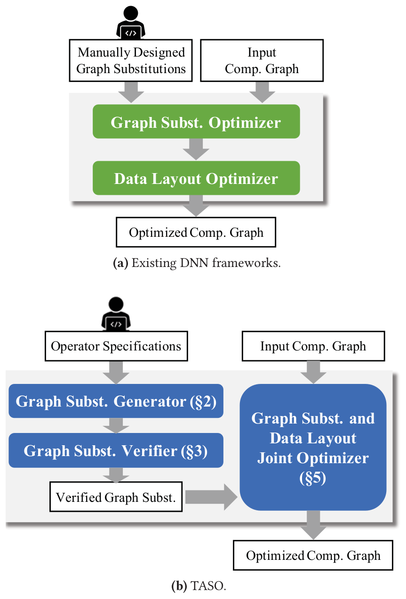

*图 1（原文 Figure 1，第 2 页）：现有 DNN 框架与 TASO 的计算图优化流程对比。*

**图中文字翻译与读法**：

- **(a) Existing DNN frameworks（现有 DNN 框架）**：左上的人形图标旁是 Manually Designed Graph Substitutions（人工设计的图替换），右上是 Input Comp. Graph（输入计算图）；二者进入 Graph Subst. Optimizer（图替换优化器），其输出再进入 Data Layout Optimizer（数据布局优化器），最终得到 Optimized Comp. Graph（优化后的计算图）。图替换与数据布局是**先后串联**的两个阶段，人力投入在“手写替换”上。
- **(b) TASO**：人形图标旁是 Operator Specifications（算子规格），它进入 Graph Subst. Generator（图替换生成器，原文第 2 节），再进入 Graph Subst. Verifier（图替换验证器，第 3 节），产出 Verified Graph Subst.（经验证的图替换）；它与 Input Comp. Graph 一起进入 Graph Subst. and Data Layout Joint Optimizer（图替换与数据布局联合优化器，第 5 节），得到 Optimized Comp. Graph。
- **读图结论**：TASO 把人力从“手写每条替换”换成“给每个算子写规格”；替换由生成器自动产生，由验证器保证正确；图替换和数据布局被放进同一个联合优化器里一起搜索。

论文把 TASO 与现有框架的区别概括为三点：（1）只需要算子的定义与规格，自动生成图替换，降低人工；（2）用形式化验证保证生成的图替换正确；（3）联合优化图替换与数据布局，得到显著更好的运行时性能。

**生成替换**：TASO 的图替换生成器在给定的 DNN 算子集合（例如 cuDNN 的 kernel）上，枚举直到某个固定大小的所有可能计算图，并在一组随机输入张量上执行它们；在随机输入上得到相同结果的任意两张计算图，被视为一条候选替换。为了高效找出所有这样的图对，TASO 建一个哈希表，按照计算图在随机输入上的输出哈希来存放计算图。

**形式化验证**：验证器依赖用户给出的**算子性质**（例如卷积的线性）来保证生成的替换正确。论文用到的 43 条性质见表 2。评估表明，每个算子只需一小组性质，就足以证明复杂替换的正确性。论文用基于一阶逻辑的符号表示来建模张量算子，这种表示不关心底层张量的大小，并能简洁地表达算子性质；验证器用自动定理证明器检查所有生成的替换。论文还给出一套开发算子性质的方法：（1）所需性质的发现由替换生成器引导；（2）算子性质本身会在小尺寸张量上经符号执行进一步验证。开发过程中，这套验证方法发现了算子规格里和替换生成器实现里的若干 bug。

**联合优化**：TASO 把图替换与数据布局变换集成到同一个表示里联合优化。它沿用 MetaFlow 的基于成本的回溯搜索，并扩展成本模型，使之也能刻画由不同数据布局带来的性能差异；搜索时在硬件上测量某个带特定布局的算子的性能，再用这些单个测量值预测整张带布局的计算图的性能。

### 2.4 论文的总括结论

- 在 5 个真实 DNN 上评测。对广泛使用且被现有框架重度优化的 ResNet-50，TASO 用长约 1,400 行的算子定义和规格，与手写规则的框架性能相当。
- 对 ResNeXt-50、NasRNN、NasNet-A 和 BERT 这类含新算子的新架构，TASO 通过自动发现新的图替换，比最先进的框架最高快 2.8 倍。
- 联合优化比“先图替换、后数据布局”的顺序优化还能再提升（原文写 1.2 倍，与图 12 的数字有出入，见第十节）。
- 所有实验中，TASO 找到优化后的计算图都不到 10 分钟。

## 三、图替换生成器（原文第 2 节）

### 3.1 什么是图替换（图 2）

一条**图替换**由三部分组成：（1）**源图**（source graph），与计算图里的子图匹配；（2）**目标图**（target graph），定义用来替换被匹配子图的、功能等价的新子图；（3）源图与目标图输入/输出张量之间的**映射关系**。（原文脚注：在有些超优化文献里，这里的“源”叫“目标”，这里的“目标”叫“重写”。）

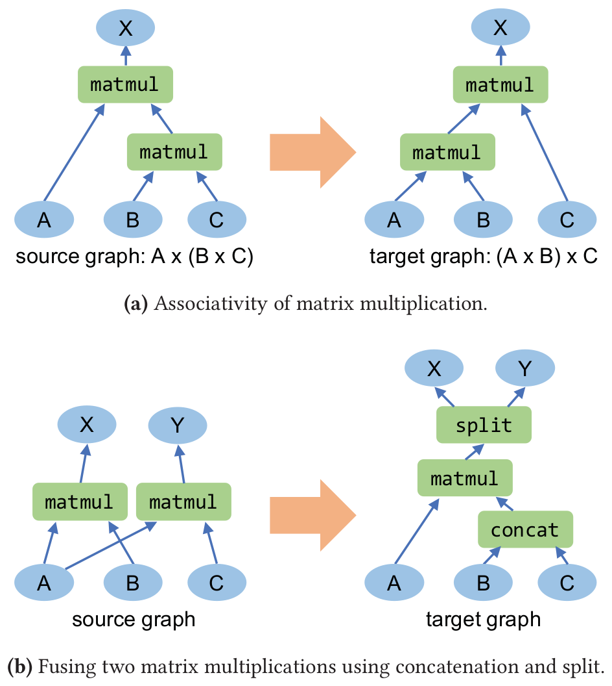

*图 2（原文 Figure 2，第 3 页）：图替换示例。*

**图中文字翻译与读法**：蓝色椭圆是输入/输出张量，绿色方框是算子，橙色大箭头表示替换。

- **(a) Associativity of matrix multiplication（矩阵乘的结合律）**：源图是 $A\times(B\times C)$（先算 B 乘 C，再用 A 去乘），目标图是 $(A\times B)\times C$，输出 X 相同。
- **(b) Fusing two matrix multiplications using concatenation and split（用拼接与切分融合两个矩阵乘）**：源图里两个 matmul 共享输入 A：X 是 A 与 B 的乘积，Y 是 A 与 C 的乘积；目标图先把 B、C 用 `concat`（拼接）合成一个张量，用一个 matmul 与 A 相乘，再用 `split`（切分）还原成 X 和 Y。
- **读图结论**：A、B、C、X、Y 标出源图与目标图之间输入输出张量的对应关系。

图替换与具体的张量形状无关，图 2 的替换可以用在任意具体形状的 A、B、C 上。有些算子还带**配置参数**决定行为：例如卷积的参数决定步长（stride）、填充（padding）和激活（例如把 relu 函数作为卷积的一部分），split 与 concat 的参数决定操作的轴。

### 3.2 拼接与切分：split tree（图 3）

concat 和 split 常用于融合共享输入的算子（图 2b）。split 把一个张量沿参数指定的维度切成两个不相交的子张量，这带来一个麻烦：**切分点既不能从输入张量推出，也不能从参数推出**。论文的观察是：split 总是在此前某次拼接的**拼接点**切开张量，以“撤销”最近一次 concat。据此给 split 定义语义：为张量的每一个维度维护一棵 **split tree**（切分树），记录拼接历史；于是替换不需要引入任何额外参数就能恢复切分点。通过嵌套 concat 与 split，这一做法也支持多路拼接与切分。

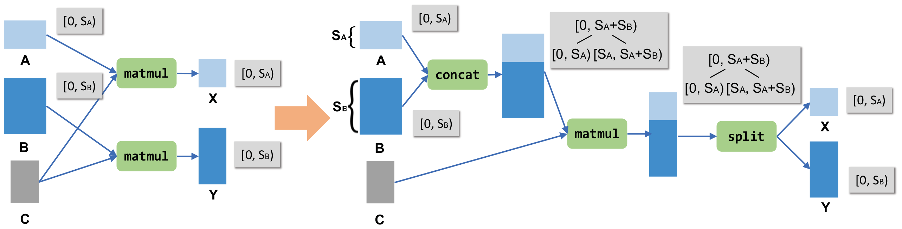

*图 3（原文 Figure 3，第 4 页）：融合共享输入的矩阵乘的图替换。目标图含一个 concat 和一个 split，二者都沿矩阵的行维度进行。每个张量行维度的切分树画在灰色框里。*

**图中文字翻译与读法**：

- **左（源图）**：张量 A 有 $S_A$ 行（浅蓝，行范围 $[0,S_A)$），B 有 $S_B$ 行（深蓝，行范围 $[0,S_B)$），C 是灰色的、被共享的第二个操作数。两个 matmul 分别计算 $A\times C\to X$（行范围 $[0,S_A)$）和 $B\times C\to Y$（行范围 $[0,S_B)$）。
- **右（目标图）**：先 `concat` 把 A、B 沿行方向拼成一个张量，其行范围是 $[0,S_A+S_B)$，**切分树**是一个根节点 $[0,S_A+S_B)$ 加两个孩子 $[0,S_A)$ 与 $[S_A,S_A+S_B)$；再做一次 matmul（与 C 相乘），结果的行维度沿用同一棵切分树；最后 `split` 按树根的两个孩子切开，得到 X（$[0,S_A)$）和 Y（$[0,S_B)$）。
- **读图结论**：切分树把“拼在哪里”记在张量上，所以 split 不需要带切分点参数，就能知道在 $S_A$ 处切开。（补充：图 3 里的字母与图 2b 不同：图 3 是共享第二个操作数 C、沿行拼接 A 和 B；图 2b 是共享第一个操作数 A、拼接 B 与 C，二者是同一类优化的两种形态。）

### 3.3 生成算法（Algorithm 1）

找出所有潜在替换，最直接的做法是对所有图对做等价性测试，需要二次方数量的测试。TASO 借用编译器**超优化**（superoptimization）里的想法：给每张图算一个**指纹**（fingerprint），即该图在若干特定输入上的输出的哈希。指纹不同的两张图一定不等价，因此只比较指纹相同的图，等价性测试的次数就大幅减少。实验里，所有指纹相同的图都被 TASO 验证为等价。生成分两步（下面是原文 Algorithm 1 的转录）：

```text
Algorithm 1: Graph substitution generation algorithm
Input:  A set of operators P, and a set of input tensors I.
Output: Candidate graph substitutions S.

// Step 1: enumerating potential graphs.
D = {}   // D is a graph hash table indexed by their fingerprints.
Build(1, ∅, I)
function Build(n, G, I)
    if G contains duplicated computation then
        return
    D = D + (FingerPrint(G), G)
    if n < threshold then
        for op ∈ P do
            for i ∈ I and i is a valid input to op do
                Add operator op into graph G.
                Add the output tensors of op into I.
                Build(n + 1, G, I)
                Remove operator op from G.
                Remove the output tensors of op from I.

// Step 2: testing graphs with identical fingerprint.
S = {}
for G1, G2 ∈ D with the same FingerPrint(·) do
    if G1 and G2 are equivalent for all test cases then
        S = S + (G1, G2)
return S
```

**第 1 步：枚举潜在计算图并收集指纹**。TASO 先用给定的算子集合，枚举直到某个大小的所有潜在计算图。构造一张图的方式是反复往当前图里加一个算子：枚举算子的种类和它的输入张量；输入可以是图的初始输入张量（图 2 的 A、B、C），也可以是此前某个算子的输出（图 2 中 matmul 与 concat 的输出）。Algorithm 1 的第 7 至 18 行是一个**深度优先搜索**，构造所有不含重复计算的无环计算图。“含重复计算”指图里有两个算子对相同的输入张量做相同的计算；生成器忽略这样的图，因为它们不是有用的计算图。

对每张图收集它的指纹，即把图在某些输入张量上求值得到的输出张量的哈希。TASO 同时用随机初始化的张量和若干常量作为输入，这样才能找到涉及常量张量（例如单位矩阵）的替换（例子见第 8.3 节）。为避免计算指纹时出现浮点误差，所有张量都用**整数**表示（采用论文引用的 Wu 等人的方法）。一张图的输出张量个数不定，所以哈希函数必须保证指纹与输出张量的排列无关。为此 TASO 用一个两步哈希：

$$
\mathrm{FingerPrint}(G)=\mathrm{hash}_2\big(\{\mathrm{hash}_1(t_i)\mid i\in \mathrm{Outputs}(G)\}\big)
$$

其中 $t_i$ 是图 $G$ 的输出张量；$\mathrm{hash}_1$ 计算一个输出张量的状态和内容，包括它的大小、形状和内容；$\mathrm{hash}_2$ 是作用在无序哈希值集合上的**对称**哈希函数。

**第 2 步：测试指纹相同的图**。对指纹相同的图，TASO 进一步在一组测试用例上检查它们的等价性。与收集指纹类似，每个测试用例含一组随机输入张量，两张图如果对所有测试用例都产生等价的输出张量，就通过测试。与指纹不同的是，这些测试用**浮点数**，取值在 −1 到 1 之间，只要两个输出张量的差不超过一个小阈值（评估里取 $10^{-5}$）就判为等价。论文观察到在这个阈值下，浮点测试与整数测试没有分歧；如果想过滤掉“对实数成立、但会产生浮点误差”的替换，也可以用更小的阈值。

通过随机测试的每一对图成为一条**候选图替换**的源图与目标图，源图与目标图输入输出张量之间的映射关系可以从测试用例里自动推断出来。所有候选替换随后送去验证器检查正确性（第四节），并在之后剪枝去除冗余替换（第五节）。

### 3.4 两个需要特殊处理的算子

上面的算法对具体的张量算子是通用的，但对 DNN 应用，有两个算子需要特殊处理：

- **relu**：relu 对所有负数输入返回 0。由于它常常返回 0，会使许多多余的替换“碰巧成立”。为避免生成这些替换，生成器把 relu 换成一个任意的**非线性函数**（实现里用 $x\mapsto x(x+1)+1$）。
- **enlarge**：该算子用零填充来增大张量，对融合卷积核大小不同的卷积很有用。但零的存在同样会产生许多多余的替换。为此生成器只考虑 enlarge 作用在**输入张量**上（即不作用在另一个算子的输出上）的计算图，这一限制保留了 enlarge 融合卷积的预期用法，又避免了多余替换。

### 3.5 随机测试靠得住吗

论文提醒，此前的编译器超优化工作（Bansal 与 Aiken）报告过用随机测试检查代码变换的**假阳性**：有若干不正确的代码变换通过了一组测试用例。TASO 在所有实验里没有观察到任何假阳性：对指纹相同的所有图对只用**一个**测试用例，通过它的替换都被验证器证明是正确的。论文认为这很可能是因为 DNN 算子的算术密度高、计算图里没有分支（if 语句）。作为参考，另一篇论文（Gulwani 与 Necula）表明，对只含线性算子的程序，两个不等价的程序在随机输入上产生相同输出的概率至多为 $1/d$，其中 $d$ 是一个变量可能取值的个数（TASO 里 $d=2^{32}$）。

## 四、图替换验证器（原文第 3 节）

验证替换的关键思路：用一小组用**一阶逻辑**表达的**算子性质**。这些性质是人工编写并复核的，并通过在小尺寸张量上符号执行算子、确认性质在这些尺寸上成立来进一步校验；性质的开发由替换生成器发现的替换来引导。

**建模**：验证时，用一阶逻辑建模张量算子，算子被表示成它的参数和输入张量的函数。例如 $\mathrm{conv}(s,p,c,x,y)$ 表示作用在张量 $x$ 和 $y$ 上的卷积算子，其中参数 $s$ 决定步长，$p$ 决定填充模式，$c$ 决定激活模式（例如把 relu 激活函数作为卷积 kernel 的一部分）。“不带激活的卷积（记作 $A_{\mathrm{none}}$）对第一个参数线性”这一事实，用下面的算子性质表达（$\mathrm{ewadd}$ 是逐元素张量加法）：

$$
\forall s,p,x,y,z.\ \mathrm{conv}(s,p,A_{\mathrm{none}},\mathrm{ewadd}(x,y),z)=\mathrm{ewadd}\big(\mathrm{conv}(s,p,A_{\mathrm{none}},x,z),\ \mathrm{conv}(s,p,A_{\mathrm{none}},y,z)\big)
$$

给定算子性质，论文用一阶定理证明器（实现里用 Z3，实验用的是 Z3 4.8.5 版）去验证所有生成的替换。这个验证相当于一阶逻辑里的**蕴含检查**：检查这些算子性质蕴含每条替换的源图与目标图功能等价。

**抽象程度**：用一阶逻辑建模算子带有一定的抽象，例如张量的形状没有被建模。论文发现这个抽象层次适合验证图替换。数据布局在验证中也被抽象掉：布局不影响算子语义，而优化器（第六节）保证布局被一致地使用。

### 4.1 算子与常量（表 1）

**表：TASO 包含的张量算子与常量张量（原文表 1，第 5 页）**。与现有 DNN 框架类似，池化和卷积算子支持不同的步长和填充模式（$P_{\mathrm{same}}$ 与 $P_{\mathrm{valid}}$）；卷积支持不同的激活函数（$A_{\mathrm{none}}$ 与 $A_{\mathrm{relu}}$）。

| 名称 | 说明 | 参数 |
|---|---|---|
| **张量算子** | | |
| `ewadd` | 逐元素加法 | |
| `ewmul` | 逐元素乘法 | |
| `smul` | 标量乘法 | |
| `transpose` | 转置 | |
| `matmul` | 批矩阵乘法（注 1） | |
| `conv` | 分组卷积（注 2） | 步长（stride）、填充（padding）、激活（activation） |
| `enlarge` | 用零填充卷积核（注 3） | 卷积核大小 |
| `relu` | Relu 算子 | |
| `pool_avg` | 平均池化 | 核大小、步长、填充 |
| `pool_max` | 最大池化 | 核大小、步长、填充 |
| `concat` | 拼接两个张量 | 拼接轴 |
| `split_{0,1}` | 切分成两个张量 | 切分轴 |
| **常量张量** | | |
| `C_pool` | 平均池化常量 | 核大小 |
| `I_conv` | 卷积单位核 | 核大小 |
| `I_matmul` | 矩阵乘单位矩阵 | |
| `I_ewmul` | 元素全为 1 的张量 | |

注 1：普通矩阵乘被看作批大小为 1。注 2：普通卷积和 depth-wise 卷积都是分组卷积的特例。注 3：增大卷积核的尺寸，限制只能作用在输入张量上。（原文表 1 脚注。）

读法：表中算子共 12 行（`split_{0,1}` 算一行，它有两个输出）、常量只有 4 种；正是这个小集合里的组合，生成了 743 条替换。`C_pool` 让平均池化可以写成 depth-wise 卷积（第 8.3 节）；`I_conv`、`I_matmul`、`I_ewmul` 分别是卷积、矩阵乘、逐元素乘法的单位元。

### 4.2 43 条算子性质（表 2）

**表：用于验证的算子性质（原文表 2，第 6 页）**。算子的定义见表 1，性质按所涉及的算子分组。逻辑变量 $w,x,y,z$ 是张量类型，变量 $a,c,k,p,s$ 是参数类型：$a$ 表示 concat 和 split 的轴，$c$ 表示卷积的激活模式，$k$ 表示池化的核形状，$p$ 表示卷积与池化的填充模式，$s$ 表示卷积与池化的步长。下面各表中，“性质”一列逐条转录原文公式（等宽字体，保留原文写法，原文的下标写成 `split_0`、`pool_avg` 这样的形式；每条公式开头的全称量词 ∀ 照原文保留），“说明”一列是原文右侧 Comment 一栏的中文翻译。

**（一）逐元素加、乘与标量乘（8 条）**

| 编号 | 性质 | 说明 |
|---|---|---|
| 1 | `∀x,y,z. ewadd(x, ewadd(y, z)) = ewadd(ewadd(x, y), z)` | ewadd 满足结合律 |
| 2 | `∀x,y. ewadd(x, y) = ewadd(y, x)` | ewadd 满足交换律 |
| 3 | `∀x,y,z. ewmul(x, ewmul(y, z)) = ewmul(ewmul(x, y), z)` | ewmul 满足结合律 |
| 4 | `∀x,y. ewmul(x, y) = ewmul(y, x)` | ewmul 满足交换律 |
| 5 | `∀x,y,z. ewmul(ewadd(x, y), z) = ewadd(ewmul(x, z), ewmul(y, z))` | 分配律 |
| 6 | `∀x,y,w. smul(smul(x, y), w) = smul(x, smul(y, w))` | smul 满足结合律 |
| 7 | `∀x,y,w. smul(ewadd(x, y), w) = ewadd(smul(x, w), smul(y, w))` | 分配律 |
| 8 | `∀x,y,w. smul(ewmul(x, y), w) = ewmul(x, smul(y, w))` | 算子可交换 |

**（二）转置（4 条）**

| 编号 | 性质 | 说明 |
|---|---|---|
| 9 | `∀x. transpose(transpose(x)) = x` | transpose 的逆是它自己 |
| 10 | `∀x,y. transpose(ewadd(x, y)) = ewadd(transpose(x), transpose(y))` | 算子可交换 |
| 11 | `∀x,y. transpose(ewmul(x, y)) = ewmul(transpose(x), transpose(y))` | 算子可交换 |
| 12 | `∀x,w. smul(transpose(x), w) = transpose(smul(x, w))` | 算子可交换 |

**（三）矩阵乘（4 条）**

| 编号 | 性质 | 说明 |
|---|---|---|
| 13 | `∀x,y,z. matmul(x, matmul(y, z)) = matmul(matmul(x, y), z)` | matmul 满足结合律 |
| 14 | `∀x,y,w. smul(matmul(x, y), w) = matmul(x, smul(y, w))` | matmul 是线性的 |
| 15 | `∀x,y,z. matmul(x, ewadd(y, z)) = ewadd(matmul(x, y), matmul(x, z))` | matmul 是线性的 |
| 16 | `∀x,y. transpose(matmul(x, y)) = matmul(transpose(y), transpose(x))` | matmul 与 transpose |

**（四）卷积（5 条）**

| 编号 | 性质 | 说明 |
|---|---|---|
| 17 | `∀s,p,c,x,y,w. conv(s, p, c, smul(x, w), y) = conv(s, p, c, x, smul(y, w))` | conv 是双线性的 |
| 18 | `∀s,p,x,y,w. smul(conv(s, p, A_none, x, y), w) = conv(s, p, A_none, smul(x, w), y)` | conv 是双线性的 |
| 19 | `∀s,p,x,y,z. conv(s, p, A_none, x, ewadd(y, z)) = ewadd(conv(s, p, A_none, x, y), conv(s, p, A_none, x, z))` | conv 是双线性的 |
| 20 | `∀s,p,x,y,z. conv(s, p, A_none, ewadd(x, y), z) = ewadd(conv(s, p, A_none, x, z), conv(s, p, A_none, y, z))` | conv 是双线性的 |
| 21 | `∀s,c,k,x,y. conv(s, P_same, c, x, y) = conv(s, P_same, c, x, enlarge(k, y))` | 增大卷积核（enlarge） |

**（五）激活（2 条）**

| 编号 | 性质 | 说明 |
|---|---|---|
| 22 | `∀s,p,x,y. conv(s, p, A_relu, x, y) = relu(conv(s, p, A_none, x, y))` | 带 A_relu 的 conv 应用 relu |
| 23 | `∀x. relu(transpose(x)) = transpose(relu(x))` | 算子可交换 |

**（六）常量张量（4 条）**

| 编号 | 性质 | 说明 |
|---|---|---|
| 24 | `∀s,p,x,k. conv(s, p, A_none, x, C_pool(k)) = pool_avg(k, s, p, x)` | 用 C_pool 做卷积即池化 |
| 25 | `∀k,x. conv(1, P_same, A_none, x, I_conv(k)) = x` | 单位卷积核 |
| 26 | `∀x. matmul(x, I_matmul) = x` | 单位矩阵 |
| 27 | `∀x. ewmul(x, I_ewmul) = x` | ewmul 的单位元 |

**（七）切分的定义与拼接的几何（3 条）**

| 编号 | 性质 | 说明 |
|---|---|---|
| 28 | `∀a,x,y. split_0(a, concat(a, x, y)) = x` | split 的定义 |
| 29 | `∀a,x,y. split_1(a, concat(a, x, y)) = y` | split 的定义 |
| 30 | `∀x,y,z,w. concat(0, concat(1, x, y), concat(1, z, w)) = concat(1, concat(0, x, z), concat(0, y, w))` | 拼接的几何性质 |

**（八）拼接与其他算子的交互（13 条）**

| 编号 | 性质 | 说明 |
|---|---|---|
| 31 | `∀a,x,y,w. concat(a, smul(x, w), smul(y, w)) = smul(concat(a, x, y), w)` | 算子可交换 |
| 32 | `∀a,x,y,z,w. concat(a, ewadd(x, y), ewadd(z, w)) = ewadd(concat(a, x, z), concat(a, y, w))` | 算子可交换 |
| 33 | `∀a,x,y,z,w. concat(a, ewmul(x, y), ewmul(z, w)) = ewmul(concat(a, x, z), concat(a, y, w))` | 算子可交换 |
| 34 | `∀a,x,y. concat(a, relu(x), relu(y)) = relu(concat(a, x, y))` | 算子可交换 |
| 35 | `∀x,y. concat(1, transpose(x), transpose(y)) = transpose(concat(0, x, y))` | 拼接与转置 |
| 36 | `∀x,y,z. concat(1, matmul(x, y), matmul(x, z)) = matmul(x, concat(1, y, z))` | 拼接与矩阵乘 |
| 37 | `∀x,y,z,w. matmul(concat(1, x, z), concat(0, y, w)) = ewadd(matmul(x, y), matmul(z, w))` | 拼接与矩阵乘 |
| 38 | `∀s,p,c,x,y,z. concat(0, conv(s, p, c, x, z), conv(s, p, c, y, z)) = conv(s, p, c, concat(0, x, y), z)` | 拼接与卷积 |
| 39 | `∀s,p,c,x,y,z. concat(1, conv(s, p, c, x, y), conv(s, p, c, x, z)) = conv(s, p, c, x, concat(0, y, z))` | 拼接与卷积 |
| 40 | `∀s,p,x,y,z,w. conv(s, p, A_none, concat(1, x, z), concat(1, y, w)) = ewadd(conv(s, p, A_none, x, y), conv(s, p, A_none, z, w))` | 拼接与卷积 |
| 41 | `∀k,s,p,x,y. concat(1, pool_avg(k, s, p, x), pool_avg(k, s, p, y)) = pool_avg(k, s, p, concat(1, x, y))` | 拼接与池化 |
| 42 | `∀k,s,p,x,y. concat(0, pool_max(k, s, p, x), pool_max(k, s, p, y)) = pool_max(k, s, p, concat(0, x, y))` | 拼接与池化 |
| 43 | `∀k,s,p,x,y. concat(1, pool_max(k, s, p, x), pool_max(k, s, p, y)) = pool_max(k, s, p, concat(1, x, y))` | 拼接与池化 |

（原文表 2，第 6 页。共 8+4+4+5+2+4+3+13=43 条，与正文的“43 条算子性质”一致。）

读法：这些性质本身是“局部的小定理”，例如结合律、线性、交换性、单位元、拼接与算子的可交换性。验证器的工作是用它们做推理，证明一条候选替换的两张图等价。（补充：笔者对图 2b 的推演，只为说明验证是怎么回事：目标图的 X 是 $\mathrm{split}_0(1,\ \mathrm{matmul}(A,\mathrm{concat}(1,B,C)))$。由性质 36 从右向左改写，得到 $\mathrm{split}_0(1,\ \mathrm{concat}(1,\ \mathrm{matmul}(A,B),\ \mathrm{matmul}(A,C)))$；再由性质 28（split 的定义）得到 $\mathrm{matmul}(A,B)$，正是源图的 X。同理由性质 29 得到 Y。）

### 4.3 如何开发算子性质，以及对性质本身的校验

**开发方法**：论文按迭代过程，根据需要来开发算子性质。开发中运行替换生成器，并尝试验证所有发现的替换；如果某条替换验证不了、而它看起来是对的，就补上合适的性质。为防止性质本身写错，论文做了进一步校验：

- **在小尺寸上穷举验证性质**：TASO 对算子性质本身，在所有的参数取值组合和直到一个小上界的张量大小上做验证（评估里上界是 4×4×4×4）。这要求每个张量算子有一个基本的、用 Python 写的符号实现。TASO 对小尺寸张量符号执行这个实现，把张量运算展开成符号实数算术表达式，激活函数（如 relu）用“未解释函数”建模；然后再用 Z3 作为实数理论的 SMT 求解器，来验证算子性质。例如，如果用户试图加入一条（错误的）性质，声称卷积对所有激活模式（包括 relu 激活）都是线性的，这一检查就会表明这条性质不被真实算子满足。
- **一致性与无冗余检查**：TASO 检查这组算子性质是自洽的，且不含冗余（即不存在被其他性质蕴含的性质），这相当于一阶蕴含检查。这些检查也有助于发现错误的性质，并且比小尺寸验证便宜。

**发现的 bug 与工作量**：开发过程中，验证方法发现了几个微妙的 bug：有些替换生成器里的 bug，是在生成器产生了无法验证的替换时被发现的；上面的校验步骤发现了若干候选算子性质里的 bug。论文的经验是：支持一个新算子只需少量工作，通常是专家几个小时的工作量，通常每个算子需要写几条性质。

**验证成绩**：评估里，论文用 43 条算子性质（表 2）验证了所有 743 条生成的图替换。

## 五、冗余替换的剪枝（原文第 4 节）

一条图替换如果被一条更一般的有效替换所包含，就是**冗余**的。论文的所有剪枝步骤都保留所有的优化机会：如果图 $G$ 可以用一串替换变成图 $G'$，那么剪枝之后，$G$ 总还可以变成 $G'$（可能用的是另一组变换）。

**输入张量重命名**：TASO 消除那些与其他替换在“改输入张量名字”意义上相同的替换。例如图 4a 里的冗余替换，只要把图 2a 里的输入 C 改名为 A 就等价于图 2a；对这类通过输入张量重命名而等价的替换，TASO 只保留一条最一般的。

**公共子图**：TASO 还尝试消除源图与目标图含有公共子图的替换，识别出两种会导致剪枝的公共子图。

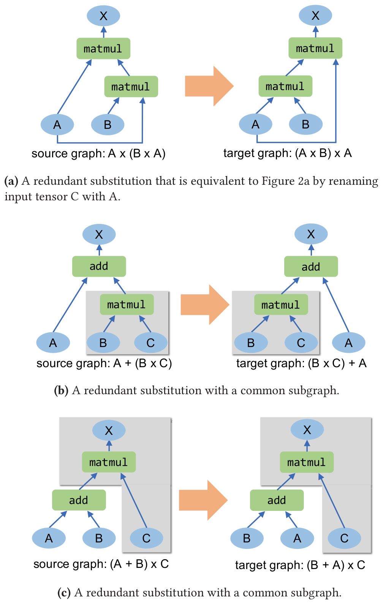

*图 4（原文 Figure 4，第 7 页）：TASO 剪枝掉的冗余替换示例。Matmul 与 Add 分别指矩阵乘和逐元素加法。每张子图里 A、B、C 是输入张量，X 是输出张量。*

**图中文字翻译与读法**：

- **(a) 与图 2a 等价的冗余替换（A 与 C 重命名）**：源图 $A\times(B\times A)$，目标图 $(A\times B)\times A$。这就是图 2a 把 C 换成 A，属于输入张量重命名。
- **(b) 含公共子图的冗余替换（形式一）**：源图 $A+(B\times C)$，目标图 $(B\times C)+A$。灰色框是两边都有的公共子图 $B\times C$，它的输出是其他算子（加法）的输入。把公共子图换成一个新的输入张量，就得到更一般的替换（加法交换律）；如果这条更一般的替换成立，就剪掉不够一般的这条。
- **(c) 含公共子图的冗余替换（形式二）**：源图 $(A+B)\times C$，目标图 $(B+A)\times C$。灰色框里的公共子图包含了源图与目标图的**全部输出**（matmul 及其结果）；这时把公共子图整个删掉，让它的输入成为源图与目标图新的输出，就得到更一般的替换（$A+B$ 换成 $B+A$）。
- **读图结论**：两种公共子图都说明，原替换只是某条更一般替换的“带上下文的特例”，保留更一般的就够了。

**表：依次应用各剪枝技术后剩余的图替换数量（原文表 3，第 8 页）**

| 剪枝技术 | 剩余替换数 | 相对初始的缩减 |
|---|---:|---:|
| 初始（Initial） | 28744 | 1× |
| 输入张量重命名（Input tensor renaming） | 17346 | 1.7× |
| 公共子图（Common subgraph） | 743 | 39× |

（原文表 3，第 8 页。）读法：两种剪枝都起了重要作用，合起来使 TASO 需要考虑的替换数量缩小 39 倍；最后留下的 743 条正是后面被验证的、也是评估里使用的替换。

## 六、联合优化器（原文第 5 节）

优化器同时优化数据布局和图替换。它采用 MetaFlow 的基于成本的回溯搜索，用已验证的替换去搜索一张优化后的计算图；TASO 扩展了 MetaFlow 的搜索算法，使其在应用替换时也考虑可能的布局优化机会。

### 6.1 替换时枚举布局（图 5）

对一个匹配的子图应用一条替换时，可以根据源图里各张量的数据布局，以及算子所支持的布局，来枚举目标图里各张量可能的布局。于是对一张匹配的计算图应用一条替换，可能得到**图结构相同、数据布局不同**的多张图。

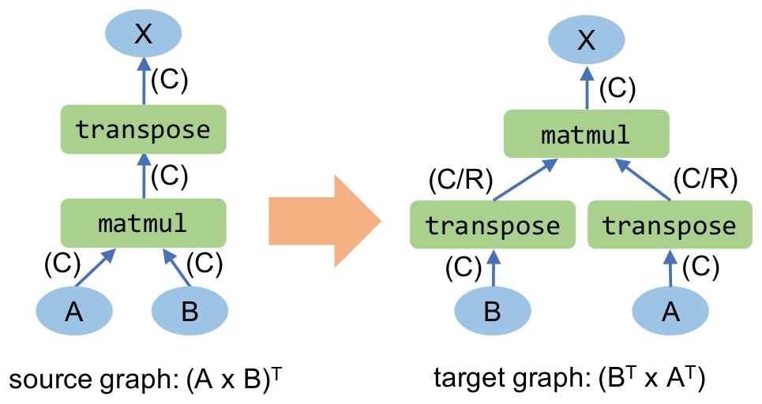

*图 5（原文 Figure 5，第 8 页）：一条利用矩阵乘的转置的图替换。matmul 与 transpose 分别表示矩阵乘与转置；括号里是源图与目标图中每个张量可能的布局，C 与 R 分别表示张量的列主序与行主序布局。*

**图中文字翻译与读法**：

- **源图 $(A\times B)^{\mathsf T}$**：A、B 的布局都是 (C)（列主序），matmul 的输出 (C)，transpose 的输出 (C)，最终 X 是 (C)。
- **目标图 $B^{\mathsf T}\times A^{\mathsf T}$**：先对 B、A 各做一个 transpose（输入布局都是 (C)），它们的输出布局标成 (C/R)，即列主序或行主序都可以；再做 matmul，输出 X 必须是 (C)。
- **读图结论**：目标图里与源图“映射”的张量（A、B、X）的布局必须与源图一致；两个中间张量可以取行主序或列主序，所以 TASO 在应用这条替换时要考虑四张不同的计算图（两个中间张量的布局记作 CC、CR、RC、RR）。这使 TASO 能抓住应用图替换时潜在的布局变换机会。

### 6.2 成本模型与基于成本的回溯搜索（Algorithm 2）

成本模型的动机是：DNN 算子执行的是稠密线性代数、没有分支，所以给定相同的数据布局与配置参数（例如卷积的步长和填充），它们在硬件上的性能高度一致、可预测。与 MetaFlow 类似，TASO 对每种配置与数据布局，把一个 DNN 算子的执行时间**测量一次**，再用图里各算子测得的执行时间**之和**来估计整张图的性能。

```text
Algorithm 2: Cost-Based Backtracking Search
Input:  an input graph G_in, verified substitutions S, a cost model Cost(·), and a hyper parameter α.
Output: an optimized graph.

P = {G_in}   // P is a priority queue sorted by Cost.
while P ≠ {} do
    G = P.dequeue()
    for substitution s ∈ S do
        // Layout(G, s) returns possible layouts applying s on G.
        for layout l ∈ Layout(G, s) do
            // Apply(G, s, l) applies s on G with layout l.
            G' = Apply(G, s, l)
            if G' is valid then
                if Cost(G') < Cost(G_opt) then
                    G_opt = G'
                if Cost(G') < α × Cost(G_opt) then
                    P.enqueue(G')
return G_opt
```

搜索过程：所有候选图放在一个**优先队列** $P$ 里，按成本从小到大出队。对每张出队的图 $G$，TASO 考虑每条已验证的替换，以及适用于该替换的各种可能布局，并应用它们得到功能等价的新图 $G'$；最后返回找到的最佳图 $G_{\mathrm{opt}}$。

**超参数 $\alpha$**：搜索空间由 $\alpha$ 剪枝，它直接丢弃所有成本比已找到的最佳图差 $\alpha$ 倍的图。$\alpha$ 在搜索时间与所能找到的最佳图之间做折中：$\alpha=1$ 时搜索退化为不带回溯的简单贪心算法，$\alpha$ 越大搜索探索的候选越多、回溯越多。论文观察到 $\alpha=1.05$ 性能较好，并在评估里使用这个值（与 MetaFlow 相同）。

### 6.3 替换可能引入环（图 6）

图替换有一个不太显然的性质：应用它可能给图**引入环**。计算图必须无环，所以 TASO 在把 $G'$ 加入队列 $P$ 之前要检查它是否无环（Algorithm 2 的第 12 行“G' is valid”）。

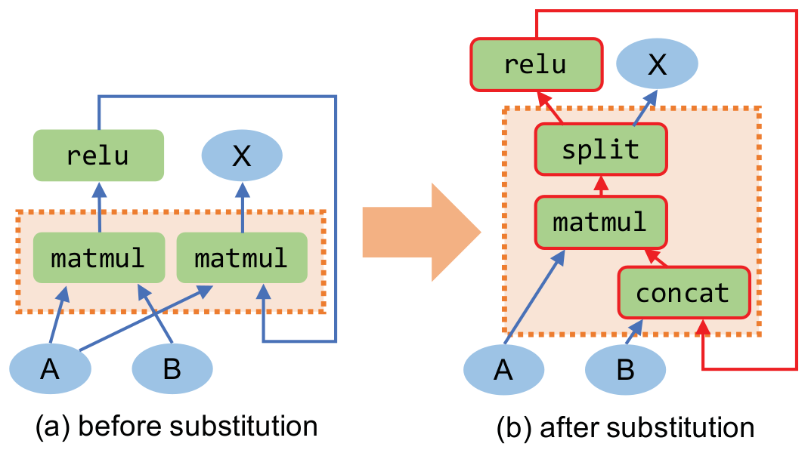

*图 6（原文 Figure 6，第 9 页）：一个把环引入计算图的图替换示例。A、B 是输入，X 是输出。原图计算 $A\times\mathrm{relu}(A\times B)$，新图是对其应用图 2b 的替换（用拼接与切分融合两个矩阵乘）的结果。替换的源图与目标图用虚线框标出。原图和替换本身都是无环的，但得到的图含有一个环（红色标出）。*

**图中文字翻译与读法**：

- **(a) before substitution（替换前）**：虚线框里是两个共享输入 A 的 matmul：左边的 matmul（A、B 输入）输出经 `relu` 后，作为右边 matmul 的另一个输入；右边 matmul 的输出是 X。所以 $X=A\times\mathrm{relu}(A\times B)$。
- **(b) after substitution（替换后）**：虚线框里是融合后的 `concat`（拼接 B 与 relu 的输出）、`matmul`（与 A 相乘）和 `split`（切分），split 的两个输出分别连到 `relu` 和 X；红色线表示 `relu` 的输出又回到 `concat` 的输入。
- **读图结论**：新图中 `concat` 依赖 `relu`，`relu` 依赖 `split`，`split` 依赖 `matmul`，`matmul` 又依赖 `concat`，构成环（红色）。融合两个“前一个的输出是后一个的输入”的算子是不合法的，这就是需要无环检查的原因。

## 七、实现（原文第 6 节）

TASO 被设计和实现成一个通用、可扩展的张量计算图优化器，便于加入新的张量算子。当前实现包含的算子见表 1。有些算子还依赖额外的参数决定行为，例如卷积的步长、填充和激活。除算子之外，TASO 还有四类在替换里有用的常量张量：$I_{\mathrm{ewmul}}$、$I_{\mathrm{matmul}}$ 和 $I_{\mathrm{conv}}$ 分别是逐元素乘法、矩阵乘、卷积的单位张量；$C_{\mathrm{pool}}$ 允许把平均池化算子转成 depth-wise 卷积（例子见第 8.3 节）。

**加入新算子要提供什么**：对每个算子，TASO 需要两种输入：（1）算子的**参考实现**，包括替换生成器使用的具体实现（C++）和用来校验算子规格的符号实现（Python）；（2）**算子性质的规格**。论文的经验是加入一个新算子需要专家几个小时的工作。对规格还缺失的新算子，TASO 把它当作**不透明算子**，仍可以用已验证的替换优化图的其余部分。

**规模**：TASO 构建在 MetaFlow 之上，复用 MetaFlow 的基于成本的回溯搜索。整体上，TASO 的实现有约 **8,000 行**核心组件代码（替换生成器、验证器和优化器），以及 **1,400 行**算子参考实现代码（包含那 43 条算子性质）。

**框架无关**：TASO 可以接到 TensorRT、TVM 等现有 DNN 框架里，只需把优化后的图按目标框架的输入格式输出。评估里论文在 TensorRT 和 TVM 上演示了这种可移植性，表明它们可以直接使用 TASO 的优化来提升性能。

## 八、实验（原文第 7 节）

论文评估三个问题：（1）TASO 能否在可接受的运行时间里自动生成并验证图替换？（2）TASO 能否提升真实 DNN 的端到端性能，尤其是含新近引入算子的新架构？（3）TASO 联合优化计算图和数据布局，是否比分开优化性能更好？

### 8.1 实验设置

| 项目 | 设置（原文第 7.1 节） |
|---|---|
| DNN | ResNet-50（广泛使用的图像分类卷积网络，ILSVRC 竞赛最佳）；ResNeXt-50（引入分组卷积，改进 ResNet-50 的精度与运行效率）；NasNet-A 与 NasRNN（由神经架构搜索自动发现的两种架构，分别在图像分类与语言建模上超过人工设计）；BERT（语言表示架构） |
| 硬件 | Amazon p3.2xlarge 实例：8 核 Intel E5-2600 CPU、64 GB DRAM、1 块 NVIDIA Tesla V100 GPU |
| 生成替换 | 用表 1 的全部算子，枚举最多 4 个算子的所有潜在计算图；约 5 分钟生成 743 条候选替换 |
| 搜索 | 基于成本的回溯搜索，$\alpha=1.05$（与 MetaFlow 相同）；所有实验里找到优化后计算图的端到端搜索时间都少于 10 分钟 |
| 端到端对比对象 | TensorFlow、TensorFlow XLA、TensorRT、TVM、MetaFlow 与 TASO，都在一块 V100 上；TensorFlow、TF XLA、TensorRT、MetaFlow 用高度工程化的 cuDNN 和 cuBLAS 库在 GPU 上执行算子，TVM 为算子生成定制的 GPU kernel；为排除不同算子库的影响，TASO 同时在两种后端上评测 |
| TVM kernel 生成 | 允许 auto-tuner 跑 2000 次试验，取每个算子找到的最佳配置；为一个 DNN 算子调优一个 GPU kernel 平均需要 2 小时 |
| TASO 的 TVM 后端 | TASO 的成本模型要查询数百个 DNN 算子的执行时间，所以对 TVM 后端，复用 cuDNN 后端找到的最佳计算图，假定算子在 cuDNN 中的成本是它在 TVM 中成本的合理估计 |

### 8.2 端到端结果（图 7）

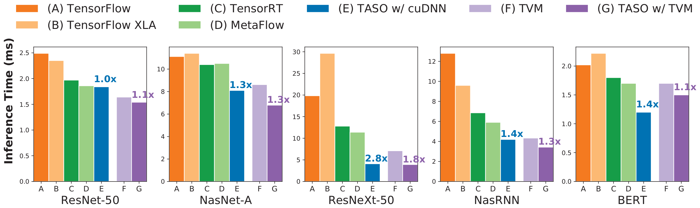

*图 7（原文 Figure 7，第 11 页）：现有 DNN 框架与 TASO 的端到端推理性能对比。实验用单个推理样本，所有数字均为在 NVIDIA V100 GPU 上平均 1,000 次运行的结果。TASO 的性能在 cuDNN 与 TVM 两种后端上评测。对每个 DNN 架构，TASO 柱上方的数字是相对**同一后端上最好的现有方法**的加速比。*

**图中文字翻译与读法**：五个子图是五个模型（ResNet-50、NasNet-A、ResNeXt-50、NasRNN、BERT），纵轴 Inference Time (ms)（推理时间，越小越好，各子图量程不同）。每个子图 7 根柱，横轴字母对应图例：(A) TensorFlow，(B) TensorFlow XLA，(C) TensorRT，(D) MetaFlow，(E) TASO w/ cuDNN（TASO，cuDNN 后端），(F) TVM，(G) TASO w/ TVM（TASO，TVM 后端）。A 至 E 同属 cuDNN/cuBLAS 阵营，F、G 同属 TVM。从图上量出的近似值（单位 ms；量取误差：ResNet-50 与 BERT 约 ±0.01，NasNet-A 与 NasRNN 约 ±0.03，ResNeXt-50 约 ±0.1，保留两位小数只为方便对比）：

| 模型 | (A) TensorFlow | (B) TF XLA | (C) TensorRT | (D) MetaFlow | (E) TASO（cuDNN） | (F) TVM | (G) TASO（TVM） |
|---|---:|---:|---:|---:|---:|---:|---:|
| ResNet-50 | 约 2.48 | 约 2.34 | 约 1.96 | 约 1.85 | 约 1.83 | 约 1.63 | 约 1.53 |
| NasNet-A | 约 11.06 | 约 11.35 | 约 10.35 | 约 10.44 | 约 8.05 | 约 8.56 | 约 6.74 |
| ResNeXt-50 | 约 19.75 | 约 29.53 | 约 12.70 | 约 11.29 | 约 4.01 | 约 6.99 | 约 3.82 |
| NasRNN | 约 12.74 | 约 9.55 | 约 6.82 | 约 5.85 | 约 4.15 | 约 4.30 | 约 3.39 |
| BERT | 约 2.01 | 约 2.21 | 约 1.79 | 约 1.69 | 约 1.19 | 约 1.69 | 约 1.49 |

柱上方标注的、原文给出的加速比（TASO 相对同一后端的最好现有方法）：

| 模型 | TASO（cuDNN）相对 A 至 D 中最好者 | TASO（TVM）相对 TVM |
|---|---:|---:|
| ResNet-50 | 1.0× | 1.1× |
| NasNet-A | 1.3× | 1.3× |
| ResNeXt-50 | 2.8× | 1.8× |
| NasRNN | 1.4× | 1.3× |
| BERT | 1.4× | 1.1× |

（原文图 7 柱上标注。笔者用上表的量取值验算，各格都与标注吻合，例如 ResNeXt-50 上最好的现有方法是 MetaFlow 的约 11.29 ms，除以 TASO 的约 4.01 ms 得 2.8。）

**读图结论**：

- **ResNet-50 持平**：它被现有框架重度优化。TASO 取得了与现有框架相当的性能（1.0×），说明 TASO 能**自动发现专家手工设计的图替换**。
- **其余 4 个架构有新算子和新图结构**：TASO 在 cuDNN 后端上快 1.3 至 2.8 倍，在 TVM 后端上快 1.1 至 1.8 倍。加速来自两点：（1）为新算子自动发现有优化作用的替换；（2）联合优化图替换与数据布局。论文在 8.3 和 8.4 节分析 TASO 发现了哪些替换，在 8.5 节分析联合优化。
- **读图时的两个条件**：一是“最好的现有方法”按同一后端取（cuDNN 阵营里取 A 至 D 最好者，TVM 阵营里取 F），不是所有基线里最好者；二是 TASO（TVM）用的是 cuDNN 后端搜出的图，没有针对 TVM 的成本重新搜索（见 8.1 的设置）。这些数字是单个推理样本在单块 V100 上的结果，没有批大小扫描。

### 8.3 替换案例分析：NasNet-A（图 8）

NasNet-A 是在 CIFAR-10 数据集上找到的最好的 CNN 架构，由神经架构搜索得到。与人工设计的架构不同，它含有非常规的图结构，很难用为较标准的 DNN 架构设计的手写替换去优化。下面是 TASO 发现的两个替换例子，都不存在于任何现有 DNN 框架里。

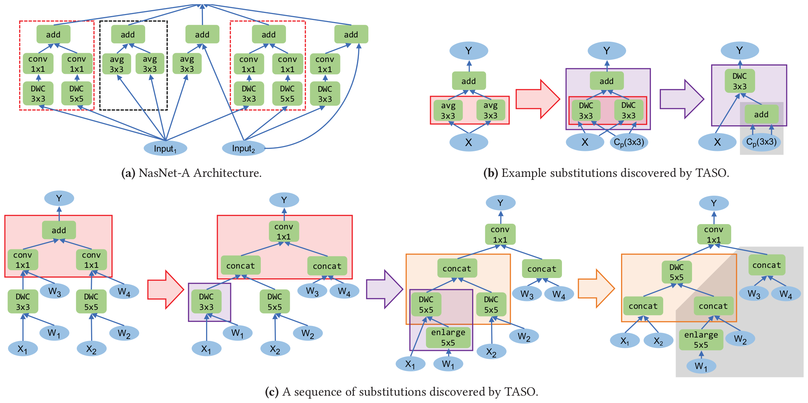

*图 8（原文 Figure 8，第 11 页）：NasNet-A 架构以及 TASO 为优化它发现的替换。图 8a 是架构，其中 avg、conv、DWC 分别指平均池化、卷积和 depth-wise 卷积，为简洁省去了权重张量。图 8b 与图 8c 是 TASO 发现的两串替换，分别用来优化图 8a 里黑框与红框标出的子图。在图 8b、8c 里，每个箭头表示一次替换，同一颜色的子图是该次替换的源图与目标图。图 8b 里的 $C_{\mathrm{pool}}(3\times3)$ 是一个所有元素为 1/9 的常量矩阵（见表 1）。图 8c 里的 enlarge 算子用额外的 0 填充权重（即 $W_1$）来增大卷积核。对推理负载，图 8b 与图 8c 里灰色区域的算子只依赖预训练权重（即 $W_i$），因此可以预先计算。*

**图中文字翻译与读法**：

- **(a) NasNet-A 架构**：一个卷积 cell，输入是 Input1、Input2，里面有 5 路并行的 `add`，5 路的结果最后汇合。每路的结构各不相同：第 1 路和第 4 路（红色虚线框）是“DWC 3×3 加 conv 1×1”与“DWC 5×5 加 conv 1×1”两个分支相加；第 2 路（黑色虚线框）是两个 avg 3×3 相加；第 3 路是一个 avg 3×3 与一条直连输入相加；第 5 路是“DWC 3×3 加 conv 1×1”与一条直连输入相加。图 8b 优化黑框，图 8c 优化红框。
- **(b) 黑框子图（两个平均池化相加）的替换序列**：第一步（红框到紫框）：把两个 `avg 3×3` 各换成 `DWC 3×3`，其卷积核是常量 $C_{\mathrm{pool}}(3\times3)$（所有元素 1/9）；第二步（紫框到最右）：两个共享输入 X 的 `DWC 3×3`、权重分别是 $C_{\mathrm{pool}}$，再相加，被融合成**一个** `DWC 3×3`，其权重是两个权重相加（灰色区域里的那个 `add`，只依赖常量，可预先算好）。
- **(c) 红框子图（两个“深度可分离卷积加 1×1 卷积”相加）的替换序列**，共三次替换：先把“两个 conv 1×1 的输出相加”换成“对拼接后的输入与拼接后的权重（$W_3$ 与 $W_4$ 拼接）做一次 conv 1×1”；再把 `DWC 3×3` 通过 `enlarge 5×5`（用 0 把 $W_1$ 补成 5×5 卷积核）改成 `DWC 5×5`；最后把两个 `DWC 5×5`（输入 $X_1$、$X_2$，权重 $\mathrm{enlarge}(W_1)$、$W_2$）融合成一个 `DWC 5×5`，作用在拼接后的 $X_1,X_2$ 与拼接后的权重上。最终得到“一个 DWC 5×5 加一个标准 conv 1×1”。
- **读图结论**：（b）把池化改写成卷积，再利用卷积的线性（表 2 的性质 19、24）合并；（c）把多个小算子融合成少数大算子，**增大算子粒度、减少算子启动开销**。对推理负载，只依赖预训练权重的算子（灰色区域）可以预处理，进一步缩短推理时间。

**（b）里的数学**：平均池化的公式是

$$
o(n,c,x,y)=\frac{1}{K_X\times K_Y}\sum_{k_x}\sum_{k_y} i(n,c,x+k_x,\,y+k_y)
$$

其中 $K_X$、$K_Y$ 是池化窗口的高与宽；depth-wise 卷积的公式是

$$
o(n,c,x,y)=\sum_{k_x}\sum_{k_y} i(n,c,x+k_x,\,y+k_y)\times w(c,k_x,k_y)
$$

当 $w(c,k_x,k_y)=1/(K_X\times K_Y)$ 时，二者在数学上等价；这就是 $C_{\mathrm{pool}}$ 的作用（表 2 性质 24）。随后，TASO 还利用卷积的线性（性质 19）把两个 depth-wise 卷积融合成一个。

### 8.4 替换案例分析：ResNeXt-50（图 9）

ResNeXt-50 把 ResNet-50 里的大卷积换成多个分支、每个分支是小得多的卷积，以同时改善精度与运行效率。但直接启动这些小卷积会带来很高的 kernel 启动开销。cuDNN 库最近引入了**分组卷积** kernel，可以用单个 CUDA kernel 并行执行多个卷积。TensorFlow 和 TensorFlow XLA（截至 2019 年 8 月的 r1.14）不支持分组卷积，所以最快的 ResNeXt-50 实现是分别启动多分支卷积，kernel 启动开销很大；TensorRT 和 MetaFlow 用一个分组卷积 kernel，并行算一组共 32 个卷积。分组卷积带来额外的并行并减少 kernel 启动开销，但也需要更大的缓存来保存所有卷积的中间状态，所以当一个 kernel 里聚合的卷积太多时，运行性能反而下降。

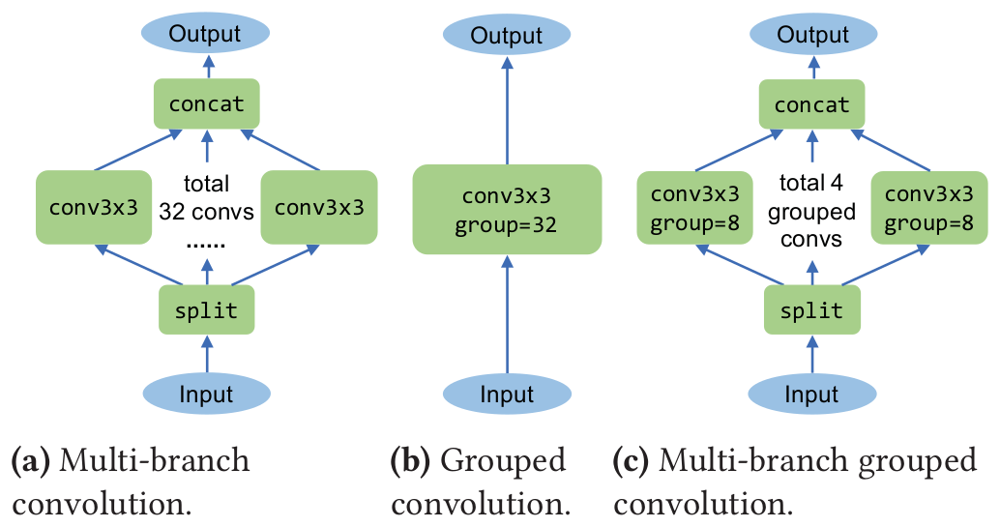

*图 9（原文 Figure 9 的 (a) 至 (c)，第 12 页）：ResNeXt-50 里多路（multi-batch）卷积的不同实现方式及其性能对比。TensorFlow 和 TensorFlow XLA 分别启动 32 个卷积（图 9a）；TensorRT 和 MetaFlow 启动单个分组卷积 kernel，并行计算全部 32 个卷积（图 9b）；TASO 找到的最佳图用 4 个分组卷积，每个计算 8 个卷积（图 9c）。*

**图中文字翻译与读法**：三种实现都从 Input 出发，到 Output 结束。

- **(a) Multi-branch convolution（多分支卷积）**：`split` 把输入切成 32 份，各接一个 `conv3x3`（图中标 “total 32 convs”，共 32 个卷积），再 `concat`（拼接）。
- **(b) Grouped convolution（分组卷积）**：一个 `conv3x3 group=32`，一次完成全部 32 个卷积。
- **(c) Multi-branch grouped convolution（多分支分组卷积）**：`split` 切成 4 份，各接一个 `conv3x3 group=8`（图中标 “total 4 grouped convs”），再 `concat`。

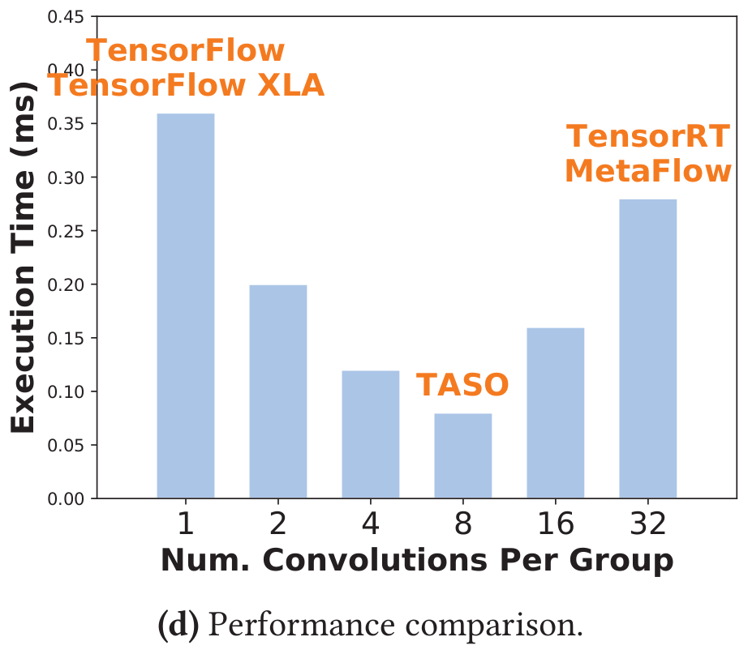

*图 9(d)（原文 Figure 9d，第 12 页）：性能对比，横轴是每组含多少个卷积，纵轴是运行全部 32 个卷积的执行时间。*

**图中文字翻译与读法**：横轴 Num. Convolutions Per Group（每组卷积数：1、2、4、8、16、32），纵轴 Execution Time (ms)（执行时间，越小越好）。柱上方橙色字标出使用该配置的系统：TensorFlow 与 TensorFlow XLA 在 1（每个卷积单独启动），TASO 在 8，TensorRT 与 MetaFlow 在 32。从图上量出的近似值：

| 每组卷积数 | 1 | 2 | 4 | 8 | 16 | 32 |
|---|---:|---:|---:|---:|---:|---:|
| 执行时间（约，ms） | 0.36 | 0.20 | 0.12 | 0.08 | 0.16 | 0.28 |

**读图结论**：执行时间随分组大小先降后升，**既不是每个卷积单独启动（1）最好，也不是全部 32 个合并成一个分组（32）最好**，最好的是中间的 8（图上约 0.08 ms，TASO 选的配置）。TASO 自动发现了这个混合方案，在端到端 ResNeXt-50 上比最好的现有方法快 2.8 倍（图 7）。（补充：9(d) 的时间是单个多路卷积层的数据，端到端的倍数是图 7 的结果，两者不能直接相除。）

### 8.5 TASO 实际使用了哪些替换（图 10）与替换规模的影响（图 11）

论文分析 TASO 发现的替换如何影响优化后的图的性能。图 10 是用来优化 5 个 DNN 的已验证替换的使用次数热图；每个 DNN 使用不同的一组替换来取得优化后的性能。

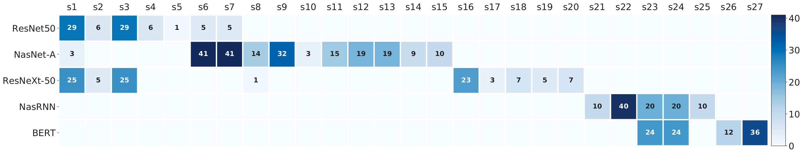

*图 10（原文 Figure 10，第 13 页）：已验证的图替换被用来优化 5 个 DNN 架构的次数热图。只列出至少被一个 DNN 用到的替换。对每个架构，数字表示 TASO 在得到优化后的图的过程中使用了该替换多少次。*

**图中文字翻译与读法**：横轴是替换编号 s1 至 s27（原文没有说明每个编号对应哪条替换），纵轴是 5 个 DNN；颜色越深次数越多（色条 0 到 40 以上），空白表示未使用（次数为 0）。逐格转录如下（只列非空格）：

| DNN | 使用的替换及次数（编号=次数） | 使用的替换种类数 | 总次数（笔者求和） |
|---|---|---:|---:|
| ResNet50 | s1=29，s2=6，s3=29，s4=6，s5=1，s6=5，s7=5 | 7 | 81 |
| NasNet-A | s1=3，s6=41，s7=41，s8=14，s9=32，s10=3，s11=15，s12=19，s13=19，s14=9，s15=10 | 11 | 206 |
| ResNeXt-50 | s1=25，s2=5，s3=25，s8=1，s16=23，s17=3，s18=7，s19=5，s20=7 | 9 | 101 |
| NasRNN | s21=10，s22=40，s23=20，s24=20，s25=10 | 5 | 100 |
| BERT | s23=24，s24=24，s26=12，s27=36 | 4 | 96 |

**读图结论**：论文说每个 DNN 用 4 至 10 种不同的替换来取得优化后的性能（按图数，NasNet-A 一行有 11 个非空格），并且**不同 DNN 需要不同的替换集合**：ResNet-50 与 ResNeXt-50 共用 s1、s2、s3；NasRNN 与 BERT 共用 s23、s24。这说明手工设计少数几条核心替换去优化当今日益多样的 DNN 架构有多困难，而 TASO 通过自动发现对性能关键的替换，更适合优化新的 DNN。

**替换规模的影响（图 11）**：论文还通过限制替换的大小来评估 TASO 的可扩展性，并测量优化后图的运行性能。

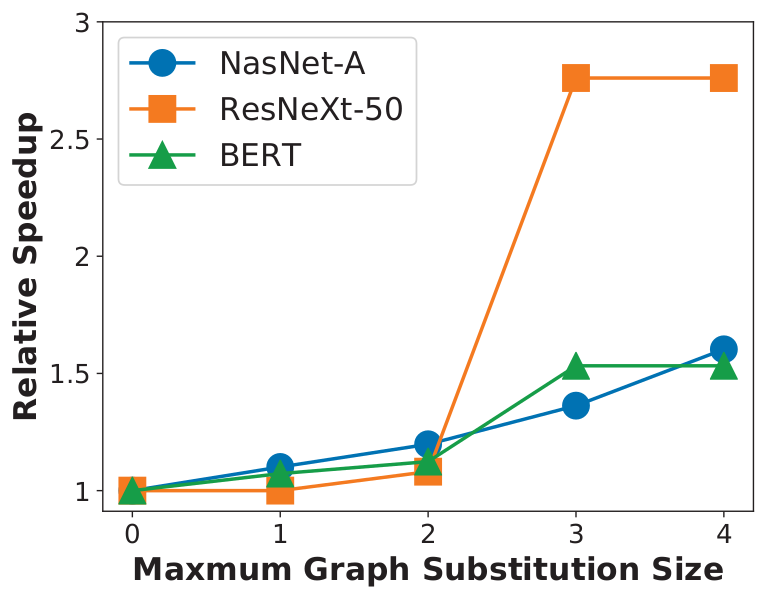

*图 11（原文 Figure 11，第 13 页）：使用不同大小限制的图替换得到的性能对比。纵轴是相对输入计算图的相对加速比。*

**图中文字翻译与读法**：横轴 Maxmum Graph Substitution Size（最大图替换大小，即替换里最多含几个算子，0 到 4；原图把 “Maximum” 拼成了 “Maxmum”），纵轴 Relative Speedup（相对输入计算图的相对加速比）。三条线：NasNet-A（蓝色圆点）、ResNeXt-50（橙色方块）、BERT（绿色三角）。从图上量出的近似值：

| 最大替换大小 | 0 | 1 | 2 | 3 | 4 |
|---|---:|---:|---:|---:|---:|
| NasNet-A | 1.0 | 约 1.1 | 约 1.2 | 约 1.4 | 约 1.6 |
| ResNeXt-50 | 1.0 | 约 1.0 | 约 1.1 | 约 2.8 | 约 2.8 |
| BERT | 1.0 | 约 1.1 | 约 1.1 | 约 1.5 | 约 1.5 |

**读图结论**：对三个 DNN，使用更大的替换（直到大小 3）都持续带来性能改善；ResNeXt-50 和 BERT 用 4 个算子的替换没有额外加速，而 NasNet-A 考虑更大的替换还能再得到约 1.2 倍。ResNeXt-50 的跃升发生在大小 2 到 3 之间（约 1.1 倍到 2.8 倍），说明那个分组卷积的混合方案需要 3 个算子规模的替换。论文也承认，TASO 当前实现**不能扩展到生成含 5 个或更多算子的所有替换**，因为生成器受限于保存所有潜在图的指纹所需的内存，这个内存随图的大小**指数增长**；分布式指纹生成器可能处理大小为 5 甚至更大的图，留作未来工作。

### 8.6 图替换与数据布局的联合优化（图 12）

为评估联合优化，论文把它与三种基线策略比较：（1）只做图替换优化；（2）只做数据布局优化；（3）依次做这两种优化。

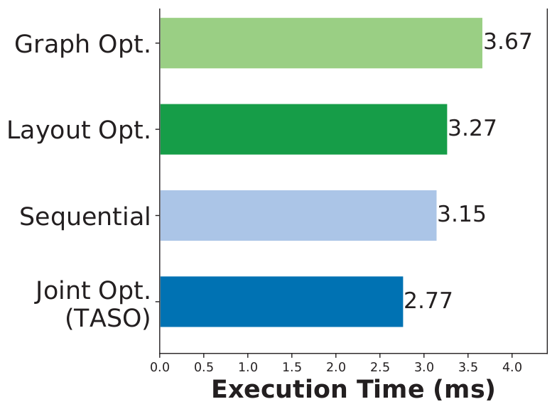

*图 12（原文 Figure 12，第 13 页）：BERT 上使用不同策略优化图替换与数据布局的端到端推理性能对比。*

**图中文字翻译与读法**：横向柱状图，横轴 Execution Time (ms)（执行时间，越小越好），4 根柱的数字标在柱端：

| 策略 | 执行时间（ms） |
|---|---:|
| Graph Opt.（只做图替换优化） | 3.67 |
| Layout Opt.（只做数据布局优化） | 3.27 |
| Sequential（先图替换、后数据布局，依次进行） | 3.15 |
| Joint Opt.（联合优化，即 TASO） | **2.77** |

（原文图 12，第 13 页；数字为原图标注。）

**读图结论**：论文写“TASO 比三种基线策略快 1.2 至 1.3 倍”。按图上数字：相对只做图替换约 1.32 倍（3.67÷2.77），相对只做布局约 1.18 倍，相对依次做约 1.14 倍；所以“1.2 至 1.3 倍”是对这三个比值的大致概括，对最强基线（顺序优化）其实只有约 1.14 倍（见第十节）。论文指出这个加速来自同时变换图结构和数据布局的图替换。一个例子就是图 5：BERT 里最耗时的操作是矩阵乘 $A\times B$，其中 A 是 64×1024，B 是 1024×4096；在 cuBLAS 中，这个矩阵乘的转置形式 $(B^{\mathsf T}\times A^{\mathsf T})^{\mathsf T}$，当 $B^{\mathsf T}$ 是列主序、$A^{\mathsf T}$ 是行主序布局时，能取得 1.5 倍加速。**这个图优化只有把图替换与数据布局放在一起考虑时才能被发现。**

### 8.7 验证器的开销（原文 7.6 节）

| 任务 | 原文给出的开销 |
|---|---|
| 生成 743 条图替换 | 约 5 分钟 |
| 用 43 条指定的算子性质验证这 743 条替换 | 不到 10 分钟 |
| 检查规格是否冗余（用 Z3 搜索“某条性质被其余规格蕴含”这一无效公式的证明） | 这个搜索可能永远不停，评估里每个查询设 10 秒超时，43 条公理共用时不到 10 分钟；开发过程中，如果有冗余规格，几秒钟内就被发现 |
| 校验算子规格：对所有参数取值组合和直到 4×4×4×4 的张量大小验证 | 约一百万个证明义务（proof obligation），用 128 个 CPU 核并行，运行约 1 小时（折合约 128 核·小时，笔者换算） |
| 只对大小恰为 4×4×4×4 的张量验证（开发时常用的受限组合） | 单个 CPU 核不到 10 分钟 |

读法：“规格校验”最贵，但只在开发新算子性质时做一次；每个模型的搜索只需不到 10 分钟，所以论文说它适合在大规模部署前优化一个 DNN 架构。

## 九、相关工作（原文第 8 节）

- **手工设计的图替换**：TensorFlow、TensorRT、TVM 用基于规则的策略直接应用所有适用的替换；MetaFlow 允许用户定义会降低性能的替换以获得更大的潜在图空间。TASO 与它们的关键区别是：TASO 能**自动生成**候选替换，并为验证其正确性提供半自动支持；评估里还表明现有框架可以直接使用 TASO 优化后的图来提升性能。
- **DNN 代码自动生成**：TVM 用基于学习的方法为多种硬件后端自动生成低层优化代码；Astra 通过探索训练期间多版本编译的优化空间来优化 DNN 计算。TASO 在更高的图层面优化 DNN 计算，因此与这些代码生成技术正交，可以组合。如何在图层面和算子层面联合优化 DNN 计算仍是开放问题。
- **DNN 自动并行化**：ColocRL 用强化学习为多 GPU 训练自动找出高效的设备放置；FlexFlow 为 DNN 训练引入了并行化策略的综合搜索空间，用随机搜索算法在其中找高效策略。这些框架在固定计算图的前提下优化分布式训练；论文相信可以把 TASO 的图优化与训练并行化技术结合。
- **超优化**（superoptimization）：一种最初用来为一串指令找最优代码的编译器优化技术。TASO 通过枚举图并算指纹来识别潜在替换，类似于用超优化技术自动生成 peephole 优化器的工作；但验证方法显著不同：超优化里的验证通常依赖“位爆破”（bit blasting），即把计算里的每一位显式建模成逻辑公式里的变量，这只有当程序变换的所有方面（包括计算与数据）都能用已知位数表达时才可行。对 TASO，替换的输入张量大小未知，必须另辟蹊径。论文基于“写算子规格”的方法不是全自动的，但对未来的、语义几乎任意的算子更灵活，也顺畅地处理了未知张量维度与切分点的问题。
- **数据布局优化**：支持数据布局优化的现有 DNN 框架把数据布局和图变换当作分开的优化问题；TASO 把执行图替换与决定每个 DNN 算子的数据布局表述成一个联合优化问题，并把布局转换当作图替换的一部分，因此能自动生成既优化图结构又优化数据布局的替换；评估显示联合优化相比分开优化能显著提升端到端性能。

## 十、局限、证据边界与原文小出入

**论文自己承认的局限（原文第 9 节）**：

1. **依赖用户提供的算子性质**。作者的经验是需要的工作量可以接受，但最好完全消除；一种可能的做法是直接对照算子的实现（例如 cuDNN 的 kernel）来自动验证替换。
2. **生成器的可扩展性**。生成器要保存所有不超过固定大小的计算图的指纹，目前扩展不到大小超过 4 的图；可能的办法是实现分布式生成器，或者用更高效的算法或启发式取代暴力枚举。
3. **图层面与算子层面优化的联合**。这个联合优化很有挑战，因为两个问题都有庞大而复杂的搜索空间，且一个层面的优化会影响另一个层面的搜索空间，留作未来研究。

**证据边界（笔者的梳理）**：

- **验证只相对于人工写的算子性质**：形式验证证明的是“在这 43 条性质成立的前提下，替换等价”，不是对 cuDNN 等真实实现的验证；性质由人工编写、复核，再靠小尺寸（4×4×4×4）符号执行校验，并不等于对所有尺寸的证明。
- **抽象掉了形状与浮点**：一阶逻辑模型不含张量形状；算子性质按实数算术成立（符号校验也是实数算术、激活函数用未解释函数），而浮点运算并不满足结合律等性质。论文只用 $10^{-5}$ 的容差做浮点测试，并指出可以用更小阈值过滤“对实数成立、但会产生浮点误差”的替换；没有报告优化前后网络输出的数值差异。
- **成本模型较简单**：用单个算子测得执行时间之和估计整张图，论文没有讨论 kernel 并发、缓存相互影响等；TASO（TVM）还是复用了 cuDNN 后端搜出的图。
- **评测范围小**：5 个 DNN、一块 V100、单个推理样本（没有批大小扫描），只评测推理；基线是 2019 年 8 月的 TensorFlow r1.14、TensorRT、TVM（2000 次试验调优）。没有评测编译或搜索之外的开销，也没有与人工规则逐条对照“发现了哪些已知规则”的统计（只在 ResNet-50 上用性能持平间接说明）。
- **“1,400 行对 5.3 万行”不是同口径比较**：1,400 行是每个算子的参考实现加 43 条性质，TASO 自身的核心组件还有约 8,000 行；而 5.3 万行是 TensorFlow r1.14 里 155 条替换的 C++ 代码。
- **只能在给定算子集合与大小不超过 4 的替换空间里搜索**：它不会发明新的 kernel 算法；新算子要提供参考实现和性质，否则被当作不透明算子。

**原文内部的小出入（本文按图和上下文理解）**：

| 位置 | 出入 |
|---|---|
| 摘要与引言 vs 图 12 | 引言写“联合优化比顺序优化再提升 1.2 倍”，而图 12 里顺序优化 3.15 ms、联合优化 2.77 ms，比值约 1.14；正文“1.2 至 1.3 倍”对应的是相对三种基线的比值范围（1.14 至 1.32） |
| 8.5 节 vs 图 10 | 正文写“每个 DNN 使用 4 至 10 种不同的替换”，图 10 里 NasNet-A 一行有 11 个非空格 |
| 3.1 节 vs 图 2b、图 3 | 正文说图 2b 沿“行维度”拼接与切分，且说图 3 是图 2b 里各张量的切分树；但图 2b 里被共享的是 A、被拼接的是 B 与 C（对应表 2 性质 36 的 `concat(1, ...)`），图 3 里则是 C 被共享、A 与 B 沿行拼接 |
| 流程描述 | 3.3 节写候选替换“先送验证、之后剪枝”，而被验证和被评估使用的 743 条恰是剪枝后的数量（表 3） |
| 图 11 | 横轴标签拼写为 “Maxmum” |
| Algorithm 2 | 伪代码里 $G_{\mathrm{opt}}$ 在使用前没有显式初始化（应理解为初始化为 $G_{\mathrm{in}}$） |

**时效性（补充）**：这是 2019 年的论文，基线版本和 GPU 都已过时；后来的编译器（例如 TVM 的 Relay、Relax 与 MLIR 生态里的重写框架）、等式饱和（equality saturation）类方法和 Korch 这类 kernel 编排工作，与 TASO 在“规则是否自动生成与验证、搜索怎样组织”上的取舍不同，这些都不在论文中，请不要把论文的数字当作对今天框架的结论。

## 十一、复现检查

- 先固定 Z3 的版本（论文用 4.8.5）、替换生成的算子集合（表 1）、枚举上限（4 个算子）、测试用例数和浮点阈值（$10^{-5}$）。
- 把“规则生成时间”（约 5 分钟）、“验证时间”（不到 10 分钟）、“每个模型的搜索时间”（不到 10 分钟）和“运行时收益”分开报告。
- 给新算子写性质后，先跑第 4.3 节的小尺寸校验和一致性、冗余检查，再用它去验证替换。
- 对重排了归约（reduction）顺序的替换做数值稳定性测试，并报告容差。
- 搜索用的成本模型要包含布局相关的测量（同一算子在不同布局下的时间不同），并核对 TVM 等后端上的成本是否与 cuDNN 上相近。
- 把 $\alpha$ 的取值与回溯程度一起记录；检查每次应用替换后图是否无环。

## 十二、常见误读

- **“TASO 能自动发明新 kernel”**：不能。它在给定算子语义和替换空间里搜索图，不生成新的算子实现；图层面的优化与 TVM 这类算子层面的代码生成正交。
- **“形式验证保证整个优化的正确性”**：它只保证替换在算子性质成立的前提下等价；性质本身靠人写和小尺寸校验，浮点行为、张量形状和真实 kernel 的实现不在验证范围内。
- **“随机测试就是证明”**：随机测试和指纹只是用来筛出候选的；所有候选都要交给验证器证明。论文还特意指出别人曾在超优化里遇到过随机测试的假阳性。
- **“TASO 比所有框架都快 2.8 倍”**：2.8 倍只出现在 ResNeXt-50 上，相对同一后端里最好的现有方法；ResNet-50 上只是持平（1.0×），其余模型是 1.1 至 1.4 倍。
- **“TASO（TVM）是针对 TVM 搜索的”**：它复用了 cuDNN 后端搜到的图。
- **“替换越大越好”**：生成器的内存随替换大小指数增长，目前只到 4 个算子；图 11 里 ResNeXt-50 和 BERT 在 3 以后就没有额外收益。
- **“图替换和数据布局可以分开处理”**：这正是论文反对的做法；图 12 与图 5 的例子表明有的优化只有联合考虑才能被发现。

## 十三、与本仓库其他论文的关系

- [XLA / OpenXLA](../xla_compiler/论文中文解读.md) 与 [TVM](../tvm_compiler/论文中文解读.md)：论文把它们归入“人工规则 + 贪心应用”的现有框架；TVM 还作为端到端对比对象和 TASO 的第二个后端。
- [Korch](../korch/论文中文解读.md)：同样在图层面做代数变换，并把候选 kernel 的全局选择写成整数规划；与 TASO 的“自动生成替换加回溯搜索”可以对照。
- [Rammer](../rammer/论文中文解读.md)、[FusionStitching](../fusion_stitching/论文中文解读.md)：关注图之上的调度与融合；TASO 关注的是图结构本身的等价改写，三者作用在不同层。
- [Ansor](../ansor/论文中文解读.md)、[MetaSchedule](../metaschedule/论文中文解读.md)：算子层面的自动搜索，与 TASO 的图层面搜索是论文自己点出的“尚未解决的联合优化”问题的两端。
- [MLIR](../mlir/论文中文解读.md)：MLIR 把声明式重写规则（DRR）作为一等公民，而 TASO 的重写规则是**自动生成并验证**的，二者可以互补。

## 原文证据导航

- [原论文 PDF](paper.pdf)
- [原文提取文本](paper.txt)
- [论文概要](论文概要.md)
