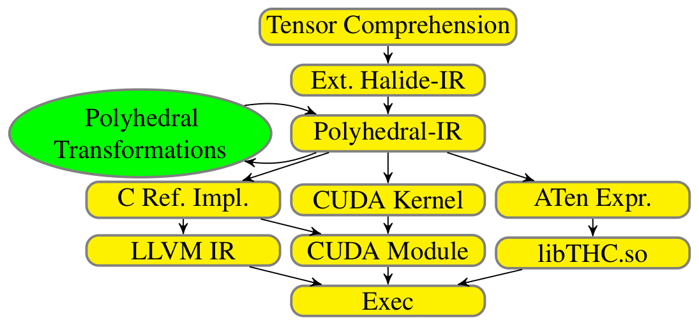
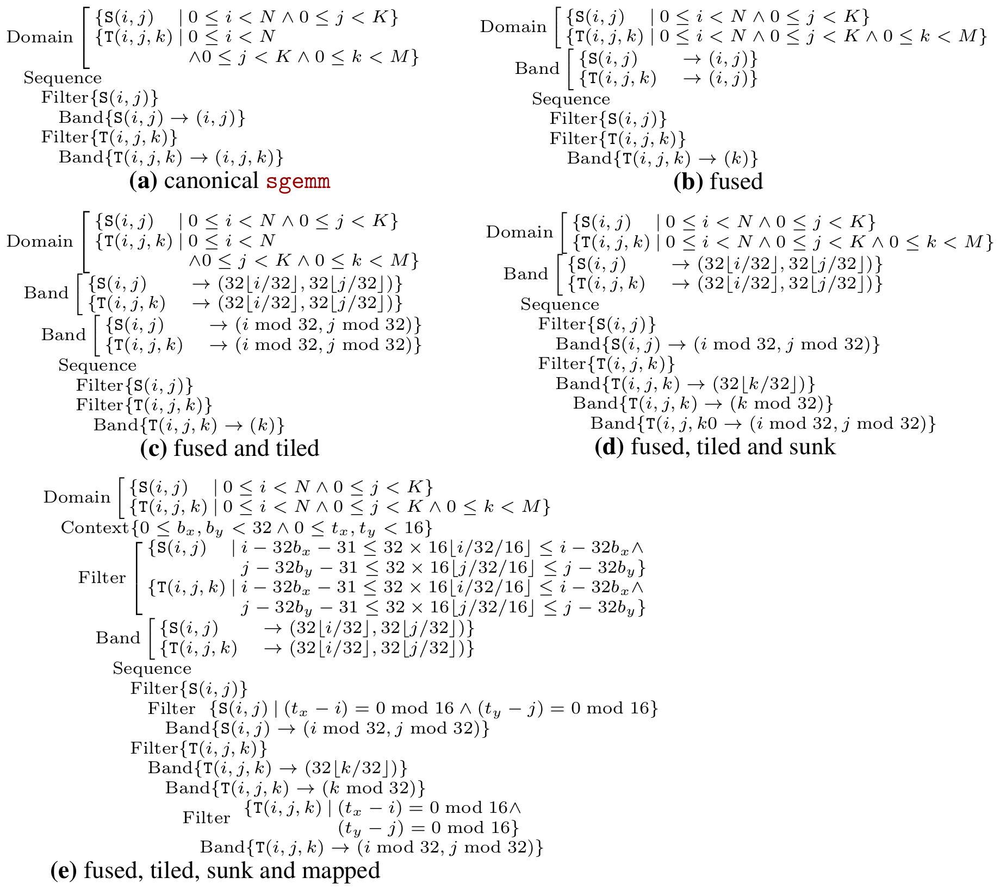
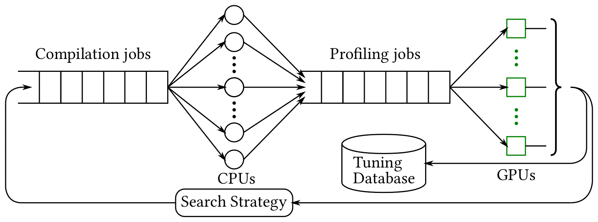
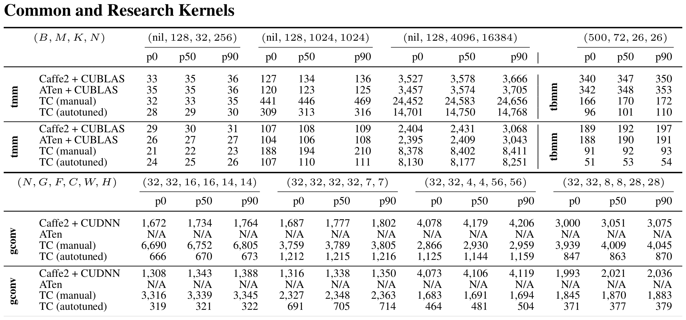
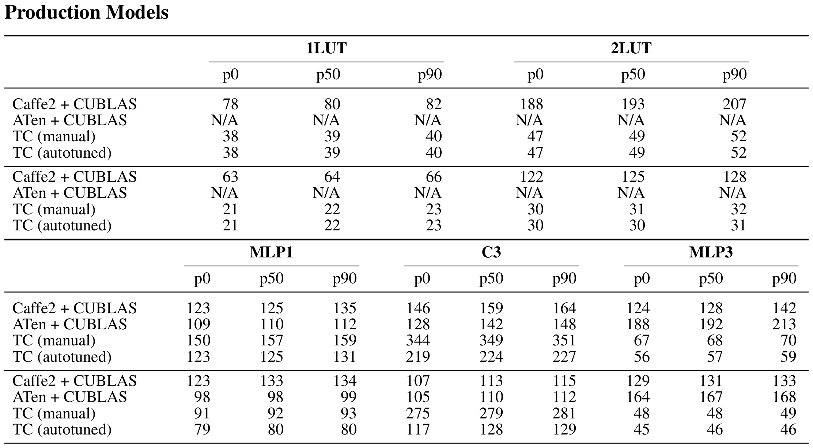
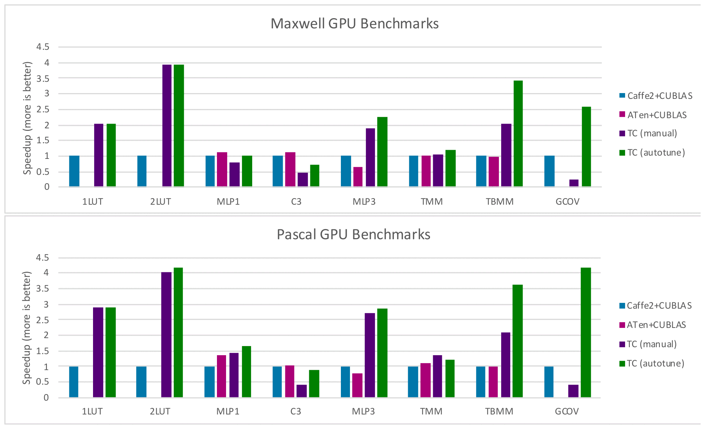

# 论文中文解读：《Tensor Comprehensions: Framework-Agnostic High-Performance Machine Learning Abstractions》

> **基本信息**：Nicolas Vasilache、Oleksandr Zinenko、Theodoros Theodoridis、Priya Goyal、Zachary DeVito、William S. Moses、Sven Verdoolaege、Andrew Adams、Albert Cohen（Facebook AI Research / Inria & ENS / ETH Zürich / MIT CSAIL / Polly Labs），Facebook AI Research 技术报告（2018 年 2 月 13 日），arXiv:1802.04730（本地 PDF 为 v3，2018 年 6 月）；论文原文 [官方页面](https://arxiv.org/abs/1802.04730)。
>
> **本文的读法**：图均为从论文 PDF 中按图裁出的原图，表、代码和公式为逐项核对后的中文转录（数字、代码与原文一致，表头翻译为中文）。每张图后有中文图题、图例/坐标轴翻译和读图结论，因此不必再翻英文版。图中读出的近似数值都写作“约”，原文正文给出的数字优先。

## 一、一句话结论

深度学习框架（TensorFlow、PyTorch、Caffe2 等）把网络表示成算子 DAG，每个算子调用 cuDNN 这类高性能库。研究者发明新算子时没有现成库调用，只能手写 CUDA，工程成本高且性能很差；即使有库调用，也错过跨算子的优化，以及针对具体张量大小和形状的优化。

Tensor Comprehensions（TC）给出三件东西：

1. **TC 语言**：一种接近数学写法、泛化了 Einstein 求和记号的张量表达式语言，循环范围自动推断；
2. **polyhedral JIT 编译器**：把一个 TC（可以对应框架里多个算子）降低成 Halide-IR，再到多面体 IR，经过调度、tiling、映射到 GPU block/thread、共享内存提升等变换，生成**单个** CUDA kernel，并把内存管理和同步交给框架；
3. **由 autotuner 填充的编译缓存**：用遗传算法在映射选项（tile/block/grid 大小、融合策略、展开上界、存储使用等）上搜索，把每组（TC、输入形状、目标架构）最快的版本缓存下来。

作者在 Tesla M40（Maxwell）和 P100（Pascal）上的结果：对常见及研究型 kernel（转置矩阵乘、批量转置矩阵乘、分组卷积）和 Facebook 生产模型中的几个层，最高比 NVIDIA 库快数倍（批量转置矩阵乘 3.5×/3.7×，分组卷积最高 3.6×/8.8×，生产模型里 2LUT 约 4×）；但在大尺寸转置矩阵乘上自动调优版本反而比 cuBLAS 慢 4.2×（Pascal 上 3.4×）。论文的定位是：快速为新算子合成“扎实的基线”并缩短研究到生产的路径，并非在所有尺寸上超过手工调优库。

## 二、背景与动机

### 2.1 痛点

- 计算图引擎（TensorFlow、Caffe2、Theano、MXNet 等）以高层抽象执行张量算子图，通常是对**单个算子**高度优化的例程的封装。当计算不在支持的库调用范围内时（例如研究者设计新类型的层），就要写自定义算子，工程代价高、性能损失大。
- 即使网络能用库调用表示，也常达不到峰值，原因有二：错过跨算子的优化；没有针对机器学习中遇到的每一种大小、形状、数据流组合做调优。
- 单靠计算图太抽象：各层的并行执行、各张量的内存布局，随数据大小与形状、上下游计算和具体硬件特性大幅变化。

### 2.2 已有路线与不足

- **active library / build-to-order（BTO）**：库代码按需特化生成；但孤立地调优库 kernel 会错过上下文相关的机会，也不可能造出覆盖所有 kernel 组合的库。
- **Halide**：在图像处理上成功（能融合大流水线而不掩盖算法），但在 GPU 上所有调度变换都要手工指定，普通用户难以组合出高性能。
- **XLA、Latte** 等深度学习编译器：能组合计算图里的算子，做跨算子优化与利用数据尺寸的优化，但在 GPU 上还没达到预期性能，它们的变换语言似乎表达不了对带分区存储的 GPU 至关重要的复杂调度与映射变换。

所以一种好的计算图引擎编程语言要同时应对两件事：（1）抽象既提高编程效率，又让编译器和运行环境能消除与目标平台无关的细节、逐步精化代码并自动探索大的优化空间（“abstraction without regret”）；（2）选对中间表示和优化算法，处理深度并行、存储层次以及向量指令、专用存储等硬件特性。

### 2.3 贡献

1. **Tensor Comprehensions（TC）**：表达机器学习张量计算的高层语言，语法推广 Einstein 记号；支持形状与大小推断、灵活的逐元素语法（既可用具名也可用位置参数）；简洁且安全（避免差一错误），同时允许布局变换与特化。
2. **端到端编译流**：把 TC 降低成高效 GPU 代码；对自定义算子给出强基线性能，对标准算子也与厂商库有竞争力。前者对减少厂商库的“技术债”至关重要，使研究者能在接近生产的场景下探索更广的架构与层。
3. **面向特定领域与目标的多面体编译算法集合**：与通用并行化编译器不同，TC 主要优化的是通过 kernel 融合降低启动与同步开销，并偏好多层并行及向更深存储层次的数据提升。
4. **利用 JIT 编译与代码缓存的 autotuning 框架**：包括对非标准大小的特化（消除控制流与地址生成逻辑），并把从 ML 框架到代码生成器的所有优化旋钮都交给 autotuner。
5. **集成到 PyTorch 与 Caffe2**（原则上也可集成到其他框架）。

初版只生成 CUDA 代码，因为 NVIDIA GPU 主导了训练深度神经网络的硬件。

### 2.4 相关工作要点

- **active library 与程序生成器**：ATLAS（稠密矩阵）、BTO、FFTW（傅里叶变换）依赖反馈驱动的优化选择生成策略；SPIRAL 在数字信号处理公式的 DSL 上做出飞跃。
- **Halide**：输入是定义在无限范围上的图像，而 TC 通过**范围推断**为每个维度确定固定大小，更适合主要在固定大小张量上计算、时间局部性更高的 ML 应用；规约写法更省笔墨，也不需要像嵌在 C++ 里的 Halide 那样预先声明阶段名与自由变量。TACO、Simit 用与 TC 类似的记号，但生成的是数值求解器的稀疏矩阵代码。
- **多面体框架**：已有一批工具与库（如 PPCG、Pluto，生产编译器里 GCC 的 Graphite、LLVM 的 Polly 等组件）；PolyMage 面向图像处理流水线；PENCIL 面向构造并行化编译器。TC 的编译器实现了针对深度学习模型的**长且不均匀的复用模式、深度嵌套循环**的优化，这些启发式在 Halide 等中没有。
- **Latte**：与 TC 动机相近（高层 DSL 与端到端流），但 TC 借助类型与形状推断更简洁、更安全（静态越界检查与图连通性检查），并通过把索引与表示、布局选择解耦更灵活（如稀疏层）；还实现了更复杂的调度与映射变换，并被设计成可无缝集成到框架里的 JIT 库。
- **XLA**：同样有形状推断、可“进程内”JIT、已集成进生产框架；但更侧重集成与功能完备，而不是优化与映射策略的复杂度。TC 保持独立于具体计算图框架，也没有用嵌入式 DSL（C++ 只作实现优化策略的接口）。
- **R-Stream·TF**：把 R-Stream 多面体编译器改造用于 TensorFlow 算子的概念验证，与 TC 类似也把生成代码包成自定义算子。TC 则更务实地把大多数决策留给张量代数层，让领域优化器或 ML 专家把声明式 comprehension 改写成容量和布局都优化的版本，并更雄心勃勃地针对仿射调度与映射做领域特化，目标是生成单个加速 kernel。

## 三、Tensor Comprehensions 语言

### 3.1 记号与三条规则

TC 借用 Einstein 求和记号：

1. 索引变量通过在表达式里**使用**而隐式定义，其范围由所索引的对象**推断**；
2. 出现在表达式右边而不出现在左边的索引，被视为**规约维度**；
3. 迭代空间中各点的求值顺序**不影响**输出。

以矩阵-向量乘为例（两条语句）：

```text
def mv(float(M,K) A, float(K) x) → (C) {
  C(i) = 0
  C(i) += A(i,k) * x(k)
}
```

它定义函数 `mv`，输入张量 `A`、`x`，输出 `C`。语句引入两个索引变量 `i`、`k`（没在任何地方定义的变量隐式成为索引变量），其范围由索引方式推断出 $i\in[0,M)$、$k\in[0,K)$；因为 `k` 只出现在右边，写入 `C` 时对 `k` 用 `+` 规约。规约可跨多个变量，但它们共享同一种满足结合律和交换律的算子（如 `+=`），以保证求值顺序不影响结果（例如 min 与 max 的复合不可交换：$\min(\max(f))\ne\max(\min(f))$）。

直观上，一个 tensor comprehension 就是一个循环体，其控制流从上下文推断。等价的 C 风格伪代码：

```text
tensor C({M}).zero(); // 0-filled single-dim tensor
parallel for (int i = 0; i < M; i++)
  reduction for (int k = 0; k < K; k++)
    C(i) += A(i,k) * x(k);
```

循环嵌套顺序（先 `i` 再 `k`）是任意的：TC 的语义对循环置换始终不变。

**原地更新**：TC 允许原地更新，但保持“对整个张量原子”的函数式语义：先完整读取右端表达式，再给左端元素赋值。左端张量也出现在右端时，编译器负责检查原地更新的逐元素依赖是否因果。目前只实现简单的语法检查：只允许在逐点定义和张量收缩上原地更新；检查失败时编译器因 liveness 冲突拒绝程序，例如原地转置 `a(i,j) = a(j,i)` 是错的（除非范围为空或只有一个元素），而 `a(i,j) = b(j,i)` 是合法的转置。TC 这种声明式加命令式混合的设计，受 Lush 启发。

### 3.2 常见算子怎么写

初始化规约有简写：在规约符号后加 `!`，即 `+=!` 代替 `+=`，表示先用规约算子的单位元初始化。一行矩阵向量乘：

```text
def mv(float(M,K) A, float(K) x) → (C) {
  C(i) +=! A(i,k) * x(k)
}
```

原文图 1（第 6 页）是 BLAS 的 `sgemm`：

```text
def sgemm(float a, float b,
          float(N,M) A, float(M,K) B) → (C) {
  C(i,j) = b * C(i,j)             # initialization
  C(i,j) += a * A(i,k) * B(k,j)   # accumulation
}
```

这里 $A$ 是 $N\times M$、$B$ 是 $M\times K$、$C$ 是 $N\times K$，三个索引的范围 $i\in[0,N)$、$j\in[0,K)$、$k\in[0,M)$ 由范围推断得到（见 3.3 节）；第一行是初始化，第二行是累加。后文的多面体例子都用它。

其他例子（原文第 6 到 7 页）：

```text
# 全连接 + ReLU：转置矩阵乘，先用广播的偏置初始化，再逐点 clamp
def fcrelu(float(B,I) in, float(O,I) weight,
           float(I) bias) → (out) {
  out(i,j) = bias(j)
  out(b,o) += in(b,i) * weight(o,i)
  out(i,j) = fmaxf(out(i,j), 0)
}
# （原文这一段的下标命名前后不一致（i,j 与 b,o，bias 的形状写作 float(I)），属于原文笔误；
#   这里按原文转录。三条语句复用同一个 out 张量，表示没有临时存储。）

# 2-D 卷积：规约初始化为 0（注意 +=!），规约维度为 ip、kh、kw
def conv2d(float(B,IP,H,W) in,
           float(OP,IP,KH,KW) weight) → (out) {
  out(b,op,h,w) +=! in(b,ip, h + kh, w + kw)
                    * weight(op,ip,kh,kw)
}

# 2x2 最大池化：kw、kh 不能由任何输入张量推断，要用 where 说明范围
def maxpool2x2(float(B,C,H,W) in) → (out) {
  out(b,c,i,j) max=! in(b,c, 2 * i + kw, 2 * j + kh)
    where kw in 0:2, kh in 0:2
}

# gather：下标表达式可以是下标的下标，捕获数据相关的访问
def gather(float(N) X, int(A,B) I) → (Z) {
  Z(i,j) = X(I(i,j))
}

# 带步长的卷积：只需在 conv 上做小改动（sh、sw 为常量时可做部分求值，使下标变成仿射）
def sconv2d(int sh, int sw, float(N,C,H,W) I,
            float(F,C,KH,KW) W, float(F) B) → (O) {
  O(n,f,h,w) = B(f)
  O(n,f,h,w) += I(n,c, sh * h + kh, sw * w + kw)
                * W(f,c,kh,kw)
}
```

**外积形式的矩阵乘**（原文第 10 页）：与 NumPy 风格的“广播”语义不同，TC 不需要隐式语法糖，例如 `[p,q,r] matmul [1,s,r,t] → [p,s,q,t]` 直接写成：

```text
def outerProductMM(float(P,Q,R) A, float(S,R,T) B) → (O) {
  O(p,s,q,t) +=! A(p,q,r) * B(s,r,t)
}
```

**语言的完整文法**（原文图 14，附录 A，第 32 页，EBNF）：

```text
num ::= <number literal with C syntax>
id ::= [_a-zA-Z0-9]*[_a-zA-Z][_a-zA-Z0-9]*
exp ::= num
      | ( '-' | '!' | ... ) exp
      | exp ( [+-*/%] | '=' | '≠' | '≤' | ... ) exp
      | exp '?' exp ':' exp
      | id '.' num # range of num-th dimension of id
      | id '(' exp_list ')' # builtin call or tensor access

reduction ::= <associative reduction operator>
            | '+=' | '*=' | 'min=' | 'max='
            | '+=!' | '*=!' | 'min=!' | 'max=!'

range_constraint ::= id 'in' exp ':' exp

stmt ::= id '(' id_list ')' [ '=' | reduction ] exp
           [ 'where' range_constraint_list ]
       | id_list = id '(' id_list ')' # TC function call

arg ::= type id
return ::= id # inferred return type and range

scalar_type ::= 'double' | 'float' | 'half' | 'int' | 'byte' | 'uint32' | ...

type ::= scalar_type [ '(' id_list ')' ]

func ::= # TC function definition
  'def' id '(' arg_list ')' '→' '(' return_list ')' '{'
    stmt_list
  '}'

id_list ::= <comma separated id list>
exp_list ::= <comma separated exp list>
arg_list ::= <comma separated arg list>
stmt_list ::= <whitespace separated stmt list>
return_list ::= <comma separated return list>
range_constraint_list ::= <non-empty comma separated range_constraint list>
```

读法：一个 TC 函数由若干语句组成；每条语句形如 `输出(索引列表) [= 或规约符] 表达式 [where 范围约束]`；参数类型可带形状（如 `float(M,K)`）；规约符号共八个（含带 `!` 的初始化版本）；下标表达式可以是任意仿射函数或下标的下标。

### 3.3 范围推断（Range Inference）

TC 简洁是因为多数时候循环范围由上下文推断。推断算法类似多态类型推断，依据使用模式准确地推断范围；但在非仿射表达式或欠约束的问题（如最大池化）上不能总是成功，需要额外标注。迭代变量总是非负的，除非 `where` 子句另有规定，每个迭代变量从 0 开始。

**设计取舍**：作者起初想用 Presburger 算术（多面体库里的做法）做很一般的推断，但要高效编程，程序员必须能在脑中模拟代码在语言语义定义的抽象机上的执行；如果这比写显式循环还费脑子，语言设计就失败了。所以放弃重型数学工具，选更直接的做法：只在范围“明显”的情形推断，其他情形要求显式标注。

**规则**：由输入参数向输出张量推断，对所有仿射数组访问建立基于约束的分析问题。第一近似是推断**尽可能大、且不越界读取输入**的矩形范围；若有多种方式则报错，要求用 `where` 明确标注。例如 sgemm：最大化 `i` 的范围得到 $A$ 的行数；最大化 `j` 得到 $B$ 的列数；`k` 用了两次，取 $A$ 的列数与 $B$ 的行数中较小者，二者由函数签名约束为相等（图 1 的签名里它们都是 `M`；原文正文此处写“都是 K”，前后不一致，按图 1 为准）。

**分轮推断**：以一维卷积为例：

```text
def conv1d(float(M) I, float(N) K) → (O) {
  O(i) = K(x) * I(i + x)
}
```

若先最大化 `i`，`i` 会遍历整个 `I`，迫使 `x` 只取一个值，这会忽略卷积核的大部分，不是想要的输出；若先最大化 `x`（遍历整个 `K`），则为了不越界，`i` 的范围要更小，输出比输入略小，这才是期望的行为。为了在不要求显式标注的简单情形下消除歧义，推断**分轮**进行：维护一个未解析变量集合，初始包含所有未被显式 `where` 约束的变量；每一轮考虑所有只含**一个**未解析变量的张量参数表达式，构造“访问不越界”的布尔表达式，用 Halide 的工具（`solve_for_inner_interval`）在已解析变量的范围下求使条件成立的最大范围；若该变量在本轮已被别的张量访问约束过，取交集。对上面的卷积：第一轮忽略 `I(i+x)`（含两个未解析变量），用 `K(x)` 推出 $x\in[0,N-1]$；第二轮 `I(i+x)` 只含一个未解析变量 `i`，由已推出的 `x` 范围得到约束

$$
\forall x\in[0,N-1],\ i+x\in[0,M-1],
$$

得 `i` 的范围是 $0$ 到 $M-N$。

**为什么用全称量词**：这里对 `x` 的 ∀ 量化保证输出张量 `O` 在整个定义域上由完全相同形态的输入统一定义。这不同于 Alpha 语言（仿射递归方程系统）里“存在量词”的做法（`x` 扫描的是 $(i,x)$ 三角形域的投影）。全称量化的语义选择来自 Halide；它保证输入张量的形状始终是（超）平行六面体，对 ML 专家直观，并有利于生成没有条件控制流的紧凑代码。

**其他**：更复杂的例子涉及对同一变量多轮推断结果取交集，以及无法由更一般约束推出单一矩形形状的歧义情形，后者类型检查会失败，编译器要求加 `where`。由于内存管理外包给 ML 框架，TC 内部定义的临时张量列表必须显式给出（含形状和范围），范围推断算法会自动推出这份列表。推断算法可形式化为类型与效应系统。**首版 TC 不支持递归定义**（如 RNN 所需）。

### 3.4 数据布局变换

ML 社区常通过对张量元数据 `(dataPtr, offset, size[], stride[])` 的组合操作做全局数据布局变换，主要用途是算法性 tiling 与层次分解（如频域卷积中控制内存占用、适配快速局部存储）。TC 支持广义张量转置（作用 $n$ 维置换矩阵，$n>2$）；数据 tiling 只需重塑张量并调整 TC 的索引表达式即可，范围推断与检查保证这种重塑在整个 TC 内一致。数组-结构体与结构体-数组互转等操作是维度交换和数据 tiling 的特例。目前数据布局与 TC 的变换由领域专家在源码层面完成，TC 的推断过程保证表达式的范围正确；自动数据布局变换留待未来。

## 四、高层工作流（图 2）

TC 先被集成到 ML 框架：采用“进程内”（in process）实现，简化与计算图引擎及其上 ML 应用的交互；提供一层很薄的 API 把具体框架的张量对象模型翻译成 TC 自己的模型；框架里的算子定义被覆盖，改为生成 TC 而不是框架后端实现，用户也可以自己写 TC。一个 TC 可以对应框架里算子的一个 DAG；这种匹配目前是**手工**的，类似 TensorRT 的自动 DAG 划分、匹配与改写留待未来。TC 随后被 JIT 编译；若默认后端实现更快，则回退到参考实现。



*图 2（原文 Figure 2，第 9 页）：JIT 编译流把 TC 降低成 Halide-IR，再降低成多面体 IR，随后是优化、代码生成与执行。*

**图中文字翻译与读法**（自上而下）：Tensor Comprehension（TC 源程序）→ Ext. Halide-IR（扩展的 Halide 中间表示）→ Polyhedral-IR（多面体中间表示），与绿色椭圆 Polyhedral Transformations（多面体变换）相互作用（变换在多面体 IR 上进行并写回）；Polyhedral-IR 分出三路：C Ref. Impl.（C 参考实现）→ LLVM IR；CUDA Kernel → CUDA Module；ATen Expr.（ATen 表达式）→ libTHC.so；三路汇合到 Exec（执行）。

**文字补充**：

- 从带有特化张量大小和步长的 TC 出发，先降低成**参数化**的 Halide 表达式。（工具链支持参数化规格，但作者发现尽早特化有助于多面体调度时做出合理的收益判断。）
- 早期原型把 Halide-IR 先翻译成 PENCIL，再用 pet 和 isl 库解析成多面体表示；为减少 IR 之间的阻抗失配、便于传播语义标注，流程后来演进为直接把 Halide-IR 降低成多面体表示，绕过 PENCIL。
- CUDA 代码生成最初基于修改版的 PPCG 编译器（修改包括把它作为库、进程内多线程使用）；离开 PENCIL 之后，PPCG 的功能被从头重新实现，以更模块化并符合现代 C++ 环境。
- autotuner 与可序列化的编译缓存和调度、映射策略紧密交互，搜索变换空间（见第六节）。
- 另外提供一个简单的“恒等”多面体映射选项，生成朴素、可读的 CUDA 参考实现，可以在单个 GPU 线程上运行并检查正确性。

## 五、Polyhedral JIT 编译

### 5.1 降低（lowering）与多面体表示

编译器弥合高层张量操作的逻辑布局（维度顺序）与多面体代码生成器期望的数据格式（C99 数组）之间的阻抗失配：降低步骤保证大小与步长的组合对应不别名的数组与子数组语法；通过分析访问关系与推断出的张量范围保证没有越界访问；并发出张量声明和重排表达式以匹配目标语言（行主序数组）的数据模型。张量规格可以含输入输出别名（原地计算）与高维张量的隐式转换，作者主张这应当导致对每种别名情形做多版本化与特化。额外的降低步骤包括卷积表达式的前向代入（存储与计算的权衡）、补零、镜像与裁剪。

**多面体框架**提供一种当前最先进的、针对“基本规则”的基于循环的程序的内部编译器表示。它描述被循环和分支包围的算术表达式，其控制流可静态确定，因此称为作用于程序的**静态控制部分（SCoP）**：循环边界与分支条件是外层迭代器和静态未知常数（符号化处理，称为参数）的仿射表达式；计算用数组元素上的算术表达式描述，下标有同样的限制。论文论证多面体框架特别适合深度神经网络：大而深嵌套的循环、长依赖链、非均匀或全对全模式（来自全连接层、张量收缩与转置），这些把优化问题推到与 Halide（图像处理）不同、也比线性代数宽得多的启发式空间。

**背景概念**（附录 A.3）：

- **迭代域**：每次循环迭代称为语句实例，对应多维向量空间中的点，坐标为外层归纳变量的取值；受仿射边界约束，这些点的集合形成凸多面体。对 `sgemm`，记初始化语句为 $S$、更新语句为 $T$，迭代域为

$$
(N,M,K)\to\{S(i,j):0\le i<N\wedge 0\le j<K\}\cup\{T(i,j,k):0\le i<N\wedge 0\le j<K\wedge 0\le k<M\}.
$$

- **调度**：迭代域中的点按其逻辑执行日期的字典序遍历；日期由调度（映射）给出。
- **代码生成**：给定迭代域与调度，可生成按调度顺序访问所有点的循环嵌套（FORTRAN、C+OpenMP、CUDA、OpenCL）；isl 的算法生成抽象语法树。
- **访问关系与依赖**：访问关系把语句实例映射到所访问的张量元素，按读/写分类。`sgemm` 里更新语句的写访问与读访问分别是

$$
A_{\mathrm{write}}=(N,M,K)\to\{T(i,j,k)\to C(i,j)\},
$$

$$
A_{\mathrm{read}}=(N,M,K)\to\{T(i,j,k)\to A(i,k)\}\cup\{T(i,j,k)\to B(k,j)\}\cup\{T(i,j,k)\to C(i,j)\}\cup\{T(i,j,k)\to a()\}.
$$

  若两个语句实例访问同一张量元素且至少一个写，则它们之间有依赖；保持依赖的变换才合法。`sgemm` 中初始化与更新之间的流依赖为

$$
(N,M,K)\to\{S(i,j)\to T(i',j',k)\mid i'=i\wedge j'=j\wedge 0\le i,i'<N\wedge 0\le j,j'<K\wedge 0\le k<M\}.
$$

  上面是最简单的基于内存的依赖分析；还可做精确数据流分析，把依赖限制为实例级的 def-use 对（此时 `sgemm` 里的流依赖只剩 $T(i,j,k=0)$）。isl 的依赖分析还区分“可能”访问与“一定”访问（如间接或非仿射访问被当作可能访问该维所有元素）。TC 的依赖还能被标注、定制，例如在两个表达式之间放一条 “kill” 语句，保证（并让多面体编译器看到）某些张量元素不会在它们之间被复用，这对复用临时张量保存不同值、限定各张量在整个 TC 图上的存活期、以及与黑盒库集成并传达无竞争并行等语义信息都很有用。
- 由于 TC 没有指针运算且张量下标不会超出推断的大小，不存在内存别名，因此依赖分析比对低层命令式语言更精确。

**越界检查**：多面体模型用关系编码张量访问。把访问关系与迭代域复合可求出被访问元素的全集，即语句的**足迹**（footprint）$F=D\cdot A$；足迹中不属于由张量形状推断出的元素集合 $T$ 的元素就是越界访问。因此无越界的条件是

$$
(D\cdot A)\setminus T=\emptyset .
$$

### 5.2 调度树（图 3）

仿射映射可以组合成**调度树**（schedule tree），便于把高层语言（这里是 TC）的性质传给下游优化器，并沿途附加目标相关信息（如 CUDA 的 SPMD 线程相对归纳变量、同步、数据搬运指令）。调度树有这些节点类型：

- **Band 节点**：由一个或多个定义在迭代域上的分段仿射函数定义偏序执行次序；名字来自“可置换调度带”：一组一维调度函数的元组，可以自由互换而不改变程序语义；带里的一个仿射函数称为 band member 或调度维度。
- **Filter 节点**：划分迭代空间，把其子树绑定到迭代域的一个子集；可以按“执行次序是否必须约束”排列成 **Set** 或 **Sequence** 节点（相当于是否对应 `#pragma omp sections`）。
- **Context 节点**：提供变量与参数的附加信息，如张量范围或 GPU 的 grid/block 大小；也可引入局部作用域和在子树内为常量的参数，在把归纳变量映射到 CUDA block 与线程标识时很有用。
- **Extension 节点**：引入不属于原迭代域的辅助计算，例如与共享内存之间拷贝数据的语句。

一个 TC 的**规范调度树**是：外层 Sequence 节点，其下对每条 TC 语句有一个 Filter 节点；每个被过滤的分支里有 Band 节点定义恒等调度，一维调度函数个数等于该语句的循环迭代器个数；隐式循环形成一个可置换带（由 TC 语义决定）。若 Band 节点不定义单射调度，则语句实例按其域坐标的字典序调度。多面体模型里的程序变换就是定义另一种调度，即另一种遍历迭代域的（偏序或全序）次序。



*图 3（原文 Figure 3，第 11 页）：图 1 中 sgemm 的优化步骤。*

**图中文字翻译与读法**：五棵调度树都以 Domain（迭代域，同 5.1 节的两个集合 $S$、$T$）开始，用 Sequence / Filter / Band 节点组织。

- **(a) canonical sgemm（规范 sgemm）**：Sequence 下依次是 Filter{S(i,j)} → Band{S(i,j) → (i,j)}（二维初始化嵌套）与 Filter{T(i,j,k)} → Band{T(i,j,k) → (i,j,k)}（三维更新嵌套）。
- **(b) fused（融合）**：观察到张量 $C$ 在两个嵌套之间被复用，就构造出外层 Band：$S(i,j)\to(i,j)$ 与 $T(i,j,k)\to(i,j)$，即 `i`、`j` 两层循环对两条语句公共，对应**循环融合**；Sequence 保证 $S$ 的实例先于对应的 $T$ 实例（保证正确初始化）；第二个 Band 只作用于 $T$，对应最内层的归约循环 $k$。（正文还说这棵树里引入了 Context 节点来声明对参数取值的假设，图 3b 里没有画出。）
- **(c) fused and tiled（融合并 tiling）**：外层 Band 变成 tile 循环 $(32\lfloor i/32\rfloor,\,32\lfloor j/32\rfloor)$，内层 Band 是点循环 $(i\bmod32,\,j\bmod32)$，其下 Sequence 的两个 Filter 中，$T$ 带着 Band $k$。（tiling 是 schedule 树上的变换：把一个可置换带变成两个带的链，外带含 tile 循环，内带含迭代次数固定的点循环，即传统的 strip-mine 加 sink。）
- **(d) fused, tiled and sunk（融合、tiling 并下沉）**：因为依赖分析表明 `i`、`j` 并行（不携带依赖），可以把它们的点循环**下沉**到归约循环 $k$ 的带之下：$T$ 分支里依次是 $(32\lfloor k/32\rfloor)$、$(k\bmod32)$，最后才是 $(i\bmod32,\,j\bmod32)$。（原图此处把最后一个带的映射写成 `T(i, j, k0 → ...`，是印刷笔误。）下沉之后最内层的点循环可以合并成一个带（需先检查可置换性）。
- **(e) fused, tiled, sunk and mapped（融合、tiling、下沉并映射到 GPU）**：Context 节点写入 grid/block 的有效大小 $0\le b_x,b_y<32$、$0\le t_x,t_y<16$（分别代表可能取到的 blockIdx.xy 与 threadIdx.xy）；Filter 节点用 $b_x,b_y$ 把 tile 循环分给 block，用形如 $(t_x-i)=0\bmod16$ 的条件把点循环分给线程（即线程 $t_x$ 以步长 16 处理 `i`），$t_y$ 对 `j` 同理。这些 Filter 节点就是“映射到 GPU”的表达。这一步是在知道实际张量大小时 just-in-time 插入的。

**读图结论**：从 (a) 到 (e) 逐步做了“融合 → tiling → 下沉 → 映射”，每一步都是对调度树的变换，而且每一步都不改变语义（依赖保持）。

### 5.3 多面体变换与映射：四个组件

面向并行体系结构时，程序变换既要改调度也要有映射策略，必须尊重依赖，同时针对目标相关性质优化。依赖不仅保证合法性，还可以用来暴露并行（独立实例可并行执行）或改善数据访问局部性（相依实例在时间上靠近）。TC 的变换引擎基于四个组件：

1. **核心多面体调度**：由 isl 提供，自动优化（外层）循环并行与局部性；作者把仿射调度启发式调向“把整个 TC 程序折叠成单个 GPU kernel”。
2. 调度进一步 **tiling**，便于映射并在 GPU 的深度并行与存储层次上做时间复用；
3. **映射到 GPU**：借鉴 PPCG 的算法，并增加扩展以支持 ML kernel 中更复杂、不完美嵌套的结构；
4. **存储提升（memory promotion）**：处理与共享、私有内存之间的显式数据搬运。

### 5.4 调度（isl）

isl 调度器的核心部分迭代求解整数线性规划问题，算出构成调度带的分段仿射函数，并保证这些带可置换、可进一步 tiling。内部先建数据依赖图（DDG，结点是语句，边表示它们之间的依赖，每条边带一组“带类型”的依赖关系）。由于整数线性规划最坏情况下是指数复杂度，isl 调度器为可扩展性设计了**仿射聚类**（affine clustering）：先对 DDG 的各强连通分量分别计算调度带，再迭代地把这些分量聚类并相对彼此调度。聚类不仅减小线性问题规模，也是 isl 循环融合启发式的基础。

作者扩展了 isl 调度器，让调用者能更细粒度地控制调度过程：对仿射变换，用户可以提供额外的任意约束插入线性规划；对聚类，用户可提供“成对依赖图分量是否合并”的决策函数（在调度器证明合并合法之后）。这些配置点构成调度策略的基础。通过这些策略，仿射变换可被限制为：（1）非负调度系数，和/或（2）非倾斜变换（即只做循环交换与平移）。聚类决策可控制传统的最小/最大融合目标，以及“最大融合但至少保留三层嵌套并行循环（映射到 CUDA block 与线程）”。调度策略可以通过 autotuning 配置与选择；无论哪种，都强制只生成**单个** GPU kernel。

### 5.5 不完美嵌套循环的 tiling

循环 tiling 是调度之后单独的一步，实现为调度树变换：把一个可置换调度带转换为两个带的链，外带含 tile 循环，内带含迭代次数固定的点循环，相当于传统的 strip-mine 加 sink 变换（图 3c）。

调度树表示还允许对**不完美嵌套**的循环做 tiling，依据的观察是：**如果一个循环不携带依赖（即并行），它可以被下沉到任何其他循环之下**。在合法的调度里所有依赖都由某个循环携带（或满足），沿该循环有正距离；只有当某个依赖在被别的循环携带之前，沿前面某循环距离为负时才被违反。并行循环按定义不携带依赖，因此不影响依赖满足或违反。所以不完美嵌套的 tiling 做法是：先孤立地对所有带做 tiling，再把并行的点循环下沉到树里。过程中点带会被复制到 sequence（或 set）节点下的每个子树，其调度会更新以只含相关的域点。`sgemm` 的调度树刻意有两个不完美嵌套的带；依赖分析表明 `i`、`j` 并行，所以可以 tiling 它们并把点循环下沉到归约循环 `k` 的带之下，得到图 3d；最内层嵌套的、含点循环的带检查可置换性后可合并成一个带。

### 5.6 映射到 block 与 thread

调度树也能表示到加速器（含多 block、多 thread 的 GPU）的映射：把某些调度带成员及其对应的循环关联到 thread 或 block 索引；多面体代码生成器随后在可能时省略这些循环并相应地重写索引表达式。TC 的映射算法源于 PPCG，其中 grid 与 block 大小独立于 tile 大小指定；由于 block 与 thread 的语义，只有属于可置换调度带的**并行循环**才能映射。若点循环映射到线程，tile 大小与 block 大小的比值控制每个线程执行的迭代数；tile 小于 block 时，若恰是 tiling 的点循环被映射到线程，部分线程就不做计算。

要求调度树至少有一个带有外层并行维度的最外层带。与 PPCG 不同（PPCG 把可能存在的多个外层带各自映射到 block 与 thread），TC 的映射算法只把**一个**带映射到 block，以生成 ML 框架期望的单个 kernel，而多个带可映射到 thread；单个最外层带的并行维度映射到 GPU block；每个调度树分支里最内层的可置换带（通常由点循环组成）映射到 GPU thread，限制是各分支映射的维度数必须相等，这可能要求在某些分支里把一些 thread 维度映射为 0。映射本身通过插入特殊名字（经 Context 节点传达给代码生成器）并把它们关联到 Filter 节点中的带维度来完成（图 3e）。

### 5.7 存储提升（memory promotion）

目标是把张量的一部分提升到 GPU 共享或私有内存。提升决策由启发式做出，对应的命令式代码在后面阶段生成，调度树提供方便的接口来附加存储相关信息。存储提升基于**数组 tile**（array tile）概念——一种针对软件管理的局部存储的数据 tiling：在某个（调度）tile 内被访问的所有元素所覆盖的、恒定大小的、可能带步长的数组块。TC 重访并扩展了 PPCG 的存储提升。

- **计算数组 tile**（附录 A.3）：对调度后的域施加 tile 化并映射的调度，再投影掉未映射到 block 的调度维度，得到 block 内被访问的数组元素关系。例如 `sgemm` 里对 $C$ 的写访问变成 $\{[i,j]\to C[a_0,a_1]\mid 32i\le a_0\le32i+31\wedge32j\le a_1\le32j+31\wedge0\le i,j<N\}$；然后找一个参数化偏移使关系的像恒定大小：考虑索引表达式的所有下界；若有多个可能，选使大小最小的。本例有 $a_0\ge0$ 与 $a_0\ge32i$ 两个界，前者把访问的元素过度近似为整个数组，后者给出 $32\times32$ 的数组 tile。若能找到这样的偏移，数组部分就被提升到共享内存：分配共享内存缓冲区，从共享内存拷入/拷出数据，并重写代码里的数组访问。拷贝语句用特殊的 Extension 节点插在映射到线程的带之前，并尽量把拷贝代码里最后一个索引表达式与 x 方向线程对齐，以最大化合并访问。
- **间接访问数组的提升**：处理 $O[l+Idx[i][j]][k]$ 这样的访问（$O$ 称外层数组，$Idx$ 称索引数组；嵌套间接时由内向外迭代处理）。外层数组第一个索引表达式的取值静态未知，仍可局部缓存为 `shared_O[l][i][j][k] = O[l + Idx[i][j]][k]`。因为有些值会重复，间接提升只在外层数组与索引数组**都只读**时才可行（写入可能产生无法简单合并的不同值）；一般要求索引数组有数组 tile，即只访问其中固定大小的块。
- **提升启发式**：直接访问的数组在满足下面条件时提升到共享内存：存在固定大小的数组 tile、各元素被访问不止一次、且至少有一个访问没有内存合并（由施加调度后的访问关系可见：最后一个访问维度应与映射到 x 线程的调度维度对齐）。间接数组不要求合并，因为这类情形本来就有更长的内存依赖。共享内存总量固定，所以用简单的贪心启发式：所需共享内存若超过可用量就拒绝提升。
- **数组引用分组与同步**（附录 A.3）：提升过程中数组的一部分被临时拷到缓冲区，修改原数组可能造成数据不一致，所以对重叠部分的写访问要一起提升（或不提升）：若各引用在 block 内访问的元素重叠且至少一个是写，就分组；若分组中有引用没有固定大小的数组 tile，整组都不能提升；另外，若合并后过度近似的数组 tile 小于原来各 tile 大小之和，也会把不重叠的引用分在一起。同步插在：从全局内存读取数据之后、写回全局内存之前，以及写引用和任何其他重叠引用之前，确保访问到所有线程的最新数据。

### 5.8 寄存器

目前**没有计划**实现比 PPCG 既有支持更复杂的寄存器提升策略，这是暂时、务实的选择，理由：（1）除个别情形外，没有经验证据表明从高层规格自动生成低层代码相对汇编有显著收益，现代汇编生成器也已公开可重定向（如 PeachPy）；（2）把寄存器优化 pass 推广并重定向到不同的架构（不同向量长度、对齐约束与模式）并不容易；（3）有许多不同的策略（寄存器级流水、寄存器旋转、多缓冲、带集合式语义的新 ISA），有些在不大费周折的情况下根本无法使用（例如 Maxwell GPU 上寄存器分 bank、L-1 FPU 操作数复用与控制码混合的情形，被 MaxAS 反向工程并利用）；（4）这类策略通常先用 intrinsics 和汇编做概念验证，之后可以用 PeachPy 这类工具模板化复用。论文承认实验性能因此受到一定影响，并计划借助外部库调用，例如加速归约。

## 六、自动调优与编译缓存

多面体调度与映射到 GPU 比起训练神经网络来说很便宜，但在传统 JIT 场景下仍远不够用。TC 利用神经网络基本静态的结构，把一个算子/kernel 在相似条件（输入形状、目标架构、优化选项）下 autotune 编译后的最佳结果缓存并复用。

### 6.1 编译缓存

缓存存储给定 TC 生成的 CUDA 或 PTX 代码。生成的代码取决于输入形状、所选优化选项（如 tile 大小、循环融合调度策略、映射决策）以及目标 GPU 架构带来的约束（如共享内存/寄存器大小、为占用率而使用的共享内存比例等）。所以每个缓存条目的键是一个元组：

```text
(TC, input, shapes, target, architecture)
```

- 为让键与名字改动无关，缓存使用的是 TC 的一个简单模板化版本；每个条目保存已知**最快**的版本；每次优化 kernel 前可先查询缓存，未命中时走常规 JIT 流程；缓存序列化为 protocol buffer 交换格式，以便持久化与复用。
- 为避免漫长且不可预测的编译与 autotuning 时间，可以用参考实现预先填充缓存；因缓存序列化为字符串，还提供了向缓存注入条目的能力，以支持手工低层调优有帮助的特殊情形（论文实验没有使用）。
- 规模：缓存大小原则上可能令人担忧（每个操作的输入形状与优化选项数可以任意大），但实践中感兴趣的算子数有限（例如 Caffe2 v0.8.0 里不同算子约 400 个），输入形状空间也很稀疏；更细的统计留待未来。
- 整条流水线是参数化的，特化可以在任何点注入（或不注入）。目前选择尽早注入运行时大小（在多面体调度之前），因为这会为调度、tiling、映射以及（静态情形下）消除所有非循环控制流提前传播有价值的信息。参数化的一个好候选是 minibatch 维度：它通常映射到 CUDA grid 维度，而 grid 维度由 kernel 启动调用指定，改变它无需生成新版本。
- 另外还维护一个独立数据库，记录所有版本的性能数据，供 autotuning 使用；将来实现其他搜索技术（贝叶斯超参搜索、多臂老虎机、黑盒优化）时有用。

### 6.2 Autotuner

autotuner 通过编译缓存与环境交互，存储最佳版本供以后使用。它要设置：（1）一组在相似 TC 上表现良好的起始配置，以及针对参考问题的若干预定义策略；（2）调优空间的维度和各范围的可取值；（3）搜索类型（目前是遗传算法或随机搜索）。autotuner 运行规定的时长，并沿途用更好的版本更新缓存。

**遗传算法**（对候选配置的各“代”操作）：

1. 每个调优步骤里候选被编译并 profile，得到**适应度（fitness），与运行时间成反比**；
2. 每个新候选通过**三亲本均匀交叉**产生：（a）按适应度概率地选三个亲本，适应度越高被选中的机会越大；（b）新候选的每个“基因”（对应一个调优参数）从亲本中随机选取；
3. 每个新候选还以很低的概率经历**变异**：零个或多个基因被赋予随机值；这个概率称为变异率，控制探索与利用的权衡。

每个 kernel 的 autotuning 要评估成百上千个版本。遗传算法等搜索策略在每一步搜索前要评估多个候选，TC 利用这一点，通过通用的多线程、多 GPU autotuner 并行启动多个编译任务（图 4）。



*图 4（原文 Figure 4，第 16 页）：kernel 的多线程 autotuning 流水线。*

**图中文字翻译与读法**：左侧队列 Compilation jobs（编译任务）→ 一组圆圈 CPUs（多个 CPU 线程并行编译）→ 队列 Profiling jobs（profile 任务）→ 一组绿色方块 GPUs（可用的 GPU 并行测量）→ 结果写入 Tuning Database（调优数据库），同时回到 Search Strategy（搜索策略）生成下一批候选，再放入 Compilation jobs 队列，形成闭环。

**文字说明**：搜索策略把多个候选配置放入“编译任务”队列，由多个 CPU 线程并行编译；编译一完成，结果放入“profile 任务”队列，每个 profile 任务在某个空闲 GPU 上评估；profile 结果用来更新 autotuning 数据库并生成下一组候选。

**被调优的 kernel 选项**：

- tile、block、grid 大小的搜索被限制在有助于避免尾效应（tail effect）的选择：同时考虑 2 的幂与问题大小的整数向上取整约数。（原文脚注：问题大小常接近 2 的幂（如 130），此时往往最好避免多启动一个 block，代价是 tile 或映射大小略有偏差（如 65）；这在延迟受限的 kernel 上最多带来 30% 收益。）
- 在调度树自叶到根的路径上最多可展开多少次迭代的上界：考虑 2 的幂，最大到 4096；
- 融合策略与可容许调度形态的离散选择，例如禁止循环倾斜、用并行性换局部性；
- 更低层的选项，如共享或私有内存的使用以及在每个 block 内多积极地使用这些存储空间，它们直接影响 GPU 占用率。

## 七、实验

### 7.1 设置

本节评估的是**早期版本**（用于投稿 PLDI 2018 的版本，依赖修改版 PPCG 编译器）；公开发布的 TC 在实现与依赖包上略有不同（绕过 PENCIL、重新实现了必要的 PPCG 函数）。

- **两套系统**：8 个 Maxwell 节点，每个为 2 路、每路 12 核的 Intel Xeon E5-2680 v3 @ 2.50GHz，配 8 张 Tesla M40（各 12GB 显存）；8 个 Pascal 节点，每个为 2 路、每路 14 核的 Intel Xeon E5-2680 v4 @ 2.40GHz，配 8 张 Tesla P100-SXM2（各 16GB 显存）。
- **软件**：CUDA v8.0、CUBLAS v8.0.45、CUDNN v6.0.21、NVRTC v8.0。NVRTC v8.0 带来约 15μs 的额外开销，对小 kernel 可能比 kernel 本身还大（据称 NVRTC v9.0 会降低）。相关处用 nvprof 讨论单个 kernel 性能，但**所有报告的数字都包含完整的 CPU 开销**（含一次 cudaDeviceSynchronize 调用）。
- **基线与度量**：对每个基准报告基线与最佳 autotuned 变体，以及对应的 Caffe2 与 ATen 参考实现（有的话）；Caffe2 被认为是最快的 ML 框架之一；ATen 是封装 Torch 张量库、与 PyTorch 集成的异步张量库，其参考实现可从 C++ 访问，可当作 PyTorch 预期性能的合理代理，但并非严格同条件比较。输出与参考实现核对；所有基准在 GPU 上运行 1,000 次，报告 p0（最小值）、p50（中位数）和 p90（第 90 百分位）。
- **“TC (manual)”与“TC (autotuned)”**：前者是作者挑的基线映射选项（“合理的猜测”，没有手工调优，但也不是明显很差的解），后者是 autotuning 找到的最佳选项。最佳 autotuning 结果序列化存入磁盘上的编译缓存，随后的验证流程遍历缓存、选出最佳映射选项、运行 1,000 次、与参考核对并记录结果。
- **autotuning 设置**：每个节点用 16 个 CPU 线程和 8 张 GPU；一次完整遗传算法扫描用种群大小 100、25 代，约 6 小时完成。瓶颈经常是 NVRTC 编译：作者发现它内部持有全局锁，一次只能处理一个 kernel。
- 没有与 Halide 的自动调度器比较，因为它当时在 GPU 上不能工作。

### 7.2 常见与研究型 kernel（图 5、图 6、图 7）

原文图 5 汇总转置矩阵乘 `tmm`、转置批量矩阵乘 `tbmm`、分组卷积 `gconv` 的运行时间；图 6 汇总生产模型里的几个层。两图其实都是表，每张表上半部分是 Tesla M40（Maxwell），下半部分是 Tesla P100（Pascal），单位 μs（含完整 CPU 开销），越小越好，N/A 表示框架没有对应实现。



*图 5（原文 Figure 5，第 18 页）：kernel 的墙钟执行时间（μs）。每个 kernel 运行 1000 次。每张表的上半部分是 Tesla M40（Maxwell），下半部分是 Tesla P100（Pascal）；N/A 表示该框架缺少实现。*

**图中文字翻译与读法**：上表是 `tmm`（转置矩阵乘）与 `tbmm`（转置批量矩阵乘），列头 $(B,M,K,N)$ 是批量大小与矩阵维度，`nil` 表示没有批量维；下表是 `gconv`（分组卷积），列头 $(N,G,F,C,W,H)$ 是批量大小、组数、每组输出通道、每组输入通道、宽、高。每个配置下有 p0、p50、p90 三列；每个 GPU 下的四行是 Caffe2 + CUBLAS（gconv 为 Caffe2 + CUDNN）、ATen + CUBLAS（gconv 为 ATen，全部 N/A）、TC (manual)、TC (autotuned)。

为便于阅读，下面把**中位数 p50**（μs）抽出来（p0 与 p90 请看图；原文数字未改）：

**转置矩阵乘 `tmm` 与转置批量矩阵乘 `tbmm`（p50，μs，越小越好）**

| GPU | 系统 | tmm (128,32,256) | tmm (128,1024,1024) | tmm (128,4096,16384) | tbmm (500,72,26,26) |
|---|---|---:|---:|---:|---:|
| Tesla M40 (Maxwell) | Caffe2 + CUBLAS | 35 | 134 | 3,578 | 347 |
| Tesla M40 (Maxwell) | ATen + CUBLAS | 35 | 123 | 3,574 | 348 |
| Tesla M40 (Maxwell) | TC (manual) | 33 | 446 | 24,583 | 170 |
| Tesla M40 (Maxwell) | TC (autotuned) | 29 | 313 | 14,750 | 101 |
| Tesla P100 (Pascal) | Caffe2 + CUBLAS | 30 | 108 | 2,431 | 192 |
| Tesla P100 (Pascal) | ATen + CUBLAS | 27 | 106 | 2,409 | 190 |
| Tesla P100 (Pascal) | TC (manual) | 22 | 194 | 8,402 | 92 |
| Tesla P100 (Pascal) | TC (autotuned) | 25 | 110 | 8,177 | 53 |

（表头括号里是 $(M,K,N)$（tmm）或 $(B,M,K,N)$（tbmm）。）

**分组卷积 `gconv`（p50，μs，越小越好；ATen 无实现）**

| GPU | 系统 | (32,32,16,16,14,14) | (32,32,32,32,7,7) | (32,32,4,4,56,56) | (32,32,8,8,28,28) |
|---|---|---:|---:|---:|---:|
| Tesla M40 (Maxwell) | Caffe2 + CUDNN | 1,734 | 1,777 | 4,179 | 3,051 |
| Tesla M40 (Maxwell) | TC (manual) | 6,752 | 3,789 | 2,930 | 4,009 |
| Tesla M40 (Maxwell) | TC (autotuned) | 670 | 1,215 | 1,144 | 863 |
| Tesla P100 (Pascal) | Caffe2 + CUDNN | 1,343 | 1,338 | 4,106 | 2,021 |
| Tesla P100 (Pascal) | TC (manual) | 3,339 | 2,348 | 1,691 | 1,870 |
| Tesla P100 (Pascal) | TC (autotuned) | 321 | 705 | 481 | 377 |



*图 6（原文 Figure 6，第 18 页）：kernel 的墙钟执行时间（μs）。每个 kernel 运行 1000 次。每张表的上半部分是 Tesla M40（Maxwell），下半部分是 Tesla P100（Pascal）；N/A 表示该框架缺少实现。*

**图中文字翻译与读法**：上表列 1LUT、2LUT（一个/两个并行的查表嵌入算子），下表列 MLP1（单个多层感知机层，即 fcrelu）、C3（转置矩阵乘，权重矩阵为 $1000\times1024$）、MLP3（三个顺序的低延迟 MLP 层，TC 生成**一个** CUDA kernel）。行与列同图 5。

**生产模型各层（p50，μs，越小越好）**

| GPU | 系统 | 1LUT | 2LUT | MLP1 | C3 | MLP3 |
|---|---|---:|---:|---:|---:|---:|
| Tesla M40 (Maxwell) | Caffe2 + CUBLAS | 80 | 193 | 125 | 159 | 128 |
| Tesla M40 (Maxwell) | ATen + CUBLAS | N/A | N/A | 110 | 142 | 192 |
| Tesla M40 (Maxwell) | TC (manual) | 39 | 49 | 157 | 349 | 68 |
| Tesla M40 (Maxwell) | TC (autotuned) | 39 | 49 | 125 | 224 | 57 |
| Tesla P100 (Pascal) | Caffe2 + CUBLAS | 64 | 125 | 133 | 113 | 131 |
| Tesla P100 (Pascal) | ATen + CUBLAS | N/A | N/A | 98 | 110 | 167 |
| Tesla P100 (Pascal) | TC (manual) | 22 | 31 | 92 | 279 | 48 |
| Tesla P100 (Pascal) | TC (autotuned) | 22 | 30 | 80 | 128 | 46 |

（表内为 p50；各行 p0、p90 见图 6。）



*图 7（原文 Figure 7，第 19 页）：各配置和基准上 p50（中位数）运行时间的加速比，针对最小的数据集，以 Caffe2-CUBLAS 为基准归一化。*

**图中文字翻译与读法**：上图 Maxwell GPU Benchmarks、下图 Pascal GPU Benchmarks；横轴八个基准 1LUT、2LUT、MLP1、C3、MLP3、TMM、TBMM、GCOV（分组卷积）；纵轴 Speedup (more is better)（加速比，越大越好，Caffe2+CUBLAS 恒为 1）；四色柱子：Caffe2+CUBLAS（蓝）、ATen+CUBLAS（洋红）、TC (manual)（紫）、TC (autotune)（绿）。ATen 在 1LUT、2LUT、GCOV 上没有柱子（无实现）。

**读图结论**（以下是从图上读出的近似值，以 Caffe2+CUBLAS = 1 为基准）：

- Maxwell：1LUT 约 2.0×，2LUT 约 3.9×，MLP1 约 1.0×，C3 约 0.7×（慢于基线），MLP3 约 2.3×，TMM 约 1.2×，TBMM 约 3.4×，GCOV 约 2.6×；
- Pascal：1LUT 约 2.9×，2LUT 约 4.2×，MLP1 约 1.7×，C3 约 0.9×，MLP3 约 2.9×，TMM 约 1.2×，TBMM 约 3.6×，GCOV 约 4.2×。

### 7.3 逐项讨论

**转置矩阵乘（tmm）**。深度学习里无处不在：

```text
def tmm(float(M,K) A, float(N,K) B) → (C) {
  C(m,n) +=! A(m,kk) * B(n,kk)
}
```

- 在**最大**的问题规模上，最佳 autotuned 版本比 Caffe2 加 CUBLAS **慢 4.2×**（Pascal 上 3.4×；本文复核：表中 p0 为 14,701 对 3,527，约 4.2×；P100 的 p50 为 8,177 对 2,431，约 3.4×）。作者的说明：（1）这是历史上被手工调优最多的 kernel 之一，大尺寸下 CUBLAS 接近峰值；（2）目前没有实现寄存器 tiling 和更高级的提升方案（见 5.8 节），所以性能受共享内存带宽限制；（3）要榨出最高性能所需的“窍门”，Scott Gray 有文献记录——涉及功能单元操作数复用以及生成 SASS 代码以绕开寄存器 bank 冲突，在 CUDA 甚至 PTX 层面都做不到。
- 积极的一面：（1）TC 的 kernel 已接近机器的共享内存带宽峰值，在“目前 5.8 节的设定下”已是最好；（2）在延迟受限场景下有不平凡的收益（见表中最小尺寸：Maxwell 上 29 对 35μs，Pascal 上 25 对 30μs；原文还写，在较小张量下（CPU 开销约 28μs），Maxwell 的 nvprof 显示最佳 kernel 仅 4.6μs，而 CUBLAS 实现了专门的 kernel `maxwell_sgemm_128x64_raggedMn_tn`，耗时 15.9μs）；（3）寄存器 tiling 与复用方案在多面体文献里是平常之物，将来可以实现；（4）作者认为与优化原语库相匹配的方案是最合理、最可移植的方向（SPIRAL、Spampinato 等，以及 NVIDIA Volta Tensor Core 为佐证），这项工作正在进行；（5）TC 的抽象使调用 ATen 和 CUBLAS 而不是生成的 kernel 变得很容易，给用户性能不会变差的强保证。

**转置批量矩阵乘（tbmm）**：

```text
def tbmm(float(B,N,M) X, float(B,K,M) Y) → (Z) {
  Z(b,n,k) +=! X(b,n,m) * Y(b,k,m)
}
```

对因子分解机（Factorization Machines）相关的大小 $(B,N,M,K)=(500,26,72,26)$，相比 CUBLAS 加速达到 **3.5×**（Pascal 上 3.7×）——nvprof 报告专用 kernel `maxwell_sgemmBatched_128x128_raggedMn_nn` 为 325μs，而 TC 的为 78μs。

**分组卷积（gconv）**：分组卷积已在 DNN 研究界存在多年（Dropout 论文中就用过，近来在 ResNext 中受到关注）。与传统 2-D 卷积相比，分组卷积把输入通道维上的大规约一分为二：一个并行的组维度，加一个较小的规约维度。批量大小为 $N$、步长 1、无 padding 的分组 2D 卷积可以直接写成 TC：

```text
def gconv(float(N,G,C,H,W) I,float(G,F,C,KH,KW) W1,
          float(M) B) → (O) {
  O(n,g,o,h,w) +=! I(n,g,i, h + kh, w + kw)
                   * W1(g,o,i,kh,kw)
  O(n,g,o,h,w) = O(n,g,o,h,w) + B(m)
}
```

（原文这段里的下标命名前后不一致（`C` 与 `i`、`F` 与 `o`、`M` 与 `m`），按原文转录。）

- 尽管 TC 目前只支持时域卷积，它仍比基于 CUDNN Winograd kernel 的 Caffe2 快 **1.4× 到 3.6×**（Pascal 上 1.9× 到 8.8×）。Maxwell 上 Caffe2 调用一个 CUDNN kernel（`maxwell_scudnn_winograd_128x128_ldg1_ldg4_tile228n_nt`）32 次：这比几个月前以 322 次直接卷积 CUDNN kernel 调用实现的版本好约 10×；作者说，弥合一种运算的发现与它在库里的实现之间相隔的年份，是论文的主要贡献之一。
- 从图 5 本文复核：M40 上 p50 比值约 1.5× 到 3.7×，P100 上约 1.9× 到 8.5×（8.8× 对应 p0：4,073 对 464）。

**生产模型**。以 Facebook 某应用里的一个很小的 MLP 模型为例（按计算机视觉流水线标准它很小）：batch size 128（由模型训练精度决定）；类似模型也出现在推荐系统与点击率预测的文献中。在参考的 Caffe2 实现里，DNN 约占总时间的 70%。TC 作用在其中四个部分：（1）两个并行的查表算子（2LUT），可生成融合 kernel；（2）一个转置矩阵乘层（C3）；（3）一个 MLP1 层（即 fcrelu），作者发现把它从下面的层里分开更有利；（4）顺序的三个 MLP 层（MLP3），TC 生成单个 CUDA kernel。

```text
def 2LUT(float(E1,D) LUT1, int(B,L1) I1,
         float(E2,D) LUT2, int(B,L2) I2) → (O1, O2) {
  O1(i,j) +=! LUT1(I1(i,k),j)
  O2(i,j) +=! LUT2(I2(i,k),j)
}
```

- **查表嵌入**：嵌入是一个二维数字矩阵，对应的计算是从大表中稀疏地查一小部分行并对这些行做规约；关心的大小是 $(E_1,E_2,D,L_1,L_2)=(10^7,10^7,64,50,50)$。作者开发了一种新的**两阶段共享内存载入**（见 5.7 节）；没有它，相互依赖的长延迟操作会使整体性能下降 5 倍以上。注意融合的 2LUT 比 2×1LUT 略差：没有并行规约支持，缺少了一阶并行度。TC 合成的 kernel 比 Caffe2 参考快 **4×**（Pascal 上 4.1×），而后者依赖 CUB 库并用到这一额外并行度。
- **转置矩阵乘 C3**（权重矩阵 $1000\times1024$）：寄存器与规约支持的论据同上，但在这种大小下 Pascal 上已有竞争力（本文复核：P100 的 p50 为 128 对 113，仍略慢）；M40 上更慢（224 对 159）。
- **单个 MLP（MLP1，即 fcrelu）**：中间的 MLP1 层在框架里通常不会与后面的层有利地融合。尽管缺少寄存器优化，TC 在 Pascal 上相比 CUBLAS 最多加速 **1.5×**（原文数字；p50 表中为 133 对 80，约 1.7×）。
- **融合的 MLP（MLP3）**：三个低延迟 MLP 层，接到二分类器。依 ML 框架、底层 HPC 库和 ML 用户不同，人们预期会看到 3 到 9 次 CUDA kernel 调用；在这种低延迟情形下 kernel 启动开销显著；TC 的 JIT 流程只发出**一次** kernel 调用，原文称它比 Caffe2 参考（CUDNN 与 CUBLAS 的混合）最快可达 **3.6×**。另外 kernel 本身运行 32μs，平均开销 25μs，部分来自 NVRTC。（本文复核：表 6 的 p50 里，MLP3 相对 Caffe2+CUBLAS 的加速是 M40 上 128/57，约 2.2×，P100 上 131/46，约 2.8×；3.6× 恰好是 P100 上相对 ATen+CUBLAS 的 167/46，原文正文没有说明。）

作者还指出：随着硬件算力不断增长，今天受带宽限制的模型会越来越多地转向延迟受限区域；本工作把 kernel 映射特化到跨入低延迟区域边界，是自动获得的。基线与最佳 autotuner 选项见补充材料（附录 A.4）。

### 7.4 附录 A.4：映射选项与生成的 kernel 举例

附录给出每个示例的基线映射选项和最佳 autotuned 映射选项。例如 tmm 的基线（所有 tmm 基线通用）：

```cpp
tc::IslKernelOptions::makeDefaultMappingOptions()
    .scheduleSpecialize(true)
    .tile({32, 32, 32})
    .mapToThreads({32, 32})
    .mapToBlocks({M / 32, N / 32})
    .useSharedMemory(true)
    .usePrivateMemory(true)
    .unrollCopyShared(true)
    .unroll(256);
```

在 Maxwell 上对 $(M,K,N)=(128,32,256)$，autotuner 找到：

```cpp
tc::IslKernelOptions::makeDefaultMappingOptions()
    .scheduleSpecialize(false)
    .tile({4, 32})
    .mapToThreads({1, 32})
    .mapToBlocks({64, 128})
    .useSharedMemory(true)
    .usePrivateMemory(true)
    .unrollCopyShared(false)
    .unroll(4);
```

并生成如下 CUDA kernel（原文转录）：

```cpp
__global__ void tmm_256_32_128(float* __restrict__ C,
  const float* __restrict__ A, const float* __restrict__ B) {
  int b0 = blockIdx.y, b1 = blockIdx.x;
  int t0 = threadIdx.y, t1 = threadIdx.x;
  __shared__ float shared_A[4][33];
  __shared__ float shared_B[32][33];
  float private_C[4][1];

  for (int c2 = 0; c2 <= 3; c2 += 1)
    shared_A[c2][t1] = A[(4 * b0 + c2) * 32 + t1];
  for (int c2 = 0; c2 <= 31; c2 += 1)
    shared_B[c2][t1] = B[(32 * b1 + c2) * 32 + t1];
  __syncthreads();
  for (int c2 = 0; c2 <= 3; c2 += 1) {
    private_C[c2][0] = 0.00000f;
    for (int c4 = 0; c4 <= 31; c4 += 1)
      private_C[c2][0] = (private_C[c2][0] +
        (shared_A[c2][c4] * shared_B[t1][c4]));
  }
  __syncthreads();
  C[4 * b0 * 256 + (32 * b1 + t1)] = private_C[0][0];
  C[(4 * b0 + 1) * 256 + (32 * b1 + t1)] = private_C[1][0];
  C[(4 * b0 + 2) * 256 + (32 * b1 + t1)] = private_C[2][0];
  C[(4 * b0 + 3) * 256 + (32 * b1 + t1)] = private_C[3][0];
  __syncthreads();
```

**读法**：映射选项里的 `tile`、`mapToThreads`、`mapToBlocks` 对应第五节的 tiling 与 GPU 映射；`useSharedMemory`、`usePrivateMemory`、`unrollCopyShared`、`unroll` 对应存储提升（共享内存 `shared_A`、`shared_B`，私有存储 `private_C`）与展开；`scheduleSpecialize` 控制是否用具体大小特化调度。生成的 kernel 里看得出：每个 block 先把 $A$ 的 $4\times32$、$B$ 的 $32\times32$ 小块协作载入共享内存（第二维 33 是为避免 bank 冲突的填充），`__syncthreads()` 之后每个线程在私有数组上累加 $4$ 个输出元素，最后写回 $C$。（原文末尾缺少函数结束的右花括号，是原文截断。）

## 八、局限、证据边界与常见误读

**论文自己交代的**（第 3、5、8 节与结论）：

- 首版 TC 不支持递归定义（RNN）；TC 到框架算子 DAG 的匹配目前是手工的，自动 DAG 划分与改写、符号自动微分、稀疏/向量/混合精度数据表示、自动数据布局变换、更多动态控制流都列入未来工作；
- 没有实现寄存器 tiling 等高级存储提升，导致大尺寸转置矩阵乘落后于 cuBLAS；
- 依赖 NVRTC（含全局锁，一次只能编译一个 kernel）使 autotuning 的编译成为瓶颈；一次完整的 autotuning 要约 6 小时。

**读证据时应注意的边界**（以下是对论文内容的核对，不是论文自己列的局限）：

1. **实验是早期版本、旧硬件**：用的是投稿 PLDI 2018 的版本（修改版 PPCG），与公开发布版有差别；GPU 是 M40 与 P100，CUDA 8、CUDNN 6，库版本很旧。
2. **基线不是最强**：基线是 Caffe2 加 CUBLAS/CUDNN 与 ATen；TC 的“手工”选项只是“合理猜测”；且与库比较是含完整 CPU 开销的墙钟时间，在微秒级的小 kernel 上，NVRTC 约 15μs 的额外开销、框架开销都会混进来。
3. **“最高 4×”的口径**：摘要写“最高 4×”，而正文分组卷积在 P100 上写到 8.8×（表中 p0 对 p0）、MLP3 写到 3.6×；而且这些倍数多出现在**小尺寸**、延迟受限、库没有专用 kernel 的场景，大尺寸转置矩阵乘上 TC 反而慢 3.4× 到 4.2×。
4. **统计量**：只报告 p0、p50、p90，没有方差或多次独立 autotuning 的结果；autotuning 的随机性（遗传算法、变异）会影响最佳配置；图 7 只针对最小数据集。
5. **TC (autotuned) 的搜索预算很高**：每个 kernel 评估成百上千个版本、完整扫描种群 100 乘 25 代、约 6 小时（16 个 CPU 线程加 8 张 GPU），而基线没有同等预算。
6. **数字前后不完全一致**（见 7.3 节）：MLP3 的 3.6×、MLP1 的 1.5×、gconv 的 1.4× 到 3.6× 与表里按 p50 复核的数略有出入，引用时应注明取的是哪一行与哪个百分位。
7. **“声明式 + 自动调优”不等于零工程量**：用户要写 TC、选择如何把框架算子 DAG 对应成 TC（手工）、并等待 autotuning；缓存里的结果只对具体形状与架构成立，形状变化就要重新调优。

## 九、复现检查清单

- 核对 DSL 里规约的初始化（`+=!` 与先 `=` 再 `+=`）与浮点结合顺序：TC 语义下求值顺序不影响结果，但浮点重排不保证逐位一致；
- 记录映射选项：tile、block、grid、展开上界、融合策略、是否使用共享/私有内存；
- 报告候选数、种群大小与代数、是否并行编译、是否使用编译缓存预热，以及 NVRTC 版本；
- 检查生成代码的共享内存用量、寄存器溢出与占用率；
- 区分首次运行（JIT + autotuning）与缓存命中后的 steady-state；动态形状要评估重新调优成本，而不是只测固定尺寸；
- 比较时分别列 p0、p50、p90，并写明是否含 CPU 侧开销与同步。

## 十、与相关论文的关系

- **TVM / Ansor**：同样“计算描述 + 调度搜索”，但 TVM 是显式调度语言加 AutoTVM/Ansor 搜索，TC 是多面体自动调度加遗传算法搜索；Ansor 在相关工作里把 TC 作为多面体编译器对照（见 [TVM 解读](../tvm_compiler/论文中文解读.md)、[Ansor 解读](../ansor/论文中文解读.md)）；
- **MetaSchedule**：论文在相关工作里把多面体模型归为构造预定义搜索空间的途径（见 [MetaSchedule 解读](../metaschedule/论文中文解读.md)）；
- **Roller**：与基于搜索的编译器相对，用对齐的 tile 构造取代搜索，论文把 TC 归为依赖巨大搜索空间的多面体编译器之一（见 [Roller 解读](../roller/论文中文解读.md)）；
- **Triton**：同样面向 GPU 的 tile 级编译器，但把 tile 大小与块调度留给程序员，TC 则自动搜索（见 [Triton 编译器解读](../triton_compiler/论文中文解读.md)）；
- **XLA**：论文把它作为同类框架级编译器对照，认为 TC 的大多数设计与算法贡献都可以放进 XLA（见 [XLA 解读](../xla_compiler/论文中文解读.md)）。

## 原文证据导航

- [原论文 PDF](paper.pdf)
- [原文提取文本](paper.txt)
- [论文概要](论文概要.md)
