# 论文中文解读：《TensorIR: An Abstraction for Automatic Tensorized Program Optimization》

> **基本信息**：Siyuan Feng\*、Bohan Hou\*、Hongyi Jin†、Wuwei Lin、Junru Shao、Ruihang Lai†、Zihao Ye、Lianmin Zheng、Cody Hao Yu、Yong Yu、Tianqi Chen（上海交通大学、卡内基梅隆大学、OctoML、华盛顿大学、UC Berkeley、AWS；\* 共同一作，† 部分工作在上海交通大学完成），arXiv:2207.04296v2 [cs.LG]，2022 年 10 月 27 日；论文原文 [官方页面](https://arxiv.org/abs/2207.04296)。（补充：该论文后来发表在 ASPLOS 2023，本目录的 PDF 是 arXiv 版，页内未标注会议信息。）
>
> **本文的读法**：图 1 至图 14 均为从 `paper.pdf` 裁出的原图，每张图后有中文图题、图中文字翻译和读图结论；表 1 为逐格核对后的转录。原文的柱状图没有数值标签，本文标“约”的数值是从 PDF 矢量图上量出的近似值（误差约 ±0.02），正文里给出的数字则直接取自原文。代码用代码块转录并加中文解释。标注“（补充）”的内容不在原文里，是帮助读懂的背景知识或笔者的核对。

## 一、一句话结论

现代硬件（NVIDIA Tensor Core、各类 NPU、ARM 的整数点积指令等）带来了能一次处理多维张量块的**张量指令**（tensor intrinsic），但现有的机器学习编译器大多只在“标量函数体外面套循环”的表示上搜索循环变换，无法自动用上这些指令。TensorIR 提出一个新结构 **block**：把一段张量计算连同它的**签名**（迭代器范围与绑定值、读写的 buffer 区域、归约的初始化）包成一个整体，使“外层循环”与“内部张量计算体”可以各自独立地变换。在此之上，论文定义了一组带正确性校验的 schedule 原语（含 blockize 等），并构建了感知张量化的自动调度器：先根据 tensor intrinsic 的声明匹配并重排计算，生成“张量化候选”，再生成带数据搬运（AutoCopy）块的程序草图，最后用进化搜索加校验得到高性能程序。实验建在 Apache TVM 上：在 NVIDIA RTX 3080 上，单算子比现有 ML 编译器最高快 7.5 倍，端到端比 PyTorch、TVM、AMOS 快 1.2 至 8.8 倍，并且达到厂商库（CUTLASS、TensorRT）的 75% 以上或相当的吞吐；在 AWS Graviton2（ARM）上换一份 sdot 指令的描述，同一套框架比 TVM 单算子最高快约 12.5 倍。

## 二、背景与动机

### 2.1 硬件专用化与 tensor intrinsic（图 1）

深度学习模型需要部署到从服务器到嵌入式的各种设备上。为加速机器学习，现代硬件引入了加速张量计算的专用原语（论文举了 NVIDIA Tensor Core 和 Google TPU）；领域专家也开始写 micro-kernel 原语，即精心组织一串高度优化的指令来完成一个子计算，用于加速领域专用的张量算子库。这些硬件指令和 micro-kernel 通常作用在**多维张量区域**上，完成多维装载、点积、矩阵乘等张量运算。论文把这类不透明的张量计算加速构造称为 **tensorized intrinsic**（张量化内建指令），把使用它们的变换过程称为 **tensorization**（张量化）。要用好这些后端，系统必须优化含有层次化循环嵌套、多维装载和 tensor intrinsic 的程序，论文把这个问题叫作 **tensorized program optimization**（张量化程序优化）。

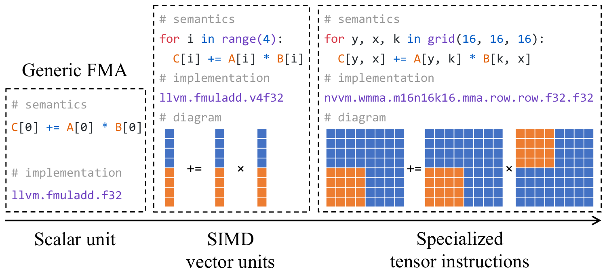

*图 1（原文 Figure 1，第 1 页）：硬件专用化的趋势。经典的加速手段是用向量单元同时处理多个标量计算，这在 CPU 上仍被广泛使用；而为满足越来越高的计算吞吐要求，现代加速器通常含有专用的高维张量计算指令，这就产生了张量化程序优化的需求。*

**图中文字翻译与读法**：图自左向右、自下而上画出三类硬件单元，每类都给出“semantics（语义）”“implementation（实现）”和“diagram（示意图）”。

- **左：Generic FMA（通用乘加），Scalar unit（标量单元）**。语义 `C[0] += A[0] * B[0]`；实现是 LLVM 的标量融合乘加指令 `llvm.fmuladd.f32`。示意图是单个方块。
- **中：SIMD vector units（SIMD 向量单元）**。语义 `for i in range(4): C[i] += A[i] * B[i]`；实现 `llvm.fmuladd.v4f32`（4 个 f32 的向量乘加）。示意图是三条竖条，相当于一次处理 4 个元素。
- **右：Specialized tensor instructions（专用张量指令），标为 Nvidia Tensor Core and NPUs**。语义 `for y, x, k in grid(16, 16, 16): C[y, x] += A[y, k] * B[k, x]`（一次完成一个 16×16×16 的矩阵乘累加）；实现是 NVVM 的 WMMA 指令 `nvvm.wmma.m16n16k16.mma.row.row.f32.f32`。示意图是三个 8×8 的方块阵列，橙色部分示意一条指令处理的数据块。
- **读图结论**：指令一次处理的数据从 1 个元素、4 个元素扩大到一个多维张量块。编译器如果只会在“标量乘加”外面做循环变换，就无法自动利用最右边这类指令。

### 2.2 两个挑战

论文指出要自动化编译张量化程序有两个关键挑战：

1. **张量化程序的抽象**。需要一种抽象，能务实地捕捉给定 ML 算子在张量化意义下的各种等价计算形式；它要能表示多维内存访问、线程层次结构，以及来自不同硬件后端的张量计算原语；并且表达力要足以覆盖大多数感兴趣的 ML 算子。
2. **张量化程序优化的巨大设计空间**。编译器要自动为给定算子生成优化的张量化程序，必须用到领域专家会用的一整套技术：有效的循环分块（tiling）、线程分配、数据布局变换。重要的是，这些变换现在必须与张量化计算协同进行，给分析和自动化增加了额外的复杂度；这些变换的组合构成很大的搜索空间，需要有效的办法找到优化后的程序。

现状是：多数张量化程序由领域专家手工优化，把张量化原语与多维循环、线程模式和数据缓存组合起来，做成专用的内核库，如 Intel MKL-DNN、ARM Compute Library、NVIDIA cuDNN，再被 TensorFlow、PyTorch、MXNet 等框架调用。但支持不断增长的模型与后端需要巨大的工程投入，这些库也需要若干迭代周期才能适应快速变化的应用，阻碍了新模型的演进。此前多数机器学习编译工作（论文引用 TVM、Tensor Comprehensions）是在循环嵌套变换的程序空间里搜索，并不能自动处理张量化程序。

### 2.3 现有两类做法与“分而治之”（图 2、图 3）

先看领域专家手工优化张量化程序的流程（图 2）：张量化的计算原语通常对应原算子计算的一个**子问题**，所以专家自然采用“分而治之”：把原程序分成“张量化计算的子问题”和“使用这些张量化计算的循环嵌套”，然后分别优化。这样开发者可以专注于一个子问题而不用管其他，还能面向多种张量化实现。

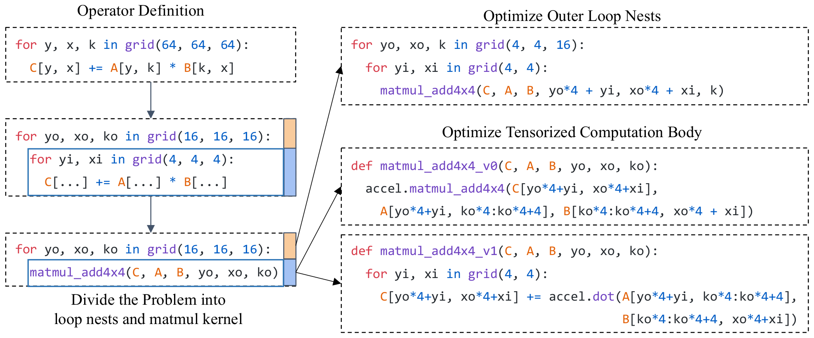

*图 2（原文 Figure 2，第 3 页）：专家可以选择把问题分成 4×4 矩阵乘，以及使用该 4×4 矩阵乘的循环，然后分别优化。这样就能有效利用目标硬件的专用张量指令。*

**图中文字翻译与读法**：

- **左列（Operator Definition，算子定义，向下的箭头是“Divide the Problem into loop nests and matmul kernel”，把问题分成循环嵌套和 matmul 内核）**。第一步是原始的 64×64×64 矩阵乘：

```python
for y, x, k in grid(64, 64, 64):
    C[y, x] += A[y, k] * B[k, x]
```

  第二步把它分成外层 16×16×16 的循环和内层 4×4×4 的小矩阵乘（图里橙色小块标出外层循环，蓝色小块标出内层）；第三步把内层整体封装成一个函数：

```python
for yo, xo, ko in grid(16, 16, 16):
    matmul_add4x4(C, A, B, yo, xo, ko)
```

- **右上（Optimize Outer Loop Nests，优化外层循环）**。外层循环可以单独变换。图里的例子是把 16×16 的 tile 网格再按 4×4 分块，并把归约循环放到 `yi, xi` 之外：`for yo, xo, k in grid(4, 4, 16): for yi, xi in grid(4, 4): matmul_add4x4(C, A, B, yo*4 + yi, xo*4 + xi, k)`。这里的 `k` 就是上面的 `ko`（范围 0 到 15），`yo*4 + yi` 覆盖 0 到 15，与上面 `yo`、`xo` 的范围一致。整个过程完全不碰 `matmul_add4x4` 的内部。
- **右中、右下（Optimize Tensorized Computation Body，优化张量化计算体）**。同一个 4×4 子问题可以有两种实现：`matmul_add4x4_v0` 直接调用整块指令 `accel.matmul_add4x4(C[...], A[...], B[...])`；`matmul_add4x4_v1` 对每个 (yi, xi) 调用点积指令 `accel.dot`，`C[yo*4+yi, xo*4+xi] += accel.dot(A[yo*4+yi, ko*4:ko*4+4], B[ko*4:ko*4+4, xo*4+xi])`。
- **读图结论**：专家的做法是“外层循环”和“内部张量计算体”各管各的。TensorIR 要把这种分而治之变成编译器能自动做的事。

论文把现有编译器分成两类（图 3 的左侧两部分）：

- **自下而上（bottom-up）**：Halide、TVM、Tiramisu、AKG、MLIR/Affine 和 AMOS 属于此类，用**标量函数体外面的循环迭代器**来建模搜索空间，然后通过搜索或多面体优化找到最佳的循环嵌套变换；
- **自上而下（top-down）**：HTA、Fireiron 和 Stripe 属于此类，通过嵌套的多面体结构把问题逐步分解成子问题。

鉴于分而治之在手工张量化优化中的重要性，作者问：能否把同样的洞见带进机器学习编译器的设计？论文的回答是：在循环嵌套里引入一个新抽象 **block**。block 含有恰当数量的签名信息，能把内层问题空间与外层问题隔离开。有了 block，就可以在外层和内层各自独立地继续做变换，把 block 签名当作接口。与手工分而治之类似，block 的常见用法是表示硬件后端的一个张量化计算原语；但当分而治之有意义时，也可以用 block 隔离更大的子问题。重要的是，在 TensorIR 里**张量计算是一等公民**，带 block 的循环嵌套可以看作迭代空间的一种广义抽象。

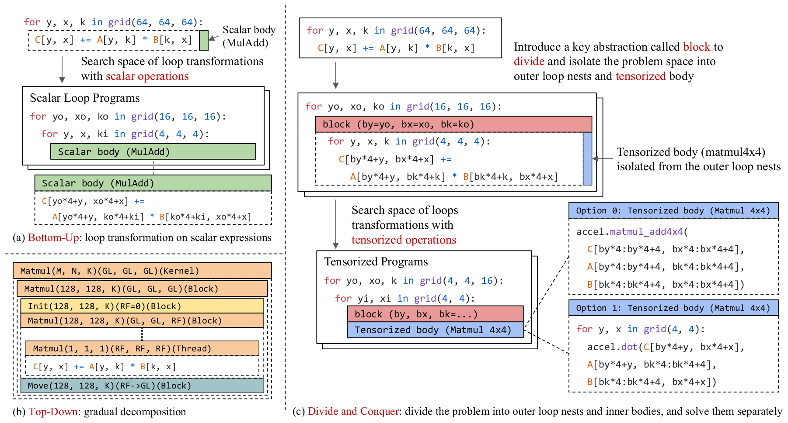

*图 3（原文 Figure 3，第 3 页）：本文方法总览。我们用一个叫 block 的关键抽象来划分并隔离张量化计算，并使得带张量化操作的进一步循环变换成为可能。*

**图中文字翻译与读法**：

- **(a) Bottom-Up（自下而上）：对标量表达式做循环变换**。最上面是 64×64×64 矩阵乘，函数体是标量乘加（Scalar body (MulAdd)，绿色小块）。箭头标注 “Search space of loop transformations with scalar operations（带标量操作的循环变换搜索空间）”，得到一族“Scalar Loop Programs（标量循环程序）”，例如分块成 `for yo, xo, ko in grid(16,16,16): for y, x, ki in grid(4,4,4):` 后，里面仍是标量乘加 `C[yo*4+y, xo*4+x] += A[yo*4+y, ko*4+ki] * B[ko*4+ki, xo*4+x]`。
- **(b) Top-Down（自上而下）：逐步分解**。一个嵌套的结构：`Matmul(M, N, K)(GL, GL, GL)(Kernel)` → `Matmul(128, 128, K)(GL, GL, GL)(Block)` → 其中含 `Init(128, 128, K)(RF=0)(Block)` 与 `Matmul(128, 128, K)(GL, GL, RF)(Block)` → `Matmul(1, 1, 1)(RF, RF, RF)(Thread)`，最里面是标量乘加 `C[y, x] += A[y, k] * B[k, x]`，外面还有 `Move(128, 128, K)(RF->GL)(Block)`。每个节点是一个“带形状、数据所在存储（GL 应指全局内存，RF 应指寄存器堆，补充）和执行层级（Kernel、Block、Thread）的子问题”，自上而下逐层拆解。
- **(c) Divide and Conquer（分而治之）：把问题分成外层循环与内层体，分别求解**。右侧：原程序（64×64×64 矩阵乘）经过本文的关键抽象 block，被划分并隔离成“外层循环嵌套”和“张量化的体”：`for yo, xo, ko in grid(16, 16, 16): block (by=yo, bx=xo, bk=ko)`，里面是 4×4×4 的小矩阵乘；蓝色竖条标出的“Tensorized body (matmul4x4) isolated from the outer loop nests”即张量化体，它与外层循环隔离。接着是 “Search space of loops transformations with tensorized operations（带张量化操作的循环变换搜索空间）”，对外层循环做变换，得到一族 “Tensorized Programs（张量化程序）”，如 `for yo, xo, k in grid(4, 4, 16): for yi, xi in grid(4, 4): block (by, bx, bk=...)` 加 `Tensorized body (Matmul 4x4)`。右下是同一个张量化体的两种实现：Option 0 是整块调用 `accel.matmul_add4x4(C[by*4:by*4+4, bx*4:bx*4+4], A[by*4:by*4+4, bk*4:bk*4+4], B[bk*4:bk*4+4, bx*4:bx*4+4])`，Option 1 是 `for y, x in grid(4, 4): accel.dot(C[by*4+y, bx*4+x], A[by*4+y, bk*4:bk*4+4], B[bk*4:bk*4+4, bx*4+x])`。
- **读图结论**：(a)(b) 要么一直在标量上做循环变换、要么需要逐层的嵌套规格；(c) 用 block 作为接口，在“外层循环的变换”和“张量化体的选择”之间解耦，搜索空间也因此缩小：体的部分交给张量指令，只需搜索外层循环。

论文称，这种分而治之既覆盖了此前编译器做法（自下而上、自上而下）的搜索空间，又把 HPC 与 ML 工程中的典型优化技术泛化成一个允许自动张量化的抽象；它自动化了库和编译流水线里常见的决策，使得自动生成可与厂商库竞争的方案成为可能。

### 2.4 贡献

论文列出三项贡献，并给出一条总括的实验结论：

1. 提出一个新的张量化程序抽象，把张量化计算与循环变换分开，同时用同一个抽象统一表示 tensor intrinsic 与硬件约束；
2. 构建带正确性校验的变换原语，生成张量化程序优化的丰富搜索空间；
3. 设计并实现一个新的、感知张量化的自动调度器。

TensorIR 被集成进一个端到端的编译框架，论文说它比现有 ML 编译方案最高快 7 倍，并自动取得与重度优化的平台专用方案相当的性能。（正文第 5.1 节写作“最高 7.5×”，见第七节的小出入。）

## 三、TensorIR 抽象（原文第 3 节）

### 3.1 三要素：buffer、循环嵌套与 block（图 4）

论文设计了一个 TensorIR 的 **Python-AST 方言**，让开发者能直接在 Python 里构造并变换 TensorIR 程序。一个 TensorIR 程序含三个主要元素：**多维 buffer**、**循环嵌套**（在 GPU 场景下可带线程绑定）和 **block**。一个 block 可以包含一个或多个嵌套的、带子 block 的循环嵌套，或者对应计算内容的一串命令式语句。这种表示使我们可以把计算划分成相应的子（block）区域，并利用保存在 block 签名里的依赖信息做有效的程序变换。

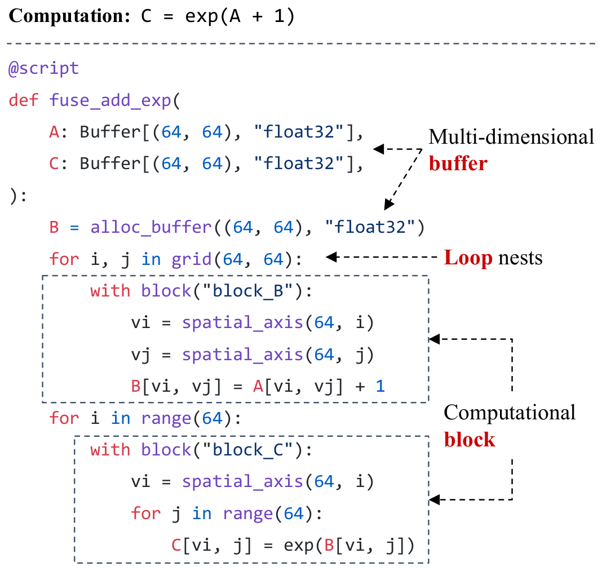

*图 4（原文 Figure 4，第 4 页）：一个 TensorIR 程序示例，含三个主要元素：多维 buffer、循环嵌套和计算 block。为简化，block 的细节被省略。*

**图中文字翻译与读法**：图里的程序计算 `C = exp(A + 1)`，分两步：先算中间结果 `B = A + 1`，再算 `C = exp(B)`。下面是图中代码的转录，右侧括注是图上的箭头标注的翻译。

```python
@script
def fuse_add_exp(
    A: Buffer[(64, 64), "float32"],      # 多维 buffer（Multi-dimensional buffer）
    C: Buffer[(64, 64), "float32"],      # 多维 buffer
):
    B = alloc_buffer((64, 64), "float32")   # 多维 buffer（中间结果）
    for i, j in grid(64, 64):               # 循环嵌套（Loop nests）
        with block("block_B"):              # 计算 block（Computational block）
            vi = spatial_axis(64, i)
            vj = spatial_axis(64, j)
            B[vi, vj] = A[vi, vj] + 1
    for i in range(64):
        with block("block_C"):              # 计算 block
            vi = spatial_axis(64, i)
            for j in range(64):
                C[vi, j] = exp(B[vi, j])
```

- `Buffer[(64, 64), "float32"]` 声明一个 64×64、float32 的多维 buffer；`alloc_buffer` 分配一个中间 buffer。
- `with block("block_B")` 定义一个名为 `block_B` 的计算块。块里的 `vi = spatial_axis(64, i)` 声明**块迭代器** `vi`：它是一个长度为 64 的**空间轴（spatial axis）**，绑定到外层循环变量 `i`。块体里只能通过 `vi`、`vj` 访问 buffer。
- `block_C` 只有一个块迭代器 `vi`，块体内部还有一个普通的 `for j in range(64)` 循环，说明 block 里可以再含循环：块可以只在某些维度上暴露迭代器，其余维度留在块内部（对应论文所说 block 可以含有嵌套的循环嵌套，或一串命令式语句）。
- **读图结论**：这三个元素在程序里各自清楚：buffer 是数据，for 循环是迭代空间，block 是“带签名的计算单元”。后面的 schedule 原语主要改的是 block 外面的循环以及 block 之间的位置关系。

### 3.2 Block 的签名（图 5）

一个 TensorIR 的 block 表示在多维 buffer 的一个子区域上的一个张量化计算。图 5 以矩阵乘（matmul）为例：block 的体由一组**块迭代器变量** $v_y, v_x, v_k$ 参数化，代表一个抽象的张量化计算；用这些块迭代器变量的不同取值组合实例化，block 就对应不同的具体运行中的 block 实例。这些迭代器变量可以绑定到含外层循环迭代器的表达式，这就隐含了 block 实例的执行顺序。

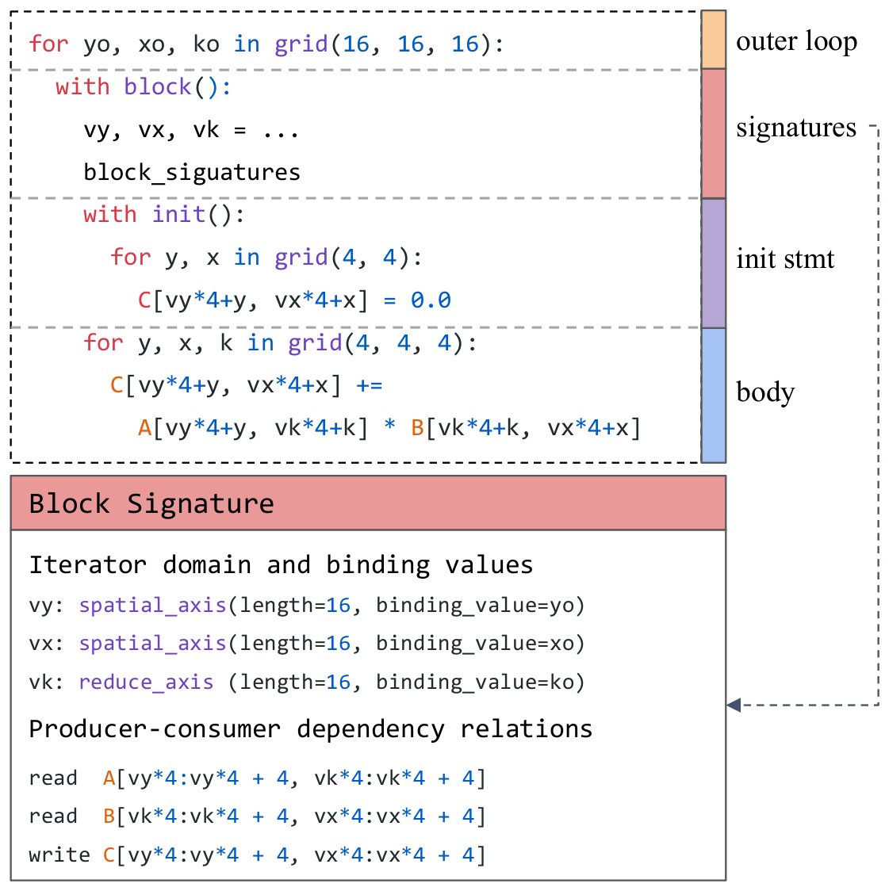

*图 5（原文 Figure 5，第 4 页）：block 含有进行依赖分析的完整签名，我们把它作为块体计算与外层循环嵌套之间的一个隔离层。*

**图中文字翻译与读法**：上半是程序，右侧的竖条给出各部分的名称；下半的红色大框是签名的内容。

```python
for yo, xo, ko in grid(16, 16, 16):          # outer loop（外层循环）
  with block():
    vy, vx, vk = ...                         # signatures（签名）
    block_siguatures                         # （原图拼写为 siguatures）
    with init():                             # init stmt（初始化语句）
      for y, x in grid(4, 4):
        C[vy*4+y, vx*4+x] = 0.0
    for y, x, k in grid(4, 4, 4):            # body（块体）
      C[vy*4+y, vx*4+x] += A[vy*4+y, vk*4+k] * B[vk*4+k, vx*4+x]
```

**Block Signature（块签名）** 包含两部分：

- **Iterator domain and binding values（迭代器范围与绑定值）**：`vy: spatial_axis(length=16, binding_value=yo)`；`vx: spatial_axis(length=16, binding_value=xo)`；`vk: reduce_axis(length=16, binding_value=ko)`。即 `vy`、`vx` 是长度 16 的空间轴，分别绑定到外层循环变量 `yo`、`xo`；`vk` 是长度 16 的**归约轴**，绑定到 `ko`。
- **Producer-consumer dependency relations（生产者-消费者依赖关系）**：`read A[vy*4 : vy*4+4, vk*4 : vk*4+4]`；`read B[vk*4 : vk*4+4, vx*4 : vx*4+4]`；`write C[vy*4 : vy*4+4, vx*4 : vx*4+4]`。即这个 block 读 A、B 的两个 4×4 子块，写 C 的一个 4×4 子块。

**设计理由（Rationale）**：block 的主要设计理由是**隔离张量化计算**：我们希望能在不看 block 体的前提下变换 block 外面的循环嵌套。但与标量计算不同，我们可能无法从不透明的张量计算体里抽取出变换所需的依赖信息，所以引入含足够依赖信息的 block 签名。签名还可以用来独立验证变换过程中迭代器绑定的正确性（第 3.4 节）。

**块迭代器范围（Block Iterator Domain）**：虽然可以把块迭代器绑定到任意循环嵌套来实例化 block 的体，但大多数实例化并不对应同一个计算。为保证各变换之间计算的一致性，在块签名里保存迭代器范围信息和迭代器的约束。对图 5 的例子，我们知道 $v_x$、$v_y$、$v_k$ 必须绑定到范围 $[0,16)$ 的迭代器。此外，因为 $v_k$ 是归约轴，除非归约是原子的，否则不能把它绑定到并行循环上。范围约束仍给外层循环变换留有很大空间，因为有多种方式构造满足约束的循环。论文说，这种范围签名可以看作整数集合与关系的一种具体表示，选择这种具体表示是因为它实现高效、便于推理，同一设计思想也适用于整数集合与关系的其他形式化范围表示（论文引用 Vasilache 等人的多面体工作）。

**访问区域与依赖（Access Region and Dependency）**：为提供足够的依赖信息，块签名含有 block 对多维 buffer 的访问区域和读写依赖。在图 5 里，block 通过读取 $A[v_y\cdot 4 : v_y\cdot 4+4,\ v_k\cdot 4 : v_k\cdot 4+4]$ 和 $B[v_k\cdot 4 : v_k\cdot 4+4,\ v_x\cdot 4 : v_x\cdot 4+4]$ 写出区域 $C[v_y\cdot 4 : v_y\cdot 4+4,\ v_x\cdot 4 : v_x\cdot 4+4]$。依赖信息在变换时使用。注意：论文**只标记每个 block 对多维 buffer 的依赖，而不是对其他语句（block）的依赖**。这种“经由 buffer 的间接”使更广泛的变换成为可能，例如数据布局变换和重计算（re-computation），它们在张量化程序优化里很重要。

**归约 block 与初始化（Reduction Block and Initialization）**：归约计算通常含一个初始化步骤和一个更新步骤，可以自然地映射成两个 block。但另一方面，联合地决定两步的调度（如分块与计算位置）常常有益。因此论文为执行归约的 block 引入一个可选的**初始化语句**，在归约的第一次迭代时执行。这种归约 block 表示主要在变换阶段有用；论文提供了在“两个 block 的表示”和“带 init 的 block 表示”之间互相转换的原语，便于为低层代码生成选择最合适的表示。

### 3.3 Schedule 变换（原文 3.2 节）

对给定的输入程序，需要生成语义等价的丰富程序搜索空间。论文引入变换原语，把一个 TensorIR 程序变换成等价的优化程序。沿用张量程序优化的惯例（Tiramisu、TVM、Halide），这一过程称为 **scheduling**。

**可调度的 block（schedulable）**：一个 block 如果其叶子只有“带子 block 的循环嵌套”，它就是**可调度的**。通过分析子 block 的签名和依赖信息，可以变换可调度 block 内的循环嵌套和子 block 的计算位置。值得注意的是，一个可调度的 block 可以包含不可调度的子 block（例如不透明的 Tensor Core 计算），一个不透明的 block 也可以包含可调度的子 block。基于 block 隔离，仍然可以独立地有效探索可调度部分的搜索空间，同时保持不透明的 block 不变。

**循环变换（Loop Transformations）**：循环分块（split、reorder）和计算位置变换（compute location mutation）是提高内存局部性的重要优化手段。论文也提供这些循环变换原语（图 6 的例子）。与已有张量编译器直接抽取每条叶子标量语句的依赖不同，TensorIR **只检查 block 签名**来计算依赖。除了循环变换，还支持把循环绑定到 GPU 线程的原语，以及给出向量化、展开等注解提示的原语。注意 block 隔离并不妨碍许多跨 block 的重要协同优化（例如 inlining、cooperative fetching）。论文的循环变换覆盖了此前工作提供的循环变换，因此 TensorIR 可以复现它们的搜索空间。

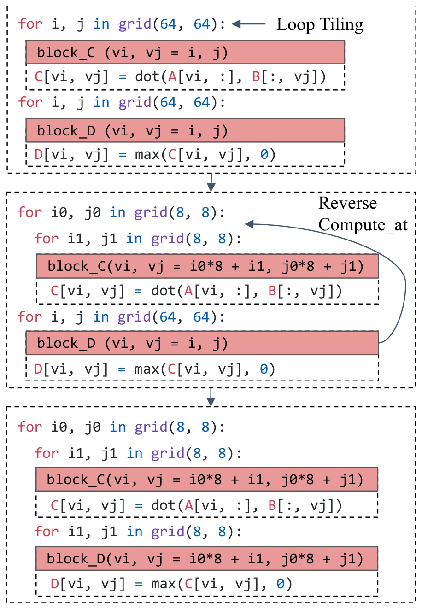

*图 6（原文 Figure 6，第 5 页）：循环变换改变外层循环嵌套，但不改变 block 内部的任何东西。*

**图中文字翻译与读法**：图里三段程序自上而下，演示对两个 block（`block_C`：矩阵乘，`block_D`：ReLU）做分块和位置变换。

1. **起点**：两个独立的 64×64 循环嵌套，`block_C (vi, vj = i, j)` 的体是 `C[vi, vj] = dot(A[vi, :], B[:, vj])`，`block_D (vi, vj = i, j)` 的体是 `D[vi, vj] = max(C[vi, vj], 0)`。第一个循环旁标注 “Loop Tiling（循环分块）”：对它做 8×8 的分块。
2. **分块后**：`block_C` 变成两层循环 `for i0, j0 in grid(8, 8): for i1, j1 in grid(8, 8): block_C(vi, vj = i0*8 + i1, j0*8 + j1)`；注意 block 的体 `C[vi, vj] = dot(A[vi, :], B[:, vj])` **一个字符都没变**，变的只是外层循环以及块迭代器的绑定表达式 `vi = i0*8 + i1`。`block_D` 仍在它自己的 64×64 循环里。一条弧线箭头标注 “Reverse Compute_at”：把消费者 `block_D` 移到生产者 `block_C` 的循环 `i0, j0` 之内。
3. **移动后**：`for i0, j0 in grid(8, 8):` 里先是 `block_C` 的 `i1, j1` 循环，紧接着是 `block_D` 的 `for i1, j1 in grid(8, 8): block_D(vi, vj = i0*8 + i1, j0*8 + j1)`。于是每个 8×8 的块先算 C 再算 D，C 的这块结果马上被 D 消费。
- **读图结论**：这三步只靠检查两个 block 的签名（迭代器绑定、读写区域）就能判断合法性，块体对变换是不透明的。（补充：以 `reverse_compute_at` 为例，需要确认 `block_D` 在某个 8×8 块里读的 C 区域，已被同一轮 `i0, j0` 里的 `block_C` 写完，这正是 3.4 节所说“生产者的写区域要覆盖消费者的读区域”的检查。）

**Blockization（块化）**：循环变换原语保持整体的 block 层次结构。正如在第 2 节所说，有时把一个子区域的计算隔离成新的子 block 来划分问题是有益的，论文把这种变换叫作 **blockization**（图 7）。块化之后的程序**不再基于标量**，因为新的子 block 对应一个张量化计算。因此可以用 blockization 来隔离可能的张量化候选。除了 blockization，论文还引入了能改变 block 层次的原语：例如缓存原语，引入子 block 把输入数据缓存到共享内存；以及在“单个归约 block”与相应的“init 块加 update 块”之间来回变换的原语。

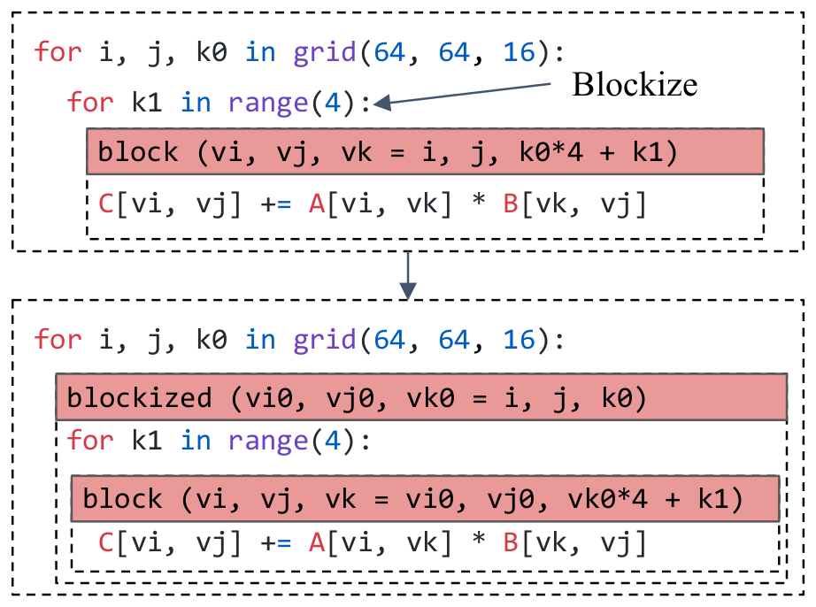

*图 7（原文 Figure 7，第 5 页）：blockization 创建一个新的 block 来隔离内部计算与外部循环嵌套。*

**图中文字翻译与读法**：

- **上（原程序）**：`for i, j, k0 in grid(64, 64, 16): for k1 in range(4): block (vi, vj, vk = i, j, k0*4 + k1)`，体是标量乘加 `C[vi, vj] += A[vi, vk] * B[vk, vj]`。内层的 `for k1 in range(4)` 旁标注 “Blockize”：对这个内层循环做块化。
- **下（块化后）**：`for i, j, k0 in grid(64, 64, 16):` 里多了一层新 block `blockized (vi0, vj0, vk0 = i, j, k0)`，它里面含有 `for k1 in range(4)` 和原来的标量 block；原来的 block 的绑定改成 `block (vi, vj, vk = vi0, vj0, vk0*4 + k1)`，体不变。
- **读图结论**：新的外层 block `blockized` 把“循环 `k1` 加内部标量 block”整体包起来，之后可以被当作一个**张量化计算**去匹配硬件的张量指令。（补充：这个新 block 有自己的签名，它读写的区域应是内部 4 步归约合起来的区域，原图没有画出这份签名。）

**Schedule 与 TensorIR 的分离（Separation of Scheduling and TensorIR）**：许多此前的张量编译器（TVM、Halide）依赖声明式的 scheduling 语言构造 schedule 树；给这类编译器添加新的 schedule 原语，需要同时修改 schedule 树的数据结构和相应的降低规则。论文采取不同的做法：把每个 schedule 原语实现成**从一个 TensorIR 程序到另一个 TensorIR 程序的独立变换**。这种设计更容易扩展：不同开发者可以基于稳定的 TensorIR 抽象并发地开发新原语；开发者还可以在任何变换阶段打印程序来调试，并把自动重写与 schedule 变换混合使用。

### 3.4 校验（Validation，原文 3.3 节）

block 及其对 buffer 的读写关系完整地刻画了原始计算，可以用来**验证循环嵌套与线程分配的正确性**。

**循环嵌套校验（Loop Nest Validation）**：检查循环嵌套提供的迭代器绑定是否满足迭代器范围的约束，包括范围大小和迭代器独立性信息。例如，如果两个数据并行的块迭代器绑定为 $v_1=i,\ v_2=i\cdot 2$，对应的程序是**非法**的，因为 $v_1$ 与 $v_2$ 不独立；但 $v_1=i/4,\ v_2=i\%4$ 可以是合法的绑定。论文构建模式匹配器来寻找从循环迭代器到块迭代器变量的**拟仿射映射**，并用这个模式验证绑定的独立性和范围。除了迭代器范围的验证，检查生产者-消费者关系同样重要：要确保写 buffer 区域的生产者 block 总是覆盖下游消费者的读区域。

**线程校验（Threading Validation）**：为 GPU 和其他支持线程的加速器构建程序时，还需要对线程和存储层次做额外校验，分三种：

| 校验 | 内容 |
|---|---|
| Thread binding（线程绑定） | 确保绑定到同一线程的不同迭代器彼此一致，并满足后端的启动约束 |
| Cooperative memory access（协作式内存访问） | 对线程间协作产生、存放在共享内存的 buffer，要确保 block 覆盖同组所有线程的下游需求；同时，为该 block 提供输入的上游 block 要覆盖该组所有线程对它的读需求 |
| Execution scope（执行范围） | 校验 tensor intrinsic 运行在正确的执行范围，例如 Tensor Core 需要在 warp 级运行 |

**schedule 原语的正确性（Correctness of Schedule Primitives）**：每个 schedule 原语里都加了检查来保证变换正确。当一个原语只改变循环嵌套时，也可以用上述校验过程来保证正确性，因为 block 的迭代器范围和依赖保持不变；对改变 block 的原语（例如 blockization），论文给出针对该原语的必要条件。论文特别说明两类检查的角色不同：循环嵌套校验和线程校验用于**过滤非法的 TensorIR 程序**，原语检查用于**保证变换前后 TensorIR 程序的等价**。用户在手工构造、导入和 schedule TensorIR 程序出错时会得到警告或错误信息；使用编译器自动生成程序时，校验可以在搜索中过滤假阳性，因此用户程序和编译生成的程序都受益。

### 3.5 编程量（原文 3.4 节）

如果让用户手工指定所有计算和优化，编程量会很高。论文的框架允许用户从 TensorFlow/PyTorch 导入模型，并自动从高层算子生成 TensorIR 程序；还通过自动调度器（第四节）为给定硬件平台自动提供分块、缓存等优化。当用户想要自定义算子时，仍可以用 Python 方言写 TensorIR，这时系统自动提供优化变换。因此编程量通常被降到最低。

## 四、自动调度张量化程序（原文第 4 节，图 8）

有了 TensorIR 抽象和变换原语，要充分利用它们，需要一个自动方案：在一组变换上优化，并把计算映射到原生的 tensor intrinsic。论文为此设计了一个**感知张量化的自动调度器**。

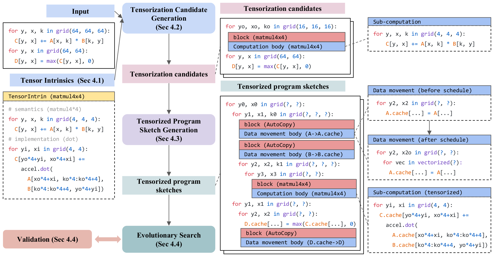

*图 8（原文 Figure 8，第 6 页）：带硬件 intrinsic 的张量化程序的自动优化。输入负载为 64×64×64 矩阵乘接一个 ReLU 算子，以 4×4×4 matmul 作为合成的 tensor intrinsic（用点积指令实现）。张量化候选生成步骤把 64×64×64 的 GEMM 切成 4×4×4 的子块并隔离出子计算；然后张量化程序草图生成步骤调度计算，并插入由此产生的数据搬运（AutoCopy）块，这些块被独立调度；最后用进化搜索填满草图里的随机决定，并用校验机制过滤掉错误的程序。*

**图中文字翻译与读法**：

- **左列（输入）**：Input 是负载 `for y, x, k in grid(64, 64, 64): C[y, x] += A[x, k] * B[k, y]`，后接 `for y, x in grid(64, 64): D[y, x] = max(C[y, x], 0)`（矩阵乘加 ReLU）；Tensor Intrinsics (Sec 4.1) 是 `TensorIntrin (matmul4x4)`：`# semantics (matmul4*4)`（语义）`for y, x, k in grid(4, 4, 4): C[y, x] += A[x, k] * B[k, y]`；`# implementation (dot)`（实现）`for yi, xi in grid(4, 4): C[yo*4+yi, xo*4+xi] += accel.dot(A[xo*4+xi, ko*4:ko*4+4], B[ko*4:ko*4+4, yo*4+yi])`。
- **中列（流程，自上而下）**：Tensorization Candidate Generation（张量化候选生成，Sec 4.2）→ Tensorization candidates（张量化候选）→ Tensorized Program Sketch Generation（张量化程序草图生成，Sec 4.3）→ Tensorized program sketches（草图）→ Evolutionary Search（进化搜索，Sec 4.4）；左下角的 Validation（校验，Sec 4.4）与进化搜索之间是双向箭头，表示搜索过程中随时校验。
- **右列上（候选）**：`for yo, xo, ko in grid(16, 16, 16): block (matmul4x4) / Computation body (matmul4x4)`，旁边的 Sub-computation 是被隔离出的 4×4×4 子计算；ReLU 部分原样保留。
- **右列下（草图）**：循环的各层大小都用 `?` 占位（如 `for y0, x0 in grid(?, ?)`），里面有两个 `block (AutoCopy)`（数据搬运块，`A->A.cache`、`B->B.cache`）、`block (matmul4x4)`（计算体）、在缓存上做的 ReLU `D.cache[...] = max(C.cache[...], 0)`，以及把 ReLU 结果搬回的 `block (AutoCopy)`（`D.cache->D`）。三个小框说明：数据搬运在调度前是简单的 `A.cache[...] = A[...]`，调度后变成向量化的 `for vec in vectorized(?): A.cache[...] = A[...]`；张量化的子计算是 `C.cache[...] += accel.dot(A.cache[...], B.cache[...])`。
- **读图结论**：流程分三段：先决定“用哪条张量指令、怎么把计算重排成它能吃的形状”（候选），再决定“外层怎么分块、数据怎么搬”（草图，里面还留着许多待定的数字），最后在待定数字上搜索，并用校验过滤非法程序。

### 4.1 Tensor intrinsic 的抽象（原文 4.1 节）

要在优化里用上某个 tensor intrinsic，需要一种办法把它的语义和后端实现告诉系统。论文用**同一个 TensorIR 抽象**来描述给定硬件后端的 tensor intrinsic：对每条张量化指令，引入一个 **TensorIntrin** 结构，由两个 block 组成：一个 block 描述**计算语义**，另一个 block 提供张量化计算的**低层实现**。

在图 8 的例子里，语义用一个带标量体 $C[i,j] \mathrel{+}= A[i,k]\times B[k,j]$ 的普通循环嵌套表示，实现则用内部的点积指令 `accel.dot`。TensorIntrin 还通过多维 buffer 的规格声明数据类型、存储范围（storage scope）、内存布局和连续性约束，这些约束在校验阶段使用。

注意，tensor intrinsic 在常见平台上通常需要和**特殊的内存范围、数据布局以及相应的装载/存储指令**配合使用。例如在 NVIDIA GPU 上，如果决定用 `nvcuda::wmma::mma_sync` API 做稠密计算，就需要用 `nvcuda::wmma::load_matrix_sync` 和 `nvcuda::wmma::store_matrix_sync` 分别准备输入操作数和取回输出结果；在 ARM CPU 上，像 `a64_gemm_u8_8×12` 这样的 micro-kernel 要求操作数以交错布局存放。开发者可以通过给张量计算的每个输入、输出操作数指定特殊的存储范围，把这些约束告诉系统。

### 4.2 张量化候选生成（原文 4.2 节，图 9）

给定一个后端目标和一个输入程序，首先把程序体与可能的 TensorIntrin 匹配，生成张量化候选。匹配是渐进的：先匹配表达式模式 $C[\cdot] \mathrel{+}= A[\cdot]\times B[\cdot]$（不考虑下标），再通过提出下标之间可能的映射来细化匹配。设某个矩阵乘 intrinsic 的计算为（原文公式 (1)）

$$
C[x,y] \mathrel{+}= A[x,k]\times B[k,y]
$$

它很容易匹配到 batch 矩阵乘一类的负载，例如 $C[b,i,j] \mathrel{+}= A[b,i,r]\times B[b,r,j]$，把 $x,y,k$ 映射到 $i,j,r$ 即可。但对下标模式更复杂的负载，例如二维卷积（Conv2D）

$$
C[n,h,w,c_o] \mathrel{+}= A[n,\ h\,s_h + r_h\,d_h,\ w\,s_w + r_w\,d_w,\ r_c]\times B[r_c,r_h,r_w,c_o]
$$

（其中 $s_h,s_w$ 是步长，$d_h,d_w$ 是膨胀率，下标在原文正文里写成 $h*s_h+r_h*d_h$），$x,y,k$ 与 $n,h,w,c,r_h,r_w,r_c$ 之间的映射就不是显然的。

**ReIndex**：对这类一般情形，论文把计算表达式改写成等价形式：

$$
C[n,h,w,c_o] \mathrel{+}= A_r[n,h,w,r_h,r_w,r_c]\times B[r_c,r_h,r_w,c_o],
$$

$$
A_r[n,h,w,r_h,r_w,r_c] = A[n,\ h\,s_h + r_h\,d_h,\ w\,s_w + r_w\,d_w,\ r_c].
$$

这个变换叫 **ReIndex**：用出现在 buffer 访问下标里的中间迭代器去重写 buffer 的访问表达式。改写之后，每个 buffer 的下标都是纯迭代器，不再是迭代器的算术组合。

**按“出现模式”匹配迭代器**：为了让新计算与 tensor intrinsic 匹配，检查每个迭代器出现在哪些 buffer 的访问里。例如：$n,h,w$ 与 intrinsic 里的 $x$ 都出现在 $A$（即 $A_r$）和 $C$ 的下标里；$c_o$ 与 $y$ 出现在 $B$ 和 $C$ 的下标里；$r_h,r_w,r_c$ 与 $k$ 出现在 $A$ 和 $B$ 的下标里。因此可以通过出现模式把计算里的迭代器与 intrinsic 里的迭代器对应起来：把 $\mathrm{fuse}(n,h,w)$ 映射到 $x$，$c_o$ 映射到 $y$，$\mathrm{fuse}(r_h,r_w,r_c)$ 映射到 $k$。（原文这一句把第一个写成了 $\mathrm{fuse}(n,h,y)$，应是 $w$ 的笔误。）这里 $\mathrm{fuse}$ 把多个迭代器合并成一个，递归定义为

$$
\mathrm{fuse}(i_1)=i_1,\qquad \mathrm{fuse}(i_1,i_2,\dots,i_r)=\mathrm{fuse}(i_1,\dots,i_{r-1})\cdot \mathrm{extent}(i_r)+i_r,
$$

其中 $\mathrm{extent}(i_r)$ 是迭代器 $i_r$ 的取值个数（把这几个下标按“行主序”拼成一个）。于是计算可以变换成

$$
C_t[\mathrm{fuse}(n,h,w),c_o] \mathrel{+}= A_t[\mathrm{fuse}(n,h,w),\mathrm{fuse}(r_h,r_w,r_c)]\times B_t[\mathrm{fuse}(r_h,r_w,r_c),c_o],
$$

其中 $C_t[\mathrm{fuse}(n,h,w),c_o]=C[n,h,w,c_o]$，$A_t[\mathrm{fuse}(n,h,w),\mathrm{fuse}(r_h,r_w,r_c)]=A_r[n,h,w,r_h,r_w,r_c]$，$B_t[\mathrm{fuse}(r_h,r_w,r_c),c_o]=B[r_h,r_w,r_c,c_o]$。论文用这个映射重塑 block 实例空间和外层循环，并变换 ReIndex 出来的 buffer 的布局：**插入布局重写块**把 $A,B,C$ 分别改写成 $A_t,B_t,C_t$，再用 $A_t,B_t,C_t$ 改写计算体。这些步骤之后，计算体就与 tensor intrinsic 兼容了。

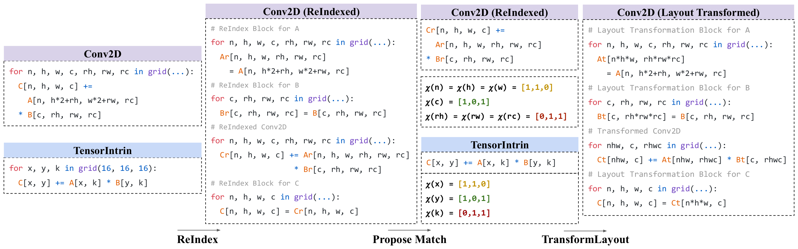

*图 9（原文 Figure 9，第 8 页）：张量化候选生成的示例流程。输入负载是标准的 NHWC 二维卷积，硬件后端 intrinsic 是 16×16×16 矩阵乘。首先系统把 buffer 访问表达式转换成中间迭代器；基于 buffer 的访问模式，计算每个迭代器的特征函数，并在具有相同特征向量的迭代器之间建立映射；这个映射进一步指导 block 实例空间和 ReIndex buffer 的变换。注意，尽管 B 与 C 的 ReIndex 阶段是冗余的，它们在草图生成阶段会被内联进消费者，因此不影响性能。*

**图中文字翻译与读法**：图自左向右是三个箭头对应的三步：**ReIndex**、**Propose Match（提出匹配）**、**TransformLayout（变换布局）**。

- **最左**：`Conv2D`（步长 2 的 NHWC 卷积）`for n, h, w, c, rh, rw, rc in grid(...): C[n, h, w, c] += A[n, h*2+rh, w*2+rw, rc] * B[c, rh, rw, rc]`；`TensorIntrin`：`for x, y, k in grid(16, 16, 16): C[x, y] += A[x, k] * B[y, k]`。
- **ReIndex 之后（Conv2D (ReIndexed)）**：为 A、B、C 各加一个 ReIndex 块：`Ar[n, h, w, rh, rw, rc] = A[n, h*2+rh, w*2+rw, rc]`；`Br[c, rh, rw, rc] = B[c, rh, rw, rc]`；改写后的卷积是 `Cr[n, h, w, c] += Ar[n, h, w, rh, rw, rc] * Br[c, rh, rw, rc]`；最后 `C[n, h, w, c] = Cr[n, h, w, c]` 写回。
- **Propose Match 一栏**：对每个迭代器计算**特征向量** $\chi$（三个分量依次表示它是否出现在 C、A、B 的下标里）。卷积一侧：$\chi(n)=\chi(h)=\chi(w)=[1,1,0]$，$\chi(c)=[1,0,1]$，$\chi(r_h)=\chi(r_w)=\chi(r_c)=[0,1,1]$。intrinsic 一侧：$\chi(x)=[1,1,0]$，$\chi(y)=[1,0,1]$，$\chi(k)=[0,1,1]$。特征向量相同的迭代器配成一对，于是 $\{n,h,w\}\to x$，$c\to y$，$\{r_h,r_w,r_c\}\to k$。
- **TransformLayout 之后（Conv2D (Layout Transformed)）**：布局变换块把 A、B 重排成二维矩阵：`At[n*h*w, rh*rw*rc] = A[n, h*2+rh, w*2+rw, rc]`；`Bt[c, rh*rw*rc] = B[c, rh, rw, rc]`（图中的 `*` 是“把这几个迭代器合并成一个”的缩写，即上面的 fuse）；变换后的卷积是 `Ct[nhw, c] += At[nhw, rhwc] * Bt[c, rhwc]`，它已经是一个普通矩阵乘，形状与 intrinsic 吻合；最后 `C[n, h, w, c] = Ct[n*h*w, c]` 写回。
- **读图结论**：这一步把“怎么把一个下标复杂的卷积变成 intrinsic 要的矩阵乘”变成了机械的两步：ReIndex 去掉下标里的算术，再按迭代器的出现模式配对并合并（相当于隐式 GEMM 或 im2col，补充）。

**循环重组与提前块化（Loop Reorganization and Early Blockize）**：除了计算体，还要确保张量计算区域与 TensorIntrin 提供的描述相匹配。重组后的 block 实例空间的形状可能不能被 tensor intrinsic 的子问题大小整除。对上一步得到的每个计算体，论文对计算 block 和输入/输出操作数做必要的**填充（padding）**到最近的可整除形状；然后做分块（tiling）创建与 tensor intrinsic 的循环嵌套匹配的内层循环，并进一步把内层循环块化，隔离出对应的张量计算。注意，这一步生成的候选**不一定都能成功张量化**：因为内存布局、线程等其他约束依赖后续变换；这些约束被嵌入张量化候选里，并在校验时检查。

**形式化描述（Formal Description of the Process）**：设 intrinsic 的标量表达式可形式化为（原文公式 (2)）

$$
O[\mathbf v_0]=f\big(O[\mathbf v_0],\,I_1[\mathbf v_1],\,I_2[\mathbf v_2],\,\dots,\,I_k[\mathbf v_k]\big)
$$

其中 $O$ 是输出操作数，$I_{1:k}$ 是输入操作数，$\mathbf v$ 是参数化这个计算的迭代器集合，$\mathbf v_{0:k}$ 都是 $\mathbf v$ 里迭代器组成的列表，$f$ 是检测到的表达式模式（它涵盖常见的点积和矩阵乘 intrinsic）。再设负载的标量表达式可形式化为

$$
\tilde O[g_0(\tilde{\mathbf v}_0)]=f\big(\tilde O[g_0(\tilde{\mathbf v}_0)],\,\tilde I_1[g_1(\tilde{\mathbf v}_1)],\,\dots,\,\tilde I_k[g_k(\tilde{\mathbf v}_k)]\big),
$$

其中 $\tilde O,\tilde I_{1:k},\tilde{\mathbf v}_{0:k}$ 对应上面的各量，$f$ 完全相同，$g_{0:k}$ 是把迭代器列表映射到实际 buffer 访问位置的映射。例如在 Conv2D 里有 $g_A(n,h,w,r_h,r_w,r_c)=(n,\ h s_h+r_h d_h,\ w s_w+r_w d_w,\ r_c)$。

为把问题化简成更简单的规范形式，使用 ReIndex 变换：它为一个操作数创建一个中间缓存 buffer，但布局按迭代器重新排列。形式化地，对 $\tilde I_1[g_1(\tilde{\mathbf v}_1)]$ 做 ReIndex，会在计算之前创建重写块 $\hat I_1[\tilde{\mathbf v}_1]=\tilde I_1[g_1(\tilde{\mathbf v}_1)]$。对所有操作数都做 ReIndex 后，负载的标量表达式化简为（原文公式 (3)）

$$
\hat O[\tilde{\mathbf v}_0]=f\big(\hat O[\tilde{\mathbf v}_0],\,\hat I_1[\tilde{\mathbf v}_1],\,\dots,\,\hat I_k[\tilde{\mathbf v}_k]\big)
$$

式 (2) 与式 (3) 的 buffer 下标都直接对应迭代器。

为匹配 (2) 与 (3)，对迭代器 $v\in\mathbf v$ 定义**特征向量** $\chi(v)\in\{0,1\}^{k+1}$：检查 $\mathbf v_0,\mathbf v_1,\dots,\mathbf v_k$ 各自是否含有 $v$，即

$$
\chi(v)_i=[\,v\in\mathbf v_i\,],\qquad i\in[0,k],
$$

其中 $[\cdot]$ 是 Iverson 括号（条件为真取 1，否则取 0）。只要满足 $\forall v\in\mathbf v,\ \exists\,\tilde v\in\tilde{\mathbf v},\ \chi(v)=\tilde\chi(\tilde v)$，就能成功提出映射。在当前实现里，进一步安全地假设 $\mathbf v$ 里的迭代器都有互不相同的特征向量；于是对每个 $v\in\mathbf v$，把所有满足 $\chi(v)=\tilde\chi(\tilde v)$ 的 $\tilde v$ 合并（fuse），并把合并后的迭代器映射到 $v$。

注意 $\mathbf v_{0:k}$ 或 $\tilde{\mathbf v}_{0:k}$ 里各个迭代器的顺序不影响特征函数的值；但合并 $\tilde v$ 时，合并的顺序会影响操作数在内存中如何重组才能与 tensor intrinsic 兼容。论文当前实现对所有负载用一个默认顺序，将来可以推广到不同的合并顺序。

### 4.3 张量化程序草图生成与 AutoCopy（原文 4.3 节）

对一组给定的张量化候选，需要构造一个包含该张量化的大程序搜索空间。论文把已有的层次化搜索空间生成方法（Ansor）推广到张量计算：通过生成含张量化计算的**程序草图（sketch）**来构造搜索空间，再枚举草图所诱导的各种选择。如图 8 右部所示，一个草图固定了程序结构的一部分，同时给其余参数（如循环分块大小和计算缓存的决定）留出选择空间。草图通过迭代地应用预定义的**草图生成规则**产生。重要的是，需要构建能作用于张量化计算的草图生成规则，做法是在分析里利用 block 签名和访问区域信息。

**数据搬运是一等公民（Data Movement as First-Class Citizen）**：此前的张量程序自动调度器把设计重点放在计算的调度上，把不同内存范围之间的数据搬运看作次要问题。然而，由于 tensor intrinsic 大幅提高了计算吞吐，**数据搬运成了张量程序的瓶颈**；而且数据搬运的决定通常依赖计算调度的决定，如分块、线程绑定、执行范围和生产者-消费者数据流的粒度。论文把这些洞见付诸实现：在自动调度器里把数据搬运作为一等公民，并与计算调度解耦。具体做法是在草图生成规则决定要做数据搬运的位置插入 **AutoCopy 块**（图 8）。拷贝块隐藏了内存调度的细节，只在块签名这一层暴露必要的 buffer 访问信息。被隔离的拷贝块让草图生成可以独立做计算调度的决定，而不用考虑如何做数据搬运。AutoCopy 块的体描述数据搬运任务的细节，包括 buffer 位置映射、线程和存储范围要求；一个**数据搬运调度器**以这些信息为输入，执行与内存有关的 schedule 变换，例如插入中间缓存阶段、利用数据搬运的 tensor intrinsic、向量化、协作式取数（cooperative fetching）或步长填充（stride padding，避免 bank 冲突）。

### 4.4 进化搜索与校验（原文 4.4 节）

草图生成之后，可以得到数十亿个可能的程序。论文用**进化搜索**探索这个空间，找到优化的张量化程序。搜索从对给定程序草图的随机初始选择开始；然后对当前这批程序做变异（mutation）；再从变异后的候选里选出有前景的程序，在目标硬件后端上做基准测试；把评测阶段收集的数据用来更新学习到的成本模型。

**张量化计算的成本模型**：论文构建基于**提升树集成**（boosting tree ensemble，论文引用 XGBoost）的成本模型，用从程序里提取的特征，特征向量包含访存模式、复用和循环注解方面的信息。重要的是，特征既从各 block 的签名里以隔离的方式提取，也从 block 的体里提取（例如标记是否使用了 Tensor Core）。论文认为该成本模型可视为对此前针对张量化程序方法的推广，并相信为张量化程序建立有效的成本模型是有前景的未来研究方向。

**校验**：搜索中随机变异程序，可能因为不满足 tensor intrinsic 的约束或循环嵌套候选无效而产生**非法程序**。假阳性的可能性要求搜索期间有校验步骤。论文用第 3.4 节的技术来验证进化搜索中的候选程序，识别并拒绝非法程序。校验步骤减轻了进化搜索算法的负担，使搜索中产生的假阳性很少。

## 五、实验（原文第 5 节）

论文把 TensorIR 实现在 Apache TVM 之上（并指出其中的洞见也可使其他 ML 编译框架受益），要回答三个问题：TensorIR 能否优化常见的 ML 算子（5.1 节）？能否给端到端网络执行带来性能提升（5.2 节）？能否支持不同硬件平台上的 tensor intrinsic（5.3 节）？实验还贯穿一个问题：TensorIR 与厂商库（以及依赖这些库的框架）相比如何？这些库大多由专门的团队重度优化，而在所有设定里，TensorIR 都是端到端自动优化，不调用外部库。

**表：实验设置汇总（均取自原文第 5 节）**

| 项目 | 设置 |
|---|---|
| 单算子（GPU） | 1D 卷积 C1D、2D 卷积 C2D、3D 卷积 C3D、深度可分离卷积 DEP、膨胀卷积 DIL、通用矩阵乘 GMM（图中有 GMM-1、GMM-2）、分组卷积 GRP、转置 2D 卷积 T2D；批大小 1 与 16 |
| GPU 平台 | NVIDIA RTX 3080（带 Tensor Core），所有算子的输入和累加器数据类型都是 float16 |
| 编译器基线 | TVM（commit 27b0aad5，使用 auto-scheduler，即 Ansor）、AMOS（commit 6aee6fe2） |
| 厂商方案基线 | CUTLASS（2.9 版）、TensorRT（PyTorch-TensorRT 容器 Release 22.06） |
| 端到端模型（GPU） | ResNet-50、MobileNet V2、BERT_large、ViT（Vision Transformer）；另含框架基线 PyTorch（1.13.0.dev20220612）；批大小 1 与 16 |
| ARM 平台 | AWS Graviton2 CPU，用 8 位整数点积指令 sdot；单算子 C2D 与 GMM（C2D-1、C2D-2、GMM-1、GMM-2、GMM-3），基线 TVM 与 ARMComputeLib；端到端 ResNet-50 与 MobileNet V2，基线 PyTorch 与 TVM |
| 指标 | 图中的“Normalized Performance”（归一化性能，越高越好）。所有图里 TensorIR 的柱都是 1.0，其他系统的柱是相对 TensorIR 的性能，高于 1.0 表示比 TensorIR 更快。原文没有明确写出归一化的定义，也没有给出各算子的具体形状 |

### 5.1 单算子评测（GPU）

**与 ML 编译器比较（图 10）**：TVM 在计算强度低的负载（如 DEP）上表现不错，但在重负载（如 C2D、C3D、GMM）上因为对 Tensor Core 的支持有限而性能较差；AMOS 能对每个负载使用 Tensor Core，但不如 TensorIR。总体上 TensorIR 相对现有 ML 编译方案最高提升 7.5 倍。论文把这些改进归因于更好的抽象，以及利用 tensor compute intrinsic 和相应数据搬运的自动调度。

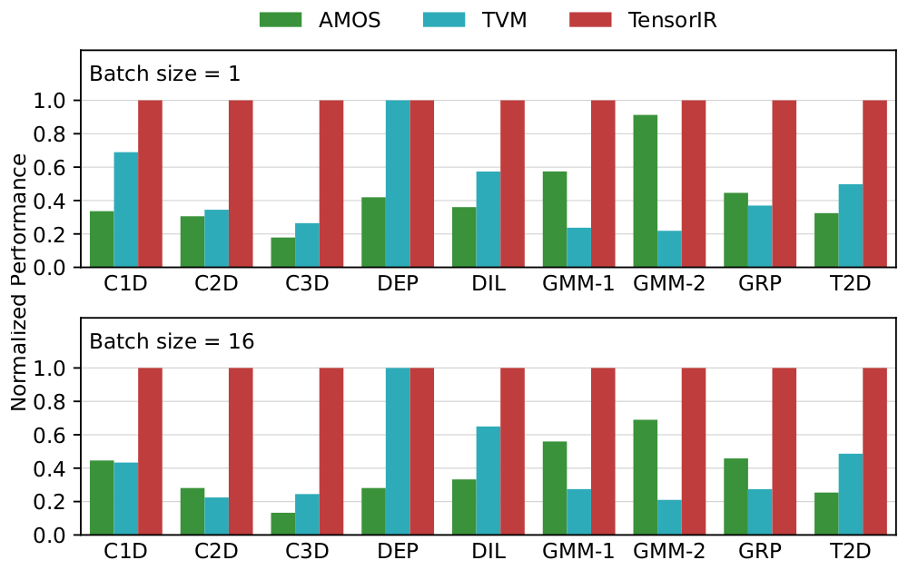

*图 10（原文 Figure 10，第 10 页）：在 NVIDIA GPU 上与现有机器学习编译器的单算子对比。TensorIR 在各负载上最高带来 7.5 倍的速度提升。*

**图中文字翻译与读法**：上下两个面板分别是 Batch size = 1 与 Batch size = 16；纵轴 Normalized Performance（归一化性能，越高越好）；绿柱 AMOS，青柱 TVM，红柱 TensorIR；横轴 9 个算子。从图上量出的近似值：

| 算子 | 批大小 1：AMOS | TVM | TensorIR | 批大小 16：AMOS | TVM | TensorIR |
|---|---:|---:|---:|---:|---:|---:|
| C1D | 0.34 | 0.69 | 1.00 | 0.45 | 0.43 | 1.00 |
| C2D | 0.31 | 0.34 | 1.00 | 0.28 | 0.22 | 1.00 |
| C3D | 0.18 | 0.27 | 1.00 | 0.13 | 0.24 | 1.00 |
| DEP | 0.42 | 1.00 | 1.00 | 0.28 | 1.00 | 1.00 |
| DIL | 0.36 | 0.58 | 1.00 | 0.33 | 0.65 | 1.00 |
| GMM-1 | 0.58 | 0.24 | 1.00 | 0.56 | 0.27 | 1.00 |
| GMM-2 | 0.91 | 0.22 | 1.00 | 0.69 | 0.21 | 1.00 |
| GRP | 0.45 | 0.37 | 1.00 | 0.46 | 0.27 | 1.00 |
| T2D | 0.33 | 0.50 | 1.00 | 0.25 | 0.49 | 1.00 |

**读图结论**：TensorIR 在所有算子上最快（或持平）。DEP 上 TVM 与 TensorIR 持平（都是 1.0），符合正文“TVM 在 DEP 这类计算强度低的负载上不错”的说法（补充：深度可分离卷积没有可用的大矩阵乘，Tensor Core 帮不上忙）。最大差距在 C3D 上，批大小 16 时 AMOS 约 0.13，即 TensorIR 快约 7.7 倍，与正文“最高 7.5 倍”大体一致。

**与平台专用库比较（图 11）**：论文对比两个平台专用方案：CUTLASS 和 TensorRT。TensorIR 在 C1D、C2D、DEP、T2D 和 DIL 上优于基线，最高达 13.9 倍；在 C3D、GMM 和 GRP 上达到 75% 以上的吞吐。论文认为这表明，即便在由专门工程团队重度优化的负载上，TensorIR 仍然可以接近或达到现有厂商方案，并预期随着把这些库里的更多洞见引入 TensorIR，剩下的差距会继续缩小。所有情形里，基线都由专门的工程团队优化，而 TensorIR 只需给定张量指令的声明，就能自动编译。

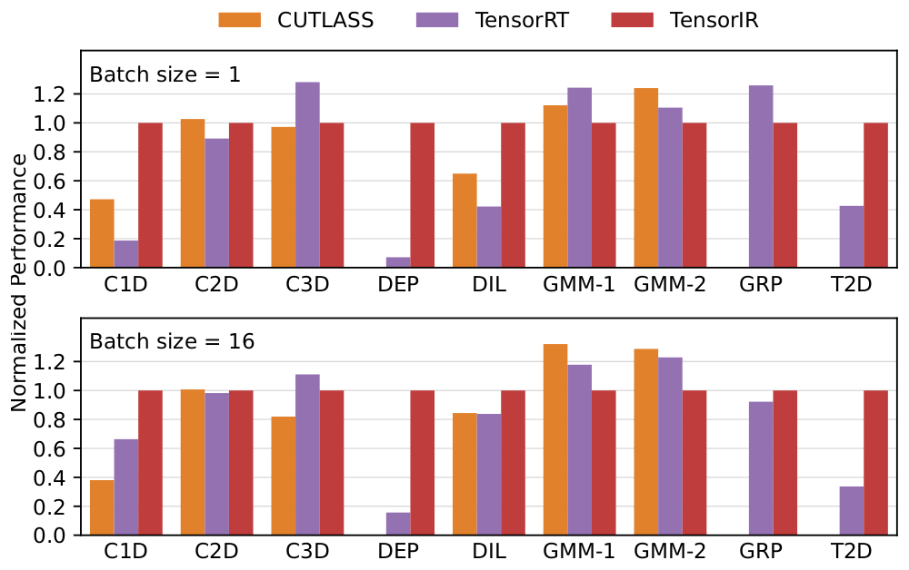

*图 11（原文 Figure 11，第 10 页）：与平台专用库的单算子对比。由于 CUTLASS 库不支持 DEP、GRP 和 T2D，没有展示这几个算子的 CUTLASS 数字。TensorIR 在 C1D、C2D、DEP、T2D 和 DIL 上优于基线，最高达 13.9 倍，在 C3D、GMM 和 GRP 上达到 75% 以上的吞吐。*

**图中文字翻译与读法**：同样是上下两个面板（批大小 1 与 16），橙柱 CUTLASS，紫柱 TensorRT，红柱 TensorIR；纵轴的刻度到 1.2 以上，因为库在若干算子上比 TensorIR 快。从图上量出的近似值（“-”表示没有这根柱，即库不支持）：

| 算子 | 批大小 1：CUTLASS | TensorRT | TensorIR | 批大小 16：CUTLASS | TensorRT | TensorIR |
|---|---:|---:|---:|---:|---:|---:|
| C1D | 0.47 | 0.18 | 1.00 | 0.38 | 0.66 | 1.00 |
| C2D | 1.02 | 0.89 | 1.00 | 1.01 | 0.98 | 1.00 |
| C3D | 0.97 | 1.28 | 1.00 | 0.82 | 1.11 | 1.00 |
| DEP | - | 0.07 | 1.00 | - | 0.15 | 1.00 |
| DIL | 0.65 | 0.42 | 1.00 | 0.84 | 0.84 | 1.00 |
| GMM-1 | 1.12 | 1.24 | 1.00 | 1.32 | 1.18 | 1.00 |
| GMM-2 | 1.24 | 1.10 | 1.00 | 1.29 | 1.23 | 1.00 |
| GRP | - | 1.26 | 1.00 | - | 0.92 | 1.00 |
| T2D | - | 0.42 | 1.00 | - | 0.34 | 1.00 |

**读图结论**：

- **TensorIR 明显更快的算子**：C1D、DEP、T2D、DIL。DEP 批大小 1 上 TensorRT 约 0.07，即 TensorIR 约快 14 倍，对应正文的“最高 13.9 倍”。
- **库更快的算子**：C3D（TensorRT 约 1.28，TensorIR 约为其 78%）、GMM-1 与 GMM-2（库约 1.1 至 1.3，TensorIR 约为其 76% 至 91%）、GRP 批大小 1（TensorRT 约 1.26，TensorIR 约 79%）。这些就是正文“75% 以上”的来源。
- **C2D 上基本持平**：CUTLASS 约 1.02 与 1.01，略高于 TensorIR（约 1 至 2 个百分点，在读图误差之内），TensorRT 为 0.89 与 0.98。论文把 C2D 也列在“优于基线”的算子里，严格看是“与最好的库相当”。
- 厂商库并不是对所有算子都支持：CUTLASS 没有 DEP、GRP、T2D 的实现。

### 5.2 端到端模型评测（GPU）与调优时间

论文在 NVIDIA RTX 3080 上评测四个常用模型（ResNet-50、MobileNet V2、BERT_large、ViT），基线包括 TVM 和 AMOS（ML 编译器）、PyTorch（框架参照点）和 TensorRT（由 NVIDIA 工程团队重度优化的厂商方案）。

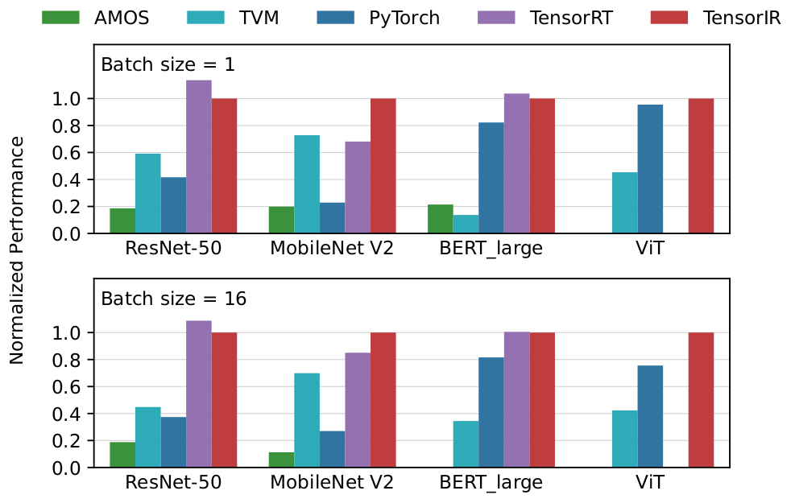

*图 12（原文 Figure 12，第 11 页）：NVIDIA GPU 上的端到端模型评测。TensorIR 显著优于现有的机器学习编译方案，并在流行网络上取得与 GPU 上推理库相近或更好的吞吐；在 TensorRT 尚不支持的新兴模型 ViT 上，TensorIR 性能更好。*

**图中文字翻译与读法**：上下两个面板（批大小 1 与 16），五个系列：AMOS（绿）、TVM（青）、PyTorch（深蓝）、TensorRT（紫）、TensorIR（红）；横轴四个模型。从图上量出的近似值（“-”表示没有这根柱）：

| 模型 | 批大小 | AMOS | TVM | PyTorch | TensorRT | TensorIR |
|---|---:|---:|---:|---:|---:|---:|
| ResNet-50 | 1 | 0.19 | 0.59 | 0.42 | 1.13 | 1.00 |
| MobileNet V2 | 1 | 0.20 | 0.73 | 0.23 | 0.68 | 1.00 |
| BERT_large | 1 | 0.22 | 0.14 | 0.82 | 1.04 | 1.00 |
| ViT | 1 | - | 0.45 | 0.96 | - | 1.00 |
| ResNet-50 | 16 | 0.19 | 0.45 | 0.37 | 1.09 | 1.00 |
| MobileNet V2 | 16 | 0.12 | 0.70 | 0.27 | 0.85 | 1.00 |
| BERT_large | 16 | - | 0.34 | 0.82 | 1.01 | 1.00 |
| ViT | 16 | - | 0.43 | 0.76 | - | 1.00 |

**读图结论**：论文写道：TensorIR 比 PyTorch、TVM 和 AMOS 快 1.2 至 8.8 倍；在 MobileNet V2 上比 TensorRT 好 30%，在 ResNet-50 和 BERT_large 上达到 TensorRT 的 88% 至 100% 的吞吐；并且能自动支持 TensorRT 尚不支持的 Vision Transformer 等新兴模型。逐项对照读数：

- **相对 TensorRT**：MobileNet V2 约快 1.47 倍（批大小 1）和 1.18 倍（批大小 16），“30%”介于两者之间；ResNet-50 上 TensorIR 约为 TensorRT 的 88%（批大小 1）和 92%（批大小 16）；BERT_large 上约 96% 和 99%。这与“88% 至 100%”一致。ResNet-50 是 TensorRT 明显更快的一个模型。
- **相对其他系统的“1.2 至 8.8 倍”**：最大值对应 AMOS 在 MobileNet V2 批大小 16 上约 0.12（约 8.7 倍）；但 ViT 批大小 1 上 PyTorch 约 0.96，只慢约 1.05 倍，低于“1.2 倍”这个下界，原文没有解释这一点。
- **缺失的柱**：AMOS 在 ViT（两种批大小）和 BERT_large（批大小 16）上没有结果，原文没有说明原因；TensorRT 没有 ViT 的结果，原文说是因为它尚不支持。

**调优时间**：基于搜索的自动深度学习编译器，调优时间是实用性的重要因素。论文比较 TVM 和 TensorIR 在 GPU 上的端到端调优时间（表 1）：

**表：GPU 上端到端模型的调优时间比较（单位：分钟，越小越好）**

| 模型 | TVM（分钟） | TensorIR（分钟） | TVM 与 TensorIR 之比（笔者由表中数字计算） |
|---|---:|---:|---:|
| ResNet-50 | 308 | 156 | 1.97 |
| MobileNet-v2 | 292 | 261 | 1.12 |
| BERT | 410 | 189 | 2.17 |
| ViT | 247 | 145 | 1.70 |

（原文表 1，第 11 页；原文标题写“TensorIR tunes up to 2x faster”，BERT 一行的比值为 2.17，略高于“2x”。）

论文解释说 TensorIR 调优最多快 2 倍，原因有两点：第一，**硬件测量**对调优时间贡献最大，而 TensorIR 的自动张量化因为用到 Tensor Core 而生成更快的程序，所以测量时间相应更少；第二，分而治之把问题空间划分、隔离成外层循环嵌套和内部体：内部体用硬件 intrinsic 张量化，只在外层循环的变换上搜索，搜索空间更小。论文还认为，当这些模型部署到许多设备、运行数月的生产环境时，这样的搜索时间是可以容忍的；TensorIR 还可以通过缓存历史成本模型和搜索记录进一步消除搜索时间，已经调过的算子不需要再搜索。

### 5.3 ARM CPU 评测

前两节在 NVIDIA GPU 上评测；这一节考察把 TensorIR 推广到不同平台有多容易。论文在 ARM 平台上，通过给出 8 位整数点积指令 sdot 的描述来评测，这条指令与前两节用的 Tensor Core 不同。重要的是，论文使用**同一套 TensorIR 框架，只需向系统提供新的 tensor intrinsic 描述**。评测在 AWS Graviton2 CPU 上进行。

**单算子**：在两个常用算子 C2D 和 GMM 上，基线为 TVM（ML 编译器）和 ARMComputeLib（平台专用库）。

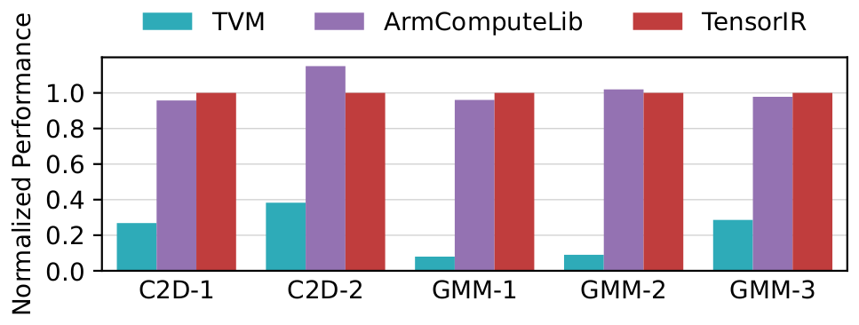

*图 13（原文 Figure 13，第 11 页）：ARM CPU 上的单算子评测。由于使用原生张量指令加速，TensorIR 比 TVM 最高快 12.6 倍，同时达到与重度优化的平台专用库（ArmComputeLib）相同水平的性能。*

**图中文字翻译与读法**：纵轴 Normalized Performance；青柱 TVM，紫柱 ArmComputeLib，红柱 TensorIR；横轴五个算子（C2D-1、C2D-2、GMM-1、GMM-2、GMM-3）。从图上量出的近似值：

| 算子 | TVM | ArmComputeLib | TensorIR |
|---|---:|---:|---:|
| C2D-1 | 0.27 | 0.96 | 1.00 |
| C2D-2 | 0.39 | 1.15 | 1.00 |
| GMM-1 | 0.08 | 0.96 | 1.00 |
| GMM-2 | 0.09 | 1.02 | 1.00 |
| GMM-3 | 0.29 | 0.98 | 1.00 |

**读图结论**：原文写“最高 12.5 倍”（图注写 12.6 倍；读图 GMM-1 的 TVM 约 0.08，即约 12 至 13 倍）；TensorIR 达到 ARMComputeLib 吞吐的 85% 至 105%（读图：C2D-2 约 87%，C2D-1 约 104%）。TVM 在 GMM 上特别差（0.08 至 0.09），因为它没有用上 sdot 这类原生张量加速。

**端到端**：基线是 PyTorch 和 TVM，论文说在这个平台上达到最高 2.3 倍（图 14）。论文还指出，PyTorch 含有用 QNNPACK 后端的专用量化模型支持，但 QNNPACK 尚未加入 sdot 支持，这说明这些框架为跟上硬件变化要付出维护成本；TensorIR 通过自动化减轻这种维护负担，并仍然取得与手工优化系统相当的性能。

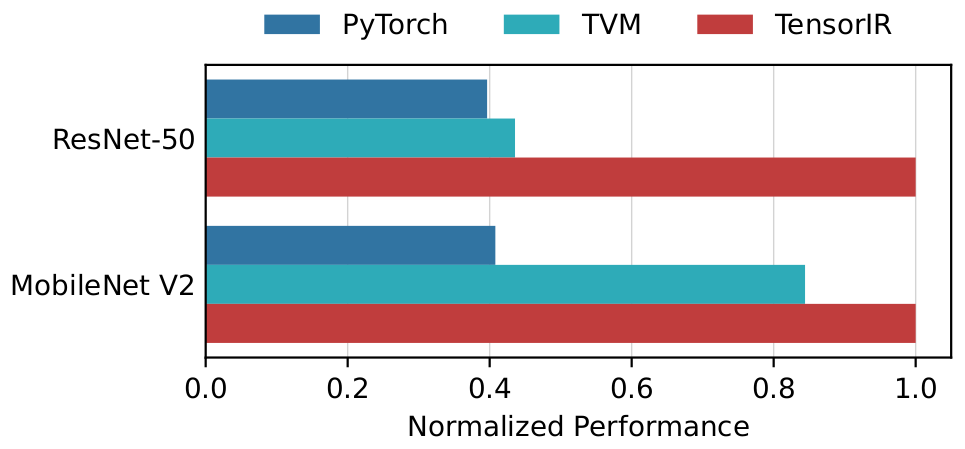

*图 14（原文 Figure 14，第 12 页）：ARM CPU 上的端到端评测结果。TensorIR 比 PyTorch 和 TVM 高 1.2 至 2.5 倍。*

**图中文字翻译与读法**：横向柱状图，横轴 Normalized Performance（0 到 1.0 以上）；蓝柱 PyTorch，青柱 TVM，红柱 TensorIR；两个模型 ResNet-50、MobileNet V2。从图上量出的近似值：

| 模型 | PyTorch | TVM | TensorIR |
|---|---:|---:|---:|
| ResNet-50 | 0.40 | 0.43 | 1.00 |
| MobileNet V2 | 0.41 | 0.84 | 1.00 |

**读图结论**：TensorIR 比 PyTorch 约快 2.5 倍（ResNet-50、MobileNet V2 都约 2.4 至 2.5 倍），比 TVM 约快 2.3 倍（ResNet-50）和 1.2 倍（MobileNet V2），与图注的“1.2 至 2.5 倍”吻合；正文写“最高 2.3 倍”，与图注的 2.5 倍不一致（PyTorch 上的数字更大），以图注和图为准。

## 六、相关工作（原文第 6 节）

- **深度学习框架**通过调用厂商优化的库（cuDNN、MKL-DNN、TensorRT、ArmComputeLibrary）来优化深度神经网络。库有工程开发成本，并且只适用于特定硬件。TensorIR 是对库开发的补充：通过自动提供与厂商库相当的性能，扩大覆盖面并降低开发成本，这些框架可以利用 TensorIR 为各种硬件后端生成优化的张量化程序。
- **HPC 中的线性代数算子**（如 CUTLASS）：矩阵乘和点积一直是 HPC 社区长期的优化目标。分而治之是 HPC 与 ML 工程里的典型优化技术，TensorIR 把这些想法泛化成一个允许自动张量化的抽象。
- **ML 与张量编译器的不同抽象**：Halide 和 TVM 用 scheduling 语言描述标量体循环嵌套的循环优化原语；Tensor Comprehensions、Tiramisu 和 MLIR/Affine 用多面体模型分析循环嵌套依赖。这些工作以**自下而上**的方式优化含标量计算的循环嵌套；Fireiron 和 Stripe 用嵌套的多面体结构以**自上而下**的方式给张量程序建模。TensorIR 结合两种做法的洞见，把表示推广到张量化程序。IREE 是端到端编译流程的编译器链，使用平台专用的优化流水线，TensorIR 则专注于自动化张量化过程，在无人工干预下为多个平台生成优化代码。TACO 是稀疏张量代数的编译器，Cortex 把张量编译推广到递归计算，与 TensorIR 的工作正交，将来可与 TensorIR 抽象结合，支持更广的计算范围。
- **自动化**：AutoTVM 引入基于学习的方法，通过学习的成本模型和模板引导的搜索来优化张量程序；Triton 引入基于 tile 的模板表示；FlexTensor 自动生成模板；Halide 用蒙特卡洛树搜索构建自动调度器；Ansor 用层次化搜索空间改进自动调度。TensorIR 的自动调度算法借鉴这些方法并推广到张量化计算。
- **自动向量化与张量化**：自动向量化是编译器研究中长期的话题，张量化可以看作向量化问题的推广，用来启用现代加速器里的 tensor intrinsic。已有相关工作：AKG 用多面体方法探索张量化搜索空间，UNIT 提出通用的张量化流程，AMOS 通过张量表达式实现到张量化 intrinsic 的自动映射。论文的方法通过提出一个张量化计算的新抽象，并把张量化与其他优化联合进行，推广了这些工作；TensorIR 可以作为进一步发展感知张量化的自动调度方法的基础。

**结论**：论文提出 TensorIR，一个自动张量化程序优化的抽象；设计了能隔离张量化计算并提供有效程序优化变换原语的 block 抽象；构建了能与其他优化联合做张量化、生成高性能程序的自动调度算法。

## 七、局限、证据边界与原文小出入

**证据边界**：

- **平台少**：实验只有两个平台，NVIDIA RTX 3080（Tensor Core，float16）和 AWS Graviton2（sdot，int8）。两者都是“点积/矩阵乘类”的指令，没有 TPU、NPU 或其他形式的张量指令。
- **缺少关键实验细节**：原文没有给出各算子的形状（C1D 至 T2D、GMM-1/2、C2D-1/2 等的具体尺寸）；没有给出调优的试验次数、种群大小或变异策略；没有给出端到端模型的输入尺寸（如 BERT_large 的序列长度）；ARM 端到端实验没有写批大小；没有写计时方法（预热、重复次数）。本文无法替它补这些数字。
- **只看吞吐**：没有编译/调优时间之外的开销（如编译产物大小、运行时内存）数据；调优时间只给了与 TVM 的比较（表 1），没有与 AMOS 的比较。
- **性能收益混合了多个因素**：TensorIR 的结果同时来自 block 抽象、自动张量化、数据搬运的一等处理和搜索，原文没有做消融，所以无法单独回答“block 抽象本身贡献了多少”。
- **库更快的地方是真实存在的**：图 11、图 12 里 TensorRT 与 CUTLASS 在 ResNet-50、C3D、GMM 等上更快；论文的口径是“接近或持平”，本文的读数显示最差情形约为库的 75% 至 80%。
- **新增依赖手工声明**：每种硬件指令都要由开发者写出 TensorIntrin（语义加实现，以及存储范围、布局约束）；论文展示的“同一框架迁移到 ARM”只需新增这份描述，但这份描述本身需要专家知识。
- **高层语义不在这一层**：TensorIR 针对张量程序（算子内部）的优化；整个模型图的变换、融合等在更上层的 IR 里完成（论文用从 TensorFlow/PyTorch 导入的方式接入，没有展开）。

**原文内部的小出入（本文按图和上下文理解）**：

| 位置 | 出入 |
|---|---|
| 4.2 节 | 把 $\mathrm{fuse}(n,h,w)$ 写成了 $\mathrm{fuse}(n,h,y)$（笔误）；并把 $r_h,r_w,r_c$ 与 $k$ 出现的 buffer 写成“A、C”，按特征向量 $[0,1,1]$ 和图 9 应为 A、B（归约迭代器只出现在两个输入里） |
| 式 (1)、图 8、图 9 | intrinsic 的下标约定不一致：式 (1) 是 $C[x,y] \mathrel{+}= A[x,k]\,B[k,y]$，图 9 是 `C[x, y] += A[x, k] * B[y, k]`，图 8 是 `C[y, x] += A[x, k] * B[k, y]`；Conv2D 的卷积核写成 $B[r_c,r_h,r_w,c_o]$（正文）或 `B[c, rh, rw, rc]`（图 9）。只看“匹配的原理”，不要把这些下标当成统一的定义 |
| 加速倍数 | 引言写“最高 7×”，第 5.1 节与图 10 图注写“最高 7.5×”；图 13 图注写“12.6×”而正文写“12.5×”；图 14 图注写“1.2 至 2.5 倍”而正文写“最高 2.3 倍”；表 1 图注“最高 2x”而 BERT 一行是 2.17 倍；图 12 的“1.2 至 8.8 倍”与 ViT 批大小 1 上 PyTorch 的读数（约 1.05 倍）不符 |
| 图 11 与正文 | 正文把 C2D 列入“TensorIR 优于基线”，图上 CUTLASS 在 C2D 上略高（约 1.01 至 1.02） |
| 图 5 | 代码里 `block_siguatures` 是拼写错误 |

**时效性**：（补充）论文写于 2022 年，TensorIR 后来合入了 Apache TVM 主线，并成为 MetaSchedule（用可组合的概率程序表达搜索空间）和 Relax 等后续组件的低层 IR；但这些后续演进不在这篇论文里，接口名称（例如本文转录的 `@script`、`spatial_axis`、`grid`）也与今天 TVM 的 TVMScript 写法有差别，请以当前官方文档为准。

## 八、复现检查

- 先固定 TVM 的版本和提交（论文基于 Apache TVM，对比时 TVM 用 commit 27b0aad5 加 auto-scheduler，AMOS 用 commit 6aee6fe2），以及 CUDA、TensorRT、CUTLASS 的版本。
- 对每个 block，检查迭代器的范围、绑定表达式、读写区域和归约初始化是否准确；schedule 变换后跑校验，并保存变换序列（trace）以便重放。
- 为自定义 TensorIntrin 同时核对语义块和实现块是否等价，并核对 dtype、存储范围、内存布局与对齐约束。
- 比较结果时区分四类变量：IR 抽象带来的能力、tensor intrinsic 是否可用、数据搬运的处理、搜索策略与预算。与旧的 TIR/TE 比较时尤其要分开。
- 报告速度时写清批大小、数据类型（论文的 GPU 实验全部 float16）、基线版本、是否调用外部库，以及调优时间。

## 九、常见误读

- **“block 就是一个代码块或作用域”**：不是。block 带有迭代器范围与绑定、读写区域和归约初始化，是依赖分析和张量化匹配所依据的语义契约。
- **“TensorIR 是一个模型级 IR”**：不是。它面向张量算子的内部程序（循环、buffer、张量指令），模型图级别的优化在更高层完成。
- **“TensorIR 的加速完全来自 IR”**：不是。论文的结果同时包含自动调度（草图加进化搜索）、数据搬运的一等处理和张量指令的使用；原文没有拆开。
- **“7.5 倍或 13.9 倍是对厂商库的加速”**：不是。7.5 倍（图 10）是对 ML 编译器（TVM、AMOS）；13.9 倍（图 11）是在 DEP 等库本身几乎没有优化的算子上；在 C3D、GMM、GRP 上 TensorIR 只达到库的约 75% 以上。
- **“同一框架换一份指令描述就能全自动适配新硬件”**：论文展示了 Tensor Core 到 ARM sdot 的迁移，但每个新指令仍需要有人写出它的 TensorIntrin 及存储和布局约束。

## 十、与本仓库其他论文的关系

- [TVM](../tvm_compiler/论文中文解读.md)：本文建在 TVM 之上；TVM 的 Tensor Expression 加 schedule 是“标量体外面套循环”的代表，也是 TensorIR 所说的 bottom-up 做法，TVM 论文里的 tensorization 与 TensorIR 的 TensorIntrin 对照可看它们对“硬件 intrinsic”的不同表达。
- [Ansor](../ansor/论文中文解读.md)：本文的草图生成把 Ansor 的层次化搜索空间生成推广到张量计算，实验里的 TVM 基线用的就是 Ansor 式 auto-scheduler。
- [MetaSchedule](../metaschedule/论文中文解读.md)：后续把搜索空间表示成可组合的概率程序，并以 TensorIR 为基础。
- [MLIR](../mlir/论文中文解读.md)：论文把 MLIR/Affine 归为“自下而上、基于标量体和多面体”的一类；MLIR 的多层 IR 设计与 TensorIR 的 block 抽象可以对照。
- [Hidet](../hidet/论文中文解读.md)、[Welder](../welder/论文中文解读.md)：同属在 tile 或 block 级别表达张量程序并做联合优化的路线。
- [Triton](../triton_compiler/论文中文解读.md)：论文把 Triton 归入基于 tile 的模板表示；它的 block 级 GPU kernel 编程模型是另一种“把张量化放在抽象里”的方式。

## 原文证据导航

- [原论文 PDF](paper.pdf)
- [原文提取文本](paper.txt)
- [论文概要](论文概要.md)
