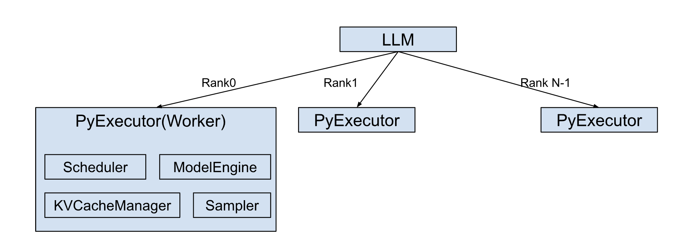

# 论文中文解读：《TensorRT-LLM Architecture Overview》（NVIDIA 官方架构文档快照）

> **基本信息**：NVIDIA TensorRT-LLM 团队维护，官方开发者文档的一部分（非同行评审论文）；本地快照对应 2026-10-03 的 `main` 分支；[官方页面](https://nvidia.github.io/TensorRT-LLM/developer-guide/overview.html) · [GitHub 仓库](https://github.com/NVIDIA/TensorRT-LLM)。
>
> **资料性质，请先读这一段**：TensorRT-LLM 没有一篇能完整覆盖当前架构的正式系统论文——它是持续演进的工程项目，文档随 `main` 分支逐周变化。本目录保存四份官方资料的快照：`paper.txt`（Architecture Overview 页面的原始 Markdown，用来生成统一格式的 `paper.pdf`）、`source_readme.md`（仓库根 README，含功能列表、更新日志和一张官方性能对比图）、`source_perf_overview.md`（官方 benchmark 方法与分模型吞吐参考表）。本文对这四份资料做逐条核对和中文讲解，但读者需要明白：这里的"证据"是工程文档某一时刻的快照，不是可复现的实验记录；任何数字都要连同 TensorRT-LLM 版本号、GPU 型号、模型精度一起引用，脱离这些条件单独引用数字没有意义。
>
> **本文的读法**：唯一的架构图取自官方 GitHub 仓库 `docs/source/media/TRTLLM_Architecture_Overview.png`（`paper.txt` 第 19 行以相对路径引用了这张图，本仓库快照没有保留图片，因此从官方仓库同名路径取回原图），并配中文图题和读法。性能数据表格逐格转录自 `source_perf_overview.md`，数字与源文件一致。专有名词（类名、函数名、环境变量名）保留英文原文。

## 一、这份资料在讲什么

TensorRT-LLM 不是一个单独的"编译器"或"kernel 库"，而是一整套 LLM 推理栈：模型加载 API、每个 rank 一份的执行循环（PyExecutor）、请求调度器（Scheduler）、KV cache 管理器（KVCacheManager）、模型执行引擎（ModelEngine）、采样器（Sampler），以及运行时优化（CUDA Graph、Overlap Scheduler、投机解码）、专用 kernel、分布式并行和故障处理机制。性能不是由单一组件决定的，而是这些组件组合的结果；本文按照"API 入口 → 执行循环 → 运行时优化 → KV cache → 可观测性与容错 → kernel 层 → 性能参考数据"的顺序逐层展开。

## 二、总体架构：从 LLM API 到 PyExecutor

用户侧的入口是 `LLM` 类，提供简化的 `generate()` API 做高效的大模型推理。以 TinyLlama 为例，官方文档给出的最小用法是：

```python
from tensorrt_llm import LLM

# Initialize the LLM with a specified model
llm = LLM(model="TinyLlama/TinyLlama-1.1B-Chat-v1.0")

# Generate text using the model
output = llm.generate("Hello, my name is")
```

`LLM` 类自动管理分词（tokenization，把输入 prompt 编码成数值表示）和反分词（detokenization，把模型输出解码回可读文本）这类前后处理步骤。在内部，`LLM` 类会在每个 rank 上创建一个专属的 `PyExecutor(Worker)` 进程。



*图 1（取自官方仓库 `docs/source/media/TRTLLM_Architecture_Overview.png`，`paper.txt` 第 19 行引用的即是这张图）：`LLM` 类按 rank 创建多个 `PyExecutor`，Rank0 的 `PyExecutor(Worker)` 内部展开为四个子组件。*

**图中文字翻译与读法**：

- **顶部 LLM**：用户侧入口类。
- **向下三条箭头 Rank0 / Rank1 / … / Rank N-1**：`LLM` 为每个分布式 rank 各创建一个 `PyExecutor`；图中只展开了 Rank0 的内部结构（标注 `PyExecutor(Worker)`），Rank1 和 Rank N-1 画成未展开的方框，表示其他 rank 结构相同。
- **`PyExecutor(Worker)` 内部四个子框**：`Scheduler`（调度器）、`ModelEngine`（模型执行引擎）、`KVCacheManager`（KV cache 管理器）、`Sampler`（采样器）。
- **读图结论**：这是全文的骨架图——多 rank 并行时，每个 rank 独立运行一份包含这四个子组件的 `PyExecutor` 后台循环；后续各节分别展开这四个子组件和它们之间的协作方式。

`PyExecutor` 运行在一个持续的后台循环里，专为推理请求的高效异步处理设计。它的功能建立在以下关键组件之上：

- **`Scheduler`**：负责确定在每个处理步骤中，哪些活跃请求已准备好可以执行；
- **`KVCacheManager`**：管理 Key-Value（KV）Cache 的分配、释放和维护。这是 Transformer 模型的关键优化——通过存储此前已计算的 attention key 和 value，显著提升自回归文本生成阶段的性能；
- **`ModelEngine`**：负责在 GPU 硬件上加载并高效执行语言模型；
- **`Sampler`**：接收 `ModelEngine` 产生的原始输出（logits），应用相应的采样策略（如 greedy、top-k、top-p、beam search）生成最终输出 token。

`PyExecutor` 后台循环每一轮依次执行：

1. **Request Fetching（请求拉取）**：如果有的话，从内部请求队列中取出新的推理请求；
2. **Scheduling（调度）**：与 `Scheduler` 交互，确定并排定本轮可执行的请求；
3. **Resource Preparation（资源准备）**：与 `KVCacheManager` 协同，确保所选请求所需的 KV Cache 资源已分配好；
4. **Model Execution（模型执行）**：调用 `ModelEngine` 对已排定的请求做一次前向计算，预测下一个输出 token；
5. **Output Handling（输出处理）**：更新进行中请求的部分输出，并为已完成的请求产出最终结果、返回给用户。

## 三、Prefill 与 Decode：两种完全不同的资源画像

虽然 `paper.txt` 原文没有专门展开 prefill/decode 的算力特征对比，但这是理解后续 KV cache、调度、CUDA Graph 等设计动机的前提，这里补充展开：

- **Prefill（预填充）**：一次性处理整段输入 prompt 的全部 token，矩阵乘法的 M 维（token 数）大，算术强度高，更接近计算受限（compute-bound）；关注点是吞吐和首次 KV cache 的写入。
- **Decode（解码）**：自回归生成阶段，通常每个请求每轮只产生一个新 token，矩阵乘法的 M 维很小，模型权重却要每轮重新从显存读一遍，更容易受 kernel 启动开销、CPU 侧调度和显存带宽制约。

这组差异解释了为什么 TensorRT-LLM 要分别为两个阶段设计不同的优化（CUDA Graph 主要针对 decode 阶段大量重复的小 kernel 调用；Overlap Scheduler 针对 decode 阶段 CPU 侧工作可能跟不上 GPU 节奏的问题），也是生态里出现"只替换 decode kernel、prefill 仍交给 TensorRT-LLM"这类方案（如 Ada-MK）的原因。

## 四、运行时优化之一：CUDA Graph 与 padding

TensorRT-LLM 通过整合一套运行时优化来提升推理吞吐、降低时延，官方文档列出的第一项是 CUDA Graph。

CUDA Graph 能大幅降低"启动 GPU kernel"在 CPU 侧的开销——这一点在基于 PyTorch 的推理中影响尤其明显，因为 Python 侧的宿主代码本身就容易成为瓶颈。做法是把一串 CUDA 操作捕获成单个 graph，之后整个序列只需一次 API 调用就能发起，从而最小化 CPU-GPU 同步和驱动开销。

为了最大化这些已缓存 graph 的"命中率"，TensorRT-LLM 采用 **CUDA Graph padding**：如果一个到来的 batch 大小与某个已捕获的 graph 不匹配，就把它填充（pad）到最接近的、已有 graph 覆盖的更大尺寸。这样做会因为计算了"浪费的" token 而产生少量额外开销，但官方文档认为这通常仍优于退回到更慢的 eager 模式执行。**这项优化影响显著：官方文档给出的数字是在特定模型和硬件上最高可带来 22% 的端到端吞吐提升**——注意这是官方原文明确限定的"certain models and hardware"，不是跨模型、跨硬件的普遍保证。

直观理解这个权衡：节省下来的是"重复发起多个小 kernel"的宿主开销，付出的代价是"为凑齐已捕获的 batch 尺寸而多算的那部分 token"，外加维护一批已捕获 graph 所占用的显存。动态请求到达越碎片化（batch 尺寸越不规则），能否命中已捕获的 graph 集合、以及 padding 策略怎么选，就越重要。

## 五、运行时优化之二：Overlap Scheduler

Overlap Scheduler 通过把 CPU 受限的时延隐藏在 GPU 计算背后，来最大化 GPU 利用率。

核心策略是：立即发起第 $n+1$ 步的 GPU 工作，不等待 CPU 处理完第 $n$ 步的结果。这让 CPU 可以在 GPU 已经执行下一个 batch 模型计算的同时，去做诸如检查停止条件、更新某个 batch 的响应这类工作。这个并发执行流水线在 `PyExecutor` 的逻辑里大致是这样的（官方文档给出的示意代码）：

```python
# Schedule and launch GPU work for the current step (n)
scheduled_batch, _, _ = self._schedule()
batch_outputs = self._forward_step(scheduled_batch, previous_tensors_device)
sample_state = self._sample_async(scheduled_batch, batch_outputs)

# While the GPU is busy, process the CPU-bound results from the previous step (n-1)
if self.previous_batch is not None:
    self._process_previous_batch()
```

这种做法有效减少了 GPU 空闲时间，提升整体硬件占用率。代价是会在流水线里多引入一个 decode step 的状态（即结果处理相对实际计算滞后一步），但由此带来的吞吐收益被认为是值得的权衡。**正因如此，Overlap Scheduler 在 TensorRT-LLM 中默认开启。** 需要注意的是，它改善的是吞吐，并不保证每一种请求模式下都能拿到最低的单请求时延——滞后一步的流水线状态，意味着某个请求的"完成确认"本身就比不开启时晚一拍。

## 六、Visual Generation：扩散模型有独立的执行路径

官方文档特别指出：面向基于扩散模型的视觉生成（图像/视频），TensorRT-LLM 提供一套独立的 `VisualGen` API 和 `DiffusionExecutor`，有自己的一套 pipeline 架构，不复用上面描述的 `PyExecutor`/`Scheduler`/`KVCacheManager` 体系。这提示了一个容易被忽略的边界：本文余下内容描述的 KV cache、调度、CUDA Graph 等机制，都是针对自回归语言模型推理的；扩散式视觉生成是另一套独立实现，细节需参考专门的 Visual Generation 功能文档，本文不展开。

## 七、KV Cache：runtime 的核心资源

自回归解码如果每一步都重新计算整个前缀的 attention，成本是不可接受的。KV cache 保存历史 token 的 attention key 和 value；分页（paged）cache 把它切成固定大小的 block，以此支持：

- 不同请求的序列长度各不相同；
- 请求在运行过程中动态加入、动态退出；
- block 级别的复用和回收；
- 前缀复用（prefix reuse），即相同前缀的多个请求共享同一批 KV block；
- prefill/decode 分离部署时，KV cache 需要在两类实例间迁移（KV transfer）。

正因为 KV cache 是贯穿调度、显存管理、跨阶段迁移的中心资源，`Scheduler` 在选择本轮 batch 时，必须同时考虑 GPU 算力和当前可用的 KV block 数量两个约束——只压测某个 kernel 的算力而不考虑 KV cache 压力，测出来的数字不能代表真实 serving 场景下的表现。

## 八、模块化日志：定位问题从日志标签开始

TensorRT-LLM 的日志消息都带一个固定宽度的模块标签，标明是哪个子系统产生的消息：

```text
[TRT-LLM] [I] [runtime ] Loading model weights...
[TRT-LLM] [W] [_torch  ] FlashAttention not available, falling back to default
[TRT-LLM] [I] [serve   ] Server listening on port 8000
```

模块名超过 8 个字符的会被缩写以适配固定宽度标签：

| 模块名 Module Name | 显示标签 Display Tag |
|---|---|
| `_torch` | `_torch  ` |
| `batch_manager` | `batchmgr` |
| `common` | `common  ` |
| `cutlass_extensions` | `cutl_ext` |
| `deep_ep` | `deep_ep ` |
| `deep_gemm` | `deepgemm` |
| `executor` | `executor` |
| `flash_mla` | `flashmla` |
| `kernels` | `kernels ` |
| `layers` | `layers  ` |
| `runtime` | `runtime ` |
| `serve` | `serve   ` |
| `quantization` | `quantize` |
| `scaffolding` | `scaffold` |
| `auto_parallel` | `autoprll` |
| `visual_gen` | `vis_gen ` |

（原文表格，`paper.txt` 第 95–112 行；16 个模块名与其缩写逐条对应，本文未做删改。）这张表本身就是一张有用的"零件清单"：`deep_ep`、`deep_gemm`、`flash_mla` 这几个模块名直接对应第十节要讲的、来自外部项目的专用 kernel；`batch_manager`、`executor`、`runtime` 对应第二节的调度与执行链路；`serve` 对应对外的服务接口；`auto_parallel` 对应自动并行策略搜索。

可以用环境变量 `TLLM_LOG_LEVEL_BY_MODULE` 为不同模块单独设置日志级别，覆盖全局的 `TLLM_LOG_LEVEL`：

```bash
# Format: "level:module1,module2;level:module3"
export TLLM_LOG_LEVEL=warning
export TLLM_LOG_LEVEL_BY_MODULE="debug:_torch,runtime;info:serve"
```

上面这个例子把全局级别设为 `warning`，但单独给 `_torch`、`runtime` 两个模块开 `debug`，给 `serve` 模块开 `info`。合法级别有：`trace`、`debug`、`verbose`、`info`、`warning`、`error`、`internal_error`。

## 九、多 Rank 容错：崩溃硬杀与挂起诊断

多 rank 分布式任务里有一个容易被忽视的故障模式：当某一个 rank 的执行循环崩溃退出时，其余的 peer rank 并不会自动跟着失败——它们会停在某个集合通信（collective）操作里，等待一个永远不会到达的 rank。如果放任不管，这些存活的 rank 会一直占着整个任务的全部 GPU，直到被外部的按墙钟时间（wall-clock）超时机制强制杀掉。

为避免这种情况，TensorRT-LLM 的设计是：一旦某个 rank 的执行循环崩溃，它会在一个短暂的宽限期后拖垮整个任务（调用 `MPI_Abort`，如果不行则回退到对自身执行 `SIGKILL`）。保留这个宽限期是为了让"更干净的退出路径"有机会先赢得这场竞速：如果崩溃先被上报给了客户端（调用方能拿到真实的 traceback），那么这次强杀就会被叫停——这样一来，即便是对称性的崩溃，最终也会表现为 N 份 traceback，而不是一个光秃秃的 `exit 137`。

**这项机制在多 rank 运行时默认开启**；单 rank 运行不受影响——没有 peer 可以被拖累。

| 环境变量 | 默认值 | 含义 |
|---|---|---|
| `TLLM_RANK_CRASH_HARD_KILL_GRACE` | `10` | 杀掉任务前等待的秒数。设为 `0` 则立即杀掉。设为任意负值（例如 `-1`）会**彻底禁用**这个强杀机制，此时 peer rank 会回退到挂起检测器（hang detector）。无法解析或非有限的值（`nan`、`inf`）会回退到默认值。 |

```bash
# Opt out: let the hang detector handle it instead (slower, but no world kill).
export TLLM_RANK_CRASH_HARD_KILL_GRACE=-1
```

什么时候应该选择退出这个机制？官方文档给出的典型场景是：你更希望让 peer rank 自己走到各自的超时，而不是被整任务级别的强杀打断——比如正在给某个存活的 rank 挂调试器，或者某个诊断工具需要收集每个 rank 各自的状态，而任务级别的强杀会破坏这些状态。

另外可以设置 `TLLM_HANG_DIAGNOSTICS=1` 来开启额外的 `PyExecutor` 诊断。它默认关闭，只有在初始化或执行阶段真的发生挂起时才会输出，届时会转储各 worker 的调用栈和最新可获得的 executor 状态。

## 十、DeepGEMM MegaMoE 的 barrier 超时

这一节是本次核对中最值得单独强调的部分：它揭示的不只是"速度"问题，而是大规模专家并行（expert-parallel）场景下，复杂融合 kernel 可能遇到的死锁、错误定位困难和多 rank 故障传播问题。

DeepGEMM 的 MegaMoE kernel 用 kernel 内部的 barrier 来同步各个专家并行 rank，这些 barrier 在固定的墙钟时间预算后会自我中止（self-abort），默认预算是 **60 秒**。一旦超出这个预算，kernel 会打印一条诊断信息，并触发一次设备侧断言（device-side assert）——这会污染（poison）CUDA context，所以 Python 层面看到的第一条 traceback 通常会指向接下来执行的、与故障完全无关的某个 kernel，而不是真正出问题的那个 barrier：

```text
DeepGEMM grid sync timeout (60s): sm=114, thread=0, grid_sync_idx=0, ...
DeepGEMM NVLink barrier timeout (60s): rank=5, counter=1381, signal=8, target=16, ...
```

读这条诊断信息时，要把 `signal` 和 `target` 对照着看：`signal=8, target=16` 的意思是，16 个 rank 里只有 8 个真正到达了这个 barrier。

| 环境变量 | 默认值 | 含义 |
|---|---|---|
| `DG_JIT_BARRIER_TIMEOUT_SECONDS` | `60` | DeepGEMM kernel 内部 grid-sync 和 NVLink barrier 的墙钟时间预算（秒）。小于等于 0 的值会被忽略，仍使用内置默认值。 |

```bash
# Give a large expert-parallel group more headroom before the barrier self-aborts.
export DG_JIT_BARRIER_TIMEOUT_SECONDS=300
```

这个值在 JIT 编译期就被固化进 kernel，并且参与 JIT 缓存键（cache key）的计算，所以修改它会触发相关 kernel 重新编译，而不是悄悄复用一份已缓存的二进制。

官方文档特别提醒：这主要是一个诊断旋钮（diagnostic knob）。调大它能帮你区分"慢但健康的汇合"（所有 rank 最终都到达了，任务能继续往下跑）和"真正的挂起，或者 rank 数量对不上"（同样的 `signal`/`target` 差值，在更大的预算下依然复现）。应该优先修复背后真正的负载不均衡问题，而不是永久调大超时——因为更长的超时同时也意味着真实挂起要更久才能被发现。

**工程启示**（本文归纳，不是原文逐句翻译）：生产系统要跑稳大规模 expert-parallel MoE，至少需要同时具备——barrier 超时与可调的预算、rank 崩溃的硬杀机制与可退出的逃生舱口、按模块划分的日志、`signal`/`target` 这类可直接定位"卡在哪一环"的诊断字段，以及让超时参数变化能正确触发重编译的一致 JIT 缓存键。这几项在上面三节（八、九、十）里各自独立出现，合在一起才构成一套完整的多 rank 可观测性与容错设计。

## 十一、Kernel 层：一个多来源拼图

官方 README 把 attention、GEMM、MoE 等专用 kernel 与运行时优化并列展示。结合第八节日志表里出现的模块名（`deep_ep`、`deep_gemm`、`flash_mla` 等）可以确认，这些 kernel 的实现来源并不单一，至少包括：

- TensorRT-LLM 自有的 CUDA/CUTLASS kernel；
- 类似 FlashAttention/FlashInfer 的 attention kernel；
- DeepGEMM 或其他 grouped GEMM 实现（对应日志模块 `deep_gemm`）；
- DeepEP 这类专家并行通信库（对应日志模块 `deep_ep`）；
- Triton（OpenAI Triton，见下节辨析）编写的 kernel；
- CuTe DSL 编写的 kernel；
- 量化相关的 plugin（对应日志模块 `quantization`）。

"使用 TensorRT-LLM"不代表所有算子都由 TensorRT 编译器自动融合生成，也不代表整个推理路径只用一种 kernel DSL——它更像是一个按需拼接多种 kernel 实现来源的运行时框架。

## 十二、TensorRT-LLM 与几个相近名词

这几个名字在中文圈的讨论里很容易混用，尤其是"Triton"：

| 名称 | 主要职责 |
|---|---|
| TensorRT | 通用的 NVIDIA 推理优化器/运行时，面向各类深度学习模型，不限于 LLM |
| TensorRT-LLM | 面向 LLM/VLM 的专用模型实现、kernel、KV cache 管理、调度器与运行时（本文的核心对象） |
| Triton Inference Server | 模型服务进程，可以加载 TensorRT-LLM 作为其中一种后端（backend） |
| OpenAI Triton | 用于编写 GPU kernel 的语言/编译器，与上面的 Triton Inference Server 不是同一个项目 |
| CUDA Graph | 捕获并低开销重放一串 kernel 调用的 CUDA 机制（见第四节） |

"Triton Inference Server"和"OpenAI Triton"因为共用"Triton"这个名字，是最容易混淆的一对；二者没有从属关系，一个是服务进程、一个是 kernel 编程语言。

## 十三、官方性能参考数据（源自 `source_perf_overview.md`）

### 13.1 测试范围与口径说明

官方文档明确声明：下面这些表格里的数据是帮助用户核对自己测得的性能是否在合理区间内的参考点，**不应被当作 TensorRT-LLM 能交付的峰值性能**。并非所有配置都在所有 GPU 上测试过；测试命令被刻意保持简单以方便复现，很多选项停留在默认设置，调整 batch size、并行配置等选项可能带来更好的性能。DeepSeek-R1 的专门性能调优指南另见官方的 *Best Performance Practice on DeepSeek-R1* 文档（不在本仓库快照内）。

测试用的 GPU 型号：H100 SXM 80GB（DGX H100）、H200 SXM 141GB（DGX H200）、B200 180GB（DGX B200）、GB200 192GB（GB200 NVL72）、RTX 6000 Pro Blackwell Server Edition。其他硬件变体可能有不同的 TDP、显存带宽、核心数等，会带来性能差异。

测试模型分两组量化精度：FP4 模型（经 ModelOpt 量化，发布在 NVIDIA 的 Model Optimizer HuggingFace Collection）包括 `nvidia/DeepSeek-R1-0528-NVFP4-v2`、`nvidia/Qwen3-235B-A22B-FP4`、`nvidia/Qwen3-30B-A3B-FP4`、`nvidia/Llama-3.3-70B-Instruct-FP4`、`nvidia/Llama-4-Maverick-17B-128E-Instruct-NVFP4`；FP8 模型包括 `deepseek-ai/DeepSeek-R1-0528`、`nvidia/Qwen3-235B-A22B-FP8`、`nvidia/Llama-3.3-70B-Instruct-FP8`、`nvidia/Llama-4-Maverick-17B-128E-Instruct-FP8`。

所有性能值的单位是**每 GPU 每秒输出 token 数**（output tokens per second per GPU），其中"输出 token"包含首个和后续全部生成的 token（不含输入 token）；数据取自 `trtllm-bench` 报告的 `Per GPU Output Throughput (tps/gpu)` 指标。表头里的 `DEPn`、`TPn`、`PPn` 分别表示专家并行度、张量并行度、流水并行度为 n。

### 13.2 DeepSeek R1 0528

| 输入/输出长度 ISL/OSL | B200<br/>DEP4 (FP4) | GB200<br/>DEP4 (FP4) | H200<br/>DEP8 (FP8) |
|---|---:|---:|---:|
| 1000/1000 | 6,463 | 6,939 | 1,627 |
| 1024/1024 | 6,430 | 6,924 | 1,620 |
| 1024/8192 | 3,862 | 4,379 | 1,218 |
| 1024/32768 | 1,451 | 1,465 | 438 |
| 8192/1024 | 1,168 | 1,192 | （未测） |

单位：每 GPU 每秒输出 token 数。**读法**：同为 FP4 精度下，GB200 在每个长度组合上都略高于 B200（例如 1000/1000 下 6,939 对 6,463，约快 7%）；H200 用 FP8 精度，吞吐只有前两者的四分之一左右，这里精度（FP4 对 FP8）和芯片代际两个变量是混在一起的，不能单独归因于芯片性能差距。长输出（1024/32768）相比短输出（1000/1000）吞吐明显下降，这是 decode 阶段 KV cache 持续增长、每步计算随之变重的直接体现。

### 13.3 GPT-OSS 120B 与 GPT-OSS 20B

| 输入/输出长度 ISL/OSL | B200<br/>DEP2 (FP4) | GB200<br/>TP1 (FP4) | H200<br/>TP1 (FP8) | H100<br/>DEP4 (FP8) |
|---|---:|---:|---:|---:|
| 1000/1000 | 25,943 | 27,198 | 6,868 | 4,685 |
| 1024/1024 | 25,870 | 26,609 | 6,798 | 4,715 |
| 1024/8192 | 17,289 | 14,800 | 3,543 | （未测） |
| 1024/32768 | 6,279 | 5,556 | （未测） | 1,177 |
| 8192/1024 | 6,111 | 6,835 | 1,828 | 1,169 |
| 32768/1024 | 1,392 | 1,645 | 519 | 333 |

（GPT-OSS 120B，单位：每 GPU 每秒输出 token 数。）

| 输入/输出长度 ISL/OSL | B200<br/>TP1 (FP4) | GB200<br/>TP1 (FP4) | H200<br/>TP1 (FP8) | H100<br/>TP1 (FP8) |
|---|---:|---:|---:|---:|
| 1000/1000 | 53,812 | 55,823 | 13,858 | 11,557 |
| 1024/1024 | 53,491 | 56,528 | 13,890 | 11,403 |
| 1024/8192 | 34,702 | 38,100 | 12,743 | 8,617 |
| 1024/32768 | 14,589 | 16,463 | （未测） | （未测） |
| 8192/1024 | 11,904 | 12,941 | 4,015 | 3,366 |
| 32768/1024 | 2,645 | 2,905 | 915 | 785 |

（GPT-OSS 20B，单位：每 GPU 每秒输出 token 数。）**读法**：两张表对比同一套 GPU 阵容下 120B 和 20B 模型的吞吐差距——20B 模型在几乎所有长度组合下吞吐都是 120B 模型的 2 倍以上（例如 1000/1000 下 B200 从 25,943 到 53,812），符合参数量减小、单 token 计算量下降的直觉；但两个模型的并行策略不同（120B 用 DEP，20B 用 TP1，即不做专家并行切分），说明这不是一个严格的"参数量减半、吞吐翻倍"的受控对比。

### 13.4 LLaMA v3.3 70B

| 输入/输出长度 ISL/OSL | B200<br/>TP1 (FP4) | GB200<br/>TP1 (FP4) | H200<br/>TP2 (FP8) | H100<br/>TP2 (FP8) |
|---|---:|---:|---:|---:|
| 1000/1000 | 6,920 | 7,769 | 2,587 | 2,209 |
| 1024/1024 | 6,842 | 7,751 | 2,582 | （未测） |
| 1024/8192 | 3,242 | 3,805 | 2,009 | （未测） |
| 8192/1024 | 1,362 | 1,491 | 537 | 398 |
| 32768/1024 | 274 | 302 | 120 | （未测） |

（单位：每 GPU 每秒输出 token 数。）RTX 6000 Pro Blackwell Server Edition 另给了一张单独的表，展示张量并行（TP）与流水并行（PP）组合的效果：

| 输入/输出长度 ISL/OSL | 1 GPU<br/>TP1,PP1 (FP4) | 2 GPUs<br/>TP1,PP2 (FP4) |
|---|---:|---:|
| 1000/1000 | 1,724 | 1,901 |
| 1024/1024 | 1,708 | 1,887 |
| 8192/1024 | 296 | 327 |
| 32768/1024 | （未测） | 67 |

（单位：每 GPU 每秒输出 token 数；原文表头用粗体标出 GPU 数量档位。）**读法**：从 1 GPU 的 TP1,PP1 扩到 2 GPU 的 TP1,PP2，短序列（1000/1000）下每 GPU 吞吐从 1,724 升到 1,901，提升约 10%——这是"每 GPU"吞吐，说明 2 GPU 配置不仅总吞吐翻倍，分摊到每张卡上也还有额外收益，而不是单纯的并行度换算。

### 13.5 LLaMA v4 Maverick

| 输入/输出长度 ISL/OSL | B200<br/>DEP4 (FP4) | GB200<br/>DEP4 (FP4) | H200<br/>DEP8 (FP8) |
|---|---:|---:|---:|
| 1000/1000 | 11,337 | 11,828 | 4,146 |
| 1024/1024 | 11,227 | 11,905 | 4,180 |
| 1024/8192 | 5,174 | 5,508 | 1,157 |
| 1024/32768 | 2,204 | 2,300 | 679 |
| 8192/1024 | 3,279 | 3,444 | 1,276 |
| 32768/1024 | 859 | 963 | （未测） |

（单位：每 GPU 每秒输出 token 数。）

### 13.6 Qwen3 235B A22B 与 Qwen3 30B A3B

| 输入/输出长度 ISL/OSL | B200<br/>DEP4 (FP4) | GB200<br/>DEP4 (FP4) | H200<br/>DEP4 (FP8) | H100<br/>DEP8 (FP8) |
|---|---:|---:|---:|---:|
| 1000/1000 | 5,764 | 6,172 | 3,288 | 1,932 |
| 1024/1024 | 5,756 | 5,862 | 3,268 | 1,935 |
| 1024/8192 | 3,389 | 3,423 | 1,417 | 873 |
| 1024/32768 | 1,255 | （未测） | （未测） | （未测） |
| 8192/1024 | 1,410 | 1,464 | 627 | （未测） |
| 32768/1024 | 319 | 333 | 134 | （未测） |

（Qwen3 235B A22B，单位：每 GPU 每秒输出 token 数。）

| 输入/输出长度 ISL/OSL | B200<br/>TP1 (FP4) | GB200<br/>TP1 (FP4) |
|---|---:|---:|
| 1000/1000 | 26,971 | 22,856 |
| 1024/1024 | 26,611 | 22,201 |
| 1024/8192 | 13,497 | 14,272 |
| 1024/32768 | 4,494 | 4,925 |
| 8192/1024 | 5,735 | 6,201 |
| 32768/1024 | 1,265 | 1,380 |

（Qwen3 30B A3B，单位：每 GPU 每秒输出 token 数。）**读法**：Qwen3 30B A3B（激活参数更少的轻量 MoE）这张表里出现了一个和其他表不同的现象——短序列（1000/1000）下 B200 反而比 GB200 更高（26,971 对 22,856），而长输出（1024/32768）下 GB200 反超 B200（4,925 对 4,494）。官方文档没有解释这个交叉，读者不应把"B200 和 GB200 谁更快"当成固定结论，而要连同具体的序列长度区间一起引用。

### 13.7 如何复现这些数字

官方文档给出的复现流程分两步，都通过 `trtllm-bench` 命令行完成，且全程使用 PyTorch 后端（不需要预先构建 engine）：

**第一步，准备数据集**：

```shell
trtllm-bench --model $model_name prepare-dataset --output $dataset_file token-norm-dist --num-requests=$num_requests --input-mean=$isl --output-mean=$osl --input-stdev=0 --output-stdev=0
```

输入、输出标准差都设为 0，意味着生成的数据集里所有请求的输入/输出长度完全一致（没有长度分布的随机性）。请求数量 `$num_requests` 按长度组合调整：短序列用更多请求数（例如 1024/1024 用 3,000 个请求）以确保系统进入稳态，长序列用更少请求数（例如 32768/1024 或 1024/32768 用 1,000 个）因为单个请求本身停留时间更长。

**第二步，跑 benchmark**：非 MoE（稠密）模型：

```shell
trtllm-bench --tp $tp_size --pp $pp_size --model $model_name throughput --dataset $dataset_file --backend pytorch --config $llm_options
```

MoE 模型多一个专家并行参数 `$ep_size`：

```shell
trtllm-bench --tp $tp_size --pp $pp_size --ep $ep_size --model $model_name throughput --dataset $dataset_file --backend pytorch --config $llm_options
```

不同模型族用的 `llm_options.yml` 配置不同，典型的关键开关包括：`cuda_graph_config.enable_padding`（对应第四节的 CUDA Graph padding）及其 `batch_sizes` 捕获列表；MoE 模型的 `moe_config.backend`（如 `CUTLASS`，Hopper 架构上部分模型改用 `TRITON`）；`kv_cache_config.dtype`（如 `fp8`）；DeepSeek R1 额外有 `attention_dp_config`（含 `batching_wait_iters`、`enable_balance`、`timeout_iters` 等专家负载均衡相关参数）和 `enable_attention_dp: true`。许多情况下还会在命令行加 `--kv_cache_free_gpu_mem_fraction 0.95`（比默认的 0.90 更激进地占用显存以换取性能），遇到显存不足再回退到 0.90 或更低。

跑完之后终端会打印一份结构化的性能总结，核心字段包括：

```text
Request Throughput (req/sec):                     43.2089
Total Output Throughput (tokens/sec):             5530.7382
Per User Output Throughput (tokens/sec/user):     2.0563
Per GPU Output Throughput (tokens/sec/gpu):       5530.7382
Average time-to-first-token [TTFT] (ms):          52667.0339
Average time-per-output-token [TPOT] (ms):        182.9639
```

（完整输出还包含 TPOT、TTFT、端到端时延的 P50/P90/P95/P99 分位数拆解，这里只摘录核心吞吐和平均时延字段；上表数字是官方文档给的示例输出，不对应本文任何一张性能参考表。）官方文档特别提醒：某些情况下 benchmark 可能完全不打印任何结果，这通常意味着跑到了显存不足（OOM），应尝试调低 `--kv_cache_free_gpu_mem_fraction`。

## 十四、如何正确报告或复现一个 TensorRT-LLM 性能数字

结合第十三节的官方口径说明，引用或复现任何 TensorRT-LLM 的吞吐/时延数字，至少要同时锁定以下条件，否则数字之间没有可比性：

- TensorRT-LLM 的具体 commit 或 release 版本，以及使用的 backend（如 PyTorch 后端）；
- GPU 型号、驱动、CUDA 版本、是否锁定了 clock/power；
- 模型版本（revision）与量化精度（FP4、FP8 等，参照 13.1 节的模型列表）；
- 张量并行/专家并行/流水并行的具体配置（`$tp_size`/`$ep_size`/`$pp_size`）；
- 输入/输出长度分布（第十三节各表的 ISL/OSL 列）；
- 并发度、batching 策略，以及 `cuda_graph_config` 里的 padding 和捕获尺寸列表；
- 测的是离线最大吞吐场景，还是在线到达率场景；
- 报告的是 TTFT、TPOT、吞吐，还是 P50/P99 这类分位数；
- prefix cache、投机解码（speculative decoding）、CUDA Graph 等开关是否打开。

官方性能文档本身也提醒：参考数字不是可以无条件复现的峰值表现。

## 十五、与本专题其他论文的关系

- [FusionStitching](../fusion_stitching/论文中文解读.md)：解释局部算子融合（fusion）的收益与资源代价，可用来理解第四节 CUDA Graph 为什么要和 kernel 融合搭配使用。
- [MegaBlocks](../megablocks/论文中文解读.md)：解释动态 MoE expert batch 的 kernel 化方式，是理解第十节 DeepGEMM MegaMoE 的背景。
- [Mirage Persistent Kernel (MPK)](../mirage_persistent_kernel/论文中文解读.md)：解释把调度逻辑迁入常驻（persistent）megakernel 的思路。
- [Ada-MK](../ada_mk/论文中文解读.md)：直接把 MegaKernel 作为 plugin 嵌入 TensorRT-LLM，呼应第三节"只替换 decode、保留 prefill"的工程动机。
- [CuTeDSL TorchInductor](../cutedsl_torchinductor/论文中文解读.md)：说明现代 runtime 会并存多个 kernel backend，呼应第十一节"kernel 层是多来源拼图"的论点。

## 十六、最终判断：用分层模型理解 TensorRT-LLM

理解 TensorRT-LLM 应该采用分层模型，而不是寻找一篇"总括论文"：API/serving 层（`LLM` 类、`VisualGen`）、请求调度层（`Scheduler`、Overlap Scheduler）、KV 管理层（`KVCacheManager`、分页 cache）、模型执行层（`ModelEngine`、CUDA Graph）、kernel 后端层（CUTLASS/FlashAttention/DeepGEMM/DeepEP/Triton/CuTe 等多来源拼图）、分布式与容错层（多 rank 崩溃硬杀、DeepGEMM barrier 超时诊断）。它没有一个可以永久冻结的"算法"可供引用，所以按版本追踪的官方文档，比强行找一篇能代表"当前 TensorRT-LLM"的论文更可靠；本文的价值是把四份官方快照之间散落的内容（架构图、运行时机制、容错细节、性能参考表）串成一份可以独立阅读的中文讲解，但读者仍需知道，这份讲解本身也会随 TensorRT-LLM 版本演进而过时。

## 原文证据导航

- [原文 Markdown / PDF](paper.pdf) · [原文提取文本](paper.txt)
- [官方 README 快照](source_readme.md)（功能列表、更新日志、模块化日志示例所在）
- [官方性能参考数据快照](source_perf_overview.md)（第十三节全部表格的来源）
- [论文概要](论文概要.md)
