# 论文中文解读：《TileLang: A Composable Tiled Programming Model for AI Systems》

> **基本信息**：Lei Wang、Yu Cheng、Yining Shi（三人为共同第一作者）、Zhengju Tang、Zhiwen Mo、Wenhao Xie、Lingxiao Ma、Yuqing Xia、Jilong Xue、Fan Yang、Zhi Yang；北京大学、帝国理工学院（Zhiwen Mo）、微软研究院中国（Lingxiao Ma、Yuqing Xia、Jilong Xue、Fan Yang）；arXiv:2504.17577v2 [cs.LG]，2025 年 4 月 27 日；共 21 页（正文到第 18 页，其后是参考文献与附录 A、B）；开源地址 github.com/tile-ai/tilelang；论文 [官方页面](https://arxiv.org/abs/2504.17577)。
>
> **本文的读法**：本文把论文的 15 张正文图和 3 张附录代码清单（图 16–18）全部从 PDF 裁出，Table 1 与附录 Table 2–4 逐格转录为中文表；每张图后有中文图题、图中文字翻译和读图结论。原文的性能图（图 12–15）大多不标数值，本文表里的数字是从 PDF 矢量图量出的柱高或点位，写作“约”；原文文字给出的数字一律标明“原文文字”。凡是本文自己的推算、背景补充或核对发现的原文瑕疵，都会明确标注。

## 一、一句话结论

现代 AI kernel 的结构高度相似：把一块块 tile 在全局内存与片上存储之间搬运，并在 tile 上做一串计算。写出高性能版本的难点不在这条数据流本身，而在四类“调度”：**线程绑定**（thread binding）、**内存布局**（memory layout）、**张量指令使用**（intrinsic tensorization）和**流水线**（pipeline）。

TileLang 的做法是把这四类调度从数据流中**解耦**：用户用 `T.copy`、`T.gemm`、`T.reduce` 等 tile 算子写数据流，其余由编译器自动推断（布局推断、线程绑定推断、软件流水线推断、warp 特化）；需要时再用 `T.annotate_layout`、`T.Pipelined`、`T.ptx`、`T.call_extern` 等注解和原语手动覆盖。前端是嵌在 Python 里的 DSL，后端复用 TVM 的 IR 基础设施，生成 CUDA 或 HIP 代码。

论文报告的主要结果（原文文字）：

- H100 上的 FlashAttention 相对 FlashAttention-3、Triton、PyTorch 的加速为 1.36×、1.41×、1.70×；
- MLA 解码 kernel 只需约 70 行 Python，在 H100 上达到手写 FlashMLA 的约 98%、在 MI300X 上达到闭源 AITER 的约 95%；
- 稠密 GEMM 与厂商库基本持平（在 RTX 4090、A100、H100、MI300X 上分别是 1.10×、0.97×、1.00×、1.04×）；
- 低比特权重（dequantize）矩阵乘最高达到 cuBLAS FP16 的 7.65×。

需要先说明的证据边界：这些都是一篇预印本里、由作者自己选的 kernel 和形状上的结果；论文没有说明各 kernel 的 tile 大小、流水线级数是否经过调优、预算多大；部分正文数字与图中读数不一致（见第九节）。

## 二、背景与动机

### 2.1 读懂本文需要的几个 GPU 概念

以下是背景知识（非原文内容），用于理解后文术语：

| 概念 | 含义 |
|---|---|
| thread block、warp | GPU 以线程块为单位调度；块内线程再按 32 个一组成为 warp，同一 warp 的线程执行相同指令 |
| 全局内存、共享内存、寄存器 | 三层存储：全局内存（HBM 或 DRAM）大而慢；共享内存是块内线程共享的片上存储，分成若干 bank；寄存器是每个线程私有的最快存储 |
| Tensor Core 与 MMA | warp 级矩阵乘累加指令，操作数必须按固定的“片段”（fragment）方式分散在 warp 内各线程的寄存器里 |
| bank conflict 与 swizzle | 同一 warp 的多个线程同时访问共享内存同一 bank 的不同地址会串行化；swizzle 通过对地址做 XOR 等置换，把访问错开 |
| `cp.async` | Ampere 引入的全局内存到共享内存的异步拷贝指令，用 commit 与 wait 管理完成时机 |
| TMA、`wgmma`、warp 特化 | Hopper 引入：TMA 是负责全局内存与共享内存之间拷贝的专用硬件单元；`wgmma` 由 4 个 warp 组成的 warpgroup 异步执行矩阵乘；warp 特化把线程分成 producer（用 TMA 搬数据）和 consumer（做计算） |

### 2.2 四类调度空间（原文第 1 节）

论文认为，即使数据流一目了然，写高性能 kernel 仍必须手工处理四件事：

| 调度空间 | 原文说法 | 原文强调的要点 |
|---|---|---|
| Thread Binding（线程绑定） | 把 tile 运算和数据映射到合适的线程：在线程块、warp、单个线程之间分配任务，以最大化并行度、减少负载不均 | 最优绑定提高数据局部性，降低同步和分支发散的开销 |
| Memory Layout（内存布局） | 系统地组织数据在物理内存中的排布，消除 bank conflict，保证高效访问；常需把自然表示变成与存储子系统对齐的分块格式 | 好的布局带来合并访问和缓存利用，降低延迟 |
| Intrinsic Tensorization（张量指令化） | 直接使用面向特定硬件的指令，如 Tensor Core、Matrix Core（AMD）、向量拷贝、异步拷贝 | 需要精确管理数据类型、内存对齐和控制流 |
| Pipeline（流水线） | 让数据搬运与计算重叠，隐藏访存延迟；Hopper 的 TMA 可让 CUDA Core 与 Tensor Core 等不同计算单元异步工作 | 让处理单元保持忙碌，把访存延迟造成的空闲降到最低 |

### 2.3 现有编译器与 DSL 的不足（原文第 1–2 节）

- 近年的面向 AI 的领域编译器（论文引用了 TVM、Ansor、Roller 一类）大大简化了高性能 kernel 的创建，但仍把大部分低层优化与 kernel 实现纠缠在一起，即使数据流已经显式暴露。
- **Triton**：提供直观的块级原语，但把线程行为、内存布局、地址空间标注藏在自动生成的策略后面。这降低了入门难度，却妨碍专家榨干性能，例如量化权重矩阵乘通常要用内联汇编做向量化的数据类型转换，并使用与硬件缓冲对齐的自定义布局；虽然 Triton 有 `tl.dot` 这类向量化操作，想通过 PTX 注册手写的高性能 tile 算子仍然麻烦；Triton 暴露了一个好用的流水线旋钮 `num_stages`，却不允许用户自定义整条流水线。
- **TVM 这类“计算与调度分离”的编译器**：用户必须显式区分计算和调度，还要手工注册新的张量指令和指定缓冲布局；调度程序难写难懂。
- **ThunderKittens**：把程序抽象成 load、compute、store、同步等 tile 粒度运算的组合，但数据流仍不够透明，限制了用户进一步优化；此外，原文结论部分称 TileLang 相比它的优势是可以完全用 Python 编程，并默认抽象流水线等优化细节。

由此，作者在设计 TileLang 时强调三条原则：

1. **Pythonic**：与 Python 生态无缝衔接，学习曲线低；
2. **以数据流为中心**（Dataflow-centric）：用户主要关注数据流，把线程绑定、内存布局、张量化、流水线等调度封装成一组可定制的注解和原语；
3. **可组合**（Composability）：kernel、原语、调度策略可以无缝组合成复杂设计。

### 2.4 三项贡献（原文第 1 节）

1. **tile 级编程语言**：用户可显式声明缓冲区放在硬件存储层次的哪一层；通过 Layout Inference（布局推断）机制自动并行化缓冲区操作，同时仍暴露线程级控制接口，让专家精确控制每个线程怎样访问缓冲区；
2. **带自动优化的编译器**：一系列自动编译 pass，包括借助布局推断的自动并行化、面向 kernel 库的动态参数化简、自动流水线推导、面向动态形状的循环尾部切分优化（后两项原文只在贡献列表和结论里提到，没有展开）；
3. **先进的性能**：在真实 AI kernel 上与专用厂商库和 Triton 等 DSL 相当，有时更好，覆盖 NVIDIA 与 AMD GPU。

## 三、一个完整的例子：用 TileLang 写 GEMM

### 3.1 源程序、中间 IR 与生成的 CUDA（图 1）

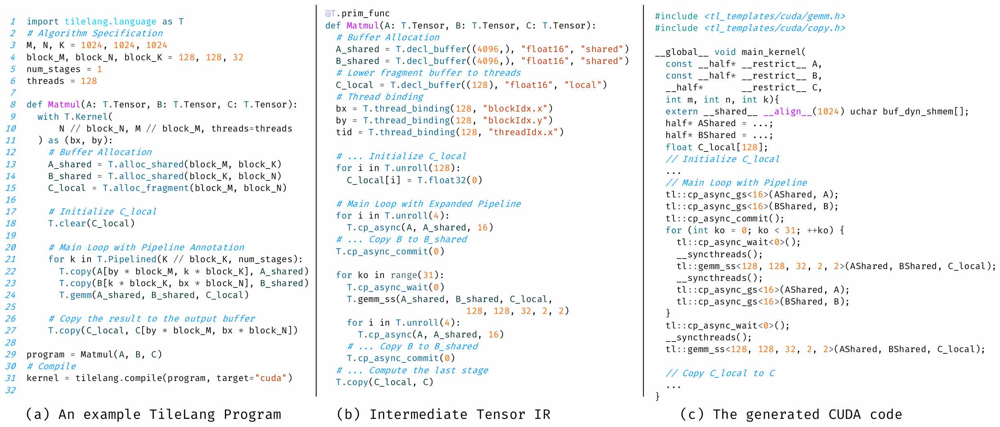

*图 1（原文 Figure 1，第 4 页）：一个 TileLang 程序（a）、对应的中间 Tensor IR（b）和生成的 CUDA 代码（c）。原文说明：代码片段为演示做了简化。*

**图中文字翻译与读法**：

- **(a) An example TileLang Program（TileLang 示例程序）**：
  - 第 3–6 行是算法规格：`M, N, K = 1024, 1024, 1024`；分块 `block_M, block_N, block_K = 128, 128, 32`；`num_stages = 1`（流水线级数）；`threads = 128`（每个线程块 128 个线程）。
  - 第 8–11 行：`def Matmul(A: T.Tensor, B: T.Tensor, C: T.Tensor)` 声明输入输出；`with T.Kernel(N // block_N, M // block_M, threads=threads) as (bx, by)` 建立 kernel 上下文：网格是 $(N/128)\times(M/128)=8\times8$ 共 64 个线程块，`bx` 对应列方向（N）的块号，`by` 对应行方向（M）的块号。
  - 第 13–15 行（Buffer Allocation，缓冲分配）：`A_shared`（$128\times32$）、`B_shared`（$32\times128$）放进共享内存，`C_local`（$128\times128$）用 `T.alloc_fragment` 分配成寄存器级的累加器；第 18 行 `T.clear(C_local)` 清零。
  - 第 21–24 行（Main Loop with Pipeline Annotation，带流水线标注的主循环）：`for k in T.Pipelined(K // block_K, num_stages)` 遍历 $1024/32=32$ 个 K 块；循环体里两个 `T.copy` 把 A、B 的 tile 从全局内存搬进共享内存，`T.gemm` 在 tile 上做矩阵乘累加。
  - 第 27 行：把 `C_local` 写回全局内存的 $C$。第 29–31 行：构造程序并用 `tilelang.compile(program, target="cuda")` 编译。
- **(b) Intermediate Tensor IR（中间 Tensor IR，写成 `@T.prim_func` 的形式）**：共享内存缓冲被降成一维 4096 元素（$128\times32$）的 `float16` 缓冲（`T.decl_buffer((4096,), "float16", "shared")`）；注释 “Lower fragment buffer to threads” 说明寄存器 fragment 被降成**每线程私有**的 128 元素局部数组（$128\times128/128$ 线程 $=128$）；`T.thread_binding` 把 `blockIdx.x`、`blockIdx.y`、`threadIdx.x` 显式绑定出来；主循环被展开成 `T.cp_async(A, A_shared, 16)`（循环 `T.unroll(4)` 次；本文推断 16 是每次异步拷贝的字节数，验算：128 线程 $\times$ 16 字节 $\times$ 4 次 $=8192$ 字节，正好是一个 $128\times32$ 的 FP16 tile）、`T.cp_async_commit(0)`、`T.cp_async_wait(0)` 和 `T.gemm_ss(...)`（`ss` 表示两个操作数都在共享内存里），循环 31 次，最后单独算最后一级。
- **(c) The generated CUDA code（生成的 CUDA 代码）**：包含 `tl_templates/cuda/gemm.h` 与 `copy.h`；`__global__ void main_kernel(...)`，共享内存用 `extern __shared__ ... buf_dyn_shmem[]`，局部累加器 `float C_local[128]`；主循环是 `tl::cp_async_gs<16>`（异步拷贝）、`tl::cp_async_commit()`、循环 `ko < 31` 内先 `tl::cp_async_wait<0>()` 和 `__syncthreads()`，再 `tl::gemm_ss<128, 128, 32, 2, 2>(AShared, BShared, C_local)`，然后同步并发起下一块的拷贝。

**读图结论与读码提示**：

- 同样的 32 行程序，只有数据流（分配、拷贝、gemm、写回）和一个 `num_stages` 注解；线程如何分工、共享内存怎样排布、用哪条异步拷贝与哪种 MMA 指令，都由编译器填进 IR 和 CUDA 里。
- 本文对 `gemm_ss<128, 128, 32, 2, 2>` 模板参数的推断（原文未解释）：前三个是 tile 形状 $(128,128,32)$，后两个很可能是沿 M、N 方向的 warp 数 $2\times2=4$，与 `threads=128`（4 个 warp）吻合。
- 本文验算资源占用（依据图 1(c) 的 `__half` 与 `float C_local[128]`）：每级流水线的共享内存是 $(128\times32+32\times128)\times2=16$ KB，若每级各占一份缓冲，`num_stages=3`（图 3）约需 48 KB；$128\times128$ 个 FP32 累加器平均分给 128 个线程，每线程 128 个。
- 本文核对：图 1(c) 中 `num_stages=1` 只有单份共享内存缓冲，下一块的拷贝在本块 `gemm` 之后才发起，所以块内并没有拷贝与计算的重叠；真正的重叠需要至少两份缓冲（见 4.4 节的图 11）。
- 图 1(b) 中 `C_local` 写作 `float16`、三个 `thread_binding` 的范围都写成 128，而 (a) 的网格是 $8\times8$、(c) 的累加器是 `float`；这是原文图注所说“为演示简化”的结果，不应当当作真实 IR。

### 3.2 编译流水线（图 2）

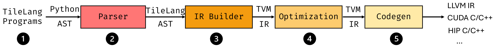

*图 2（原文 Figure 2，第 5 页）：TileLang 编译流水线的各阶段。*

**图中文字翻译与读法**：从左到右五步（图中 ❶–❺）：

1. ❶ TileLang Programs（TileLang 程序，即用户写的 Python）；
2. ❷ Parser（解析器）：把程序解析成 Python AST，再转成 TileLang AST；
3. ❸ IR Builder（IR 构造器）：把 AST 变成 TVM IR，从而复用 TVM 的语法树及相关基础设施；
4. ❹ Optimization（优化）：在 TVM IR 上做一系列图优化和调度变换；
5. ❺ Codegen（代码生成）：把优化后的 IR 翻译成后端代码：LLVM IR、CUDA C/C++、HIP C/C++ 等。

**读图结论**：TileLang 是“Python 前端 + TVM 中间层 + 多后端”的结构。原文没有写 TVM 版本，也没有给出各 pass 的先后顺序，只列出了功能（见第五节）。

### 3.3 Tile 编程模型的要素（原文 3.1，图 3）

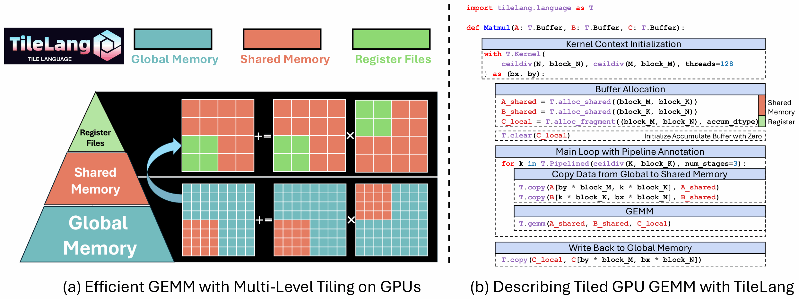

*图 3（原文 Figure 3，第 6 页）：在 GPU 上用 TileLang 实现多级分块的 GEMM。*

**图中文字翻译与读法**：

- **左图 (a) Efficient GEMM with Multi-Level Tiling on GPUs（GPU 上高效的多级分块 GEMM）**：左边的金字塔把存储层次画成三层，由上到下是 Register Files（寄存器，绿色）、Shared Memory（共享内存，橙色）、Global Memory（全局内存，青色），越往上越小越快。右边是两层 $C \mathrel{+}= A\times B$：下半部分在全局内存层，青色大矩阵里的橙色子块是被搬进共享内存的 tile；上半部分在共享内存层，橙色 tile 里的绿色子块是进一步放进寄存器里计算的部分；蓝色弧线箭头表示数据沿层次向上搬运。
- **右图 (b) Describing Tiled GPU GEMM with TileLang（用 TileLang 描述分块 GPU GEMM）**：同一个 GEMM 的代码，按功能框起来：Kernel Context Initialization（kernel 上下文初始化：`T.Kernel(ceildiv(N, block_N), ceildiv(M, block_M), threads=128) as (bx, by)`）；Buffer Allocation（缓冲分配：`T.alloc_shared` 两次，标注为 Shared Memory；`T.alloc_fragment((block_M, block_N), accum_dtype)`，标注为 Register）；`T.clear(C_local)`（用 0 初始化累加缓冲）；Main Loop with Pipeline Annotation（带流水线标注的主循环：`for k in T.Pipelined(ceildiv(K, block_K), num_stages=3)`）；Copy Data from Global to Shared Memory（两个 `T.copy`）；GEMM（`T.gemm`）；Write Back to Global Memory（`T.copy(C_local, C[...])`）。

**读图结论**：左图是内存层次和分块的物理含义，右图是同一件事的 TileLang 写法，每个代码段对应存储层次上的一步数据移动。

原文 3.1 节强调了两点：

- **tile 是一等公民**：一个 tile 是数据的一个带形状的部分，可以归属一个 warp、一个线程块或等价的并行单元；`T.Kernel` 定义执行上下文（线程块下标 `bx`、`by` 与线程数），既便于编译器自动推断访存与计算，也允许用户手动控制块内每个线程的行为。
- **显式放置硬件存储**：`T.alloc_shared` 在片上共享存储（NVIDIA 上就是共享内存）里分配；`T.alloc_fragment` 在 fragment 存储（NVIDIA 上就是寄存器堆）里分配累加器。原文特意解释了一个看似反直觉的点：程序里 `C_local` 与共享内存缓冲的分配大小是同阶的，而寄存器通常小得多——这是因为这里分配的是**整个线程块的**寄存器堆；编译时的布局推断 pass 会推出一个 `T.Fragment` 布局对象，决定怎样把它分给每个线程。此外，`T.clear`、`T.fill` 用来初始化缓冲，数据赋值还可以用 `T.Parallel` 并行完成。

### 3.4 Table 1：数据流算子与调度原语（原文 Table 1，第 5 页）

**表 1：TileLang 支持的部分数据流算子与调度原语**（按原文格式转录，表头翻译为中文）：

| 以数据流为中心的 tile 算子 | 说明 | 调度原语 | 说明 |
|---|---|---|---|
| `copy` | 专门的内存拷贝算子，抽象了寄存器、共享内存、全局内存之间的并行数据搬运 | `T.Parallel` | 自动并行化循环迭代，把迭代映射到硬件线程，也可启用向量化以获得额外性能 |
| `gemm` | 自动选择实现（cute、cuda、hip），在不同 GPU 上做高性能矩阵乘 | `T.Pipelined` | 启用循环级流水线，让数据传输与计算重叠，并支持 async copy、TMA 等硬件特定指令 |
| `reduce` | 灵活的归约算子（如 sum、min、max），利用 warp 级和块级并行 | `T.annotate_layout` | 允许定义自定义内存布局，以减少 bank conflict、优化线程绑定 |
| `atomic` | 提供原子操作（如 add、min、max），保证共享或全局内存中更新的线程安全 | `T.use_swizzle` | 通过对线程块做 swizzle 改善 L2 缓存局部性 |

（原文表 1，第 5 页，与 PDF 逐格核对。）读法：左半是“做什么”（数据流），右半是“怎么做得快”（调度）；前者是 kernel 的语义，后者原则上可以由编译器代劳，也可以由用户覆盖。

## 四、Tile 算子与调度原语（原文 3.2、3.3）

### 4.1 每个 Tile 算子都实现两个接口（图 4）

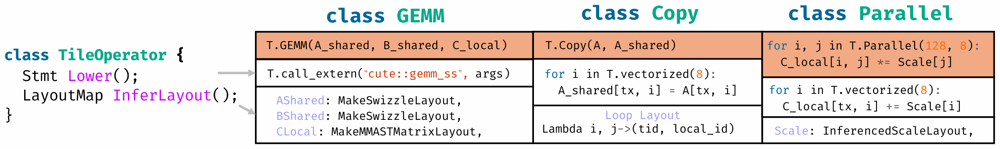

*图 4（原文 Figure 4，第 7 页）：Tile 算子（TileOperator）的接口以及 GEMM、Copy、Parallel 三个实例。*

**图中文字翻译与读法**：

- 左边是基类：`class TileOperator { Stmt Lower(); LayoutMap InferLayout(); }`，两个接口分别用箭头指向右边每列的“降低后的代码”和“推断出的布局”。
- **class GEMM**：顶部橙色格是用户写的 `T.GEMM(A_shared, B_shared, C_local)`；`Lower` 的结果是 `T.call_extern("cute::gemm_ss", args)`；`InferLayout` 的结果是 `AShared: MakeSwizzleLayout`、`BShared: MakeSwizzleLayout`、`CLocal: MakeMMASTMatrixLayout`（共享内存两个输入用 swizzle 布局，累加器用与 MMA 指令对应的矩阵布局）。
- **class Copy**：`T.Copy(A, A_shared)`；`Lower` 成带向量化的循环 `for i in T.vectorized(8): A_shared[tx, i] = A[tx, i]`；推断出的 Loop Layout（循环布局）是 `Lambda i, j -> (tid, local_id)`，即把循环迭代映射到（线程号，线程内编号）。
- **class Parallel**：`for i, j in T.Parallel(128, 8): C_local[i, j] *= Scale[j]`；降低后写成 `for i in T.vectorized(8): C_local[tx, i] += Scale[i]`（原图这里的 `+=` 与上一行的 `*=` 不一致，疑为图中笔误）；推断出 `Scale: InferencedScaleLayout`（`Scale` 的布局由使用方式推出）。

**读图结论**：

- **`Lower`** 决定高层算子怎样降成低层 IR：线程绑定、向量化访存、`extern` 调用等；
- **`InferLayout`** 决定与算子相关的内存布局（例如 swizzle 后的共享内存布局）和循环布局（例如线程绑定）；
- 所以“layout inference”不是单独的魔法，而是每个 tile 算子各自回答“我需要我的缓冲是什么布局”，由编译器汇总求解（见 5.3 节）。

### 4.2 四个核心算子（原文 3.2）

- **`copy`**：是 `T.Parallel` 加内存拷贝的语法糖。可以在以下作用域之间拷贝：`fragment`（寄存器）、`shared`（静态共享内存）、`shared.dyn`（动态共享内存）、`global`（全局内存）。
- **`gemm`**：内置的高度优化通用矩阵乘，支持 `ss`、`sr`、`rs`、`rr` 四种访存方式，其中 `r` 表示寄存器、`s` 表示共享内存（本文理解：两个字母分别对应 A、B 两个输入操作数）；它按 kernel 配置自动选实现：CUDA 后端借助 NVIDIA 的 CUTLASS 库使用 Tensor Core 或 CUDA Core，AMD GPU 上使用 composable kernel 和手写 HIP 代码；用户也能用 Python 注册自定义原语来扩展 `T.gemm`。
- **`reduce`**：在指定轴上做 sum、min、max、product 等归约（如矩阵的按行或按列归约），实现里利用 warp 级和块级并行，同时支持 CUDA 与 AMD 后端；用户也可以自定义归约。
- **`atomic`**：在并行环境下对共享或全局内存做安全更新，开箱支持 add、min、max；原文说它会使用 NVIDIA 与 AMD GPU 的原生原子指令，适用于直方图更新、共享内存归约、无同步计数器等。

### 4.3 四个调度原语（原文 3.3）

- **`T.Pipelined`**：对循环做流水线，让计算与访存重叠。例如图 3 里对 K 维循环用 `num_stages=3`，建立一个 3 级流水线，让数据传输、计算和下一块数据准备相互重叠（降到 CUDA 的细节见 4.4 节）。
- **`T.Parallel`**：自动并行化循环，把迭代映射到线程，同时支持向量化。原文以图 8 为例：把数据拷贝到 `A_shared` 时用 `T.Parallel(8, 32)` 并行化 8 与 32 两个维度。
- **`T.annotate_layout`**：允许对共享内存或全局内存指定自定义布局；默认情况下，TileLang 采用一种在 NVIDIA 与 AMD GPU 上都尽量减少 bank conflict 的优化布局。
- **`T.use_swizzle`**：通过 swizzle 改善 L2 缓存局部性、提高数据复用（表 1 写作 swizzle thread blocks，本文理解为重排线程块的执行顺序，让同时运行的块访问相邻的数据），对并行线程块处理分块数据时尤其有效。

## 五、调度空间的自动化设计（原文第 4 节）

原文把四类调度分成两组：流水线与张量化相对独立；线程绑定与内存布局耦合紧密。因此顺序是：先讲内存布局基础设施，再讲线程绑定，然后张量化，最后流水线。

### 5.1 内存布局：Layout 函数（原文 4.1，图 5）

**核心定义**。多维数组用高层下标 `A[i, k]` 访问，最终要翻译成物理地址。在物理地址层面，布局可写成线性化的地址表达式 $\sum_i y_i s_i$，其中 $y_i$ 是第 $i$ 维的下标，$s_i$ 是该维对整体线性地址的步长贡献。原文把布局记作 $L=s:d=(s_0,\dots,s_{n-1}):(d_0,\dots,d_{n-1})$（本文按上下文理解为各维步长与各维大小），并采用一种受 TVM 启发的、可组合、可堆叠的**布局函数**抽象，建立在 TVM 的 `IterVar`（带范围的迭代变量）之上：因为 `IterVar` 可以携带范围与步长信息，布局表达式可以化简成 `IterVar` 上的代数形式。于是布局函数是一个映射

$$
f:\mathbb{K}^n\to\mathbb{K}^m,
$$

编码从高层下标到内存地址（或其他坐标）的变换。（原文没有定义 $\mathbb{K}$，按上下文理解为下标域。）

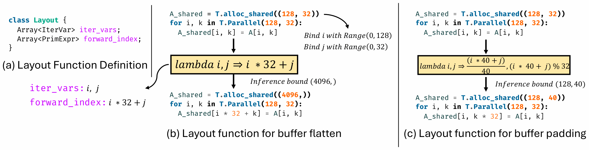

*图 5（原文 Figure 5，第 9 页）：布局函数（Layout Function）的接口与实例。*

**图中文字翻译与读法**：

- **(a) Layout Function Definition（布局函数的定义）**：`class Layout { Array<IterVar> iter_vars; Array<PrimExpr> forward_index; }`。`iter_vars` 是（可带范围的）迭代变量，`forward_index` 是一组用这些变量表示的表达式，用来算内存位置；例如 `iter_vars: i, j`，`forward_index: i * 32 + j`。
- **(b) Layout function for buffer flatten（把缓冲压平的布局函数）**：原程序是 `A_shared = T.alloc_shared((128, 32))` 加 `for i, k in T.Parallel(128, 32): A_shared[i, k] = A[i, k]`。给定缓冲形状，`iter_vars` 被绑定到具体范围（Bind i with Range(0, 128)，Bind j with Range(0, 32)），布局函数是 `lambda i, j => i * 32 + j`；把表达式交给算术分析器得到取值范围，推断出新缓冲的形状（Inference bound）为 `(4096,)`，并相应改写访问：`A_shared = T.alloc_shared((4096,))`，`A_shared[i * 32 + k] = A[i, k]`。
- **(c) Layout function for buffer padding（带填充的布局函数）**：同样的程序，布局函数印作 `lambda i, j => (i * 40 + j) / 40, (i * 40 + j) % 32`，推断出的形状是 `(128, 40)`，缓冲改成 `T.alloc_shared((128, 40))`，访问写成 `A_shared[i, k * 32] = A[i, k]`。

**读图结论与读码提示**：

- 布局函数既负责“推断缓冲的新形状”，也负责“把所有访问改写成新下标”；压平是一对一的，**填充**则是单射但不满射——每行 40 个位置只用了前 32 个，这就是原文所说的“非双射（non-bijective）布局变换”。原文还说这些变换可组合，并内置了若干策略，如用于缓解 GPU 共享内存 bank conflict 的 layout swizzling。
- 本文核对：(c) 里第二个分量印成 `% 32`，但推出的形状是 `(128, 40)`，只有取 `% 40`（即 $(40i+j)\bmod 40=j$）才一致，而访问处的 `k * 32` 也与恒等映射不符，疑为原文笔误。按“每行加 8 个填充元素，使相邻行错开 bank”理解最合理。

### 5.2 Fragment：把块级寄存器分给线程（原文 4.1，图 6）

TileLang 在 `Layout` 之上扩展出 **Fragment**（片段）布局。普通布局的输出是地址；Fragment 的输出总是两个分量：

$$
f:\mathbb{K}^n\to\mathbb{K}^2,\qquad f(\text{下标})=(\text{线程号},\ \text{该线程寄存器堆里的编号}),
$$

即“这个元素在哪个线程的哪个寄存器”。这是必要的，因为寄存器是线程私有的：程序里用 `T.alloc_fragment` 声明的是整个线程块的缓冲（例如图 1 的 `C_local`），实际存放时必须切分给块内各个线程，Fragment 布局就是这种切分的精确描述。

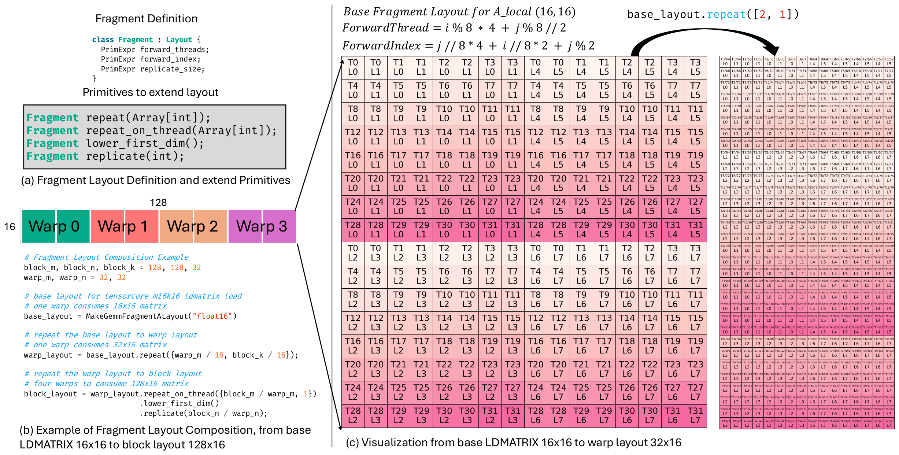

*图 6（原文 Figure 6，第 10 页）：Fragment 布局的接口与示例。*

**图中文字翻译与读法**：

- **(a) Fragment Layout Definition and extend Primitives（Fragment 布局的定义与扩展原语）**：`class Fragment : Layout { PrimExpr forward_threads; PrimExpr forward_index; PrimExpr replicate_size; }`。三个字段分别是“元素属于哪个线程”“元素在该线程里的编号”“复制份数”。原文提供四个扩展已有 Fragment 的原语：`repeat(Array[int])`、`repeat_on_thread(Array[int])`、`lower_first_dim()`、`replicate(int)`。
- **(b) Example of Fragment Layout Composition（组合示例）**：代码与注释大意——设 `block_m, block_n, block_k = 128, 128, 32`、`warp_m, warp_n = 32, 32`；`base_layout = MakeGemmFragmentALayout("float16")` 是用于 Tensor Core 的 m16k16 `ldmatrix` 加载的基础布局，一个 warp 消费 $16\times16$ 的矩阵；`warp_layout = base_layout.repeat({warp_m / 16, block_k / 16})`，一个 warp 消费 $32\times16$（注释）；`block_layout = warp_layout.repeat_on_thread({block_m / warp_m, 1}).lower_first_dim().replicate(block_n / warp_n)`，四个 warp 共同消费 $128\times16$ 的矩阵（注释）。左下角的色条标出 Warp 0–3，长度 128、宽度 16。
- **(c) Visualization from base LDMATRIX 16x16 to warp layout 32x16（从基础 16×16 到 warp 32×16 的可视化）**：左边 $16\times16$ 的格子逐格标着“线程号 + 线程内编号”，如 `T0 L0`、`T0 L1`、`T1 L0`……（`L` 是 Local，线程内编号）；图上方写着这个基础布局的公式（见下）；顶部弧线箭头标注 `base_layout.repeat([2, 1])`，指向右边缩得很小的大网格，网格里每格形如 `T0/64 L0`。

**把图上的公式讲透**。基础布局（图上标为 “Base Fragment Layout for A_local (16,16)”）为

$$
\text{ForwardThread}(i,j)=4\,(i\bmod 8)+\Big\lfloor \frac{j\bmod 8}{2}\Big\rfloor,\qquad
\text{ForwardIndex}(i,j)=4\Big\lfloor \frac{j}{8}\Big\rfloor+2\Big\lfloor \frac{i}{8}\Big\rfloor+(j\bmod 2).
$$

（原图用 Python 写法：`ForwardThread = i % 8 * 4 + j % 8 // 2`，`ForwardIndex = j // 8 * 4 + i // 8 * 2 + j % 2`。）线程号在 $0..31$（一个 warp 的 32 个线程），线程内编号在 $0..7$（每线程持有 $16\times16/32=8$ 个元素）。读法是：线程号 $=4\times(\text{行}\bmod 8)+\lfloor(\text{列}\bmod 8)/2\rfloor$，所以行号 mod 8 相同的元素由同一组 4 个线程负责、每个线程取相邻 2 列；线程内编号则由“列在前 8 还是后 8”“行在前 8 还是后 8”“列的奇偶”三位组成。

本文自拟的核对例子（与图上格子对照）：

- 元素 $(i,j)=(1,10)$：线程 $=4\times1+\lfloor(10\bmod8)/2\rfloor=4+1=5$，编号 $=4\times1+0+0=4$，即 `T5 L4`，图中第 1 行第 10 列正是 `T5 L4`；
- 元素 $(9,3)$：线程 $=4\times1+\lfloor3/2\rfloor=5$，编号 $=0+2\times1+1=3$，即 `T5 L3`，与图中第 9 行第 3 列一致；
- 因此线程 5 持有 $(1,2),(1,3),(9,2),(9,3),(1,10),(1,11),(9,10),(9,11)$ 八个元素。

本文补充（据 NVIDIA PTX 文档，原文未明说）：这恰好就是 `mma.m16n8k16` 指令中 A 操作数在 warp 内的寄存器排布——这也是 “MakeGemmFragmentALayout” 名字的含义：布局不是随意设计的，而是由 Tensor Core 指令规定的。

**关于右边的大网格**：放大到原图矢量精度后可以读出，那个缩得很小的网格前 16 行是线程 `T0/64`…`T31/95`（每行 4 个线程，行号 0–7 与 8–15 分别对应 `L0 L1 L4 L5` 与 `L2 L3 L6 L7`），接下来的行由 `T32/96`…`T63/127` 持有；每格标两个线程号（相差 64），表示同一个元素在两个线程里各有一份。这更像是经过“在线程方向重复（`repeat_on_thread`）并复制（`replicate`）”之后的 block 级布局，而不只是 `repeat([2, 1])` 的结果。本文注意到：正文说图 6(c) 可视化的是 base 到 warp 布局的变换，图上的标注与此不完全对应；`lower_first_dim` 原文没有解释语义。

**读图结论**：Fragment 布局是一个可以通过少数几个原语逐级组合出来的东西：从一条 Tensor Core 指令规定的最小布局（一个 warp、$16\times16$）出发，沿数据方向重复得到 warp 布局，沿线程方向重复并复制得到整个线程块的布局。

读码提示（本文核对）：图 6(b) 的 `warp_layout = base_layout.repeat({warp_m / 16, block_k / 16})` 里 `block_k = 32`，按此式是 `repeat({2, 2})`，会得到 $32\times32$；但图 6(c) 的箭头标注是 `repeat([2, 1])`，注释也写“一个 warp 消费 $32\times16$”。两者要一致需要 `block_k = 16`，疑为原文笔误。

### 5.3 线程绑定与布局推断（原文 4.2，图 7、图 8）

**问题**：有了 Fragment 布局，怎样把块级寄存器分给线程、怎样为各缓冲推断合适的 Fragment 布局，并正确并行化循环以符合布局约束，就是**线程绑定**问题。原文给出两点观察：

1. 多个 tile 算子常常共用同一批缓冲，所以它们的布局与线程绑定策略相互依赖；
2. 不同算子对布局和绑定的严格程度不同：例如 GPU 上用 Tensor Core 的 GEMM 对布局和线程绑定有严格约束，而逐元素算子通常灵活得多。

**方案**：在 `Layout` 与 `Fragment` 对象上做推断。维护一个 `LayoutMap`，记录所有缓冲的布局信息；给 tile 算子的布局需求定义一个**层次化的优先级**，优先级越高表示布局要求越严格、对性能影响越大；按**自顶向下**的顺序依次推断，从最高优先级到最低优先级；在每个优先级上，反复尝试为所有尚未确定的缓冲推断布局，直到没有进展，再进入下一个更低的优先级。（原文没有列出具体有哪些优先级、各算子属于哪一级。）

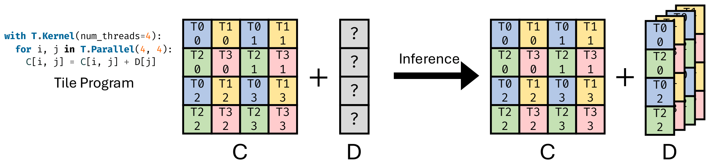

*图 7（原文 Figure 7，第 11 页）：对 Fragment 做线程绑定推断的例子。*

**图中文字翻译与读法**：

- 左边 Tile Program（tile 程序）：`with T.Kernel(num_threads=4): for i, j in T.Parallel(4, 4): C[i, j] = C[i, j] + D[j]`，即给 GEMM 的输出 $C$（$4\times4$）按列加偏置向量 $D$（长度 4）。
- 左半图：$C$ 的格子已被 GEMM 确定了布局，每格写着“线程号 / 线程内编号”：第 0 行是 `T0/0 T1/0 T0/1 T1/1`，第 1 行是 `T2/0 T3/0 T2/1 T3/1`，第 2 行是 `T0/2 T1/2 T0/3 T1/3`，第 3 行是 `T2/2 T3/2 T2/3 T3/3`，即 4 个线程各持有 4 个元素；$D$ 的 4 个格子画着问号，表示布局未知。
- 中间箭头 Inference（推断）之后，右半图：$C$ 不变；$D$ 变成堆叠的多层，每层标出元素所在的（线程，编号）。比如 $D[0]$ 那一层是 `T0/0`、`T2/0`、`T0/2`、`T2/2`，正是 $C$ 的第 0 列元素所在的位置。

**读图结论**：GEMM 的优先级最高，所以 $C$ 的线程绑定先确定；偏置 $D[j]$ 被 $C$ 第 $j$ 列的每个元素用到，而这些元素分布在不同线程里（$D[0]$ 要被 `T0`、`T2` 各用两次），所以 $D$ 必须**复制**到所有需要它的线程（replicate），每个线程拿到自己所需列的副本，布局推断就是自动算出这种复制关系。原文还写道：D 的布局可用同样方法推出。

本文核对：原文正文说这个例子里 $C$ 是“$4\times4$、分布在 8 个线程上、每线程 2 个元素”，但图上是 `num_threads=4`、4 个线程各持有 4 个元素，二者不一致，这里按图解释。

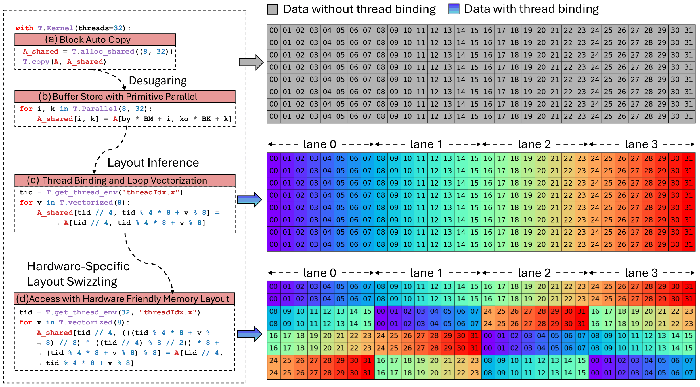

*图 8（原文 Figure 8，第 11 页）：多阶段自动线程绑定推断，实现高效并行内存访问。*

**图中文字翻译与读法**：左边是一条逐阶段降低的链路，右边对应阶段的数据排布；顶部图例：灰格 “Data without thread binding”（未绑定线程的数据），彩色渐变格 “Data with thread binding”（已绑定线程的数据，颜色代表负责它的 lane）。

- **(a) Block Auto Copy（块级自动拷贝）**：`with T.Kernel(threads=32)` 下，`A_shared = T.alloc_shared((8, 32))`，`T.copy(A, A_shared)`，右边是 $8\times32$ 的灰格，格内数字是列号 00–31，此时还没有线程归属；
- 经过 **Desugaring（去糖）** 到 **(b) Buffer Store with Primitive Parallel（用并行原语的缓冲写）**：`for i, k in T.Parallel(8, 32): A_shared[i, k] = A[by * BM + i, ko * BK + k]`；
- 经过 **Layout Inference（布局推断）** 到 **(c) Thread Binding and Loop Vectorization（线程绑定与循环向量化）**：`tid = T.get_thread_env("threadIdx.x")`；`for v in T.vectorized(8): A_shared[tid // 4, tid % 4 * 8 + v % 8] = A[tid // 4, tid % 4 * 8 + v % 8]`。右边的彩色图里，每行 32 列被分成 lane 0–3 四段，每段 8 列，一个线程用一次 8 元素向量化访存搬一段（32 个线程 $\times$ 8 = 256 = $8\times32$）；
- 经过 **Hardware-Specific Layout Swizzling（硬件相关的布局 swizzle）** 到 **(d) Access with Hardware Friendly Memory Layout（用对硬件友好的内存布局访问）**：`A_shared[tid // 4, (((tid % 4 * 8 + v % 8) // 8) ^ ((tid // 4) % 8 // 2)) * 8 + (tid % 4 * 8 + v % 8) % 8] = A[...]`；右边的彩色图里，每行内的四个 8 元素段被重新排位。

**把 swizzle 公式讲透**。(d) 的写入位置里，行号不变（`tid // 4`），列方向把“8 元素段号” $c=\lfloor \text{col}/8\rfloor$ 换成 $c\oplus s$，其中 $s=\lfloor(\text{row}\bmod 8)/2\rfloor$，$\oplus$ 是按位异或，段内偏移不变：

$$
\text{物理列}=\big(c\oplus s\big)\times 8+(\text{col}\bmod 8),\qquad c=\Big\lfloor\frac{\text{col}}{8}\Big\rfloor,\quad s=\Big\lfloor\frac{\text{row}\bmod 8}{2}\Big\rfloor .
$$

对照图 (d)：

- 第 0、1 行 $s=0$，不变：段顺序是 00–07、08–15、16–23、24–31；
- 第 2、3 行 $s=1$：段号 0↔1、2↔3 互换，所以物理上依次放着 08–15、00–07、24–31、16–23；
- 第 4、5 行 $s=2$：0↔2、1↔3 互换：16–23、24–31、00–07、08–15；
- 第 6、7 行 $s=3$：0↔3、1↔2 互换：24–31、16–23、08–15、00–07。

这与图上格子逐段一致（例如线程 `tid=13`：行 3、段 1，$1\oplus1=0$，它的 8 个元素被写到第 3 行物理列 0–7）。

本文补充（原文只说 swizzle 常用来缓解 bank conflict，未展开）：假设元素是 16 位，一行 32 个元素占 64 字节，相邻两行刚好占满一个 128 字节（32 个 bank）的周期。不 swizzle 时，同一个 8 元素段在第 0、2、4、6 行落在同一组 bank 上，纵向读 8 行会发生 4 路冲突；按上式 swizzle 后，8 行的同一逻辑段落到 8 个互不相同的 16 字节 bank 组，读取无冲突。

**读图结论**：用户只写了 `T.copy(A, A_shared)`；经过去糖、线程绑定与向量化、再到对硬件友好的布局 swizzle，编译器自己确定每个线程搬哪 8 个元素、写到共享内存的哪个位置。

### 5.4 使用高性能硬件指令（原文 4.3，图 9、图 10）

同一个计算在硬件上常有多条指令路径。原文以 NVIDIA GPU 上的 8 位乘加为例：

| 指令 | 做什么 | 在 RTX 3090 上的吞吐（原文估计值） |
|---|---|---:|
| `IMAD` | 标量融合乘加 $d=a\cdot b+c$，所有操作数在内部提升成 32 位整数计算 | 约 17.8 TOPS |
| `DP4A` | 向量点积：$d=\langle \mathbf{a},\mathbf{b}\rangle+c=\sum_{i=0}^{3}a_ib_i+c$，$\mathbf{a},\mathbf{b}$ 是长度为 4 的 8 位整数向量，$c$ 与 $d$ 是 32 位整数 | 约 71.2 TOPS |
| `MMA` | 用 Tensor Core 做 $D=A\cdot B+C$，其中 $A\in\mathbb{R}^{16\times32}$、$B\in\mathbb{R}^{32\times8}$、$C,D\in\mathbb{R}^{16\times8}$；$A$、$B$ 是 8 位整数矩阵，$C$ 与累加结果 $D$ 是 32 位整数 | 约 284 TOPS |

三者吞吐大约是 $1:4:16$。此外，同一精度下 MMA 指令还支持多种形状。TileLang 为此提供几种互补方式：

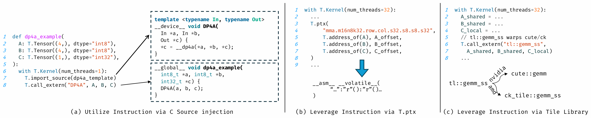

*图 9（原文 Figure 9，第 12 页）：在 TileLang 里使用高性能硬件指令的不同方法。*

**图中文字翻译与读法**：

- **(a) Utilize Instruction via C Source injection（通过注入 C 源码使用指令）**：用 `T.import_source(dp4a_template)` 把一段 C++ 模板（`template <typename In, typename Out> __device__ void DP4A(In *a, In *b, Out *c) { *c = __dp4a(*a, *b, *c); }`）注入到生成的代码开头，再在 kernel 里用 `T.call_extern("DP4A", A, B, C)` 调用；右边的 `__global__ void dp4a_example(int8_t *a, int8_t *b, int32_t *c)` 就是调用它的生成代码。优点是保持类 C 语法的低层控制。
- **(b) Leverage Instruction via T.ptx（通过 `T.ptx` 使用指令）**：`T.ptx("mma.m16n8k32.row.col.s32.s8.s8.s32", T.address_of(A), A_offset, T.address_of(B), B_offset, T.address_of(C), C_offset)`，直接在 kernel 里发射内联 PTX；右下蓝色箭头指向生成的 `__asm__ __volatile__(...)`。适合 warp 级操作。
- **(c) Leverage Instruction via Tile Library（通过 tile 库使用指令）**：`T.call_extern("tl::gemm_ss", A_shared, B_shared, C_local)`；`tl::gemm_ss` 在 NVIDIA 上对应 `cute::gemm`，在 AMD 上对应 `ck_tile::gemm_ss`。

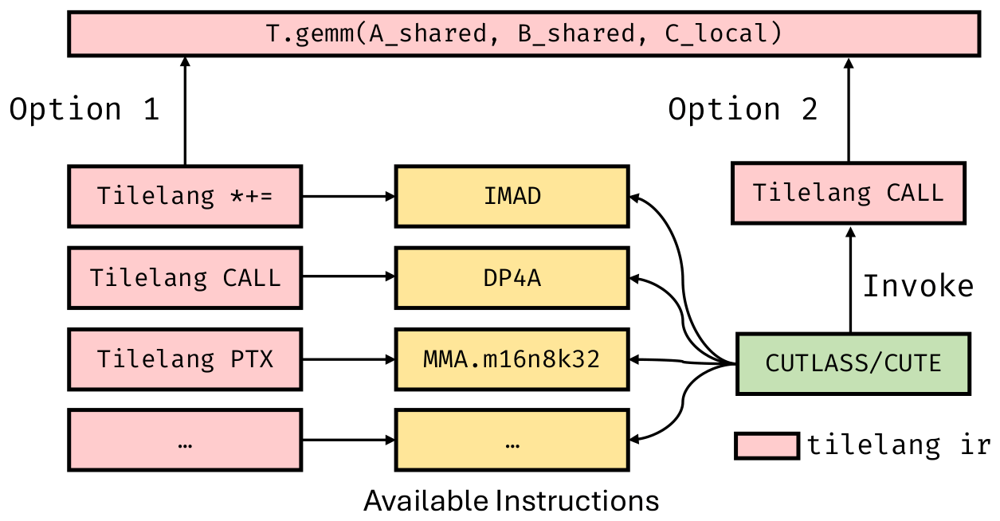

*图 10（原文 Figure 10，第 13 页）：在 TileLang 中使用 DP4A 与 mma 的不同方法。*

**图中文字翻译与读法**：顶部是同一个高层调用 `T.gemm(A_shared, B_shared, C_local)`。**Option 1（选项 1）**：在 TileLang 里直接实现每条指令——`Tilelang *+=`（对应 `IMAD`）、`Tilelang CALL`（对应 `DP4A`）、`Tilelang PTX`（对应 `MMA.m16n8k32`）等，粉色框是 tilelang IR；**Option 2（选项 2）**：一个 `Tilelang CALL` 去调用绿色的 CUTLASS/CUTE，由库为每种输入配置选出合适的指令（图中绿色框到黄色“Available Instructions（可用指令）”的几根弧线）。

**两种思路的取舍（原文）**：

- **tile 库**（cute、composable kernel）接入简单，并能获得厂商优化的性能；但高层抽象限制低层控制：例如 `cute::gemm_ss` 在共享内存输入上做 GEMM，而共享内存到寄存器的数据流由 cute 模板内部管理，无法从外部标注或覆盖内部布局，灵活性降低；另外模板用得多，编译会明显变慢——用 NVCC 12.8 的 trace 工具分析，模板展开占 TileLang 生成的 CUDA 代码编译时间的约 90%。
- **用 TileLang 自己实现指令**（Option 1）避免了布局标注的限制并缩短编译时间，但需要用户为每个目标硬件指令在 tilelang 里实现完整的指令集。
- 当前两种都支持，**默认走基于 tile 库的方式**，以便快速支持新硬件指令。

这一点对读实验很重要：默认路径上，`T.gemm` 的核心计算由 CUTLASS 或 composable kernel 提供，所以 GEMM 与厂商库持平，部分来自 TileLang 调用了同类库的模板（这是本文的提醒，原文在 4.3 节自己交代了这一默认设置）。

### 5.5 软件定义的流水线（原文 4.4，图 11）

TileLang 用**自动软件流水线推断**分析计算块（例如 Copy 与 GEMM）之间的依赖，生成既最大化并行又保持执行顺序正确的流水线调度：把 Copy 任务与其他计算密集操作交错，减少空闲时间；发现可以异步的机会时，自动把这些任务映射到可用硬件资源上并发执行。因此 TileLang 只需向用户暴露一个 `num_stages` 接口，大大简化流程；用户需要时也可以显式给出各语句的次序和所属级。

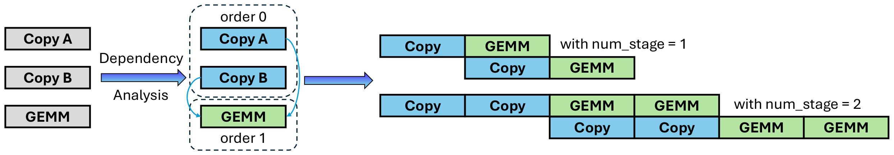

*图 11（原文 Figure 11，第 13 页）：TileLang 中的软件流水线调度，展示 TileLang 如何交错 Copy 与 GEMM。*

**图中文字翻译与读法**：

- 左边三个灰框 Copy A、Copy B、GEMM 经过 Dependency Analysis（依赖分析）变成两组：虚线框 order 0（次序 0）里是并列的 Copy A、Copy B（蓝色），虚线框 order 1（次序 1）里是 GEMM（绿色）；青色箭头表示 GEMM 依赖两个 Copy 的结果。
- 右边是两个时间线（每格是一个任务，同一列的上下格表示同时进行）：**with num_stage = 1**：第一行是 Copy、GEMM，第二行（错开一格）也是 Copy、GEMM，即下一轮的 Copy 与上一轮的 GEMM 同时进行；**with num_stage = 2**：第一行 Copy、Copy、GEMM、GEMM，第二行从第三格起错开：Copy、Copy、GEMM、GEMM，即同时有更多轮次的拷贝与计算在流水。

**读图结论**：`num_stages` 越大，在途的拷贝越多、重叠越深，代价是需要更多的共享内存缓冲。本文提醒：图 11 的 `num_stage = 1` 画的是一次拷贝与计算重叠，而图 1(c) 在 `num_stages=1` 时生成的是单缓冲、没有块内重叠的代码；两处对“级数”的计数口径不完全一致，原文没有说明。

**各代硬件上的实现（原文 4.4）**：

- **Ampere**：用 `cp.async` 做全局内存到共享内存的异步拷贝；TileLang 分析循环结构，对符合条件的内存传输自动插入 `cp.async`，并正确使用 `cp.async.commit` 与 `cp.async.wait` 处理同步，保证数据正确；这个优化还减轻了寄存器压力，提高带宽利用率。
- **Hopper**：新增 TMA 单元，负责全局内存与共享内存之间的拷贝；PTX 新增 `wgmma` 指令，由 warpgroup（4 个 warp）执行矩阵乘，提高 Tensor Core 利用率，其中 `wgmma.mma_async` 是异步的。Hopper 上常用 **warp 特化**：线程分成生产者（用 TMA 搬数据）和消费者（做计算）。TileLang 在降低过程中**自动**完成 warp 特化：分析所有语句的缓冲使用，确定它们是生产者还是消费者，再按 `threadIdx` 把二者分成不同的执行路径；为保证正确，用**活跃变量分析**（Live Variable Analysis）确定合适的同步点并插入内存屏障（mbarrier）。
- **AMD CDNA**：同样有异步拷贝和 DMA 支持，TileLang 通过 HIP 封装的 Copy 原语使用，具体用到 `s_waitcnt lgkmcnt` 与 `buffer_load_dword lds` 等指令。

## 六、实验（原文第 5 节）

### 6.1 实验设置（原文 5.1）

- **硬件**：NVIDIA H100（80 GB，CUDA 12.4）、NVIDIA A100（80 GB）、AMD Instinct MI300X（192 GB，ROCm 6.1.0）；所有平台系统均为 Ubuntu 20.04。（原文只列这三块 GPU，但图 13 还包含 RTX 4090，见第九节。）
- **负载与硬件对应**：H100 上测多头注意力（MHA）、线性注意力、GEMM；A100 上测反量化 GEMM；MI300X 上测 GEMM 与 MHA（原文写 MHA，图 14(b) 画的是 MLA，见第九节）。
- **基线**：FlashAttention-3（针对 MHA，使用 `tma`、`wgmma.mma_async` 等 CUDA 指令）、Triton（开源 GPU kernel 框架，支持 NVIDIA 与 AMD，但需要手工优化）、cuBLAS、rocBLAS、PyTorch（手工优化的 GEMM 与 FlashAttention-2 kernel，但未完全优化）、BitsandBytes（支持 $W_{NF4}A_{FP16}$ 等格式）、Marlin（面向 $W_{INT4}A_{FP16}$ 的高度优化 kernel）；图中还出现 CUTLASS、FlashInfer、FlashMLA、AITER。
- **没有交代的设置**：原文没有说明数据类型（注意力与 MLA 的精度）、各基线的软件版本（Triton、PyTorch、FlashAttention-3、cuBLAS）、计时方法与重复次数，也没有说明 TileLang 各 kernel 的 tile 大小、`num_stages`、线程数是人工设定还是自动调优得到。

**形状配置**（原文附录 A，逐格核对）：

**表 2：GEMM 形状**（原文只写 m、n、k，未说明约定；按常规理解为 $C_{m\times n}=A_{m\times k}B_{k\times n}$）：

| 形状 | V0 | V1 | V2 | V3 | V4 | V5 | V6 | V7 |
|---|---:|---:|---:|---:|---:|---:|---:|---:|
| m | 1 | 1 | 1 | 1 | 1 | 1 | 1 | 1 |
| n | 16384 | 43008 | 14336 | 57344 | 14336 | 9216 | 36864 | 9216 |
| k | 16384 | 14336 | 14336 | 14336 | 57344 | 9216 | 9216 | 36864 |

| 形状 | M0 | M1 | M2 | M3 | M4 | M5 | M6 | M7 |
|---|---:|---:|---:|---:|---:|---:|---:|---:|
| m | 4096 | 4096 | 4096 | 4096 | 8192 | 8192 | 8192 | 8192 |
| n | 1024 | 8192 | 28672 | 8192 | 1024 | 8192 | 28672 | 8192 |
| k | 8192 | 8192 | 8192 | 28672 | 8192 | 8192 | 8192 | 28672 |

（原文表 2，第 19 页。）读法：V0–V7 的 $m=1$，是矩阵乘向量（GEMV）形状，用于图 15 的反量化实验；M0–M7 是 $m\ge4096$ 的稠密 GEMM，用于图 13。原文没有说明这些形状取自哪些模型（本文推断：$n$、$k$ 的取值如 14336、28672 与常见大模型的 FFN 维度同一量级）。

**表 3：FlashAttention 形状**：

| 形状 | FA0 | FA1 | FA2 | FA3 | FA4 |
|---|---:|---:|---:|---:|---:|
| batch | 1 | 1 | 1 | 1 | 1 |
| nheads | 32 | 32 | 32 | 32 | 32 |
| seq_len | 512 | 512 | 1024 | 1024 | 4096 |
| head_dim | 128 | 128 | 128 | 128 | 128 |
| causal | true | false | true | false | true |

（原文表 3，第 19 页。）

**表 4：线性注意力形状**（Mamba-2 的 chunk-scan 为 CC0–CC5，chunk-state 为 CT0–CT5）：

| 形状 | CC0 | CC1 | CC2 | CC3 | CC4 | CC5 |
|---|---:|---:|---:|---:|---:|---:|
| batch | 1 | 1 | 1 | 64 | 64 | 64 |
| nheads | 64 | 64 | 64 | 64 | 64 | 64 |
| seq_len | 1024 | 2048 | 8192 | 1024 | 2048 | 8192 |
| head_dim | 64 | 64 | 64 | 64 | 64 | 64 |
| d_state | 128 | 128 | 128 | 128 | 128 | 128 |

| 形状 | CT0 | CT1 | CT2 | CT3 | CT4 | CT5 |
|---|---:|---:|---:|---:|---:|---:|
| batch | 1 | 1 | 1 | 64 | 64 | 64 |
| nheads | 64 | 64 | 64 | 64 | 64 | 64 |
| seq_len | 1024 | 2048 | 8192 | 1024 | 2048 | 8192 |
| head_dim | 64 | 64 | 64 | 64 | 64 | 64 |
| d_state | 128 | 128 | 128 | 128 | 128 | 128 |

（原文表 4，第 19 页。）读法：两组表的数值完全相同，只是对应两个 kernel；图 12 里只画了 CC0–CC4 与 CT0–CT4。

### 6.2 FlashAttention 与线性注意力（图 12）

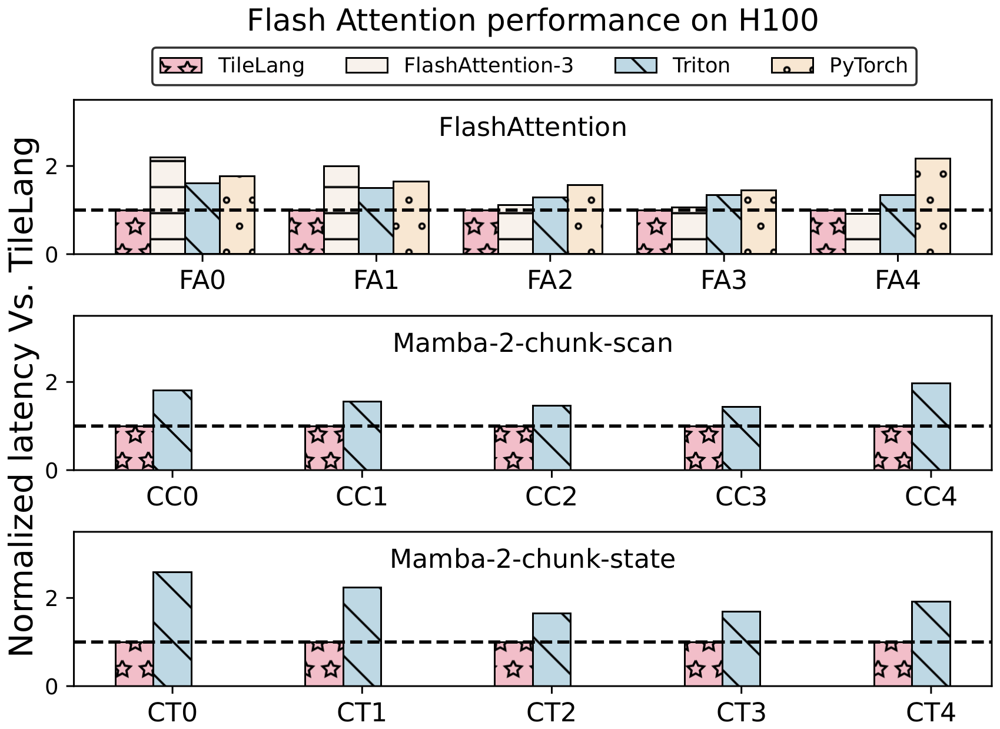

*图 12（原文 Figure 12，第 15 页）：Hopper 架构（H100）上 FlashAttention 与线性注意力的性能。*

**图中文字翻译与读法**：

- 总标题 Flash Attention performance on H100（H100 上的 FlashAttention 性能）；纵轴 Normalized latency Vs. TileLang（相对 TileLang 归一化的延迟，**越小越快**），虚线是 TileLang 的 1.0 水平线。
- 图例（顶部）：TileLang（粉色星形纹）、FlashAttention-3（米色横线纹）、Triton（蓝色斜线纹）、PyTorch（橙色圆点纹）。
- 三个子图：**FlashAttention**（FA0–FA4，对应表 3 的五个形状，四个系列）；**Mamba-2-chunk-scan**（CC0–CC4，只画 TileLang 与 Triton）；**Mamba-2-chunk-state**（CT0–CT4，只画 TileLang 与 Triton）。

下表是从该图矢量数据量出的归一化延迟（TileLang 的延迟记为 1.00，约值）：

| 形状（表 3） | TileLang | FlashAttention-3 | Triton | PyTorch |
|---|---:|---:|---:|---:|
| FA0（seq 512，causal） | 1.00 | 2.19 | 1.61 | 1.76 |
| FA1（seq 512，非 causal） | 1.00 | 2.00 | 1.50 | 1.65 |
| FA2（seq 1024，causal） | 1.00 | 1.11 | 1.29 | 1.57 |
| FA3（seq 1024，非 causal） | 1.00 | 1.06 | 1.35 | 1.45 |
| FA4（seq 4096，causal） | 1.00 | 0.91 | 1.34 | 2.17 |
| 几何平均 | 1.00 | 1.36 | 1.41 | 1.70 |

| 线性注意力形状 | CC0 | CC1 | CC2 | CC3 | CC4 | CT0 | CT1 | CT2 | CT3 | CT4 |
|---|---:|---:|---:|---:|---:|---:|---:|---:|---:|---:|
| Triton（TileLang 记为 1.00） | 1.81 | 1.56 | 1.46 | 1.44 | 1.96 | 2.59 | 2.23 | 1.65 | 1.69 | 1.92 |

**原文文字结论（5.2）**：

- 相对 FlashAttention-3、Triton、PyTorch，TileLang 的加速分别是 1.36×、1.41×、1.70×。原文解释：FlashAttention-3 是手工写的方案，无法有效适应变化的工作量，它的固定 tile 大小在较短序列上性能欠佳；在更长序列（原文写“例如 8k”）上，TileLang 的性能接近 FlashAttention-3；PyTorch 用的是手工优化的 FlashAttention-2 kernel，所以比 FlashAttention-3 更慢。
- 与这些手工模板实现相比，TileLang 能自动利用 `cp.async.bulk`、`wgmma.mma_async` 等指令，并自动施加 warp 特化等优化；在 H100 上，TileLang 能表达与 FlashAttention-3 同样复杂的流水线调度方案。
- 线性注意力用 Mamba-2 的 chunk-scan 与 chunk-state 函数；相对 Triton，TileLang 平均加速 1.77× 与 2.10×。

**读图结论与核对**：

- 本文由上表验算：五个形状上相对 FA3、Triton、PyTorch 的几何平均恰为 1.36、1.41、1.70，与原文文字一致，说明原文的“加速”就是按形状取几何平均。
- FA3 的差距随序列长度变化很大：512 时约慢 2.0–2.2 倍，1024 时约 1.06–1.11 倍，4096（causal）时反而比 TileLang 快约 10%（0.91）。所以“1.36×”主要来自短序列；在 4096 上 TileLang 更慢。表 3 的最长序列是 4096，并没有 8k，原文正文“例如 8k”与表 3 不符。
- 原文说 PyTorch（FlashAttention-2 kernel）比 FlashAttention-3 慢，图上只在 FA2–FA4 成立；在 512 序列的 FA0、FA1 上，FA3（2.19、2.00）反而比 PyTorch（1.76、1.65）更慢。
- 线性注意力的图里只有 5 个形状：图上读出的几何平均是约 1.63（chunk-scan）和约 1.99（chunk-state），算术平均约 1.65 与 2.02，与正文的 1.77× 与 2.10× 对不上；表 4 列了 6 个形状（含 CC5、CT5），也许正文平均含了图里没画的第 6 个形状，但原文没有说明。

### 6.3 MLA（图 14）

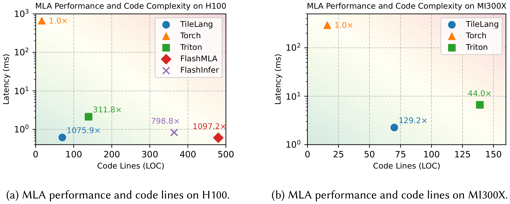

*图 14（原文 Figure 14，第 16 页）：H100 与 MI300X 上 MLA 性能与代码行数的比较。*

**图中文字翻译与读法**：两个散点图，横轴 Code Lines (LOC)（代码行数），纵轴 Latency (ms)（延迟，对数刻度），越靠左下越好；点旁标注的 “×” 是相对 Torch 的加速倍数。(a) 为 MLA Performance and Code Complexity on H100（H100 上的 MLA 性能与代码复杂度），图例 TileLang（蓝圆）、Torch（橙三角）、Triton（绿方块）、FlashMLA（红菱形）、FlashInfer（紫叉）；(b) 为 MI300X，只有 TileLang、Torch、Triton。

下表从图的矢量数据量出（延迟与代码行数均为约值；倍数是图上标注）：

| GPU | 实现 | 延迟（ms，约） | 代码行数（约） | 图上标注的相对 Torch 加速 |
|---|---|---:|---:|---:|
| H100 | Torch | 664 | 16 | 1.0× |
| H100 | TileLang | 0.62 | 70 | 1075.9× |
| H100 | Triton | 2.1 | 139 | 311.8× |
| H100 | FlashInfer | 0.83 | 364 | 798.8× |
| H100 | FlashMLA | 0.61 | 480 | 1097.2× |
| MI300X | Torch | 292 | 16 | 1.0× |
| MI300X | TileLang | 2.3 | 70 | 129.2× |
| MI300X | Triton | 6.6 | 139 | 44.0× |

**原文文字结论（5.2）**：在 H100 上，TileLang 相对 Torch 加速 1075.9×，显著优于 Triton 与 FlashInfer，并达到手工优化的 FlashMLA 性能的 98%（本文验算：$1075.9/1097.2\approx0.98$）；只需约 70 行 Python 代码，可用性明显好于其他基线（FlashMLA 约 480 行）。在 MI300X 上，TileLang 相对 Torch 加速 129.2×，在性能与代码紧凑度上都超过 Triton；对于手写库 AITER，TileLang 达到其 95% 的性能；由于 AITER 的 kernel 实现不开源，图里没有给出它的代码行数。

**读图时的提醒**：（1）Torch 基线的具体实现原文未说明，它的延迟比其他实现高近三个数量级，应当是未经优化的朴素实现（本文推断），所以倍数大得夸张，这些倍数主要说明“相对朴素 PyTorch”，真正有意义的对比是对 FlashMLA、Triton；（2）图 14(b) 里没有 AITER 的点，“95%”无法从图验证；（3）代码行数是原文作者自己的统计口径。

### 6.4 GEMM（图 13）

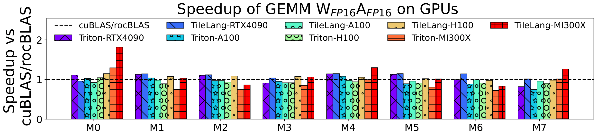

*图 13（原文 Figure 13，第 16 页）：NVIDIA 与 AMD GPU 上的 GEMM 性能。*

**图中文字翻译与读法**：标题 Speedup of GEMM $W_{FP16}A_{FP16}$ on GPUs（各 GPU 上 FP16 权重、FP16 激活的 GEMM 加速）；纵轴 Speedup vs cuBLAS/rocBLAS（相对 cuBLAS 或 rocBLAS 的加速，虚线 1.0 为厂商库水平，NVIDIA 用 cuBLAS，AMD 用 rocBLAS）；横轴 M0–M7 是表 2 的八个稠密形状；每组 8 根柱，依次是 Triton-RTX4090、TileLang-RTX4090、Triton-A100、TileLang-A100、Triton-H100、TileLang-H100、Triton-MI300X、TileLang-MI300X。

下表为从图中矢量数据量出的相对厂商库加速（约值）：

| 形状 | Triton 4090 | TileLang 4090 | Triton A100 | TileLang A100 | Triton H100 | TileLang H100 | Triton MI300X | TileLang MI300X |
|---|---:|---:|---:|---:|---:|---:|---:|---:|
| M0 | 1.11 | 0.96 | 1.03 | 0.92 | 1.05 | 1.15 | 1.30 | 1.82 |
| M1 | 1.13 | 1.14 | 1.04 | 0.98 | 0.89 | 1.07 | 0.75 | 1.04 |
| M2 | 1.10 | 1.12 | 0.97 | 0.97 | 0.93 | 1.09 | 0.74 | 0.86 |
| M3 | 0.91 | 1.04 | 0.96 | 0.92 | 0.91 | 1.08 | 0.85 | 1.06 |
| M4 | 1.14 | 1.15 | 1.08 | 0.98 | 0.94 | 1.06 | 1.00 | 1.30 |
| M5 | 1.13 | 1.15 | 0.89 | 0.96 | 0.91 | 1.02 | 0.81 | 1.02 |
| M6 | 1.00 | 1.14 | 0.89 | 0.99 | 0.91 | 0.98 | 0.73 | 0.83 |
| M7 | 0.82 | 1.01 | 0.75 | 0.96 | 0.91 | 0.98 | 1.01 | 1.27 |
| 8 形状算术平均 | 1.04 | 1.09 | 0.95 | 0.96 | 0.93 | 1.05 | 0.90 | 1.15 |

**原文文字结论（5.2）**：在 RTX 4090、A100、H100、MI300X 上，TileLang 相对厂商库的加速分别是 1.10×、0.97×、1.00×、1.04×；相对 Triton 分别是 1.08×、1.03×、1.13×、1.25×。原文总结说，对矩阵乘，TileLang 用简单语法就达到了厂商库的性能；并且借助 layout swizzling，TileLang 保证了在所有测试设备上无 bank conflict 的执行（原文没有给出 profiler 数据支持这一句）。

**读图结论与核对**：

- 相对 Triton 的比值（每形状 TileLang÷Triton 再取平均）约为 1.05、1.02、1.13、1.27，H100 与原文吻合，其余略有出入。
- 相对厂商库，图里读出的算术平均分别约 1.09、0.96、1.05、1.15，A100 与 RTX 4090 接近原文，**H100（原文 1.00，图约 1.05）与 MI300X（原文 1.04，图约 1.12–1.15）差别较大**，原文未说明平均口径。
- 单个形状的波动比平均值大得多：MI300X 上 M0 达到约 1.82×，而 M2、M6 只有约 0.86、0.83；A100 上 TileLang 的 8 个形状全部不超过 1.0（约 0.92–0.99）。所以“与厂商库持平”是平均意义上的，不是逐形状的。
- 如 5.4 节所述，`T.gemm` 默认调用 CUTLASS 或 composable kernel，GEMM 的持平结论不能全部归功于 TileLang 自己的代码生成。

### 6.5 反量化矩阵乘（图 15）

BitBLAS 是面向混合精度计算的高性能库，有高级的自定义类型系统和调度；它原先建立在 TensorIR 上，原文把它的底层后端换成了 TileLang，从而可以与其他混合精度加速库直接比较。

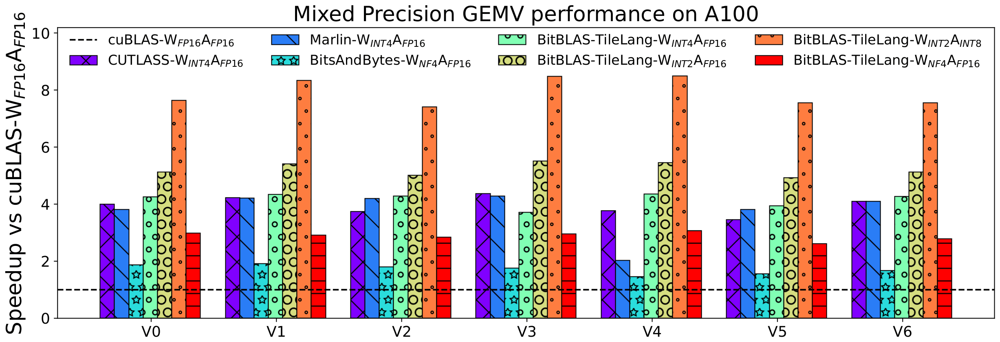

*图 15（原文 Figure 15，第 17 页）：A100 GPU 上反量化矩阵乘的性能（图标题写作 Mixed Precision GEMV performance on A100）。*

**图中文字翻译与读法**：纵轴 Speedup vs cuBLAS-$W_{FP16}A_{FP16}$（相对 cuBLAS FP16 的加速，虚线为 1.0）；横轴 V0–V6；每组 7 根柱，依次是 CUTLASS-$W_{INT4}A_{FP16}$、Marlin-$W_{INT4}A_{FP16}$、BitsAndBytes-$W_{NF4}A_{FP16}$、BitBLAS-TileLang-$W_{INT4}A_{FP16}$、BitBLAS-TileLang-$W_{INT2}A_{FP16}$、BitBLAS-TileLang-$W_{INT2}A_{INT8}$、BitBLAS-TileLang-$W_{NF4}A_{FP16}$。（$W$ 表示权重的数据类型，$A$ 表示激活的数据类型。）

下表为从图中矢量数据量出的加速（约值）：

| 形状 | CUTLASS INT4 | Marlin INT4 | BitsAndBytes NF4 | TileLang INT4×FP16 | TileLang INT2×FP16 | TileLang INT2×INT8 | TileLang NF4×FP16 |
|---|---:|---:|---:|---:|---:|---:|---:|
| V0 | 4.00 | 3.82 | 1.87 | 4.25 | 5.13 | 7.63 | 2.98 |
| V1 | 4.23 | 4.22 | 1.91 | 4.33 | 5.41 | 8.33 | 2.91 |
| V2 | 3.74 | 4.20 | 1.80 | 4.28 | 5.01 | 7.41 | 2.84 |
| V3 | 4.38 | 4.28 | 1.76 | 3.71 | 5.52 | 8.48 | 2.95 |
| V4 | 3.77 | 2.03 | 1.46 | 4.35 | 5.45 | 8.49 | 3.07 |
| V5 | 3.46 | 3.81 | 1.56 | 3.94 | 4.92 | 7.55 | 2.61 |
| V6 | 4.10 | 4.09 | 1.67 | 4.26 | 5.12 | 7.56 | 2.79 |

**原文文字结论（5.2）**：相对 cuBLAS-$W_{FP16}A_{FP16}$，TileLang 最高加速 7.65×，来自 BitBLAS-TileLang-$W_{INT2}A_{INT8}$ 配置；对 $W_{INT4}A_{FP16}$ 格式，平均比 Marlin 快 1.04×；对 $W_{NF4}A_{FP16}$ 格式，平均比 BitsandBytes 快 1.62×。原文认为，TileLang 之所以能做得更好，是因为它暴露了线程级编程接口，并允许控制数据布局和流水线配置，例如开发者可以使用基于 PTX 的快速数值精度转换指令，并利用 Ladder（该团队此前的低比特张量变换工作）获得更平滑的 tile 内内存访问；这些优化在 Triton 里很难实现。

**读图结论与核对**：

- 低比特带来的主要收益是显存带宽：权重位宽越小，相对 FP16 的加速越大（INT2×INT8 约 7.4–8.5×，INT2×FP16 约 4.9–5.5×，INT4×FP16 约 3.7–4.4×，NF4×FP16 约 2.6–3.1×）；这是由权重位宽决定的，不能全部归功于 TileLang。
- 相对同为 INT4×FP16 的手写库：TileLang÷Marlin 逐形状约 1.11、1.03、1.02、0.87、2.15、1.04、1.04（中位数约 1.04，算术平均约 1.18，V4 是 Marlin 偏低的离群点）；TileLang÷CUTLASS 在 V3 上不到 1。
- TileLang NF4÷BitsandBytes 逐形状约 1.52–2.10，算术平均约 1.69，原文为 1.62×。
- 本文核对：图上最高的柱约 8.5（V3、V4 的 INT2×INT8），原文写的“最高 7.65×”只与 V0 的约 7.63 接近；图只画了 V0–V6，而表 2 有 V0–V7 共 8 个形状；图标题写 GEMV，正文写 Dequantize Matmul，表 2 里 $m=1$，即 GEMV。

## 七、附录里的三个 kernel 实现（图 16–18）

这三段代码是理解 TileLang 写法的最好材料，原文放在附录 B。

### 7.1 矩阵乘（图 16）

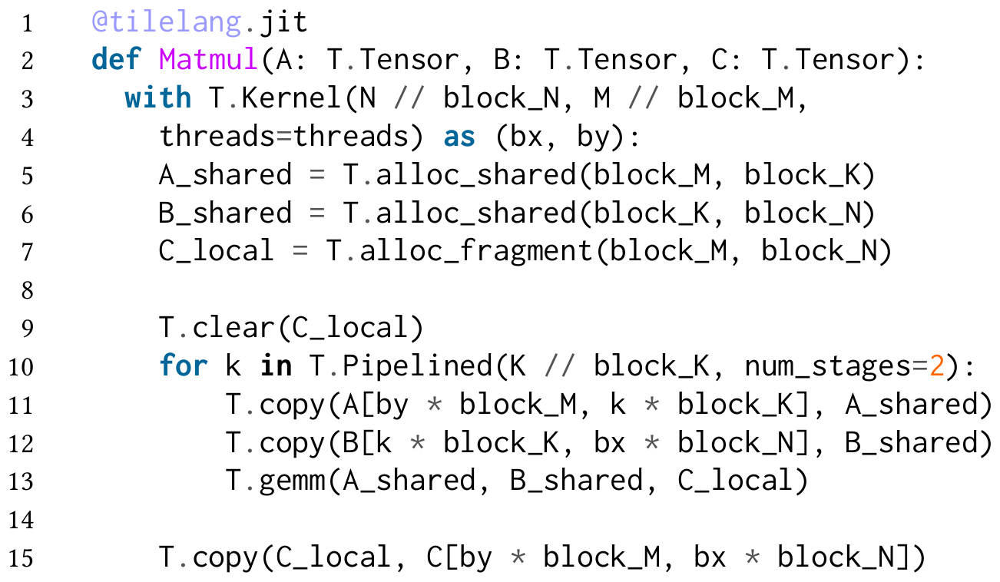

*图 16（原文 Figure 16，第 20 页）：矩阵乘的 kernel 实现。*

这是图 1(a) 的紧凑版本：`@tilelang.jit` 装饰器让函数在第一次调用时编译；`T.Kernel(N // block_N, M // block_M, threads=threads) as (bx, by)` 建网格；第 5–7 行分配两个共享内存 tile 与一个寄存器 fragment；第 9 行清零；第 10–13 行 `T.Pipelined(K // block_K, num_stages=2)` 里两次 `T.copy` 加一次 `T.gemm`；第 15 行写回。与图 1(a) 相比，主要区别是 `num_stages=2`（双缓冲）和用 `@tilelang.jit` 代替手写的 `tilelang.compile` 调用。

### 7.2 反量化矩阵乘（图 17）

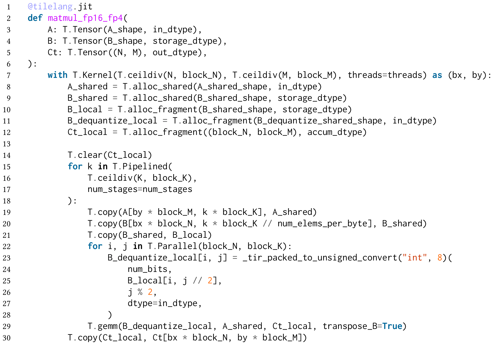

*图 17（原文 Figure 17，第 20 页）：用 TileLang 实现的仅权重量化（$W_{FP4\_E2M1}A_{FP16}$）矩阵乘，展示以简单形式支持混合精度计算。*

逐行读法：

- 第 1–6 行：`matmul_fp16_fp4(A, B, Ct)`：`A` 是 FP16 激活（`in_dtype`），`B` 是打包后的权重（`storage_dtype`，一个字节装多个 4 位权重），`Ct` 是输出的转置 $(N,M)$；
- 第 8–12 行：共享内存里放 `A_shared`、`B_shared`（打包的权重 tile），寄存器 fragment 里放 `B_local`（打包形式）、`B_dequantize_local`（解包后的 FP16）、`Ct_local`（累加器）；
- 第 15–18 行：`T.Pipelined(T.ceildiv(K, block_K), num_stages=num_stages)`；
- 第 19–21 行：把 A 块拷进共享内存；把打包的 B 块拷进共享内存（K 方向偏移除以 `num_elems_per_byte`，因为一个字节装多个元素）；再从共享内存拷进寄存器 `B_local`；
- 第 22–28 行：`for i, j in T.Parallel(block_N, block_K)` 并行**解包**：`B_dequantize_local[i, j] = _tir_packed_to_unsigned_convert("int", 8)(num_bits, B_local[i, j // 2], j % 2, dtype=in_dtype)`，即取第 `j // 2` 个字节里的第 `j % 2` 个 4 位域，转成 FP16（原文没有解释这个函数如何把 E2M1 比特解释为浮点数）；
- 第 29–30 行：`T.gemm(B_dequantize_local, A_shared, Ct_local, transpose_B=True)` 用解包后的权重做矩阵乘，最后把结果写到 `Ct`。

要点：反量化这一步直接写成 `T.Parallel` 的逐元素循环，夹在拷贝与 `gemm` 之间；它能自动并行化，并与流水线、布局推断共存。这正是第 2 节所说“Triton 里需要内联汇编和自定义布局”的场景，在 TileLang 里写成了一个 `T.Parallel` 循环加一次转换函数调用。

### 7.3 FlashMLA（图 18）

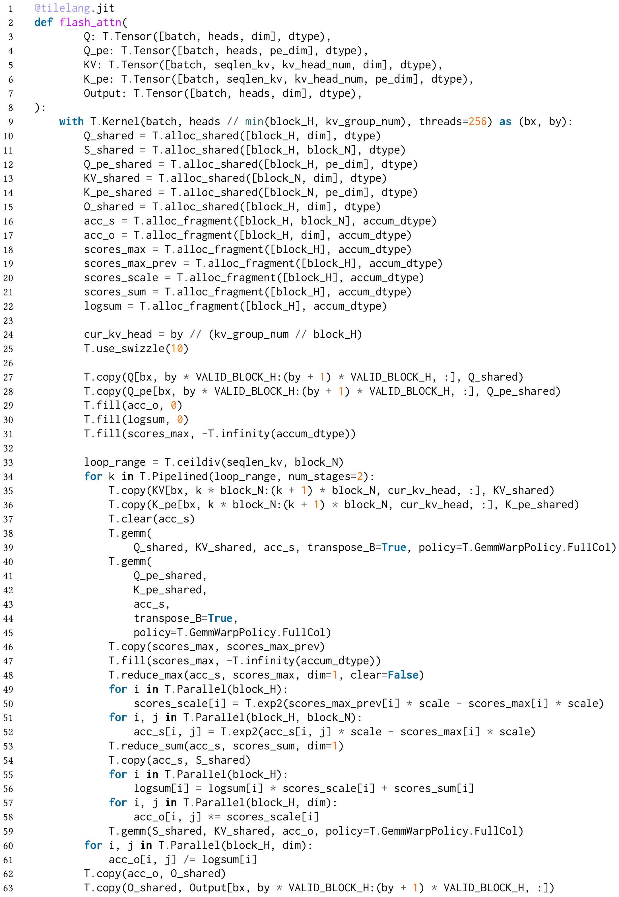

*图 18（原文 Figure 18，第 21 页）：用 TileLang 实现的 FlashMLA。*

背景（本文补充，非原文内容）：MLA（Multi-head Latent Attention，多头潜在注意力）是 DeepSeek-V2 提出的注意力（见 [DeepSeek-V2 中文解读](../deepseek_v2/论文中文解读.md)），KV 缓存里存的是压缩的潜在向量 `KV` 与单独的旋转位置编码键 `K_pe`；解码时每个请求只有一个查询 token，所以 `Q` 的形状是 `[batch, heads, dim]`，没有序列维。

逐段读法：

- 第 1–8 行：函数签名。`Q`、`Q_pe` 是查询的内容部分与位置编码部分；`KV`、`K_pe` 是缓存；`Output` 是输出；
- 第 9 行：`T.Kernel(batch, heads // min(block_H, kv_group_num), threads=256) as (bx, by)`：网格的第一维是 batch，第二维按 head 分块，每块 256 个线程；
- 第 10–22 行：分配共享内存 tile（`Q_shared`、`S_shared`、`Q_pe_shared`、`KV_shared`、`K_pe_shared`、`O_shared`）和寄存器 fragment（`acc_s`、`acc_o` 与在线 softmax 需要的 `scores_max`、`scores_max_prev`、`scores_scale`、`scores_sum`、`logsum`）；
- 第 24–25 行：`cur_kv_head` 由 `by` 算出；`T.use_swizzle(10)` 启用线程块 swizzle 提高 L2 命中；
- 第 27–31 行：把 `Q`、`Q_pe` 的块拷进共享内存，初始化 `acc_o`、`logsum` 为 0，`scores_max` 为负无穷；
- 第 33–34 行：沿 KV 序列方向的流水线循环，`num_stages=2`；
- 第 35–45 行：拷贝一块 `KV` 与 `K_pe`，清零 `acc_s`，做**两次** `T.gemm` 累加到同一个 `acc_s`：$Q\cdot KV^\top+Q_{pe}\cdot K_{pe}^\top$（`policy=T.GemmWarpPolicy.FullCol` 指定 warp 在输出上的划分策略）；
- 第 46–59 行：在线 softmax：保存上一块的最大值，把 `scores_max` 重置为负无穷后对当前块按行求最大；`scores_scale = exp2(旧最大 × scale − 新最大 × scale)` 用来重缩放旧的累加量；`acc_s = exp2(acc_s × scale − 新最大 × scale)`；按行求和得 `scores_sum`；把 `acc_s` 拷到 `S_shared`；更新 `logsum = logsum × scores_scale + scores_sum`；把 `acc_o` 乘以 `scores_scale`；最后 `T.gemm(S_shared, KV_shared, acc_o)`，也就是用 `KV` 同时充当值（MLA 里潜在向量既生成键也生成值，本文补充）；
- 第 60–63 行：循环结束后 `acc_o /= logsum` 归一化，经共享内存写回 `Output`。

读码提示（本文补充）：这里每一轮把 `scores_max` 重置为 $-\infty$ 再取当前块的最大值，用“上一块最大值到当前块最大值”的比例重缩放旧的累加量，数学上与 FlashAttention 的在线 softmax 等价（见 [FlashAttention 中文解读](../flash_attention/论文中文解读.md)），但与保存跨块运行最大值的写法不同。清单里的 `scale`、`block_H`、`VALID_BLOCK_H` 等常量在附录里没有给出定义。

这段 63 行的代码就是图 14 里“约 70 行”（原文文字）实现的主体：它显式写出了 softmax 与双 GEMM 的数据流，而线程绑定、共享内存布局、`cp.async` 或 TMA、warp 特化都由编译器生成。

## 八、局限、证据边界与常见误读

**论文自己的讨论（第 6 节）**：

- 与 ThunderKittens 相比，TileLang 简化了编程：可以完全用 Python 写，并默认抽象流水线等优化细节，例如 FlashAttention 实现里，TileLang 在 Ampere 上自动用异步拷贝搬数据，在 Hopper 上把流水线降成 TMA；同时仍保留用户在前端显式实现流水线的选项。
- TileLang 对动态参数、动态形状等高级特性有较强的支持，适合写 kernel 库。
- **未来工作**：（1）建立一个基于 TileLang 的自托管 tile 库，消除对 CUTLASS 和手工包装的 CUDA/HIP 代码的依赖；（2）通过引入 tile 级通信原语和调度策略，扩展到分布式场景；（3）为 TileLang 设计代价模型（因为线程映射、访存和计算行为都被显式暴露，有利于分析和建模）；（4）探索动态形状调优，为维度动态变化的程序选择合适的 tile 配置；（5）把显式的存储层次设计推广到 CPU、NPU 等后端。

**本文列出的证据边界**：

1. **没有交代调优与配置**：各 kernel 的 tile 大小、`num_stages`、线程数是人工选定还是自动搜索，原文没有说；Triton 与各库基线是否同样调优也没有说。
2. **基线与版本信息不足**：Triton、PyTorch、FlashAttention-3、cuBLAS、AITER 的版本和配置缺失；H100 用 CUDA 12.4，而编译时间分析用的是 NVCC 12.8，A100、RTX 4090 的软件版本没写。
3. **性能图不标数值**：图 12–15 全靠读图，正文数字与图读数有多处对不上（见第九节）。
4. **GEMM 的“持平”部分来自库模板**：`T.gemm` 默认调用 CUTLASS 或 composable kernel（5.4 节）；论文没有把“TileLang 自己生成的指令序列”与“调用库模板”两条路径分开比较。
5. **以精选 kernel 为证据**：FlashAttention、Mamba-2、MLA、GEMM、反量化 GEMM 都是作者选定的形状；没有端到端模型的结果，也没有覆盖形状范围外的泛化测试。
6. **编译成本只有一个数字**：只给出模板展开占编译时间约 90%，没有给出各 kernel 的编译耗时或调优耗时。
7. **“自动”不等于“零知识”**：用户仍要选 tile 大小、缓冲位置，理解 fragment 与共享内存的区别；想超过自动推断的结果时还要懂 swizzle、PTX 和流水线。

**常见误读**：

- “TileLang 能把任意 Python 自动变成峰值 kernel”：不是。示例里 tile 形状、流水线级数、缓冲位置仍由专家给出。
- “TileLang 消灭了硬件知识”：它把硬件知识提升到较可组合的 tile 层，并让专家可以逐项覆盖，而不是消除。
- “所有倍数都说明 TileLang 比库好”：图 14 的“上千倍”是相对朴素 Torch；与手写专家库比较时是 98%、95%、1.0 附近。
- “反量化 GEMM 的 7 倍加速来自 TileLang”：主要来自低比特权重减少的显存读取，TileLang 的贡献体现在与同类低比特库（Marlin、BitsandBytes）的比较上。

## 九、论文内部的不一致（本文核对发现）

以下均为本文对照 PDF 逐项核对后发现，原文没有解释，引用时需谨慎：

| 位置 | 不一致 |
|---|---|
| 第 2、3 节正文 | 第 2 节把图 1 写成 “Figure 11(a)(b)(c)”；3.1 节开头把图 3 写成 “Figure 11”；3.1 节末尾的 “as demonstrated in 8” 是悬空引用 |
| 图 1(b) | `thread_binding` 的范围写成 128，而 (a) 的网格是 $8\times8$；`C_local` 在 IR 里是 `float16`、在 CUDA 里是 `float` |
| 图 4 | Parallel 例子中源码是 `*=`，降低后写成 `+=` |
| 图 5(c) | 布局函数第二分量 `% 32` 与推出形状 `(128, 40)` 不符；`A_shared[i, k * 32]` 的 `k * 32` 无意义 |
| 图 6 | (b) 的 `repeat({warp_m/16, block_k/16})` 在 `block_k=32` 时是 `{2, 2}`，与 (c) 的 `repeat([2, 1])` 和“32×16”注释不符；(c) 右图实际显示的是线程复制后的 block 布局 |
| 图 7 与正文 | 正文称 $C$ 分布在 8 个线程、每线程 2 个元素，图是 4 个线程、每线程 4 个元素 |
| 5.1 节 | 实验平台只列 H100、A100、MI300X，图 13 还有 RTX 4090；文字称 MI300X 测 MHA，图 14(b) 是 MLA |
| 5.2 节 | 文字写 FlashAttention 对比长序列“例如 8k”，表 3 最长序列 4096 |
| 线性注意力 | 文字平均加速 1.77×、2.10×，图中 5 个形状的平均约 1.63–1.65、1.99–2.02；表 4 有 CC5、CT5，图中没有 |
| GEMM | 文字对厂商库 H100 为 1.00×、MI300X 为 1.04×，图读数约 1.05 与 1.12–1.15 |
| 反量化 GEMM | 文字最高 7.65×，图中最高约 8.5×；图只画 V0–V6，表 2 有 V0–V7；图标题写 GEMV，正文称 Matmul |
| 图 11 与图 1(c) | `num_stage=1` 的含义不一致（图 11 有拷贝与计算重叠，图 1(c) 的代码没有） |

这些问题不影响论文的整体思路，但提示图 12–15 的头条倍数应以“约”引用，而不是逐位当作精确结论。

## 十、复现检查清单

- 保存完整配置：`block_M/N/K`、`num_stages`、`threads`、使用的 `T.gemm` 实现（CUTLASS 或自写）、布局注解、target 与 GPU 型号；
- 固定软件版本：CUDA（H100 为 12.4）、ROCm（MI300X 为 6.1.0）、TileLang、Triton、PyTorch、FlashAttention-3、cuBLAS 的版本；
- 与基线统一数据类型、causal 设置、输入布局、是否包含 epilogue，并分别报告 warmup、计时次数与同步方式；
- 复现图 12–15 时按表 2–4 的形状逐一测，并同时给出绝对延迟，而不只是比值；
- 对非整除边界、动态形状和极端数值做测试；
- 用 profiler 检查 bank conflict、warp 停顿、占用率与异步重叠，验证“swizzle 保证无冲突”和“流水线确有重叠”；
- 对比 tile 库路径与自实现指令路径的性能与编译时间，分离“TileLang 带来的”与“库模板带来的”部分。

## 十一、与相关论文的关系

- **Triton**（[Triton 中文解读](../triton_compiler/论文中文解读.md)）：同样是 tile 级 DSL，但把线程、布局、地址空间交给编译器；TileLang 保留相近的简洁度，同时把这些显式化为可选的注解（见本文 2.3 节）。
- **Hidet**（[Hidet 中文解读](../hidet/论文中文解读.md)）：用 task mapping 把任务到 worker 的分配与次序写进程序；TileLang 的 `T.Parallel` 与布局推断解决的是同类问题，只是 TileLang 更面向 tile 与 fragment。
- **CuTe 的 layout 代数**（[CuTe Layout 代数中文解读](../cute_layout_algebra/论文中文解读.md)）与 **Linear Layouts**（[Linear Layouts 中文解读](../linear_layouts/论文中文解读.md)）：这两篇是对“布局”的数学化；TileLang 的 `Layout`（`iter_vars` 加 `forward_index`）与 `Fragment`（线程与线程内编号）则是更偏工程的布局表示（本文评价），它的 `T.gemm` 默认直接调用 CuTe。
- **TensorIR、Roller**（[TensorIR 中文解读](../tensorir/论文中文解读.md)、[Roller 中文解读](../roller/论文中文解读.md)）：同一研究脉络（TileLang 的 IR 复用 TVM；原文引用了 Roller 与 Ladder），可对照“tile 在编译器里是怎样一步步变成一等公民的”。
- **FlashAttention 系列**（[FlashAttention-3 中文解读](../flash_attention_3/论文中文解读.md)）：图 12 的主要基线，也是 TileLang 要证明自己能表达的复杂流水线。
- **CuTe DSL 与 TorchInductor**（[CuTeDSL 与 TorchInductor 中文解读](../cutedsl_torchinductor/论文中文解读.md)）：同一时期的另一条 tile 级 DSL 路线。
- 整体脉络见 [AI 编译器与运行时演进索引](../AI编译器与运行时演进索引.md) 与 [GPU 内核融合与大模型推理论文阅读索引](../GPU内核融合与大模型推理论文阅读索引.md)。

## 原文证据导航

- [原论文 PDF](paper.pdf)（官方页面：[arXiv:2504.17577](https://arxiv.org/abs/2504.17577)）
- [原文提取文本](paper.txt)
- [论文概要](论文概要.md)
