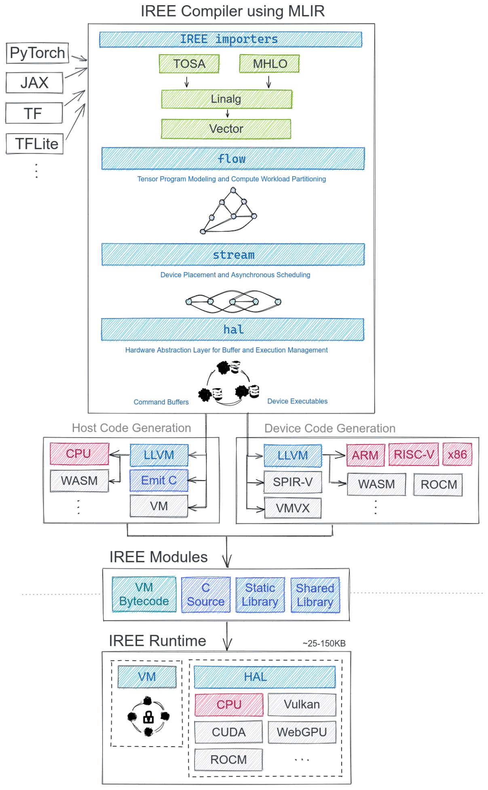
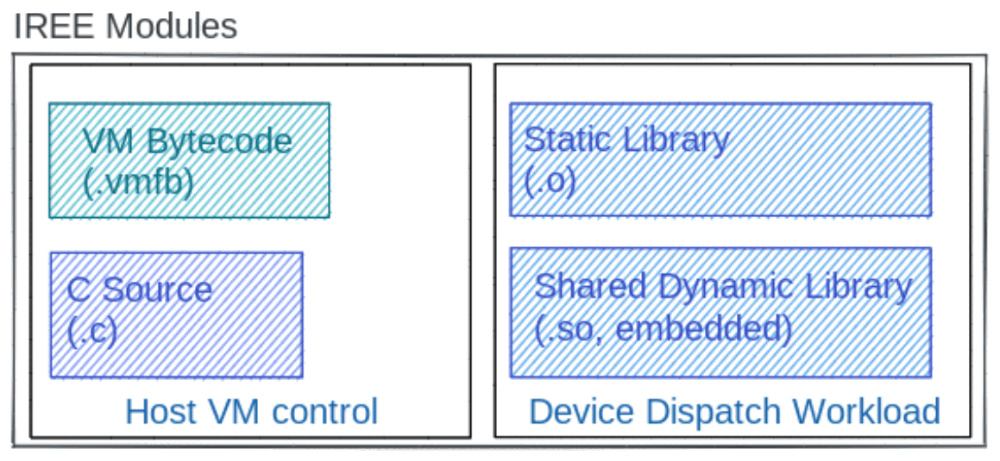
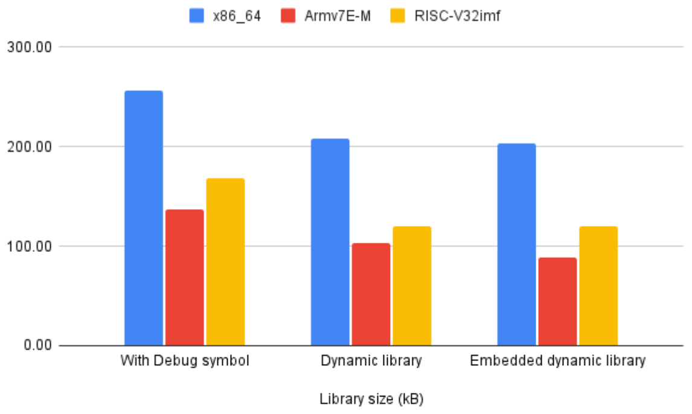

# 论文中文解读：《TinyIREE: An ML Execution Environment for Embedded Systems from Compilation to Deployment》

> **基本信息**：Hsin-I Cindy Liu、Marius Brehler（Fraunhofer IML，德国多特蒙德）、Mahesh Ravishankar、Nicolas Vasilache、Ben Vanik、Stella Laurenzo（除 Brehler 外均在 Google），发表于 IEEE Micro，2022 年 7/8 月刊；arXiv:2205.14479v1 [cs.PL]，2022 年 5 月 28 日；论文原文 [官方页面](https://arxiv.org/abs/2205.14479)。源码见 github.com/google/iree 与 github.com/iml130/iree-bare-metal-arm，样例见 github.com/google/iree-samples。
>
> **本文的读法**：这是一篇 9 页的 IEEE Micro 文章，没有性能（延迟、吞吐、功耗）实验，实验部分只给出**产物大小**和**运行时内存**两类数字。图 1 至图 3 取自 `paper.pdf` 的原图，每张图后有中文图题、图中文字翻译和读图结论；表 1、表 2 为逐格核对后的中文转录；三段代码清单（Listing 1 至 3）用代码块转录并加中文解释。页码均指 `paper.pdf` 的页码。标注“（补充）”的内容不在原文里，是帮助读懂的背景知识或笔者的核对。

## 一、一句话结论

IREE（Intermediate Representation Execution Environment）是一套**统一的编译器加运行时**：它基于 MLIR，把机器学习模型当作“又一个程序”，经过多层 dialect（TOSA 或 MHLO，到 Linalg，到 Vector，到 LLVM）逐步降低成目标硬件的可执行代码，同时生成控制主机端执行顺序和缓冲区的 VM 命令。设计目标是既能**缩小**到手机、边缘设备和无操作系统的 bare-metal 平台的最小体量，又保留向大规模部署**放大**的能力。TinyIREE 是 IREE 里面向嵌入式的**一组部署选项**：用 EmitC 把 VM 命令变成 C 代码以去掉字节码解释器，把计算负载编译成静态库或“嵌入式友好”的动态库，用同步调度器代替线程化的异步调度器，并通过 LLVM 的 target 参数切换 CPU 架构、ABI 和 ISA 扩展。论文唯一的实验是编译 MobileNet SSD V2（面向 Armv7E-M 时参数是量化的）：在 Armv7E-M 目标上，嵌入式动态库模式的设备端 workload 约 88.84 kB（x86_64 上约 203.80 kB）；与 TFLite 解释器相比，运行时库只有 96.31 kB（对 2,971.06 kB），峰值内存 5.93 MB（对 20.05 MB）。

## 二、背景与动机

### 2.1 嵌入式部署被边缘化

机器学习近十年受到大量关注，新的、更深的模型结构和更大的数据集不断出现，对硬件的要求也在增长，催生了加速模型训练和执行（推理）的新处理器架构。要充分利用这些加速硬件，开发工具链需要新的部署与编译流程；在手机和边缘设备上部署模型，还要特别考虑系统资源和功耗的约束。

作者的判断是：业界很大一部分投入都面向**向上扩展**到最强大的部署目标的用例，而低功耗和嵌入式设备被很差地照顾了。IREE 就是为了纠正这种失衡而设计的：设计一个统一的编译器与运行时栈，明确目标是**缩小到最小的体量**，同时保留放大到更大部署的能力（并能与更高层的分布式运行时集成）。这种对模型可移植性的关注，使 IREE 能有效地面向 bare-metal 或嵌入式 CPU 和微控制器；论文就是讲这种可移植性是怎样实现的。

### 2.2 此前的三类做法

| 做法 | 论文的描述 |
|---|---|
| **TensorFlow Lite for Microcontrollers（TFLM）** | 公共的、面向微控制器的 ML 推理框架一直主要靠**逐算子（op-by-op）的、基于 kernel 的运行时**，针对一小批常用算子手工适配和优化。TFLM 是专为在微控制器上执行模型设计的框架，用一个小运行时库（在 Arm Cortex-M3 上约 **16 kB**），支持 TensorFlow 算子的一个子集，带有面向硬件的高层算子 kernel 实现。其图优化仍沿用 TensorFlow Lite 的编译流程，在算子层面做优化 |
| **Glow** | 编译器路线，用两阶段 IR 降低神经网络图：高层 IR 做领域专用优化，低层 IR 做与内存相关的优化，包括指令调度、静态内存分配和拷贝消除（见 [Glow 解读](../glow_compiler/论文中文解读.md)） |
| **Apache TVM** | 在多种 IR 里做高层图重构和低层算子优化。TVM 虽然面向 CPU、GPU、DSP 等多种设备后端，但对 bare-metal 微控制器还需要 MicroTVM 扩展来支持模型执行调度和内存管理，以弥补没有操作系统的缺陷（见 [TVM 解读](../tvm_compiler/论文中文解读.md)） |

### 2.3 IREE 的做法

IREE 是基于 MLIR 编译器基础设施的端到端编译器与运行时框架。它采用**编译器路线**：把 ML 模型转成一种中间表示，既能对模型做分析与优化，又能为异构硬件加速器生成代码。IREE 把 ML 模型“只当作另一个程序”，用各种 MLIR dialect 表示它，最终生成能在目标架构上运行的二进制。**dialect** 可以粗略地理解为 IR 的一个逻辑层次。

论文认为这种通过一串可组合 IR 的**多阶段编译**是关键的区别点，因为它让人们更有效地重新定向（retarget）并推广那些用于大规模目标的做法和组件，去面向专门化的、深度嵌入式的用途；这种推广在经典的、基于 emitter 的两阶段编译器里难得多，在 TFLM 这类执行器里则根本不可能。

IREE 面向各种边缘设备和加速器，包括 CPU、GPU 和各类 ML 加速器，因此**小的二进制体积、与应用的互操作性和可移植性**都是一等关心的问题。本文聚焦 **TinyIREE**：IREE 选项里的一个子集，它能生成紧凑的 workload 和运行时库，针对没有操作系统的嵌入式系统做了优化；这些选项能无缝支持不同的 CPU 架构和 ISA 扩展，同时还提供接口来支持嵌入式的 ML 加速器。

## 三、IREE 的整体流程（图 1）



*图 1（原文 Figure 1，第 3 页）：IREE 的简化端到端流程图。*

**图中文字翻译与读法**：论文说明，图中 TinyIREE 的选项是**带颜色**的，通用的 IREE 编译与部署选项是**灰色**的。图自上而下是三个大块。

- **上：IREE Compiler using MLIR（使用 MLIR 的 IREE 编译器）**。左侧是输入的框架：PyTorch、JAX、TF、TFLite 等（竖点表示还有更多），箭头指向编译器框。框内自上而下：
  - **IREE importers（IREE 导入器）**：把模型导入成 MLIR。下面是绿色的 dialect：**TOSA** 与 **MHLO**（二者箭头都指向 Linalg）→ **Linalg** → **Vector**。
  - **flow**（蓝色斜线条）：旁注 Tensor Program Modeling and Compute Workload Partitioning（张量程序建模与计算负载划分），配一张计算 DAG 的小图。
  - **stream**：Device Placement and Asynchronous Scheduling（设备放置与异步调度）。
  - **hal**：Hardware Abstraction Layer for Buffer and Execution Management（面向缓冲区与执行管理的硬件抽象层），配图里有 Command Buffers（命令缓冲区）和 Device Executables（设备可执行体）两个标签。
- **中：代码生成与模块**。
  - **Host Code Generation（主机端代码生成）**：LLVM（蓝）、Emit C（蓝）、VM（灰）三条路径，目标是 CPU（粉）、WASM（灰）等。
  - **Device Code Generation（设备端代码生成）**：LLVM（蓝）指向 ARM、RISC-V、x86（粉，即 CPU 目标）；还有 SPIR-V、VMVX、WASM、ROCM（灰）等。
  - **IREE Modules（IREE 模块）**：VM Bytecode（VM 字节码）、C Source（C 源码）、Static Library（静态库）、Shared Library（共享库）四种形态。
- **下：IREE Runtime（IREE 运行时），右上角标注 “~25-150KB”（约 25 至 150 KB）**。左边是 VM（附一个带锁的小图标，可能对应后文的缓冲区权限控制，图里没有说明）；右边是 HAL，其下 CPU（粉）为 TinyIREE 用到的后端，Vulkan、CUDA、WebGPU、ROCM 等（灰）是通用 IREE 的后端。
- **读图结论**：同一个编译流程（上）可以输出多种模块形态（中）去匹配不同的运行时（下）；TinyIREE 走的是“CPU 目标、LLVM 或 EmitC、静态库或嵌入式动态库、小运行时”这条带颜色的路径。正文只讲了 TOSA/MHLO、Linalg、Vector、LLVM 四个 dialect，以及 dispatch region 与 VM 命令；`flow`、`stream`、`hal` 三层在正文里没有展开，只在这张图里给出一句话说明。

## 四、IREE 的编译流程（原文 IREE Compilation Flow）

IREE 的编译流程沿用 MLIR 的做法：把一个 ML 程序**渐进式降低**（progressive lowering）成面向目标硬件的可执行体。MLIR 实现它的主要手段是 **dialect**：一个 dialect 是一组 operation 以及相关类型的集合，可以用来表示一个程序；不同的 dialect 可以用来在不同抽象层次上给程序建模（MLIR 本身见 [MLIR 解读](../mlir/论文中文解读.md)）。

下表概括论文提到的各个 dialect，以及在每一层上能做的事：

| dialect | 作用（原文） | 能做的优化 |
|---|---|---|
| TOSA（Tensor Operator Set Architecture）/ MHLO（Meta High Level Optimizer） | 在**张量算子**层面给 ML 程序建模，有 add、convolution、dot product 这样的算子 | 可以识别 1×1 的 2D 卷积并转成矩阵乘，后者能更高效地执行 |
| Linalg | 以简洁、易操作的方式表示**完美嵌套循环**计算 | 融合（fusion）、分块（tiling）、循环交换（loop interchange）等 |
| Vector | 用对虚拟向量的操作给程序部分建模，即目标硬件上高层的、可重定向的向量指令 | 让生成的代码使用高效的向量读写，以及目标上特殊的固定功能单元（fixed function units），例如 Arm 的 sdot 指令 |
| LLVM | **叶子 dialect**，使 MLIR 程序能被翻译成 LLVM IR，再编译成可执行二进制 | 由 LLVM 完成 |

因为这些 dialect 都用同一套基础设施定义，在每一层都可以使用通用的编译器优化，例如公共子表达式消除（CSE）和死代码消除（DCE）；也可以在每个 dialect 内部做自定义优化，利用该 dialect 里 operation 所携带的语义信息。从较高层的表示（如 TOSA/MHLO）经中间 dialect 转成可执行二进制，每一步用的 dialect 更通用、更不专门，这个过程就叫渐进式降低。

### 4.1 前端 dialect：TOSA 与 MHLO（Listing 1）

TOSA 和 MHLO 这类前端 dialect 用 add、convolution、dot product 这样的操作表示程序。Listing 1 是 TOSA dialect 里“点积加偏置加法”的一个简单序列：

```text
%2 = "tosa.matmul"(%0, %1) : ( tensor<?x8xf32>, tensor<8x?xf32> ) -> tensor<?x?xf32>
%3 = "tosa.add"(%2, %3) : ( tensor<?x?xf32>, tensor<?x?xf32> ) -> tensor<?x?xf32>
```

（原文把 `->` 排成了箭头 `→`，这里还原成 MLIR 的写法。）

怎么读：第一行是矩阵乘，两个操作数 `%0`、`%1` 的类型是 `tensor<?x8xf32>` 与 `tensor<8x?xf32>`，结果是 `tensor<?x?xf32>`；第二行是逐元素加，把矩阵乘的结果 `%2` 与另一个张量相加，得到同类型的结果。论文特别提醒：MLIR 内建类型 `tensor` 用 `?` 表示**动态维度**（编译期不知道大小的维度），所以 **MLIR 对动态形状的计算有一等支持**。（补充：原文清单第二行写成 `"tosa.add"(%2, %3)`，而这一行定义的正是 `%3`，等于自己用自己，应是原文笔误，偏置操作数应为另一个值，例如 `%4`。）

### 4.2 降低到 Linalg：迭代空间、数据空间与融合（Listing 2）

接着程序被降低到 Linalg dialect。这一层上，操作被表示成**完美嵌套的循环计算**，最内层循环体执行一次标量操作。这种表示便于做循环融合、分块和循环交换等传统循环变换。这种建模受**多面体编译**领域启发：计算被表示在一个正交空间里，每个循环对应一条坐标轴，这个空间叫计算的**迭代空间**（iteration space）；循环里归纳变量的取值表示成对应轴上的点；空间里每个点代表在最内层循环里执行的那一串标量操作。Listing 2 是 Linalg dialect 表示的 GEMM（形如 $D_{ij}=C_{ij}+A_{ik}\cdot B_{kj}$）：

```text
#map0 = affine_map<(i, j, k) -> (i, k)>
#map1 = affine_map<(i, j, k) -> (k, j)>
#map2 = affine_map<(i, j, k) -> (i, j)>
%3 = linalg.generic {
    iterator_types = ["parallel", "parallel", "reduction"],
    indexing_maps = [#map0, #map1, #map2]}
    ins(%0, %1 : tensor<?x?xf32>, tensor<?x?xf32>)
    outs(%2 : tensor<?x?xf32>) {
  ^bb0(%arg0 : f32, %arg1 : f32, %arg2 : f32):
    %0 = mulf %arg0, %arg1 : f32
    %1 = addf %arg1, %arg2 : f32
    linalg.yield %1 : f32
} -> tensor<?x?xf32>
```

逐项解释：

- **`iterator_types`**：循环的个数就是这个列表里条目的个数（这里 3 个循环 i、j、k）。循环迭代之间的数据依赖有两种：`parallel`（无依赖）或 `reduction`（归约型依赖）。GEMM 的 i、j 是并行的，k 是归约。
- **数据空间与 `indexing_maps`**：和迭代空间类似，每个操作数也用一个与它同维数的正交空间表示，叫该操作数的**数据空间**（data space）。例如 GEMM 的所有操作数都是二维数据空间。`indexing_maps` 里的映射刻画每个操作数的数据访问模式：每个映射的**定义域**表示迭代空间里的一个点，**值域**表示该映射所访问的操作数数据空间里的点。这里 `#map0` 从迭代点 (i, j, k) 取 A 的元素 (i, k)，`#map1` 取 B 的 (k, j)，`#map2` 取输出 C 的 (i, j)。
- **region**：花括号 `{` 与 `}` 之间的 operation 序列表示在迭代空间每个点上做的计算。每个 Linalg operation 有一个只含单个基本块的 region，块的参数是从操作数里经 indexing map 取出的标量值；`linalg.yield` 的值就是迭代空间该点的计算结果。例如 Listing 2 的每个点执行一次乘加。
- **注意（原文清单的笔误）**：清单里 `%1 = addf %arg1, %arg2` 把 B 的元素 `%arg1` 与累加器 `%arg2` 相加，没有用到上一行的乘积 `%0`；按正文所说“每个点做一次乘加”，应是把乘积加到累加器上，即 `addf %0, %arg2`。

**为什么融合要放在 Linalg 层做**：TOSA/MHLO 的所有张量操作都可以降低成 `linalg.generic`。两个有生产者-消费者关系的这类操作，只需要用 iterator types 和 indexing maps 里的信息，就能融合成另一个 `linalg.generic`。这种融合涵盖了所有**逐元素融合**优化（在 XLA 里也叫 loop fusion），并且**不需要推理每个操作实际做的计算**。如果在 TOSA/MHLO 这一层做同样的融合，融合的可能性会出现**组合爆炸**。可以这样融合的操作类别比纯逐元素操作更大，还包括排列（permutation）和广播（broadcast）。

**分块与 dispatch region**：Linalg 的操作也可以只用 iterator types 和 indexing maps 的信息来**分块**。这使每一层的计算被拆成相似计算的更小的块。例如一个 GEMM 可以分块成若干更小的 GEMM；这些小块可以并行计算，因此可以分给不同的线程。然后每个块所代表的计算被封装进一个 **dispatch region**，其中包含必须在设备上**原子地**执行的代码。到这里，每个计算被拆成两部分去执行：**dispatch region**（分块后的计算）和**执行主机端计算的代码**（**VM 命令**），后者规定 dispatch region 的执行顺序。dispatch region 里的代码还会继续用融合、循环交换等手段变换，以得到更好的缓存局部性和数据访问模式。

### 4.3 Vector 与 LLVM dialect，用参数切换目标

最后，代码被降低到 **Vector dialect**，它表示目标硬件上可用的高层、可重定向的向量指令。这个 dialect 里的变换使生成的代码能用到高效的向量读写和目标上特有的固定功能单元（fixed function units），例如 Arm 的 sdot 指令。

设备端编译的最后一步是降低到 **LLVM dialect**，它可以被机械地转换成 LLVM IR；LLVM 编译栈再为目标架构生成二进制代码。**LLVM 的 target 参数**用来选择使用哪种 CPU 架构、ABI 和 ISA 扩展。论文给了三个例子（原文排版用了类似减号的字符，这里还原成普通连字符）：

```text
# x86_64 CPU
--iree-llvm-target-triple=x86_64-pc-linux-elf

# 带乘法和浮点 ISA 扩展的 RISC-V 32 位 CPU
--iree-llvm-target-triple=riscv32-pc-linux-elf
--iree-llvm-target-cpu=generic-rv32
--iree-llvm-target-cpu-features=+m,+f
--iree-llvm-target-abi=ilp32

# Armv7E-M CPU
--iree-llvm-target-triple=armv7em-pc-linux-elf
--iree-llvm-target-float-abi=hard
```

（补充：`+m` 表示 RISC-V 的整数乘除扩展，`+f` 表示单精度浮点扩展，`ilp32` 是 32 位 RISC-V 的整数/长整数/指针都为 32 位的 ABI；`hard` 表示用硬件浮点调用约定。这些含义原文没有解释。）

以上优化流程也能很容易地用在**其他非 ML 专用的线性代数操作**上，只要这些操作是合适的格式。换言之，IREE 也能优化作为程序一部分的输入预处理和输出后处理操作：例如视觉 ML 程序常要对图像数据流做色彩空间转换或图像缩放，这些操作可以按同一编译流程融合进程序。

## 五、TinyIREE 的部署选项（原文 TinyIREE Deployment Options）

上面编译流程的输出是一个 **IREE 模块**（IREE module），它包含一段控制缓冲区设置的 **VM 命令**，和一组作为 workload 的 **dispatch region**；这些 workload 包住了可以派发到目标设备上的 ML 程序。面向嵌入式系统时（图 1 下部），用户需要构建一个 **IREE 运行时应用**：它包含 IREE 运行时库，用来配置 VM、负责 workload 的**加载器**和 workload 的**调度器**；后两者被定义为设备的**硬件抽象层（HAL）驱动**。

在编译出最终可执行体之前，还可以用不同的部署策略把 IREE 模块的结构进一步拆开（图 2）：IREE 提供一套灵活的工具，覆盖 CPU 上的各种部署场景，包括**静态与动态嵌入式库**，而 VM 控制部分可以用**字节码渲染器**或 **C 源码**实现。其中 VM 字节码以 FlatBuffer 格式存在文件里（`vmfb`），并可选地把设备端 workload 以共享动态库的格式嵌入进去。



*图 2（原文 Figure 2，第 6 页）：TinyIREE 的 IREE 可执行体部署选项。*

**图中文字翻译与读法**：外框是 IREE Modules（IREE 模块），里面分左右两个框。

- **左：Host VM control（主机端 VM 控制）**：VM Bytecode（VM 字节码，扩展名 `.vmfb`）或 C Source（C 源码，`.c`），二选一。
- **右：Device Dispatch Workload（设备端 dispatch 工作负载）**：Static Library（静态库，`.o`）或 Shared Dynamic Library（共享动态库，`.so`，embedded，即嵌入式友好的动态库）。
- **读图结论**：IREE 模块被拆成“主机端控制”和“设备端计算”两个互相独立的维度，各有两种形态，可以自由组合：例如“C 源码加静态库”能得到不带字节码解释器的最小体积，“字节码加动态库”则最灵活。

除了面向嵌入式 CPU 的这些部署路径，开发者还可以用现有的 HAL 接口与**定制的 ML 加速器**交互。此外，虽然 IREE 运行时可以支持动态部署，嵌入式系统甚至可以**完全绕过 IREE 运行时**，直接部署一个特定的 workload，以得到最高效的执行。

### 5.1 用 EmitC 做 VM 控制

VM 命令控制资源的所有权和执行流程，被编码成另一个 MLIR dialect：**VM dialect**。这些操作可以序列化成在运行时被解释的**字节码模块**；另一个选项是把它们序列化成 **C 源码**：先把 VM 操作转换成 **EmitC dialect**（一个能从 MLIR 生成 C/C++ 的 MLIR dialect），再经 Cpp emitter 翻译成 C。EmitC 里有一个表示 C 函数调用的 call 操作，这类操作被用来**直接调用 VM API**，而不是把调用序列化成等价的字节码表示。因此，**字节码解释器不会被链接进可执行体**，从而减小了体积。IREE 仓库里的 `static_library_demo_c` 样例展示了 EmitC 的用法。

### 5.2 把 ML workload 做成静态库或动态库

ML workload 可以放进静态库，也可以放进动态库。两种情形下，IREE 都用 LLVM 把程序编译成针对具体目标高度优化的指令流。

- **静态库**：可以与序列化后的 VM 字节码模块一起构成一个 IREE 模块；但要得到针对体积优化的二进制，应当把静态库与**翻译成 C 调用的 VM 操作**配合使用（即 5.1 的 EmitC）。
- **动态库**：提供更大的灵活性。例如可以为不同架构创建多个动态库，它们有相同的入口和出口，然后在**运行时**决定使用哪个动态库。由于嵌入式系统往往不提供动态库支持，IREE 采用一个**固定的动态库 ABI**，并把自己的、低开销的动态库加载器集成进运行时库。

### 5.3 HAL 驱动的调度器（Listing 3）

主机端 VM 把命令缓冲区设置好之后，由一个 workload 调度器负责派发缓冲区里设定的设备端 workload。受 GPU 调度器和计算 API 启发，IREE 用一个 **3D 网格拓扑**做 workload 调度，调度针对一个具体的 worker 结构，它含有数据缓冲区和调度信息（Listing 3）：

```c
for (int z = 0; z < worker.cnt.z; ++z) {
  for (int y = 0; y < worker.cnt.y; ++y) {
    for (int x = 0; x < worker.cnt.x; ++x) {
      vec3_t work_id = {{x, y, z}};
      int ret = dispatch_ptr(&st, &work_id);
    }
  }
}
```

怎么读：三层循环遍历三维网格 `(x, y, z)` 的每个格点，每个格点对应一块分块后的计算（类似 GPU 里的一个 workgroup，补充）；`dispatch_ptr` 是编译出的 dispatch region 入口，`work_id` 告诉它当前处理哪个格点，`st` 是状态。这恰好是 GPU 里网格（grid）与线程块（block）编号的 CPU 版本（补充），所以同一份 dispatch region 既能在 GPU 上并行启动，也能在没有操作系统的 CPU 上用三层循环串行执行。

两种调度器：

| 调度器 | 适用 | 特点 |
|---|---|---|
| **异步任务调度器** | 支持多线程的系统 | 把 workload 拆开，更高效地执行**有向无环图（DAG）**，允许乱序和流水线式执行，从而取得更好的并行度和对目标设备更好的利用 |
| **同步调度器** | 没有线程处理机制的嵌入式系统，或没有操作系统支持的 CPU | 按顺序逐个发出 workload，为派发 workload 提供一条直观的路径 |

### 5.4 流式执行（Stream execution）

IREE 运行时调度的工作，会连同**依赖信息**一起提供给底层系统调度器（无论是硬件命令处理器还是 CPU 线程池），依赖信息决定了工作提交的顺序。这提供了最后一层的即时（just-in-time）调度、负载均衡，以及在系统共享有限设备资源时的**安全抢占点**。

异步工作所需的内存，从一个**感知流式行为的内存池**里预留，只分配并发可执行的工作所需要的那么多内存。这使得可以向设备提交很深的工作流水线，而不会过度占用有限的内存资源。因为典型推理里使用的大部分内存要么是**常量**，要么是**瞬态**的（只在某一次调用内部有效），这个办法把已加载程序的**静态驻留内存**降到只有**几千字节**（论文原话是 “mere kilobytes”），另外还要加上常量所需的内存，而这些常量往往可以映射到可丢弃的内存。因此可以加载好几个程序（即便跨调用保留状态），再把它们安排成交错执行，同时**只占用任意单次调用所需的峰值内存**。

### 5.5 缓冲区分配与权限控制

IREE 运行时用设备提供的内存分配器来处理设备缓冲区的配置和准备，同时用系统分配器来处理主机端 VM 缓冲区。分配器可以**显式设置缓冲区在主机（VM）与设备之间的可见性**，同时用标准内存分配库保证合适的对齐。一块内存可以分配在一侧（主机或设备），同时对另一侧**有选择地可访问**。例如，ML 程序的输入缓冲区可以分配在主机上，以便用正确的输入值初始化，同时设置为对设备可见、带读权限，这样 workload 就能消费它的内容。这种**可见性与权限控制**，与支持 enclave 计算的系统相结合，可以提供一个**安全的 ML 执行环境**。

## 六、实验（原文 Results）

### 6.1 设置

论文用 IREE 的编译流程，并选择对 bare-metal 友好的配置来部署 ML 程序，以缩小 IREE 模块和 IREE 运行时库两种产物的体积。

| 项目 | 设置（原文） |
|---|---|
| 模型 | MobileNet SSD V2（目标检测模型）；面向 Armv7E-M（例如 Arm Cortex-M4）目标时，参数是量化的；附录说明样例里的是量化模型 |
| IREE 版本 | IREE snapshot 20211203.686 |
| 编译目标 | x86_64、Armv7E-M、RISC-V32imf（通过不同的 LLVM target 参数得到） |
| 编译模式 | **Debug-dylib**（带调试符号的动态库，默认）、**Dylib**（不带调试符号的动态库）、**Embedded**（嵌入式友好的动态库）、**Static**（静态库）；后两种是 **TinyIREE 模式** |
| 度量 | IREE 模块（打包成 FlatBuffer 文件）的大小，以及（嵌入在模块 FlatBuffer 里的）可执行 workload 的大小；运行时的峰值内存与主机端库的大小 |
| 对比对象 | x86_64 上的 TensorFlow Lite（TFLite）基准测试工具（TFLite 解释器库）；用动态嵌入式库模式加同步 HAL 驱动构建的 IREE 应用 |

### 6.2 产物大小（表 1 与图 3）

**表：MobileNet V2 SSD 模型编译到不同 CPU 架构目标时，IREE 模块的 FlatBuffer 大小与嵌入式设备可执行 workload 的大小（单位 kB）（原文表 1，第 8 页）**

| 目标与模式 | FlatBuffer 大小（kB） | Workload 大小（kB） |
|---|---:|---:|
| **x86_64** | | |
| Debug-dylib | 5,588 | 256.55 |
| Dylib | 5,525 | 208.35 |
| Embedded | 5,521 | 203.80 |
| Static | 5,317 | – |
| **Armv7E-M** | | |
| Debug-dylib | 5,468 | 136.55 |
| Dylib | 5,420 | 102.98 |
| Embedded | 5,406 | 88.84 |
| Static | 5,317 | – |
| **RISC-V32imf** | | |
| Debug-dylib | 5,500 | 168.42 |
| Dylib | 5,437 | 120.18 |
| Embedded | 5,437 | 120.18 |
| Static | 5,317 | – |

（原文表 1，第 8 页；“–”表示该模式下没有可单独报告的 workload 大小。）

论文的读法：workload 的大小随 LLVM 目标而变；特别是面向 Armv7E-M 这类嵌入式系统的目标，workload 小得多，这是 LLVM 对这类目标做了优化的结果（原文的解释）。



*图 3（原文 Figure 3，第 8 页）：IREE 流程为不同 CPU 架构、不同部署模式生成的 MobileNet SSD V2 模型的 workload 大小对比。*

**图中文字翻译与读法**：纵轴是 Library size (kB)（库大小，0 到 300）；横轴三组模式：With Debug symbol（带调试符号，即 Debug-dylib）、Dynamic library（动态库，即 Dylib）、Embedded dynamic library（嵌入式动态库，即 Embedded）；每组三根柱：蓝色 x86_64、红色 Armv7E-M、黄色 RISC-V32imf。柱高与表 1 的 Workload size 一致（笔者按图量取核对：x86_64 约 255、207、202，Armv7E-M 约 136、102、88，RISC-V32imf 约 167、119、119，均与表 1 相符）。**读图结论**：三个目标上，去掉调试符号再切到嵌入式动态库，workload 都在变小；Armv7E-M 在所有模式下最小，x86_64 最大。

论文还指出：静态库模式下，ML workload 成为一个可以在**链接期**优化的库，所以它的最终大小取决于用户应用如何集成这个 workload 库。例如，从“静态库”切换到“用 EmitC 的 VM 控制”时，字节码解释器可以被丢掉，在编译到 Armv7E-M 时能省下约 **15 kB**。

**笔者由表 1 的数字算出的派生量（原文没有给出）**：

| 目标 | Debug-dylib 到 Embedded 的 workload 缩减 | Embedded 的 workload 占 FlatBuffer 的比例 |
|---|---:|---:|
| x86_64 | 256.55 到 203.80，减少约 20.6% | 约 3.7% |
| Armv7E-M | 136.55 到 88.84，减少约 34.9% | 约 1.6% |
| RISC-V32imf | 168.42 到 120.18，减少约 28.6% | 约 2.2% |

另外，三个目标的 Static 行的 FlatBuffer 都是 5,317 kB，而其余模式的 FlatBuffer 大小约等于 5,317 kB 加上 workload 大小（Debug-dylib 一行还多出约 14 kB）。也就是说，**约 5.3 MB 的模块体积几乎全是与目标无关的部分**（应主要是模型常量与 VM 字节码，推断），设备端可执行代码只占其中几个百分点。这也提醒读者：表 1 里“workload 变小”的收益，在整体体积里占比不大，真正决定闪存占用的是权重。

### 6.3 运行时内存与运行时库大小（表 2）

**表：用 TFLite 解释器对比 IREE 运行时应用，运行 MobileNet V2 SSD 模型的运行时峰值内存与主机端库大小（原文表 2，第 8 页）**。IREE 一行使用动态嵌入式库模式与同步 HAL 驱动。

| 系统与目标 | 峰值内存（MB） | 主机端库（kB） |
|---|---:|---:|
| **TFLite** | | |
| x86_64 | 20.05 | 2971.06 |
| **IREE（Embedded）** | | |
| x86_64 | 5.93 | 96.31 |
| Armv7E-M | 5.93 | 79.96 |
| RISC-V32imf | 5.93 | 152.86 |

（原文表 2，第 8 页。）

**论文的结论**：在执行方面，IREE 运行时的内存使用也更高效，同时只需要一个很小的运行时库；与 TFLite 解释器库相比，同一个 workload 可以用小得多的运行时库部署。

**与 TFLM 的对比（原文的说明）**：论文强调 TFLM 也能提供大小相近的主机库，但它只支持算子的一个子集，所以并非所有 TFLite 产物都与 TFLM 兼容。例子：2.5.0-rc0 之前的 TFLM 构建能部署表 2 里同一个 MobileNet V2 SSD 模型，峰值内存 **4.91 MB**、x86_64 主机库 **80.02 kB**；但 TFLM 后来放弃了对无符号算子的支持，改为推荐使用有符号算子，因此对这个特定模型的支持也没有了。

**笔者的核对**：

- 对 TFLite，IREE 的峰值内存约为其 1/3.4（5.93÷20.05），x86_64 主机库约为其 1/30.9（96.31÷2971.06）。这个对比对象是通用的 TFLite 解释器，不是面向微控制器的 TFLM。
- 对 TFLM（2.5.0-rc0 之前），论文自己给的数字是 4.91 MB 与 80.02 kB，**比 IREE 的 x86_64 数字（5.93 MB 与 96.31 kB）更小**。论文的说法是 TFLM 对该模型的支持已被移除，并不是说 IREE 更小。所以表 2 支持的结论应当读作：“相对 TFLite 解释器，IREE 的运行时库小一个数量级以上、峰值内存小几倍”；它**不**支持“IREE 的运行时比 TFLM 更小”。
- 表 2 里三个目标的峰值内存都是 5.93 MB，原文没有说明这个数字是在哪台机器或哪块板卡上、怎样测得的（Armv7E-M 与 RISC-V 的结果是否真的在目标上运行得到，原文也没有交代）。

### 6.4 论文的结论

论文总结：IREE 是一个基于编译器的 ML 执行框架，充分利用 MLIR，可以方便地为不同目标设备配置；TinyIREE 选项能使用同一套程序编译流程，却能轻松调整运行时，以较小的开销面向嵌入式系统；还展示了通过调整 LLVM 编译参数支持不同 CPU 架构和 ISA 扩展的能力。因此所提出的框架可以同时为多个目标后端优化，又保持足够的定制灵活性。

## 七、局限、证据边界与原文小出入

**证据边界**：

- **没有性能数据**：论文没有给出任何延迟、吞吐、功耗或精度结果，也没有在真实微控制器板卡上运行的数据。唯一的实验只报告产物大小和内存，所以“TinyIREE 快不快”“在 Cortex-M 上能不能跑起来”这篇论文都没有回答（没有板卡型号，也没有交代是否在模拟器里测过）。
- **只有一个模型、一个 IREE 快照**：MobileNet SSD V2，IREE snapshot 20211203.686。算子覆盖、动态形状、其他模型族（如 Transformer）不在评测范围内。
- **“Static” 模式没有给出 workload 大小**：论文解释为静态库在链接期还会被优化，最终大小取决于用户应用怎么集成，因此表 1 没有静态库的大小；而静态库加 EmitC 恰是论文推荐的“体积最小”方案，却没有报告它的最终体积（除了“省约 15 kB”这一句）。
- **“几千字节的静态驻留内存”没有数据支撑**：5.4 节里的 “mere kilobytes” 是定性描述，表 2 里报告的是峰值内存 5.93 MB，没有给出静态驻留内存的实测值。
- **对比对象的选取**：表 2 的对比对象是 TFLite 解释器；对面向微控制器的 TFLM，论文只在文字里给了 2.5.0-rc0 之前的两个数字（见 6.3 节）。
- **产物体积被权重主导**：表 1 里 FlatBuffer 约 5.3 MB，其中设备端代码只占几个百分点，所以对闪存预算紧张的设备，量化与权重压缩比 workload 编译选项更关键（笔者的推断）。
- **闪存与 SRAM 没有区分**：论文的“库大小”和“峰值内存”都是以 MB 或 kB 为单位的整体数字，没有区分闪存与 SRAM，也没有说明 Armv7E-M 的数字是否真的对应微控制器上的内存占用。

**原文内部的小出入**：

| 位置 | 出入 |
|---|---|
| Listing 1 | `%3 = "tosa.add"(%2, %3)` 在定义 `%3` 的同一行又用了 `%3` 作为操作数，应是笔误 |
| Listing 2 | 区域里 `%1 = addf %arg1, %arg2` 没有用到乘积 `%0`，与正文“每个点做一次乘加”不符，应为 `addf %0, %arg2` |
| 排版 | `->` 被排成 `→`；命令行参数里的连字符被排成类似减号的字符；`x86_64` 在文本提取里丢了下划线（以 PDF 图像为准） |
| 图 1 与表 2 | 图 1 把 IREE 运行时标为约 25 至 150 KB，而表 2 里 RISC-V32imf 的主机端库是 152.86 kB，略超上限，应是取整 |

**时效性（补充）**：这是 2022 年的论文，IREE 此后变化很大（例如 HAL、VM、流式调度相关的内部 dialect 与接口、MLIR 里的 Linalg 与 Vector dialect、TOSA/MHLO 与 StableHLO 的关系等）。文中的命令行参数、`flow`/`stream`/`hal` 的内部划分和 EmitC 路径是否仍保持原样，请以当前 IREE 文档为准。

## 八、复现检查

- 固定 IREE 的版本（论文用 snapshot 20211203.686）、LLVM target 三元组与参数、编译模式（Debug-dylib、Dylib、Embedded、Static），并保存编译命令。
- 报告产物大小时分开：FlatBuffer 模块大小、设备端 workload 大小（含或不含调试符号）、主机端运行时库大小、峰值内存。静态库模式要报告链接之后的最终体积。
- 对嵌入式目标，要区分闪存（代码与常量）和 SRAM（运行时缓冲区与栈）；论文没有区分，复现时应补上，并在真实板卡上测量，而不仅在模拟器里。
- 比较对象要写明：TFLite 解释器、TFLM（及其版本）还是 IREE；TFLM 对无符号算子的支持随版本变化。
- 检查模型是否量化、算子是否都被支持；动态形状（`?` 维度）是否真的被用到。
- 同步调度器还是异步调度器、是否有 RTOS 或线程，对结果有影响，要一并记录。

## 九、常见误读

- **“TinyIREE 是一个新的神经网络或一个新运行时”**：都不是。它是 IREE 里面向嵌入式的一组**部署选项**：同一套编译流程，换用 EmitC、静态库或嵌入式动态库、同步调度器等，把运行时调小。
- **“论文证明了 IREE 在微控制器上又快又省”**：论文没有任何速度、功耗数据，也没有板卡实测；它报告的是产物大小和 x86_64 主机上的内存对比。
- **“IREE 的运行时比 TFLM 更小”**：论文自己给的 TFLM（旧版本）数字比 IREE 的 x86_64 数字更小，只是 TFLM 对该模型的后续版本不再支持；与 TFLite 的对比是另一回事。
- **“Linalg 层的融合只是普通的算子融合”**：论文强调这里的融合只依赖 iterator types 与 indexing maps，不必推理每个操作的具体计算，能避开在 TOSA/MHLO 层做融合会出现的组合爆炸。
- **“MLIR 的 dialect 就是一组固定的算子”**：dialect 只是 operation 与类型的逻辑分组，用于在不同抽象层次建模；IREE 在每一层用的都是同一套 MLIR 基础设施，所以能复用 CSE、DCE 这类通用优化。
- **“字节码解释器是必须的”**：EmitC 把 VM 命令翻译成 C，字节码解释器就不用链接进可执行体；这正是 TinyIREE 缩小体积的办法之一。

## 十、与本仓库其他论文的关系

- [MLIR](../mlir/论文中文解读.md)：IREE 的基础。MLIR 论文讲 dialect、region 与渐进式降低；TinyIREE 展示了把这些思想落成完整部署栈。论文里的 Linalg、Vector、EmitC 等 dialect 在 2020 年的 MLIR 论文里没有出现，是之后的发展（MLIR 论文提到过 LLVM dialect）。
- [Glow](../glow_compiler/论文中文解读.md)：同样是两阶段（高层图、低层指令）加静态内存分配的编译器，论文把它列为编译器路线的先行者；Glow 的运行时（分区、供给、设备管理）与 IREE 的 HAL 驱动可对照。
- [TVM](../tvm_compiler/论文中文解读.md)：论文指出 TVM 对 bare-metal 需要 MicroTVM 扩展；TVM 的张量表达式加 schedule 与 IREE 的 Linalg 加分块融合是两种表达“计算与调度”的方式。
- [XLA / OpenXLA](../xla_compiler/论文中文解读.md)：论文用 XLA 里的 loop fusion 对照说明 Linalg 层能涵盖逐元素融合；XLA 页面里的 PJRT 是框架与设备之间的运行时接口，与 IREE 的 HAL 在“设备抽象”上可以类比（补充）。
- 面向 LLM 的部署系统（本仓库里的 TensorRT-LLM 资料）：与 TinyIREE 一个面向小体量通用部署、一个面向 LLM 专用 runtime，可对照两类部署栈的取舍。

## 原文证据导航

- [原论文 PDF](paper.pdf)
- [原文提取文本](paper.txt)
- [论文概要](论文概要.md)
