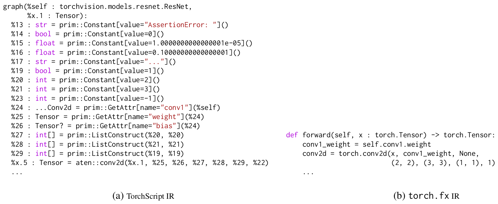
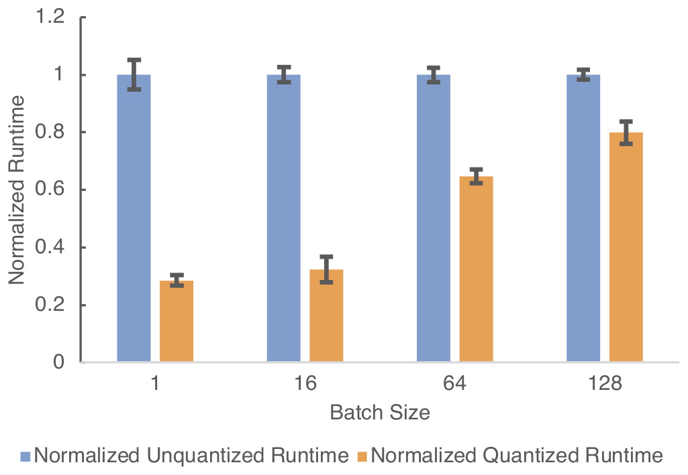
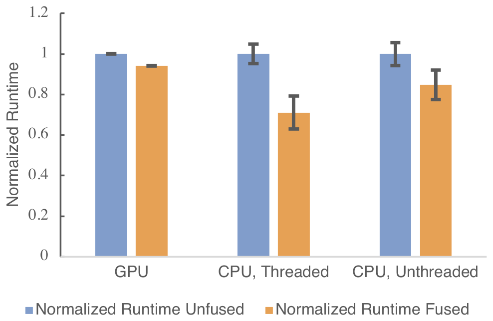
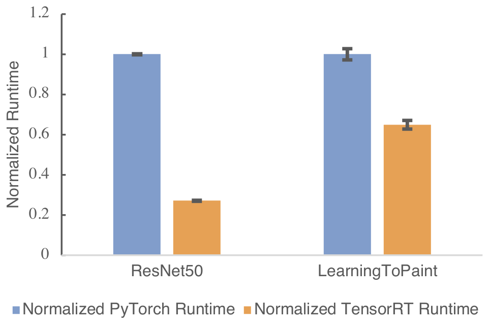

# 论文中文解读：《torch.fx: Practical Program Capture and Transformation for Deep Learning in Python》

> **基本信息**：James K. Reed、Zachary DeVito、Horace He、Ansley Ussery、Jason Ansel（Facebook，Menlo Park），第 5 届机器学习与系统会议 MLSys 2022（Santa Clara）；论文原文 [MLSys 论文集页面](https://proceedings.mlsys.org/paper/2022/hash/7c98f9c7ab2df90911da23f9ce72ed6e-Abstract.html)。
>
> **本文的读法**：原文有 8 个图（Figure 1–4 是代码清单，Figure 5–8 是 IR 对比与三个案例的性能柱状图）、附录 5 张小表（A.1、A.2 的 opcode 表，B、C、D 的数值表）。图 5–8 为从 PDF 裁出的原图并配中文说明；代码清单转录成代码块并逐行解释；附录表逐格转录。凡不是出自论文的内容（对 `Interpreter`/`Transformer` 的补充、笔者的复算、与 PyTorch 2 的类比）都标注“笔者补充”。每个性能图表都写明硬件、基线、模型和指标。

## 一、一句话结论

深度学习框架在 eager（define-by-run）模式下写模型很方便，但量化、算子融合、设备 lowering、分析可视化这类**程序变换**需要一份显式的、可遍历可改写的程序表示。torch.fx 的取舍是：**不追求完整建模 Python，只面向“典型深度学习模型”这种高层有向无环图（DAG）**，用可定制的**符号追踪**（symbolic tracing，以 `Proxy` 对象代替真实张量运行一遍 `forward`）捕获程序，用只有 6 种 opcode 的 Python IR（`Graph` 由线性排列的 `Node` 构成）表示，再把变换后的图**重新生成成 Python 源码**，装回一个 `GraphModule`（`nn.Module` 的子类）。因为 IR 里没有控制流、不建模 mutation 与别名，变换写起来很短（ResNet-50 的 Conv-BN 融合变换加测试不到 150 行 Python）；代价是只能捕获符号追踪能走通的那条路径，输入相关的控制流需要改写或定制 `Tracer`。

论文给出的案例结果（各自硬件、基线、模型不同，不能相加）：同一个 ResNet-50 的 IR，torch.fx 只有 445 个操作，TorchScript 的 `jit.trace` 为 860、`jit.script` 为 2614；DeepRecommender 的训练后量化（PTQ）在 Intel Xeon Gold 6138 CPU 上相对浮点模型最高快 3.3 倍（论文正文的说法，见 8.2 节核对）；Conv-BN 融合在 V100 GPU 上约 6%、CPU 默认线程上约 40%（见 8.3 节对“40%”含义的核对）；参数服务器 RPC 调度在大型分布式训练里 QPS 最高提升 9%；torch.fx 到 TensorRT 的 lowering 在 V100 上让 ResNet-50 快 3.7 倍、LearningToPaint 快 1.54 倍。

## 二、背景与动机（论文第 1–3 节）

### 2.1 为什么 eager 之上还需要 IR

早期的 graph 模式（define-and-run）框架，如 Caffe、Theano、TensorFlow，让用户构造一张以图为基础的中间表示（IR），程序微分、设备/主机划分与放置、量化、设备 lowering 和性能优化等变换可以直接作用在这张 IR 上；可以把它们看成由宿主语言（主要是 Python）做元编程的小型嵌入式编程语言。代价是用户必须离开宿主语言、进入一个领域专用语言和运行时，用户体验往往不如宿主语言，例如调试要用与 Python 的 `pdb` 不同的工具。

较新的 eager（define-by-run）框架，如 Autograd、Chainer、PyTorch、TensorFlow Eager，不再提供显式的图构建 API，而是直接用宿主语言编程；深度学习框架里最主要的程序变换——程序微分——被重新表述成即时（JIT）变换，也就是自动微分。大多数训练和推理用 eager 加自动微分就能完成，但仍有一些变换（如程序量化、算子融合）在有 IR 提供的额外程序结构时更容易写。为了弥合这一差距，eager 框架需要一种能从用户程序里**捕获程序结构**的办法。

已有的程序捕获系统有的是为了得到一份可独立存在的完整程序表示以便序列化或导出，例如 TorchScript 包含可变状态、控制流和复杂数据类型，以忠实地建模原 Python 程序的语义；但**完整地建模 Python 的代价**是捕获技术复杂，并且在高度复杂的 IR 上写变换很难。论文的观察是：可以把“忠实建模 Python”和“量化、融合等变换所需要的东西”**解耦**：变换通常被表述为对代码的高层 DAG 组织的修改，实现细节则藏在高层块（如卷积、批归一化）里。因此可以同时简化捕获机制和它产生的 IR，把重点放在大多数神经网络计算的高层 DAG 结构上。

### 2.2 论文的贡献

1. 对深度学习程序的捕获与变换里重要特性的实践分析；
2. 一个纯 Python 的程序捕获库，实现这些特性，并可定制以捕获不同细节层次；
3. 一个只有 6 条指令的简单 IR，强调易于理解和易于做静态分析；
4. 一个把变换后的代码送回宿主语言生态的代码生成系统；
5. 关于 torch.fx 在实践里如何用于性能优化、程序分析、设备 lowering 等的案例研究。

### 2.3 程序捕获的方式（论文第 2.1 节）

| 方式 | 代表 | 特点 |
|---|---|---|
| 示例输入追踪 | PyTorch `jit.trace` | 最简单：在示例输入上追踪模型执行并记录发生的运算 |
| 符号追踪（用抽象值而非示例输入） | MXNet Gluon、TensorFlow `tf.function` | 用户不必提供示例输入；还能暴露“Python 控制流依赖输入值”的位置，而不是收集一条被示例输入的控制决策所特化的轨迹 |
| 追踪加控制流改写 | `tf.function` | 在符号追踪上增加轻量级模块化分阶段（Lightweight Modular Staging）系统，用 Python AST 变换把命令式控制流构造转成可追踪的高阶 Python 函数，代价是复杂度 |
| 嵌入式语言：图构建 API | TensorFlow | 用户通过调用 Python 函数构建程序（图）；在这类 API 里表示控制流很别扭 |
| 嵌入式语言：解析源码 | PyTorch TorchScript | 用传统的词法分析-语法分析-编译器工具链直接从 Python 源码提取程序，能以完整保真度检查源码语法，理解结构化控制流、集合类型（tuple、list、dict）和用户定义类型 |
| 集成到非 Python 宿主语言 | Julia 的 Zygote.jl 与 TPU 集成、Swift for TensorFlow | 通过与非 Python 语言集成提供程序变换接口；主要缺点是用户得离开 Python 生态 |

论文对比各类方式的要点：追踪期间只对张量和少数其他数据结构（如张量列表）记录运算，所以追踪只能记录 Python 程序的一个子集；尽管可见性有限，这对深度学习计算通常是足够的，因为它们多是平坦的张量运算序列（论文称之为 **basic block 程序**，见 2.5 节）。与追踪可能静默失败不同，嵌入式语言的方法能在编译时报告不支持的构造；但嵌入式语言编译要实现完整的语言栈，复杂得多，而且实践中这些系统也不支持完整的 Python，所以用户仍需让程序符合所支持的子集（只是比追踪系统支持的子集更大）。

### 2.4 程序特化（论文第 2.2 节）

Python 表达式 `a + b` 非常抽象：对 `a`、`b` 的类型没有约束；即使都是张量，维数和各维大小也可能变化。ML 框架捕获程序时常同时把这些表达式**特化**成只对特定类型或张量 shape 有效。程序特化得越多，能工作的输入越少，所以各方案在特化程度、特化发生的时机（提前、即时）和特化结果的安全性上各不相同。

- `jit.trace` 对示例输入的 shape 做特化。它的捕获是“非侵入的”：记录程序一次真实执行中发生的运算。含义之一是张量元数据（如 `ndim`、`shape` 属性）可以**逃出被追踪区域**，用于 Python 程序里的控制决策，使追踪得到的表示被 shape 特化——只对追踪时的 shape 有效，对其他 shape 可能失败；
- DyNet 和 LazyTensor 在运行时即时追踪，从而能为每次调用捕获特化的程序表示：它们推迟张量运算的执行、累积出程序轨迹；需要物化某个值时，系统对收集到的程序表示应用变换（如自动批处理或本地代码 lowering）并执行，返回所请求的值。代价是每次调用都要捕获程序；LazyTensor 用缓存降低这一代价：优化后的产物存在以所收集 IR 的哈希为键的缓存里；
- JAX 的 `jit` 组合子用纯函数式的 Python 程序作输入，从而对 shape 表达式这类非张量计算强制引用透明；当某个变换需要特化（如转成静态 shape 的 XLA）时，系统可以查看输入的 shape 来决定是否需要重新捕获。
- JIT 特化的缺点是更难推理代码执行：例如被追踪代码里的 `print` 或 `pdb` 语句只在发生重新追踪的运行里才会执行；重新追踪与重新变换还可能引起难以预测的性能气泡（系统停下来重新特化）。

### 2.5 IR 设计的三个维度（论文第 2.3 节）

IR 越丰富，能捕获的程序越多、表达力越强，代价是写变换或高效运行代码更复杂。论文比较了三方面：

**语言**：许多框架把 IR 定义成跨语言格式，例如 Caffe 与 TensorFlow 用 Protocol Buffers 表示计算图；PyTorch 的 JIT 和 MXNet 用 C++ 数据结构表示 IR 并提供 Python 绑定。这种原生表示运行时性能可能更好、更易序列化，但学习曲线高于编程 Python 所需。

**控制流**：大多数神经网络可以表示成不含 `if`、循环的平坦张量运算序列——论文称为 **basic block 程序**，通常表示为 DAG。多层感知机（MLP）、卷积网络（如 ResNet）和个性化/推荐模型很容易这样表示；Transformer 网络同样可以，除了解码器序列生成所需的循环。循环神经网络（RNN、LSTM、GRU）不能直接这样表示，因为循环网络计算要对（通常是动态长度的）序列的各元素反复应用；RNN 结构可以在命令式语言里表示成“循环体里做张量计算、张量值在迭代间传递”。但实践中 RNN 结构通常以整体张量运算的形式提供：对整个序列应用 RNN 在代码里表现为对一个 RNN 函数或模块的调用，所以这些网络结构往往也表现为 basic block 程序。尽管如此，许多框架还是支持在 IR 里捕获和表示控制流：TorchScript 一开始就把控制流作为一等公民建进所有组件（预期工作负载会变复杂，尤其是序列处理）；JAX 用 `jax.lax.scan` 这类高阶函数提供函数式风格的控制流；MLIR 用以尾调用结束的基本块表示控制流。控制流除增加 IR 复杂度外，还让公共子表达式消除这类变换更难实现。

**状态**：深度学习模型的状态是各层里的可训练权重；除这些参数外，多数网络是其输入的纯函数。各框架处理状态修改的办法不同：

- PyTorch 允许值被修改，张量可以互为视图（view）。例如 `x[i]`（`x` 是张量）不产生新张量而是返回别名到 `x` 的子集的视图，视图也可以被修改，如 `x[i] = y` 把 `y` 写进 `x` 的相应部分。由于这些别名与修改语义，对程序的修改必须在一个能证明修改安全的分析语境里进行。TorchScript 为此实现了别名分析，但代价很高：程序里所有运算都必须标注别名与修改行为；实践中许多函数（不透明调用或未标注宽松语义的）被保守地当作会修改全局内存，成为屏障、妨碍优化。要推理别名与可变性使写 pass 复杂，增加框架维护负担并限制优化机会，但让用户能使用 PyTorch 张量语言的全部通用性；
- JAX 的函数式做法把跟踪这种状态的负担移到框架之外：模型必须变成纯函数、参数作为输入传入，通常用 Haiku、Flax 这类包装库。任何既要修改状态又要修改代码的变换（如把批归一化的缩放折叠进权重张量），因为这些成分不再在同一个框架里而变复杂。

### 2.6 设计原则（论文第 3 节）

论文指出：当捕获的程序是运行程序的**唯一**方式时，完整保真地捕获程序至关重要；但 PyTorch 主要用作 eager 执行框架，程序捕获只用于某些特定变换，**不需要对整个程序都有效**。而且想变换模型的 PyTorch 程序员多是倾向于用 Python、可能不太懂编译器设计的机器学习从业者。因此：

1. **优先让典型模型的捕获与变换简单，代价是不能处理所有可能的程序**；避免为支持长尾的、冷僻的用例引入复杂性；
2. **使用 ML 从业者已熟悉的工具和概念**，如 Python 数据结构和 PyTorch 公开文档里的算子；
3. **让程序捕获过程高度可配置**，使用户能为长尾用例实现自己的解决办法——允许用户做一次性的配置，比处理一般情形简单。

## 三、torch.fx 总览与第一个例子（论文第 4 节）

torch.fx 捕获程序的方式是符号追踪，用只有 6 条指令的、基于 Python 的 IR 表示，再从这个 IR 重新生成 Python 代码来执行。为避免 JIT 特化所需的重新捕获的复杂性，torch.fx **自己不对程序做任何特化**，而是依靠变换决定在捕获时要做哪些特化。符号追踪的过程可以由用户配置，以适用于更冷僻的用途。

图 1（原文 Figure 1，第 5 页）是一个捕获例子：

```python
import torch
from torch.fx import symbolic_trace, GraphModule

def my_func(x):
  return torch.relu(x).neg()

# Program capture via symbolic tracing
traced : GraphModule = symbolic_trace(my_func)
for n in traced.graph.nodes:
  print(f'{n.name} = {n.op} target={n.target} args={n.args}')
"""
x = placeholder target=x args=()
relu = call_function target=<built-in method relu ...> args=(x,)
neg = call_method target=neg args=(relu,)
output = output target=output args=(neg,)
"""

print(traced.code)
"""
def forward(self, x):
    relu = torch.relu(x);  x = None
    neg = relu.neg();  relu = None
    return neg
"""
```

*图 1（原文 Figure 1，第 5 页）：torch.fx 用符号追踪把程序捕获成一种简单的 IR，并从这个 IR 生成 Python 代码。*

**逐行解释**：

- `symbolic_trace(my_func)` 接收一个函数或 `torch.nn.Module`，把它的结构捕获进一个 `Graph` 对象；这个 `Graph` 与模块参数结合成一个 `GraphModule`，它是 `torch.nn.Module` 的子类，其 `forward` 方法运行捕获的 `Graph`；
- 遍历 `traced.graph.nodes` 打印每个 `Node`：`n.name` 是节点名，`n.op` 是 opcode，`n.target` 是调用目标，`n.args` 是参数；
- 输出的第一行：`x = placeholder target=x args=()`——**placeholder 节点表示输入**；
- 第二行：`relu = call_function target=<built-in method relu ...> args=(x,)`——**call_function 节点直接引用它要调用的 Python 函数**（这里是 `torch.relu`），参数是对上一个节点 `x` 的引用；
- 第三行：`neg = call_method target=neg args=(relu,)`——**call_method 节点直接对第一个参数调用一个方法**：`target` 是方法名字符串 `neg`，`args[0]` 是调用方法的对象（节点 `relu`）；
- 第四行：`output = output target=output args=(neg,)`——**一个** output 节点表示图的结果；
- `traced.code` 是从这张 `Graph` 重新生成的 Python 代码（`GraphModule` 的 `forward`）。其中 `; x = None`、`; relu = None` 这样的语句是在变量最后一次使用之后把它置空（笔者的推断：作用是让 Python 及早释放引用，论文没有解释）。

图 2（原文 Figure 2，第 5 页）是一个变换的例子：找出某个激活函数的所有实例并替换成另一个，这里用它把例子里的 `relu` 换成 `gelu`：

```python
from torch.fx import Graph
def replace_activation(g: Graph, old, new):
  for n in g.nodes:
    if n.op == 'call_function' and n.target == old:
      # create IR to call new activate
      with g.inserting_after(n):
        new_n = g.call_function(new, n.args)
        n.replace_all_uses_with(new_n)
        g.erase_node(n)
      # or for this simplified case: `n.target = new`

replace_activation(traced.graph, torch.relu,
                   torch.nn.functional.gelu)
traced.recompile()
```

*图 2（原文 Figure 2，第 5 页）：变换（如这个替换激活函数的变换）直接用 Python 写。*

**逐行解释**：

- `for n in g.nodes`：遍历图里的所有节点；
- `if n.op == 'call_function' and n.target == old`：只处理“调用函数”类、且调用的函数正是 `old`（如 `torch.relu`）的节点；
- `with g.inserting_after(n):`：设置**插入点**——在 `n` 之后创建的新节点放在 `n` 后面；
- `new_n = g.call_function(new, n.args)`：创建一个新的 `call_function` 节点，调用 `new`（如 `gelu`），参数沿用原节点的 `n.args`；
- `n.replace_all_uses_with(new_n)`：把所有使用 `n` 的地方改成使用 `new_n`（调用 `n` 的下游节点现在读 `new_n` 的输出）；
- `g.erase_node(n)`：删除旧节点；
- 末尾注释：对这个简化的情形也可以直接 `n.target = new`（原地改调用目标）；
- 调用 `replace_activation(traced.graph, torch.relu, torch.nn.functional.gelu)` 之后，要调用 `traced.recompile()`，把修改后的图重新生成成 Python 代码。
- **要点**：变换就是对 `Graph` 这个 Python 数据结构的遍历和修改，没有任何特殊的 DSL。

## 四、符号追踪与 Proxy（论文第 4.1 节、5.1–5.3 节）

### 4.1 机制

torch.fx 的符号追踪机制用一个 **`Proxy`** 数据结构来记录流经程序的值上的运算。`Proxy` 是一个“鸭子类型”的 Python 类，它记录对它的属性访问和方法调用，充当一个代替具体程序值的**抽象值**。具体做法有三层：

1. `Proxy` 用 `__torch_function__` 协议（Abbasi et al. 2020）来拦截并记录 PyTorch 算子（它们是自由函数）的分派；
2. torch.fx 还重写 PyTorch 的 `Module` 抽象，来记录用代理值对 Module 的调用；
3. 符号追踪的过程可以通过一个 **`Tracer`** 类配置，它的方法可以被覆盖，以控制哪些值保留为 `Proxy`、哪些在追踪时被部分求值。

### 4.2 为什么选符号追踪而不是嵌入式语言（5.1 节）

torch.fx 用 `Proxy` 的符号追踪而不是嵌入式语言技术，因为前者更容易直接用 Python 灵活的对象模型来实现；实现简单到用户在追踪行为不符合预期时可以阅读并单步调试源码。追踪还有助于**消除不依赖输入的控制流**，例如 `torch.nn.Sequential` 里遍历各子模块的循环。PyTorch 模型到处是这类抽象，许多用户还使用包含自己模型实现的第三方库，所以能追踪过这些抽象、到达真正运行的算子很重要。代价是无法捕获确实含有依赖输入的控制流的长尾模型——论文用“让追踪过程可定制，来绕开一次性的问题”来弥补。

### 4.3 可配置的程序捕获（5.2 节）

`Tracer` 类控制 `fx.symbolic_trace` 的行为，它的方法可以被覆盖来改变追踪过程：

- **`is_leaf_module`**：指定哪些 PyTorch `Module` 实例在追踪时当作**不透明调用**（leaf）。默认 torch.fx 保持 PyTorch 内置 Module（如 `nn.Conv2d`）原样，而追踪进用户定义的 Module——这样产生的是标准的、可理解的原语的轨迹。自定义它可以挡住模型中含有不支持语言特性的部分，或改变变换所用的表示层次；
- **`create_proxy`**：自定义创建 `Graph` 里 `Node` 以及对应运行时 `Proxy` 值的行为。可用来给 `Node` 安装自定义元数据（供变换使用），或把自定义数据结构支持成可追踪的值。例如，一个自定义 `Tracer` 可以特化张量的大小与 shape，并用这些值捕获一个否则不可追踪的程序。

### 4.4 没有特化的提前（AoT）捕获（5.3 节）

提前追踪限制了能捕获的程序空间（如不支持任意控制流），但它让捕获、变换、代码生成过程**更可预测、更可观察**，契合 PyTorch 的开发者体验，实践中效果良好。**与基于示例的追踪不同，符号追踪不会顺带地特化程序流**，因为做出数据依赖控制流决策所需的信息在追踪时并不存在。控制决策里常用的张量属性（如 `shape`、`ndim`）在符号追踪中是作为 `Proxy` 值返回的，对这些值的运算可以被记录。另一方面，当这些 `Proxy` 对象被用在会发生不可追踪运算的上下文里（如转成 Python 内建类型 `int` 或 `bool`），用户会收到一条描述问题的错误信息，附带指出问题位置的栈跟踪。

笔者补充两点（非论文原文）：

- 条件依赖 `Proxy` 的 `if`，如 `if x.sum() > 0:`，需要把 `Proxy` 转成 `bool`，而追踪器并不知道运行时的值，所以通常报错；
- 不依赖 `Proxy` 输入的 Python 值（如 `math.pi`、在追踪时就能算出的常量）在追踪时被**部分求值**成立即数，烧进图里（图 3 里 `x + math.pi` 变成 `x + 3.141592653589793` 就是例子）；[PyTorch 2 论文](../pytorch_2/论文中文解读.md)第 2.4 节还给出一个相关的反例：`torch.rand(10)` 在追踪时被求值、其结果成为图里的固定常量，使后续调用得不到新的随机性。

## 五、Graph、Node 与 GraphModule（论文第 4.2 节、附录 A）

torch.fx 把程序表示成基于 DAG 的 IR，这种 IR 适合深度学习中常见的 basic block 程序。程序表示成一个 `Graph` 对象，它含有一个由 `Node` 对象构成的**线性序列**，每个 `Node` 表示一个运算。`Node` 的构成：

- **opcode**（字符串）：描述这个 `Node` 表示哪种运算；
- **target**：调用节点（`call_module`、`call_function`、`call_method`）的调用目标；
- **args** 与 **kwargs**：二者合起来表示追踪时看到的、以 Python 调用约定传给 target 的参数；`Node` 之间的数据依赖表示成 `args`、`kwargs` 里对其他 `Node` 的引用。（脚注：不对 `args` 和 `kwargs` 做任何规范化，保持用户写的样子，这便于生成代码的向后兼容。）

**opcode 与参数语义（原文附录 A）**：

| opcode | 含义（A.1） | `args`/`kwargs` 行为（A.2） |
|---|---|---|
| `placeholder` | 函数输入 | 空，或 `args[0]` 为默认值 |
| `call_method` | 对 `args[0]` 调用方法 | Python 调用约定；`args[0]` 是 self |
| `call_module` | 调用由 `target` 指定的模块 | Python 调用约定；target 是 self |
| `call_function` | 调用由 `target` 指定的函数 | Python 调用约定；target 是 self |
| `get_attr` | 取回由 `target` 指定的属性 | 空 |
| `output` | return 语句；返回 `args[0]` | `args[0]` 是返回值 |

（原文附录 A.1、A.2，第 12 页。A.2 里 `call_module`、`call_function` 的“target is self”是原文措辞，字面意思应是“被调用的对象就是 target 本身”。）

**简化 IR 的几个关键决定**：

- **没有**建模数据结构的构造或修改的原语运算。但 `args` 和 `kwargs` 支持**立即值**：Python 内建类型（如 `int`、`float`）以及递归的集合类型（如 `tuple`、`list`）可以直接出现在 `Node` 的参数里，不需要单独的对象构造节点。由于 `Node` 支持立即值，IR 很干净，`Node` 与张量运算**大致一一对应**；
- **`GraphModule`**：torch.fx 把程序的状态存放在 `GraphModule` 类里。它是变换后程序的容器，对外暴露变换后生成的代码，同时提供 `nn.Module` 熟悉的参数管理 API。`GraphModule` 可以用在任何普通 `nn.Module` 能用的地方，使变换后的代码与 PyTorch 生态其余部分互操作；
- **访问模块层次里状态的两个 opcode**：`call_module` 调用子 Module 的 `forward`，`get_attr` 从 Module 取参数。变换后的代码通过这两个 opcode，几乎能像普通 PyTorch 代码那样与 Module 层次交互。此外，变换可以**同时**对代码和 Module 层次里的可变状态做变换。这在可变的参数与（通过 `call_module` 节点与之交互的）函数式的 `Graph` 之间形成自然的分离，同时又让它们保存在同一个对象里，便于做同时涉及两者的变换。

## 六、源到源变换与代码生成（论文第 4.3 节、5.4 节）

torch.fx 变换流水线的最后一步是**代码生成**：不是离开 Python 生态、进入一个定制的运行时，而是从变换后的 IR 生成合法的 Python 源码；这份变换后的代码被加载进 Python，得到一个可调用的 Python 对象，并作为 `forward` 方法安装到 `GraphModule` 实例上。使用代码生成让 torch.fx 变换的结果能装回模型里、并仍能用于后续的变换。图 3 的例子：

```python
class SampleModule(torch.nn.Module):
    def forward(self, x):
      return self.act(x + math.pi)

sm = SampleModule()
sm.act = traced # from previous figure
traced : GraphModule = symbolic_trace(sm)
print(traced.code)
"""
def forward(self, x):
    add = x + 3.141592653589793;  x = None
    gelu = torch.nn.functional.gelu(add);  add = None
    neg = gelu.neg();  gelu = None
    return neg
"""
```

*图 3（原文 Figure 3，第 6 页）：torch.fx 的输出是 Python 代码，所以可以再用于后续的捕获与变换步骤。*

**逐行解释**：

- `SampleModule.forward` 先把输入加 $\pi$，再交给属性 `act` 处理；
- `sm.act = traced`：把前面图 1、图 2 里得到的（已把 `relu` 换成 `gelu` 的）`GraphModule` 装成 `act`；
- `symbolic_trace(sm)`：对这个新模块再做一次符号追踪。因为 `act` 是 `GraphModule` 而不是 PyTorch 内置 Module，追踪会**进入**它；
- 输出的代码把两步合并：`x + 3.141592653589793`（`math.pi` 在追踪时被求值成常量），`gelu`（图 2 的变换结果），`neg`（原函数里的 `.neg()`）。这表明生成的代码可以作为输入继续被捕获、变换。

**Python 化的 IR 与变换（5.4 节）**：torch.fx 的 IR 完全用 Python 表示和实现，用户可以很容易地调用、阅读或覆盖它，不必理解 Protocol Buffers 或 C++（或搭建它们的构建环境），这对主要用 Python 工作的 ML 工程师是障碍。变换也用 Python 写；变换的结果同样是 Python 代码，易于检查正确性、用 `pdb` 调试、交给其他库、传给后续变换。变换后的代码封装在一个 `GraphModule` 里，可以像任何其他 `nn.Module` 一样用于 PyTorch：例如用户可以用 TorchScript 编译该模型来部署，或在 PyTorch 的 `DistributedDataParallel` 库里使用；用户还可以通过实验性的 `GraphModule.to_folder` API 把生成的代码存成源文件。代码生成使 torch.fx 进一步融入 Python 生态，而不是把变换后的代码隔离到一个定制的、更难用的运行时里。

## 七、IR 里为什么没有控制流，也不建模 mutation（论文第 5.5、5.6 节）

### 7.1 IR 里没有控制流

随着 Transformer 越来越多地取代循环递归神经网络、换成更大可扩展的注意力模块，在深度学习里使用宿主语言控制流变得更罕见。许多模型可以不用它表示；即使对有些控制流的程序（如 beam search 解码器），也有大块不含控制流的模型部分（编码器和解码器的一步）。

但**IR 里存在控制流就会显著增加复杂性，不论具体模型是否用到它**：

- 对 IR 的多数分析必须表述为对程序的**不动点数据流**（fixpoint data-flow，Kildall 1972），而不是简单的前向传播；
- 作者必须为被分析的性质定义一个格（lattice）、转移函数（transfer function）和合并函数（join function），并证明其单调性与有限性；
- 对编译器作者这很熟悉，但论文发现 ML 变换的作者常在这里引入 bug：例如合并函数不单调，或没有迭代到收敛；
- 相比之下，对 basic block 的 IR，只需要转移函数。

**shape 传播就是一个例子**：对 basic block 程序，shape 可以平凡地向前传播（除少数输出 shape 依赖值的运算外）；但加入控制流后，shape 传播不满足有限性——跨循环迭代传递的值可以取无穷多种 shape，如图 4 所示。

```python
def loop_shapes(x, itr):
  # x is an input tensor of size [1, N]

  for _ in range(itr):
    x = torch.cat((x, x), dim=0)

  # Depending on the number of loop iterations, x may have an
  # arbitrary leading dimension i.e. x \in [*dynamic*, N]
  return x
```

*图 4（原文 Figure 4，第 7 页）：循环携带依赖造成动态 shape 的演示。*

**逐行解释**：输入 `x` 的 shape 是 `[1, N]`；每次循环把 `x` 沿第 0 维与自己拼接，所以 `x` 的第一维每轮翻倍（笔者推导：$1\to2\to4\to\cdots$，共 `itr` 轮后是 $2^{\text{itr}}$）；循环次数 `itr` 是运行时参数，因此返回值的第一维可以是任意值，原文记作 `x \in [*dynamic*, N]`。分析通常会在这种情形里得到“动态”值，使 shape 分析给出**欠指定**的数据，妨碍需要具体 shape 信息的后续变换，如 ASIC lowering。

此外，ML 社区提出的一些变换在有控制流时没有明确定义，如 6.2.1 节描述的量化变换。IR 本身不含控制流并**不妨碍**变换作用在更大模型里 basic block 的**子图**上；这种组合怎么做，留给变换的作者或使用变换的用户决定。

### 7.2 函数式的图，有状态的模块

如 2.5 节所述，语言里的别名与可变性语义可能需要复杂的分析来证明程序变换是合法的。torch.fx **省略这类分析**：把执行修改的运算定义为**未定义行为**，并可选地在追踪期间捕获到它时报错。避免在 IR 里出现可变性，大大简化了对深度学习程序的分析和变换；多数模型不受这个限制影响，因为多数修改都局限于模型的参数。

torch.fx 仍然保留 PyTorch 的层次化 `nn.Module` 结构，并能表示对这个结构的模块调用与属性读取。像 `torch.nn.Conv2d` 这样的 Module 被用户很好地理解、参数文档齐全，并且把对参数的有状态使用藏在模块内部，所以保留这些对象让写变换更容易。例如 `torch.nn.BatchNorm` 实际上含有可变状态，但这种状态被 ML 从业者很好地理解。

## 八、案例研究与评测（论文第 6 节）

torch.fx 既被开源生态里的 PyTorch 用户使用，也是一家大型软件公司深度学习栈里的关键组成部分。论文研究了 torch.fx IR 的复杂度，以及它在性能优化、程序分析、设备与运行时导出等场景的用法。

### 8.1 IR 复杂度（图 5）

torch.fx 的目标之一是简化为 ML 模型生成的 IR，使 ML 从业者更易理解。可以把 torch.fx 的 IR 与 TorchScript 的两个前端（`jit.trace` 和 `jit.script`）产生的 IR 比较，因为它们都从同样的输入程序出发。



*图 5（原文 Figure 5，第 9 页）：torch.fx 能追踪过不变的控制流，并能把常量作为参数嵌入 `Node`，这大幅简化了典型模型的 IR。对一个标准的 ResNet50 模型，torch.fx 的 IR 含 445 个操作，而 `torch.jit.script` 为 2614，`torch.jit.trace` 为 860。*

**图中文字翻译与读法**：

- **(a) TorchScript IR**（左）：一份 `graph(%self : torchvision.models.resnet.ResNet, %x.1 : Tensor)` 的 SSA 风格 IR，开头是一大批 `prim::Constant`（字符串 `"AssertionError: "`、布尔值、浮点数 `1e-05`、`0.1`、整数 2、3、−1 等），然后是 `prim::GetAttr` 取 `conv1` 模块及其 `weight`、`bias` 属性，`prim::ListConstruct` 构造 `int[]` 列表（卷积的步长、填充、膨胀的参数列表），最后才是真正的 `aten::conv2d(%x.1, %25, %26, %27, %28, %29, %22)`；
- **(b) torch.fx IR**（右）：生成的 `forward(self, x : torch.Tensor) -> torch.Tensor`：`conv1_weight = self.conv1.weight`，然后一次 `torch.conv2d(x, conv1_weight, None, (2, 2), (3, 3), (1, 1), 1)`，步长、填充、膨胀等直接作为立即值（元组）写在参数里；
- **读图结论**：同样的第一个卷积，TorchScript 需要大约十几个常量、属性读取和列表构造节点，torch.fx 只需要 2 个节点（取权重、调用卷积）。

| 方案（同一个 ResNet50） | 操作数 |
|---|---:|
| `torch.jit.script` 的 TorchScript IR | 2614 |
| `torch.jit.trace` 的 TorchScript IR | 860 |
| torch.fx IR | 445 |

（数字来自图 5 的图注与正文第 6.1 节。）论文的解释：TorchScript 的 IR 非常丰富，包含张量运算、标量运算、控制流、数据结构、层次化模块结构，以及别名与可变性语义，对简单模型就显得冗长；torch.fx 的缩减主要来自**消除与被捕获轨迹无关的控制流**，同时还受益于内联简单常量和数据结构，所以其大小几乎是同样消除了控制流的 `torch.jit.trace` 的 IR 的**一半**（笔者计算：445/860 ≈ 0.52）。TorchScript 前端产生的复杂 IR 也使编写变换更复杂：需要更小心才能把变换写对，导致变换代码更长、更难维护。

### 8.2 量化（论文第 6.2.1 节，图 6，附录 B）

**量化**（Quantization）是通过缩小张量数据元素的大小来提高神经网络计算效率的技术：更小的数据元素需要更少的内存带宽和存储，并常能被现代处理器更快处理；神经网络计算对数值扰动的敏感度较低，所以量化是典型的性能优化。做训练后量化（PTQ）或量化感知训练（QAT）不仅需要参数值，还需要流经程序的**激活值**——例如 QAT 需要测量张量加法输出里浮点值的分布，以在量化数值下计算缩放与偏置。这种内省在 PyTorch eager 模式里通常不可得，而 torch.fx 提供了一种轻量的方式来捕获这样的程序表示。

PTQ 的流程包括三个阶段：

1. **准备阶段**：给程序插入“观察器（observer）”对象，记录程序各处张量值里浮点数的统计信息；
2. **校准阶段**：用户把若干批数据送过网络，填充观察器；
3. **转换阶段**：利用收集到的统计量，把权重下转，并把模型里的运算转成内嵌缩放与零点信息的量化运算。

量化利用 torch.fx 的 `Graph` 和 `GraphModule` 表示，**同时**修改程序代码和权重值。QAT 的流程与上面阶段 (1)、(2) 类似，但使用“伪量化（fake quantize）”观察器，把浮点值吸附到量化数值下对应的值。

**评测设置**：模型 DeepRecommender（Kuchaiev & Ginsburg 2017），应用训练后量化，在服务器级的 Intel Xeon Gold 6138 CPU（2.00 GHz）上，使用 FBGEMM 的量化运算；指标为推理运行时间，按同一批大小下的未量化浮点模型**归一化**（越低越好）。



*图 6（原文 Figure 6，第 9 页）：基于 torch.fx 的量化的归一化推理运行时间（越低越好）。*

**图中文字翻译与读法**：

- 横轴 Batch Size（批大小）：1、16、64、128；纵轴 Normalized Runtime（归一化运行时间，0–1.2）；蓝柱 Normalized Unquantized Runtime（归一化的未量化运行时间，基线，恒为 1），橙柱 Normalized Quantized Runtime（归一化的量化后运行时间）；柱顶的 I 形线是标准差误差条。
- 从图上读出的橙柱高度（近似）：批大小 1 约 0.29，16 约 0.32，64 约 0.65，128 约 0.80。
- **读图结论**：批小时量化收益最大（运行时间不到浮点模型的三分之一），批增大后收益逐渐变小；误差条都很小，论文据此说明提前（AoT）变换的性能特征可预测。

**附录 B 的数值数据**（单位：秒；原文表 B）：

| 批大小 | 未量化 运行时间 | 未量化 标准差 | 量化后 运行时间 | 量化后 标准差 |
|---:|---:|---:|---:|---:|
| 1 | 0.0777 | 0.00079 | 0.0222 | 0.0008 |
| 16 | 0.1980 | 0.0104 | 0.0639 | 0.0057 |
| 64 | 0.3995 | 0.0204 | 0.2585 | 0.0129 |
| 128 | 0.6717 | 0.0228 | 0.5369 | 0.0413 |
| 256 | 1.2307 | 0.0874 | 1.1157 | 0.0686 |

（原文附录 B，第 14 页。）

**核对与读法**：

- 论文正文说 torch.fx 量化“相对浮点模型最高 3.3 倍的运行时性能提升，方差很低”。笔者用附录 B 复算：量化前后时间之比，批大小 1 为 $0.0777/0.0222\approx3.5$，16 为 3.1，64 为 1.5，128 为 1.25，256 为 1.1；与图 6 里批大小 1 的橙柱约 0.29（即约 3.5 倍）一致。所以正文的“3.3×”与附录 B 的批大小 1 数据（约 3.5×）并不完全吻合，引用时应同时说明批大小，并以附录数据为准（或注明原文两处不一致）。图 6 没有画批大小 256（约 1.1×）这一项，附录表里有。
- 论文说量化的**正确性测试不直接**，因为这是改变语义的变换，但这个流程的数值适用性已在若干模型架构上用评测集测试验证；
- 耗时：准备阶段 44 ms，校准阶段 590 ms，转换阶段 3.8 s；后两个阶段的大部分时间分别来自模型执行期间的张量运算和值的量化；
- 论文还说，除了性能提升，这个工具的开发相比在 TorchScript 平台上的实现，有**一个数量级的生产力提升**：因为降低了表示的复杂度、在 Python 里暴露变换 API、并嵌入原生 PyTorch 生态。

### 8.3 算子融合（论文第 6.2.2 节，图 7，附录 C）

**算子融合**是把张量运算的模式合并成单个计算 kernel 的一类优化，可以节省算子分派开销、内存带宽开销和内存空间开销。例子是 **Convolution-BatchNorm 融合**：推理时，一个“卷积-批归一化”算子序列可以把批归一化的权重施加到卷积权重上而合并。

**评测设置**：PyTorch ResNet50 模型；GPU 为 NVIDIA Tesla V100-SXM2 16GB（CUDA 11.0），CPU 为 Intel Xeon Gold 6138 @ 2.00 GHz；指标为推理运行时间，按未融合时的运行时间归一化（越低越好）；三种情形：GPU、CPU 默认线程（Threaded，默认 intra-op 并行）、CPU 不开线程（Unthreaded，`OMP_NUM_THREADS=1`）。原文没有给出批大小。



*图 7（原文 Figure 7，第 9 页）：基于 torch.fx 的 Convolution/Batch-Norm 融合的归一化推理运行时间（越低越好）。*

**图中文字翻译与读法**：横轴三组 GPU、CPU, Threaded（CPU，多线程）、CPU, Unthreaded（CPU，单线程）；纵轴 Normalized Runtime；蓝柱 Normalized Runtime Unfused（未融合，基线恒为 1），橙柱 Normalized Runtime Fused（融合后）。从图上读出的橙柱高度（近似）：GPU 约 0.94，CPU 多线程约 0.71，CPU 单线程约 0.85。CPU 的误差条比 GPU 的明显大。

**附录 C 的数值数据**（单位：秒；原文表 C）：

| 设备 | 是否融合 | 线程 | 平均运行时间 | 运行时间标准差 |
|---|---|---|---:|---:|
| GPU | Unfused（未融合） | N/A | 0.1887 | 0.00048 |
| GPU | Fused（融合） | N/A | 0.1777 | 0.00049 |
| CPU | Unfused | Threaded | 0.2996 | 0.02835 |
| CPU | Fused | Threaded | 0.2129 | 0.03491 |
| CPU | Unfused | Unthreaded | 2.0231 | 0.23050 |
| CPU | Fused | Unthreaded | 1.7166 | 0.25091 |

（原文附录 C，第 14 页。）

**重要核对（笔者）**：论文正文说融合带来“GPU 上约 6% 的延迟降低、默认 intra-op 并行的 CPU 上 40% 的延迟降低，关闭 intra-op 并行时更小的 18%”。用附录 C 的平均时间复算：

| 情形 | 速度提升（未融合时间 ÷ 融合后时间 − 1） | 延迟降低（1 − 融合后时间 ÷ 未融合时间） |
|---|---:|---:|
| GPU | 约 6% | 约 6% |
| CPU 多线程 | 约 41% | 约 29% |
| CPU 单线程 | 约 18% | 约 15% |

也就是说，正文的 6%、40%、18% 恰好等于“未融合时间 ÷ 融合后时间 − 1”（即**速度提升**的比例），而不是延迟降低的比例；若按“延迟降低”严格计算，应是约 6%、29%、15%（与图 7 里橙柱高度约 0.94、0.71、0.85 一致）。引用时请写成“速度提升约 6%/41%/18%”或“延迟降低约 6%/29%/15%”，不要把 40% 当作延迟下降。

其他信息：数值正确性通过融合与未融合实现输出的 epsilon 等价比较（`rtol=1e-05`、`atol=1e-08`）确认，数值结果见附录 C；变换本身的运行时间是 81 ms，其中大部分是把参数张量融合在一起的算术运算。torch.fx 以其提前（AoT）、基于图的特性，提供了这个变换所需的**非局部程序上下文和状态修改**能力；整个变换连同测试框架不到 150 行 Python，体现了 torch.fx API 在实现简洁、快速开发的程序变换方面的威力。

### 8.4 程序调度（论文第 6.2.3 节）

大型 PyTorch 模型有时含有**阻塞的远程过程调用**（RPC），从参数服务器取值；为清晰起见，这些调用写在使用参数之前。但如果模型含有若干这样的调用，把这些网络调用与其他本地工作**重叠**能提高利用率。论文用 torch.fx 提供一个 pass：把阻塞的网络调用换成**非阻塞**调用加一个单独的 `wait` 调用，然后把非阻塞调用尽可能早地**提到**（hoist）程序前面。在大型分布式训练作业上，这个优化可以把 QPS 最高提升 9%（原文没有给出具体模型、硬件和基线，只说“a major software company”里的大型分布式训练作业）。

### 8.5 程序分析（论文第 6.3 节）

torch.fx 被以各种方式用于程序分析：

- 在一家大型软件公司里，用 torch.fx 实现了一个在各种硬件设备上大规模**模拟深度学习推理**的框架：torch.fx 能估计工作负载的 FLOPs、内存带宽使用量和数据值大小，从而估计程序运行时间和内存消耗，使得可以在模拟里而不是真实设备上快速迭代；
- **shape 分析**：标准的 `fx.passes.shape_prop` 包提供 shape 分析的一个朴素实现，通过**解释**图并记录观察到的 shape；基于符号表达式的 shape 传播与基于渐进类型语义的 shape 传播正在开发中；torch.fx 提供了可以做这类分析的表示，为把类型系统和类型推断的创新应用到 PyTorch 模型打开了机会；
- **可视化**：`fx.graph_drawer` 包让用户用 Graphviz 可视化 torch.fx 图，这是常被要求的、通过 DAG 的可视化表示来理解深度学习程序的方式。

### 8.6 设备与运行时的导出/编译（论文第 6.4 节，图 8，附录 D）

PyTorch 主要为现代 GPU 设计，GPU 提供很大的灵活性和动态性，非常适合 eager 执行；但 GPU 仍能从借助 NVIDIA TensorRT 这类工具包对模型代码做提前编译中受益。更专用的处理器（如 TPU）通过专用功能单元、专用数值格式和新的内存架构，承诺更高性能、更好能效和更低成本，它们常需要静态分析与优化，包括算子调度、代码生成、内存规划/调度和架构感知的量化。与 6.2 节的优化类似，这类分析通常需要比 eager 模式下 PyTorch 逐算子启动 kernel 所能提供的更多的程序上下文。torch.fx 提供一条让这类编译器栈与 PyTorch 集成的路径：提供提前提取的程序表示。论文说它在一家大型软件公司里用于 ASIC lowering。

**评测设置**：把 PyTorch 的 ResNet50 模型和 LearningToPaint 模型（Huang et al. 2019）lowering 到 NVIDIA TensorRT，硬件为 NVIDIA Tesla V100-SXM2 16GB GPU（CUDA 11.0），使用实验性的 torch.fx 到 TensorRT 的 lowering 系统；基线是普通 PyTorch（原文写作 baseline PyTorch，笔者按 eager 理解）；指标为推理运行时间，按 PyTorch 运行时间归一化（越低越好）；ResNet50 的 3.7 倍是 30 次试验的结果。原文没有给出批大小。



*图 8（原文 Figure 8，第 10 页）：基于 torch.fx 的 TensorRT lowering 的归一化推理运行时间（越低越好）。*

**图中文字翻译与读法**：横轴两个模型 ResNet50、LearningToPaint；纵轴 Normalized Runtime；蓝柱 Normalized PyTorch Runtime（归一化的 PyTorch 运行时间，基线为 1），橙柱 Normalized TensorRT Runtime（归一化的 TensorRT 运行时间）。从图上读出：ResNet50 的橙柱约 0.27，LearningToPaint 约 0.65。ResNet50 的误差条几乎不可见（论文说 TensorRT 提供“可预测的” 3.7 倍加速）。

**附录 D 的数值数据**（单位：秒；原文表 D）：

| 配置 | 平均运行时间 | 运行时间标准差 |
|---|---:|---:|
| PyTorch RN50 | 0.2443 | 0.00119 |
| torch.fx TensorRT RN50 | 0.0662 | 0.00022 |
| PyTorch LearningToPaint | 0.0068 | 0.0003 |
| torch.fx TensorRT LearningToPaint | 0.0044 | 0.0001 |

（原文附录 D，第 14 页。）

**读法**：笔者复算 $0.2443/0.0662\approx3.69$（即“3.7×”）；$0.0068/0.0044\approx1.55$（原文取整写作 1.54×）。数值正确性同样通过 `rtol=1e-05`、`atol=1e-08` 的 epsilon 等价比较确认。**这些加速来自 TensorRT，而不是 torch.fx 本身**：torch.fx 提供的是把 PyTorch 模型提取成可交给 TensorRT 的程序表示的通道。论文还强调开发效率：项目借助 torch.fx 的 Python API 与 TensorRT 的 Python API 建一个转换层，很快就开发出来，包括按 TensorRT 支持的算子**自动切分模型**、把不支持的运算自动调度到不优化的块里；最终的用户 API 符合 Python 编程习惯，易用、易检查、易调试。

## 九、Interpreter 与 Transformer（笔者补充，论文未涉及）

本文对应的 MLSys 2022 论文**没有**讲 `torch.fx.Interpreter` 和 `torch.fx.Transformer` 这两个类，只在 6.3 节提到 `fx.passes.shape_prop` 是“解释图并记录观察到的 shape”。下面是笔者按 PyTorch 公开文档的常见理解做的补充，仅作路线提示：

- **`Interpreter`**：逐个节点执行（解释）一个 `GraphModule` 的工具；可以覆盖其中的方法，在执行每个节点时插入自定义行为，常用于 shape 传播、调试和分析；
- **`Transformer`**：`Interpreter` 的子类，一边“解释”一边产生一个新的 `GraphModule`，适合写“把每个节点换成别的节点”的变换。

它们与论文的关系是：论文强调“变换就是遍历并修改 `Graph`”，这两个类是为这种遍历提供的更高层脚手架。

## 十、局限、证据边界与常见误读

**局限与证据边界**（论文自述加笔者归纳）：

1. **只捕获符号追踪能走通的那一条路径**：依赖 `Proxy` 的数据相关控制流、`Proxy` 到 `int`/`bool` 的转换会报错；论文的设计就是用“可定制 `Tracer`”来换通用性。
2. **不建模 mutation 与别名**：执行修改的运算被定义为未定义行为，追踪时可选择报错；论文认为多数模型的修改局限于参数，但对确实依赖原地修改的程序不适用。
3. **没有与 TorchScript 做速度对比**：论文比较的是 IR 的**复杂度**（操作数）和各案例的**加速**，各案例的基线、模型、硬件都不同，不能把 3.3×（量化）、3.7×（TensorRT）、9%（QPS）等相加或视为通用的 FX 加速。
4. **数字与硬件都是 2021–2022 年的环境**：V100-SXM2、CUDA 11.0、Xeon Gold 6138；各实验的批大小多未给出；量化与融合的正文数字与附录有不一致（见 8.2、8.3 节核对）。
5. **“一家大型软件公司”的案例**（QPS 提升 9%、模拟框架、ASIC lowering）没有给出可复现的细节。
6. 论文里的 FX 是**可变换 IR 的基础**，不等于今天 Dynamo 的完整前端。

**常见误读**：

- “symbolic_trace 能捕获任意 PyTorch”——不能。它只执行一条符号路径；数据相关的 Python 控制流、复杂 mutation 和部分自定义对象需要改写或定制 `Tracer`。
- “GraphModule 是静态二进制”——不是。它仍是 Python Module，执行的是重新生成的 Python 代码。
- “FX 优化模型”——FX 本身主要是基础设施；性能来自写在它之上的量化、融合、调度或后端（TensorRT）。
- “FX 的 Graph 和 autograd 图是一回事”——不是：autograd 图由真实张量执行产生，目标是反向传播，节点是反向函数与保存的张量；FX 图由符号追踪产生，目标是对前向程序做变换，节点是高层的模块/函数/方法调用，可编辑并重新生成代码（笔者归纳）。

## 十一、与 Dynamo、PyTorch 2 及本仓库其他论文的关系

- 与 [PyTorch 2](../pytorch_2/论文中文解读.md)：Dynamo 产出的 IR 仍是 **FX Graph**（FX 图格式被 TorchDynamo 共用），但捕获机制不是传统的 `symbolic_trace`：Dynamo 解释 Python 字节码，用 guards 保护特化、用 graph break 覆盖更多 Python；该论文第 2.4 节还指出 `symbolic_trace` 仍是“全有或全无”并且不可靠（如 `torch.rand` 被烧成常量、全局变量修改丢失）。所以“都是 FX 图”不代表捕获语义相同。
- 与 [PyTorch 2019](../pytorch_imperative/论文中文解读.md)：eager/autograd 能求导，但不适合做全局变换；torch.fx 补上了“可遍历、可改写、可重新生成代码”的显式 IR。
- 与 [JANUS](../janus_symbolic_graph/论文中文解读.md)：JANUS 在 TensorFlow 1.x 里追求“命令式程序自动转符号图并保持正确”；torch.fx 则用“只面向典型 DAG、控制流由用户定制处理”来换简单。
- 路线见 [PyTorch 动态图与 Graph 编译论文阅读索引](../PyTorch动态图与Graph编译论文阅读索引.md)。

笔者补充：现代 PT2 流水线可简化为下面这样，FX 是其中被共用的图数据结构和变换基础。

```text
TorchDynamo → FX 图 + guards + 剩余字节码 → AOTAutograd/functionalization/decomposition → 前向/反向 FX 图 → Inductor
```

## 十二、复现与阅读检查清单

- 能否不看原文，写出 `placeholder`、`call_function`、`call_method`、`call_module`、`get_attr`、`output` 六种 opcode 各自的含义与参数约定？
- 能否解释为什么 `Proxy` 对 `bool(...)`、`int(...)` 报错，而 `x.shape`、`x.ndim` 这样的属性可以记录？
- 能否解释 `is_leaf_module` 如何改变图的层次，以及它对量化、融合和 lowering 的意义？
- 能否说清 IR 里没有控制流、不建模 mutation 带来的好处（变换只需转移函数、不需要别名分析）与代价？
- 引用性能数字时，是否写明基线、硬件和模型：Conv-BN 融合是 ResNet50、V100 或 Xeon Gold 6138；量化是 DeepRecommender、Xeon Gold 6138 + FBGEMM；TensorRT 是 V100、30 次试验；并说明 40% 实为速度提升比例（延迟降低约 29%）？

## 原文证据导航

- [原论文 PDF](paper.pdf)
- [原文提取文本](paper.txt)
- [论文概要](论文概要.md)
