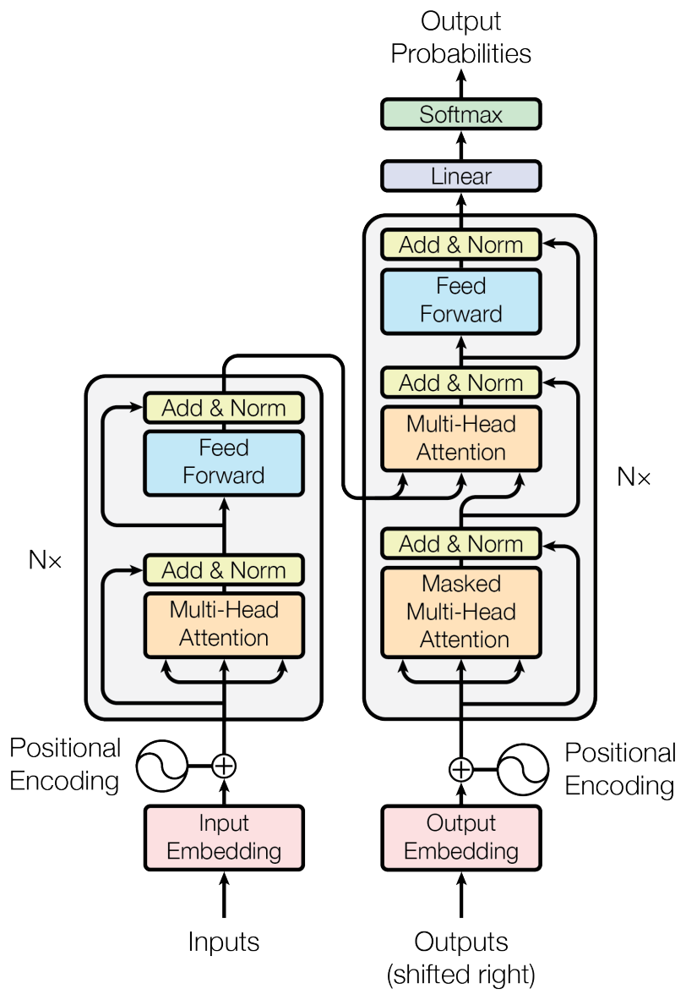
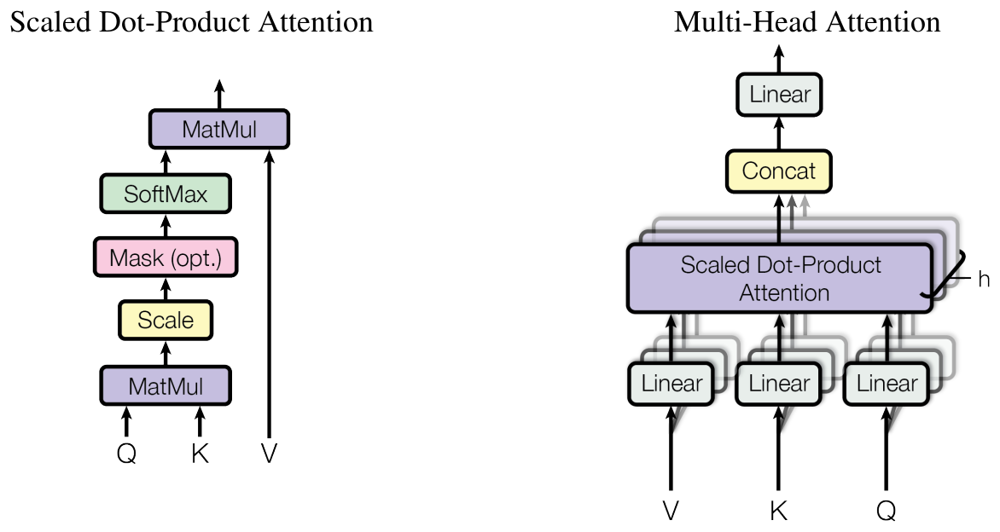
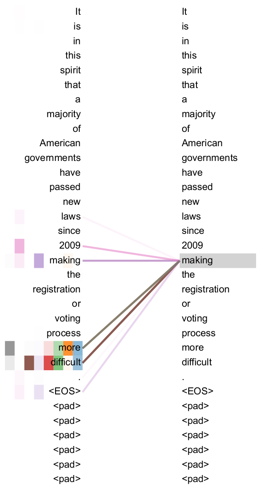
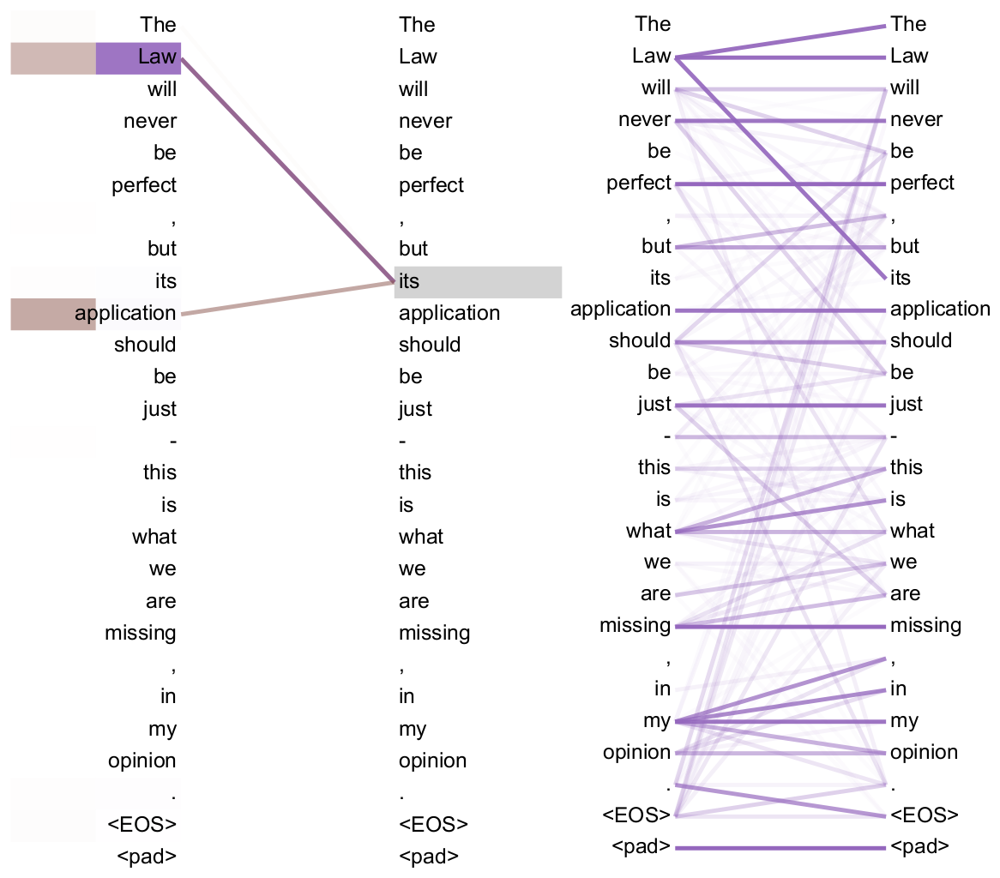
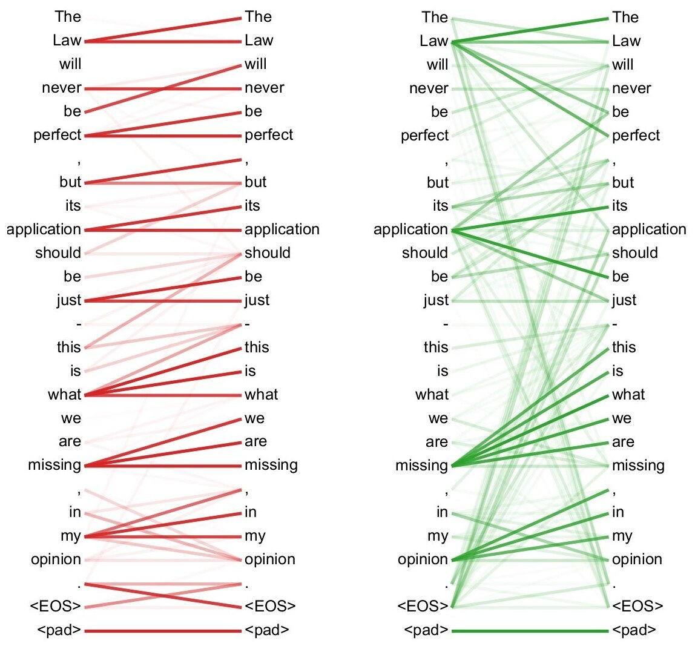

# 论文中文解读：《Attention Is All You Need》

> **基本信息**：Ashish Vaswani、Noam Shazeer、Niki Parmar、Jakob Uszkoreit、Llion Jones、Aidan N. Gomez、Łukasz Kaiser、Illia Polosukhin（Google Brain、Google Research、University of Toronto；作者同等贡献，排名随机），arXiv:1706.03762（本文所用为 v7，2023 年 8 月 2 日），发表于 NIPS 2017；代码见 tensor2tensor；[论文原文（arXiv 页面）](https://arxiv.org/abs/1706.03762)。
>
> **本文的读法**：本文覆盖原文正文的全部 2 张图、全部 4 张表，以及附录的 3 张注意力可视化图。图取自论文 PDF 的原图（附录的三张图原图是竖排文字，本文旋转了 90° 以便阅读），表为逐格核对后的中文转录（数字、模型名保持原样，表头译为中文）。每张图后有图中文字翻译和读图结论，每张表后有原文页码和读法；模型每个组件的公式、维度、训练细节都在正文里讲清楚，因此不必再翻英文原文。图上读出的数值一律标“约”。

## 一、一句话结论

当时主流的序列转换（sequence transduction）模型是带编码器和解码器的复杂循环或卷积网络，最好的模型还会用注意力机制把编码器和解码器连起来。论文提出 Transformer：**只用注意力机制**，完全不用循环和卷积。编码器和解码器各由 6 个相同的层堆成，每层是多头自注意力加逐位置前馈网络，外加残差连接和层归一化；位置信息靠加在输入嵌入上的正弦位置编码提供。结果是训练可以在序列位置上高度并行：在 WMT 2014 英译德上，大模型得到 28.4 BLEU，比此前最好的结果（含集成）高出 2 BLEU 以上，基础模型也超过此前所有已发表的模型和集成；在英译法上，单模型 41.8 BLEU（见表 2；正文 6.1 节写成了 41.0，原文自身不一致），在 8 块 GPU 上训练 3.5 天，训练成本只是文献中最好模型的一小部分。它还成功用于英语成分句法分析，说明该架构并不局限于翻译。

## 二、背景与动机

**循环模型的问题**：循环神经网络、特别是 LSTM（见 [LSTM 解读](../lstm/论文中文解读.md)）和门控循环网络，已经稳固确立为序列建模和转换问题（语言建模、机器翻译）的最先进方法。循环模型通常沿输入和输出序列的符号位置分解计算：把位置对齐到计算时间的步骤上，生成隐藏状态序列 $h_t$，它是前一个隐藏状态 $h_{t-1}$ 和位置 $t$ 的输入的函数。这种**固有的顺序性**使训练样本内部无法并行；序列越长这越关键，因为内存限制了跨样本的批处理。近来的工作通过因式分解技巧和条件计算大幅提高了计算效率（后者还提升了模型性能），但顺序计算这个根本约束仍然存在。

**注意力已是序列建模的组成部分**：注意力机制让模型能够在不考虑输入或输出序列中距离的情况下建模依赖关系（见 [Bahdanau 注意力解读](../bahdanau_attention/论文中文解读.md)）。但除了个别例子，这类注意力机制都是与循环网络联用的。

**其他减少顺序计算的努力**：Extended Neural GPU、ByteNet 和 ConvS2S 都以卷积网络作为基本构件，对所有输入和输出位置并行计算隐藏表示。在这些模型里，把两个任意输入或输出位置的信号关联起来所需的操作数随位置间距离增长：ConvS2S 是线性增长，ByteNet 是对数增长。这使学习远距离位置之间的依赖更困难。Transformer 把它降到**常数**次操作，代价是由于对注意力加权的位置取平均而降低了有效分辨率，论文用多头注意力（3.4 节）来抵消这一影响。

**自注意力**（有时叫内部注意力 intra-attention）是把同一序列的不同位置联系起来、以计算该序列表示的注意力机制，已成功用于阅读理解、抽象式摘要、文本蕴含和学习与任务无关的句子表示。端到端记忆网络基于循环注意力机制而不是与序列对齐的循环，在简单语言的问答和语言建模上表现良好。论文宣称：据其所知，Transformer 是第一个完全依靠自注意力来计算输入输出表示、而不使用与序列对齐的 RNN 或卷积的转换模型。

## 三、模型架构

大多数有竞争力的神经序列转换模型都有编码器–解码器结构。编码器把符号表示的输入序列 $(x_1,\dots,x_n)$ 映射成连续表示序列 $\mathbf z=(z_1,\dots,z_n)$；给定 $\mathbf z$，解码器一次生成一个符号，得到输出序列 $(y_1,\dots,y_m)$。每一步模型都是**自回归**的（auto-regressive）：生成下一个符号时，把先前已生成的符号作为额外输入。

### 3.1 总体结构（图 1）

*图 1（原文 Figure 1，第 3 页）：Transformer 的模型架构。*

**图中文字翻译与读法**：

- **左半（编码器）**：自下而上依次为 Inputs（输入）、Input Embedding（输入嵌入）、与 Positional Encoding（位置编码）相加（$\oplus$），进入重复 $N\times$ 次的一层：Multi-Head Attention（多头注意力）、Add & Norm（残差相加并做层归一化）、Feed Forward（前馈网络）、Add & Norm。每个子层旁边有绕过子层的箭头，表示残差连接。
- **右半（解码器）**：Outputs (shifted right)（右移一位的输出）、Output Embedding（输出嵌入）、加 Positional Encoding，进入重复 $N\times$ 次的一层：Masked Multi-Head Attention（带掩码的多头注意力）、Add & Norm、Multi-Head Attention（对编码器输出的注意力）、Add & Norm、Feed Forward、Add & Norm；之后是 Linear（线性层）、Softmax，输出 Output Probabilities（输出概率）。
- **编码器与解码器的连接**：编码器顶层的输出画出两根线，进入解码器每层中间那个 Multi-Head Attention 的两个输入（作为键和值），第三个输入（查询）来自解码器同一层下方的子层。
- **读图结论**：整个模型只有“注意力 + 前馈 + 残差/归一化 + 嵌入/位置编码”几类部件；解码器比编码器多一个对编码器输出做注意力的子层，且第一个注意力带掩码。

### 3.2 编码器与解码器的堆叠（第 3.1 节）

**编码器**由 $N=6$ 个相同的层堆叠而成。每层有两个子层：第一个是多头自注意力机制，第二个是简单的、逐位置的全连接前馈网络。每个子层外面各有一个残差连接，随后做层归一化（layer normalization）。也就是说，每个子层的输出是

$$
\mathrm{LayerNorm}\bigl(x+\mathrm{Sublayer}(x)\bigr),
$$

其中 $\mathrm{Sublayer}(x)$ 是子层自己实现的函数。为了便于这些残差连接，模型中所有子层以及嵌入层的输出维度都是 $d_{\mathrm{model}}=512$。

**解码器**也由 $N=6$ 个相同的层堆叠而成。除了编码器层里的两个子层，解码器再插入第三个子层，它对**编码器堆叠的输出**做多头注意力。与编码器类似，每个子层外都有残差连接，随后是层归一化。解码器的自注意力子层还做了修改，**防止位置关注后续位置**：这种掩码，加上输出嵌入偏移一个位置，确保对位置 $i$ 的预测只依赖于位置小于 $i$ 的已知输出。

### 3.3 注意力：缩放点积注意力（第 3.2 节，图 2 左）

注意力函数可以描述为把一个查询（query）和一组键–值（key–value）对映射为一个输出，其中查询、键、值和输出都是向量。输出是值的加权和，赋给每个值的权重由查询与对应键的兼容性函数算出。

论文使用的是“缩放点积注意力”（Scaled Dot-Product Attention）：输入由维度为 $d_k$ 的查询和键以及维度为 $d_v$ 的值组成；计算查询与所有键的点积，每个除以 $\sqrt{d_k}$，再用 softmax 得到值上的权重。实际中把一组查询同时打包成矩阵 $Q$，键和值也分别打包成矩阵 $K$ 和 $V$，输出矩阵为

$$
\mathrm{Attention}(Q,K,V)=\mathrm{softmax}\!\left(\frac{QK^{\top}}{\sqrt{d_k}}\right)V.\qquad(1)
$$

*图 2（原文 Figure 2，第 4 页）：左，缩放点积注意力；右，多头注意力由若干并行运行的注意力层组成。*

**图中文字翻译与读法**：

- **左图 Scaled Dot-Product Attention（缩放点积注意力）**：自下而上是 Q、K 进入 MatMul（矩阵乘，得到 $QK^{\top}$）、Scale（除以 $\sqrt{d_k}$）、Mask (opt.)（可选的掩码）、SoftMax；其输出再与 V 做 MatMul，得到输出。
- **右图 Multi-Head Attention（多头注意力）**：V、K、Q 各自经过 Linear（线性投影，每个头一份），进入 $h$ 个并行的 Scaled Dot-Product Attention（图中堆叠的方框表示 $h$ 份），结果经 Concat（拼接）和最后一个 Linear（输出投影）。
- **读图结论**：左图只是式 (1) 的流程图；掩码标为“可选”，解码器的自注意力要用，编码器不用。右图说明多头是“先投影、再并行做注意力、再拼接再投影”。

**两种常用的注意力函数**：加性注意力（additive attention，见 Bahdanau 解读）和点积（乘性）注意力。点积注意力与论文的算法一样，只差缩放因子 $1/\sqrt{d_k}$。加性注意力用一个带单隐藏层的前馈网络计算兼容性函数。二者理论复杂度相近，但点积注意力在实践中快得多、也省空间，因为它可以用高度优化的矩阵乘代码实现。

**为什么要缩放**：当 $d_k$ 较小时两种机制表现相近；但当 $d_k$ 较大时，不缩放的点积注意力不如加性注意力（Britz 等 2017）。论文怀疑，$d_k$ 大时点积的数值会变大，把 softmax 推到梯度极小的区域。为抵消这个影响，把点积缩放 $1/\sqrt{d_k}$。原文脚注 4 给出了点积变大的原因：假设 $q$ 和 $k$ 的各分量是相互独立的、均值为 0、方差为 1 的随机变量，则它们的点积 $q\cdot k=\sum_{i=1}^{d_k}q_ik_i$ 的均值为 0、方差为 $d_k$；除以 $\sqrt{d_k}$ 即把方差拉回 1。

### 3.4 多头注意力（第 3.2.2 节，图 2 右）

与其用 $d_{\mathrm{model}}$ 维的键、值和查询做一次注意力，论文发现更有益的做法是：把查询、键、值分别用不同的、学出来的线性投影**投影 $h$ 次**，投影到 $d_k$、$d_k$、$d_v$ 维；在每个投影版本上并行地做注意力函数，得到 $d_v$ 维的输出；把它们拼接起来再投影一次，得到最终的值：

$$
\mathrm{MultiHead}(Q,K,V)=\mathrm{Concat}(\mathrm{head}_1,\dots,\mathrm{head}_h)\,W^{O},\qquad
\mathrm{head}_i=\mathrm{Attention}\bigl(QW_i^{Q},\,KW_i^{K},\,VW_i^{V}\bigr),
$$

其中投影矩阵 $W_i^{Q}\in\mathbb R^{d_{\mathrm{model}}\times d_k}$，$W_i^{K}\in\mathbb R^{d_{\mathrm{model}}\times d_k}$，$W_i^{V}\in\mathbb R^{d_{\mathrm{model}}\times d_v}$，$W^{O}\in\mathbb R^{hd_v\times d_{\mathrm{model}}}$。多头注意力让模型能够**共同关注来自不同表示子空间、不同位置的信息**；只用单个注意力头时，取平均会抑制这一点。

论文用 $h=8$ 个并行注意力层（头），每个头取 $d_k=d_v=d_{\mathrm{model}}/h=64$。由于每个头的维度降低了，总计算量与全维度的单头注意力相近。

### 3.5 模型里注意力的三种用法（第 3.2.3 节）

1. **编码器–解码器注意力**（“encoder-decoder attention”）：查询来自前一个解码器层，记忆的键和值来自编码器的输出。这让解码器的每个位置都能关注输入序列的所有位置，模仿了 seq2seq 模型里典型的编码器–解码器注意力机制。
2. **编码器里的自注意力层**：自注意力层中所有的键、值、查询来自同一个地方——这里是编码器上一层的输出；编码器的每个位置可以关注上一层的所有位置。
3. **解码器里的自注意力层**：同样让解码器的每个位置关注解码器中直到并包括该位置的所有位置。为保持自回归性质，要防止解码器里信息向左流动。实现方式是在缩放点积注意力内部，把 softmax 输入里对应非法连接的值全部**掩掉**（设为 $-\infty$），见图 2 左的 Mask。

### 3.6 逐位置前馈网络（第 3.3 节）

除注意力子层外，编码器和解码器的每一层还含有一个全连接前馈网络，对每个位置分别且相同地应用。它由两次线性变换和中间的 ReLU 构成：

$$
\mathrm{FFN}(x)=\max(0,\,xW_1+b_1)\,W_2+b_2.\qquad(2)
$$

不同位置用同样的线性变换，但不同层使用不同的参数。另一种描述方式是两个核大小为 1 的卷积。输入输出维度是 $d_{\mathrm{model}}=512$，中间层维度是 $d_{ff}=2048$。

### 3.7 嵌入与 softmax（第 3.4 节）

与其他序列转换模型类似，用学出来的嵌入把输入 token 和输出 token 转成 $d_{\mathrm{model}}$ 维的向量；用常规的学习到的线性变换和 softmax 把解码器输出转成预测的下一个 token 的概率。模型中，**两个嵌入层和 softmax 前的线性变换共享同一个权重矩阵**（类似 Press 与 Wolf 2016）；在嵌入层里，把这些权重乘以 $\sqrt{d_{\mathrm{model}}}$。

### 3.8 位置编码（第 3.5 节）

模型不含循环也不含卷积，为了让模型利用序列的顺序，必须注入一些关于 token 在序列中相对或绝对位置的信息。为此，在编码器和解码器堆叠的底部把“位置编码”加到输入嵌入上。位置编码与嵌入的维度相同（都是 $d_{\mathrm{model}}$），所以二者可以相加。位置编码有很多选择，可学习的和固定的都有。论文使用不同频率的正弦和余弦函数：

$$
PE_{(pos,\,2i)}=\sin\!\bigl(pos/10000^{2i/d_{\mathrm{model}}}\bigr),\qquad
PE_{(pos,\,2i+1)}=\cos\!\bigl(pos/10000^{2i/d_{\mathrm{model}}}\bigr),
$$

其中 $pos$ 是位置，$i$ 是维度（的编号）。也就是说，位置编码的每个维度对应一个正弦曲线；波长构成从 $2\pi$ 到 $10000\cdot2\pi$ 的等比数列。（按 $d_{\mathrm{model}}=512$ 计算，最快的一对周期约 6.28，最慢的一对周期约 $2\pi\times9647\approx6.1\times10^4$，这是本文的验算。）

作者选这个函数是因为假设它能让模型容易学会按**相对位置**关注：对任意固定偏移 $k$，$PE_{pos+k}$ 可以表示成 $PE_{pos}$ 的线性函数。（本文补充：对每一对 $(\sin,\cos)$，设 $\omega=1/10000^{2i/d_{\mathrm{model}}}$，由和角公式有下式，即偏移 $k$ 对应一个只依赖 $k$ 的旋转矩阵。）

$$
\begin{pmatrix}\sin\omega(pos+k)\\\cos\omega(pos+k)\end{pmatrix}
=
\begin{pmatrix}\cos\omega k&\sin\omega k\\-\sin\omega k&\cos\omega k\end{pmatrix}
\begin{pmatrix}\sin\omega\,pos\\\cos\omega\,pos\end{pmatrix}.
$$

论文也试了学习的位置嵌入，发现两者结果几乎相同（表 3 的 (E) 行）。选正弦版本是因为它也许能让模型外推到比训练时遇到的更长的序列。

### 3.9 整体数据流与维度走读（本文归纳）

下面是对上述组件的串联，便于对照图 1（$n$ 为序列长度）：

1. **编码器输入**：源 token 经嵌入得到 $n\times512$ 的矩阵，乘以 $\sqrt{512}$，加上位置编码，再做 dropout（5.4 节）。
2. **编码器每一层**（共 6 层）：$x\leftarrow\mathrm{LayerNorm}(x+\mathrm{MultiHead}(x,x,x))$；$x\leftarrow\mathrm{LayerNorm}(x+\mathrm{FFN}(x))$。其中多头自注意力对每个头：$X\in\mathbb R^{n\times512}$ 经 $W_i^{Q},W_i^{K},W_i^{V}$ 得到 $n\times64$ 的 $Q_i,K_i,V_i$；$Q_iK_i^{\top}/8$ 是 $n\times n$ 的分数矩阵；逐行 softmax；再乘 $V_i$ 得到 $n\times64$；8 个头拼成 $n\times512$，再乘 $W^{O}\in\mathbb R^{512\times512}$。输出是 $\mathbf z\in\mathbb R^{n\times512}$。
3. **解码器输入**：已生成的目标 token 右移一位，经嵌入、乘 $\sqrt{512}$、加位置编码。训练时整句目标一次性并行输入，靠掩码保证位置 $i$ 只看 $<i$ 的位置；推理时逐 token 自回归生成。
4. **解码器每一层**（共 6 层）：带掩码的自注意力 + Add & Norm；对 $\mathbf z$ 的编码器–解码器注意力（查询来自解码器，键和值来自 $\mathbf z$）+ Add & Norm；FFN + Add & Norm。
5. **输出**：线性层（与嵌入共享权重）加 softmax，得到下一个 token 的概率。
6. **参数粗算（本文）**：每个多头注意力块（$W^Q,W^K,W^V,W^O$）约 $4\times512\times512\approx1.05\text{M}$，每个 FFN 约 $2\times512\times2048\approx2.10\text{M}$；因此编码器层约 3.15M，解码器层（两个注意力块加 FFN）约 4.2M；6 层编码器和 6 层解码器合计约 44M，再加共享的词嵌入矩阵（按约 37000 词、512 维约 19M），粗算合计约 63M，与表 3 的 65M 接近（差异来自论文没有给出的细节）。

## 四、为什么用自注意力（第 4 节，表 1）

论文把自注意力层与常用于把一个变长符号表示序列 $(x_1,\dots,x_n)$ 映射到等长序列 $(z_1,\dots,z_n)$（$x_i,z_i\in\mathbb R^d$，如典型序列转换编码器或解码器中的隐藏层）的循环层和卷积层做比较，考虑三个需求：

1. **每层的总计算复杂度**；
2. **可并行的计算量**，用所需的最小顺序操作数衡量；
3. **网络中长程依赖之间的路径长度**。学习长程依赖是许多序列转换任务的关键难题；影响学习这类依赖能力的一个关键因素，是前向和后向信号必须穿过的路径长度。输入和输出序列中任意位置组合之间的路径越短，越容易学习长程依赖。因此也比较由不同层类型构成的网络中任意两个输入输出位置之间的最大路径长度。

表 1：不同层类型的最大路径长度、每层复杂度和最小顺序操作数。$n$ 是序列长度，$d$ 是表示维度，$k$ 是卷积的核大小，$r$ 是受限自注意力中邻域的大小。

| 层类型 | 每层复杂度 | 顺序操作数 | 最大路径长度 |
|---|---|---|---|
| Self-Attention（自注意力） | $O(n^2\cdot d)$ | $O(1)$ | $O(1)$ |
| Recurrent（循环） | $O(n\cdot d^2)$ | $O(n)$ | $O(n)$ |
| Convolutional（卷积） | $O(k\cdot n\cdot d^2)$ | $O(1)$ | $O(\log_k(n))$ |
| Self-Attention (restricted)（受限自注意力） | $O(r\cdot n\cdot d)$ | $O(1)$ | $O(n/r)$ |

原文表 1，第 6 页。读法与论文的讨论：

- **自注意力**用常数次顺序执行的操作连接所有位置，而循环层需要 $O(n)$ 次顺序操作；这决定了并行度和路径长度。
- **计算复杂度**：当序列长度 $n$ 小于表示维度 $d$ 时，自注意力层比循环层更快；机器翻译里最先进模型常用的词片（word-piece）和字节对（byte-pair）表示通常如此。（本文示例：$n=50$、$d=512$ 时，$n^2d=1.28\times10^6$，$nd^2\approx1.31\times10^7$，约差 10 倍。）
- **受限自注意力**：对于超长序列，可以把自注意力限制在以各自输出位置为中心、大小为 $r$ 的邻域内，这会把最大路径长度提高到 $O(n/r)$；论文计划在未来工作中进一步研究。
- **卷积**：核宽 $k<n$ 的单个卷积层不能连接所有输入输出位置对；要这么做，连续核需要堆叠 $O(n/k)$ 个卷积层，空洞卷积需要 $O(\log_k(n))$ 个，这增加了网络中任意两位置之间最长路径的长度。卷积层通常比循环层贵一个因子 $k$。可分离卷积（separable convolution）把复杂度大大降到 $O(k\cdot n\cdot d+n\cdot d^2)$；但即使 $k=n$，可分离卷积的复杂度也等于一个自注意力层加一个逐点前馈层的组合，这正是论文采用的方案。
- **附带好处——更好解释**：自注意力可能带来更可解释的模型。论文检查了模型的注意力分布并在附录中给出例子（见 6.4 节）：不仅各个注意力头明显学会了执行不同任务，许多头还表现出与句子句法和语义结构相关的行为。

## 五、训练设置（第 5 节）

### 5.1 训练数据与批处理

- **英德**：标准的 WMT 2014 英德数据集，约 450 万个句对。句子用字节对编码（BPE）编码，源和目标共享一个约 37000 个 token 的词表。
- **英法**：显著更大的 WMT 2014 英法数据集，3600 万个句子，token 切分成 32000 个 word-piece 的词表。
- 句对按近似的序列长度分批；每个训练批包含一组句对，大约 25000 个源 token 和 25000 个目标 token。

### 5.2 硬件与时间

在一台有 8 块 NVIDIA P100 GPU 的机器上训练。基础模型（用论文各处描述的超参数）每个训练步约 0.4 秒，共训练 100,000 步或 12 小时。大模型（表 3 最后一行）每步 1.0 秒，训练 300,000 步（3.5 天）。（本文验算：$10^5\times0.4\,\text{s}\approx11$ 小时，$3\times10^5\times1.0\,\text{s}\approx3.5$ 天，与原文一致。）

### 5.3 优化器与学习率

使用 Adam 优化器（$\beta_1=0.9$，$\beta_2=0.98$，$\epsilon=10^{-9}$）。学习率在训练过程中按下面的公式变化：

$$
lrate=d_{\mathrm{model}}^{-0.5}\cdot\min\bigl(step\_num^{-0.5},\ step\_num\cdot warmup\_steps^{-1.5}\bigr).\qquad(3)
$$

这对应于前 $warmup\_steps$ 个训练步线性增大学习率，之后按步数的平方根倒数成比例减小。论文使用 $warmup\_steps=4000$。（本文验算：$d_{\mathrm{model}}=512$ 时，峰值学习率约 $7.0\times10^{-4}$，出现在第 4000 步；到第 $10^5$ 步约 $1.4\times10^{-4}$。）

### 5.4 正则化

论文说训练中用三种正则化，但正文只列出了两种（原文如此）：

- **残差 dropout（Residual Dropout）**：对每个子层的输出，在它被加到子层输入上并归一化之前，施加 dropout；此外，对编码器和解码器堆叠中嵌入与位置编码之和也施加 dropout。基础模型取 $P_{drop}=0.1$。
- **标签平滑（Label Smoothing）**：训练时使用 $\epsilon_{ls}=0.1$ 的标签平滑。这会损害困惑度，因为模型学会了更不确定，但提高了准确率和 BLEU。

### 5.5 配置汇总

下表汇总论文各处给出的 base 与 big 配置（这是对表 3 和第 5、6 节文字的整理，不是原文表格）：

| 项目 | base（基础模型） | big（大模型） |
|---|---|---|
| 层数 $N$ | 6 | 6 |
| $d_{\mathrm{model}}$ | 512 | 1024 |
| $d_{ff}$ | 2048 | 4096 |
| 头数 $h$ | 8 | 16 |
| $d_k=d_v$ | 64 | 64（表 3 未列出，同 base；$16\times64=1024$） |
| $P_{drop}$ | 0.1 | 0.3（英德）；英法大模型用 0.1 |
| $\epsilon_{ls}$ | 0.1 | 0.1 |
| 训练步数 | 100K（12 小时，约 0.4 秒/步） | 300K（3.5 天，1.0 秒/步） |
| 参数量 | 65M | 213M |
| 推理 | 取最后 5 个检查点的平均（每 10 分钟存一个） | 取最后 20 个检查点的平均 |
| 解码 | 束宽 4，长度惩罚 $\alpha=0.6$，最大输出长度为输入长度 + 50（可提前终止） | 同左 |

## 六、实验结果

### 6.1 机器翻译（第 6.1 节，表 2）

在 WMT 2014 英译德任务上，大 Transformer 模型（表 2 的 Transformer (big)）比此前报告的最好模型（包括集成）高出 2.0 BLEU 以上，新纪录 28.4。该模型的配置见表 3 最后一行，在 8 块 P100 上训练了 3.5 天。即使基础模型也超过所有此前发表的模型和集成，而训练成本只是任何有竞争力的模型的一小部分。在 WMT 2014 英译法任务上，大模型的 BLEU 超过此前所有已发表的单模型，训练成本不到此前最好模型的 1/4；英译法所用的 Transformer (big) 取 $P_{drop}=0.1$ 而不是 0.3。

**推理设置**：基础模型取最后 5 个检查点（每隔 10 分钟写一次）平均得到的单个模型；大模型平均最后 20 个检查点。束搜索的束宽为 4，长度惩罚 $\alpha=0.6$；这些超参数是在开发集上做实验后选定的。推理时最大输出长度设为输入长度 + 50，但可以的话提前终止。

**训练成本估算**：把训练时间、所用 GPU 数量和每块 GPU 持续单精度浮点能力的估计值相乘（原文脚注 5：K80、K40、M40、P100 分别取 2.8、3.7、6.0、9.5 TFLOPS）。

表 2：Transformer 在英德和英法 newstest2014 测试集上取得比此前最先进模型更好的 BLEU，而训练成本只是其一小部分。BLEU 越高越好；训练成本（FLOPs）越小越好。

| 模型 | BLEU EN-DE | BLEU EN-FR | 训练成本 EN-DE | 训练成本 EN-FR |
|---|---:|---:|---:|---:|
| ByteNet [18] | 23.75 | | | |
| Deep-Att + PosUnk [39] | | 39.2 | | $1.0\cdot10^{20}$ |
| GNMT + RL [38] | 24.6 | 39.92 | $2.3\cdot10^{19}$ | $1.4\cdot10^{20}$ |
| ConvS2S [9] | 25.16 | 40.46 | $9.6\cdot10^{18}$ | $1.5\cdot10^{20}$ |
| MoE [32] | 26.03 | 40.56 | $2.0\cdot10^{19}$ | $1.2\cdot10^{20}$ |
| Deep-Att + PosUnk Ensemble [39] | | 40.4 | | $8.0\cdot10^{20}$ |
| GNMT + RL Ensemble [38] | 26.30 | 41.16 | $1.8\cdot10^{20}$ | $1.1\cdot10^{21}$ |
| ConvS2S Ensemble [9] | 26.36 | **41.29** | $7.7\cdot10^{19}$ | $1.2\cdot10^{21}$ |
| Transformer (base model) | 27.3 | 38.1 | **$3.3\cdot10^{18}$** | 同左（原表合并两列） |
| Transformer (big) | **28.4** | **41.8** | $2.3\cdot10^{19}$ | 同左（原表合并两列） |

原文表 2，第 8 页。表中空格是原文没有给出的数据；Transformer 两行的训练成本在原表中是跨 EN-DE 与 EN-FR 两列的合并单元格。读法：

- **英德**：Transformer (base) 的 27.3 已高于所有此前模型和集成（最高的 ConvS2S 集成 26.36），而训练成本 $3.3\cdot10^{18}$ 低于所有对比项（最低的是 ConvS2S 单模型的 $9.6\cdot10^{18}$）；Transformer (big) 为 28.4，比最好的集成高 2.04。
- **英法**：Transformer (big) 41.8，高于所有单模型（最高的 MoE 40.56）以及所有集成（最高的 ConvS2S 集成 41.29）；成本 $2.3\cdot10^{19}$，约为此前单模型最高分 MoE（40.56，成本 $1.2\cdot10^{20}$）的 19%，也只有成本最低的对比单模型 Deep-Att + PosUnk（$1.0\cdot10^{20}$）的 23%，与论文所说“不到此前最好模型的 1/4”一致。Transformer (base) 在英法上为 38.1，低于表中所有给出英法分数的对比项（不过训练成本只有 $3.3\cdot10^{18}$）。
- **注意**：论文正文 6.1 节写的是英法大模型“BLEU 41.0”，而摘要和表 2 都是 41.8，原文自身不一致；本文按表 2 和摘要引用 41.8。
- 训练成本是论文用“训练时间 × GPU 数 × 每块 GPU 持续单精度算力估计值”估算的 FLOPs，而不是实测；其他模型的成本也是估算，所以只能看数量级。（本文验算：base $12\,\text{h}\times8\times9.5\,\text{TFLOPS}\approx3.3\times10^{18}$，big $3.5\,\text{天}\times8\times9.5\,\text{TFLOPS}\approx2.3\times10^{19}$，与表一致。）

### 6.2 模型变体消融（第 6.2 节，表 3）

为评估 Transformer 各组件的重要性，论文以不同方式改动基础模型，在英译德开发集 newstest2013 上度量性能变化；用前面所述的束搜索，但不做检查点平均。

表 3：Transformer 架构的变体。未列出的值与基础模型相同（本表用“—”表示）。所有指标都在英译德开发集 newstest2013 上。PPL 是按 word-piece（即论文的字节对编码）算的，不应与按词的困惑度比较。BLEU 越高越好，PPL 越低越好。

| 行 | $N$ | $d_{\mathrm{model}}$ | $d_{ff}$ | $h$ | $d_k$ | $d_v$ | $P_{drop}$ | $\epsilon_{ls}$ | 训练步数 | PPL（dev） | BLEU（dev） | 参数量（×10^6） |
|---|---:|---:|---:|---:|---:|---:|---:|---:|---:|---:|---:|---:|
| base | 6 | 512 | 2048 | 8 | 64 | 64 | 0.1 | 0.1 | 100K | 4.92 | 25.8 | 65 |
| (A) | — | — | — | 1 | 512 | 512 | — | — | — | 5.29 | 24.9 | 未列出 |
| (A) | — | — | — | 4 | 128 | 128 | — | — | — | 5.00 | 25.5 | 未列出 |
| (A) | — | — | — | 16 | 32 | 32 | — | — | — | 4.91 | 25.8 | 未列出 |
| (A) | — | — | — | 32 | 16 | 16 | — | — | — | 5.01 | 25.4 | 未列出 |
| (B) | — | — | — | — | 16 | — | — | — | — | 5.16 | 25.1 | 58 |
| (B) | — | — | — | — | 32 | — | — | — | — | 5.01 | 25.4 | 60 |
| (C) | 2 | — | — | — | — | — | — | — | — | 6.11 | 23.7 | 36 |
| (C) | 4 | — | — | — | — | — | — | — | — | 5.19 | 25.3 | 50 |
| (C) | 8 | — | — | — | — | — | — | — | — | 4.88 | 25.5 | 80 |
| (C) | — | 256 | — | — | 32 | 32 | — | — | — | 5.75 | 24.5 | 28 |
| (C) | — | 1024 | — | — | 128 | 128 | — | — | — | 4.66 | 26.0 | 168 |
| (C) | — | — | 1024 | — | — | — | — | — | — | 5.12 | 25.4 | 53 |
| (C) | — | — | 4096 | — | — | — | — | — | — | 4.75 | 26.2 | 90 |
| (D) | — | — | — | — | — | — | 0.0 | — | — | 5.77 | 24.6 | 未列出 |
| (D) | — | — | — | — | — | — | 0.2 | — | — | 4.95 | 25.5 | 未列出 |
| (D) | — | — | — | — | — | — | — | 0.0 | — | 4.67 | 25.3 | 未列出 |
| (D) | — | — | — | — | — | — | — | 0.2 | — | 5.47 | 25.7 | 未列出 |
| (E) 学习的位置嵌入代替正弦位置编码 | — | — | — | — | — | — | — | — | — | 4.92 | 25.7 | 未列出 |
| big | 6 | 1024 | 4096 | 16 | — | — | 0.3 | — | 300K | **4.33** | **26.4** | 213 |

原文表 3，第 9 页。注意：(A) 行的 $d_k=d_v=d_{\mathrm{model}}/h$，所以 $h$ 变化时总计算量和参数量保持不变（原文这几行不列参数量）；big 行的 $d_k$、$d_v$ 原表未列，沿用 base 的 64；(E) 行在原表中是横跨多列的一句文字“positional embedding instead of sinusoids”。读法（论文的描述加上数字）：

- **(A) 头数**（总计算量保持不变）：单头注意力比最好的设置低 0.9 BLEU（24.9 对 25.8）；头数太多质量也会下降（32 头 25.4）。8 头与 16 头都是 25.8。
- **(B) 键维度 $d_k$**：减小 $d_k$ 会损害模型质量（16：25.1；32：25.4；base 的 64：25.8）。论文由此推测，决定兼容性并不容易，比点积更复杂的兼容性函数也许有益。
- **(C) 规模**：如预期，越大的模型越好——层数 $N$：2 层 23.7，4 层 25.3，8 层 25.5；$d_{\mathrm{model}}$：256 为 24.5，1024 为 26.0；$d_{ff}$：1024 为 25.4，4096 为 26.2。参数量也随之变化（28M 到 168M）。
- **(D) 正则化**：dropout 对避免过拟合非常有用：$P_{drop}=0.0$ 的 BLEU 为 24.6，0.2 为 25.5。标签平滑：$\epsilon_{ls}=0.0$ 的困惑度更低（4.67 对 base 的 4.92）但 BLEU 更低（25.3），$\epsilon_{ls}=0.2$ 的 BLEU 为 25.7，印证“标签平滑损害困惑度、提高 BLEU”。
- **(E) 位置编码**：用学习的位置嵌入替换正弦位置编码，结果与基础模型几乎相同（25.7 对 25.8）。
- **big**：$N=6$、$d_{\mathrm{model}}=1024$、$d_{ff}=4096$、$h=16$、$P_{drop}=0.3$，训练 300K 步，开发集 PPL 4.33、BLEU 26.4，参数量 213M。
- **证据边界**：这是单次训练、在开发集上得到的数字，论文没有报告方差；0.1 到 0.3 BLEU 的差异不宜过度解读。本表与表 2 的 BLEU 不是同一数据集（开发集 newstest2013 对测试集 newstest2014），不能混比。

### 6.3 英语成分句法分析（第 6.3 节，表 4）

为检验 Transformer 能否泛化到其他任务，论文做了英语成分句法分析实验。这个任务有特殊挑战：输出受强结构约束，并且明显比输入长；而且 RNN 序列到序列模型在小数据场景下一直无法达到最先进水平。

**设置**：在 Penn Treebank 的华尔街日报（WSJ）部分训练一个 4 层、$d_{\mathrm{model}}=1024$ 的 Transformer，约 4 万个训练句子；还在半监督设置下训练，使用更大的高置信度语料和 BerkeleyParser 语料，约 1700 万个句子。WSJ-only 设置用 16K token 的词表，半监督设置用 32K。只做了少量实验来选择 dropout（注意力和残差两处，见 5.4 节）、学习率和束宽，用的是第 22 节开发集；其余所有参数都与英译德基础模型保持不变。推理时把最大输出长度增加到输入长度 + 300；两种设置都用束宽 21 和 $\alpha=0.3$。

表 4：Transformer 能很好地泛化到英语成分句法分析（结果在 WSJ 第 23 节）。指标是 F1，越高越好。

| 解析器 | 训练方式 | WSJ 23 F1 |
|---|---|---:|
| Vinyals & Kaiser el al. (2014) [37] | WSJ only, discriminative | 88.3 |
| Petrov et al. (2006) [29] | WSJ only, discriminative | 90.4 |
| Zhu et al. (2013) [40] | WSJ only, discriminative | 90.4 |
| Dyer et al. (2016) [8] | WSJ only, discriminative | 91.7 |
| Transformer (4 layers) | WSJ only, discriminative | 91.3 |
| Zhu et al. (2013) [40] | semi-supervised | 91.3 |
| Huang & Harper (2009) [14] | semi-supervised | 91.3 |
| McClosky et al. (2006) [26] | semi-supervised | 92.1 |
| Vinyals & Kaiser el al. (2014) [37] | semi-supervised | 92.1 |
| Transformer (4 layers) | semi-supervised | 92.7 |
| Luong et al. (2015) [23] | multi-task | 93.0 |
| Dyer et al. (2016) [8] | generative | 93.3 |

原文表 4，第 10 页（训练方式一列：WSJ only 为只用 WSJ 训练的判别式；semi-supervised 为半监督；multi-task 为多任务；generative 为生成式）。读法：

- 论文的结论：尽管没有针对任务做专门调参，模型表现出奇地好，结果好于此前报告的所有模型，只有递归神经网络文法（RNNG，Dyer 等 2016）除外；与 RNN 序列到序列模型不同，Transformer 只用 4 万句的 WSJ 训练集就超过了 BerkeleyParser（91.3 对 90.4）。
- **对照表中数字**：WSJ-only 的 91.3 低于 Dyer 等的判别式 91.7；半监督的 92.7 在半监督一类里最高，但低于 Luong 等的多任务 93.0 和 Dyer 等的生成式 93.3。所以“除 RNNG 外好于所有此前模型”与表中数字并不完全一致（Luong 等的 93.0 也更高），读正文结论时应以表为准。
- 这个实验只做了极少的调参，主要证明架构的可迁移性，而不是句法分析的新纪录。

### 6.4 注意力可视化（附录，图 3–5）

论文在附录给出编码器自注意力的可视化，用来支撑第 4 节说的“自注意力可能带来更可解释的模型”。三张图都取自编码器第 5 层（共 6 层）。原图的文字是竖排的，本文把每张图顺时针旋转了 90°，因此原图中的“上/下”在下面的图里变成“右/左”。

*图 3（原文 Figure 3，第 13 页）：编码器第 5 层（共 6 层）自注意力里，注意力机制跟踪长距离依赖的一个例子。*

**图中文字翻译与读法**：

- 原文图题：许多注意力头都关注动词 *making* 的一个远距离依赖，补全短语 *making … more difficult*。图中只显示词 *making* 的注意力；不同颜色代表不同的头；最好看彩色图。
- 句子是 *It is in this spirit that a majority of American governments have passed new laws since 2009 making the registration or voting process more difficult . `<EOS>`*，后面是 6 个 `<pad>`。右列中高亮（灰条）的是查询词 *making*，连线连向左列被关注的词；左列各词旁的彩色方块表示 8 个头在该词上的权重。
- 从图上看：从 *making* 出发的粗线（灰褐色和棕色两个头）连向相隔 6–7 个词的 *more* 和 *difficult*，其他头也有连向 *2009*、*making* 自己、`<EOS>` 等词的较淡连线。
- **读图结论**：这是定性的例子，说明在不经过逐词传递的情况下，自注意力能让一个词直接连到句子里远处的、语法上相关的词（这里是 *making* 与 *more difficult*）；只是单个句子、单个层的展示，不能当作对所有头的统计结论。

*图 4（原文 Figure 4，第 14 页）：同在第 5 层（共 6 层）的两个注意力头，看起来参与了指代消解（anaphora resolution）。*

**图中文字翻译与读法**：

- 原文图题：上图为第 5 个头的完整注意力；下图为仅从词 *its* 出发的、第 5 和第 6 个头的孤立注意力。注意对这个词来说注意力非常尖锐。本文旋转后，右侧是第 5 个头的完整注意力（原图在上），左侧是 *its* 的孤立注意力（原图在下）。
- 句子是 *The Law will never be perfect , but its application should be just - this is what we are missing , in my opinion . `<EOS>`*。左侧的两条线：从 *its*（右列高亮）出发，一条紫色线连向 *Law*（第 5 个头），一条棕粉色线连向 *application*（第 6 个头）。右侧是整句的完整注意力连线（紫色，越深权重越大）。
- **读图结论**：*its* 指代的是 *Law*，其所属的 *application* 也被关注；两个头的注意力都很尖锐（几乎只集中在一个词上），论文据此说它们“似乎参与了指代消解”。这是描述性的观察，不是对指代消解能力的量化评估。

*图 5（原文 Figure 5，第 15 页）：许多注意力头表现出似乎与句子结构有关的行为。*

**图中文字翻译与读法**：

- 原文图题：上面给出了两个这样的例子，来自编码器第 5 层（共 6 层）自注意力中的两个不同的头；这些头明显学会了执行不同的任务。本文旋转后，右侧（绿色）对应原图上方的头，左侧（红色）对应原图下方的头；两张图用的是同一个句子，与图 4 相同。
- 从图上看：红色头的连线大多发生在同一个词或相邻词之间，近似局部、带少量位移；绿色头则让 *Law*、*application*、*missing*、*opinion*、`<EOS>` 等词向所在短语或从句里的许多词发出连线，更成片、更长程。
- **读图结论**：不同的头学到了明显不同的注意力模式，这印证多头设计里“不同头可以做不同的事”的动机；论文只说这些行为“似乎与句子结构有关”，并没有对其做定量检验。

## 七、结论、局限与常见误读

**论文的结论（第 7 节）**：论文提出了 Transformer，第一个完全基于注意力的序列转换模型，用多头自注意力取代了编码器–解码器架构里最常用的循环层。对翻译任务，Transformer 的训练速度显著快于基于循环或卷积层的架构；在 WMT 2014 英译德和英译法上都达到了新的最先进水平，前者中最好的模型甚至超过所有此前报告的集成。作者期待基于注意力的模型的未来，计划把它用到其他任务上：把 Transformer 扩展到涉及文本以外的输入输出模态的问题，研究局部的、受限的注意力机制以高效处理图像、音频、视频这类大的输入输出；让生成变得不那么顺序化也是他们的研究目标之一。

**局限与证据边界**：

- **只验证了两类任务**：机器翻译（英德、英法）和英语成分句法分析。更多的任务和模态（语言建模、预训练、视觉、语音）都是后续工作，不属于这篇论文的证据。
- **自注意力的代价**：每层复杂度 $O(n^2\cdot d)$（表 1），序列很长时内存和计算都随 $n^2$ 增长；论文自己提出的缓解办法是受限自注意力（邻域 $r$），但没有实验。
- **并行性的含义**：训练时可以对整个目标序列并行，推理时解码器仍然是逐 token 的自回归；论文把“让生成不那么顺序化”列为未来目标。
- **消融的范围**：表 3 只在英译德开发集上，单次训练，没有方差；对注意力头为何有用的解释（可视化）是定性的。
- **成本口径**：训练 FLOPs 是估算（8 块 P100，持续单精度 9.5 TFLOPS 等），不同论文的硬件不同，只能看数量级。
- **原文自身的小不一致**：英法大模型 BLEU 在正文是 41.0、在摘要和表 2 是 41.8；正文称“三种正则化”但只列出两种；句法分析的正文结论与表 4 的数字不完全吻合（见 6.3 节）。

**常见误读**：

- “Transformer 就是自注意力”：完整系统还包括多头、逐位置前馈、残差连接、层归一化、掩码、位置编码、学习率预热、标签平滑、检查点平均和束搜索；表 3 说明头数、键维度、层数、宽度、dropout、标签平滑都影响结果。
- “位置编码是可有可无的”：没有循环和卷积，模型不含任何顺序信息，必须靠位置编码注入；表 3 的 (E) 行只是说明学习的位置嵌入与正弦编码效果几乎一样，不是说可以不要位置信息。
- “原版就是今天常见的 Transformer”：原版是**后归一化**（post-LN，$\mathrm{LayerNorm}(x+\mathrm{Sublayer}(x))$）的编码器–解码器，使用正弦位置编码和 ReLU；今天常见的预归一化、仅解码器（decoder-only）结构、RoPE、RMSNorm、GQA 等都是后续发展，不应倒写进原论文。
- “28.4 / 41.8 BLEU 说明它在所有设置下都更好”：这些结果对应特定数据、词表、解码设置和 BLEU 评测；英法基础模型的 38.1 就低于多数对比项。
- “注意力权重 = 解释”：图 3–5 是定性例子，论文只说这些头“似乎”与句法、语义结构相关，并不是因果解释的证据。

## 八、复现检查清单

- 数据与词表：英德 WMT 2014 约 450 万句对，共享 BPE 词表约 37000；英法 3600 万句，32000 的 word-piece 词表；按近似长度分批，每批约 25000 源 token 加 25000 目标 token。
- 模型：base 为 $N=6$、$d_{\mathrm{model}}=512$、$d_{ff}=2048$、$h=8$、$d_k=d_v=64$；编码器、解码器各 6 层；每个子层 $\mathrm{LayerNorm}(x+\mathrm{Sublayer}(x))$（后归一化）；嵌入与 softmax 前的线性层共享权重，嵌入乘 $\sqrt{d_{\mathrm{model}}}$；正弦位置编码。
- 掩码：解码器自注意力把非法位置在 softmax 之前设为 $-\infty$；输出嵌入右移一位；padding 的处理论文没有写（按长度分批仍会有 padding，实现时需要在 softmax 前屏蔽，这是实现常识）。
- 优化：Adam（$\beta_1=0.9$，$\beta_2=0.98$，$\epsilon=10^{-9}$），按式 (3) 调整学习率，$warmup\_steps=4000$；残差 dropout 0.1（对子层输出以及嵌入与位置编码之和）；标签平滑 0.1。论文提到注意力 dropout（句法分析部分），但在翻译部分没有明说，复现时应单独记录。
- 解码：束宽 4、长度惩罚 $\alpha=0.6$，最大输出长度为输入长度 + 50；base 取最后 5 个检查点平均（每 10 分钟存一个），big 取最后 20 个。
- 评测：newstest2014，BLEU；开发集 newstest2013 用于消融，困惑度是按 word-piece 计的，不能与按词的困惑度比较；报告 FLOPs 估算时写明 GPU 持续算力假设。
- 消融：表 3 中 (A) 行要保持总计算量不变（$d_k=d_v=d_{\mathrm{model}}/h$），其余只改一个因素。

## 九、与相关论文的关系

- 前置：[LSTM](../lstm/论文中文解读.md)（循环结构的原型）、[Seq2Seq](../seq2seq/论文中文解读.md)（编码器–解码器范式）、[Bahdanau 注意力](../bahdanau_attention/论文中文解读.md)（加性注意力）。本文用点积注意力替代加性注意力，并把注意力从“编码器到解码器”扩展到序列内部。
- 后续：[Transformer-XL](../transformer_xl/论文中文解读.md)（为长上下文加入片段级循环和相对位置编码）；[BERT](../bert/论文中文解读.md)（只用编码器的预训练）；[GPT-1](../gpt1/论文中文解读.md)（只用解码器的预训练）；[RoPE](../rope/论文中文解读.md)、[ALiBi](../alibi/论文中文解读.md)（位置编码的改进）；[Multi-Query Attention](../multi_query_attention/论文中文解读.md)、[GQA](../grouped_query_attention/论文中文解读.md)（降低推理时的键值开销）；[FlashAttention](../flash_attention/论文中文解读.md)（针对 $O(n^2)$ 注意力的 IO 优化）。

## 原文证据导航

- [原论文 PDF](paper.pdf)：架构与图 1 在第 3 页，注意力公式与图 2 在第 4 页，多头注意力、前馈、嵌入在第 4–5 页，位置编码与表 1 在第 6 页，为什么用自注意力在第 6–7 页，训练设置在第 7–8 页，表 2 在第 8 页，表 3 在第 9 页，句法分析与表 4 在第 9–10 页，附录的注意力可视化（图 3–5）在第 13–15 页。
- [原文提取文本](paper.txt)：表 2、表 3 的列对齐在抽取文本里已经打乱，核对数字请以 PDF 为准。
- [论文概要](论文概要.md)
