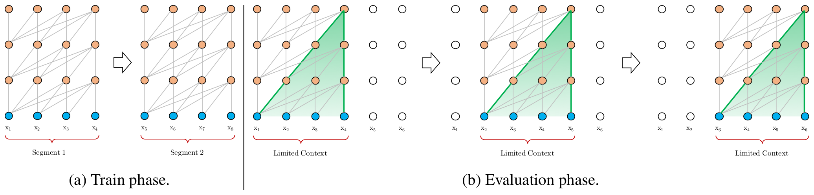
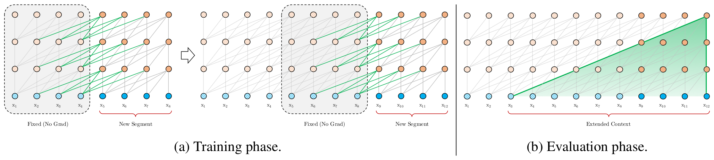
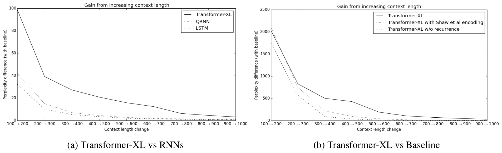
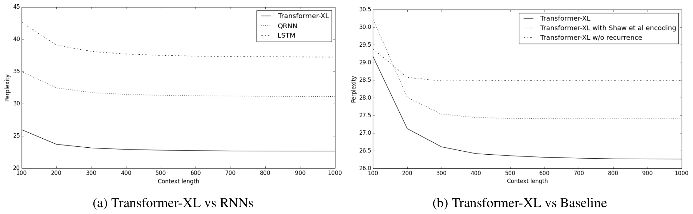
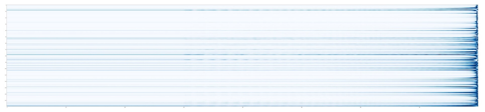
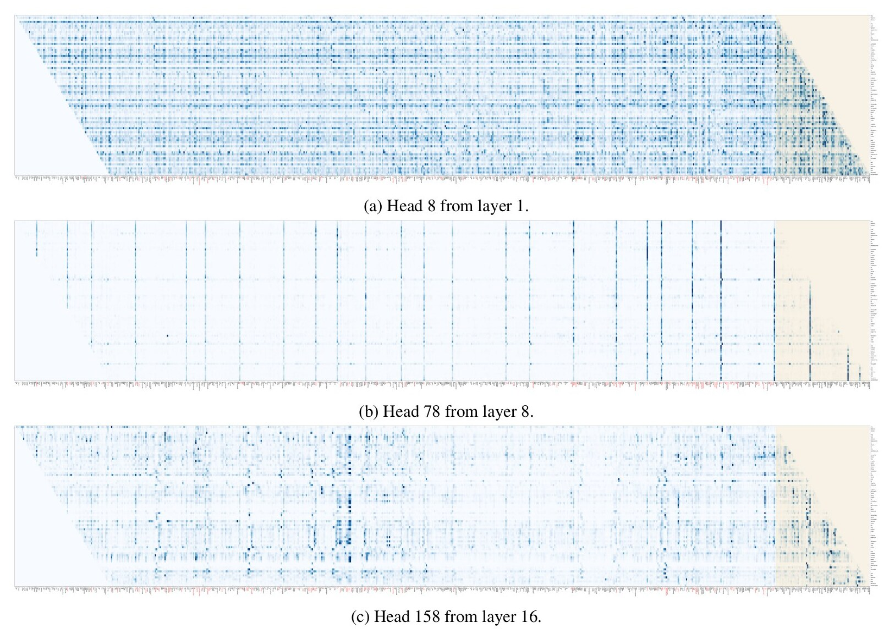
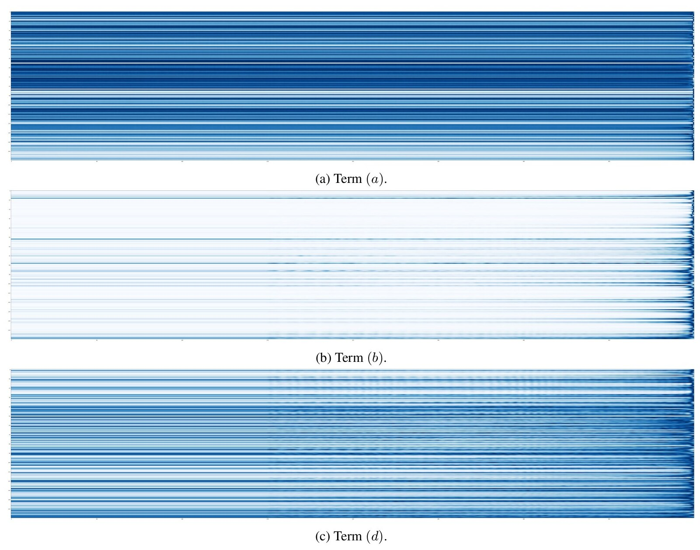

# 论文中文解读：《Transformer-XL: Attentive Language Models Beyond a Fixed-Length Context》

> **基本信息**：Zihang Dai、Zhilin Yang（同等贡献）、Yiming Yang、Jaime Carbonell、Quoc V. Le、Ruslan Salakhutdinov（Carnegie Mellon University；Google Brain），arXiv:1901.02860（本文所用为 v3，2019 年 6 月 2 日）；代码、预训练模型和超参数见 [kimiyoung/transformer-xl](https://github.com/kimiyoung/transformer-xl)；[论文原文（arXiv 页面）](https://arxiv.org/abs/1901.02860)。
>
> **本文的读法**：本文覆盖原文正文的全部 2 张方法图、全部 9 张表，以及附录的 1 张表和 5 张分析图；附录里的三个长文本生成样例（表 11–13）篇幅很长，只概括生成方法和论文的观察，不逐字转录。图取自论文 PDF 的原图，表为逐格核对后的中文转录（数字、模型名保持原样，表头译为中文）。每张图后有图中文字翻译和读图结论，每张表后有原文页码和读法；方法部分的公式逐项解释，因此不必再翻英文原文。图上读出的数值一律标“约”。

## 一、一句话结论

Transformer 能学习更长程的依赖，但在语言建模里受限于**固定长度的上下文**：长文本被切成互不相通的定长片段，片段之间没有信息流动，最大依赖长度被片段长度封顶，而且每个片段开头的几个词因缺少历史而预测得很差（论文称为上下文碎片化，context fragmentation）。Transformer-XL（“XL”指 extra long）用两项互相配合的技术解决这个问题：(1) **段级循环**（segment-level recurrence）：处理新片段时，把上一片段各层算好的隐藏状态缓存下来（停止梯度）当作扩展的上下文，使信息能跨片段流动；(2) **相对位置编码**：只在注意力得分里编码相对距离，使缓存的状态可以被复用而不产生位置混淆，并且能泛化到比训练时更长的注意力长度。论文报告：学到的依赖比 RNN 长 80%、比原始（vanilla）Transformer 长 450%（相对有效上下文长度，表 8）；评测时最高快 1,874 倍；在 enwik8（0.99 bpc）、text8（1.08 bpc）、WikiText-103（18.3 困惑度）、One Billion Word（21.8）和 Penn Treebank（54.5，无微调）上刷新当时的最好结果；只在 WikiText-103 上训练也能生成上千词的较连贯文章。

## 二、背景与动机

**RNN 与 Transformer 的各自问题**：语言建模是需要建模长程依赖的重要问题，已用于无监督预训练等应用。RNN、特别是 LSTM（见 [LSTM 解读](../lstm/论文中文解读.md)）是语言建模的标准方案，但由于梯度消失和爆炸，RNN 难以优化，LSTM 里的门控和梯度裁剪也许不足以完全解决；已有工作发现 LSTM 语言模型平均只利用 200 个上下文词（Khandelwal 等 2018），还有很大改进空间。另一方面，注意力机制内置的长距离词对之间的直接连接可能降低优化难度、使学习长程依赖成为可能（见 [Bahdanau 注意力](../bahdanau_attention/论文中文解读.md)、[Transformer](../transformer/论文中文解读.md)）。Al-Rfou 等（2018）设计了一组辅助损失来训练深层 Transformer 做字符级语言建模，大幅超过 LSTM；但他们的训练是在互相分隔的、几百个字符的定长片段上进行的，片段之间没有信息流。

**两个后果**：由于上下文长度固定，模型无法捕捉超出预定义上下文长度的更长依赖；而且定长片段是选一段连续的符号得到的，不顾句子或其他语义边界，所以模型缺少预测前几个符号所需的上下文信息，导致优化效率低、性能差，这就是**上下文碎片化**。

**本文的思路**：为了解决固定长度上下文的局限，把循环的概念引入深层自注意力网络：不再为每个新片段从头计算隐藏状态，而是复用前面片段得到的隐藏状态；被复用的隐藏状态充当当前片段的记忆，在片段之间建立循环连接。于是建模很长的依赖成为可能，因为信息可以沿循环连接传播；同时，传递前一片段的信息也解决了上下文碎片化。更重要的是，论文说明为了让状态复用不引起时间混淆，必须使用相对位置编码而不是绝对位置编码，作为额外的技术贡献，提出了一种简单但更有效的相对位置编码形式，能泛化到比训练时更长的注意力长度。论文强调这两项技术构成一套完整的解决方案：单独哪一项都不能解决固定长度上下文的问题；并称 Transformer-XL 是第一个在字符级和词级语言建模上都显著优于 RNN 的自注意力模型。

**相关工作（第 2 节）**：近年语言建模的进展包括设计更好编码上下文的新架构、改进正则化和优化算法（Gal 与 Ghahramani 2016）、加速 softmax 计算（Grave 等 2016a）和丰富输出分布族（Yang 等 2017）。为捕捉长程上下文，一类工作直接把更宽上下文的表示作为额外输入送进网络，从手工定义的上下文表示（Mikolov 与 Zweig 2012 等）到从数据中学出的文档级主题（Dieng 等 2016、Wang 等 2017）都有。在更一般的序列建模里，如何捕捉长程依赖是长期的研究问题；自 LSTM 被广泛采用以来，许多工作致力于缓解梯度消失，包括更好的初始化、额外损失信号、增强的记忆结构，以及修改 RNN 内部结构。与这些不同，本文基于 Transformer 架构，并表明语言建模这一现实任务能从学习更长程依赖的能力中受益。

## 三、方法

### 3.1 语言建模设定与原始 Transformer 语言模型（第 3、3.1 节）

给定 token 语料 $\mathbf x=(x_1,\dots,x_T)$，语言建模要估计联合概率 $P(\mathbf x)$，通常自回归分解成 $P(\mathbf x)=\prod_tP(x_t\mid x_{<t})$。于是问题归结为估计每个条件因子。论文沿用标准的神经方法：用一个可训练的神经网络把上下文 $x_{<t}$ 编码成定长隐藏状态，把它与词嵌入相乘得到 logits，再送入 softmax，得到下一个 token 的类别分布。

要把 Transformer 用于语言建模，核心问题是如何训练 Transformer 把任意长的上下文有效地编码成定长表示。若有无限的内存和计算，一个简单的办法是用无条件 Transformer 解码器处理整个上下文序列，类似前馈网络，但实际资源有限，通常做不到。一个可行但粗糙的近似是把整个语料切成可管理大小的较短片段，只在每个片段内训练，忽略前面片段的一切上下文信息——这是 Al-Rfou 等（2018）的做法，论文称之为 **vanilla 模型**（原始模型）。

*图 1（原文 Figure 1，第 3 页）：片段长度为 4 的 vanilla 模型示意；(a) 训练阶段，(b) 评测阶段。*

**图中文字翻译与读法**：

- **图例**：最下面一行蓝色圆点是输入 token $x_1,x_2,\dots$；其上三行橙色圆点是三层隐藏状态；灰线表示注意力连接（每个位置连向同一片段内它自己和之前的位置）；绿色阴影三角形是最右上角那个节点（要做预测的位置）所能看到的全部上下文；白色圆点是不在当前窗口内的 token。
- **(a) 训练阶段（Train phase）**：Segment 1（$x_1$ 到 $x_4$）和 Segment 2（$x_5$ 到 $x_8$）各自独立计算，两个片段之间没有任何连线，信息在前向和反向传播中都不跨片段流动。
- **(b) 评测阶段（Evaluation phase）**：模型每步消耗一个与训练同长的窗口（“Limited Context”，有限上下文），只在最后一个位置做一次预测；然后窗口只向右移动一个位置（$x_1$–$x_4$、$x_2$–$x_5$、$x_3$–$x_6$……），新窗口要从头重新计算。
- **读图结论**：这个做法保证每次预测都用到训练时见过的最长上下文，也缓解了训练中的上下文碎片化，但评测代价极高（每预测一个 token 就要重算整个窗口）。

**vanilla 模型的两个关键局限**：

1. **依赖长度上界**：最大可能的依赖长度受限于片段长度（字符级语言建模里是几百，Al-Rfou 等 2018）。因此，尽管自注意力比 RNN 更不受梯度消失影响，vanilla 模型无法充分发挥这一优化优势。
2. **上下文碎片化**：尽管可以用 padding 来尊重句子或其他语义边界，实际中因为效率更高，标准做法是简单地把长文本切成定长片段（Peters 等 2018、Devlin 等 2018、Al-Rfou 等 2018）。简单切块会导致上下文碎片化。

### 3.2 段级循环与状态复用（第 3.2 节）

训练时，对前一个片段算出的隐藏状态序列被**固定并缓存**，在模型处理下一个新片段时作为扩展上下文复用，如图 2a。尽管梯度仍然只在一个片段之内，这个额外输入让网络能够利用历史信息，从而能建模更长程的依赖并避免上下文碎片化。形式上，设两个相邻的、长度为 $L$ 的片段 $\mathbf s_\tau=[x_{\tau,1},\dots,x_{\tau,L}]$ 和 $\mathbf s_{\tau+1}=[x_{\tau+1,1},\dots,x_{\tau+1,L}]$；记第 $\tau$ 个片段 $\mathbf s_\tau$ 产生的第 $n$ 层隐藏状态序列为 $\mathbf h_\tau^{\,n}\in\mathbb R^{L\times d}$，$d$ 是隐藏维数。那么片段 $\mathbf s_{\tau+1}$ 的第 $n$ 层隐藏状态（示意地）这样产生：

$$
\tilde{\mathbf h}_{\tau+1}^{\,n-1}=\bigl[\mathrm{SG}(\mathbf h_\tau^{\,n-1})\circ\mathbf h_{\tau+1}^{\,n-1}\bigr],
$$

$$
\mathbf q_{\tau+1}^{\,n},\ \mathbf k_{\tau+1}^{\,n},\ \mathbf v_{\tau+1}^{\,n}=\mathbf h_{\tau+1}^{\,n-1}\mathbf W_q^{\top},\ \tilde{\mathbf h}_{\tau+1}^{\,n-1}\mathbf W_k^{\top},\ \tilde{\mathbf h}_{\tau+1}^{\,n-1}\mathbf W_v^{\top},
$$

$$
\mathbf h_{\tau+1}^{\,n}=\text{Transformer-Layer}\bigl(\mathbf q_{\tau+1}^{\,n},\mathbf k_{\tau+1}^{\,n},\mathbf v_{\tau+1}^{\,n}\bigr).
$$

其中 $\mathrm{SG}(\cdot)$ 是 stop-gradient（停止梯度），$[\mathbf h_u\circ\mathbf h_v]$ 表示两个隐藏序列沿**长度维度**拼接，$\mathbf W_\cdot$ 是模型参数。与标准 Transformer 相比，关键区别是键 $\mathbf k_{\tau+1}^{\,n}$ 和值 $\mathbf v_{\tau+1}^{\,n}$ 以扩展上下文 $\tilde{\mathbf h}_{\tau+1}^{\,n-1}$ 为条件，因而也以从前一片段缓存下来的 $\mathbf h_\tau^{\,n-1}$ 为条件；而查询 $\mathbf q_{\tau+1}^{\,n}$ 仍只来自当前片段。论文用图 2a 中的绿色路径强调这一设计。

*图 2（原文 Figure 2，第 4 页）：片段长度为 4 的 Transformer-XL 模型示意；(a) 训练阶段，(b) 评测阶段。*

**图中文字翻译与读法**：

- **(a) 训练阶段（Training phase）**：灰色虚线框标着 “Fixed (No Grad)”（固定、无梯度），是上一片段（$x_1$–$x_4$）缓存下来的各层隐藏状态；右边 “New Segment”（新片段，$x_5$–$x_8$）里每个节点除了连向本段内的节点，还有**绿色连线**连向缓存片段**低一层**（第 $n-1$ 层）的节点；再下一步（箭头之后）缓存变成 $x_5$–$x_8$，新片段是 $x_9$–$x_{12}$。
- **(b) 评测阶段（Evaluation phase）**：“Extended Context”（扩展上下文）跨越 $x_3$ 到 $x_{12}$，绿色阴影三角形表示最右上角节点的感受野。它的底边长度（约 10 个 token）超过一个片段的长度 4；并且每个位置的表示只算一次，之后的位置直接复用，不需要像图 1b 那样每次移动窗口都重算。
- **读图结论**：第 $n$ 层的状态依赖前一片段第 $n-1$ 层的状态，所以这种循环依赖**每经过一个片段就下移一层**，与传统 RNN 语言模型里“同一层内”的循环不同。

**最大依赖长度**：由此，最大可能的依赖长度随层数和片段长度线性增长，即 $O(N\times L)$（$N$ 为层数，$L$ 为片段长度），如图 2b 的阴影区域所示。这类似于训练 RNN 语言模型的截断 BPTT（Mikolov 等 2010）；但不同的是，这里缓存的是一**串**隐藏状态而不是最后一个，并且需要与 3.3 节的相对位置编码配合使用。

**更长的记忆**：递归不必只限于前一个片段。理论上，可以缓存 GPU 内存允许的尽可能多的前面片段，处理当前片段时把它们全部作为额外上下文复用。于是缓存一个预先定义的、长度为 $M$ 的旧隐藏状态（可能跨越多个片段），称为**记忆**（memory）$\mathbf m_\tau^{\,n}\in\mathbb R^{M\times d}$，与记忆增强神经网络（Graves 等 2014；Weston 等 2014）有明显联系。实验里，训练时令 $M$ 等于片段长度，评测时把它增大若干倍。

**额外好处：评测快得多**。评测时，前面片段的表示可以被复用而不必像 vanilla 模型那样从头计算。论文称在 enwik8 的实验中，Transformer-XL 评测时比 vanilla 模型最高快 1,800 倍以上（见 4.5 节）。

### 3.3 相对位置编码（第 3.3 节）

**为什么不能直接用绝对位置编码**：标准 Transformer 里，序列顺序信息由一组位置编码 $\mathbf U\in\mathbb R^{L_{\max}\times d}$ 提供，其中第 $i$ 行 $\mathbf U_i$ 对应片段内第 $i$ 个**绝对**位置，$L_{\max}$ 规定可建模的最大长度；Transformer 的实际输入是词嵌入与位置编码逐元素相加。若把它简单套用到循环机制，隐藏状态序列（示意地）会这样算：

$$
\mathbf h_{\tau+1}=f\bigl(\mathbf h_\tau,\ \mathbf E_{\mathbf s_{\tau+1}}+\mathbf U_{1:L}\bigr),\qquad
\mathbf h_{\tau}=f\bigl(\mathbf h_{\tau-1},\ \mathbf E_{\mathbf s_{\tau}}+\mathbf U_{1:L}\bigr),
$$

其中 $\mathbf E_{\mathbf s_\tau}\in\mathbb R^{L\times d}$ 是 $\mathbf s_\tau$ 的词嵌入序列，$f$ 是变换函数。注意 $\mathbf E_{\mathbf s_\tau}$ 和 $\mathbf E_{\mathbf s_{\tau+1}}$ 都与**同一个**位置编码 $\mathbf U_{1:L}$ 相联系。结果是，模型没有任何信息来区分 $x_{\tau,j}$ 与 $x_{\tau+1,j}$（对任意 $j=1,\dots,L$）的位置差别，造成严重的性能损失。

**基本想法**：避免这种失效的根本思路是只在隐藏状态里编码**相对**位置信息。位置编码本质上是给模型一个关于“信息该怎样收集、即该关注哪里”的时间线索或“偏置”。出于同样的目的，与其把偏置静态地并入初始嵌入，不如把同样的信息注入每一层的注意力得分。更重要的是，用相对的方式定义时间偏置更直观、更易泛化：例如当查询向量 $q_{\tau,i}$ 关注键向量 $\mathbf k_{\tau,\le i}$ 时，它不需要知道每个键的绝对位置来识别片段的时间顺序；只需知道每个键 $k_{\tau,j}$ 与它自己 $q_{\tau,i}$ 之间的相对距离 $i-j$。实践中可以建立一组相对位置编码 $\mathbf R\in\mathbb R^{L_{\max}\times d}$，其第 $i$ 行 $\mathbf R_i$ 表示两个位置之间相对距离为 $i$。通过把相对距离动态注入注意力得分，查询向量就能从不同的距离轻易区分 $x_{\tau,j}$ 与 $x_{\tau+1,j}$ 的表示，使状态复用成为可行；同时不会丢失任何时间信息，因为绝对位置可以从相对距离递归恢复。

**推导**：此前相对位置编码的想法已在机器翻译（Shaw 等 2018）和音乐生成（Huang 等 2018）中探索过；这里给出另一种推导，得到新的相对位置编码形式，它与绝对形式一一对应，且在经验上泛化得更好（见第 4 节）。首先，标准 Transformer 里同一片段内查询 $q_i$ 与键 $k_j$ 的注意力得分可分解成四项：

$$
\mathbf A^{\mathrm{abs}}_{i,j}=\underbrace{\mathbf E_{x_i}^{\top}\mathbf W_q^{\top}\mathbf W_k\mathbf E_{x_j}}_{(a)}+\underbrace{\mathbf E_{x_i}^{\top}\mathbf W_q^{\top}\mathbf W_k\mathbf U_j}_{(b)}+\underbrace{\mathbf U_i^{\top}\mathbf W_q^{\top}\mathbf W_k\mathbf E_{x_j}}_{(c)}+\underbrace{\mathbf U_i^{\top}\mathbf W_q^{\top}\mathbf W_k\mathbf U_j}_{(d)}.
$$

按“只依赖相对位置信息”的思路，论文把这四项重新参数化为：

$$
\mathbf A^{\mathrm{rel}}_{i,j}=\underbrace{\mathbf E_{x_i}^{\top}\mathbf W_q^{\top}\mathbf W_{k,E}\mathbf E_{x_j}}_{(a)}+\underbrace{\mathbf E_{x_i}^{\top}\mathbf W_q^{\top}\mathbf W_{k,R}\mathbf R_{i-j}}_{(b)}+\underbrace{u^{\top}\mathbf W_{k,E}\mathbf E_{x_j}}_{(c)}+\underbrace{v^{\top}\mathbf W_{k,R}\mathbf R_{i-j}}_{(d)}.
$$

做了四处改动：

1. **用相对编码替换绝对编码**：把计算键向量时的 (b) 项和 (d) 项里所有出现的绝对位置嵌入 $\mathbf U_j$ 换成对应的相对位置编码 $\mathbf R_{i-j}$。这反映的先验是：决定该关注哪里时只有相对距离重要。注意 $\mathbf R$ 是正弦编码矩阵（Vaswani 等 2017），**没有可学习参数**。
2. **用可训练向量 $u$ 替换 (c) 项里的查询 $\mathbf U_i^{\top}\mathbf W_q^{\top}$**：$u\in\mathbb R^d$。因为所有查询位置用同一个查询向量，这意味着对不同词的注意偏置应当与查询位置无关。
3. **同理**，用可训练向量 $v\in\mathbb R^d$ 替换 (d) 项里的 $\mathbf U_i^{\top}\mathbf W_q^{\top}$。
4. **分开两套键的权重矩阵**：有意把产生基于内容的键向量的 $\mathbf W_{k,E}$ 和产生基于位置的键向量的 $\mathbf W_{k,R}$ 分开。

**四项的直观含义**：(a) 是**基于内容的寻址**（content-based addressing）；(b) 是**依赖内容的位置偏置**（content-dependent positional bias）；(c) 是**全局内容偏置**（global content bias）；(d) 是**全局位置偏置**（global positional bias）。

**与 Shaw 等（2018）的比较**：Shaw 等的形式只有 (a) 和 (b) 两项，丢掉了两个偏置项 (c) 和 (d)；而且他们把乘积 $\mathbf W_k\mathbf R$ 并成一个单独的可训练矩阵 $\hat{\mathbf R}$，抛弃了原始正弦位置编码里内置的归纳偏置。相反，本文的相对位置嵌入 $\mathbf R$ 沿用正弦形式；得益于这种归纳偏置，在某个记忆长度上训练出的模型能自动泛化到评测时长几倍的记忆。

**完整的 $N$ 层算法**：把循环机制与相对位置嵌入结合，就得到 Transformer-XL 架构。论文给出单头 $N$ 层 Transformer-XL 的计算过程（对 $n=1,\dots,N$）：

$$
\begin{aligned}
\tilde{\mathbf h}_\tau^{\,n-1}&=\bigl[\mathrm{SG}(\mathbf m_\tau^{\,n-1})\circ\mathbf h_\tau^{\,n-1}\bigr],\\
\mathbf q_\tau^{\,n},\mathbf k_\tau^{\,n},\mathbf v_\tau^{\,n}&=\mathbf h_\tau^{\,n-1}\mathbf W_q^{\,n\top},\ \tilde{\mathbf h}_\tau^{\,n-1}\mathbf W_{k,E}^{\,n\top},\ \tilde{\mathbf h}_\tau^{\,n-1}\mathbf W_v^{\,n\top},\\
\mathbf A_{\tau,i,j}^{\,n}&=\mathbf q_{\tau,i}^{\,n\top}\mathbf k_{\tau,j}^{\,n}+\mathbf q_{\tau,i}^{\,n\top}\mathbf W_{k,R}^{\,n}\mathbf R_{i-j}+u^{\top}\mathbf k_{\tau,j}^{\,n}+v^{\top}\mathbf W_{k,R}^{\,n}\mathbf R_{i-j},\\
\mathbf a_\tau^{\,n}&=\text{Masked-Softmax}(\mathbf A_\tau^{\,n})\,\mathbf v_\tau^{\,n},\\
\mathbf o_\tau^{\,n}&=\mathrm{LayerNorm}\bigl(\mathrm{Linear}(\mathbf a_\tau^{\,n})+\mathbf h_\tau^{\,n-1}\bigr),\\
\mathbf h_\tau^{\,n}&=\text{Positionwise-Feed-Forward}(\mathbf o_\tau^{\,n}),
\end{aligned}
$$

其中 $\mathbf h_\tau^{\,0}:=\mathbf E_{\mathbf s_\tau}$ 是词嵌入序列，$\mathbf m_\tau^{\,n-1}$ 是第 $n-1$ 层的记忆。读法：第一行把（停止梯度的）记忆与当前层输入沿长度拼接，作为键和值的来源；第二行里查询只来自当前片段 $\mathbf h_\tau^{\,n-1}$；第三行是四项相对位置得分（其中的 $\mathbf q_{\tau,i}^{\,n\top}\mathbf k_{\tau,j}^{\,n}$ 对应 (a) 项，$u^{\top}\mathbf k_{\tau,j}^{\,n}$ 对应 (c) 项）；Masked-Softmax 是因果掩码下的 softmax，只让每个位置看自己之前的位置；之后是线性层、残差、层归一化和逐位置前馈。（论文公式里 $u$、$v$ 没有层上标，是否逐层独立原文没有说明，复现时以官方代码为准。）

**用线性代价计算相对位置得分（附录 B）**：朴素地计算所有 $(i,j)$ 对的 $\mathbf W_{k,R}\mathbf R_{i-j}$ 的代价与序列长度成二次关系。但相对距离 $i-j$ 只会取从 0 到 $M+L-1$ 的整数（$M$、$L$ 分别是记忆长度和片段长度），所以只需先对这 $M+L$ 个可能的距离各算一次：把 $[\mathbf R_{M+L-1},\dots,\mathbf R_0]^{\top}$ 乘以 $\mathbf W_{k,R}^{\top}$ 得到矩阵 $\mathbf Q\in\mathbb R^{(M+L)\times d}$（第 $k$ 行为 $\mathbf W_{k,R}\mathbf R_{M+L-1-k}$，故意用倒序以方便讨论）。(b) 项对所有 $(i,j)$ 的值构成 $L\times(M+L)$ 矩阵 $\mathbf B$，它的第 $i$ 行恰好是矩阵 $\tilde{\mathbf B}=\mathbf q\mathbf Q^{\top}$ 的第 $i$ 行**向左平移** $L-1-i$ 位，并在右端补零（补零的位置对应被掩掉的未来位置）；因此只需一次矩阵乘 $\mathbf q\mathbf Q^{\top}$ 加上若干行平移。(d) 项同理：先算向量 $\tilde{\mathbf d}=[\mathbf Q v]^{\top}$（一次矩阵–向量乘），$\mathbf D$ 的每一行是它的左移版本。这样代价对序列长度只是线性的。

### 3.4 一次训练步和一次评测的走读（本文归纳）

1. **切段**：把语料按顺序切成长度 $L$ 的连续片段 $\mathbf s_1,\mathbf s_2,\dots$；每个 batch 位置沿着自己那条连续的语料流依次取片段，这样“上一个片段”确实是紧挨着的前文。
2. **取记忆**：处理片段 $\mathbf s_\tau$ 时，每一层 $n-1$ 取出缓存的记忆 $\mathbf m_\tau^{\,n-1}$（长度 $M$ 的旧隐藏状态，第一个片段的记忆为空），把它们停止梯度后与本段的 $\mathbf h_\tau^{\,n-1}$ 沿长度拼接。
3. **相对位置注意力**：查询来自本段，键和值来自拼接序列；得分由四项相对位置项组成；因果掩码只屏蔽本段内的未来位置，记忆里的位置全部可见；之后线性层、残差、层归一化和前馈。
4. **损失与反传**：对本段的每个位置算下一个 token 的交叉熵；梯度只在本段内部传播（记忆停止梯度）。
5. **更新记忆**：把本段各层的隐藏状态存起来作为后续片段的记忆，保留最近的 $M$ 个（论文只说“缓存预定义长度 $M$ 的旧隐藏状态，可能跨多个片段”，具体更新方式属于实现细节）。
6. **评测**：同样按片段顺序前进，但记忆长度 $M$ 取得比训练时大几倍（例如 WikiText-103 训练时注意力长度 384、评测时 1600），因为相对位置编码允许这样外推；不再需要对每个 token 重算整个窗口，这就是评测加速的来源。

## 四、实验（第 4 节）

### 4.1 数据集与设置

论文把 Transformer-XL 用于词级和字符级语言建模的多个数据集，以便与最先进的系统比较：

- **WikiText-103**：最大的、有长程依赖的词级语言建模基准，含 1.03 亿训练 token、来自 2.8 万篇文章，平均每篇 3.6K 个 token，适合检验建模长程依赖的能力。训练时注意力长度 384，评测时 1600；使用自适应 softmax 和自适应输入表示（Baevski 与 Auli 2018；Grave 等 2016a）。
- **enwik8**：1 亿字节的未经处理的维基百科文本（字符级，指标 bpc，即每字符比特数）。
- **text8**：1 亿个经过处理的维基百科字符：文本被转成小写，并去掉了 26 个字母 a–z 和空格之外的所有字符。由于与 enwik8 相似，论文直接把 enwik8 上最好的模型和同样的超参数用到 text8，没有进一步调参。
- **One Billion Word**：句子已被打乱，因此不保留任何长程依赖，这个数据集主要检验建模短程依赖的能力。
- **Penn Treebank（PTB）**：词级，只有 100 万训练 token；与 AWD-LSTM（Merity 等 2017）类似，对 Transformer-XL 使用变分 dropout 和权重平均。

论文正文没有给出完整的超参数表（摘要说代码、预训练模型和超参数公开）；正文给出的设置散见于下面各小节。指标说明：PPL 是困惑度，bpc 是每字符比特数，二者越低越好。

### 4.2 主结果：表 1–5

**WikiText-103**（表 1）：Transformer-XL 把此前最好的困惑度从 20.5 降到 18.3，显示了 Transformer-XL 架构的优越性。

表 1：WikiText-103 上与最先进结果的比较（PPL，越低越好）。◇ 表示同期工作。

| 模型 | 参数量 | PPL |
|---|---:|---:|
| Grave et al. (2016b) - LSTM | - | 48.7 |
| Bai et al. (2018) - TCN | - | 45.2 |
| Dauphin et al. (2016) - GCNN-8 | - | 44.9 |
| Grave et al. (2016b) - LSTM + Neural cache | - | 40.8 |
| Dauphin et al. (2016) - GCNN-14 | - | 37.2 |
| Merity et al. (2018) - QRNN | 151M | 33.0 |
| Rae et al. (2018) - Hebbian + Cache | - | 29.9 |
| Ours - Transformer-XL Standard | 151M | **24.0** |
| Baevski and Auli (2018) - Adaptive Input ◇ | 247M | 20.5 |
| Ours - Transformer-XL Large | 257M | **18.3** |

原文表 1，第 6 页（最后两行在分隔线之下）。读法：在与 QRNN 相同的 151M 参数量下，Transformer-XL Standard 的 24.0 比 QRNN 的 33.0 低 9 个点；257M 的 Large 版把此前最好的（同期工作）20.5 降到 18.3。

**enwik8**（表 2）：在模型大小的约束下，12 层 Transformer-XL 取得新的最好结果，比 Al-Rfou 等（2018）的 12 层 vanilla Transformer 低 0.05，两个 Transformer 变体都大幅领先传统的基于 RNN 的模型。值得注意的是，12 层结构取得与 Al-Rfou 等的 64 层网络相同的结果，而参数量只有它的 17%。为看看增大模型是否更好，训练了 18 层和 24 层的 Transformer-XL：训练时注意力长度 784，评测时 3,800，取得新的最好结果，也是第一个在被广泛研究的字符级基准上突破 1.0 的方法。与 Al-Rfou 等不同，Transformer-XL 不需要任何辅助损失，所以全部收益都归于更好的架构。

表 2：enwik8 上与最先进结果的比较（bpc，越低越好）。

| 模型 | 参数量 | bpc |
|---|---:|---:|
| Ha et al. (2016) - LN HyperNetworks | 27M | 1.34 |
| Chung et al. (2016) - LN HM-LSTM | 35M | 1.32 |
| Zilly et al. (2016) - RHN | 46M | 1.27 |
| Mujika et al. (2017) - FS-LSTM-4 | 47M | 1.25 |
| Krause et al. (2016) - Large mLSTM | 46M | 1.24 |
| Knol (2017) - cmix v13 | - | 1.23 |
| Al-Rfou et al. (2018) - 12L Transformer | 44M | 1.11 |
| Ours - 12L Transformer-XL | 41M | **1.06** |
| Al-Rfou et al. (2018) - 64L Transformer | 235M | 1.06 |
| Ours - 18L Transformer-XL | 88M | 1.03 |
| Ours - 24L Transformer-XL | 277M | **0.99** |

原文表 2，第 6 页（分隔线之下是 64 层 vanilla 与 Transformer-XL 的 18、24 层）。读法：同样 12 层，Transformer-XL（41M，1.06）比 vanilla（44M，1.11）低 0.05 且参数更少；41M 的 12 层与 235M 的 64 层 vanilla 持平（41/235 约 17%）；24 层 277M 达到 0.99。

**text8**（表 3）：与 enwik8 类似但不同，text8 直接沿用 enwik8 上最好的模型和超参数，无需进一步调参。Transformer-XL 再次以明显优势取得新的最好结果。

表 3：text8 上与最先进结果的比较（bpc，越低越好）。

| 模型 | 参数量 | bpc |
|---|---:|---:|
| Cooijmans et al. (2016) - BN-LSTM | - | 1.36 |
| Chung et al. (2016) - LN HM-LSTM | 35M | 1.29 |
| Zilly et al. (2016) - RHN | 45M | 1.27 |
| Krause et al. (2016) - Large mLSTM | 45M | 1.27 |
| Al-Rfou et al. (2018) - 12L Transformer | 44M | 1.18 |
| Al-Rfou et al. (2018) - 64L Transformer | 235M | 1.13 |
| Ours - 24L Transformer-XL | 277M | **1.08** |

原文表 3，第 6 页。读法：24 层 Transformer-XL 的 1.08 比 64 层 vanilla 的 1.13 低 0.05。

**One Billion Word**（表 4）：该数据集因句子被打乱而不保留任何长程依赖，主要测试短程依赖建模。尽管 Transformer-XL 的主要设计目标是更好地捕捉长程依赖，它仍把单模型最好结果从 23.7 大幅提高到 21.8。尤其是，它明显优于同期使用 vanilla Transformer 的方法（Baevski 与 Auli 2018），说明 Transformer-XL 的优势可以推广到建模短序列。

表 4：One Billion Word 上与最先进结果的比较（PPL，越低越好）。◇ 表示同期工作。

| 模型 | 参数量 | PPL |
|---|---:|---:|
| Shazeer et al. (2014) - Sparse Non-Negative | 33B | 52.9 |
| Chelba et al. (2013) - RNN-1024 + 9 Gram | 20B | 51.3 |
| Kuchaiev and Ginsburg (2017) - G-LSTM-2 | - | 36.0 |
| Dauphin et al. (2016) - GCNN-14 bottleneck | - | 31.9 |
| Jozefowicz et al. (2016) - LSTM | 1.8B | 30.6 |
| Jozefowicz et al. (2016) - LSTM + CNN Input | 1.04B | 30.0 |
| Shazeer et al. (2017) - Low-Budget MoE | ∼5B | 34.1 |
| Shazeer et al. (2017) - High-Budget MoE | ∼5B | 28.0 |
| Shazeer et al. (2018) - Mesh Tensorflow | 4.9B | 24.0 |
| Baevski and Auli (2018) - Adaptive Input ◇ | 0.46B | 24.1 |
| Baevski and Auli (2018) - Adaptive Input ◇ | 1.0B | 23.7 |
| Ours - Transformer-XL Base | 0.46B | 23.5 |
| Ours - Transformer-XL Large | 0.8B | **21.8** |

原文表 4，第 6 页（最后两行在分隔线之下）。读法：同为 0.46B 参数，Transformer-XL Base 的 23.5 低于 Adaptive Input 的 24.1；0.8B 的 Large 达到 21.8，低于 1.0B 的 Adaptive Input（23.7）。

**Penn Treebank**（表 5）：通过适当的正则化，Transformer-XL 在不做两步微调的模型中取得新的最好结果。PTB 只有 100 万训练 token，说明 Transformer-XL 在小数据集上也泛化良好。

表 5：Penn Treebank 上与最先进结果的比较（PPL，越低越好）。† 表示用了两步微调。

| 模型 | 参数量 | PPL |
|---|---:|---:|
| Inan et al. (2016) - Tied Variational LSTM | 24M | 73.2 |
| Zilly et al. (2016) - Variational RHN | 23M | 65.4 |
| Zoph and Le (2016) - NAS Cell | 25M | 64.0 |
| Merity et al. (2017) - AWD-LSTM | 24M | 58.8 |
| Pham et al. (2018) - Efficient NAS | 24M | 58.6 |
| Liu et al. (2018) - Differentiable NAS | 23M | 56.1 |
| Yang et al. (2017) - AWD-LSTM-MoS | 22M | 55.97 |
| Melis et al. (2018) - Dropout tuning | 24M | 55.3 |
| Ours - Transformer-XL | 24M | **54.52** |
| Merity et al. (2017) - AWD-LSTM+Finetune † | 24M | 57.3 |
| Yang et al. (2017) - MoS+Finetune † | 22M | **54.44** |

原文表 5，第 7 页（后两行在分隔线之下，用了两步微调）。读法：Transformer-XL 的 54.52 是不含两步微调的模型中最好的（摘要写作 54.5）；用了两步微调的 MoS+Finetune 的 54.44 略低（更好）。

### 4.3 消融：两项技术各自的作用（第 4.2 节，表 6、7、10）

论文做了两组消融，检验 Transformer-XL 的两项技术（循环机制和新的位置编码）。

**第一组在 WikiText-103 上**（它需要建模长程依赖），结果见表 6。比较的编码方案中，Shaw 等（2018）是相对的，Vaswani 等（2017）和 Al-Rfou 等（2018）是绝对的。“Full”和“Half”损失指对片段中所有位置或只对最近一半位置施加交叉熵。论文发现绝对编码只在 Half 损失下表现好，因为 Half 损失排除了训练中注意力长度很短的位置，有利于泛化。

表 6：WikiText-103 上的消融（PPL，越低越好）。前两块使用稍小的模型（128M 参数）；† 表示该行被降到与 Al-Rfou 等（2018）的 Transformer 网络相同的设置，只是没有实现那里的两个辅助损失。“PPL init”指评测时用与训练相同的注意力长度，“PPL best”指用最优长度得到的困惑度，“Attn Len”是达到对应结果（PPL best）所需的最短注意力长度（评测时）。

| 备注 | 循环 | 编码 | 损失 | PPL init | PPL best | Attn Len |
|---|---|---|---|---:|---:|---:|
| Transformer-XL (128M) | ✓ | Ours | Full | **27.02** | **26.77** | **500** |
| - | ✓ | Shaw et al. (2018) | Full | 27.94 | 27.94 | 256 |
| - | ✓ | Ours | Half | 28.69 | 28.33 | 460 |
| - | ✗ | Ours | Full | 29.59 | 29.02 | 260 |
| - | ✗ | Ours | Half | 30.10 | 30.10 | 120 |
| - | ✗ | Shaw et al. (2018) | Full | 29.75 | 29.75 | 120 |
| - | ✗ | Shaw et al. (2018) | Half | 30.50 | 30.50 | 120 |
| - | ✗ | Vaswani et al. (2017) | Half | 30.97 | 30.97 | 120 |
| Transformer (128M) † | ✗ | Al-Rfou et al. (2018) | Half | 31.16 | 31.16 | 120 |
| Transformer-XL (151M) | ✓ | Ours | Full | 23.43（三行共用） | **23.09** | **640** |
| 同上 | ✓ | Ours | Full | 〃 | 23.16 | 450 |
| 同上 | ✓ | Ours | Full | 〃 | 23.35 | 300 |

原文表 6，第 8 页（原表用分隔线分成三块：前五行、中间四行、最后三行；最后一块的 PPL init 是跨三行的单个值）。读法：

- **两项技术缺一不可**：完整的 Transformer-XL（循环 + 本文编码 + Full 损失）PPL 26.77（注意力长度 500）；去掉循环（本文编码 + Full）为 29.02；换成 Shaw 编码为 27.94；两项都去掉的 vanilla（Al-Rfou 等）为 31.16。从 vanilla 到完整模型共降 4.39（31.16 到 26.77）。
- **只有本文的编码才能随评测时注意力变长而受益**：用本文编码且有循环，最优注意力长度可达 500；用 Shaw 编码是 256，没有循环时最优长度只有 120–260。原文表注的结论是：评测时增大注意力长度只在使用本文位置编码时才改善性能。
- **训练的反传长度只有 128，评测时注意力长度却可增到 640**。在 151M 的标准设置下，困惑度随注意力长度增大而下降（300：23.35，450：23.16，640：23.09；PPL init 为 23.43）。

由于循环机制要额外占用内存，论文还在**相同 GPU 内存约束**下与基线比较（附录 A，表 10）：

表 10：WikiText-103 上相同 GPU 内存约束下的消融（PPL，越低越好）。Partial 与表 6 的 Half 含义相同（只对最近一半位置施加损失）。

| 反传长度 | 循环 | 编码 | 损失 | PPL best | PPL init | Attn Len |
|---:|---|---|---|---:|---:|---:|
| 128 | ✓ | Ours | Full | **26.77** | **27.02** | **500** |
| 128 | ✓ | Ours | Partial | 28.33 | 28.69 | 460 |
| 176 | ✗ | Ours | Full | 27.98 | 28.43 | 400 |
| 172 | ✗ | Ours | Partial | 28.83 | 28.83 | 120 |

原文表 10，第 12 页。读法：为了在同样内存预算下比较，无循环的基线用了更长的反传长度（176、172），而 Transformer-XL 只用 128；即便如此，Transformer-XL（26.77）仍优于基线（27.98，28.83），说明收益不是靠多占内存换来的。

**第二组在 One Billion Word 上**（表 7）：这组实验的目的是把“解决上下文碎片化”的作用与“捕捉更长上下文”的作用分开。为此故意选一个不需要长程依赖的数据集，使得建立循环带来的任何提升都只能归因于解决了上下文碎片化。训练一个约 0.3B 参数的 20 层 Transformer-XL，训练 400K 步。

表 7：One Billion Word（没有长程依赖的数据集）上的消融（PPL，越低越好）。

| 方法 | PPL |
|---|---:|
| Ours（本文完整方法） | **25.2** |
| With Shaw et al. (2018) encodings（换成 Shaw 编码） | 25.7 |
| Without recurrence（去掉循环） | 27.1 |

原文表 7，第 8 页。读法：即使不需要长程依赖，使用段级循环也显著提升性能（27.1 到 25.2），这与前面的论述一致——循环机制解决了上下文碎片化；而且本文的相对位置编码在短序列上也优于 Shaw 等（25.2 对 25.7）。

### 4.4 相对有效上下文长度 RECL（第 4.3 节与附录 C，表 8，图 3、图 4）

**为什么要新指标**：Khandelwal 等（2018）提出了评估序列模型“有效上下文长度”（ECL）的方法：ECL 是使增加上下文跨度能带来超过某个阈值的增益的最长长度。但 ECL 忽略了一个事实：当模型仅用较短上下文就已达到较低困惑度时，更难再取得提升，所以它不适合在多个模型之间公平比较。论文因此提出**相对有效上下文长度**（Relative Effective Context Length，RECL）：RECL 定义在**模型组**而不是单个模型上，长上下文的增益是相对于组内最好的短上下文模型的相对改善来衡量的，因而同一组共用同一个基线，使比较公平。RECL 还有参数 $r$，表示把比较限制在最难的前 $r$ 比例的位置上。

**定义（附录 C）**：设模型组 $\mathcal M=\{m_1,\dots,m_N\}$，令 $l_i(c,t)=-\log P_{m_i}(x_t\mid x_{t-1},\dots,x_{t-c})$ 表示模型 $m_i$ 在语料第 $t$ 个 token 上、上下文长度为 $c$ 时的损失。对短上下文长度 $c$ 和长上下文长度 $c'\ge c$，对每个位置 $t$ 定义基线

$$
b(c,t)=\min_{i=1}^{N}l_i(c,t),
$$

即各模型在短长度 $c$ 上的最小损失。模型 $m_i$ 相对于模型组的相对损失是

$$
f_i(c,c')=\frac{1}{\lvert\mathcal T\rvert}\sum_{t\in\mathcal T}\min\bigl(b(c,t),\ l_i(c',t)\bigr),
$$

即只有比基线更小的损失才会被计入相对损失，这样所有用长上下文 $c'$ 的模型都必须在同一个基线上有所改进。有时只关心基线表现差的位置（说明长度 $c$ 的短程依赖不够），所以给定比例参数 $r$，令 $\mathcal T$ 为 $b(c,t)$ 最大的前 $r$ 比例的位置。相对增益定义为相对困惑度下降：

$$
g_i(c,c')=\frac{\exp f_i(c,c)-\exp f_i(c,c')}{\exp f_i(c,c)}.
$$

给定步长 $\Delta$，用下面的算法通过阈值化相对增益求 RECL：(1) 设初始短上下文长度 $c$ 和长上下文长度 $c'=c+\Delta$；(2) 计算 $g_i(c,c')$；若 $g_i(c,c')<0.01$，返回 $\mathrm{RECL}=c$；若 $g_i(c,c')\ge0.01$，令 $c=c'$、$c'=c+\Delta$ 并回到 (1)。

*图 3（原文 Figure 3，第 13 页）：用 $r=0.1$ 可视化未归一化的相对困惑度增益，即 $\exp f_i(c,c)-\exp f_i(c,c')$。*

**图中文字翻译与读法**：

- 两幅图的标题都是 Gain from increasing context length（增大上下文长度的增益），纵轴 Perplexity difference (with baseline)（相对基线的困惑度差），横轴 Context length change（上下文长度变化），刻度从 100→200、200→300 一直到 900→1000。
- **(a) Transformer-XL vs RNNs**：实线 Transformer-XL，点线 QRNN，点划线 LSTM。从图上读出的近似值：从 100 增到 200 时，Transformer-XL 的增益约 99，QRNN 约 41，LSTM 约 32；之后三者都迅速下降，到 300→400 时 Transformer-XL 仍约 27，而 QRNN、LSTM 只有 5–7，到 500 之后 QRNN、LSTM 的增益只剩约 1–3。
- **(b) Transformer-XL vs Baseline**：实线 Transformer-XL，点线 Transformer-XL with Shaw et al. encoding（换成 Shaw 编码），点划线 Transformer-XL w/o recurrence（无循环）。纵轴量级大得多（最大约 2000；量级差异可能与两组使用的基线不同有关，原文未解释）；从图上读出的近似值：300→400 时 Transformer-XL 约 500，Shaw 版约 220，无循环版约 95；400→500 时分别约 430、100、40。
- **读图结论**：增大上下文带来的增益，Transformer-XL 在更长的范围内仍然显著，而 RNN 和消融版本很快衰减到接近零，这就是它的 RECL 更长的来源。图上的值是从曲线读出的近似数字。

*图 4（原文 Figure 4，第 13 页）：困惑度随上下文长度的变化。*

**图中文字翻译与读法**：

- 纵轴 Perplexity（困惑度），横轴 Context length（上下文长度，100 到 1000）；这里的纵轴是“普通”困惑度，没有用基线校准（原文说明）。(a)、(b) 两幅图的曲线与图 3 一致。
- **(a)**：从图上读出的近似值：上下文长度 100 时 LSTM 约 42.7、QRNN 约 35、Transformer-XL 约 26；上下文长度到 1000 时分别约 37.3、31.2、22.6。LSTM 和 QRNN 的曲线在约 300–500 之后基本走平，Transformer-XL 的曲线仍在缓慢下降。
- **(b)**：从图上读出的近似值：上下文长度 100 时 Transformer-XL 约 29.2、Shaw 版约 30.2、无循环版约 29.4；到 1000 时分别约 26.3、27.4、28.5。无循环版从 200 起就基本走平，Shaw 版在约 400 之后走平，Transformer-XL 持续改善到更长。
- **读图结论**：更长的上下文确实继续降低 Transformer-XL 的困惑度，但收益逐渐变小；对 RNN 和缺少某项技术的版本，收益早早饱和。图 4 的绝对数值与表 6 不完全相同（论文没有说明图 4 的评测子集），不要混用。

**结果（表 8）**：Transformer-XL 在 $r=0.1$ 时平均能建模 900 个词长的依赖。其 RECL 比循环网络长 80%，比 Transformer 长 450%；循环机制和本文的位置编码都有助于更长的 RECL，这进一步印证了 Transformer-XL 能建模更长程的依赖。

表 8：相对有效上下文长度（RECL）比较（越大越好）。前三个模型和后四个模型分别作为两个模型组来计算 RECL（RECL 是按模型组而不是单个模型计算的），每组有相同的参数预算。

| 模型 | $r=0.1$ | $r=0.5$ | $r=1.0$ |
|---|---:|---:|---:|
| Transformer-XL 151M | **900** | **800** | **700** |
| QRNN | 500 | 400 | 300 |
| LSTM | 400 | 300 | 200 |
| Transformer-XL 128M | **700** | **600** | **500** |
| - use Shaw et al. (2018) encoding（换成 Shaw 编码） | 400 | 400 | 300 |
| - remove recurrence（去掉循环） | 300 | 300 | 300 |
| Transformer | 128 | 128 | 128 |

原文表 8，第 8 页。读法：

- **“80% 和 450%”怎么来的**：第一组里，900 比最好的 RNN（QRNN 的 500）长 80%；第二组里，Transformer-XL 128M 的 700 比 Transformer 的 128 长约 447%（约 450%）。
- **两项技术各有贡献**：128M 组里，完整模型 700，换成 Shaw 编码降到 400，去掉循环降到 300，vanilla Transformer 只有 128（正好等于它的片段长度）。
- **$r$ 越大越宽松**：$r=1.0$ 表示所有位置，RECL 比 $r=0.1$（最难的 10% 位置）短；本文的解释是，简单位置不太需要长上下文，更容易在 1% 的增益阈值处停下。
- 论文在 4.3 节没有明说这些模型用的数据集；按 151M、128M 的规模，对应 WikiText-103 上的设置（本文的推断）。

### 4.5 评测速度（第 4.5 节，表 9）

论文把模型的评测速度与 vanilla Transformer（Al-Rfou 等 2018）比较：由于状态复用方案，Transformer-XL 评测时最高快 1,874 倍。

表 9：评测时运行时间的变慢倍数。评测基于单 GPU 上的每 token 耗时。第二列表示相对 Transformer-XL，Al-Rfou 等（2018）慢多少。

| 注意力长度 Attn Len | Al-Rfou et al. (2018) 比 Transformer-XL 慢多少 |
|---:|---:|
| 3,800 | 1,874x |
| 2,800 | 1,409x |
| 1,800 | 773x |
| 800 | 363x |

原文表 9，第 8 页。读法：注意力长度越长，vanilla 模型“每个 token 都要把整个窗口重算一遍”的代价越大，倍数越高（800 时 363 倍，3,800 时 1,874 倍）。摘要和 3.2 节说的“1,800 多倍”对应表里 3,800 这一行（3.2 节说明是在 enwik8 上，而 3,800 恰是 enwik8 大模型的评测注意力长度，原文 4.5 节没有明说数据集）；它只是**评测**速度的比较，不是训练速度。

### 4.6 生成文本（第 4.4 节与附录 E，表 11–13）

只在中等规模的 WikiText-103 上训练，Transformer-XL 已能无需人工挑选地生成上千 token 的较连贯的文章，尽管有些小缺陷。

**生成方法（附录 E）**：用 WikiText-103 测试集里随机抽取的、至多 512 个连续 token 作为种子上下文，让 Transformer-XL 生成预定数量的 token（500 或 1,000）。每一步生成时，先找出下一步分布中概率最高的 40 个 token，再按重新归一化的分布从这 40 个里采样（top-40 采样）。为方便阅读，对上下文、生成文本和参考文本做了反分词。论文强调没有做任何挑选，直接给出生成的前三个样例（表 11–13）；文中 “= text =”、“= = text = =”、“= = = text = = =” 分别表示维基百科的页面标题、章节标题和小节标题（WikiText-103 原始预处理的结果）。

**论文的总体观察**：尽管只在 1 亿 token 上训练，Transformer-XL 仍是生成长文章的强模型，特别是：(1) 能在结构上保持维基百科的分节安排；(2) 能在语义上整个生成过程中保持同一主题；(3) 长程指代很常见；(4) 经常生成训练数据中不存在的新内容。同时也有缺陷：模型只能感知种子上下文并基于有限的知识（仅 1 亿 token）“幻觉”出要生成的内容，所以生成的文字有时明显相关但不够贴切；论文认为这主要是训练数据规模有限的问题，可以用更大的训练集缓解。

**三个样例的逐条观察（来自各表的图注）**：

- **样例 1（表 11，500 个 token，种子是棒球投手 Kershaw 的介绍）**：Kershaw 现实中从没去过皇家队（Royals），但 Transformer-XL 始终围绕这个完全想象出来的主题，通篇一直在“幻觉”他在皇家队的经历；它在章节标题里正确地按 2011、2012、2013 赛季的时间顺序推进；在 2013 赛季段落里准确地用了 “another back injury”（又一次背伤）这个说法，因为它在 2012 赛季里已经谈过一次伤病，这再次表明它具备捕捉长程依赖的能力。
- **样例 2（表 12，500 个 token）**：种子上下文的最后一段结束后，参考文本和生成文本都开启了一个新主题（即新的维基百科页面，以单独一行 “= title =” 标记），说明模型有能力识别一个主题或页面的结束并随机开始新主题；更有意思的是，新开的页面是关于一本书 *The Tale of Mrs. Tittlemouse*，Transformer-XL 设法从训练集中拷贝了同样的书名和一些相关信息，但对书的内容则“幻觉”出新内容，这体现了某种程度的泛化而不是记忆。
- **样例 3（表 13，1,000 个 token，种子是拿破仑战争的 Dürenstein 战役）**：尽管样例长得多，Transformer-XL 仍能保持在同一主题上，并编造不存在的关于拿破仑战争的故事。

### 4.7 注意力可视化（附录 D，图 5–7）

附录用 WikiText-103 验证集分析在最好的模型上学到的注意力；这个模型有 16 层、每层 10 个头，使用长度为 640 的记忆。

*图 5（原文 Figure 5，第 14 页）：对前 640 个 token 的平均注意力：每一行对应一个注意力头，每一列对应一个相对位置。共有 160 个注意力头，每 10 个头来自同一层。颜色越深，值越大。*

**图中文字翻译与读法**：

- 做法：对每一层的每个注意力头，把验证集所有 token 的注意力分布取平均。横轴越靠右（图中颜色最深的一侧）对应越近的 token（据原文“整体趋势是更关注近处的 token”推断横轴方向）；纵轴是 160 个头，按层排列。
- 论文的结论：整体趋势是更关注近处的 token 而非远处的 token；但也很清楚地有一些头的注意力分布覆盖整个记忆跨度，其中最突出的是第 1 层的第 8 个头、第 8 层的第 78 个头和第 16 层的第 158 个头（图中横贯整幅图的细线）。

*图 6（原文 Figure 6，第 15 页）：三个注意力范围很宽的头的可视化；每一行对应一个目标位置（token），每一列对应一个上下文位置（token）；记忆中注意力值排名前 20% 的 token 用红色标出。*

**图中文字翻译与读法**：

- (a) 第 1 层的第 8 个头；(b) 第 8 层的第 78 个头；(c) 第 16 层（最后一层）的第 158 个头。每幅图里在随机选的一个位置上展示注意力行为。
- **(a) 第 1 层第 8 个头**：几乎在整个记忆跨度上均匀的注意力。论文认为这很直观：低层需要扫描整个记忆跨度，以便为高层决定该聚焦哪里。
- **(b) 第 8 层第 78 个头**（中间层）：非常稀疏的注意力模式，散布在记忆的各个范围，每列的竖线表示许多目标位置共享同样的被关注位置；这符合直觉：随着信息累积，网络可能聚焦到某些特别感兴趣的位置。
- **(c) 第 16 层第 158 个头**（最后一层）：每个目标位置（对应每一行）有自己独特的稀疏焦点，不同于第 78 个头里目标位置大多共享同样的被关注位置；也不同于第 8 个头里少数位置明显更受关注的情形。
- 注意：图里的浅褐色区域和左侧空白三角是由因果结构和记忆窗口造成的形状（本文的推断，原文未说明）；图只是单个位置的定性展示，不是统计结论。

*图 7（原文 Figure 7，第 16 页）：计算注意力得分的三项（(a)、(b)、(d)）的可视化；每一行对应一个注意力头，每一列对应一个相对位置。*

**图中文字翻译与读法**：

- 论文把注意力得分的四项分别分析其对图 5 整体趋势的贡献。因为 (c) 项代表全局内容偏置（每个词不依赖上下文的先验重要性），这里略去，只看 (a)、(b)、(d)：对每一项，在记忆跨度上取 softmax，再对验证集所有 token 的结果取平均。
- **(a) 项**：完全基于内容的寻址；对所有目标词取平均后，结果在整个上下文里基本是均匀的，只有紧挨着的少数词除外，它们可能与目标词语义相近。
- **(b) 项**：整体趋势与图 5 的整个注意力分布高度相似，说明关注近处上下文的全局趋势主要由这一项“依赖内容的位置偏置”贡献。
- **(d) 项**：整体趋势也是更关注近处的词，但与 (b) 项相比明显更平坦，偏向更长的上下文。
- **读图结论**：四项分解里，(a) 管“语义相似的词”，(b)(d) 管“远近”，且位置偏置项（b）主导了总体的近处偏好；这为相对位置编码的四项设计提供了定性支持。

## 五、结论、局限与常见误读

**论文的结论（第 5 节）**：Transformer-XL 取得了很强的困惑度结果，比 RNN 和 Transformer 建模更长程的依赖，在评测时取得显著加速，并能生成连贯的文章。作者设想 Transformer-XL 在文本生成、无监督特征学习、图像和语音建模等领域的有趣应用。

**局限与证据边界**：

- **梯度不跨段**：记忆是停止梯度的，反向传播只在一个片段内进行（例如消融里反传长度只有 128）；记忆让模型能“读到”更远的历史，但不等于端到端地学习无限长的依赖。能用到的依赖长度理论上是 $O(N\times L)$，实际测得的 RECL 是几百到 900。
- **额外的内存和计算**：循环机制要额外占用内存（论文在 4.2 节自己承认，所以才有表 10 的同内存比较）；每个片段的注意力要对记忆加当前段（长度 $M+L$）做，而不是只对当前段，并没有消除注意力的二次代价，只是避免了对旧 token 的重复计算。
- **实验范围**：五个语言建模数据集，没有做下游任务微调；成果的“最好”指发表时（2019 年初）。其中 Baevski 与 Auli（2018）被标为同期工作（◇）。
- **不同来源的数字不可混比**：图 4 的困惑度与表 6 的数值不同且论文没说明评测子集；RECL（表 8）只比较同一参数预算下的模型组；表 9 的加速倍数依赖注意力长度。
- **生成文本是定性的**：没有挑选样例，但会“幻觉”出不存在的事实（如 Kershaw 没去过皇家队），只能说明连贯性和长程指代，不能说明事实正确性；也没有定量的生成质量评测。
- **原文没有给出完整超参数表**：复现需要依赖作者公开的代码和超参数。

**常见误读**：

- “段级循环就是 RNN”：不是。它不是把历史压成一个状态，而是缓存多个位置、多层的隐藏状态，由注意力按需读取；循环依赖每经过一个片段还会下移一层。
- “只加缓存就够了”：不是。论文明确说循环和相对位置编码互相配合，缺一不可；若仍用绝对位置编码，缓存状态和当前片段会带有相同的位置编号而混淆（3.3 节）。
- “记忆越长越好，没有代价”：评测时可以把记忆增到训练时的几倍，但困惑度收益会饱和（图 4），而且注意力计算和内存随记忆长度增长。
- “1,800 倍加速是训练加速”：它只是评测速度，与 vanilla 模型“每个 token 重算整个窗口”的做法相比。
- “RECL 是通用的‘有效上下文长度’”：RECL 是论文为公平比较提出的、定义在模型组上的指标，带阈值 0.01、步长 $\Delta$ 和比例 $r$，不同论文的 ECL/RECL 不能直接比较；它通过**截断上下文长度**来度量增益，而不是对输入做扰动。
- “Transformer-XL 的相对位置编码就是 Shaw 等的”：不是。Shaw 等只有 (a)(b) 两项，并把 $\mathbf W_k\mathbf R$ 并成可学习矩阵；本文保留了正弦形式、引入偏置项 $u$、$v$ 并分开 $\mathbf W_{k,E}$ 与 $\mathbf W_{k,R}$；表 6 和表 7 显示整体上本文的编码优于 Shaw 等的，但论文没有把这几处改动的贡献逐项拆开。

## 六、复现检查清单

- 数据：WikiText-103（103M 训练 token，28K 篇，平均 3.6K token/篇）、enwik8、text8、One Billion Word、PTB 各自的预处理；词级任务用自适应 softmax 和自适应输入表示。
- 注意力长度：WikiText-103 训练 384、评测 1600；enwik8 的 18/24 层模型训练 784、评测 3,800；训练时记忆长度 $M$ 等于片段长度，评测时增大几倍；分别记录训练和评测的注意力长度。
- 记忆：对上一片段（或最近 $M$ 个）各层隐藏状态停止梯度后拼接到当前层输入；查询只来自当前片段；检查缓存状态已 detach，否则计算图会随片段数增长。论文没有提到在文档边界清空记忆，它把语料当作连续的 token 流处理；复现时需要明确自己的做法。
- 相对位置编码：$\mathbf R$ 用正弦编码（无可学习参数），相对距离取 0 到 $M+L-1$；每层有 $\mathbf W_{k,E}$、$\mathbf W_{k,R}$，偏置向量 $u$、$v$ 的共享方式以官方代码为准；按附录 B 用一次矩阵乘加平移实现线性代价，并用小矩阵单元测试检查平移后因果方向与下标。
- 因果掩码：只屏蔽当前段内的未来位置，记忆内的位置全部可见。
- 评测：按片段向前滑动而不是每次只移一个 token；速度比较要写明注意力长度和硬件（单 GPU、每 token 耗时）。
- 消融：区分 Full 与 Half（Partial）损失；同内存预算比较时无循环基线的反传长度要更长（表 10）。
- RECL：按附录 C 的定义（模型组、基线、$r$、阈值 0.01、步长 $\Delta$）实现，不能与 ECL 混用。

## 七、与相关论文的关系

- 前置：[Transformer](../transformer/论文中文解读.md)（正弦位置编码和自注意力；Transformer-XL 的相对位置编码沿用其正弦形式）；[LSTM](../lstm/论文中文解读.md)（RNN 语言模型的标准方案，也是本文比较和类比的对象）。
- 同方向后续：[Longformer](../longformer/论文中文解读.md)、[BigBird](../bigbird/论文中文解读.md)（用稀疏注意力降低长序列的注意力代价，与本文的“缓存历史”路线不同）；[RoPE](../rope/论文中文解读.md)、[ALiBi](../alibi/论文中文解读.md)（位置编码方向上更好的相对位置/外推方案）；今天推理系统中的 KV cache 可以看作“缓存各层键值并停止梯度”的这一思路在推理里的落地。

## 原文证据导航

- [原论文 PDF](paper.pdf)：片段循环与图 1、图 2 在第 3–4 页，相对位置编码与算法在第 4–5 页，主结果表 1–4 在第 6 页，表 5 在第 7 页，消融与 RECL（表 6–9）在第 8 页，附录 A 的表 10 与附录 B 在第 12 页，附录 C（RECL 定义、图 3、图 4）在第 13–14 页，附录 D 的图 5、6、7 在第 14–16 页，附录 E 的生成样例（表 11–13）在第 17–20 页。
- [原文提取文本](paper.txt)：双栏排版的抽取文本把表格和正文交错在一起，核对数字请以 PDF 为准。
- [论文概要](论文概要.md)
