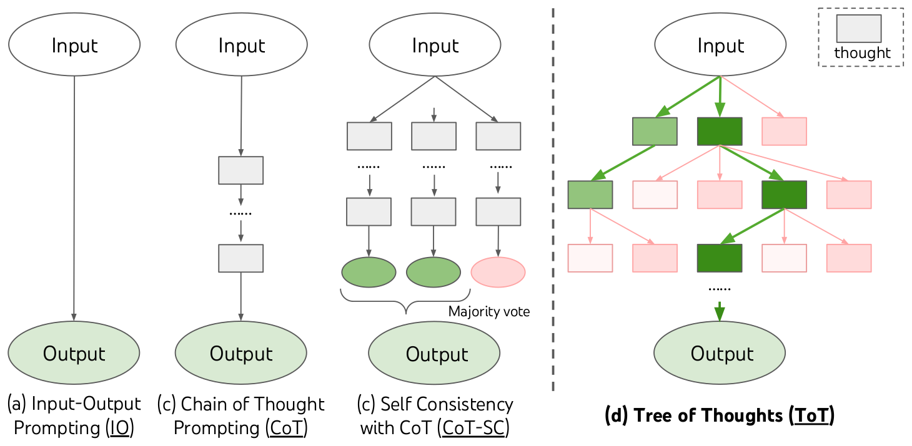
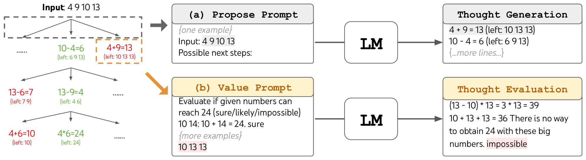
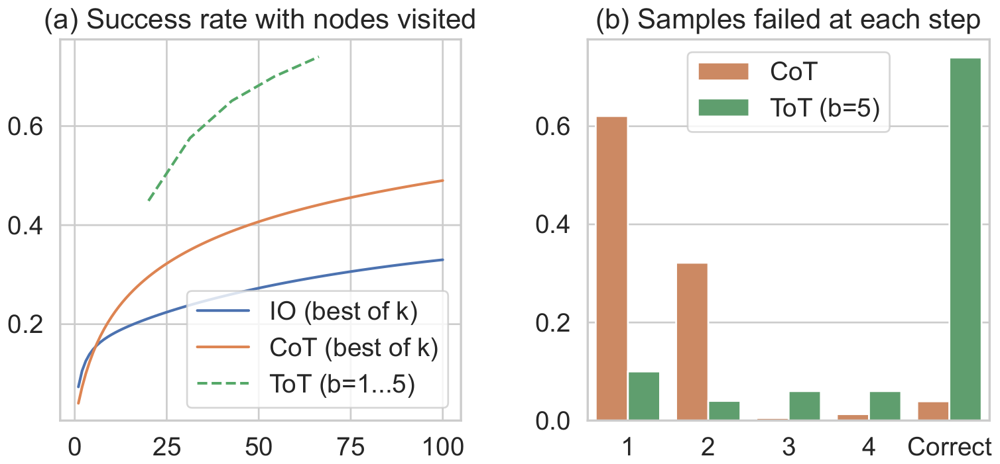
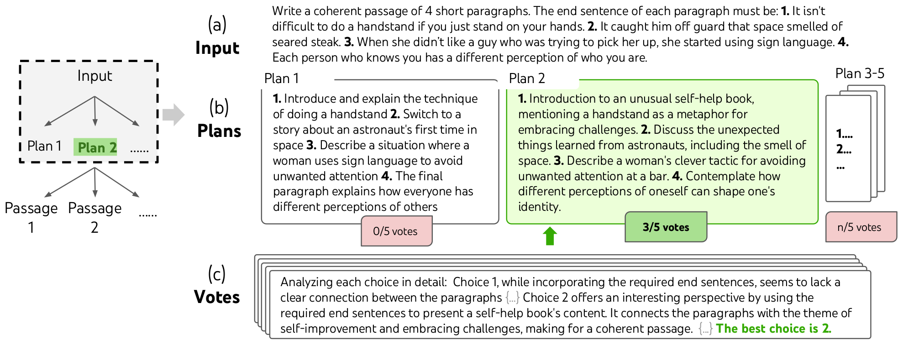
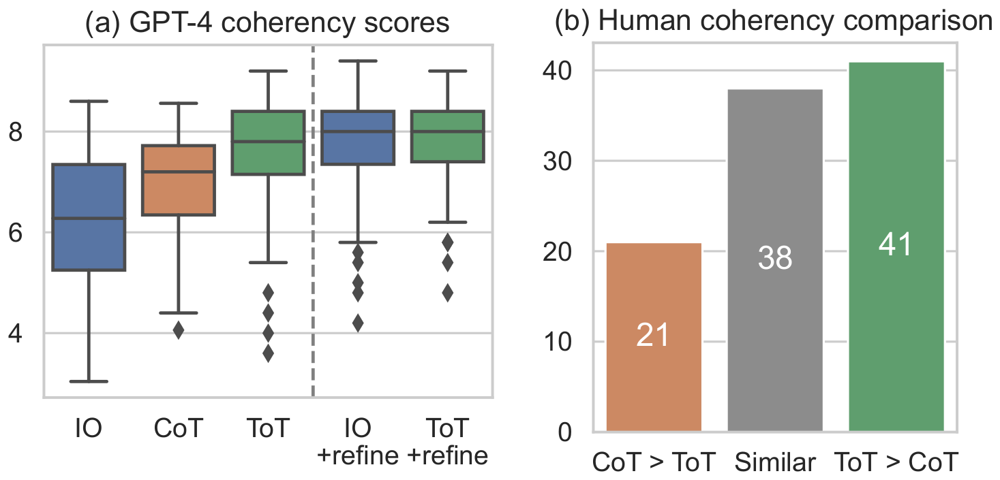
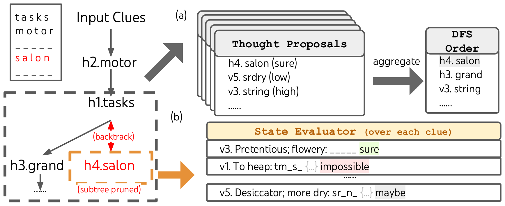

# 论文中文解读：《Tree of Thoughts: Deliberate Problem Solving with Large Language Models》

> **基本信息**：Shunyu Yao（Princeton）、Dian Yu、Jeffrey Zhao、Izhak Shafran（Google DeepMind）、Thomas L. Griffiths（Princeton）、Yuan Cao（Google DeepMind）、Karthik Narasimhan（Princeton），NeurIPS 2023，arXiv:2305.10601（本文依据 v2，2023 年 12 月）；论文原文 [官方页面](https://arxiv.org/abs/2305.10601)，[代码与全部 prompt](https://github.com/princeton-nlp/tree-of-thought-llm)。
>
> **本文的读法**：图为从论文 PDF 中裁出的原图，表为逐格核对后的中文转录（数字与原文一致，表头和行名译成中文）。每张图、表前后都有中文图题、图中文字翻译和读法结论。文中标“读者注”的是整理者的补充理解，不是论文原话。前置阅读：[Chain-of-Thought 提示](../chain_of_thought/论文中文解读.md)与[Self-Consistency](../self_consistency/论文中文解读.md)。

## 一、一句话结论

语言模型在推理时仍然是 token 级、从左到右的决策：一旦写下一步，就不会回头，也没有对多个备选的比较。论文提出 **Tree of Thoughts（ToT，思维树）**：把问题看成在“thought”（连贯的中间文字单元）组成的树上做搜索——每个节点是一个部分解，让语言模型（1）在每个节点提出多个后继 thought，（2）自己评估各状态离解决问题有多近，（3）配合 BFS 或 DFS 做前瞻和回溯。不需要训练，只用现成的 GPT-4。主要结论：

- 在三个专门挑出来的、需要规划或搜索的任务上，ToT 明显优于输入输出（IO）提示、CoT 和 CoT-SC：Game of 24 上 GPT-4 + CoT 只解出 4%，ToT 达 74%；Creative Writing 的 GPT-4 连贯性评分 ToT 为 7.56，IO 为 6.19，CoT 为 6.93；Mini Crosswords 上 ToT 的词级成功率 60%，20 局解出 4 局，IO 和 CoT 词级成功率不到 16%；
- 消融表明回溯和剪枝都有用：去掉回溯，crossword 词级成功率从 60% 掉到 20%；去掉剪枝也变差；用“最优状态”（oracle）输出还能更好，说明输出选择与剪枝的启发式有改进空间；
- 代价：ToT 比 IO 或 CoT 多消耗数倍到上百倍的生成 token（论文估计 5 到 100 倍），费用显著更高；
- 局限：三个任务是专门为难住 GPT-4 而设计的，ToT 不是对所有任务都有必要；评价器与生成器用同一个模型，评价会出错。

## 二、背景与动机

### 2.1 语言模型缺一个“System 2”

论文开头问：现在语言模型的进步仍然建立在最初的自回归机制上——一个 token 接一个 token、从左到右地做决策。这足以造出通用的问题求解器吗？认知科学里的“双过程”理论认为，人有两种决策模式：快速、自动、无意识的 System 1，以及缓慢、审慎、有意识的 System 2；强化学习里也有对应的“model-free”联想学习与“model-based”规划之分。语言模型简单的、联想式的逐 token 选择，类似 System 1，因而可能受益于一个更审慎的 System 2 规划过程，它（1）对当前的选择保留并探索多个备选，而不是只选一个；（2）评估当前状态，主动向前看或者回溯，以便做出更全局的决策。

### 2.2 经典 AI 的启发：问题求解就是树搜索

论文回到 AI 与认知科学的源头，借鉴 Newell、Shaw、Simon 自 20 世纪 50 年代起研究的规划过程：把问题求解刻画成在组合问题空间里的搜索，这个空间表示为一棵树——节点是部分解，分支是修改部分解的算子；走哪个分支由启发式来引导。由此指出现有语言模型方法的两个缺陷：

1. **局部**：在一个思考过程内部，不探索不同的后续（树的分支）；
2. **全局**：没有任何规划、前瞻或回溯来评估不同选项——而这正是人类问题求解里启发式引导搜索的特点。

经典搜索里的启发式要么是人**编写**的（如 Deep Blue），要么是**学习**的（如 AlphaGo）；论文提出第三种：让语言模型自己通过审慎的推理来评估状态。它比手写规则更灵活，比学习得到的模型更省样本。这种“通过语言模型自评和审慎推理来实现搜索启发式”的做法，论文称之为新颖。

### 2.3 已有方法的形式化（论文第 2 节）

用 $p_\theta$ 表示参数为 $\theta$ 的预训练语言模型，小写字母 $x,y,z,s$ 表示一段语言序列 $x=(x[1],\ldots,x[n])$（每个 $x[i]$ 是一个 token，$p_\theta(x)=\prod_{i=1}^{n}p_\theta(x[i]\mid x[1\ldots i-1])$），大写字母 $S$ 表示一组序列。

- **IO（输入输出）提示**：把输入 $x$ 包装成提示（任务说明和/或少样本的输入输出示例），直接生成输出，$y\sim p_\theta^{\mathrm{IO}}(y\mid x)$。
- **CoT 提示**：引入一串 thought $z_1,\ldots,z_n$ 来连接 $x$ 和 $y$，每个 $z_i$ 是一个连贯的、有意义的中间步骤（例如数学题里的一个中间等式）。形式上依次采样 $z_i\sim p_\theta^{\mathrm{CoT}}(z_i\mid x,z_{1\cdots i-1})$，再采样 $y\sim p_\theta^{\mathrm{CoT}}(y\mid x,z_{1\cdots n})$；实际上是把 $[z_{1\cdots n},y]$ 当成一段连续文本一次采出来，thought 怎样分解（一个短语、一句还是一段）是含糊的。
- **CoT-SC（自洽性）**：独立同分布地采样 $k$ 条思维链 $[z^{(i)}_{1\cdots n},y^{(i)}]$，返回出现次数最多的输出 $\arg\max_y\#\{i\mid y^{(i)}=y\}$。它优于 CoT，因为同一个问题通常有不同的思考过程。但它的缺陷是：每条链内部**没有**对不同思考步骤的局部探索；而且“最频繁”这个启发式只适用于输出空间有限的情形（例如选择题）。

## 三、方法：Tree of Thoughts 框架

### 3.1 总体：把问题看成树上的搜索



*图 1（原文 Figure 1，第 2 页）：用大语言模型求解问题的几种方式的示意图。每个矩形框代表一个 thought，即作为问题求解中间步骤的连贯语言序列。thought 如何生成、评估和搜索的具体例子见论文图 2、4、6。*

**图中文字翻译与读法**：

- **(a) Input-Output Prompting (IO)（输入输出提示）**：Input 直接连到 Output，中间没有 thought。
- **(c) Chain of Thought Prompting (CoT)（思维链提示）**：Input → 一串 thought（灰色矩形，中间用省略号表示）→ Output，只有一条路径。
- **(c) Self Consistency with CoT (CoT-SC)（带 CoT 的自洽性）**：从 Input 出发并行生成多条独立的思维链，各自得到一个答案（两个绿色、一个粉红色，绿表示正确），再做 Majority vote（多数票）得到 Output。
- **(d) Tree of Thoughts (ToT)（思维树）**：从 Input 出发展开一棵树，每个矩形是一个 thought；深绿色是被选中的路径，浅绿色是保留的候选，粉红色是被评估后淘汰的分支；最终从保留的分支走到 Output。右上角的虚线框是图例：灰色矩形代表 thought。
- **读图结论**：IO、CoT、CoT-SC 都可以看作 ToT 的特例——深度和宽度受限的树；ToT 的新东西是中间节点的**评估、剪枝**，以及可以回到上层节点换一个分支。（原图的子图标号有误：CoT 和 CoT-SC 都标成了 (c)，应为 (b)(c)；正文说 ToT 是 “Figure 1(c)”，指的是图上标 (d) 的那一幅。）

ToT 把任何问题表述为树上的搜索：每个节点是一个**状态** $s=[x,z_{1\cdots i}]$，表示输入加上到目前为止的 thought 序列所构成的部分解。具体实现一个 ToT 要回答四个问题：（1）怎样把中间过程分解成 thought 步骤；（2）怎样从每个状态生成候选 thought；（3）怎样用启发式评估状态；（4）用什么搜索算法。

### 3.2 Thought 分解

CoT 里 thought 是连贯地采出来的，没有显式的分解；ToT 则利用问题的性质来设计和分解中间 thought 步骤。随问题不同，thought 可以是几个词（Crosswords），一行算式（Game of 24），或者一整段写作计划（Creative Writing）。一般原则：thought 要足够**小**，使语言模型能生成有前途且多样的样本（例如一次生成整本书通常太“大”，无法连贯）；又要足够**大**，使语言模型能评估它对解决问题的前景（例如只生成一个 token 通常太“小”，无法评估）。

### 3.3 Thought 生成器 $G(p_\theta,s,k)$

给定树的状态 $s=[x,z_{1\cdots i}]$，生成 $k$ 个下一步 thought 候选，有两种策略：

- **(a) 独立同分布采样**（用于 Creative Writing，图 4）：从 CoT 提示里独立采样 $z^{(j)}\sim p_\theta^{\mathrm{CoT}}(z_{i+1}\mid s)$，$j=1\ldots k$。当 thought 空间丰富（例如每个 thought 是一整段）时更好，独立同分布的样本带来多样性。
- **(b) 顺序提出**（用于 Game of 24 与 Crosswords，图 2、图 6）：用一个“propose prompt”在同一个上下文里依次提出 $[z^{(1)},\ldots,z^{(k)}]\sim p_\theta^{\mathrm{propose}}(z_{i+1}^{(1\cdots k)}\mid s)$。当 thought 空间受约束（例如每个 thought 只是一个词或一行）时更好，因为在同一个上下文里提出不同的 thought，可以避免重复。

### 3.4 状态评价器 $V(p_\theta,S)$

给定一批不同的状态（frontier），评价器评估它们离解决问题有多近，作为搜索算法的启发式，决定保留哪些状态继续探索、按什么顺序探索。同样有两种策略：

- **(a) 对每个状态独立打分（Value）**：$V(p_\theta,S)(s)\sim p_\theta^{\mathrm{value}}(v\mid s)$，$\forall s\in S$。value prompt 对状态 $s$ 做推理，产生一个标量值 $v$（例如 1 到 10）或一个分类标签（如 sure / likely / impossible），再被启发式地换算成值。评价推理的依据可以随问题和 thought 步骤而变。论文用到两类：**前瞻模拟**（例如快速确认 5, 5, 14 可以通过 5 + 5 + 14 得到 24；或者 `hot_l` 可以通过在空格处填 “e” 得到 hotel，表示 “inn”）和**常识**（例如 1 2 3 太小，凑不出 24；或者没有单词以 “tzxc” 开头）。前者可以推举“好”状态，后者可以帮助排除“坏”状态。这种估值不需要完美，只需要对决策大致有帮助。
- **(b) 跨状态投票（Vote）**：$V(p_\theta,S)(s)=\mathbb 1[s=s^*]$，其中“好”状态 $s^*\sim p_\theta^{\mathrm{vote}}(s^*\mid S)$ 是在一个 vote prompt 里审慎比较 $S$ 中各状态之后投出来的。当问题的成功很难直接打分（例如文章的连贯性）时，自然的做法是比较不同的部分解，投票选最有前途的。这在精神上类似一种“逐步的”自洽性：把“探索哪个状态”变成一道选择题，并用语言模型的样本来投票。

两种策略下，都可以多次提示语言模型并聚合 value 或 vote 的结果，用更多的时间、资源和成本换取更可靠、更稳健的启发式。

### 3.5 搜索算法：BFS 与 DFS

在 ToT 框架里可以即插即用不同的搜索算法。论文只探索了两个相对简单的算法，把 A*、MCTS 等更高级的留给未来工作。

**算法 1：ToT-BFS**（广度优先，每层保留 $b$ 个最有前途的状态）。输入：输入 $x$、语言模型 $p_\theta$、thought 生成器 $G$ 与每步候选数 $k$、状态评价器 $V$、步数上限 $T$、广度上限 $b$。

```text
S_0 = {x}                                    # 起点只有输入本身
for t = 1, ..., T:
    S'_t = { [s, z] : s in S_{t-1}, z in G(p, s, k) }     # 把每个保留的状态各扩展 k 个后继
    V_t  = V(p, S'_t)                                      # 对所有候选状态评价
    S_t  = argmax_{S 属于 S'_t 的子集, |S| = b} sum_{s in S} V_t(s)   # 只保留总分最高的 b 个
return G(p, argmax_{s in S_T} V_T(s), 1)     # 取最后一层得分最高的状态，生成最终输出
```

BFS 用于 Game of 24 和 Creative Writing，那里树的深度有限（$T\le 3$），而且最初的 thought 步骤可以被评估并剪枝到一个小集合（$b\le 5$）。

**算法 2：ToT-DFS**（深度优先，先探索最有前途的状态，直到得出最终输出，或评价器认为从当前状态不可能解决问题时剪枝并回溯）。输入：当前状态 $s$、当前步 $t$、$p_\theta$、$G$ 与 $k$、$V$、步数上限 $T$、阈值 $v_{th}$。

```text
ToT-DFS(s, t):
    if t > T:  记录输出 G(p, s, 1)；返回
    for s' in G(p, s, k):                      # 候选按优先级排好序
        if V(p, {s'})(s') > v_th:              # 评价器认为还有希望，不剪枝
            ToT-DFS(s', t + 1)
        # 否则剪掉以 s' 为根的子树，继续试下一个候选
    # for 循环结束即返回上一层 = 回溯
```

DFS 用于 crossword。若评价器认为某状态 $s$ 不可能解决问题（价值 $\le v_{th}$），就剪掉 $s$ 的子树，用探索换利用；无论哪种终止情形，DFS 都回溯到 $s$ 的父状态继续探索。（算法 2 在原文里把比较写成 `V(p, {s'})(s) > v_thres`，符号有点不一致，上面按含义统一写成 $s'$ 与 $v_{th}$。）

读者注：BFS 适合深度固定、每一步的候选可以放在一起比较的任务，DFS 适合需要不断试填、撤销的任务；DFS 通常比 BFS 更省内存，这是经典搜索的常识，不是论文的论证。

### 3.6 ToT 的四个优点

1. **通用性**：IO、CoT、CoT-SC 和 self-refinement 都可以看成 ToT 的特例，即深度和宽度受限的树（图 1）；
2. **模块化**：基础语言模型、thought 分解、生成、评价和搜索这几个环节都可以独立变化；
3. **适应性**：可以适应不同的问题性质、语言模型能力和资源约束；
4. **便利性**：不需要额外训练，只要一个预训练语言模型。

## 四、实验总览

论文提出三个即使用最先进的语言模型 GPT-4、采用标准 IO 或 CoT 提示也很难解决的任务，用它们来展示审慎搜索的作用。除非另有说明，实验用 Chat Completion 模式的 GPT-4，采样温度 0.7（实验时间为 2023 年 5 月 5 日至 16 日）。

**表 1：三个任务概览（输入、输出、thought 的例子）**

| | Game of 24 | Creative Writing | 5×5 Crosswords |
|---|---|---|---|
| 输入 | 4 个数，如 `4 9 10 13` | 4 个随机句子 | 10 条线索，如 `h1. presented;..` |
| 输出 | 一个得到 24 的等式，如 `(13-9)*(10-4)=24` | 一篇 4 段的文章，各段分别以这 4 个句子结尾 | 5×5 个字母，如 `SHOWN; WIRRA; AVAIL; ...` |
| thought | 3 个中间等式：`13-9=4 (left 4,4,10); 10-4=6 (left 4,6); 4*6=24` | 一个简短的写作计划，如 `1. Introduce a book that connects...` | 为各条线索填的单词，如 `h1. shown; v5. naled; ...` |
| ToT 步数 | 3 | 1 | 5–10（可变） |

（原文表 1，第 5 页。）读法：三个任务的 thought 粒度完全不同——一行等式、一段计划、一个单词，ToT 步数也从 1 到 10 不等；这正是 3.2 节“用问题的性质来分解 thought”的体现。

## 五、Game of 24：局部选择决定全局可解性

### 5.1 任务与设置

Game of 24 是一个数学推理挑战：用 4 个数和基本算术运算（加减乘除）得到 24。例如输入 “4 9 10 13”，一个解是 `(10 - 4) * (13 - 9) = 24`。

- **数据**：从 4nums.com 抓取，共 1,362 局，按人类解题用时从易到难排序，取相对较难的第 901 到 1,000 局共 100 局作为测试。
- **成功标准**：输出是一个值为 24、且每个输入数恰好使用一次的有效等式；指标是 100 局上的成功率。

### 5.2 基线

- **IO 提示**：5 个上下文示例；**CoT 提示**：给每个输入输出对补上 3 个中间等式，每个等式对剩下的两个数做一次运算，例如输入 “4 9 10 13” 的 thought 是 `13 - 9 = 4 (left: 4 4 10); 10 - 4 = 6 (left: 4 6); 4 * 6 = 24 (left: 24)`。每局对 IO 和 CoT 各采样 100 次，取平均性能。
- **CoT-SC**：对 100 条 CoT 样本取多数输出。
- **IO + Refine**：在一条 IO 样本的基础上最多迭代 10 次；每次迭代里，如果输出不对，语言模型以此前全部历史为条件，“反思你的错误并生成一个改进的答案”。注意它使用了关于等式是否正确的真实反馈信号。
- **Best of k（oracle）**：对 IO 或 CoT，用 $k$ 个样本中最好的一个来计算成功率（$1\le k\le 100$）。

### 5.3 ToT 的设置

把 Game of 24 套进 ToT：自然地把 thought 分成 3 步，每步一个中间等式。



*图 2（原文 Figure 2，第 5 页）：Game of 24 中的 ToT。语言模型被提示做（a）thought 生成和（b）估值。*

**图中文字翻译与读法**：

- **左：搜索树**。顶部 `Input: 4 9 10 13`（输入）。第一层候选：`10-4=6 (left: 6 9 13)`（绿色，保留）、`4+9=13 (left: 10 13 13)`（红色，橙色虚线框表示正在被评估）、省略号。从 `10-4=6` 往下：`13-6=7 (left: 7 9)`（红色，淘汰）、`13-9=4 (left: 4 6)`（绿色）、省略号；再往下：`4+6=10 (left: 10)`（红色）、`4*6=24 (left: 24)`（绿色，得到 24）。
- **(a) Propose Prompt（提出 prompt）**：内容是“{一个示例} Input: 4 9 10 13 Possible next steps:”（输入 4 9 10 13，可能的下一步：），经过 LM，得到 Thought Generation（thought 生成）：`4 + 9 = 13 (left: 10 13 13)`、`10 - 4 = 6 (left: 6 9 13)`、{……更多行}。
- **(b) Value Prompt（估值 prompt）**：内容是“评估给定的数能否得到 24（sure / likely / impossible）；10 14: 10 + 14 = 24. sure；{更多示例}；10 13 13”，经过 LM，得到 Thought Evaluation（thought 评价）：“(13 - 10) * 13 = 3 * 13 = 39；10 + 13 + 13 = 36；用这些大数没有办法得到 24。impossible”。
- **读图结论**：每个节点只记录“还剩哪些数”，既可读，又足以判断后续能否凑成 24；评价器靠“几步前瞻”确认可行（sure），靠“太大或太小”的常识排除不可能（impossible），其余标 maybe。

**ToT 设置细节**：在每个树节点，取出剩下的数，提示语言模型提出一些可能的下一步；3 个 thought 步骤都用同一个 propose prompt，它只含一个 4 个输入数的例子。用 BFS，每步保留最好的 $b=5$ 个候选。评价时提示语言模型把每个 thought 候选评为 “sure / maybe / impossible”（相对于能否得到 24），目的是推举那些在几次前瞻试验内就能判定正确的部分解，根据“太大 / 太小”的常识淘汰不可能的部分解，其余保留为 “maybe”；每个 thought 采样 3 次估值。（正文写作 sure / maybe / impossible，图 2 写作 sure / likely / impossible，是原文里不一致的两种写法。）

### 5.4 结果

**表 2：Game of 24 的结果（成功率）**

| 方法 | 成功率 |
|---|---:|
| IO 提示 | 7.3% |
| CoT 提示 | 4.0% |
| CoT-SC（k=100） | 9.0% |
| ToT（本文）（b=1） | 45% |
| ToT（本文）（b=5） | 74% |
| IO + Refine（k=10） | 27% |
| IO（100 取最好） | 33% |
| CoT（100 取最好） | 49% |

（原文表 2，第 6 页；后三行是用真实反馈或“取最好”的 oracle 设置。）读法：

- IO、CoT、CoT-SC 在这个任务上都很差，只有 7.3%、4.0%、9.0%（CoT 甚至低于 IO）。
- ToT 在广度 $b=1$ 时已经达到 45%，$b=5$ 时达到 74%。
- 即使给 IO 或 CoT 用 oracle 的“100 个样本取最好的一个”，成功率也只有 33% 和 49%，仍明显低于 ToT；带真实反馈的 IO + Refine（最多 10 次）只有 27%。
- 读者注：这里所有基线的成功率都远低于 ToT，但 oracle 设置并不是实际可部署的方法；它们只是用来说明“多采样”这个预算轴上的上限。



*图 3（原文 Figure 3，第 6 页）：Game of 24 的（a）规模分析与（b）错误分析。*

**图中文字翻译与读法**：

- **(a) Success rate with nodes visited（成功率随访问节点数）**：横轴是每个任务访问的节点数（0 到 100，对 IO 和 CoT 来说是“取最好”所用的样本数 $k$），纵轴是成功率（0.2 到 0.6 有刻度）。蓝色实线 IO (best of k)，橙色实线 CoT (best of k)，绿色虚线 ToT (b=1...5)。论文把 ToT 在 $b=1\ldots5$ 时每个任务访问的树节点数算出来，和对应的 5 个成功率画在一起，并把 IO、CoT 的“取最好 $k$ 个”看作在一个老虎机里访问 $k$ 个节点。读出的近似值：IO 从 $k=1$ 的约 0.07 升到 $k=100$ 的 0.33；CoT 从约 0.04 升到 0.49；ToT 的 5 个点从约 20 个节点处的 0.45（$b=1$）升到约 67 个节点处的 0.74（$b=5$）。
- **(b) Samples failed at each step（各步失败的样本）**：横轴 1、2、3、4 表示在第几步失败，Correct 表示成功；纵轴是样本比例。这里“失败”指 CoT 中的那个 thought，或 ToT 中全部 $b$ 个 thought，已经无效或不可能得到 24。橙色柱是 CoT，绿色柱是 ToT（$b=5$）。读出的近似值：CoT 在第 1 步失败约 0.62、第 2 步约 0.32、第 3、4 步接近 0，成功约 0.04；ToT 在第 1 步约 0.10、第 2 步约 0.04、第 3 和第 4 步各约 0.06，成功约 0.74。（原文没有解释“第 4 步”，读者注：应指三个中间等式之后的最终输出一步。）
- **读图结论**：（a）在相同的节点预算下，ToT 的成功率远高于 IO 和 CoT 的“取最好”；论文的原话是，CoT 比 IO 扩展得好，100 个 CoT 样本取最好能到 49%，但仍远差于在 ToT 里探索更多节点（$b$ 大于 1）。（b）约 60% 的 CoT 样本在生成**第一步**之后就已经失败了——换句话说，在写下最前面的三个“词”（如 “4 + 9”）之后；这凸显了直接从左到右解码的问题：早期的一个选择就决定了成败，而 CoT 不会回头。

### 5.5 这个实验说明了什么

读者注：Game of 24 的结构特别适合剪枝——中间状态“还剩哪几个数”是完全可读、可检验的，而且“能否凑到 24”可以靠几步前瞻判定；所以 74% 的幅度不能外推到一般的问答任务。论文的说法也是三个任务是为突出规划和搜索而选的。

## 六、Creative Writing：搜索也能作用于难以形式化的状态

### 6.1 任务与设置

输入是 4 个随机句子，输出应是一篇连贯的、共 4 段的文章，4 段分别以这 4 个输入句子结尾。这个任务是开放式、探索性的，考验创造性思维和高层规划。

- **数据**：从 randomwordgenerator.com 抽取随机句子，构成 100 个输入；每个输入没有标准答案文章。
- **评价**：论文发现 GPT-4 大多数时候能遵守输入约束，所以重点评估文章的**连贯性**，有两种方式：（1）用 GPT-4 的 zero-shot 提示给出 1 到 10 的标量分，对每篇输出采样 5 个分数取平均（这 5 个分数通常很一致，平均标准差约 0.56）；（2）人工判断：由一部分作者做盲评，比较 CoT 与 ToT 生成的文章对，100 个输入上文章顺序被随机翻转。
- **基线**：因为任务带创造性，IO 和 CoT 提示都是 zero-shot。IO 让语言模型直接根据输入约束生成连贯文章；CoT 让它先写一个简短的计划，再写文章（计划就是中间 thought）。每个任务生成 10 个 IO 和 CoT 样本。另有 iterative-refine（$k\le 5$）：在每个任务的一个随机 IO 样本上，让语言模型根据输入约束和上一次生成的文章，判断文章是否已经“完美连贯”，否则生成一个改进版本。

### 6.2 ToT 的设置

ToT 的深度为 2（只有 1 个中间 thought 步骤）：语言模型先生成 $k=5$ 个计划并投票选出最好的一个（图 4）；然后同样地基于最好的计划生成 $k=5$ 篇文章，再投票选出最好的一篇。这里广度限制 $b=1$，因为每一步只保留一个选择。两步都用一个简单的 zero-shot 投票提示（“分析下面的选项，然后断定哪一个对于该指令最有前途”）采样 5 票。



*图 4（原文 Figure 4，第 7 页）：在一个随机选取的 Creative Writing 任务中，一步审慎搜索的例子。给定输入，语言模型采样 5 个不同的计划，然后投 5 次票决定哪个计划最好；多数票选中的计划被用于接着写输出文章，写文章时用同样的“采样—投票”过程。*

**图中文字翻译与读法**：

- **(a) Input（输入）**：“写一篇由 4 个短段落构成的连贯文章。每段的结尾句必须依次是：1. 如果你只是用手撑地，倒立并不难。2. 太空闻起来像煎烤牛排，这让他措手不及。3. 当她不喜欢一个想搭讪她的男人时，她开始使用手语。4. 每个认识你的人，对你是怎样一个人都有不同的看法。”
- **(b) Plans（计划）**：Plan 1（0/5 票）：“1. 介绍并解释倒立的技巧 2. 转到一个宇航员第一次进入太空的故事 3. 描述一个女人用手语避开不想要的关注的情景 4. 最后一段解释每个人对他人有不同的看法”。Plan 2（绿色，3/5 票，被选中）：“1. 介绍一本不寻常的自助书，把倒立作为拥抱挑战的隐喻。2. 讨论从宇航员那里学到的出人意料的事，包括太空的气味。3. 描述一个女人在酒吧里避开不想要的关注的聪明办法。4. 思考对自己的不同看法如何塑造一个人的身份。” Plan 3–5 折叠在右侧（n/5 票）。
- **(c) Votes（投票）**：一条模型的投票推理示例：“逐个详细分析：选项 1 虽然用上了要求的结尾句，但段落之间似乎缺乏清晰的联系 {……} 选项 2 用要求的结尾句来呈现一本自助书的内容，以自我提升和拥抱挑战为主题把各段联系起来，形成连贯的文章。{……} 最好的选择是 2。”
- **左侧小树**：Input → Plan 1、Plan 2（绿色高亮，被选中）、……；选中的 Plan 2 再展开为 Passage 1、Passage 2、……（文章候选，同样“采样 5 个、投票选 1 个”）。
- **读图结论**：这里的 thought 是一个“段落级的写作计划”，它既不是符号表达式，也不容易写一个程序来检验；评价器靠语言模型自己比较各计划的连贯性来投票。

### 6.3 结果



*图 5（原文 Figure 5，第 7 页）：Creative Writing 的结果。*

**图中文字翻译与读法**：

- **(a) GPT-4 coherency scores（GPT-4 连贯性评分）**：箱线图，横轴五种方法：IO、CoT、ToT，虚线右侧是 IO + refine 和 ToT + refine；纵轴是 1 到 10 的评分。从箱线图的中位数看，IO 最低（约 6.3），CoT 次之（约 7.2），ToT 约 7.8；加 refine 之后 IO 和 ToT 都升到约 8。
- **(b) Human coherency comparison（人工连贯性比较）**：三根柱，在 100 对 CoT 与 ToT 文章中：`CoT > ToT`（CoT 更连贯）21 对，`Similar`（相近）38 对，`ToT > CoT`（ToT 更连贯）41 对。

数字（取自正文）：GPT-4 的平均评分，ToT 7.56，高于 IO 的 6.19 和 CoT 的 6.93。论文承认这种自动指标可能有噪声，所以用图 5(b) 的人工比较来印证：人类在 100 对里，41 对更喜欢 ToT，只有 21 对更喜欢 CoT，其余 38 对认为“同样连贯”。最后，iterative-refine 在这个自然语言任务上更有效：它把 IO 的连贯性评分从 6.19 提高到 7.67，把 ToT 的评分从 7.56 提高到 7.91。论文认为它可以看成 ToT 框架里生成 thought 的**第三种方式**——新的 thought 来自对旧 thought 的改写，而不是独立同分布或顺序生成。

读者注：IO + refine（7.67）略高于不加 refine 的 ToT（7.56），所以“ToT 一定最好”的说法并不准确；而且评分的评价器是 GPT-4，可能偏爱与自己风格相近的文本，人工比较是更有力的证据，但它由部分作者完成（盲评），样本也只有 100 对。

## 七、Mini Crosswords：回溯是否真的必要

### 7.1 任务与设置

Game of 24 和 Creative Writing 里 ToT 相对较浅——最多 3 个 thought 步骤就到最终输出。论文进一步用 5×5 迷你填字游戏作为更难的、涉及自然语言的搜索问题。目标不只是解题——更一般的填字游戏用依赖大规模检索的专门 NLP 流水线就能解（Wallace et al., 2022）——而是探索语言模型作为通用问题求解器的极限：它探索自己的 thought，并用审慎推理作为启发式来引导自己的探索。

- **数据**：从 GooBix 抓取，共 156 局 5×5 迷你填字游戏。观察到相邻几局的线索相似，所以取序号 1、6、……、91、96 的 20 局做测试，取 136、141、146、151、156 这 5 局做提示。
- **输入输出**：输入描述 5 条横向线索（h1 到 h5）和 5 条纵向线索（v1 到 v5），输出是一个 5×5 = 25 个字母的棋盘。
- **评价**：三个层次的成功：正确字母的比例（每局 25 个）、正确单词的比例（每局 10 个）、解出整局的比例。
- **基线**：IO 提示给 5 个输入输出示例；CoT 提示额外包含中间单词，按 h1 到 h5、再 v1 到 v5 的顺序。每个提示运行 10 个样本取平均。

### 7.2 ToT 的设置

用**深度优先搜索**（算法 2）：不断探索最有前途的下一个单词线索，直到状态不再有前途，再回溯到父状态去探索别的 thought。为了让搜索可处理，后续 thought 被限制不能改变任何已填的单词或字母，所以 ToT 最多有 10 个中间步骤。



*图 6（原文 Figure 6，第 8 页）：在 Mini Crosswords 中，（a）thought 怎样被提出并聚合到用于深度优先搜索（DFS）的优先队列中；（b）怎样根据能否填出每个剩余线索来评价一个状态，只要有剩余线索被语言模型判定为不可能填出就剪枝；然后 DFS 回溯到父状态，探索该线索的下一个有前途的 thought。*

**图中文字翻译与读法**：

- **左上**：当前棋盘（`tasks` 在第一行、`motor` 在第二行，第四行红色的 `salon` 是正在尝试的词），下面是 Input Clues（输入线索）→ `h2.motor` → `h1.tasks`。虚线大框里是 DFS 的当前分支：从 `h1.tasks` 出发，尝试 `h3.grand`，以及红色的 `h4.salon`；`h4.salon` 被橙色虚线框住并标注 (subtree pruned)（子树被剪枝），红色箭头 (backtrack)（回溯）回到父状态。
- **(a) Thought Proposals（thought 提议）**：多张卡片叠放，表示多次调用提议 prompt，每张给出候选：`h4. salon (sure)`、`v5. srdry (low)`、`v3. string (high)`、……括号里是语言模型给出的置信度。aggregate（聚合）这些提议之后，得到 DFS Order（DFS 顺序）：`h4. salon`、`h3. grand`、`v3. string`、……
- **(b) State Evaluator (over each clue)（对每条线索的状态评价器）**：对每条剩余线索，按当前字母约束判断能否填出：`v3. Pretentious; flowery: _____`，sure（确定能填）；`v1. To heap: tm_s_ {...}`，impossible（不可能）；……；`v5. Desiccator; more dry: sr_n_ {...}`，maybe（也许）。只要有一条线索 impossible，就剪掉这个状态的子树。
- **读图结论**：thought 的生成与评价都在“字母约束”这个中间表示上进行；评价器不是看整盘棋，而是逐条检查剩余线索，让早期的错误填词能被尽快发现。

**生成与评价的细节**：生成 thought 时，在每个状态把所有已有的 thought（例如图 6(a) 里的状态 `h2.motor; h1.tasks`）翻译成对剩余线索的字母约束（例如 `v1.To heap: tm___;...`），然后调用 5 次提议 prompt，得到“下一个单词填在哪里、填什么”的候选。重要的是，还提示语言模型给出各个 thought 的置信度，并在多次提议之间聚合，得到一份排好序的下一步 thought 列表（图 6(a)）。评价状态时，同样把每个状态翻译成对剩余线索的字母约束，逐条评估能否填出；若有剩余线索被判定为 “impossible”（如 `v1. To heap: tm_s_`），就剪掉这个状态的子树，DFS 回溯到父状态去探索下一个有前途的 thought。DFS 的搜索步数上限为 100，最后把探索到的最深状态（如果有多个，取最先探索的那个）渲染成最终输出。

### 7.3 结果与消融

**表 3：Mini Crosswords 的结果（成功率 %，分三个层次：字母、单词、整局）**

| 方法 | 字母 | 单词 | 整局 |
|---|---:|---:|---:|
| IO | 38.7 | 14 | 0 |
| CoT | 40.6 | 15.6 | 1 |
| ToT（本文） | 78 | 60 | 20 |
| + 最优状态（oracle） | 82.4 | 67.5 | 35 |
| − 剪枝 | 65.4 | 41.5 | 5 |
| − 回溯 | 54.6 | 20 | 5 |

（原文表 3，第 7 页。）读法与论文的结论：

- **主结果**：IO 和 CoT 的词级成功率不到 16%（14 和 15.6）；ToT 把所有指标都显著提高，词级成功率达到 60%，20 局里解出 4 局（整局 20%）。论文认为这个提升不意外：IO 和 CoT 缺乏尝试不同线索、修改决定或回溯的机制。
- **oracle（最优状态）**：如果每个任务从 DFS 探索到的状态里输出**真正最好**的那个（而不是按启发式选出的），ToT 能解 7/20 局（整局 35%）。这说明论文简单的输出启发式还能被明显改进。
- **剪枝的问题与“去掉剪枝”的消融**：论文先观察到一个有趣的现象：有时游戏其实已经被解出，状态评价器仍可能把某些词判为 “impossible” 而剪枝——也许是因为 5×5 填字游戏按设计会含有一些罕见或过时的词，GPT-4 不认识（例如 “agend” 是 “agendum” 的过时形式，而 GPT-4 认为它是 “agenda” 的拼写错误；论文指出，外部检索或网络交互可以在知识不确定时增强语言模型）。既然评价器作为剪枝启发式并不完美，作者又做了去掉剪枝的消融：性能总体更差（词级 41.5），但它实际上在 4/20 局里找到了正确解（尽管通过启发式只输出了其中 1 局），其中 3 局是带剪枝的 ToT 在 100 步内解不出的。因此，对 DFS 剪枝而言，更好的启发式是关键。
- **去掉回溯**：让它一直填最有前途的线索、至多 20 步、允许覆盖已填内容；这类似于广度限制 $b=1$ 的“贪心”BFS，表现很差，词级成功率只有 20%。这直接支持论文的结构主张：能撤销承诺是单向 CoT 缺少的能力。

读者注：整局 20% 对应 4/20 局，样本很少；“−剪枝”与“+最优状态”的整局数字（5% 和 35%）只对应 1 局和 7 局，读数字时要考虑这个量级。

## 八、附加实验（附录 B）

论文主体用最先进的 GPT-4 和三个专门设计来难住它的任务；附录再报告较弱的语言模型或更容易的任务，并讨论成本。

### 8.1 迁移到新任务：GSM8K 和 StrategyQA（零样本 ToT）

作者用很少的几行代码实现了一个通用的、类似 Creative Writing 的零样本 ToT-BFS：先采样 5 个解题策略并投票选最好的一个；再基于最好的策略采样 5 个解答并投票选最好的一个。下面是论文里给出的、与任务无关的提示骨架（`{format}`、`{input}`、`{s}` 是占位符）：

```text
# 定义新任务的答案格式
gsm8k_format = '"the answer is n" where n is a number'
strategyqa_format = 'either "the answer is yes" or "the answer is no"'

# 零样本 IO 提示
standard_prompt = 'Answer the following question with {format}: {input}'

# 零样本 CoT 与零样本 ToT 用的 thought 格式
cot_prompt = '''Answer the following question: {input}

Make a strategy then write. Your output should be of the following format:

Strategy:
Your strategy about how to answer the question.

Answer:
Your answer to the question. It should end with {format}.
'''

# 零样本 ToT 用的投票提示
vote_prompt = '''Given an instruction and several choices,
decide which choice is most promising.
Analyze each choice in detail, then conclude in the last line
"The best choice is {s}", where s the integer id of the choice.
'''
```

**表 4（附录）：用 GPT-4 的零样本 ToT 在新任务上的结果（100 个随机 GSM8K 测试题与 StrategyQA 开发题上的正确率 %）**

| 方法 | GSM8K | StrategyQA |
|---|---:|---:|
| IO | 51 | 73 |
| CoT | 86 | 82 |
| ToT | 90 | 83 |

（原文表 4，第 13 页。）读法：ToT 在两个任务上都好于 CoT，但只是略好——因为 GPT-4 + CoT 在这类任务上已经很强，而且 StrategyQA 的瓶颈是外部知识而不是推理。考虑到计算成本，传统 NLP 任务更适合尝试较小的语言模型加 ToT，而 GPT-4 + ToT 更适合那些难住了 GPT-4 + CoT 推理的难任务。

### 8.2 迁移到较弱的模型：GPT-3.5

作者用 GPT-3.5-turbo 在 Creative Writing 和 Game of 24 上重跑实验。

**表 5（附录）：Game of 24，GPT-4 与 GPT-3.5 的成功率**

| 方法 | GPT-4 | GPT-3.5 |
|---|---:|---:|
| IO | 7.3% | 6% |
| CoT | 4.0% | 3% |
| ToT | 74% | 19% |

**表 6（附录）：Creative Writing，GPT-4 与 GPT-3.5 的 GPT-4 连贯性评分**

| 方法 | GPT-4 | GPT-3.5 |
|---|---:|---:|
| IO | 6.19 | 4.47 |
| CoT | 6.93 | 5.16 |
| ToT | 7.56 | 6.62 |

（原文表 5、表 6，第 13 页。）读法：

- 两个任务上 “ToT 优于 CoT 优于 IO” 的次序对 GPT-3.5 同样成立。Creative Writing 上，GPT-3.5 + ToT（6.62）超过 GPT-4 + IO（6.19），与 GPT-4 + CoT（6.93）相近，说明 ToT 也可能在较弱的语言模型上起作用。
- Game of 24 上（为了让它能跑起来，作者把 1-shot 的 propose 提示改成了 3-shot），GPT-3.5 + ToT 的 19% 远低于 GPT-4 + ToT 的 74%。为了弄清生成与评价哪个更重要，作者还试了 GPT-4 生成 + GPT-3.5 评价（64%）和 GPT-3.5 生成 + GPT-4 评价（31%）。这说明这个游戏的瓶颈在 **thought 生成**，而且生成与评价用不同的语言模型也能得到不错的结果，同时降低成本。

### 8.3 成本与效率

运行 ToT 需要比 IO 或 CoT 多得多的计算。

**表 7（附录）：Game of 24 的成本分析**

| 方法 | 生成 / 提示 token 数 | 每题成本 | 成功率 |
|---|---|---:|---:|
| IO（100 取最好） | 1.8k / 1.0k | 0.13 美元 | 33% |
| CoT（100 取最好） | 6.7k / 2.2k | 0.47 美元 | 49% |
| ToT | 5.5k / 1.4k | 0.74 美元 | 74% |

**表 8（附录）：Creative Writing 的成本分析（原文这张表的题注误写成 “Game of 24”）**

| 方法 | 生成 / 提示 token 数 | 每题成本 |
|---|---|---:|
| IO | 0.9k / 0.4k | 0.06 美元 |
| CoT | 0.9k / 0.4k | 0.07 美元 |
| ToT | 4k / 2.9k | 0.32 美元 |

（原文表 7、表 8，第 14 页。）读法与论文的结论：

- Game of 24 里，用 ToT 解一道题需要约 5.5k 个生成 token，接近 100 次 CoT（6.7k token）的量，但 ToT 的表现好于 100 次独立 CoT 取最好。
- Creative Writing 里，ToT 约多花 5 倍的生成 token 和费用，这符合直觉：因为 $b=5$，而且大部分 token 是生成的文章。
- 两个任务的 ToT 主实验总共花费约 0.74 × 100 + 0.32 × 100 = 106 美元；Crosswords 的 DFS 实验也应在 100 美元以内。总的来说，ToT 的成本和效率高度依赖所用的提示和搜索算法，生成的 token 可能是 CoT 的 5 到 100 倍。
- 论文给出的可操作建议：（1）在需要审慎推理、CoT 吃力的任务上用 ToT；（2）ToT 的灵活性允许权衡性能与成本，例如改变 BFS 的 beam 大小或投票次数、少样本或零样本提示、GPT-3.5 或 GPT-4 等；（3）效率还有很大改进空间，例如 BFS 找到解就提前停止，或者当有 thought 被判为 “impossible” 时缩小 beam；（4）作者相信让模型获得更强的智能确实需要更多的计算，从长远看（开源）语言模型会变得便宜和高效，这不应成为阻碍；如何更好地训练或微调语言模型来做 thought 的生成与评价，也是一个好方向。

## 九、相关工作（论文第 5 节）

- **规划与决策**：语言模型吸收了丰富的常识，能根据问题设定和环境状态提出合理的计划。ToT 在此基础上同时考虑每一步多个可能可行的计划，并沿最有前途的继续；传统决策过程通常需要训练专门的奖励和策略模型（如强化学习里的 CHAI），而 ToT 用语言模型本身提供价值估计。RAP 是同期工作，把语言模型推理看成用其内部世界模型做规划，提出了类似 ToT 的基于 MCTS 的方法，但它的任务较简单，框架缺少容纳不同树搜索算法的模块化。
- **自我反思（self-reflection）**：用语言模型评估自己预测的可行性。Reflexion 等引入让语言模型对候选生成给出反馈的“自我反思”机制；Self-debug 用语言模型自己根据代码执行结果生成的反馈信息提高代码生成准确率；与本文最相关的是 “self-eval guided decoding”：同样遵循树搜索流程，叶子由随机 beam search 解码采样，再由语言模型用精心准备的自评提示评估；但它采用 PAL 的形式，把 thought 表示成代码，难以处理本文的创意写作这类任务。
- **程序引导的语言模型生成**：Schlag et al. 把语言模型嵌入算法化的搜索过程，树由外部相关段落展开，而不是语言模型自己的 thought，也没有反思或投票；LLM+P 更进一步，把实际规划委托给经典规划器。
- **经典搜索方法**：ToT 可以看作经典搜索的现代版本，例如一种启发式搜索算法 A*，其中每个搜索节点的启发式由语言模型的自评提供。NeuroLogic A*esque decoding 受 A* 启发，引入对语言模型高效的前瞻启发式来改进 beam search 或 top-$k$ 采样，但只限于句子生成任务。

## 十、局限、讨论与读者注

### 10.1 论文自述的局限与展望

- 对许多 GPT-4 已经擅长的任务（见附录 B.1），审慎搜索如 ToT 可能并不必要；作为第一步，本文只探索了三个相对简单但难住 GPT-4 的任务（附录 B.2 给了 GPT-3.5 的一些结果）。随着语言模型被用于更多现实决策应用（编程、数据分析、机器人等），可能出现更复杂的任务和研究机会。
- 像 ToT 这样的搜索方法比采样方法需要更多资源（如 GPT-4 API 费用）才能提高任务表现，但 ToT 的模块化灵活性允许用户定制性能与成本的权衡；开源模型的发展应该很快就能降低成本（详见附录 B.3）。
- 本文只用现成的语言模型；用类似 ToT 的高层“反事实”决策（比如对下一段落的各种可能选择进行审慎权衡，而不是预测下一个 token）去微调语言模型，也许能进一步增强问题求解能力。
- 结论：语言模型联想式的 “System 1” 可以被基于搜索可能解题路径树的 “System 2” 有益地增强；ToT 提供了一条把经典的问题求解思想转化成当代语言模型可用方法的路径；同时语言模型弥补了经典方法的一个弱点——可以解决不易形式化的复杂问题，比如创意写作。
- 更广泛的影响：ToT 让语言模型更自主、更智能地决策和解题；当前任务只限于推理和搜索，未来如果涉及与外部环境或人的交互，可能带来潜在危险，例如助长对语言模型的有害使用；另一方面，ToT 也提高了模型决策的可解释性和与人类对齐的机会，因为所得表示是可读的、高层的语言推理，而不是隐式的、低层的 token 值。

### 10.2 读者注：公平比较与失败模式

- **公平比较**：ToT 的调用次数来自三个乘数——每个节点生成 $k$ 个后继、每个后继做若干次评价、搜索多个深度或回溯节点。因此报告准确率时必须同时报告访问的节点数、生成 token、评价 token、并行度和模型价格。论文用图 3(a) 的“访问节点数”和表 7 的 token 与费用做了这类比较；更严格的基线是相同 token 或相同调用预算下的 CoT-SC、best-of-N，以及带独立 verifier 的搜索。
- **失败模式**（结合论文的证据）：状态表示丢掉约束信息时，搜索无法恢复；生成器从未提出正确动作时，评价器无解可选（Game of 24 里，把生成换成 GPT-3.5 会大幅掉点，说明这个游戏的瓶颈在生成，见 8.2 节）；评价器误判会剪掉正确分支（crossword 里把生僻词判为 impossible，见 7.3 节）；提议与评价共用同一个模型，两者可能共享盲点；扩大深度和宽度会使调用量快速增加；用强模型评价自己生成的创作结果有自偏好风险（Creative Writing 的评分），需要独立的人评或不同模型复核。
- **与现代 reasoning 的连接**：ToT 清楚地把语言模型推理拆成 proposer、状态或价值评价器与搜索三部分。后来的过程奖励模型把评价器 $V$ 从“prompt 自评”变成训练得到的步骤级评分器；test-time scaling 研究则把搜索宽度、深度和并行或顺序的比例视作预算分配问题。现代 reasoning 系统即使不叫 ToT，也常出现相同结构：生成候选、验证局部或整体、把算力集中到高价值轨迹。

## 十一、复现检查表

- 为每个任务明确 thought 的边界与状态的序列化格式（如 Game of 24 里“已有等式 + 剩余数”），不能只说“让模型思考”。
- 公布生成器和评价器的完整 prompt、温度（本文 GPT-4 为 0.7）、每步采样次数（Game of 24 估值 3 次，Crosswords 提议 5 次，Creative Writing 5 个候选加 5 票）、宽度 $b$ 和阈值；论文的全部 prompt 在其代码仓库里。
- 同时报成功率、访问节点数、token、延迟和费用；最好给出 Pareto 曲线。
- 分别做无评价、无剪枝、无回溯、随机评价和 oracle 状态的消融（论文做了无剪枝、无回溯和 oracle 最优状态）。
- 检查评价器的假阳性和假阴性，尤其统计正确路径被剪掉的比例（论文的 crossword 里有这样的例子）。
- 创作任务使用独立的人评或不同模型评价，避免同源偏差；基线（IO + Refine、best of k）用到了真实反馈或 oracle 时要说明。

## 十二、原文细节备忘

核对 `paper.txt` 与 PDF 原页时发现下列原文内部的小问题，引用时请注意：

1. **图 1 的子图标号**：CoT 与 CoT-SC 都标成了 (c)，ToT 标成 (d)；正文把 ToT 称为 “Figure 1(c)”。
2. **评价标签**：正文第 4.1 节写 “sure / maybe / impossible”，第 3 节与图 2 写 “sure / likely / impossible”。
3. **表 8 的题注**：写的是 “Cost analysis on Game of 24”，内容却是 Creative Writing。
4. **表 7 的 ToT 提示 token 数**：读者注（疑似笔误）：IO 和 CoT 两行的费用与表中 token 数，按 2023 年 5 月 GPT-4 8K 版的公开价格（每 1K 提示 token 0.03 美元、每 1K 生成 token 0.06 美元，这个价格不在论文里）推算大致吻合；ToT 一行若提示 token 为 14k 才吻合 0.74 美元，表中写的是 1.4k。
5. **算法 2 的符号**：条件里写 `V(p, {s'})(s) > v_thres`，参数表里却是 $v_{th}$；本文按含义统一。
6. **参考文献**：原文参考文献里 Hart et al. 的 A* 论文重复出现了两次（[10] 与 [11]）。

## 十三、与相关论文的关系

- 前置：[Chain-of-Thought 提示](../chain_of_thought/论文中文解读.md)提供单条显式轨迹；[Self-Consistency](../self_consistency/论文中文解读.md)是多条完整轨迹的投票；ToT 则在中间节点就做“生成—评价—选择—回溯”。
- 与经典搜索的渊源：[AlphaZero](../alphazero/论文中文解读.md)等工作用学习得到的价值函数引导树搜索；ToT 用语言模型自评取代学习或手写的启发式。
- [Let’s Verify Step by Step](../lets_verify_step_by_step/论文中文解读.md)：把评价器 $V$ 训练成步骤级的过程奖励模型；[Scaling LLM Test-Time Compute Optimally](../scaling_test_time_compute/论文中文解读.md)：把搜索宽度、深度和并行或顺序的比例看作预算分配问题。
- 本文用的模型：[GPT-4](../openai_gpt4/论文中文解读.md)。

## 原文证据导航

- [原论文 PDF](paper.pdf)：第 2 节（IO、CoT、CoT-SC 的形式化）、第 3 节（ToT 的四个问题、算法 1 和 2）、第 4 节（三个实验：4.1 Game of 24，4.2 Creative Writing，4.3 Mini Crosswords；表 1–3，图 2–6）、第 5 节（相关工作）、第 6 节（讨论与局限）；附录 A（代码、prompt 与轨迹）、附录 B（表 4–8：新任务、GPT-3.5、成本）。
- [原文提取文本](paper.txt)
- [论文概要](论文概要.md)
