# 论文中文解读：《Triton: An Intermediate Language and Compiler for Tiled Neural Network Computations》

> **基本信息**：Philippe Tillet、H. T. Kung（哈佛大学）、David Cox（哈佛大学、IBM），第 3 届 ACM SIGPLAN 机器学习与编程语言国际研讨会（MAPL '19），2019 年 6 月 22 日，美国凤凰城，共 10 页；DOI [10.1145/3315508.3329973](https://doi.org/10.1145/3315508.3329973)；开源项目网址 triton-lang.org（原文脚注 1）。
>
> **本文的读法**：这篇论文只有 10 页，几乎每个设计点都靠一张图或一段代码清单说明，所以本文把全部 11 张图和 5 段关键代码清单的原图都放了进来（均从 PDF 裁出），每张图后有中文图题、图中文字翻译和读图结论；Table 1 与数据流方程逐项转录。原文的 Figure 1、8、10、11 没有标注数值，本文表里的数字是从 PDF 矢量图量出的点位或柱高（写作“约”），不是原文给出的数。凡属本文自己的推算、解释或论文之外的背景知识，都会明确标注。

## 一、一句话结论

Triton 在 CUDA 与图编译器之间插入一个 **tile 级**抽象层：程序员（或上层 DSL）写的是“对一整块多维子数组（tile）做什么”，而不是“每个线程做什么”；编译器再把 tile 逐级切分并映射到线程、共享内存和寄存器，自动完成访存合并、共享内存分配与同步插入，并用自动调优器选 tile 大小。

论文由三部分组成：C 风格语言 Triton-C、基于 LLVM 的 tile 级中间表示 Triton-IR、即时编译器 Triton-JIT。实验在一块 NVIDIA GTX 1070 上进行：

- 矩阵乘与 cuBLAS 10.0 大体相当（按图 8 读数，9 个方阵与 DeepSpeech2 形状上约为 cuBLAS 的 0.93–1.26 倍，3 个 Transformer 浅形状上只有约 0.40–0.90 倍），明显快于 AutoTVM、Tensor Comprehensions、PlaidML；
- 卷积的 implicit GEMM 在 ResNet 的 5 个任务上都快于 cuDNN 7.0 的 IMPLICIT_GEMM，在 DeepSpeech2 上与之接近；
- 把 shift 与 1×1 卷积融成一个 kernel 后，几乎隐藏了 shift 的开销（达到“不做 shift”上限的约 95%–98%）。

## 二、背景与动机

### 2.1 读懂本文需要的几个前置概念

- **SPMD 与 CUDA 编程模型**：CUDA kernel 在一个 launch grid（启动网格）上由许多 thread block 执行，每个线程运行同一段标量程序，靠线程和块的编号区分各自处理的数据；块内线程通过共享内存和同步协作。论文把这种模型称为 SPMD（Single-Program, Multiple-Data，单程序多数据）。
- **访存合并（memory coalescing）**：显存（DRAM）一次取回的是较大的连续块，只有同一时刻相邻线程访问相邻地址，取回的数据才会被充分利用（原文 5.2.2 的定义）。
- **共享内存（shared memory）**：每个计算核心内的片上快速存储，由程序显式管理。不同线程通过它交换数据时，“写”和“读”之间需要同步（barrier）。
- **SSA 与 LLVM IR**：静态单赋值形式（SSA）要求每个变量只赋值一次、先定义后使用；控制流汇合处用 `phi` 指令按来路选值（清单 7 会用到）。LLVM IR 是常见的编译器中间表示。
- **Roofline 模型**：性能上界等于“峰值算力”与“访存带宽 × 算术强度”两者中较小的一个，其中算术强度是每搬运一字节数据所做的运算次数（图 1 会用到）。

### 2.2 问题：库覆盖不全，手写 CUDA 太累，已有 DSL 又慢又不够灵活

论文开篇的论证链条：

1. 深度学习的进步依赖并行硬件，以及 cuBLAS、cuDNN 这类厂商库；但这些库只支持有限的一组张量算子，新原语只能留给专家去实现（原文在此引用了 [13, 17, 25]，依次是 persistent RNN、block-sparse GPU kernel 和 Winograd 快速卷积三项工作）。
2. 于是出现了面向 DNN 的领域专用语言（DSL）：基于多面体（polyhedral）技术的 Tensor Comprehensions，基于循环合成（loop synthesis）的 Halide、TVM、PlaidML。它们在某些问题（如 MobileNet 里的 depthwise-separable 卷积）上表现不错，但实践中常常**比厂商库慢得多**（见图 1），并且**表达力不足**：无法写出不能用“嵌套循环里的仿射数组下标”直接描述的结构化稀疏模式 [28, 31, 47]。
3. 另一条路是微内核（micro-kernel [11, 21]，即手写的 tile 级 intrinsics），需要大量手工劳动且不可移植；也有人提出了面向 tiling 的高层抽象（CUTLASS [23]、TiDA [41]），但**底层编译器后端仍缺少对 tile 级操作和优化的支持**。

Triton 要填的就是这个空缺：一个能描述并编译 tile 程序的中间语言和编译器。

### 2.3 相关工作的三条路线，以及 Triton 的位置

原文第 2 节把现有 DNN 编译器分成三类：

- **张量级 IR**（XLA、Glow）：用模式匹配把张量程序变成预先定义好的 LLVM-IR 与 CUDA-C 操作模板（张量缩并、逐元素运算等）；
- **多面体模型**（Tensor Comprehensions、Diesel）：把一层或多层 DNN 参数化后自动编译成 LLVM-IR 与 CUDA-C 程序；
- **循环合成器**（Halide、TVM）：把张量计算变成循环嵌套，再由用户手写（可能参数化的）调度去优化。

Triton 的做法是把 tile 级操作和优化加进传统编译流水线。论文总结的好处有三点：（1）比 XLA、Glow 更灵活；（2）与 TC、Diesel 不同，**支持非仿射的张量下标**；（3）能自动推断可能的执行调度，而这些调度在 Halide、TVM 里要手工指定。代价是**编程工作量更大**。清单 2 给出同一个计算 $C=AB^\top$ 在四个系统里的写法：

```text
C = tf.matmul(A, tf.transpose(B))       // TensorFlow
C[i, j: I, J] = +(A[i, k] * B[j, k]);   // PlaidML
C(i, j) +=! A(i, k) * B(j, k)           // Tensor Comprehensions
tvm.sum(A[i, k] * B[j, k], axis=k)      // TVM
```

（原文清单 2，第 3 页。）这四行都只说“算什么”（索引表达式），不涉及 tile、线程或存储层次，调度全靠编译器去找；对比之下后面的 Triton-C（清单 1）要长得多，这就是原文所说的“更多编程工作”。

### 2.4 先看一张动机图：现有 DSL 离厂商库有多远（图 1）

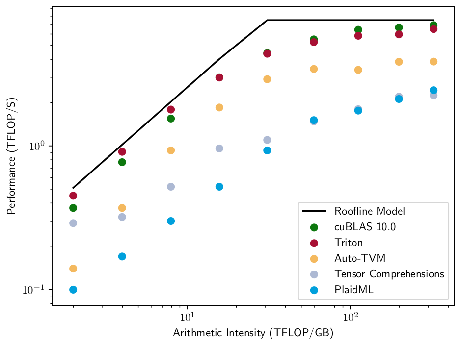

*图 1（原文 Figure 1，第 1 页）：各实现的矩阵乘 $C=AB^\top$ 与 Roofline 模型的对比（NVIDIA GeForce GTX 1070）。*

**图中文字翻译与读法**：

- 设置：$A\in\mathbb{R}^{1760\times1760}$，$B\in\mathbb{R}^{N\times1760}$，通过改变 $N$ 来改变算术强度。
- 横轴 Arithmetic Intensity (TFLOP/GB)（算术强度，对数刻度）；纵轴 Performance (TFLOP/S)（性能，对数刻度）。图例：黑线 Roofline Model（Roofline 模型）、绿点 cuBLAS 10.0、红点 Triton、橙点 Auto-TVM、浅灰蓝点 Tensor Comprehensions、蓝点 PlaidML。
- 黑色折线是 Roofline：左段随算术强度上升（受带宽限制，memory-bound），右段是水平平台（受峰值算力限制，compute-bound）。
- 读图注：横轴单位在原图上写作 TFLOP/GB；按点的位置和 Roofline 左段斜率（约 0.256 TFLOP/s 每单位）推算，数值实际更像 FLOP/Byte，对应约 256 GB/s 的带宽，与 GTX 1070 公开的显存带宽规格一致（外部信息，原文未写）。这里按原图写法转述，下文不依赖该单位。

下表是从该图的矢量数据量出的各点性能（单位 TFLOP/s，约值；算术强度取各列的近似横坐标，约值）：

| 算术强度（约） | 2.0 | 4.0 | 7.9 | 15.7 | 30.9 | 59.6 | 111.6 | 198.3 | 324.0 |
|---|---:|---:|---:|---:|---:|---:|---:|---:|---:|
| Roofline | 0.51 | 1.02 | 2.03 | 4.02 | 7.5 | 7.5 | 7.5 | 7.5 | 7.5 |
| cuBLAS 10.0 | 0.37 | 0.77 | 1.55 | 3.00 | 4.42 | 5.51 | 6.43 | 6.66 | 6.92 |
| Triton | 0.45 | 0.91 | 1.79 | 2.99 | 4.38 | 5.27 | 5.84 | 5.97 | 6.50 |
| Auto-TVM | 0.14 | 0.37 | 0.93 | 1.85 | 2.91 | 3.43 | 3.38 | 3.85 | 3.86 |
| Tensor Comprehensions | 0.29 | 0.32 | 0.52 | 0.96 | 1.10 | 1.48 | 1.80 | 2.20 | 2.25 |
| PlaidML | 0.10 | 0.17 | 0.30 | 0.52 | 0.93 | 1.51 | 1.76 | 2.12 | 2.44 |

**读图结论**：

- 在这个固定的矩阵乘上，Triton 和 cuBLAS 紧贴 Roofline，Auto-TVM、Tensor Comprehensions、PlaidML 都明显更低：在最右端（算术强度最大），cuBLAS 约 6.9、Triton 约 6.5，而 Auto-TVM 约 3.9，TC 与 PlaidML 约 2.3–2.4 TFLOP/s。这就是引言里说的“DSL 在实践中常比厂商库慢得多”。
- 两者的相对高低随算术强度而变：横坐标约 2、4、8 的三列（访存受限区），Triton 高于 cuBLAS 约 15%–22%（约 0.45、0.91、1.79 对 0.37、0.77、1.55）；约 16 与 31 两列几乎重合；约 60 以上各列，cuBLAS 比 Triton 高约 5%–12%。这些是读图所得，原文没有单独讨论。
- 按 Roofline 平台约 7.5 TFLOP/s（读图）估算，最右端 cuBLAS 约为 92%，Triton 约为 87%。

## 三、系统总览（图 2）

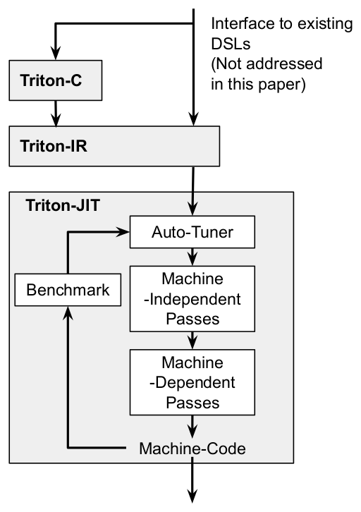

*图 2（原文 Figure 2，第 2 页）：Triton 的整体结构。*

**图中文字翻译与读法**：

- 最上方：前端 **Triton-C**；右上文字 “Interface to existing DSLs (Not addressed in this paper)”（对接已有 DSL 的接口，本文不讨论）表示，将来上层 DSL 可以绕过 Triton-C，直接生成 Triton-IR。
- 中间：**Triton-IR**（中间表示）。
- 灰色大框 **Triton-JIT**（即时编译器）内部：Auto-Tuner（自动调优器）→ Machine-Independent Passes（机器无关优化）→ Machine-Dependent Passes（机器相关优化）→ Machine-Code（机器码）；Machine-Code 再经 Benchmark（基准测试）回到 Auto-Tuner，形成“生成—测速—再选参数”的闭环。

**读图结论**：自动调优器位于 JIT 的最前端，负责把 Triton-IR 中参数化的 tile 形状取成具体数值（原文 4.2.1：Triton-IR 里没有 `tunable` 关键字，参数化的形状必须在生成程序前解析掉，由 Triton-JIT 的自动调优器完成）；后面两组 pass 把实例化后的 IR 编译成机器码；测得的速度再反馈给调优器。

论文列出的四项贡献与本文章节的对应：

| 贡献 | 内容 | 本文章节 |
|---|---|---|
| Triton-C（原文第 3 节） | 用参数化 tile 变量表达张量程序的类 C 语言，作为现有 DNN 转译器（PlaidML、TC）和熟悉 CUDA 的程序员的稳定接口 | 四 |
| Triton-IR（第 4 节） | 基于 LLVM 的中间表示，适合 tile 级程序分析、变换和优化；当前版本直接由 Triton-C 在解析时构造，未来也可由嵌入式 DSL 或更高层 DNN 编译器（如 TVM）直接生成 | 五 |
| Triton-JIT（第 5 节） | 把 Triton-IR 编译成 LLVM bitcode 的即时编译器与代码生成后端：机器无关 pass、机器相关 pass、自动调优器 | 六 |
| 数值实验（第 6 节） | 矩阵乘接近 cuBLAS 并比其他 DSL 在循环网络与 Transformer 上最多快 3 倍；重新实现 cuDNN 的 IMPLICIT_GEMM 稠密卷积且无性能损失；高效实现 shift 卷积 | 七 |

需要特别标注的历史差异：

- 论文的前端是 **Triton-C**，不是今天最常见的 Python 装饰器 API；
- IR 当时直接扩展 LLVM，现代 Triton 后端使用 MLIR 体系；
- 论文把 tensor core、量化和更高层 DSL 集成写在未来工作中（原文第 7 节）；
- 因而这篇论文解释的是“为什么有 Triton”，不是当前版本的操作手册。

## 四、Triton-C 语言（第 3 节）

Triton-C 的目的是给现有（和未来的）DNN 转译器，以及熟悉底层 GPU 编程的程序员，提供一个稳定的前端：语法像 CUDA（基于 ANSI C，更具体说基于 CUDA-C），语义像 NumPy，编程模型是 SPMD。

### 4.1 语法：在 C 上加了什么（原文 3.1）

清单 3 给出了全部文法扩展（逐字转录如下，`trans` 的文法在原文里就写成两个 `expr`）：

```text
// Broadcasting semantics
slice           : ':' | 'newaxis'
slice_list      : slice | slice_list ',' slice
slice_expr      : postfix_expr | expr '[' slice_list ']'
// Range initialization
constant_range  : expr '...' expr
// Intrinsics
global_range    : 'get_global_range' '(' constant ')'
dot             : 'dot' '(' expr ',' expr ')'
trans           : 'trans' '(' expr ',' expr ')'
intrinsic_expr  : global_range | dot | trans
// Predication
predicate_expr  : '@' expr
// Tile extensions for abstract declarators
abstract_decl   : abstract_decl | '[' constant_list ']'
// Extensions of C expressions
expr            : expr | constant_range | slice_expr | intrinsic_expr
// Extensions of C specifiers
storage_spec    : storage_spec | 'kernel'
type_spec       : type_spec | 'tunable'
// Extensions of C statements
statement       : statement | predicate_expr statement
```

（原文清单 3，第 3 页。）这些扩展归为四类：

- **tile 声明**：新增多维数组的专用写法，如 `int tile[16, 16]`，以强调它与 ANSI C 嵌套数组 `int tile[16][16]` 在语义上的区别——tile 是一个整体的多维值，而不是“数组的数组”。tile 形状必须是常量，但可以用 `tunable` 关键字变成参数化的；一维整型 tile 可以用省略号初始化，如 `int range[8] = 0 ... 8`。
- **内建函数**：逐元素运算（`+`、`-`、`&&`、`*` 等）沿用 C 语法；新增 `dot`、`trans`、`get_global_range` 来支持 tile 语义和 SPMD 编程模型。
- **广播**：用 `newaxis` 与通常的切片语法沿某个轴广播 N 维 tile，如 `int broadcast[8, 8] = range[:, newaxis]`（把一列向量按列堆叠成 $8\times8$）。除此之外，**用切片从 tile 中取出标量或子数组是被禁止的**。
- **谓词**：tile 运算内部的基本控制流通过 `@` 前缀的谓词语句实现（见本文 5.3 节，原文 4.3）。

本文的解读：“tile 内的元素不能被单独访问”是整个设计里最关键的限制：正因为程序不能说“第 i 个元素由哪个线程处理”，编译器才有自由把元素任意映射到线程。

### 4.2 语义：tile 语义与广播语义（原文 3.2）

**tile 语义**（原文 3.2.1）带来两个好处：其一，它隐藏了 tile 内部的访存合并、缓存管理和专用硬件使用等重要性能细节，使张量程序结构更简单；其二，它为编译器自动做这些优化打开了大门（第 5 节）。

**广播语义**（原文 3.2.2）：Triton-C 的 tile 是强类型的——有些指令在编译期就要求操作数形状满足严格约束，例如标量不能直接加到数组上，除非先广播。广播语义提供一套隐式完成这种转换的规则：

1. **补齐（Padding）**：把维数较少的操作数的形状在**左侧**补 1，直到两个操作数维数相同；
2. **广播（Broadcasting）**：把两个操作数的内容复制足够多次，直到形状完全相同；若做不到则报错。

清单 4 的例子（逐字转录，注释与原文一致）：

```c
int a[16], b[32, 16], c[16, 1];
// a is first reshaped to [1, 16]
// and then broadcast to [32, 16]
int x_1[32, 16] = a[newaxis, :] + b;
// Same as above but implicitly
int x_2[32, 16] = a + b;
// a is first reshaped to [1, 16]
// a is broadcast to [16, 16]
// c is broadcast to [16, 16]
int y[16, 16] = a + c;
```

读法：`a[newaxis, :]` 把形状 `[16]` 变成 `[1, 16]`，再沿第 0 维复制 32 份，得到 `[32, 16]`，所以 `x_1[i][j] = a[j] + b[i][j]`；`x_2 = a + b` 是隐式写法，结果相同。`y = a + c` 里 `a` 先补成 `[1, 16]` 再广播成 `[16, 16]`（每行都是 `a`），`c` 从 `[16, 1]` 广播成 `[16, 16]`（每列都是 `c`），所以 `y[i][j] = a[j] + c[i]`。

### 4.3 编程模型：CUDA 与 Triton 的分工（原文 3.3，图 3）

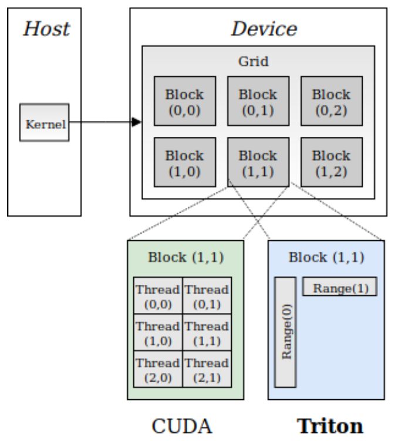

*图 3（原文 Figure 3，第 4 页）：CUDA 与 Triton 的编程模型对比。*

**图中文字翻译与读法**：

- 上半部是共同的执行结构：左侧 Host（主机）上的 Kernel 被送到右侧 Device（设备）；设备上有一个 Grid（网格），网格由 2×3 个 Block（块）组成，编号 Block (0,0) 到 Block (1,2)。
- 下半部放大 Block (1,1)：**左侧绿框**（CUDA）里是 Thread (0,0)、(0,1)、(1,0)、(1,1)、(2,0)、(2,1)，即一个 $3\times2$ 的线程阵列——CUDA 程序要为每个线程写标量代码；**右侧蓝框**（Triton）里没有线程，只有两条“Range”：竖条 Range(0) 和横条 Range(1)，即这个 kernel 实例所负责的两个维度上的一段全局下标。
- 注：这张图在原 PDF 里是低分辨率位图（312×352），裁出后略显模糊，内容不受影响。

**读图结论**：

- CUDA：每个 kernel 对应 launch grid 中一个可识别的 thread block，程序按线程写；
- Triton：编程模型类似，但**每个 kernel 是单线程的（由编译器自动并行化）**，并关联一组随实例而变的 global range；通过内建函数 `get_global_range(axis)` 查询这些 range，用来构造诸如“指针 tile”之类的对象（见清单 1）；
- 因而 Triton kernel 里**不存在** CUDA 式的并发原语（共享内存同步、线程间通信等）——这些由编译器生成。

本文的补充说明（非原文表述）：原文用 “kernel / kernel instance” 的说法，后来 Triton 文档里的 “program instance” 与之对应；原文没有 `program_id` 这个名字，只有 `get_global_range`。可以把 Triton 的并行分成两层：**tile 之间**的并行由启动的实例个数和 global range 决定，**tile 之内**的并行由编译器决定。

| 维度 | CUDA | Triton-C |
|---|---|---|
| 程序视角 | 每个线程执行一份标量程序 | 每个实例是单线程程序，对象是整块 tile |
| 数据对象 | 标量与指针 | 静态形状的多维 tile（包括指针 tile） |
| 线程组织 | 程序员显式写（线程编号、块内布局） | 编译器自动并行化 |
| 共享内存与同步 | 程序员显式管理 | 不出现在源码中，由编译器 pass 生成 |
| 访存合并 | 程序员安排线程与地址的对应 | 编译器排列线程（原文 5.2.2，本文 6.2.2） |

### 4.4 完整例子：清单 1 的矩阵乘 kernel

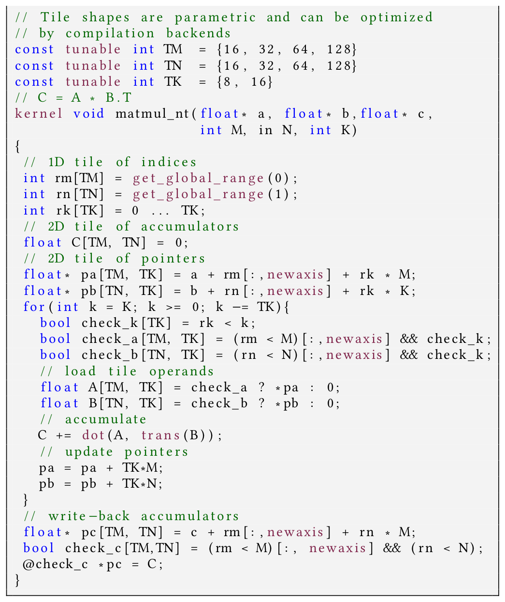

*清单 1（原文 Listing 1，第 2 页）：用 Triton-C 实现 $C=A\times B^\top$ 的完整 kernel。原文注：Triton 专有关键字用紫色表示。*

用一句话概括：每个 kernel 实例负责输出矩阵 $C$ 中一块 `TM×TN` 的 tile，沿归约维 $K$ 每次取 `TK` 列，用 `dot` 累加。逐行读法：

1. `const tunable int TM = {16, 32, 64, 128}`（`TN` 同，`TK = {8, 16}`）：tile 大小是**可调参数**，候选集合写在声明里，由自动调优器选定（`TM`、`TN` 的候选里有 16，而原文 5.3 节写的 tile 大小搜索范围是 32–128，原文没有解释这一差别）。
2. `kernel void matmul_nt(float* a, float* b, float* c, int M, in N, int K)`：`nt` 表示 A 不转置、B 转置。参数表里的 `in N` 是原文笔误，应为 `int N`。
3. `int rm[TM] = get_global_range(0); int rn[TN] = get_global_range(1); int rk[TK] = 0 ... TK;`：`rm`、`rn` 是当前实例负责的输出行下标与列下标（两个一维 tile）；`rk` 是归约维上 tile 内的局部下标 $0,\dots,\mathrm{TK}-1$。
4. `float C[TM, TN] = 0;`：二维累加器 tile，初值为 0。
5. `float* pa[TM, TK] = a + rm[:, newaxis] + rk * M;`：**指针 tile**。`rm[:, newaxis]` 形状为 `[TM,1]`，`rk * M` 形状为 `[TK]`（按广播规则左补成 `[1,TK]`），相加广播成 `[TM,TK]`，于是 `pa[i][j]` 指向 `a[rm[i] + rk[j]*M]`，即 A 按**列主序**存放、主维度为 `M`。`pb` 同理。
6. `for (int k = K; k >= 0; k -= TK)`：`k` 在这里表示“归约维上还剩多少个元素”，每轮消耗 `TK`。
7. `check_k[TK] = rk < k`、`check_a[TM,TK] = (rm < M)[:, newaxis] && check_k`、`check_b[TN,TK] = (rn < N)[:, newaxis] && check_k`：为本轮要加载的 A、B tile 生成布尔掩码。
8. `float A[TM,TK] = check_a ? *pa : 0;`、`float B[TN,TK] = check_b ? *pb : 0;`：按掩码加载，越界位置不访问内存、直接补 0。这样 `M`、`N`、`K` 不是 tile 大小的整数倍时，循环体也不用写特殊分支。
9. `C += dot(A, trans(B));`：$[\mathrm{TM},\mathrm{TK}]\times[\mathrm{TK},\mathrm{TN}]\to[\mathrm{TM},\mathrm{TN}]$ 的 tile 级矩阵乘并累加；补 0 的位置对结果没有贡献。
10. `pa = pa + TK*M; pb = pb + TK*N;`：把两个指针 tile 整体向后推进 `TK` 列。
11. 循环结束后：`pc` 是输出的指针 tile，`check_c` 是输出掩码，`@check_c *pc = C;` 用谓词语句只写回合法位置。

**两个小例子**（本文自拟）：

- 指针 tile：设 `M = 8`、`TM = 4`、`TK = 2`，某个实例的 `rm = [4,5,6,7]`，则 `pa` 相对 `a` 的偏移为 `[[4,12],[5,13],[6,14],[7,15]]`（第二列比第一列多 `M = 8`）。
- 尾部掩码：`K = 10`、`TK = 4` 时，三轮的 `k` 依次为 10、6、2；第三轮 `rk < 2`，掩码为 `[真,真,假,假]`，只加载列号 8、9（从 0 起算），列号 10、11 补 0。

**读码提示**（原文清单里的瑕疵，供对照实现时参考）：

- `pb` 的初值写成 `b + rn[:, newaxis] + rk * K`，但循环尾部更新是 `pb + TK*N`；清单 8 里对应的写法是 `rkb*N`，所以这里的 `rk * K` 疑为 `rk * N` 的笔误（B 按列主序、主维度为 `N`）。
- 循环条件 `k >= 0` 在 `K` 恰为 `TK` 的整数倍时会多跑一轮全被掩码屏蔽的空迭代（结果不变）；清单 8 用的是 `k > 0`。

要点伪代码（本文整理，Python 风格，与清单 1 的逻辑一致）：

```text
rm, rn = 本实例负责的行下标 tile、列下标 tile      # get_global_range(0/1)
rk     = [0, 1, ..., TK-1]
C      = zeros([TM, TN])                         # 累加器
pa, pb = A、B 的指针 tile                          # 指针算术 + 广播
对 K 方向每次推进 TK：
    掩码 = 行/列是否越界  与  rk < 剩余长度
    A = 掩码 ? load(pa) : 0                        # 越界补 0
    B = 掩码 ? load(pb) : 0
    C += dot(A, transpose(B))
    pa, pb 前移 TK 列
在 (rm, rn) 合法的位置 store(C)                    # 谓词 store
```

程序员仍要说明每个实例覆盖哪一块输出、沿 K 维怎样迭代；但**没有**写“哪个线程加载哪个元素”，也没有手写 barrier。

## 五、Triton-IR（第 4 节）

Triton-IR 是基于 LLVM 的中间表示，用来承载 tile 级的程序分析、变换和优化。本文中的 Triton-IR 程序由 Triton-C 在解析阶段直接构造。它与 LLVM-IR 共享同样的高层结构，但增加了 tile 级数据流分析（原文 4.2）和控制流分析（原文 4.3）所需的扩展，这些扩展对原文第 5 节的优化、以及对任意形状张量的安全访问（原文第 6 节实验）至关重要。

### 5.1 结构：模块、函数、基本块（原文 4.1）

- **模块（module）**：编译的基本单元，彼此独立编译，最后由链接器合并，职责是解析前向声明并合并全局定义；模块内含函数、全局变量、常量和其他符号（元数据、函数属性等）。
- **函数**：由返回类型、名字和（可为空的）参数表构成，可附带可见性、对齐和链接说明符；函数属性（如内联提示）和参数属性（如只读、别名提示）能让后端做更激进的优化，例如更好地使用只读缓存。函数体是一组基本块，块间依赖构成控制流图（CFG）。
- **基本块**：只在末尾含终结指令（分支、返回）的直线代码。Triton-IR 采用 SSA 形式：每个变量只赋值一次、先定义后使用，于是每个基本块隐式地定义了一张数据流图（DFG），其中的不同路径对应 SSA 里的 use-def 链。这种形式可以直接从抽象语法树（AST）构造（参见论文引用的 [7]）。

### 5.2 tile 级数据流：类型、retiling 指令与 ReLU 例子（原文 4.2）

**类型**：多维 tile 是数据流分析的中心，声明语法类似 LLVM-IR 的向量，例如 `i32<8, 8>` 表示 $8\times8$ 的 32 位整型 tile。Triton-IR 里**没有** `tunable`，参数化的形状必须在生成 IR 之前确定，本文中由 Triton-JIT 的自动调优器完成。

**retiling 指令**：为支持原文 3.2.2 的广播语义，Triton-IR 引入一组改变 tile 形状的指令：

- `reshape`：用输入参数的数据创建指定形状的 tile，常用来在广播前给形状补 1，把变量重新解释成更高维的数组；
- `broadcast`：沿大小为 1 的维度把输入复制足够多次，创建指定形状的 tile。

此外，常规标量指令（`cmp`、`getelementptr`、`add`、`load` 等）被保留并扩展为对 tile 操作数的**逐元素**运算；Triton-IR 还提供专门的算术指令：转置 `trans` 与矩阵乘 `dot`。

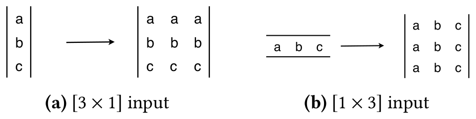

*图 4（原文 Figure 4，第 5 页）：`broadcast<3,3>` 指令把输入复制成 $3\times3$ 的 tile。*

**图中文字翻译与读法**：

- (a) [3 × 1] input（$3\times1$ 输入）：列向量 `a, b, c` 经 broadcast 变成 $3\times3$ 矩阵，每一**行**内元素相同（第一行 `a a a`，第二行 `b b b`，第三行 `c c c`），即沿列方向复制。
- (b) [1 × 3] input（$1\times3$ 输入）：行向量 `a b c` 经 broadcast 变成 $3\times3$ 矩阵，每一**列**内元素相同（三行都是 `a b c`），即沿行方向复制。
- 读图结论：broadcast 只能沿大小为 1 的维度复制，所以要先用 `reshape` 补出这个大小为 1 的维度，这正是清单 5 里 `reshape` 紧跟 `broadcast` 的原因。

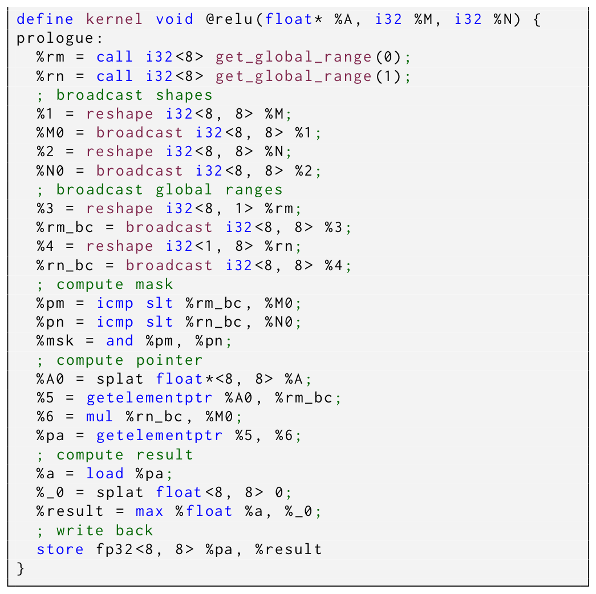

*清单 5（原文 Listing 5，第 4 页）：A = max(A, 0)（ReLU）的 Triton-IR。原文注：这里的 tile 形状是非参数化的，本文中其值由 Triton-JIT 实例化。*

逐段读法（tile 形状 $8\times8$，矩阵按列主序存放，`%M`、`%N` 是行数与列数）：

- `%rm`、`%rn`：调用 `get_global_range(0/1)`，各得到一个 8 元素的一维 tile（行下标、列下标）；
- “broadcast shapes”：`%1 = reshape i32<8, 8> %M`、`%M0 = broadcast i32<8, 8> %1`：把标量 `M` 变成 $8\times8$ 的 tile `%M0`；`%N0` 同理；
- “broadcast global ranges”：`%3 = reshape i32<8, 1> %rm` 把行下标变成列向量，`%rm_bc = broadcast i32<8, 8> %3` 复制成 $8\times8$（每一行内元素相同）；`%rn_bc` 则先 reshape 成 `<1, 8>` 再广播（每一列内元素相同）；
- “compute mask”：`%pm`、`%pn` 比较下标与 `M`、`N`，`%msk = and %pm, %pn` 得到 $8\times8$ 的布尔掩码；
- “compute pointer”：`%A0 = splat float*<8, 8> %A` 把基指针复制成指针 tile，两次 `getelementptr` 加上 `rm` 与 `rn * M`，得到 `%pa`；
- “compute result”：`%a = load %pa`，`%_0` 是全 0 的 tile，`%result = max %float %a, %_0` 就是 ReLU；
- “write back”：`store fp32<8, 8> %pa, %result`。

注意：清单里算出了 `%msk`，但随后的 `load` 与 `store` 都没有使用它，原文没有给出谓词形式的写法，可视为省略。

### 5.3 tile 级控制流：谓词化 SSA（PSSA）（原文 4.3）

**问题**：tile 级运算使 Triton-IR 无法表达 tile **内部**的分叉控制流。例如程序可能需要只对 tile 的一部分元素做越界保护的加载，但这没法用分支实现，因为 tile 的元素不能被单独访问。

**解决**：采用谓词化 SSA（Predicated SSA，PSSA）形式 [8] 和 $\psi$ 函数 [39]，为此给 Triton-IR 增加两类指令：

- **`cmpp`**：类似普通比较指令 `cmp`，但返回**两个互反的谓词**而不是一个；
- **`psi`**：合并来自不同谓词指令流的值。

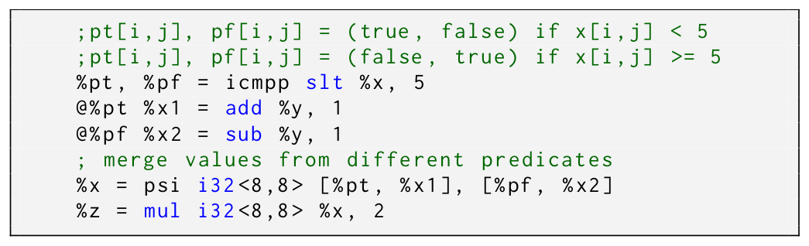

*清单 6（原文 Listing 6，第 5 页）：Tile 级谓词在 Triton-IR 中的写法。*

逐行读法（对 $8\times8$ 的每个元素 `[i,j]` 独立生效）：

- `%pt, %pf = icmpp slt %x, 5`：`slt` 是有符号小于。若 `x[i,j] < 5`，则 `(pt, pf) = (真, 假)`；否则 `(假, 真)`。两个谓词互为反面；
- `@%pt %x1 = add %y, 1`、`@%pf %x2 = sub %y, 1`：以 `@` 加谓词开头的指令只在谓词为真的元素上生效，所以“`y+1`”与“`y-1`”分别只对各自的元素有意义；
- `%x = psi i32<8,8> [%pt, %x1], [%pf, %x2]`：按元素合并两条谓词流——`pt` 为真取 `x1`，`pf` 为真取 `x2`；
- `%z = mul i32<8,8> %x, 2`：合并之后，所有元素又回到同一条无分支的 tile 级数据流上继续运算。

（严格的 SSA 里 `%x` 不应同时出现在 `icmpp` 的输入与 `psi` 的结果里，这里是原文的示意写法。）

于是逐元素的 if/else 被改写成无分支的数据流，边界保护和条件逻辑仍然可以在 tile 级分析，而不必把整个程序降回逐线程的控制流。这也是清单 1 里 `check ? *pa : 0` 与 `@check_c *pc = C` 的语义基础，今天 Triton 里 mask 的核心地位与此一脉相承（本文的联系，非原文表述）。

## 六、Triton-JIT 编译器（第 5 节）

Triton-JIT 把 Triton-IR 简化并编译成高效机器码，依次经过机器无关 pass（原文 5.1）、机器相关 pass（原文 5.2），由自动调优引擎（原文 5.3）支撑。

### 6.1 机器无关优化（原文 5.1）

**软件预取（Pre-Fetching）**：循环里的 tile 级访存可能引入很长的延迟，若没有足够多的独立指令就无法隐藏。Triton-IR 可以直接检测循环，在需要处插入预取代码（清单 7）。

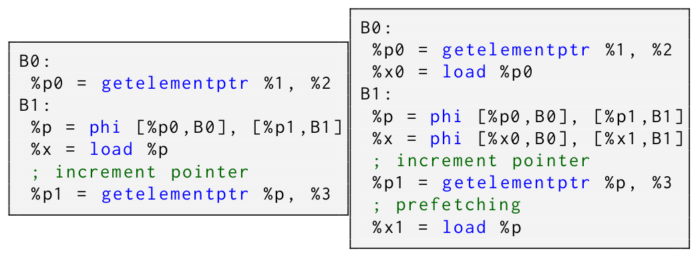

*清单 7（原文 Listing 7，第 5 页）：自动预取。左框为变换前，右框为变换后。*

读法：

- **变换前**（左框）：基本块 `B0` 算出初始指针 `%p0`；循环块 `B1` 里 `%p = phi [%p0, B0], [%p1, B1]`（指针第一次取 `%p0`，之后取上一轮的 `%p1`），然后 `%x = load %p` 读数据，最后 `%p1 = getelementptr %p, %3` 把指针推进。每一轮都要等本轮的 `load` 返回才能用数据。
- **变换后**（右框）：在循环**之前**的 `B0` 里多了 `%x0 = load %p0`，预先读好第一轮的数据；循环里的 `%x = phi [%x0, B0], [%x1, B1]` 表示本轮数据来自循环前的预读，或来自上一轮预取的 `%x1`；推进指针后（“; prefetching” 注释）再发出一条 `load`，为下一轮取数。这样访存延迟可以和本轮计算重叠。
- 注：右框最后一行原文印作 `%x1 = load %p`，按语义预取应读取更新后的指针 `%p1`，疑为原文笔误。

**tile 级窥孔优化（Peephole）**：tile 级运算为窥孔优化器带来新机会。原文唯一给出的例子是转置链可以用恒等式 $X=(X^\top)^\top$ 化简，并称与对角 tile 等性质相关的其他代数性质“将来也可能被利用”。

### 6.2 机器相关优化（原文 5.2）

这些 pass 面向符合图 5 所示高层模型的机器。Triton-JIT 的机器相关优化共有四项：（1）分层 tiling，（2）访存合并，（3）共享内存分配，（4）共享内存同步。

#### 6.2.1 分层 tiling（Hierarchical Tiling，原文 5.2.1）

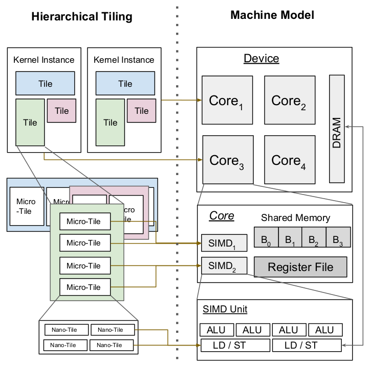

*图 5（原文 Figure 5，第 6 页）：Triton-IR 机器模型中的分层 tiling。*

**图中文字翻译与读法**：

- **左半 Hierarchical Tiling（分层 tiling）**：每个 Kernel Instance（内核实例）包含若干 Tile（图中用蓝、绿、粉三色表示）；每个 Tile 继续切成多个 Micro-Tile（微 tile），每个 Micro-Tile 再切成多个 Nano-Tile（纳 tile）。
- **右半 Machine Model（机器模型）**：Device（设备）包含若干 Core（核心，图中为 Core1–Core4）和 DRAM；每个 Core 内有若干 SIMD 单元（SIMD1、SIMD2）、Shared Memory（共享内存，分成 B0–B3 几个 bank）和 Register File（寄存器堆）；每个 SIMD Unit 内有若干 ALU 与 LD / ST（加载/存储）单元。
- **连线含义**：Kernel Instance → Core；Tile 的各个 Micro-Tile → Core 内的各个 SIMD 单元；Micro-Tile 的 Nano-Tile → SIMD 单元内的 ALU 与 LD/ST 单元；LD/ST 与 DRAM 相连。

**读图结论**：嵌套的 tiling 策略把 tile 逐级分解为 micro-tile、再到 nano-tile，使之尽可能贴合机器的计算能力和存储层次。这种技术在自动调优框架 [34, 40] 中很常见，但 Triton-IR 的结构使得**对任何可表达的程序**，都能自动枚举并优化合法的嵌套 tiling 配置，而不需要多面体机制。（本文的对应关系，非原文表述：Core 约等于 GPU 的 SM，SIMD 单元约等于 warp，Nano-Tile 约等于单个线程处理的小块。）

#### 6.2.2 访存合并（Memory Coalescing，原文 5.2.2）

若相邻线程同时访问相邻的存储位置，则称访存是合并的；这很重要，因为内存通常以大块为单位从 DRAM 取回。由于 Triton-IR 程序是单线程且自动并行化的，编译器后端可以在每个 micro-tile 内部**排列线程**，尽可能避免不合并的访问。这一策略减少了加载一个 tile 的某一列所需的内存事务数（图 6）。

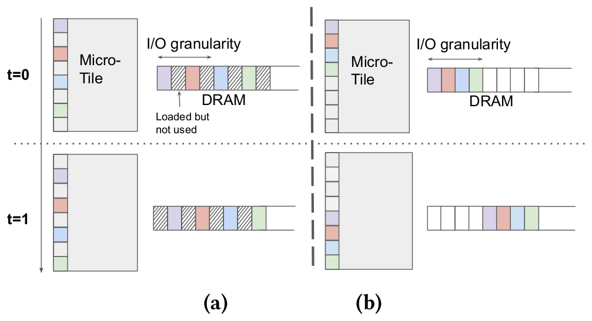

*图 6（原文 Figure 6，第 6 页）：非合并（a）与合并（b）的 DRAM 访问，不同线程用不同颜色表示。*

**图中文字翻译与读法**：

- 每个子图的左边是 Micro-Tile 的一列（8 个元素），右边是 DRAM 中对应的一段；纵向分为两个时间步：t=0（上）和 t=1（下）；“I/O granularity”（I/O 粒度）指 DRAM 一次取回的数据块，斜线填充的格子标注为 “Loaded but not used”（已加载但未使用）。
- **(a) 非合并**：4 个线程（4 种颜色）在 t=0 访问第 1、3、5、7 个元素，在 t=1 访问第 2、4、6、8 个元素。每个时间步里线程碰到的元素是相隔一个的，取回的每个数据块中约一半是被加载却没用到的（斜线格）。
- **(b) 合并**：4 个线程在 t=0 访问第 1–4 个元素，在 t=1 访问第 5–8 个元素，同一时刻相邻线程访问相邻元素，取回的数据全部被用到。
- 读图结论：同样把一列 8 个元素取完，线程与元素的对应方式不同，取回的无用数据量和需要的内存事务数就不同。这一线程排列由编译器根据 tile 的连续维度决定，而在 CUDA 里通常由程序员写死。

#### 6.2.3 共享内存分配（Shared Memory Allocation，原文 5.2.3）

具有高算术强度的 tile 级运算（如 `dot`）可以先把操作数暂存到快速的共享内存。**共享内存分配 pass** 要决定的是：一个 tile 应当**何时**、**放在哪里**。做法是先计算每个相关变量的**活跃区间（live range）**，再用 [15] 提出的线性时间存储分配算法分配空间（图 7）。

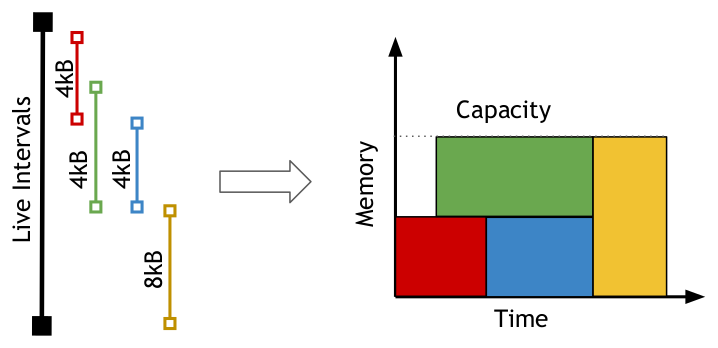

*图 7（原文 Figure 7，第 6 页）：共享内存分配。*

**图中文字翻译与读法**：

- **左边 Live Intervals（活跃区间）**：黑色粗竖线表示程序执行的时间轴，旁边四条彩色竖线是四个 tile 的活跃区间，大小标注为：红 4kB、绿 4kB、蓝 4kB、黄 8kB。
- **右边**：纵轴 Memory（内存）、横轴 Time（时间），虚线 Capacity（容量）；彩色方块是分配结果。
- 读法：红与蓝的活跃区间不重叠，所以共用共享内存底部同一块地址；绿与红、蓝都有重叠，只能放在它们之上；黄（8kB）出现在其他几个都已结束之后，独占整个容量。
- 读图结论：峰值占用只有 8kB（图中 Capacity 线与黄色块齐平），而如果四个 tile 各占一份，则需要 4+4+4+8=20kB（这是对图中标注的求和）。这就是用活跃区间做复用、让更大的工作集放进共享内存的做法。

#### 6.2.4 共享内存同步（Shared Memory Synchronization，原文 5.2.4）

在原文的机器模型里，对共享内存的读写是**异步**的。同步 pass 要在生成的 GPU 源码中**自动插入 barrier**，保证程序正确。做法是用**前向数据流分析**检测先写后读（RAW，read-after-write）与先读后写（WAR，write-after-read）两类冲突，数据流方程如下（$s$ 为一条语句，$\mathrm{pred}(s)$ 为其前驱，$\mathrm{read}(s)$、$\mathrm{write}(s)$ 为它读、写的共享内存区域集合）：

$$
\mathrm{in}_s^{(RAW)}=\bigcup_{p\in \mathrm{pred}(s)}\mathrm{out}_p^{(RAW)},\qquad
\mathrm{in}_s^{(WAR)}=\bigcup_{p\in \mathrm{pred}(s)}\mathrm{out}_p^{(WAR)}
$$

$$
\mathrm{out}_s^{(RAW)}=\begin{cases}\varnothing & \text{if }\mathrm{in}_s^{(RAW)}\cap \mathrm{read}(s)\neq\varnothing\ \text{(barrier)}\\ \mathrm{in}_s^{(RAW)}\cup \mathrm{write}(s) & \text{otherwise}\end{cases}
$$

$$
\mathrm{out}_s^{(WAR)}=\begin{cases}\varnothing & \text{if }\mathrm{in}_s^{(WAR)}\cap \mathrm{write}(s)\neq\varnothing\ \text{(barrier)}\\ \mathrm{in}_s^{(WAR)}\cup \mathrm{read}(s) & \text{otherwise}\end{cases}
$$

（原文第 6 页，与 PDF 逐项核对。）读法：

- $\mathrm{in}_s^{(RAW)}$ 是“到达语句 $s$ 时，还没被 barrier 保护的待定写”的区域集合，取所有前驱的并集；$\mathrm{in}_s^{(WAR)}$ 同理，是待定的读。
- 若 $s$ 要**读**的区域与待定写有交集，就是 RAW 冲突：在 $s$ 之前插入 barrier，barrier 之后所有待定写都已完成，所以 $\mathrm{out}=\varnothing$；否则 $s$ 自己的写入加入待定集合。
- WAR 对称：若 $s$ 要**写**的区域与待定读有交集，就在 $s$ 之前插 barrier，并清空；否则把 $s$ 读的区域加入待定集合。
- 这是前向分析，要沿 CFG 迭代到不动点（循环回边也会产生冲突）。

本文自拟的例子：循环里先 `s1` 把 tile 写进共享内存区域 `sA`，再 `s2` 读取 `sA` 做 `dot`。到 `s2` 时 $\mathrm{in}^{(RAW)}=\{\mathtt{sA}\}$ 且 $\mathrm{read}(s_2)=\{\mathtt{sA}\}$，所以在 `s2` 前插 barrier；`s2` 之后 $\mathrm{out}^{(WAR)}=\{\mathtt{sA}\}$，下一轮 `s1` 再写 `sA` 时又命中 WAR，在回边处再插一个 barrier。

“用户不写 barrier”并不表示没有 barrier，而是把正确插入 barrier 的责任转给了编译器：分析太保守会插得过多而变慢，漏掉则会出现竞态。

### 6.3 自动调优器（Auto-tuner，原文 5.3）

传统自动调优器 [42, 45] 通常依赖手写的参数化代码模板，在预定义的负载上取得好性能。Triton-JIT 的区别是：它可以**直接从 Triton-IR 程序中提取优化空间**，办法是把上面每个优化 pass 关联的元参数拼接起来。

本文只考虑了分层 tiling 这一个 pass，因此每个 tile 的每个维度**至多 3 个** tiling 参数，用**穷举搜索**在 2 的幂中优化：

| 参数 | 搜索范围 | 取值 |
|---|---|---|
| tile 大小 | 32 到 128 | 32、64、128 |
| micro-tile 大小 | 8 到 32 | 8、16、32 |
| nano-tile 大小 | 1 到 4 | 1、2、4 |

（原文 5.3 给出范围，具体取值是按“2 的幂”列出的。）按此推算，每个维度至多 $3\times3\times3=27$ 种组合，二维 tile 至多 729 种（本文的推算，原文未给总数，实际还需剔除不合法组合）。原文还写道“更好的自动调优方法将来可以使用”。

## 七、实验（第 6 节）

### 7.1 实验设置

- 硬件：NVIDIA GeForce GTX 1070（单卡）。
- 对比对象：厂商库 cuBLAS 10.0、cuDNN 7.0，以及相关编译器技术 AutoTVM、Tensor Comprehensions（TC）、PlaidML。凡适用之处，这些 DSL 都按官方文档指引针对每个问题规模单独调优。
- 数据类型：原文没有单独声明；清单里的 kernel 使用 `float`，可推断为 FP32。
- 任务：矩阵乘（方阵，以及取自 DeepSpeech2 循环网络和 Transformer 的形状）与卷积（取自 ResNet 与 DeepSpeech2）。
- 这是一张 2019 年的单卡快照：适合验证设计可行，不足以推出对后来 A100/H100、tensor core、FP8 和 AMD GPU 的普遍结论。

### 7.2 矩阵乘（原文 6.1，图 8）

矩阵乘任务形如 $A=D\times W^\top$，其中 $D\in\mathbb{R}^{M\times K}$，$W\in\mathbb{R}^{N\times K}$，是神经网络计算的核心。图 8 的形状来自循环网络（DeepSpeech2）和 Transformer。

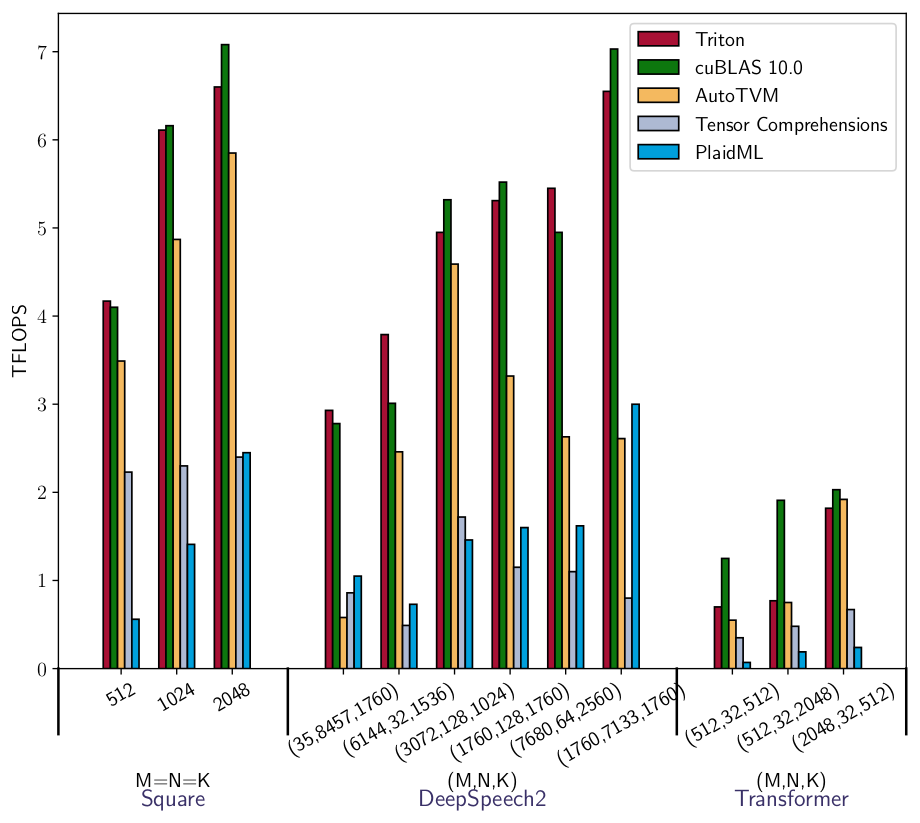

*图 8（原文 Figure 8，第 7 页）：各系统的矩阵乘性能（GTX 1070）。*

**图中文字翻译与读法**：

- 纵轴 TFLOPS（每秒万亿次浮点运算，越大越好）；横轴分三组，每组内按形状排开：**Square（方阵）**，$M=N=K$，取 512、1024、2048；**DeepSpeech2**，标注 (M,N,K)，取 (35,8457,1760)、(6144,32,1536)、(3072,128,1024)、(1760,128,1760)、(7680,64,2560)、(1760,7133,1760)；**Transformer**，标注 (M,N,K)，取 (512,32,512)、(512,32,2048)、(2048,32,512)。
- 每个形状有 5 根柱，从左到右依次是：Triton（红）、cuBLAS 10.0（绿）、AutoTVM（橙）、Tensor Comprehensions（浅灰蓝）、PlaidML（蓝）。

下表是从该图矢量数据量出的柱高（单位 TFLOP/s，约值，保留两位小数；原文没有标数值）：

| 形状 (M,N,K) | Triton | cuBLAS 10.0 | AutoTVM | Tensor Comprehensions | PlaidML |
|---|---:|---:|---:|---:|---:|
| 方阵 512 | 4.17 | 4.10 | 3.49 | 2.23 | 0.56 |
| 方阵 1024 | 6.11 | 6.16 | 4.87 | 2.30 | 1.41 |
| 方阵 2048 | 6.60 | 7.08 | 5.85 | 2.40 | 2.45 |
| DeepSpeech2 (35,8457,1760) | 2.93 | 2.78 | 0.58 | 0.86 | 1.05 |
| DeepSpeech2 (6144,32,1536) | 3.79 | 3.01 | 2.46 | 0.49 | 0.73 |
| DeepSpeech2 (3072,128,1024) | 4.95 | 5.32 | 4.59 | 1.72 | 1.46 |
| DeepSpeech2 (1760,128,1760) | 5.31 | 5.52 | 3.32 | 1.15 | 1.60 |
| DeepSpeech2 (7680,64,2560) | 5.45 | 4.95 | 2.63 | 1.10 | 1.62 |
| DeepSpeech2 (1760,7133,1760) | 6.55 | 7.03 | 2.61 | 0.80 | 3.00 |
| Transformer (512,32,512) | 0.70 | 1.25 | 0.55 | 0.35 | 0.07 |
| Transformer (512,32,2048) | 0.77 | 1.91 | 0.75 | 0.48 | 0.19 |
| Transformer (2048,32,512) | 1.82 | 2.03 | 1.92 | 0.67 | 0.24 |

**原文 6.1 的结论**：Triton 与 cuBLAS 总体上相当，并在某些任务上达到设备峰值性能的 90% 以上；但在**浅的 Transformer 网络**上 cuBLAS 仍比 Triton 快，原因是 cuBLAS 使用一种 **3D 算法** [2]，把深的归约（reduction）拆成相互独立的块来增加并行度——当 $M$、$N$ 太小时这很有用。除此之外，现有 DSL 比 Triton 慢 2–3 倍，唯一例外是输入形状为 32 的倍数时的 TVM（慢不到 2 倍）。

**对读图的补充**（本文从上表算出，均为约值）：

- Triton 相对 cuBLAS：在 9 个方阵与 DeepSpeech2 形状上约为 0.93–1.26 倍，其中 4 个形状 Triton 更高（512 方阵、(35,8457,1760)、(6144,32,1536)、(7680,64,2560)）；在 3 个 Transformer 形状上只有约 0.56、0.40、0.90 倍，其中 (512,32,2048) 即 $K$ 最深的那个差距最大，与“3D 算法拆分深归约”的解释吻合。
- “2–3 倍”是概括性说法。在多数形状上 AutoTVM 是最强的 DSL 基线：方阵上 Triton 只快约 1.1–1.25 倍，(2048,32,512) 上 AutoTVM（1.92）还略高于 Triton（1.82）；而 TC 与 PlaidML 在多个形状上与 Triton 相差远不止 3 倍（例如 PlaidML 在 (512,32,512) 只有 0.07）。
- 按图 1 的 Roofline 平台约 7.5 TFLOP/s（读图）估算，图 8 里最高的 cuBLAS（7.08、7.03）约为 94%，Triton 的最高值（6.60、6.55）约为 87%–88%；原文所说“超过 90%”主要由 cuBLAS 满足，具体是哪个系统、哪个任务原文没有说明。
- 本文的推测：论文只搜索了分层 tiling（原文 5.3），没有 3D/split-K 式的分解，可能是浅形状落后的原因之一，但论文没有对此做实验验证。

### 7.3 卷积与 shift 卷积（原文 6.2，图 9、表 1、图 10、图 11）

卷积网络（CNN）是一类重要的模型，理应被 DSL 与编译器良好支持。它们的核心是卷积层（图 9a），而把卷积实现成矩阵乘（图 9b）是利用专用张量处理硬件所必需的——这一点在已有 DSL 中尚不被支持。本节评测两项：Triton 对 cuDNN 的 `IMPLICIT_GEMM` 算法的重新实现（7.3.1），以及论文称为“首个可用”的 shift 卷积融合 kernel（7.3.2）。两者都通过**指针增量查找表**实现，如清单 8 所示。

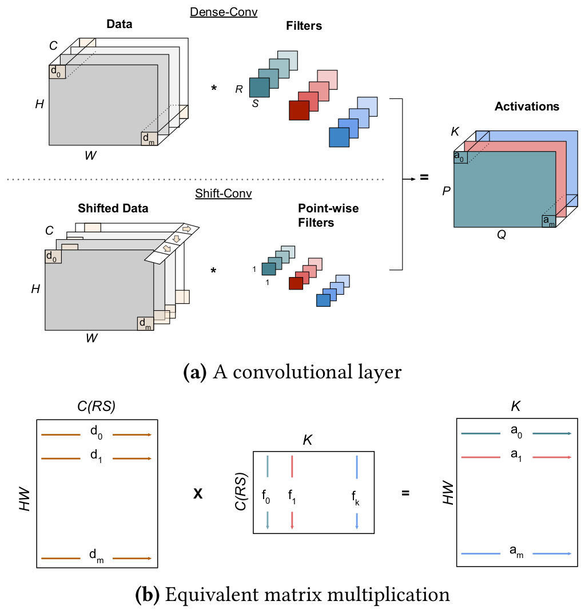

*图 9（原文 Figure 9，第 7 页）：稠密卷积层与 shift 卷积层（a），以及它们作为矩阵乘的等价形式（b）。*

**图中文字翻译与读法**：

- **(a) A convolutional layer（一个卷积层）**。上半部 Dense-Conv（稠密卷积）：左边 Data（输入数据，$C$ 个通道，每个通道 $H\times W$，图中 $d_0,\dots,d_m$ 标出若干取值位置）与 Filters（滤波器，每个滤波器是 $C$ 层 $R\times S$ 的核，三种颜色表示三个不同的滤波器）做卷积（`*`），得到右边的 Activations（激活/输出，$K$ 个通道，空间尺寸 $P\times Q$，$a_0,\dots,a_m$）。下半部 Shift-Conv（shift 卷积）：Shifted Data（移位后的数据，每个通道按各自的偏移在空间上平移，图中用箭头表示）与 Point-wise Filters（逐点滤波器，核大小为 $1\times1$）做卷积，得到同样形状的输出。
- **(b) Equivalent matrix multiplication（等价的矩阵乘）**：左矩阵形状 $HW\times C(RS)$，每一行 $d_0,d_1,\dots,d_m$ 是一个输出位置对应的输入窗口展开成的长度 $C\cdot R\cdot S$ 的向量；中间矩阵 $C(RS)\times K$，每一列 $f_0,f_1,\dots,f_k$ 是一个滤波器；相乘得到 $HW\times K$ 的输出矩阵，每一行 $a_0,\dots,a_m$ 是该位置的 $K$ 个输出通道。
- 读图结论：卷积 = 一个“窗口展开矩阵”乘“滤波器矩阵”。**显式** `im2col` 要把左矩阵真的展开出来，多占一大块内存；**隐式 GEMM**（implicit GEMM）则在 kernel 内按卷积窗口位置现算地址，不物化左矩阵；shift 卷积把 $R\times S$ 的空间卷积换成“零 FLOP 的移位 + $1\times1$ 卷积”，其矩阵乘形式里只是左矩阵的取数地址不同。

#### 7.3.1 稠密卷积（原文 6.2.1）

先看实验用的卷积任务（表 1）。

**表 1：本文使用的卷积任务**（H、W 为输入空间尺寸，C 为输入通道数，K 为输出通道数，R、S 为滤波器空间尺寸；B 原文表中未说明，按惯例应是 batch size，属本文推断）：

| 任务 | H | W | C | B | K | R | S | 来源网络 |
|---|---:|---:|---:|---:|---:|---:|---:|---|
| Task 1 | 112 | 112 | 64 | 4 | 128 | 3 | 3 | ResNet |
| Task 2 | 56 | 56 | 128 | 4 | 256 | 3 | 3 | ResNet |
| Task 3 | 28 | 28 | 256 | 4 | 512 | 3 | 3 | ResNet |
| Task 4 | 14 | 14 | 512 | 4 | 512 | 3 | 3 | ResNet |
| Task 5 | 7 | 7 | 512 | 4 | 512 | 3 | 3 | ResNet |
| Task 6 | 161 | 700 | 1 | 8 | 64 | 5 | 5 | DeepSpeech2 |
| Task 7 | 79 | 341 | 32 | 8 | 32 | 5 | 10 | DeepSpeech2 |

（原文表 1，第 8 页，逐格与 PDF 核对。）

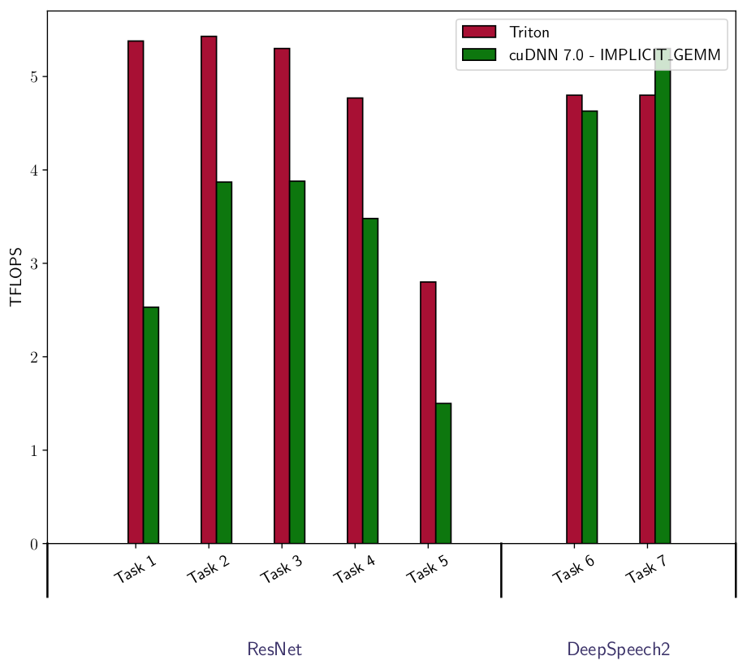

*图 10（原文 Figure 10，第 8 页）：隐式矩阵乘（IMPLICIT_GEMM）的性能：Triton 对 cuDNN 7.0。*

**图中文字翻译与读法**：纵轴 TFLOPS（越大越好）；横轴是表 1 的 Task 1–7，前 5 个属于 ResNet，后 2 个属于 DeepSpeech2；每个任务两根柱：红色 Triton，绿色 cuDNN 7.0 - IMPLICIT GEMM。

下表是从该图矢量数据量出的柱高（单位 TFLOP/s，约值）：

| 任务 | Triton | cuDNN 7.0（IMPLICIT_GEMM） | Triton ÷ cuDNN（约） |
|---|---:|---:|---:|
| Task 1（ResNet） | 5.38 | 2.53 | 2.13 |
| Task 2（ResNet） | 5.43 | 3.87 | 1.40 |
| Task 3（ResNet） | 5.30 | 3.88 | 1.37 |
| Task 4（ResNet） | 4.77 | 3.48 | 1.37 |
| Task 5（ResNet） | 2.80 | 1.50 | 1.87 |
| Task 6（DeepSpeech2） | 4.80 | 4.63 | 1.04 |
| Task 7（DeepSpeech2） | 4.80 | 5.30 | 0.91 |

**原文结论**：Triton 在 ResNet 上优于 cuDNN 的 IMPLICIT_GEMM 实现。论文对此的解释是：**这可能是因为** cuDNN 还维护着针对 $3\times3$ 卷积的更好算法（即 Winograd [25]），因而留给优化次要 kernel 的工程资源很少；在没有快速算法可用的情形（如 DeepSpeech2），cuDNN 与 Triton 持平。

读法与限定：

- 图上 ResNet 的 5 个任务 Triton 都更高（约 1.4–2.1 倍），DeepSpeech2 的 Task 6 约持平，Task 7 上 cuDNN 反而略高（约 5.3 对 4.8）。
- 比较对象是 cuDNN 里的**一条特定算法路径**（IMPLICIT_GEMM）。若按原文的解释，cuDNN 对 $3\times3$ 卷积真正使用的是 Winograd，则不能据此说 Triton 全面超过 cuDNN；准确的说法是“Triton 重现了有竞争力的 implicit GEMM”。（这句限定是本文的读后判断，原文只说了前半句的原因猜测。）
- Task 5（$7\times7$ 空间尺寸）两边都最低，原文没有解释；本文推测是可并行的输出位置太少，但这没有被论文验证。

#### 7.3.2 shift 卷积与清单 8（原文 6.2.2）

shift 卷积是一种新的 CNN 做法（论文引用 [47]：“零 FLOP、零参数的空间卷积替代方案”）：先按通道对空间位置做移位，再做 $1\times1$ 卷积。朴素实现需要：单独启动一个手写的 shift kernel、把移位后的张量写回显存、再调一次 cuBLAS。Triton 则可以在加载 tile 时直接做移位后的地址计算，与后续的 `dot` 融合在一个 kernel 里。

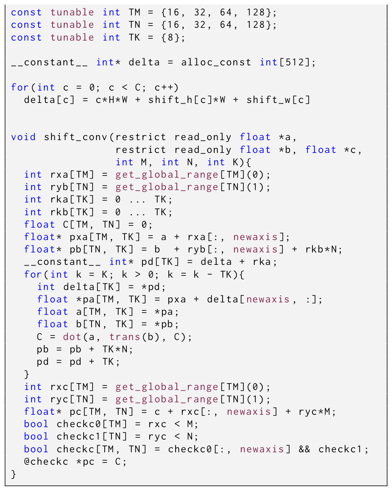

*清单 8（原文 Listing 8，第 8 页）：用 Triton-C 实现的 shift 卷积。*

读法：

- 顶部：`TM`、`TN` 同清单 1，`TK` 只取 `{8}`。
- `__constant__ int* delta = alloc_const int[512];`：在常量内存里开一张 512 项的整数表（原文只给出这个数字；恰好覆盖表 1 中 Task 1–5 最大的通道数 $C=512$，这是本文的观察）。随后的循环 `delta[c] = c*H*W + shift_h[c]*W + shift_w[c]` 填表：第 $c$ 个通道的取数偏移 = 通道平面的起点（`c*H*W`）+ 该通道的纵向移位（`shift_h[c]*W`）+ 横向移位（`shift_w[c]`）。这就是“指针增量查找表”。
- `rxa`、`ryb`、`rka`、`rkb`：输出位置的一维下标 tile，以及 K（通道）方向的局部下标；注意清单里写成 `get_global_range[TM](0)`，比清单 1 多了尺寸参数。
- `pxa[TM,TK] = a + rxa[:, newaxis]`：A 的基础指针 tile，只含空间位置；`pb[TN,TK] = b + ryb[:, newaxis] + rkb*N`：权重的指针 tile（`rkb*N` 与清单 1 的对应处不同，见 4.4 的读码提示）；`pd[TK] = delta + rka`：指向常量表的指针。
- 主循环：`int delta[TK] = *pd` 从常量内存读出本轮 `TK` 个通道的偏移；`pa = pxa + delta[newaxis, :]` 把偏移加到每一行，得到**移位后**的取数指针；`a = *pa`、`b = *pb` 加载两个 tile；`C = dot(a, trans(b), C)` 累加（这里 `dot` 写成了三参数形式，与清单 3 的二参数文法不同，原文没有解释）；然后 `pb += TK*N`、`pd += TK` 前移。
- 收尾与清单 1 相同：`pc`、`checkc0`、`checkc1`、`checkc` 与 `@checkc *pc = C;` 做谓词写回。
- 其他细节：参数里的 `restrict read_only` 是别名与只读提示，对应原文 4.1.2 说的“参数属性让后端更好地使用只读缓存”；清单里加载 `a` 时没有写越界掩码，原文没有说明移位越界怎样处理。
- 非仿射性：`pa = pxa + delta[...]` 的偏移来自查表，不是循环下标的仿射函数，这正是原文第 1、2 节强调的“多面体/仿射类 DSL 无法表达、Triton 可以”的那类非仿射下标。

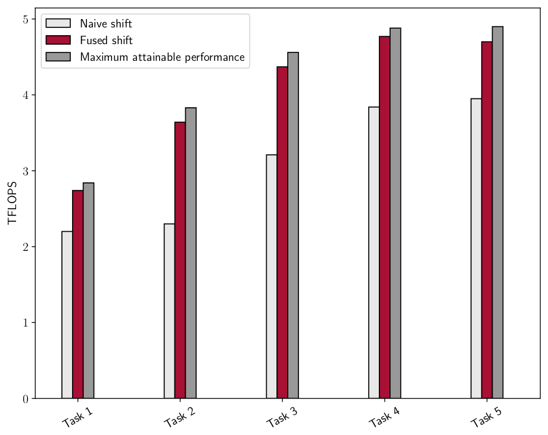

*图 11（原文 Figure 11，第 8 页）：Triton 中 shift 卷积的性能。*

**图中文字翻译与读法**：纵轴 TFLOPS（越大越好）；横轴 Task 1–5（表 1 中的 ResNet 任务，作为 shift 卷积实现）；三根柱：Naive shift（朴素实现：手写 shift kernel + 单独调用 cuBLAS，浅色）、Fused shift（Triton 融合实现，红色）、Maximum attainable performance（不做 shift 时的最大可达性能，即 $1\times1$ 卷积，灰色）。

下表是从该图矢量数据量出的柱高（单位 TFLOP/s，约值）：

| 任务 | Naive shift | Fused shift | 最大可达（不做 shift） | Fused ÷ Naive（约） | Fused ÷ 最大可达（约） |
|---|---:|---:|---:|---:|---:|
| Task 1 | 2.20 | 2.74 | 2.84 | 1.25 | 96% |
| Task 2 | 2.30 | 3.64 | 3.83 | 1.58 | 95% |
| Task 3 | 3.21 | 4.37 | 4.56 | 1.36 | 96% |
| Task 4 | 3.84 | 4.77 | 4.88 | 1.24 | 98% |
| Task 5 | 3.95 | 4.70 | 4.90 | 1.19 | 96% |

**原文结论**：Triton 实现几乎完全隐藏了 shift 的代价。读图：融合版比朴素版快约 1.2–1.6 倍，并达到不做 shift 上限的约 95%–98%。

**为什么这是更有说服力的案例**：Triton 对固定函数库的优势并不在于每个标准 GEMM 都要击败 cuBLAS，而是在非标准索引与融合场景里避免中间张量的显存读写。

## 八、论文的结论、局限与证据边界

原文结论（第 7 节）：论文展示了只给 LLVM-IR 增加少量数据流与控制流扩展，就能支撑多种 tile 级优化 pass，并联合达到与厂商库相当的性能；还提出了更高层的 Triton-C，用它简洁地实现了面向 CNN 新结构的高效 kernel。未来工作包括：支持 tensor core、实现量化 kernel [26]、集成到更高层的 DSL。

**论文没有证明什么**：

1. 没有证明 Triton 对所有 kernel 都比 CUDA 或厂商库快；
2. 没有证明 tile 参数搜索能自动发现所有高级算法，如 split-K（3D 算法）、Winograd；
3. 没有证明同一 kernel 无需重新调优即可跨 GPU 达到同样性能；
4. 没有覆盖现代 tensor core、异步拷贝、TMA、FP8 与多 CTA 协作；
5. 没有评估编译时间、调优成本或大规模部署中的缓存行为；
6. 实验只有一块 GTX 1070，主要是 GEMM 与卷积，没有归约、attention、scan 等后来常见的模式。

**常见误读**：

- “Triton 能自动把任意 Python 变快”：这篇论文只讨论受限的 DSL 和结构化张量计算。
- “零调优”：用户少写硬件细节，但 tile 大小等参数仍要搜索（原文 5.3），分解方式、数据重用和融合是否合适仍由程序或上层生成器负责。
- “Triton 全面超过 cuDNN / cuBLAS”：图 8 里 Transformer 浅形状 cuBLAS 明显更快；图 10 里 Triton 只赢了 cuDNN 的 IMPLICIT_GEMM 路径，且 Task 7 仍略输。
- 把 2019 的 API 与数字当成现在的 Triton：见下一节。

## 九、从 2019 到现代 Triton：哪些没变，哪些变了

以下对照属于论文之外的背景知识，仅用于帮助把论文和今天的接口对上号。

| 2019 论文 | 今天常见的写法 |
|---|---|
| Triton-C（C 风格） | Python DSL（`@triton.jit`） |
| `get_global_range(axis)` | `tl.program_id(axis)` 加 `tl.arange` |
| `tunable` 与穷举搜索 | `@triton.autotune` 的配置列表 |
| `check ? *pa : 0` | `tl.load(ptr, mask=..., other=0)` |
| `@check_c *pc = C` | `tl.store(ptr, val, mask=...)` |
| `dot(A, trans(B))` | `tl.dot(a, tl.trans(b))` |
| 基于 LLVM 的 Triton-IR | 基于 MLIR 的多层 IR |

没变的核心：一个实例处理一块 tile；shape、mask 和指针算术显式存在；tile 内的线程映射主要交给编译器；JIT 特化与自动调优是性能路径的一部分；对融合和自定义算子尤其有价值。已显著变化的：前端、IR 基础设施、tensor core 与更多数据类型、多代 NVIDIA/AMD 后端、被 TorchInductor 等上层编译器大规模自动生成；layout 表示后来成为独立而复杂的研究问题，见 [Linear Layouts 中文解读](../linear_layouts/论文中文解读.md)。

## 十、对实际 kernel 开发的启示

以下是读者向的经验总结，不是论文的结论。

1. **先决定分解**：一个实例负责哪块输出、沿哪个轴并行、哪个轴循环，通常比某条语句更重要；错误的分解导致并行度不足或重复加载，后面的微调难以挽救。
2. **用 mask 表达完整语义**：不要只在整除的常用形状上验证。边界 tile、零长度维度、非连续 stride 和数据类型提升都可能让看似正确的 kernel 出错（清单 1 的读码提示就是例子）。
3. **把融合收益与单算子算力区分**：融合 kernel 的优势常来自少一次显存读写，而不是更高的矩阵乘峰值；benchmark 应同时报告端到端延迟、字节流量和正确基线（图 11 的朴素版与融合版就是这种对比）。
4. **自动调优要受控**：候选太少会漏掉好配置，太多会让首次编译与调优成本失控；候选还必须受寄存器、共享内存、warp 数和输入形状约束。

## 十一、复现检查清单

- 硬件与软件版本：GTX 1070、cuBLAS 10.0、cuDNN 7.0；换 GPU 或库版本，图 8、10、11 的倍数都会变。
- 基线是否同样调优：AutoTVM、TC、PlaidML 在原文里都针对每个问题规模单独调优；若基线没调优，结论不可比。
- 形状清单：图 8 的 12 个矩阵乘形状与表 1 的 7 个卷积任务需完全一致。
- 数值与边界：用掩码处理非 tile 倍数的尺寸，并与参考实现比对误差。
- 区分“峰值”口径：图 1 的 Roofline 平台（读图约 7.5 TFLOP/s）与不同口径的设备峰值不同，引用“超过 90% 峰值”前要先对齐口径。

## 十二、与相关论文的关系

- 向后：[PyTorch 2](../pytorch_2/论文中文解读.md) 说明 Triton 如何成为 `torch.compile` 的 GPU 后端；[TritonBench](../tritonbench/论文中文解读.md) 从基准角度看写对、跑通、跑快 Triton kernel 的难度；[Linear Layouts](../linear_layouts/论文中文解读.md) 处理现代 Triton 后端的 layout 问题。
- 同类系统：[Tensor Comprehensions](../tensor_comprehensions/论文中文解读.md)、[TVM](../tvm_compiler/论文中文解读.md)（实验里的 TC 与 AutoTVM 基线分别来自这两篇）。
- 阅读顺序见 [Triton 论文阅读索引](../Triton论文阅读索引.md)。

## 原文证据导航

- [原论文 PDF](paper.pdf)（官方出版页面：[DOI](https://doi.org/10.1145/3315508.3329973)）
- [原文提取文本](paper.txt)
- [论文概要](论文概要.md)
