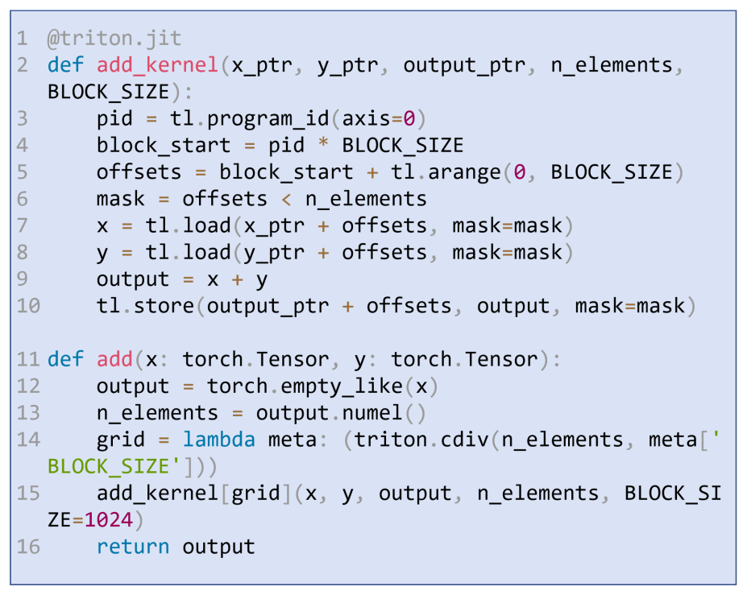
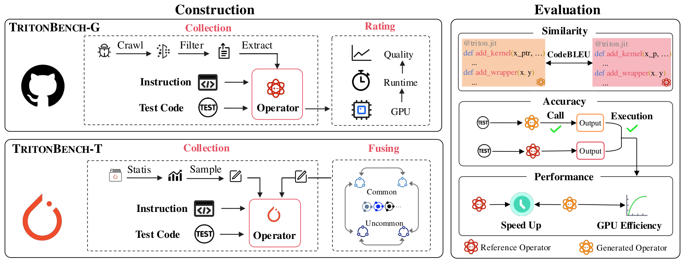
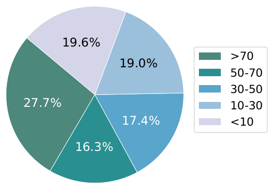
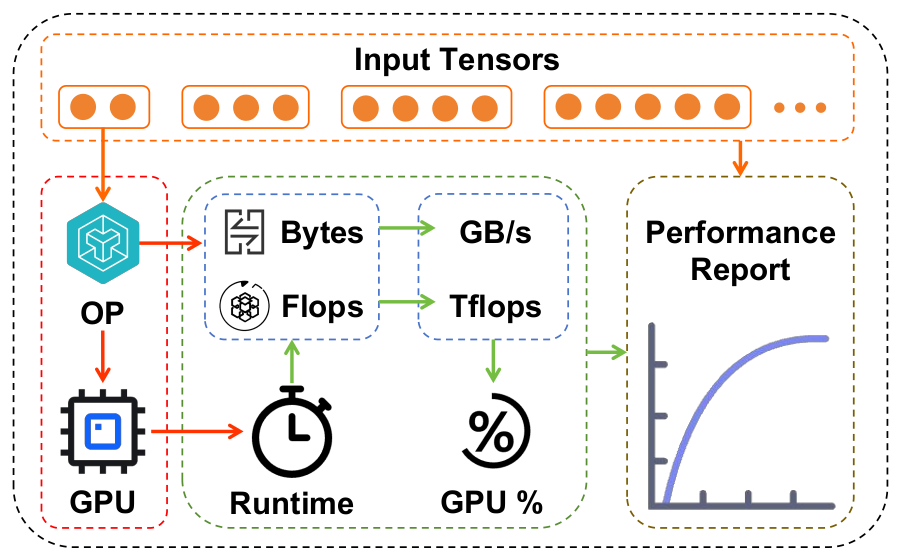
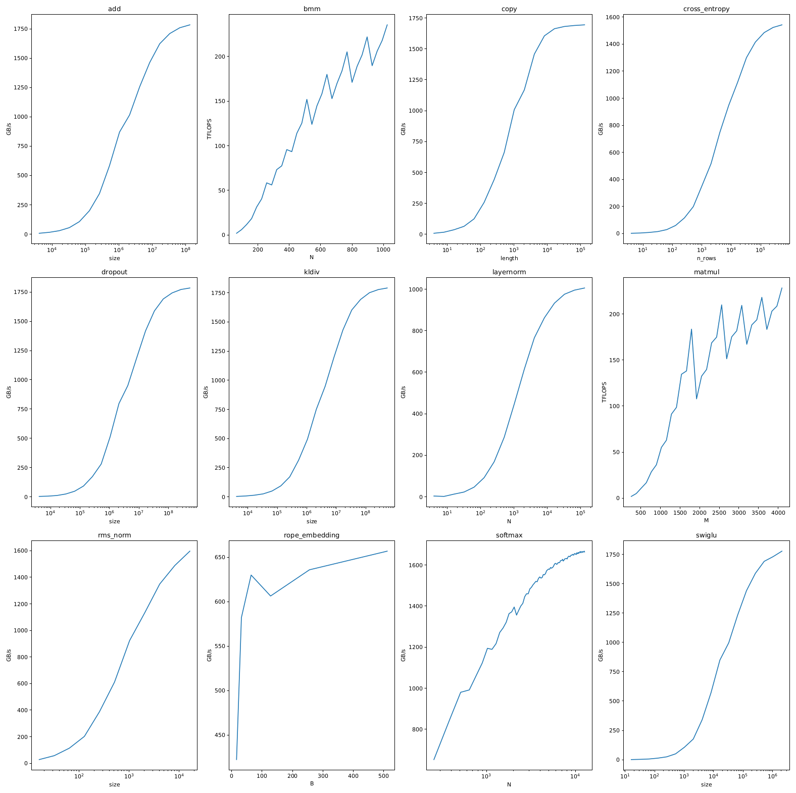
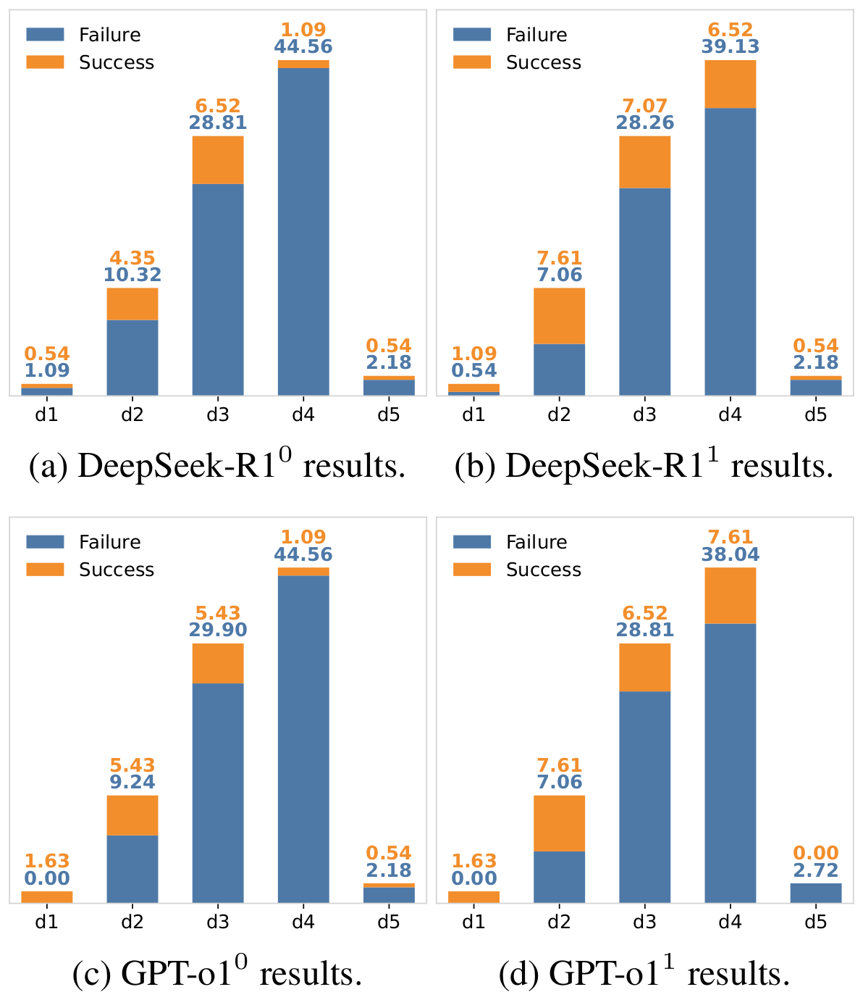
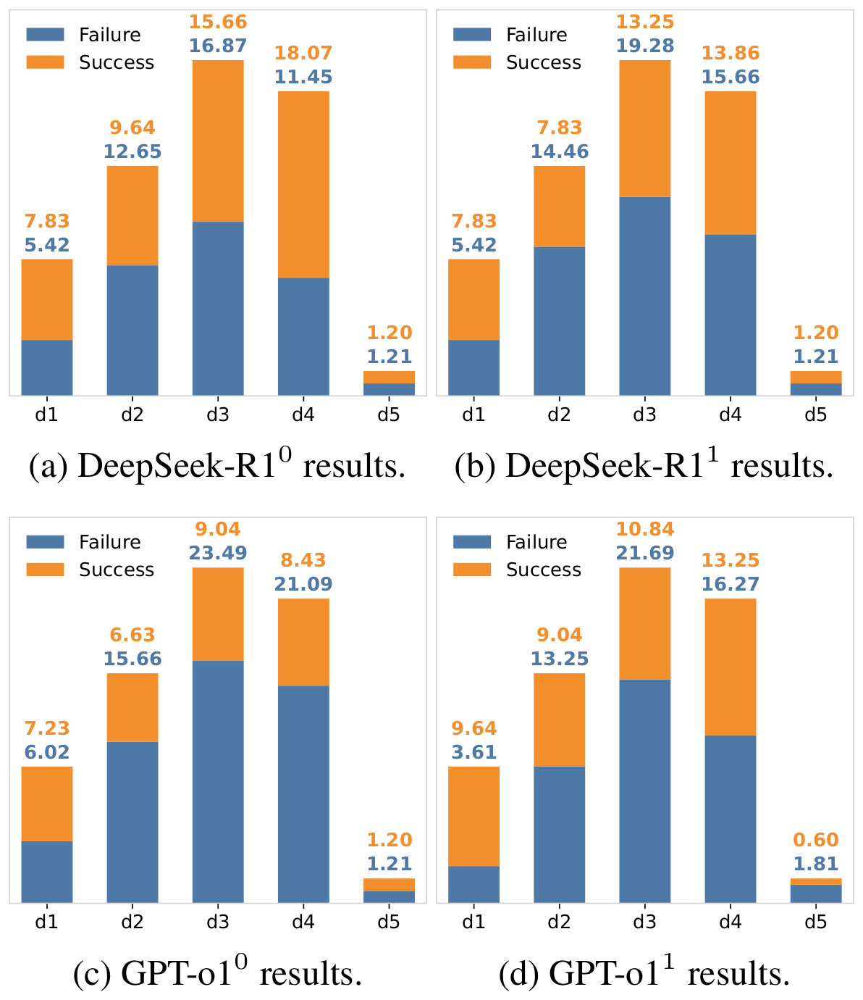

# 论文中文解读：《TritonBench: Benchmarking Large Language Model Capabilities for Generating Triton Operators》

> **基本信息**：Jianling Li、Shangzhan Li（前两位为共同第一作者）、Zhenye Gao、Qi Shi、Yuxuan Li（后两位为通讯作者）、Zefan Wang、Jiacheng Huang、Haojie Wang、Jianrong Wang、Xu Han、Zhiyuan Liu、Maosong Sun；天津大学、哈尔滨工业大学、香港科技大学（广州）、清华大学；arXiv:2502.14752v1 [cs.CL]，2025 年 2 月 20 日；论文称数据集将发布在 github.com/thunlp/TritonBench；本地另有 [arXiv 摘要页](https://arxiv.org/abs/2502.14752)。
>
> **本文的读法**：论文共 13 页（正文第 1–8 页，第 9 页为局限与参考文献，附录 A–D 在第 10–13 页），核心证据是 6 张表和 7 张图。本文把全部 7 张图（含附录图）从 PDF 裁出原图，6 张表逐格转录为中文表（数字与原文一致，已与 PDF 逐格核对）；每张图后有中文图题、图中文字翻译和读图结论。原文表 3、表 4 里每格写成“零样本 / 单样本”两个数，本文保持原样。凡属本文自己的换算、推断或建议，会明确标注。

## 一、一句话结论

TritonBench 是第一个专门评测“大模型能否写出正确且高效的 Triton 算子”的基准。它有两个互补通道：**TritonBench-G**（184 个来自 GitHub 的真实 Triton 算子）和 **TritonBench-T**（166 个与 PyTorch 接口对齐、含算子融合的任务）；评测不只看功能正确性，还用 Speed Up 与 GPU Efficiency 衡量性能。

主要结果：

- 在 G 上，最好的执行正确率只有 **23.91%**（GPT-o1，单样本）；在 T 上最好为 **53.01%**（DeepSeek-R1，零样本）。
- 对“正确生成”的算子，相对参考实现的最好平均加速在 G 上是 1.56×、在 T 上是 1.91×；但 1.56× 出自执行正确率只有 4.89% 的微调小模型，加速比只统计了很少的正确样本。
- 论文结论：当前最先进的代码大模型很难写出高效的 Triton 算子，高性能代码生成仍有明显差距。

一个读法上的提醒：模型名次（GPT-o1、DeepSeek-R1 等）是 2025 年初的快照，会很快过时；这篇论文更持久的贡献是基准的构造方法和“把调用、正确、加速分开测”的评测纪律。

## 二、背景与动机

### 2.1 Triton 算子长什么样（图 2）

论文给出的定义：一个 Triton 算子通常至少包含一个 **kernel** 和一个 **wrapper**。kernel 是在 GPU 上执行的代码，关注张量元素的寻址和线程并行的协调；wrapper 是一个 Python 函数，封装对 kernel 的调用。



*图 2（原文 Figure 2，第 3 页）：Triton “add” 算子的实现。原文说明：第 3–6 行做张量元素寻址，第 7–10 行做计算与存储，wrapper 的第 15 行调用 kernel。*

**图中代码的中文读法**（行号即原图行号）：

- 第 1–2 行：`@triton.jit` 修饰的 `add_kernel`，参数是两个输入指针、输出指针、元素个数 `n_elements` 和块大小 `BLOCK_SIZE`（launch 时以关键字参数传入 1024）；
- 第 3–6 行（寻址）：`pid = tl.program_id(axis=0)` 取当前程序实例的编号；`block_start = pid * BLOCK_SIZE` 是它负责的第一个元素；`offsets = block_start + tl.arange(0, BLOCK_SIZE)` 生成这一块的元素下标；`mask = offsets < n_elements` 标记没越界的位置；
- 第 7–10 行（计算与存储）：按掩码把 `x`、`y` 两块数据加载进来，相加，再按掩码写回输出；
- 第 11–16 行（wrapper）：`output = torch.empty_like(x)` 创建输出，`n_elements = output.numel()` 取元素总数，`grid = lambda meta: (triton.cdiv(n_elements, meta['BLOCK_SIZE']))` 算出需要启动多少个程序实例（向上取整），第 15 行 `add_kernel[grid](..., BLOCK_SIZE=1024)` 启动 kernel，最后返回输出。

这个例子说明了为什么基准里要区分“调用”与“执行”：模型可能写对了 kernel，却在 wrapper 里把 grid、参数或返回值写错，部署时同样是失败。

### 2.2 为什么普通代码生成基准不够

论文在引言里给出的动机：

- Triton 已被 vLLM、LightLLM、Liger-kernel、unsloth 等现代大模型框架广泛采用，原因是可移植、灵活、轻量、对不熟悉底层的程序员友好。
- 但写出高性能算子仍然困难：要在内存层次管理、并行线程协调和硬件相关优化之间取得平衡。Triton 虽然屏蔽了 CUDA 的许多复杂性，仍要求开发者手动处理指针运算和访存模式，调优常常要大量试错。
- 现有的 AI 辅助编程研究已达到“与人类相当”的水平，但主要局限于 Python 这类通用语言；大模型在领域专用语言（DSL）上仍有困难，尤其是 Triton 这类涉及并行编程模型的 DSL；而这些模型生成高质量 Triton 代码的能力此前没有被评估过。
- 多数代码基准只看功能正确性（原文举 HumanEval、MBPP 一类），而 TritonBench 强调对照参考实现在 NVIDIA GPU 上的效率，以更贴近工业需求。

读者向的补充（本文归纳，非原文列表）：GPU DSL 比普通 Python 题多出并行与性能维度，例如 grid 是否覆盖全部元素、mask 在不能整除的形状上是否安全、stride 与非连续张量是否正确、归约有无竞态与数值误差、dtype 提升与累加精度是否一致、block 大小与访存模式是否高效、launch 开销是否抵消融合收益。一段 Triton 代码可能语法正确、能启动，却在边界形状上静默算错，也可能完全正确却比成熟库更慢。所以只用 CodeBLEU 或一次单元测试远远不够。

### 2.3 相关工作（原文第 2 节）

- **Triton 开发**：Triton 是开源的、类 Python 的语言和编译器，通过块级（block-based）编程模型屏蔽 CUDA 的复杂性，自动完成访存合并、tensor core 利用等底层优化，同时仍给开发者显式控制访存模式和并行性的能力；开发者仍需费力调参才能发挥硬件能力。（经典论文见 [Triton 中文解读](../triton_compiler/论文中文解读.md)。）
- **代码基准**：主流做法是功能正确性测试（构造测试用例并在沙箱里执行，如 HumanEval 的手写程序、MBPP 的众包题）；近年扩展到自动测试生成和软件工程任务；另一个方向是性能剖析，但现有框架多是竞赛式的单进程执行，CPU 并行编程已有一些评测，针对 GPU 代码的基准仍然稀缺。
- **大模型写代码**：DeepSeek-Coder、Qwen-Coder 等在通用基准上表现很强，但在 DSL 上常常吃力，原因是 DSL 数据集和基准有限，且语法语义独特。本文聚焦高性能计算领域的 DSL，那里还要处理并行编程模型。

## 三、基准总览：双通道设计（图 1）



*图 1（原文 Figure 1，第 2 页）：TritonBench 的构造（左）与评测（右）流程。*

**图中文字翻译与读法**：

- **左半 Construction（构造）**：
  - 上框 **TritonBench-G**：Collection（收集）——Crawl（爬取）→ Filter（过滤）→ Extract（提取）得到 Operator（算子）；同时为每个算子配 Instruction（指令）和 Test Code（测试代码）。Rating（评级）——用 Runtime（运行时间）与 GPU 计算 Quality（质量）。
  - 下框 **TritonBench-T**：Collection——Statis[tics]（统计）→ Sample（采样）→ 得到 Operator，同样配 Instruction 与 Test Code；Fusing（融合）——把 Common（常用）与 Uncommon（不常用）的 PyTorch 算子两两或多个组合。
- **右半 Evaluation（评测）**：
  - **Similarity（相似度）**：用 CodeBLEU 比较参考算子（红色图标，Reference Operator）与生成算子（橙色图标，Generated Operator）的代码；
  - **Accuracy（准确率）**：测试代码分别运行两个算子，Call（调用）指能否产出 Output，Execution（执行）指两个 Output 是否一致（图上用勾表示）；
  - **Performance（性能）**：对执行正确的算子计算 Speed Up（加速比）与 GPU Efficiency（GPU 效率）。

**读图结论**：G 与 T 的来源、指令生成方式和评测项不同，下一节起分别讲。

| 通道 | 来源 | 任务性质 | 评测指标 |
|---|---|---|---|
| TritonBench-G | 开源 GitHub 上已有的 Triton 算子 | 实现复杂、接口和风格多样 | Similarity、Call、Execution、Speed Up、GPU Efficiency（共 5 项） |
| TritonBench-T | 由 PyTorch 算子及其有效组合（融合）构造 | 语义参考清晰、接口规整 | Call、Execution、Speed Up（共 3 项，无 Similarity 与 GPU Efficiency） |

（对照原文 4.3、4.4 节与表 3、表 4。）G 更贴近真实 Triton 代码分布，T 更接近“按 PyTorch 参考实现写融合 kernel”。二者难度、数据源和评测项都不同，不能把准确率直接合并。

## 四、TritonBench-G：真实算子通道（原文第 3 节）

### 4.1 数据收集

1. 收集 GitHub 上 star 数超过 100 的 Triton 相关仓库，共 95 个仓库、845 个 Python 文件。原文解释：star 更高的 Triton 仓库很少，100 是质量与数量之间的折中阈值。
2. 用提示词过滤（附录 D 的 Filtering Prompt）从这些 Python 文件中挑出 250 个确实含 Triton 代码的文件。
3. 严格的人工检查：补全缺失部分、删除冗余部分、调试算子；一个文件含多个独立算子则拆开；只有 kernel 的补上 wrapper；用 CodeBERTScore 去重以保证唯一性。
4. 为每个算子用提示词生成给大模型的指令（Instruction Prompt）：包含算子功能、对应函数名、完整的输入/输出示例；全部指令经人工审核，确保准确反映算子预期行为。

最终得到 184 个算子（摘要与引言均写 184）。这个流程比直接爬代码可靠，但也带来选择偏差：留下来的是作者能修复、能构造测试、能说清楚的样本。

### 4.2 数据统计与难度分级（表 1）

每个算子由大模型按 Difficulty Prompt 先打分，再由两名领域专家复核，定为 d1（最容易）到 d5（最难）。Difficulty Prompt 让模型从两个方面各打 1–5 分：**内存布局复杂度**（访存模式、分块、数组转置、地址对齐、缓存利用、全局内存访问次数）与**计算调度复杂度**（指令级并行、计算与访存流水、线程块设计、线程间通信、线程分支发散、硬件资源利用），最终分数为两项平均值向上取整，只输出一个 1–5 的数。

**表 1：TritonBench-G 的统计**（括号中是该难度占 184 个算子的比例；Instruction 列为指令的平均 token 数；其余四列是 Triton 算子的平均函数数、参数数、代码行数、token 数）：

| 难度（占比） | 指令 tok# | 函数数 func# | 参数数 params# | 行数 line# | 算子 tok# |
|---|---:|---:|---:|---:|---:|
| d1（1.6%） | 296.67 | 2.00 | 1.33 | 26.00 | 369.0 |
| d2（14.7%） | 363.26 | 2.41 | 2.70 | 45.56 | 678.1 |
| d3（35.3%） | 353.80 | 3.80 | 3.34 | 102.42 | 1510.4 |
| d4（45.7%） | 394.48 | 3.89 | 6.04 | 153.77 | 2689.1 |
| d5（2.7%） | 469.60 | 6.60 | 6.00 | 249.80 | 4581.4 |

（原文表 1，第 4 页。）读法：

- d3 与 d4 合计占 81%，d4 单独就是 45.7%，所以这不是由大量 toy 的 add、relu 组成的简单集合；d5 只占 2.7%（约 5 个算子），对极端复杂 kernel 的估计不稳定。
- 随难度升高，函数数、行数、token 数总体上升，原文据此认为专家分级“大体合理”。不过并非严格单调：指令 token 数 d3（353.80）略低于 d2（363.26），参数数 d5（6.00）略低于 d4（6.04）（本文核对）。
- 原文强调 G 的指令平均长度明显长于现有代码生成任务，是有意设计：更丰富的上下文有助于模型理解细微要求，也更接近真实算子开发里需求必须详尽的情形。

### 4.3 算子质量评级：参考实现并不都快（图 3）

为了评估 G 中算子本身的质量，作者对每个算子计算 GPU efficiency（计算方法见 4.6 节）。统计显示平均 GPU 效率为 **43.0%**，论文用它说明 G 中算子整体“可靠”；同时指出，**19.6% 由专业 Triton 程序员写的算子，GPU 性能低于 10%**，说明开发和优化 Triton 算子本身就很难。



*图 3（原文 Figure 3，第 4 页）：TritonBench-G 中 Triton 算子的 GPU 效率分布。*

**图中文字翻译与读法**：饼图按 GPU 效率分五档（右侧图例，单位 %）：

| 效率区间 | >70 | 50–70 | 30–50 | 10–30 | <10 |
|---|---:|---:|---:|---:|---:|
| 占比 | 27.7% | 16.3% | 17.4% | 19.0% | 19.6% |

**读图结论**：

- 效率分布很分散：约 28% 的算子效率超过 70%，也有约 20% 低于 10%。
- 这给评测带来第二层含义：**参考实现不是硬件最优的标准答案**。生成 kernel 达到 1.5× 加速，可能因为它优秀，也可能因为对应参考实现很差。因此最好同时报告对参考的相对加速、绝对延迟、对理论带宽或算力上限的效率，以及与厂商库或其他强实现的对照（本文建议）。
- 低效率也可能来自问题规模小或算子天生受延迟限制，不一定都是实现差；效率的估算还依赖如何计算字节数与 FLOPs，复杂融合算子的理论工作量并不总是唯一（本文提醒）。

### 4.4 测试代码设计

与传统以标量输入为主的 CPU 语言基准不同，G 围绕**张量输入**设计：用 PyTorch 生成随机张量代替传统测试用例，并用提示词（Test Code Prompt）为每个算子生成测试代码。对多分支算子，生成的测试代码要调用算子的每个分支；作者逐分支调试以保证测试可靠。**平均每个算子 3.6 个测试分支**。

Test Code Prompt（附录 D）的要求包括：所有分支测试放在一个以 `test_` 开头、无参数的函数里；张量参数要放在 GPU 上；**分支数尽量不超过 4 个**；分支测试里避免修改参数表靠后的带默认值的参数（有 out 参数时不要赋值）；把所有分支的计算结果存进字典，键为 `test_case_n`；导入路径必须与算子文档一致；代码要能直接运行，不使用 `if __name__ == "__main__"`。

这里有一个值得注意的细节：平均 3.6 个分支，已经很接近提示词自己设的“不超过 4 个”的上限（本文的观察）。这套测试比只测一个固定形状强，但仍不能构成形式证明。一个 kernel 的输入空间可能同时包含：不同 rank/形状与不能整除 block 的尾部；contiguous、transposed、sliced 等 stride；FP32/BF16/FP16/整数与混合 dtype；空张量、极小或超大张量；NaN、Inf、溢出、极端归约长度；对齐与非对齐地址；不同 GPU 架构。3.6 个分支很难覆盖这些组合，所以 Execution Accuracy 的准确含义是“通过该基准现有的测试”，而不是“在整个定义域上被证明正确”。

### 4.5 五个评测指标（原文 3.5）

- **Similarity（相似度）**：用 CodeBLEU 度量文本层面的相似；实验中给 N-gram、加权 N-gram、语法（syntax）、数据流（dataflow）四个分量各 0.25 的权重。它回答“生成代码与参考代码在文本和结构上有多像”。一个 Triton 算子可以有多种等价的分块、索引和融合实现，低相似度仍可能正确且更快，高相似度也可能只错了一个 mask，所以 Similarity 适合观察模型是否学到领域代码的形态，不适合作为部署门槛。
- **Call Accuracy（调用准确率）**：代码能否无错误地运行。它会捕获语法、名称、参数、API 以及部分编译错误。
- **Execution Accuracy（执行准确率）**：输入输出行为是否正确，即在测试输入上生成算子的输出与参考算子是否一致（附录 C 把两者结果不一致称为 ResultsError）。Call 与 Execution 接近，说明失败多在调用阶段就暴露了；差距大则说明有较多“能跑但算错”。原文没有给出数值容差。
- **Speed Up（加速比）**：只对**执行正确**的算子计算相对执行时间的改善：

$$
\mathrm{SpeedUp}(\mathrm{gen})=\frac{t_{\mathrm{ref}}}{t_{\mathrm{gen}}},
$$

其中 $t_{\mathrm{gen}}$、$t_{\mathrm{ref}}$ 分别是生成算子和参考算子的运行时间；大于 1 表示生成实现更快。因为只统计正确样本，它是条件统计，近似回答“在已经写对的前提下速度如何”；不能把执行正确率 20% 的模型的 1.5× 与执行正确率 50% 的模型的 1.1× 只按速度排名，两者的成功样本集合可能完全不同。

- **GPU Efficiency（GPU 效率）**：生成算子对 GPU 资源的利用程度，沿用 4.3 节的算子质量评级方法。它能帮助区分“超过弱参考”和“接近硬件上限”，但在融合或混合瓶颈的 kernel 上要谨慎解释。

### 4.6 性能评测流程（附录 B，图 6、图 7）



*图 6（原文 Figure 6，第 11 页）：算子性能评测的工作流程。*

**图中文字翻译与读法**：

- 顶部 Input Tensors（输入张量）是一串**规模递增**的张量组；每组张量依次送入 OP（算子），在 GPU 上运行。
- 中间：根据专家为每个算子写的标注，由输入张量得到 Bytes（总访存字节数）与 Flops（总浮点运算数）；GPU 上测得 Runtime（运行时间）；于是得到吞吐量 GB/s（Bytes ÷ 时间）与 Tflops（Flops ÷ 时间），再与 A100 的理论峰值之比得到 GPU %（GPU 效率）。
- 右侧 Performance Report（性能报告）：把各个输入规模下的结果汇总成曲线。

**流程文字补充**（原文附录 B）：

1. 参考 Triton 官方示例，为 G 中每个算子提供评测脚本；
2. 按算子特点定义一组维度递增的张量，依次输入算子；
3. 每次执行时，用专家给每个算子的标注，由输入张量确定总访存字节数（Bytes）和总浮点运算数（Flops）；
4. 用 Triton 官方库的 `triton.testing.do_bench` 测量 GPU 上的执行时间：逐步增大预热（warm-up）和重复时间，直到测得的时间稳定，大多数算子要运行几十万次；
5. 用 Bytes 和 Flops 除以执行时间，得到 GB/s 和 Tflops；GPU 效率是这两个实测指标与 NVIDIA A100 Tensor Core GPU 理论最大性能之比；
6. 对不同规模重复上述过程得到性能报告，**取报告中的峰值 GPU 效率作为该算子质量的最终度量**。

原文没有说明 GB/s 与 Tflops 两个比值如何合并成一个效率值（本文提示：这是复现时必须补问的细节）。



*图 7（原文 Figure 7，第 12 页）：常见算子的性能曲线。*

**图中文字翻译与读法**：共 12 个子图，每个子图是一个算子，横轴是该算子的输入规模变量，纵轴是实测吞吐量。逐元素和归约类算子用 GB/s，矩阵乘类用 TFLOPS。下表数值是读图所得的约值：

| 算子 | 横轴变量 | 纵轴 | 曲线末端的大致数值（约） |
|---|---|---|---|
| add | size（对数轴） | GB/s | 约 1780 |
| bmm | N（线性轴） | TFLOPS | 约 235（锯齿上升） |
| copy | length（对数轴） | GB/s | 约 1690 |
| cross_entropy | n_rows（对数轴） | GB/s | 约 1540 |
| dropout | size（对数轴） | GB/s | 约 1780 |
| kldiv | size（对数轴） | GB/s | 约 1790 |
| layernorm | N（对数轴） | GB/s | 约 1005 |
| matmul | M（线性轴） | TFLOPS | 约 228（锯齿上升） |
| rms_norm | size（对数轴） | GB/s | 约 1595 |
| rope_embedding | B（线性轴） | GB/s | 约 420 升到约 657，B≈128 处有凹陷 |
| softmax | N（对数轴） | GB/s | 约 650 升到约 1665 |
| swiglu | size（对数轴） | GB/s | 约 1775 |

**读图结论**：输入规模增大时，GB/s 或 TFLOPS 总体上升，最终趋于稳定，说明算子在某个规模之后触到瓶颈，继续增大规模收益递减（原文的解读）。不是所有曲线都平滑饱和：bmm 与 matmul 呈锯齿，rope_embedding 在 B≈128 处下凹。这也说明为什么要“取各规模下的峰值效率”，而不是任取一个规模。另外 add、dropout、kldiv、swiglu 的曲线上限约 1.75–1.8 TB/s，高于 A100-40GB 公开的约 1.55 TB/s 显存带宽，推测实验用的是 80GB 版本（本文推断，原文只写 NVIDIA A100）。

## 五、TritonBench-T：与 PyTorch 对齐的通道（原文第 4 节）

### 5.1 数据构造

G 里的真实算子集中在高频操作上，T 作为补充，把 Triton 的 wrapper 与 PyTorch 库的接口对齐，覆盖公开来源里代表性不足的算子。构造步骤：

1. 选出需要 GPU 交互的 PyTorch 算子，以保证与 Triton 的适用范围一致；
2. 在剩余的池子中抽取 **40 个高频算子和 40 个低频算子**。频率由算子在 The Stack V2 的 PyTorch 相关代码中的使用概率确定，超过预设阈值 45% 的算为常用（common）算子；
3. 以多种方式融合这些算子：常用+常用、常用+不常用、不常用+不常用；所有组合都是合法的，前一个算子的输出恰好可作为后一个算子的输入；
4. 最终集合包含 **166 个**算子，基于最新的 PyTorch v2.6.0。每个算子配对应的标准 PyTorch 调用及文档，融合算子则把各参与算子的描述拼合。

### 5.2 数据统计（表 2）

与 G 类似，T 的算子也由大模型按 Difficulty Prompt 分成 d1–d5，再经两名领域专家复核。

**表 2：TritonBench-T 的统计**（torch-op# 为平均 PyTorch 算子数；params# 为平均参数数；math# 为数学表达式的平均 token 数；description# 为描述的平均 token 数）：

| 难度（占比） | torch-op# | params# | math# | description# |
|---|---:|---:|---:|---:|
| d1（13.3%） | 1.36 | 2.82 | 23.50 | 50.41 |
| d2（22.3%） | 1.97 | 3.78 | 40.73 | 61.19 |
| d3（32.5%） | 2.70 | 4.91 | 74.64 | 67.89 |
| d4（29.5%） | 2.16 | 5.24 | 47.31 | 71.02 |
| d5（2.4%） | 2.75 | 2.75 | 30.50 | 88.50 |

（原文表 2，第 5 页。）读法：

- T 的难度分布比 G 平滑：d3 占 32.5%、d4 占 29.5%，d1 和 d2 分别有 13.3% 和 22.3%，而 G 的 d3+d4 占 81%。这是 T 上正确率整体更高的原因之一（原文的解释，见 8.1）。
- 原文说这些统计量“随难度总体增加”，但本表并不单调：torch-op# 与 math# 在 d3 最大，到 d4、d5 反而更小；d5 只占 2.4%（约 4 个算子），个别算子就会拉动均值（本文核对）。

### 5.3 G 与 T 的对比（原文 4.4）

- **来源与分布**：G 来自 GitHub，反映真实编程需求，集中在高频算子，如 Attention 占 20.0%、MatMul 占 10.9%、LayerNorm 占 6.5%、SoftMax 占 3.8%；T 来自 PyTorch，算子更多样，同时含常用与不常用算子。这个分布反映当时 LLM 与深度学习代码的热点，不代表所有 Triton 应用的自然分布。
- **指令生成**：G 是大模型生成加专家验证；T 直接从 PyTorch 文档提取指令。
- **评测指标**：两个通道都评测正确性与性能；G 还有基于相似度的评估，可与已有实现直接对比。

## 六、实验设置（原文 5.1 与附录 A）

**被测模型**：

- 领域/开源小模型：Qwen2.5-Coder-7B-Instruct、deepseek-coder-6.7b-instruct；各自还有经监督微调（SFT）后的版本，表中写作 Qwen2.5-Coder-sft、DeepSeek-Coder-sft。
- 通用模型：Claude-3.5-Sonnet-0620、GPT-4o-0806、qwen2.5-72B-Instruct、DeepSeek-R1（表中规模 685B）、GPT-o1-2024-12-17。后两者是“思考型”模型。
- 通用模型直接推理；领域模型额外做一个 SFT 阶段。

**设置**：零样本（zero-shot）只给任务指令；单样本（one-shot）用基于 BM25 的检索，从训练语料中选出最相关的一条提示作为示例。

**SFT 语料（附录 A）**：由两部分组成：一部分是从 GitHub 抽取的真实 Triton 代码，按 Filtering Prompt 做基本清洗，调试程度不如 TritonBench-G 严格，并用 CodeBERTScore 剔除与 G 中条目高度相似的样本以防泄漏；另一部分是用 Ninetoothed（一种建立在 Triton 之上、提供更强抽象能力的 DSL）自动合成的合法 Triton 代码。两部分各 4K 个样本，共约 8K；这份语料也是单样本设置的检索库。微调共 3 个 epoch，学习率 5e-5。

**证据边界**：

- 表中的模型和版本是 2024–2025 年的快照，不能当作今天的能力排名。
- 相似度过滤的去泄漏措施有价值，但无法证明预训练阶段没有见过公开的 GitHub 代码。
- 原文没有报告采样温度、每题采样次数、超时设置、数值容差，以及 Triton、PyTorch、CUDA 和驱动版本（只给出构造 T 用的 PyTorch v2.6.0）。

## 七、G 的主结果（原文 5.2）

**表 3：TritonBench-G 主结果**。每格为“零样本 / 单样本”；Similarity、Call、Execution 为百分数，Speed Up 为倍数（只对执行正确的算子统计），GPU Efficiency 为百分数；粗体为原文标出的该列最佳：

| 模型 | 规模 | Similarity | Call Accuracy | Execution Accuracy | Speed Up | GPU Efficiency |
|---|---|---|---|---|---|---|
| Qwen2.5-Coder（领域） | 7B | 9.19 / 14.54 | 0.00 / 0.00 | 0.00 / 0.00 | 0.00 / 0.00 | 0.00 / 0.00 |
| DeepSeek-Coder（领域） | 6.7B | 9.38 / 14.52 | 0.00 / 0.00 | 0.00 / 0.00 | 0.00 / 0.00 | 0.00 / 0.00 |
| Qwen2.5-Coder-sft（领域） | 7B | **29.98** / 25.96 | 4.89 / 10.87 | 4.89 / 10.87 | **1.56** / **1.22** | **51.71** / **46.70** |
| DeepSeek-Coder-sft（领域） | 6.7B | 25.52 / **30.34** | **9.78** / **11.96** | **9.87** / **11.96** | 1.03 / 1.11 | 47.68 / 42.26 |
| GPT-4o（通用） | - | 9.87 / 20.67 | 10.87 / 17.93 | 10.33 / 16.84 | 0.97 / 1.19 | 48.80 / **53.33** |
| Claude-3.5-Sonnet（通用） | - | 12.46 / 22.48 | 10.33 / 20.11 | 9.79 / 19.57 | 0.90 / **1.54** | **59.31** / 49.32 |
| Qwen2.5-72B（通用） | 72B | 14.86 / 26.25 | 11.41 / 16.85 | 10.87 / 16.31 | 0.96 / 1.19 | 23.28 / 49.40 |
| DeepSeek-R1（通用） | 685B | **19.96** / 22.64 | 13.59 / 22.83 | 13.05 / 22.83 | **1.11** / 1.22 | 44.83 / 46.70 |
| GPT-o1（通用） | - | 16.58 / **29.70** | **15.22** / **23.91** | **14.23** / **23.91** | 0.92 / 1.14 | 54.25 / 46.37 |

（原文表 3，第 6 页。）注：表中“0.00”表示该模型没有任何执行正确的算子，所以 Speed Up 与 GPU Efficiency 记为 0.00。

**原文结论与读法**：

- **领域小模型整体不如通用模型，但微调显著提高了准确率**：Qwen 的零样本准确率从 0 升到 4.89%，DeepSeek 从 0 升到 9.78%；单样本设置下提升更明显，因为检索语料与 G 同源（都来自 GitHub）。微调模型的 Speed Up 偏高（Qwen-sft 零样本 1.56×，是全表的最高值）、GPU 效率也高，原文解释为**正确生成的算子本身比较简单，更容易写出高效代码**——这是条件选择效应：失败的复杂任务没有进入速度均值，留下来的简单任务更容易超过参考实现。所以 1.56× 不能与强通用模型的 1.0× 左右直接比较速度，它的执行正确率只有 4.89%。
- **通用模型里 DeepSeek-R1 和 GPT-o1 最强**：单样本下 DeepSeek-R1 的 Call 与 Execution 都是 22.83%，GPT-o1 是 23.91%。零样本到单样本约有 10 个百分点的提升，原文据此强调高质量示例对 Triton 生成的重要性。即使最好的模型也有约 76% 的任务没通过（本文换算：23.91% 约折合 44 个算子，共 184 个）。
- **Call 与 Execution 很接近**，说明调用成功之后只有少数算子算错。这不表示语义错误少：可能很多逻辑或 API 错误在编译或启动阶段就已暴露，同时有限测试也可能漏掉静默错误。
- 原文称 DeepSeek-R1 在 GPU 执行时间上领先（零样本 1.11×、单样本 1.22×）；但表中单样本最高的 Speed Up 是 Claude-3.5-Sonnet 的 1.54×，所以这句话只在零样本成立（本文核对）。
- Qwen2.5-72B 零样本的 GPU 效率偏低（23.28%），原文推测是它的正确算子里低效率算子比例较高。Similarity 的变化趋势与其他指标相符。
- 单样本在 G 上对 5 个通用模型的 Execution 都有提升（GPT-4o 10.33→16.84，Claude 9.79→19.57，Qwen2.5-72B 10.87→16.31，DeepSeek-R1 13.05→22.83，GPT-o1 14.23→23.91）。作者认为同源的 GitHub 示例能提供结构和 API 线索，但检索到的示例也会带入错误的名称、形状假设或无关模式（见 9.2 的错误统计）。

表中几个对不上的数字，见 10.2 节。

## 八、T 的主结果（原文 5.3）

**表 4：TritonBench-T 主结果**。每格为“零样本 / 单样本”；T 只评 Call、Execution 与 Speed Up，没有 Similarity 与 GPU Efficiency：

| 模型 | 规模 | Call Accuracy | Execution Accuracy | Speed Up |
|---|---|---|---|---|
| Qwen2.5-Coder（领域） | 7B | 0.00 / 0.00 | 0.00 / 0.00 | 0.00 / 0.00 |
| DeepSeek-Coder（领域） | 6.7B | 0.00 / 1.81 | 0.00 / 1.81 | 0.00 / **0.94** |
| Qwen2.5-Coder-sft（领域） | 7B | 17.47 / 16.27 | 17.47 / 15.67 | **0.98** / 0.92 |
| DeepSeek-Coder-sft（领域） | 6.7B | **19.28** / **18.67** | **19.28** / **16.26** | 0.91 / 0.85 |
| GPT-4o（通用） | - | 36.75 / 32.53 | 36.75 / 32.53 | 0.98 / 0.94 |
| Claude-3.5-Sonnet（通用） | - | 29.52 / 37.95 | 29.52 / 33.70 | 0.93 / 0.89 |
| Qwen2.5-72B（通用） | 72B | 30.12 / 22.89 | 30.12 / 16.30 | 1.07 / 0.92 |
| DeepSeek-R1（通用） | 685B | **53.01** / **45.78** | **53.01** / **45.78** | 1.03 / **1.91** |
| GPT-o1（通用） | - | 32.53 / 43.37 | 32.53 / 43.37 | **1.21** / 1.10 |

（原文表 4，第 7 页。）

**原文结论与读法**：

- 领域模型同样整体不如通用模型，但用 8K 语料微调后明显提升：Qwen 零样本 Execution 从 0 升到 17.47%。它的单样本提升（15.67%）略低，原文推测是检索到的示例（来自 GitHub）与 T 的算子（来自 PyTorch）来源不同。
- 通用模型里 DeepSeek-R1 最强：零样本 Call 与 Execution 都是 53.01%；单样本下降 7.23 个百分点（到 45.78%），仍略高于 GPT-o1（43.37%）。Speed Up 上 DeepSeek-R1 取得最高的 1.91×。
- 论文认为多数成功算子的性能提升来自**算子融合**：Triton 的融合算子减少了相对 PyTorch 的冗余内存读写，提高了带宽利用率。若融合扩大寄存器压力、破坏库里高效的矩阵乘或计算量本身很小，加速也可能低于 1（本文补充）。
- 多数模型在 T 上好于在 G 上，原文的解释是 T 的难度分布更均衡，而 G 以 d3、d4 的高难算子为主；此外 T 的接口、描述与参考实现更规范，不要求重现某个真实仓库的大型手工 kernel（本文补充）。

**单样本在 T 上不是稳定规律**（本文用表 4 的 Execution 列整理）：

| 模型 | 零样本 | 单样本 | 变化 |
|---|---:|---:|---|
| GPT-4o | 36.75 | 32.53 | 下降 |
| Claude-3.5-Sonnet | 29.52 | 33.70 | 上升 |
| Qwen2.5-72B | 30.12 | 16.30 | 下降 |
| DeepSeek-R1 | 53.01 | 45.78 | 下降 |
| GPT-o1 | 32.53 | 43.37 | 上升 |

5 个通用模型里 3 个下降、2 个上升，而在 G 上 5 个都上升。

**“准确率降、速度升”不能读成单样本更优**：DeepSeek-R1 从零样本到单样本，Execution 从 53.01% 降到 45.78%，但正确样本的平均 Speed Up 从 1.03× 升到 1.91×。更可能的解释是检索示例改变了成功任务的组成：一部分任务被干扰而失败，留下的正确任务里融合收益较高。没有逐题配对分析和置信区间，不能断言示例使性能普遍翻倍。

## 九、分析（原文第 6 节）

### 9.1 按难度的成功与失败分布（图 4、图 5）

作者对表现最好的两个模型 DeepSeek-R1 和 GPT-o1，分析各难度上正确与错误算子的分布；零样本和单样本分别标为上标 0 与 1。



*图 4（原文 Figure 4，第 8 页）：TritonBench-G 上按难度等级的执行结果分布。*

**图中文字翻译与读法**：四个子图依次是 (a) DeepSeek-R1 零样本、(b) DeepSeek-R1 单样本、(c) GPT-o1 零样本、(d) GPT-o1 单样本。横轴 d1–d5 是难度；每根柱由蓝色 Failure（失败）和橙色 Success（成功）两段堆叠，柱上标注的是各段占**全部 184 个算子**的百分比（所以一根柱的总高就是该难度占全集的比例，如 d4 约 45.65%）。

下表逐项转录图上标注（格式为“成功 / 失败”，单位 %）：

| 设置 | d1 | d2 | d3 | d4 | d5 | 成功合计 |
|---|---|---|---|---|---|---:|
| (a) DeepSeek-R1 零样本 | 0.54 / 1.09 | 4.35 / 10.32 | 6.52 / 28.81 | 1.09 / 44.56 | 0.54 / 2.18 | 13.04 |
| (b) DeepSeek-R1 单样本 | 1.09 / 0.54 | 7.61 / 7.06 | 7.07 / 28.26 | 6.52 / 39.13 | 0.54 / 2.18 | 22.83 |
| (c) GPT-o1 零样本 | 1.63 / 0.00 | 5.43 / 9.24 | 5.43 / 29.90 | 1.09 / 44.56 | 0.54 / 2.18 | 14.12 |
| (d) GPT-o1 单样本 | 1.63 / 0.00 | 7.61 / 7.06 | 6.52 / 28.81 | 7.61 / 38.04 | 0.00 / 2.72 | 23.37 |

为了看清“每个难度里解出了多大比例”，本文用“成功占比 ÷ 该难度占全集的比例”换算（d1–d5 分别占 1.63%、14.67%、35.33%、45.65%、2.72%，对应 3、27、65、84、5 个算子），得到难度内成功率（约值，本文换算）：

| 设置 | d1 | d2 | d3 | d4 | d5 |
|---|---:|---:|---:|---:|---:|
| DeepSeek-R1 零样本 | 33% | 30% | 18% | 2% | 20% |
| DeepSeek-R1 单样本 | 67% | 52% | 20% | 14% | 20% |
| GPT-o1 零样本 | 100% | 37% | 15% | 2% | 20% |
| GPT-o1 单样本 | 100% | 52% | 18% | 17% | 0% |

**读图结论**：

- 大多数算子都生成失败，且主要集中在 d3、d4（这两档占全集 81%）；两个模型趋势相近，DeepSeek-R1 略优于 GPT-o1。
- d4 在零样本下几乎全败（84 个算子只解出约 2 个），单样本后两个模型在 d4 上都显著提升（约 12 与 14 个）。原文猜测这是因为 d4 里 Attention 与 Softmax 算子很多，模型可以借用相似的检索示例；而 d2、d3 的提升有限，原文猜测是这些数据更零碎、更有个性，检索相似度较低。这些都是论文的解释，没有做消融验证。
- d1、d5 样本太少（3 个、5 个），比例不稳定。



*图 5（原文 Figure 5，第 8 页）：TritonBench-T 上按难度等级的执行结果分布。*

**图中文字翻译与读法**：同图 4 的版式，但柱上标注的是占**全部 166 个**算子的百分比（d1–d5 分别占 13.25%、22.29%、32.53%、29.52%、2.41%，对应 22、37、54、49、4 个算子）。

| 设置 | d1 | d2 | d3 | d4 | d5 | 成功合计 |
|---|---|---|---|---|---|---:|
| (a) DeepSeek-R1 零样本 | 7.83 / 5.42 | 9.64 / 12.65 | 15.66 / 16.87 | 18.07 / 11.45 | 1.20 / 1.21 | 52.40 |
| (b) DeepSeek-R1 单样本 | 7.83 / 5.42 | 7.83 / 14.46 | 13.25 / 19.28 | 13.86 / 15.66 | 1.20 / 1.21 | 43.97 |
| (c) GPT-o1 零样本 | 7.23 / 6.02 | 6.63 / 15.66 | 9.04 / 23.49 | 8.43 / 21.09 | 1.20 / 1.21 | 32.53 |
| (d) GPT-o1 单样本 | 9.64 / 3.61 | 9.04 / 13.25 | 10.84 / 21.69 | 13.25 / 16.27 | 0.60 / 1.81 | 43.37 |

难度内成功率（约值，本文换算）：

| 设置 | d1 | d2 | d3 | d4 | d5 |
|---|---:|---:|---:|---:|---:|
| DeepSeek-R1 零样本 | 59% | 43% | 48% | 61% | 50% |
| DeepSeek-R1 单样本 | 59% | 35% | 41% | 47% | 50% |
| GPT-o1 零样本 | 55% | 30% | 28% | 29% | 50% |
| GPT-o1 单样本 | 73% | 41% | 33% | 45% | 25% |

**读图结论**：

- 在 T 上 DeepSeek-R1 零样本的成功多于失败，原文据此说明 T 的难度分布比 G 平滑。
- 单样本下 DeepSeek-R1 在 d2–d4 的表现下降，GPT-o1 在这些难度上反而提升；原文据此推测 GPT-o1 可能更擅长利用给定示例做逻辑推理，也说明示例对不同模型的影响方式不同。

### 9.2 错误类型（表 5、表 6，附录 C）

作者把失败算子中编译器报告的 **16 种**错误归为 4 大类（附录 C 的归并如下；原文只统计编译器报告的错误，未被报告的静默错误不在其中）：

| 类别 | 包含的错误 |
|---|---|
| Syntax | SyntaxError、IndentationError |
| Attr&Type | AttributeError、TypeError、NotImplementedError |
| Name&Ref | NameError、KeyError、IndexError、ModuleNotFoundError、ImportError |
| Run&Logc | ValueError、ZeroDivisionError、RuntimeError、RecursionError、AssertionError、CompilationError、ResultsError |

其中 ResultsError 指参考算子与生成算子的执行结果不一致。注意：按上表逐项数是 2+3+5+7=17 个名称，与正文“16 种”不符（本文核对，原文没有解释）。

**表 5：TritonBench-G 上执行失败的错误统计**（各行为该模型、该设置下失败样本里各类错误的占比，%；每行相加约为 100）：

| 模型（上标 0 为零样本，1 为单样本） | Syntax | Attr&Type | Name&Ref | Run&Logc |
|---|---:|---:|---:|---:|
| DeepSeek-R1（零样本） | 1.64 | 42.62 | 16.39 | 39.34 |
| DeepSeek-R1（单样本） | 9.27 | 33.11 | 35.76 | 21.85 |
| GPT-o1（零样本） | 10.3 | 38.18 | 28.48 | 23.03 |
| GPT-o1（单样本） | 20.83 | 24.31 | 43.06 | 11.81 |

**表 6：TritonBench-T 上执行失败的错误统计**（同上，%）：

| 模型 | Syntax | Attr&Type | Name&Ref | Run&Logc |
|---|---:|---:|---:|---:|
| DeepSeek-R1（零样本） | 0.00 | 31.96 | 14.43 | 53.61 |
| DeepSeek-R1（单样本） | 0.00 | 36.79 | 20.75 | 42.45 |
| GPT-o1（零样本） | 24.06 | 26.32 | 7.52 | 42.11 |
| GPT-o1（单样本） | 25.25 | 25.25 | 22.22 | 27.27 |

（原文表 5、表 6，第 8 页，均与 PDF 逐格核对。）

**原文结论与读法**：

- G 上：与零样本相比，DeepSeek-R1 和 GPT-o1 在单样本下 Syntax 与 Name&Ref 错误的占比显著上升，Attr&Type 与 Run&Logc 占比下降。例如 DeepSeek-R1 的 Run&Logc 从 39.34% 降到 21.85%，Name&Ref 从 16.39% 升到 35.76%，Syntax 从 1.64% 升到 9.27%。原文推测训练语料为逻辑结构和 Triton 规范提供了有益引导。DeepSeek-R1 不太容易出语法错误，GPT-o1 更擅长处理逻辑错误。
- T 上：DeepSeek-R1 完全没有 Syntax 错误，GPT-o1 则保持较高比例；单样本下 DeepSeek-R1 的 Attr&Type 与 Name&Ref 占比上升、Run&Logc 下降；GPT-o1 的 Name&Ref 显著上升、Run&Logc 明显下降。对比 G 与 T，单样本在两个通道上都稳定地降低了 Run&Logc 占比。原文把这些变化归因于示例里有用信息与无关信息的混合影响。
- 合理的解释（本文）：示例提供了较好的整体算法骨架，减少深层逻辑失败；同时模型复制或改写示例时带入不匹配的名称和局部结构。这提示检索系统不能只按 BM25 文本相似度选示例，还应检查 API、dtype、形状、Triton 版本和硬件约束。
- 读表提醒：这些是失败样本内部的占比，不是占全部算子的比例；占比下降不等于该类错误的绝对数量下降。表里只有编译器报告的错误；性能退化也不算“错误”，所以这些比例不能当作所有失败原因的完整分布。

## 十、局限与证据边界

### 10.1 论文自己承认的局限与其他边界

1. **只在 NVIDIA A100 上评测**（论文唯一明说的局限，计划以后扩展到更多硬件）。Triton 的性能对架构非常敏感：tensor core 代际、共享内存、warp 原语、编译后端都会改变最优实现；A100 上的 1.2× 不代表 H100、消费卡或 AMD 上同样快。
2. **有限测试不能证明正确**：随机张量加平均 3.6 个分支是工程测试，不是等价性证明，尤其是 mask、stride、极端数值和非确定性场景。
3. **难度标签含主观性**：大模型初分加两位专家复核比纯自动可靠，但难度同时受代码长度、数学复杂性、Triton API 熟悉度和优化难度影响，单个 d1–d5 难以完全分离。
4. **参考实现质量不齐**：约五分之一的参考 kernel 的 GPU 效率低于 10%，使 Speed Up 的基线变弱；低效率也可能源于问题规模小或算子天生受延迟限制（见 4.3）。
5. **统计信息不足**：表中主要给点估计，没有 bootstrap 置信区间、逐题配对变化或速度方差；正确样本数很小时，平均 Speed Up 对个别任务非常敏感。
6. **排行榜会快速过时**：模型、Triton API 和编译器都在快速更新。

### 10.2 本文核对时发现的原文内部不一致

以下差异均为本文对照 PDF 逐项核对后发现，原文没有解释，引用时应注意：

- **表 3**：DeepSeek-Coder-sft 零样本的 Execution Accuracy 印为 9.87%，高于同行的 Call Accuracy 9.78%（执行正确要求先调用成功），正文写的是“DeepSeek's from 0 to 9.78%”，所以 9.87 疑为 9.78 的笔误。
- **表 3 与图 4**：GPT-o1 零样本 Execution 在表中是 14.23%，而图 4(c) 各难度成功占比相加为 14.12%（约 26/184）；GPT-o1 单样本表中是 23.91%（约 44/184），图 4(d) 相加为 23.37%（约 43/184）。DeepSeek-R1 的两个数（13.05%、22.83%）与图 4(a)(b) 相加（13.04%、22.83%）基本一致。
- **表 4 与图 5**：DeepSeek-R1 零样本表中 53.01%（88/166），图 5(a) 相加 52.40%（约 87/166）；单样本表中 45.78%（76/166），图 5(b) 相加 43.97%（约 73/166）。GPT-o1 的 32.53%、43.37% 与图 5(c)(d) 一致。
- **正文与表 3**：正文说 DeepSeek-R1 “在 GPU 执行时间上领先”（1.11×、1.22×），但表 3 单样本最高的 Speed Up 是 Claude-3.5-Sonnet 的 1.54×。
- **附录 C**：正文写 16 种错误类型，逐项列出的名称共 17 个。

这些差异都不改变论文的主要结论（G 上最好约四分之一、T 上最好约一半），但提示头部数字的小数位不宜被过度引用。

## 十一、复现检查清单

把这套基准用于新模型时，建议至少记录：

- Triton、PyTorch、CUDA 或 ROCm、驱动与 GPU 的精确版本（原文只给了 PyTorch v2.6.0 与 A100）；
- 提示词、采样温度、采样次数和推理预算（原文未给）；
- 编译失败、运行失败、结果错误、超时分开统计；
- 每个任务零样本与单样本的配对结果，而不是只给均值；
- 预热、计时重复次数、中位数或分位数与同步方式（原文用 `triton.testing.do_bench`，并逐步增大预热与重复时间）；
- 正确率的分母和 Speed Up 的条件分母（只含正确样本）；
- 多形状、dtype、stride 和边界用例；
- 跨 GPU 架构的正确性与重新调优。

对数值正确性，还应按算子设定绝对与相对误差，避免统一容差掩盖低精度归约的问题。

## 十二、怎样安全地用 LLM 写 Triton（读者向）

以下是本文基于论文结论给出的工作流建议，不是论文的结论：

```text
明确 PyTorch/数学 reference
        ↓
LLM 生成多个 Triton 候选
        ↓
静态检查 + 编译
        ↓
property-based tests（形状/dtype/stride/边界）
        ↓
数值差异与 race 检查
        ↓
多配置 benchmark / autotune
        ↓
与强基线、硬件上界比较
        ↓
人工审查后部署
```

LLM 最适合减少初始样板、提出分块候选和解释错误；测试、基准和编译器反馈必须进入闭环。单次生成通过几个随机样本，不足以授予生产可信度。

## 十三、与相关论文的关系

- [Triton（2019）](../triton_compiler/论文中文解读.md)说明 tile 级 DSL 为什么能表达高性能 kernel；
- [PyTorch 2](../pytorch_2/论文中文解读.md)说明编译器如何自动生成大量 Triton kernel；
- 本文量化另一条路径：大模型能否从自然语言或 PyTorch 语义直接生成 Triton；
- [Linear Layouts](../linear_layouts/论文中文解读.md)处理现代 Triton 后端的 layout 问题。

三者共同显示：Triton 把线程级细节交给编译器，并没有消除算法分解、边界语义和性能搜索的困难；生成的代码更短，不代表验证成本消失。阅读顺序见 [Triton 论文阅读索引](../Triton论文阅读索引.md)。

## 原文证据导航

- [原论文 PDF](paper.pdf)（[arXiv PDF](https://arxiv.org/pdf/2502.14752)）
- [原文提取文本](paper.txt)
- [论文概要](论文概要.md)
