# 论文中文解读：《TVM: An Automated End-to-End Optimizing Compiler for Deep Learning》

> **基本信息**：Tianqi Chen、Thierry Moreau、Ziheng Jiang、Lianmin Zheng、Eddie Yan、Meghan Cowan、Haichen Shen、Leyuan Wang、Yuwei Hu、Luis Ceze、Carlos Guestrin、Arvind Krishnamurthy（University of Washington，部分作者另属 AWS、上海交通大学、UC Davis、Cornell），arXiv:1802.04799v3，2018 年 10 月，发表于 OSDI 2018；论文原文 [官方页面](https://arxiv.org/abs/1802.04799)。
>
> **本文的读法**：图均为从 `paper.pdf` 按图裁出的原图，每张图后有中文图题、图中文字翻译和读图结论；表为逐格核对后的中文转录；代码清单用代码块转录并加中文解释。原文的柱状图和曲线图没有数值标签，本文标“约”的数值是从 PDF 矢量图上量出的近似值（误差约 ±0.02，换算成倍数时已按基线柱归一化），正文中给出的数字则直接取自原文。标注“（补充）”的内容不在原文里，是帮助读懂的背景知识或笔者的核对。

## 一、一句话结论

深度学习模型要部署到服务器 GPU、手机 CPU 与 GPU、嵌入式设备和 FPGA/ASIC 加速器上，但主流框架依赖厂商手工调优的算子库，换一种硬件就要重新手写一大批 kernel。TVM 提出一个端到端的编译栈：先在**计算图层**做算子融合、常量折叠、静态内存规划和数据布局变换；再在**算子层**用 tensor expression 描述“算什么”、用 schedule 描述“怎么算”，并为 GPU（协作式共享内存）和加速器（tensorization、显式内存延迟隐藏）新增 schedule 原语；最后用**基于机器学习的成本模型**指导对巨大 schedule 空间的自动搜索。论文在服务器 GPU（NVIDIA Titan X）、嵌入式 CPU（ARM Cortex A53）、嵌入式 GPU（ARM Mali-T860MP4）和 FPGA 上的自研加速器 VDLA 上评测：端到端推理相对依赖手工优化库的框架快 1.2× 到 3.8×。

## 二、背景与动机

### 2.1 硬件多样性（图 1）

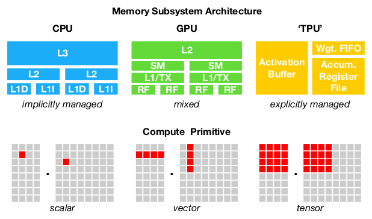

*图 1（原文 Figure 1，第 1 页）：三类硬件在片上存储体系和计算原语上差别很大，生成优化代码时必须处理这种差异。*

**图中文字翻译与读法**：

- **上半 Memory Subsystem Architecture（存储子系统结构）**：
  - **CPU**：L3 缓存在上，下面是各核的 L2，再往下是 L1D（数据）和 L1I（指令）缓存。图注标为 implicitly managed（隐式管理，由硬件缓存自动搬运）。
  - **GPU**：L2 之下是多个 SM（流多处理器），每个 SM 里有 L1/TX（L1 与纹理缓存）和 RF（寄存器堆）。标为 mixed（混合：既有硬件管理的缓存，也有程序显式管理的共享内存和寄存器）。
  - **‘TPU’（类 TPU 加速器）**：Activation Buffer（激活缓冲）、Wgt. FIFO（权重队列）、Accum. Register File（累加寄存器堆）。标为 explicitly managed（显式管理，软件负责搬运）。
- **下半 Compute Primitive（计算原语）**：CPU 是 scalar（标量）运算，GPU 是 vector（向量）运算，类 TPU 加速器是 tensor（张量，即小矩阵块）运算。红色方块示意一条指令一次处理的数据范围。
- **读图结论**：存储从“硬件隐式管理”走向“软件显式管理”，计算粒度从标量走向张量。同一份算子描述要在三类硬件上都跑得好，编译器必须分别处理内存搬运方式和计算指令的差异。

### 2.2 现有框架的做法与问题

TensorFlow、MXNet、Caffe、PyTorch 等框架用**计算图中间表示**来实现优化，例如自动微分和动态内存管理。论文指出这种图层优化有两个局限：

1. 图层优化“往往太高层”，处理不了与具体硬件相关的算子级变换。
2. 这些框架大多只关注一小类服务器级 GPU，把针对具体目标的优化交给高度工程化的、厂商专属的算子库。这些库需要大量手工调优，因此过于专门化、过于不透明，很难移植到别的硬件上；为各种后端在各个框架里提供支持，现在需要大量工程投入。

即使是已支持的后端，框架也要在两难之间选择：（1）避免那些会产生“预定义算子库里没有的新算子”的图优化；（2）使用这些新算子的未优化实现。换句话说，融合出新算子，就没有现成的高性能 kernel 可用。

### 2.3 两大挑战

**挑战一：利用具体硬件的特性与抽象。** 深度学习加速器带来了优化过的张量计算原语（论文引用 Tesla V100、Eyeriss、TPU 等），GPU 和 CPU 的处理单元也在不断改进。这些硬件指令的输入是多维的，长度固定或可变，规定了不同的数据布局，对内存层次也有特殊要求；系统必须有效利用这些复杂原语才能受益于加速。此外，加速器设计常常倾向于更“精简”的控制逻辑，把大量调度复杂性交给编译栈：对专用加速器，系统要生成能显式控制流水线依赖的代码来隐藏访存延迟，而这件事在 CPU 和 GPU 上是由硬件完成的。

**挑战二：优化的搜索空间巨大。** 要在不手工调优每个算子的前提下生成高效代码，访存方式、线程模式和新硬件原语的组合会产生巨大的配置空间（例如循环分块与顺序、缓存、展开），如果做黑盒自动调优，搜索代价很高。可以用预定义成本模型来引导搜索，但现代硬件越来越复杂，建一个准确的成本模型很难，而且每种硬件都要单独建一个。

### 2.4 TVM 的三个模块与四项贡献

TVM 用三个模块应对上述挑战：

1. **张量表达式语言 + 程序变换原语**：用来构造算子，并生成同一算子的不同优化版本。这一层延续 Halide 的“计算/调度分离”思想，并且**进一步把目标硬件的 intrinsic（硬件内建指令）也与变换原语分开**，这使得支持新加速器及其新指令成为可能。论文还引入新的变换原语，针对 GPU 的挑战并支持部署到专用加速器。对同一个算子声明，可以应用不同的变换序列，构成一个丰富的有效程序空间。
2. **自动程序优化框架**：寻找优化的张量算子。优化器由一个基于 ML 的成本模型引导，随着从硬件后端收集的数据越多，模型会适应并改进。
3. **图重写器**：建立在自动代码生成器之上，充分利用高层和算子层优化。

三者结合，TVM 可以接收现有深度学习框架的模型描述，联合做高层与低层优化，并为 CPU、GPU、FPGA 专用加速器等后端生成面向硬件的优化代码。论文列出的四项贡献：

- 识别出为深度学习负载在多样硬件后端上提供性能可移植性的主要优化挑战；
- 提出新的 schedule 原语，利用跨线程的内存复用、新的硬件 intrinsic 和延迟隐藏；
- 提出并实现基于机器学习的优化系统，自动探索并搜索优化的张量算子；
- 构建端到端的编译与优化栈，让用高层框架（TensorFlow、MXNet、PyTorch、Keras、CNTK）描述的深度学习负载可以部署到多样的硬件后端（CPU、服务器 GPU、移动 GPU 和基于 FPGA 的加速器）。

### 2.5 论文的评测与主要结论

作者用真实负载在四类平台上评测：服务器级 GPU、嵌入式 GPU、嵌入式 CPU，以及一个定制的、通用的基于 FPGA 的加速器。摘要与引言给出的总括结论：TVM 在各后端上提供可移植的性能，相对由手工优化库支撑的现有框架取得 **1.2× 到 3.8×** 的加速；开源并已在若干大公司内投入使用。后文第七节逐项核对这个数字是在哪些条件下得到的。

## 三、系统总览与用户接口

### 3.1 编译流程（图 2）

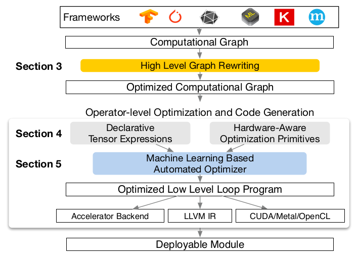

*图 2（原文 Figure 2，第 3 页）：TVM 的执行步骤及其在论文中对应的章节。*

**图中文字翻译与读法**：

- **最上方 Frameworks（框架）**：一排框架与交换格式的图标（图里没有文字，原文也没有逐个点名）；图注说当前栈支持许多深度学习框架以及 CoreML、ONNX 这类交换格式，面向主要的 CPU、GPU 和专用加速器。
- **自上而下的流程**：Computational Graph（计算图）→ **High Level Graph Rewriting（高层图重写，原文第 3 节）**→ Optimized Computational Graph（优化后的计算图）→ **Operator-level Optimization and Code Generation（算子级优化与代码生成）**：其中 Declarative Tensor Expressions（声明式张量表达式）与 Hardware-Aware Optimization Primitives（面向硬件的优化原语，二者是原文第 4 节）共同输入 **Machine Learning Based Automated Optimizer（基于机器学习的自动优化器，原文第 5 节）**→ Optimized Low Level Loop Program（优化后的低层循环程序）→ 三类代码生成目标 Accelerator Backend（加速器后端）、LLVM IR、CUDA/Metal/OpenCL → Deployable Module（可部署模块）。
- **读图结论**：编译分两层。图层只决定“哪些算子放在一起算、数据怎么放”；算子层为每个（融合后的）算子生成高性能循环程序，并由学习型优化器在众多 schedule 中挑选。

论文用一句话概括执行步骤：系统先接收现有框架中的模型，把它转成计算图表示；然后做高层数据流重写，得到优化后的图；算子层必须为这张图里的每个融合算子生成高效代码；算子用声明式的张量表达式语言描述，执行细节不指定；TVM 为给定硬件目标的算子找出一批可能的代码优化，这些优化构成一个很大的空间，因此用基于 ML 的成本模型去找优化算子；最后系统把生成的代码打包成可部署模块。

### 3.2 终端用户示例（原文第 2 节）

用户只需几行代码，就能把现有框架里的模型变成可部署模块：

```python
import tvm as t
# Use keras framework as example, import model
graph, params = t.frontend.from_keras(keras_model)
target = t.target.cuda()
graph, lib, params = t.compiler.build(graph, target, params)
```

编译得到的运行时模块包含三个部分：最终优化后的计算图（`graph`）、生成的算子（`lib`）和模块参数（`params`）。然后用它们部署到目标后端：

```python
import tvm.runtime as t
module = runtime.create(graph, lib, t.cuda(0))
module.set_input(**params)
module.run(data=data_array)
output = tvm.nd.empty(out_shape, ctx=t.cuda(0))
module.get_output(0, output)
```

上面两段代码按原文逐字转录；它们是 2018 年的接口示意，今天的 TVM API 已完全不同（见第九节）。TVM 支持 C++、Java、Python 等语言的多种部署后端。论文余下部分讲 TVM 的架构，以及系统程序员如何扩展它以支持新后端。

## 四、计算图层优化（原文第 3 节）

### 4.1 计算图是什么（图 3）

计算图是深度学习框架中表示程序的通用方式。节点表示对张量的运算或程序输入，边表示运算之间的数据依赖。它与 LLVM 这类低层编译器 IR 的主要区别是：中间数据项是**大的多维张量**。计算图提供了算子的全局视图，但回避了每个算子必须如何实现这一问题。和 LLVM IR 一样，计算图可以被变换成功能等价的图来施加优化。论文还利用常见深度学习负载中 shape 固定的特点，针对一组固定的输入 shape 做优化。

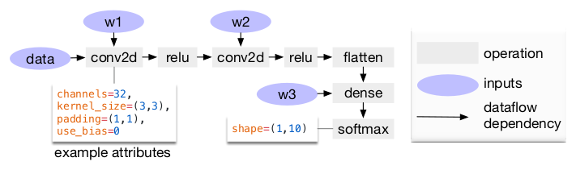

*图 3（原文 Figure 3，第 3 页）：两层卷积网络的计算图。每个节点是一个消耗一个或多个张量并产生一个或多个张量的运算，运算可以带属性（如 padding、stride）配置行为。*

**图中文字翻译与读法**：

- **数据流**：输入 `data` 与权重 `w1` 进入 conv2d，再 relu；与权重 `w2` 进入第二个 conv2d，再 relu；经 flatten（展平）后，与权重 `w3` 一起进入 dense（全连接），最后 softmax 输出形状为 `shape=(1,10)`。
- **图例**：灰色矩形是 operation（运算），紫色椭圆是 inputs（输入，包括数据和权重），箭头是 dataflow dependency（数据流依赖）。
- **example attributes（示例属性）**：第一个 conv2d 的属性为 `channels=32, kernel_size=(3,3), padding=(1,1), use_bias=0`。
- **读图结论**：图层看到的是“conv2d、relu、dense”这样的算子，不知道每个算子内部的循环怎么写，这是它能做全局变换、但做不了算子内优化的原因。

### 4.2 四种图层优化

TVM 在计算图上实现了许多优化，包括：

- **算子融合（operator fusion）**：把多个小算子融合在一起；
- **常量折叠（constant folding）**：预先算出可以静态确定的图的部分，节省执行开销；
- **静态内存规划（static memory planning）**：预先分配内存来保存每个中间张量；
- **数据布局变换（data layout transformation）**：把内部数据布局变成对后端友好的形式。

论文详细讨论了算子融合和数据布局变换。

### 4.3 算子融合与四类算子

算子融合把多个算子合并成一个 kernel，**中间结果不写回内存**。这可以大幅降低执行时间，尤其在 GPU 和专用加速器上。论文把图算子分成四类：

| 类别 | 含义 | 例子 |
|---|---|---|
| injective（单射） | 一对一映射 | add |
| reduction（归约） | 把多个输入归约成更少的输出 | sum |
| complex-out-fusable（复杂但输出可融合） | 可以把逐元素映射融合到它的输出上 | conv2d |
| opaque（不透明） | 不能被融合 | sort |

融合的通用规则是：

1. 多个 injective 算子可以融合成另一个 injective 算子；
2. 一个 reduction 算子可以与它的输入端的 injective 算子融合（例如把缩放 scale 与求和 sum 融合）；
3. conv2d 这类 complex-out-fusable 算子，可以把逐元素算子融合到它的输出上。

按这些规则就能把计算图变换成融合版本。

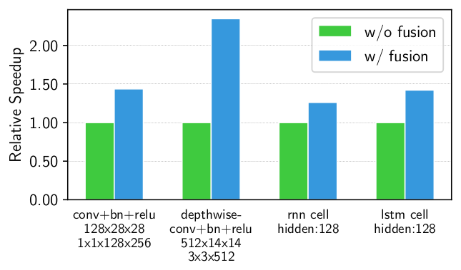

*图 4（原文 Figure 4，第 4 页）：融合与未融合算子的性能对比，两种算子都由 TVM 生成，在 NVIDIA Titan X 上测试。*

**图中文字翻译与读法**：

- **纵轴 Relative Speedup（相对加速比）**，绿柱 w/o fusion（无融合，归一化为 1.0），蓝柱 w/ fusion（有融合）。
- **四组负载**：conv+bn+relu（输入 128×28×28，卷积核 1×1×128×256）；depthwise-conv+bn+relu（输入 512×14×14，卷积核 3×3×512）；rnn cell（hidden:128）；lstm cell（hidden:128）。
- **近似读数（从图上量出）**：融合后相对无融合约 1.43×、2.36×、1.26×、1.42×。
- **读图结论**：融合在四种负载上都有收益。正文写“融合算子带来 1.2× 到 2× 的加速，原因是减少了内存访问”；图上 depthwise 一组约 2.4×，略高于正文写的 2× 上界（读图近似，原文没有解释）。

### 4.4 数据布局变换

一个张量在计算图中有多种存放方式。最常见的是列主序和行主序，但实践中可能更偏好更复杂的布局：比如深度学习加速器可能利用 4×4 矩阵运算，这就要求数据被切成 4×4 的块来优化访问局部性。

数据布局优化把计算图转换成能在目标硬件上使用更好内部布局的图。做法是：先为每个算子给出在存储层次约束下它偏好的数据布局；然后当生产者和消费者偏好的布局不一致时，在两者之间做相应的布局变换。

### 4.5 为什么图层优化还不够

论文接着说：图层优化虽然能大幅提高效率，但**它的效果取决于算子库提供什么**。目前少数支持算子融合的框架要求算子库提供融合模式的实现。随着新算子不断出现，可能的融合 kernel 数量会急剧增长；当目标后端越来越多时，这种做法已不可持续，因为需要的融合模式实现数量会随着要支持的数据布局、数据类型和加速器 intrinsic 的数量而**组合式增长**。为各个后端手工写出程序所需要的各种算子 kernel 是不可行的。为此，论文提出一种代码生成方法，能够为给定模型的算子生成各种可能的实现。这就引出了下一节。

## 五、生成张量算子：Tensor Expression 与 schedule 空间（原文第 4 节）

TVM 为每个算子生成大量有效实现，再从中选出优化实现。这个过程建立在 Halide 的思想之上（把“描述”与“计算规则/调度优化”解耦），并扩展它以支持新的优化（嵌套并行、tensorization、延迟隐藏）和更多硬件后端。

### 5.1 Tensor Expression（张量表达式）

与计算图表示里“张量运算的实现是不透明的”不同，TVM 用一种**索引公式表达式语言**来描述每个运算。下面的代码是一个计算“转置矩阵乘”的张量表达式示例：

```python
m, n, h = t.var('m'), t.var('n'), t.var('h')
A = t.placeholder((m, h), name='A')
B = t.placeholder((n, h), name='B')
k = t.reduce_axis((0, h), name='k')
C = t.compute((m, n), lambda y, x:
                   t.sum(A[k, y] * B[k, x], axis=k))
```

原文用箭头标注：`t.compute` 的第一个参数 `(m, n)` 是 **result shape（结果形状）**，`lambda y, x: t.sum(...)` 是 **computing rule（计算规则）**。它写成公式就是：

$$
C[y,x]=\sum_{k}A[k,y]\cdot B[k,x],
$$

也就是 $C=A^{\top}B$（转置矩阵乘，对共同的下标 $k$ 求和），而不是标准的 $C_{ij}=\sum_k A_{ik}B_{kj}$。（补充：原文这段代码里 `A` 声明为 `(m, h)` 却按 `A[k, y]` 访问，形状声明与下标顺序不一致，只有当两者相等时才自洽，应是原文笔误；后面图 5 的例子用 1024×1024，没有这个问题。）

每个 `compute` 运算既指定输出张量的形状，又给出如何计算其每个元素的表达式。这种张量表达式语言支持常见的算术和数学运算，覆盖常见的深度学习算子模式。语言**不指定循环结构和许多其他执行细节**，这为各后端加入面向硬件的优化留出了灵活性。沿用 Halide 的“计算与调度分离”原则，TVM 用 **schedule（调度）** 表示从张量表达式到低层代码的一种具体映射，同一个表达式可以有许多种 schedule 来完成。

论文说，张量表达式的设计借鉴了 Halide、Darkroom 和 TACO，主要增强是支持下面要讲的新 schedule 优化。

### 5.2 Schedule：逐步施加变换（图 5）

schedule 是通过**逐步应用基本变换**（schedule 原语）构建的，每个原语都保持程序在逻辑上等价。TVM 内部用一个数据结构跟踪循环结构和其他信息，当给定最终 schedule 时，这些信息再用来生成低层代码。图 5 用一个“在专用加速器上优化矩阵乘”的例子演示。

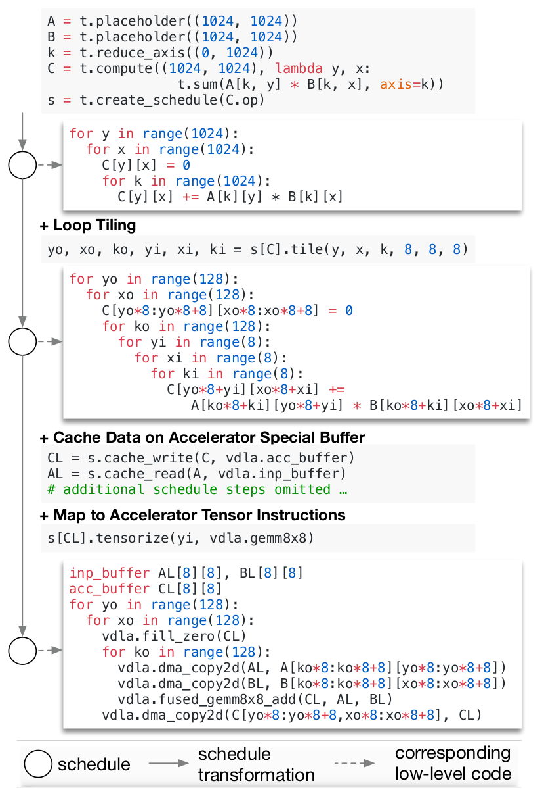

*图 5（原文 Figure 5，第 4 页）：在专用加速器上对矩阵乘做 schedule 变换的示例。*

**图中文字翻译与读法**：图自上而下是一条变换链；圆圈是一个 schedule，实线箭头是 schedule 变换，虚线箭头指向该 schedule 对应的低层代码（图底部的图例）。下面按原图逐步转录代码。

**第 0 步：张量表达式与默认 schedule。** 声明 1024×1024 的两个矩阵并创建默认 schedule：

```python
A = t.placeholder((1024, 1024))
B = t.placeholder((1024, 1024))
k = t.reduce_axis((0, 1024))
C = t.compute((1024, 1024), lambda y, x:
              t.sum(A[k, y] * B[k, x], axis=k))
s = t.create_schedule(C.op)
```

对应的低层代码就是最朴素的三重循环：

```python
for y in range(1024):
  for x in range(1024):
    C[y][x] = 0
    for k in range(1024):
      C[y][x] += A[k][y] * B[k][x]
```

**第 1 步：Loop Tiling（循环分块）。** 把 y、x、k 三个循环都按 8 分块：

```python
yo, xo, ko, yi, xi, ki = s[C].tile(y, x, k, 8, 8, 8)
```

每个循环被拆成外层（`yo`、`xo`、`ko`，范围 128）和内层（`yi`、`xi`、`ki`，范围 8），顺序为 yo、xo、ko、yi、xi、ki。代码变成：

```python
for yo in range(128):
  for xo in range(128):
    C[yo*8:yo*8+8][xo*8:xo*8+8] = 0
    for ko in range(128):
      for yi in range(8):
        for xi in range(8):
          for ki in range(8):
            C[yo*8+yi][xo*8+xi] +=
               A[ko*8+ki][yo*8+yi] * B[ko*8+ki][xo*8+xi]
```

**第 2 步：Cache Data on Accelerator Special Buffer（把数据缓存到加速器的专用缓冲区）。**

```python
CL = s.cache_write(C, vdla.acc_buffer)
AL = s.cache_read(A, vdla.inp_buffer)
# additional schedule steps omitted …
```

`cache_write`、`cache_read` 声明：结果 C 的分块先在加速器的累加缓冲区 `vdla.acc_buffer` 里算，输入 A 的分块先装进输入缓冲区 `vdla.inp_buffer`（原文省略了若干额外步骤）。

**第 3 步：Map to Accelerator Tensor Instructions（映射到加速器的张量指令）。**

```python
s[CL].tensorize(yi, vdla.gemm8x8)
```

`tensorize` 把内层 8×8×8 的循环块整体替换成加速器的 `gemm8x8` 指令。最终得到的低层代码：

```python
inp_buffer AL[8][8], BL[8][8]
acc_buffer CL[8][8]
for yo in range(128):
  for xo in range(128):
    vdla.fill_zero(CL)
    for ko in range(128):
      vdla.dma_copy2d(AL, A[ko*8:ko*8+8][yo*8:yo*8+8])
      vdla.dma_copy2d(BL, B[ko*8:ko*8+8][xo*8:xo*8+8])
      vdla.fused_gemm8x8_add(CL, AL, BL)
    vdla.dma_copy2d(C[yo*8:yo*8+8,xo*8:xo*8+8], CL)
```

**读图结论**：同一个数学定义（三重循环）经过三个 schedule 原语，变成了“清零累加缓冲区、用 DMA 把 8×8 的块搬进片上缓冲区、调用硬件的 8×8 矩阵乘累加指令、再把结果搬回”的加速器程序。数学结果不变，改变的只是循环结构、数据放置和使用的硬件指令。

### 5.3 schedule 原语一览（图 6）

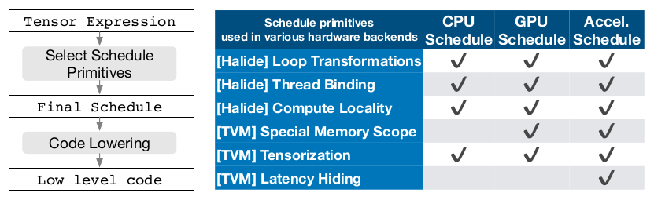

*图 6（原文 Figure 6，第 5 页）：TVM 的 schedule 降低（lowering）与代码生成流程；表格列出用于优化 CPU、GPU、加速器 schedule 的 Halide 既有原语和 TVM 新增原语。*

**图中文字翻译与读法**：左边是流程：Tensor Expression（张量表达式）→ Select Schedule Primitives（选择 schedule 原语）→ Final Schedule（最终 schedule）→ Code Lowering（代码降低）→ Low level code（低层代码）。右边的表格逐格转录如下（✔ 表示该后端的 schedule 用到该原语）：

| schedule 原语（来源） | CPU schedule | GPU schedule | 加速器（Accel.）schedule |
|---|---|---|---|
| [Halide] Loop Transformations（循环变换） | ✔ | ✔ | ✔ |
| [Halide] Thread Binding（线程绑定） | ✔ | ✔ | ✔ |
| [Halide] Compute Locality（计算局部性） | ✔ | ✔ | ✔ |
| [TVM] Special Memory Scope（特殊内存作用域） |  | ✔ | ✔ |
| [TVM] Tensorization（张量化） | ✔ | ✔ | ✔ |
| [TVM] Latency Hiding（延迟隐藏） |  |  | ✔ |

（原文 Figure 6 右侧的表，第 5 页。）图注的补充：tensorization 对加速器必不可少，但也可用于 CPU 和 GPU；special memory scope（特殊内存作用域）使 GPU 能做内存复用、并让加速器能显式管理片上内存；latency hiding 是类 TPU 加速器专有的。论文复用 Halide 中有用的原语和低层循环程序 AST，并新增原语来优化 GPU 和加速器的性能；新原语对于达到 GPU 的最优性能是必要的，对加速器则是必不可少的。

### 5.4 嵌套并行与协作式共享内存（原文 4.2）

GPU 提供大规模并行，所以要把并行模式“烘焙”进 schedule 变换。大多数现有方案采用**嵌套并行**，一种 fork-join 形式：需要一个 parallel schedule 原语把数据并行任务并行化，每个任务还可以被递归地分成子任务，以利用目标架构的多级线程层次（例如 GPU 的线程组）。论文把这种模型称为 **shared-nothing 嵌套并行**，因为同一个并行计算阶段内，一个工作线程看不到同组兄弟线程的数据。

与 shared-nothing 相对的做法是**协作式取数**：同一线程组里的线程可以一起把它们都需要的数据取到共享内存里（原文脚注：Halide 最近也加入了共享内存支持，但没有面向加速器的通用内存作用域）。这个优化可以利用 GPU 的内存层次，让数据通过共享内存区域在线程间复用。TVM 用一个 schedule 原语支持这一众所周知的 GPU 优化。下面是论文中优化矩阵乘的 GPU 示例伪代码：

```text
for thread_group (by, bx) in cross(64, 64):
  for thread_item (ty, tx) in cross(2, 2):
    local CL[8][8] = 0
    shared AS[2][8], BS[2][8]
    for k in range(1024):
      for i in range(4):
        AS[ty][i*4+tx] = A[k][by*64+ty*8+i*4+tx]
      for each i in 0..4:
        BS[ty][i*4+tx] = B[k][bx*64+ty*8+i*4+tx]
      memory_barrier_among_threads()
      for yi in range(8):
        for xi in range(8):
          CL[yi][xi] += AS[yi] * BS[xi]
    for yi in range(8):
      for xi in range(8):
        C[yo*8+yi][xo*8+xi] = CL[yi][xi]
```

原图的两处标注：对 `AS[...] = A[...]` 和 `BS[...] = B[...]` 两个循环，标注是“All threads cooperatively load AS and BS in different parallel patterns（所有线程以不同的并行模式协作装载 AS 和 BS）”；对 `memory_barrier_among_threads()`，标注是“Barrier inserted automatically by compiler（屏障由编译器自动插入）”。（补充：这是示意伪代码，下标并不严格自洽，例如 `AS` 声明为 2×8 而写入下标 `i*4+tx` 的范围会超出 8，请只读它的结构：线程组先协作把块装进共享内存，同步，再各自用共享内存里的数据累加。）

论文引入**内存作用域**（memory scope）的概念，让一个计算阶段（代码里的 `AS` 和 `BS`）可以被标记为 shared（共享）。如果没有显式的内存作用域，自动作用域推断会把计算阶段标成线程本地（thread-local）。共享阶段必须计算组内所有工作线程的依赖；还必须正确插入内存同步屏障，保证共享装载的数据对消费者可见。除了对 GPU 有用，内存作用域还让我们能为特殊内存缓冲区打标签，并在面向专用深度学习加速器时生成特殊的降低规则。

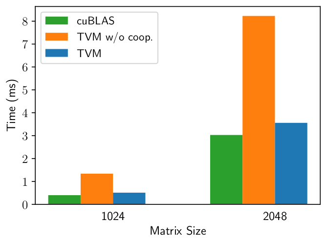

*图 7（原文 Figure 7，第 5 页）：矩阵乘负载上，TVM 有无协作式共享内存取数的性能对比，在 NVIDIA Titan X 上测试。*

**图中文字翻译与读法**：横轴 Matrix Size（矩阵大小，1024 与 2048），纵轴 Time (ms)（时间，越小越好）；绿柱 cuBLAS，橙柱 TVM w/o coop.（TVM 无协作取数），蓝柱 TVM。从图上量出的近似值：

| 矩阵大小 | cuBLAS（约，ms） | TVM 无协作取数（约，ms） | TVM（约，ms） |
|---|---:|---:|---:|
| 1024 | 0.39 | 1.33 | 0.50 |
| 2048 | 3.02 | 8.22 | 3.55 |

**读图结论**：加上协作式共享内存取数后，TVM 的时间比不用时降到约 0.38 倍（1024）和约 0.43 倍（2048），也就是快约 2.7× 和 2.3×；这时 TVM 已接近 cuBLAS（约慢 28% 和 18%，笔者由读数计算）。原文只说这张图展示了该优化的影响，没有给出这些倍数。

### 5.5 Tensorization（张量化，原文 4.3）

深度学习负载算术强度高，通常可以分解成矩阵乘、一维卷积这类张量算子，由此带来了为硬件新增**张量计算原语**的趋势。这些原语既带来机会也带来挑战：用了它们可以提升性能，但编译框架必须无缝集成它们。论文把这件事称为 **tensorization**，它类似 SIMD 架构的向量化（vectorization），但有重要区别：指令的输入是多维的，长度固定或可变，每个输入有不同的数据布局；更重要的是，我们不能只支持固定的一组原语，因为新的加速器不断涌现，各自带着自己的张量指令变体。所以需要一种可扩展的方案。

TVM 通过**把目标硬件 intrinsic 与 schedule 分开**，并提供张量 intrinsic 声明机制来让 tensorization 可扩展：用同一种张量表达式语言同时声明每个新硬件 intrinsic 的**行为**，以及与之关联的**降低规则**。下面的代码展示如何声明一个 8×8 的张量硬件 intrinsic：

```python
w, x = t.placeholder((8, 8)), t.placeholder((8, 8))
k = t.reduce_axis((0, 8))
y = t.compute((8, 8), lambda i, j:
              t.sum(w[i, k] * x[j, k], axis=k))

def gemm_intrin_lower(inputs, outputs):
    ww_ptr = inputs[0].access_ptr("r")
    xx_ptr = inputs[1].access_ptr("r")
    zz_ptr = outputs[0].access_ptr("w")
    compute = t.hardware_intrin("gemm8x8", ww_ptr, xx_ptr, zz_ptr)
    reset = t.hardware_intrin("fill_zero", zz_ptr)
    update = t.hardware_intrin("fuse_gemm8x8_add", ww_ptr, xx_ptr, zz_ptr)
    return compute, reset, update

gemm8x8 = t.decl_tensor_intrin(y.op, gemm_intrin_lower)
```

原图的两处标注：前四行（`w, x ... y = t.compute(...)`）是 “declare behavior（声明行为）”：用张量表达式写出这条指令的数学含义；`gemm_intrin_lower` 整个函数是 “lowering rule to generate hardware intrinsics to carry out the computation（生成硬件 intrinsic 来完成计算的降低规则）”：当 schedule 要把一段计算映射到这条指令时，编译器按它生成对应的硬件调用——`gemm8x8`（矩阵乘）、`fill_zero`（累加器清零）、`fuse_gemm8x8_add`（融合的乘加）三个入口分别对应“计算”“重置”“更新”。

此外，论文引入 `tensorize` 这个 schedule 原语，用对应的 intrinsic 替换一小块计算：编译器把计算模式与硬件声明匹配，并降低成相应的硬件 intrinsic。tensorization 把 schedule 与具体硬件原语解耦，使得扩展 TVM 以支持新硬件架构变得容易。由 tensorize 过的 schedule 生成的代码，与高性能计算的实践一致：把复杂运算拆成一串 micro-kernel 调用。它还可以用来利用**手工写好的 micro-kernel**，在某些平台上这是有益的。例如论文为移动 CPU 实现了超低精度（1 位或 2 位宽的数据类型）算子，利用了一个 bit-serial 矩阵向量乘 micro-kernel，该 micro-kernel 把结果累加进逐渐变宽的数据类型以最小化内存占用；把它作为张量 intrinsic 交给 TVM，相对非 tensorize 版本**最多加速 1.5×**。

### 5.6 显式内存延迟隐藏（原文 4.4）

**延迟隐藏**指把内存操作与计算重叠，以最大化内存和计算资源的利用率。不同硬件后端需要不同策略：

- **CPU**：靠同时多线程（SMT）或硬件预取，隐式地隐藏访存延迟；
- **GPU**：依靠大量 warp 的快速上下文切换；
- **专用深度学习加速器（如 TPU）**：通常倾向于更精简的控制，采用 **decoupled access-execute（DAE，访存/执行解耦）** 架构，并把细粒度同步问题卸给软件。

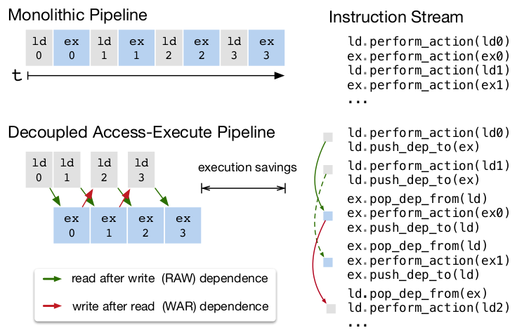

*图 9（原文 Figure 9，第 7 页）：DAE 通过让内存与计算重叠，隐藏大部分访存延迟；正确性由低层同步（依赖令牌的入队/出队）保证，编译栈必须把这些同步插入指令流。*

**图中文字翻译与读法**：

- **左上 Monolithic Pipeline（整体式流水线）**：`ld 0, ex 0, ld 1, ex 1, ld 2, ex 2, ld 3, ex 3` 沿时间轴 t 串行：装载（ld）与执行（ex）交替，不重叠。右上 Instruction Stream（指令流）是对应的串行指令序列：`ld.perform_action(ld0)`、`ex.perform_action(ex0)`、`ld.perform_action(ld1)`、`ex.perform_action(ex1)`……
- **左下 Decoupled Access-Execute Pipeline（解耦的访存-执行流水线）**：装载 `ld 0` 到 `ld 3` 与执行 `ex 0` 到 `ex 3` 分在两条流水线上，彼此错开，重叠执行，图中 execution savings（执行时间节省）标出节省的跨度。绿色箭头是 read after write（RAW，写后读）依赖：装载完才能执行；红色箭头是 write after read（WAR，读后写）依赖：执行读完缓冲区才允许下一次装载覆盖它。
- **右下 Instruction Stream（指令流）**：为保证依赖，指令里加入了 `ld.push_dep_to(ex)`（装载完成后向执行流水线“放入”一个依赖令牌）、`ex.pop_dep_from(ld)`（执行前先“取出”令牌，没有令牌就等待）、`ex.push_dep_to(ld)`、`ld.pop_dep_from(ex)` 等入队/出队操作。
- **读图结论**：DAE 能把访存与计算重叠、几乎打满计算资源，但代价是指令流里必须有细粒度的依赖入队/出队操作，否则依赖无法保证、会导致错误执行。

给 DAE 加速器编程很难，因为要显式写低层同步。为减轻编程负担，TVM 引入了**虚拟线程（virtual threading）**这个 schedule 原语：程序员像对待支持多线程的硬件后端一样，写一个高层的数据并行程序；TVM 再自动把它降低成带显式低层同步的**单一指令流**（图 8）。算法先从高层多线程 schedule 开始，为每个线程插入保证正确执行所需的低层同步操作；接着把所有虚拟线程的操作交错成一个单一指令流；最后由硬件根据指令流中的低层同步恢复出可用的流水线并行。

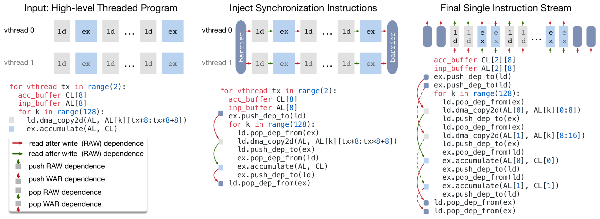

*图 8（原文 Figure 8，第 7 页）：TVM 的虚拟线程降低，把虚拟线程并行的程序变成单一指令流；指令流包含显式的低层同步，硬件能据此恢复隐藏访存延迟所需的流水线并行。*

**图中文字翻译与读法**：三栏自左到右是三个阶段。

- **左：Input: High-level Threaded Program（输入：高层线程化程序）**。`vthread 0` 与 `vthread 1` 两个虚拟线程，各自是 `ld`（装载）与 `ex`（执行）交替的序列。代码：

```text
for vthread tx in range(2):
  acc_buffer CL[8]
  inp_buffer AL[8]
  for k in range(128):
    ld.dma_copy2d(AL, AL[k][tx*8:tx*8+8])
    ex.accumulate(AL, CL)
```

- **中：Inject Synchronization Instructions（插入同步指令）**。每个虚拟线程内部插入依赖令牌操作，线程组首尾加 barrier（屏障）：

```text
for vthread tx in range(2):
  acc_buffer CL[8]
  inp_buffer AL[8]
  ex.push_dep_to(ld)
  for k in range(128):
    ld.pop_dep_from(ex)
    ld.dma_copy2d(AL, AL[k][tx*8:tx*8+8])
    ld.push_dep_to(ex)
    ex.pop_dep_from(ld)
    ex.accumulate(AL, CL)
    ex.push_dep_to(ld)
  ld.pop_dep_from(ex)
```

- **右：Final Single Instruction Stream（最终的单一指令流）**。两个虚拟线程各自的缓冲区变成 `CL[2][8]`、`AL[2][8]`，两个线程的 `ld` 与 `ex` 被交错在一条流里：

```text
acc_buffer CL[2][8]
inp_buffer AL[2][8]
ex.push_dep_to(ld)
ex.push_dep_to(ld)
for k in range(128):
  ld.pop_dep_from(ex)
  ld.dma_copy2d(AL[0], AL[k][0:8])
  ld.push_dep_to(ex)
  ld.pop_dep_from(ex)
  ld.dma_copy2d(AL[1], AL[k][8:16])
  ld.push_dep_to(ex)
  ex.pop_dep_from(ld)
  ex.accumulate(AL[0], CL[0])
  ex.push_dep_to(ld)
  ex.pop_dep_from(ld)
  ex.accumulate(AL[1], CL[1])
  ex.push_dep_to(ld)
ld.pop_dep_from(ex)
ld.pop_dep_from(ex)
```

- **图例**：红色横箭头与绿色横箭头分别表示两类依赖（原图例两行都写成了 read after write (RAW)，按图 9 的图例，红色应是 write after read (WAR)，是原文笔误）；上下箭头小方块表示 push RAW、push WAR、pop RAW、pop WAR 依赖令牌操作。
- **读图结论**：程序员只写“两个并行的虚拟线程”，编译器负责把它们交错成一条流，并配好每一处令牌的 push/pop。交错之后，线程 1 的装载与线程 0 的执行可以重叠，硬件按令牌顺序就恢复出流水线并行。

**延迟隐藏的硬件评测。** 论文在一个定制的基于 FPGA 的加速器上（第 6.4 节详述）展示延迟隐藏的效果：对 ResNet 的每一层，用 TVM 生成两个 schedule，一个带延迟隐藏、一个不带。带延迟隐藏的 schedule 用虚拟线程并行化程序，以暴露流水线并行从而隐藏访存延迟。结果用 roofline 图（图 10）表示。

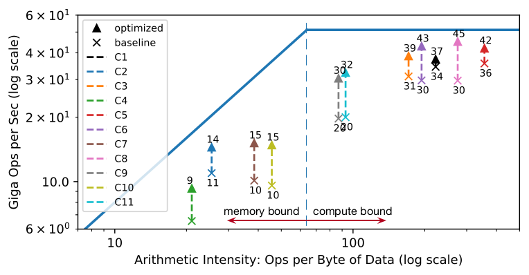

*图 10（原文 Figure 10，第 7 页）：基于 FPGA 的深度学习加速器运行 ResNet 推理的 roofline 图。开启 TVM 的延迟隐藏后，各层性能更接近 roofline，体现出更高的计算与访存带宽利用率。*

**图中文字翻译与读法**：

- **坐标轴**：横轴 Arithmetic Intensity: Ops per Byte of Data (log scale)（算术强度：每字节数据的运算数，对数坐标）；纵轴 Giga Ops per Sec (log scale)（每秒十亿次运算，对数坐标）。
- **折线与分区**：蓝色折线是 roofline（左边是斜线，右边是水平的计算上限）。竖虚线左侧标 memory bound（受访存限制），右侧标 compute bound（受计算限制）。
- **图例**：▲ optimized（优化后，带延迟隐藏），✕ baseline（基线，无延迟隐藏）；图例里的 C1 至 C11 用 11 种颜色标记 11 个层（原文没有说明与表 2 层名的对应关系；正文说第一层卷积不在 FPGA 上跑，而 ResNet-18 表 2 的 C2 至 C12 恰好是 11 层，所以这里的 C1 至 C11 很可能是这 11 个被卸载层的重新编号，是推测）。每对 ✕ 到 ▲ 的虚线箭头表示该层性能的提升，图上标注的 GOPS 值逐项转录如下：

| 图例编号 | 颜色 | 优化后（▲，GOPS） | 基线（✕，GOPS） |
|---|---|---:|---:|
| C1 | 黑 | 37 | 34 |
| C2 | 蓝 | 14 | 11 |
| C3 | 橙 | 39 | 31 |
| C4 | 绿 | 9 | 图上没有标数字（✕ 在最下方，读图约 6.5） |
| C5 | 红 | 42 | 36 |
| C6 | 紫 | 43 | 30 |
| C7 | 棕 | 15 | 10 |
| C8 | 粉 | 45 | 30 |
| C9 | 灰 | 30 | 约 26（标注被相邻的 20 遮住了一部分） |
| C10 | 黄绿 | 15 | 10 |
| C11 | 青 | 32 | 20 |

- **读图结论**：每个层的 ▲ 都高于对应的 ✕，即延迟隐藏提高了所有 ResNet 层的性能。正文给出的总括数字是：峰值计算利用率从无延迟隐藏的 **70%** 提高到有延迟隐藏的 **88%**。（补充：图中水平屋顶约在 51 的位置，等于 16×16 的矩阵向量单元乘 200 MHz 的 51.2 G 次乘加每秒；45 / 51.2 约为 88%，36 / 51.2 约为 70%，与正文吻合。正文把理论峰值写成 102.4 GOPS/s，是把一次乘加记为两次运算，图的纵轴按乘加计数，所以两处数字相差一倍，这是笔者的核对。）

## 六、自动优化（原文第 5 节）

有了丰富的 schedule 原语，剩下的问题是为深度学习模型的每一层找到最优的算子实现。TVM 为每一层对应的具体输入 shape 和布局创建**专门化**的算子。这种专门化带来显著的性能收益（相比只针对较少 shape 和布局的手写代码），但也带来自动化的挑战：系统要选择 schedule 优化（比如修改循环顺序、针对存储层次优化），也要选择 schedule 的参数（比如分块大小、循环展开因子）。这些组合选择为每个硬件后端创造了巨大的算子实现搜索空间。

为应对这一挑战，论文构建了一个自动 schedule 优化器，包含两个主要组件：一个 **schedule explorer（调度探索器）**，提出有希望的新配置；一个**机器学习成本模型**，预测给定配置的性能。

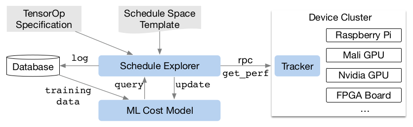

*图 11（原文 Figure 11，第 8 页）：自动优化框架。schedule 探索器借助基于 ML 的成本模型检查 schedule 空间，并选出要在分布式设备集群上通过 RPC 运行的实验；为提高预测能力，ML 模型会定期用数据库里收集的数据更新。*

**图中文字翻译与读法**：

- **输入**：TensorOp Specification（张量算子声明）与 Schedule Space Template（schedule 空间模板），都进入 **Schedule Explorer（调度探索器）**。
- **探索器与成本模型**：探索器向 **ML Cost Model（ML 成本模型）** 发 `query`（查询），成本模型返回预测；探索器把测得的数据 `update`（更新）给模型。
- **Database（数据库）**：探索器把测试记录 `log`（记日志）到数据库；数据库里的 `training data`（训练数据）用来训练成本模型。
- **右侧 Device Cluster（设备集群）**：探索器通过 `rpc`（远程过程调用）和 `get_perf`（取性能）与 **Tracker（跟踪器）** 通信，由跟踪器在集群中的设备上运行实验；设备包括 Raspberry Pi、Mali GPU、Nvidia GPU、FPGA Board 等。
- **读图结论**：这是一个“提出候选配置、真机测量、更新成本模型、再提出候选”的闭环；成本模型只用来缩小要实测的候选集合，不替代实测。

### 6.1 Schedule 空间的声明（原文 5.1）

论文构建了一个 **schedule 模板声明 API**，让开发者声明 schedule 空间中的“旋钮”（knob，可调参数）。模板声明允许在指定可能的 schedule 时，按需加入开发者的领域知识。论文还为每个硬件后端创建了一个**通用主模板（master template）**，根据张量表达式语言写的计算描述自动提取可能的旋钮。总的思路是：希望考虑尽可能多的配置，让优化器去承担选择的负担。因此优化器必须在论文实验所用的真实世界深度学习负载上，搜索**数十亿**种可能的配置。

### 6.2 基于 ML 的成本模型（原文 5.2）

要在庞大的配置空间中找到最佳 schedule，一种办法是黑盒优化，即自动调优（auto-tuning），这种方法被用来调优高性能计算库（论文引用 FFTW、ATLAS）。但自动调优需要很多次实验才能找到好配置。另一种办法是为特定硬件后端建一个**预定义成本模型**来引导搜索，而不是把所有可能都跑一遍并测量性能。理想的成本模型要考虑所有影响性能的因素：访存模式、数据复用、流水线依赖、线程模式等。可惜现代硬件越来越复杂，这种方法很繁重；而且每个新硬件目标都需要一个新的（预定义）成本模型。

论文则采用**统计方法**：schedule 探索器提出可能提升算子性能的配置；对每个 schedule 配置，用一个 ML 模型，把**降低后的循环程序**作为输入，预测它在给定硬件后端上的运行时间。模型用探索过程中收集的运行时测量数据训练，**不需要用户输入详细的硬件信息**；随着探索更多配置，模型会定期更新，这也提高了对其他相关负载的准确性。这样，ML 模型的质量会随着试验次数的增加而提高。表 1 概括了几种自动化方法的关键区别。

**表：自动化方法的比较（原文表 1，第 8 页）。** 表中“模型偏差”指由建模引起的不准确。

| 方法类别 | 数据成本 | 模型偏差 | 是否需要硬件信息 | 能否从历史中学习 |
|---|---|---|---|---|
| 黑盒自动调优（Blackbox auto-tuning） | 高 | 无 | 否 | 否 |
| 预定义成本模型（Predefined cost model） | 无 | 高 | 是 | 否 |
| **基于 ML 的成本模型（ML based cost model）** | **低** | **低** | **否** | **是** |

读法：基于 ML 的成本模型在“要测多少数据”和“模型有多不准”之间取得平衡，并且能利用相关负载的历史性能数据。

**ML 模型的设计选择。** 选择探索器使用什么 ML 模型时，必须考虑两个关键因素：**质量**和**速度**。探索器会频繁查询成本模型，产生模型预测时间和模型重新拟合时间的开销；要有用，这些开销必须小于在真实硬件上测一次性能的时间（视具体负载和硬件，可能在秒量级）。这一速度要求使该问题区别于传统的超参数调优：后者测量代价相对模型开销很高，因此可以用更昂贵的模型。

除了模型的选择，还要选训练目标函数，比如配置的预测运行时间的误差。但探索器只依据预测的**相对顺序**（A 比 B 快）来选最好的候选，因此不需要直接预测绝对执行时间，而是用 **rank 目标函数**来预测运行时间成本的相对顺序。

论文实现了几种模型：

- **梯度树提升模型**（基于 XGBoost）：根据从循环程序中提取的**特征**预测。特征包括各内存缓冲区在每一层循环处的访存次数和复用比，以及循环注解（如 vectorize、unroll、parallel）的 one-hot 编码。
- **神经网络模型**：用 TreeRNN 在不做特征工程的前提下概括循环程序的 AST。

图 13 概括了成本模型的工作流程。

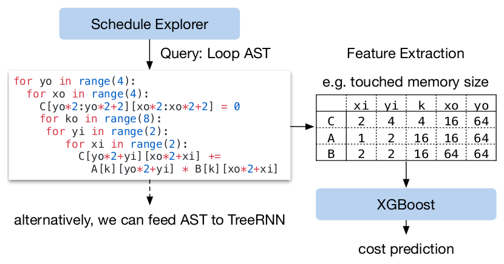

*图 13（原文 Figure 13，第 9 页）：ML 成本模型的示例工作流。XGBoost 根据循环程序特征预测代价，TreeRNN 则直接概括 AST。*

**图中文字翻译与读法**：

- **流程**：Schedule Explorer 发出 “Query: Loop AST（查询：循环 AST）”，给出一个具体配置降低后的循环程序（图中是一个矩阵乘循环：y、x 各分成外层 4、内层 2，k 循环 8 次）；然后做 **Feature Extraction（特征提取）**，例如 “touched memory size（被访问内存的大小）”；特征送入 **XGBoost**，输出 **cost prediction（代价预测）**。图下方文字：“alternatively, we can feed AST to TreeRNN（也可以把 AST 喂给 TreeRNN）”。
- **特征表（touched memory size）**：每个缓冲区在每一层循环下被访问的内存元素数，逐格转录如下：

| 缓冲区 | xi | yi | k | xo | yo |
|---|---:|---:|---:|---:|---:|
| C | 2 | 4 | 4 | 16 | 64 |
| A | 1 | 2 | 16 | 16 | 64 |
| B | 2 | 2 | 16 | 64 | 64 |

- **读图结论**：成本模型输入的是“降低后的循环程序”提取的特征，不是 schedule 的原始参数；这使得同一个模型可以泛化到相关但不同的负载。

论文发现树提升与 TreeRNN 的预测质量相近，但前者**预测速度快一倍、训练耗时少得多**，因此在实验中选梯度树提升作为默认成本模型。作者认为两种方法都有价值，期待未来更多研究。树提升模型平均**每次预测 0.67 ms，比跑一次真实测量快数千倍**。

### 6.3 Schedule 探索（原文 5.3）

选定成本模型后，就用它挑选有希望的配置，迭代地在这些配置上跑真实测量。每一轮中，探索器用 ML 模型的预测选出一批候选，在候选上跑测量；收集到的数据再作为训练数据更新模型。**如果还没有初始训练数据，探索器就随机选候选来测。**

最简单的探索算法是枚举每个配置、让成本模型都评估一遍、选预测性能最好的 top-k。但这在大搜索空间里不可行。因此论文采用**并行模拟退火算法**：探索器从随机配置出发，每一步随机游走到相邻配置；如果成本模型预测的代价降低，就接受这次转移；如果目标配置代价更高，则很可能被拒绝。随机游走会倾向于收敛到成本模型预测代价更低的配置。探索状态在成本模型更新之间保持，更新之后从上一次的配置继续。

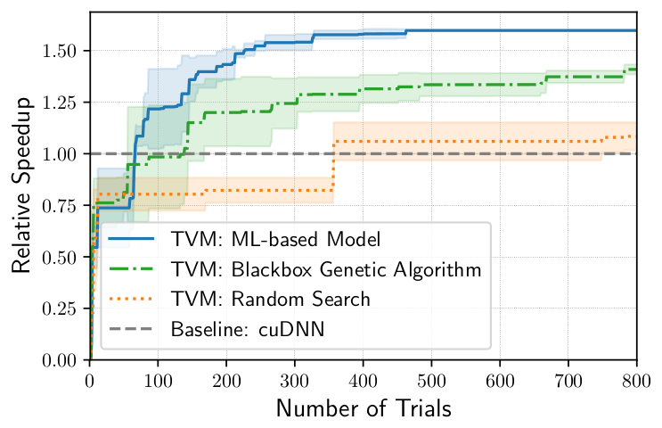

*图 12（原文 Figure 12，第 9 页）：不同自动化方法在 TITAN X 上对 ResNet-18 中一个 conv2d 算子的比较。基于 ML 的模型从零训练数据开始，用收集到的数据改进自己。纵轴是相对 cuDNN 的加速比；对其他负载观察到类似趋势。*

**图中文字翻译与读法**：

- **坐标轴**：横轴 Number of Trials（试验次数，0 到 800），纵轴 Relative Speedup（相对加速比，相对 cuDNN）。每条线周围的浅色带原文没有说明，应是多次运行的波动范围（推测）。
- **四条线**：蓝色实线 TVM: ML-based Model（TVM：基于 ML 的模型）；绿色点划线 TVM: Blackbox Genetic Algorithm（TVM：黑盒遗传算法）；橙色点线 TVM: Random Search（TVM：随机搜索）；灰色长虚线 Baseline: cuDNN（基线 cuDNN，恒为 1.0）。
- **近似读数（从图上量出）**：到 800 次试验时，ML 模型约 1.6×、遗传算法约 1.4×、随机搜索约 1.1×；超过 cuDNN（1.0×）所需的试验次数，ML 模型约 60 次、遗传算法约 140 次、随机搜索约 350 次。
- **读图结论**：正文的结论是“基于 ML 的优化器比黑盒自动调优方法能更快地找到更好的配置”。注意这是**一个算子**上的曲线，原文说其他负载趋势类似，但没有给出更多曲线。

### 6.4 分布式设备池与 RPC（原文 5.4）

**分布式设备池**把在硬件上运行试验的任务扩展开来，让多个优化任务可以细粒度共享资源。TVM 实现了一个定制的、基于 RPC 的分布式设备池，客户端可以在特定类型的设备上运行程序。可以用这个接口在主机的编译器上编译程序，请求一个远程设备，在远程运行函数，并在主机上的同一个脚本里拿到结果。TVM 的 RPC 支持动态上传并运行使用其运行时约定的交叉编译模块和函数，所以同一套基础设施既能做单个负载优化，也能做端到端的图推理。这套方法自动化了跨多个设备的编译、运行、性能剖析步骤，对嵌入式设备尤其关键，因为后者传统上需要繁琐的手工交叉编译、代码部署和测量。

## 七、实验（原文第 6 节）

TVM 的核心用 C++ 实现（约 5 万行），提供 Python 和 Java 绑定。前面各节已经评估了若干单独的优化和组件：算子融合（图 4）、延迟隐藏（图 10）、基于 ML 的成本模型（图 12）。这一节聚焦端到端评测，回答四个问题：

- TVM 能否在多种平台上优化深度学习负载？
- 与依赖高度优化库的现有框架相比，TVM 在每个后端上表现如何？
- TVM 能否支持新兴的深度学习负载（如 depthwise 卷积、低精度算子）？
- TVM 能否支持并优化新的专用加速器？

实验在四类平台上进行：（1）服务器级 GPU；（2）嵌入式 GPU；（3）嵌入式 CPU；（4）实现在低功耗 FPGA SoC 上的深度学习加速器。基准是真实世界的深度学习推理负载：ResNet、MobileNet、LSTM 语言模型、Deep Q Network（DQN）和 DCGAN。对比对象是 MXNet 和 TensorFlow 等依赖高度工程化的厂商专属库的现有框架；TVM 则做端到端的自动优化和代码生成，不需要外部算子库。

下表汇总各平台与基线（均取自原文第 6 节）：

| 平台 | 硬件 | 基线与版本 |
|---|---|---|
| 服务器级 GPU | NVIDIA Titan X | MXNet v1.1、TensorFlow v1.7、TensorFlow XLA；MXNet 与 TensorFlow 的卷积用 cuDNN v7、矩阵乘用 cuBLAS v8；depthwise 卷积用各自实现；单算子对比另加 TensorComprehensions（commit ef644ba） |
| 嵌入式 CPU | ARM Cortex A53（四核 1.2 GHz） | TensorFlow Lite（TFLite，commit 7558b085）；超低精度算子对比 Caffe2（commit 39e07f7） |
| 嵌入式 GPU | Firefly-RK3399 板上的 ARM Mali-T860MP4 | ARM Compute Library（v18.03，厂商库） |
| FPGA 加速器 | PYNQ 板：ARM Cortex A9 双核 667 MHz + Artix-7 FPGA | 无外部基线；对比 TVM 在 ARM 上的纯 CPU 实现 |

### 7.1 服务器级 GPU（原文 6.1）

论文先比较深度神经网络在 TVM、MXNet（v1.1）、TensorFlow（v1.7）和 TensorFlow XLA 上、于一块 Nvidia Titan X 上的端到端性能。MXNet 与 TensorFlow 的卷积算子都用 cuDNN v7；depthwise 卷积因为相对较新、最新库尚未支持，它们用各自的实现；矩阵乘用 cuBLAS v8。TensorFlow XLA 则使用 JIT 编译。

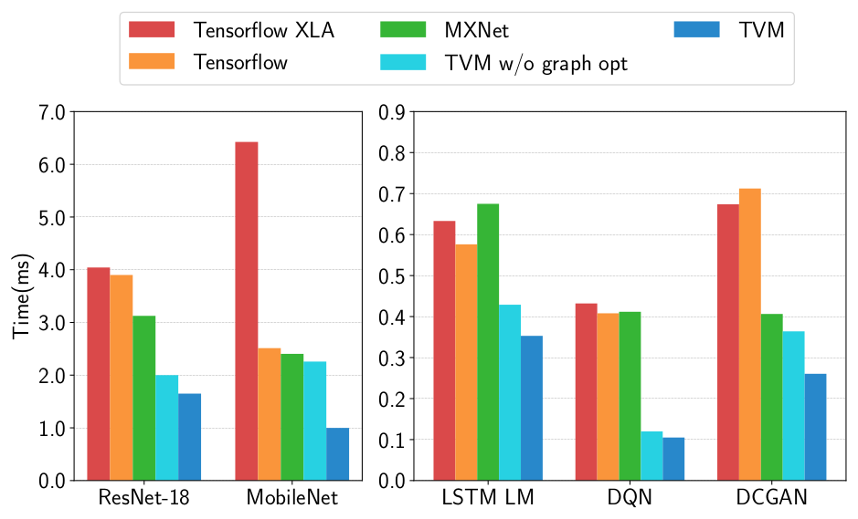

*图 14（原文 Figure 14，第 10 页）：TVM、MXNet、TensorFlow 与 TensorFlow XLA 的 GPU 端到端评测，在 NVIDIA Titan X 上测试。*

**图中文字翻译与读法**：纵轴 Time (ms)（时间，越小越好）；左面板为 ResNet-18 与 MobileNet，右面板为 LSTM LM、DQN、DCGAN（纵轴量程不同）。每个负载五根柱，依次为 Tensorflow XLA（红）、Tensorflow（橙）、MXNet（绿）、TVM w/o graph opt（TVM 无图优化，青）、TVM（蓝）。从图上量出的近似值（ms）：

| 负载 | TF XLA | TF | MXNet | TVM 无图优化 | TVM |
|---|---:|---:|---:|---:|---:|
| ResNet-18 | 约 4.03 | 约 3.89 | 约 3.12 | 约 1.99 | 约 1.64 |
| MobileNet | 约 6.41 | 约 2.50 | 约 2.40 | 约 2.25 | 约 0.99 |
| LSTM LM | 约 0.63 | 约 0.58 | 约 0.67 | 约 0.43 | 约 0.35 |
| DQN | 约 0.43 | 约 0.41 | 约 0.41 | 约 0.12 | 约 0.10 |
| DCGAN | 约 0.67 | 约 0.71 | 约 0.41 | 约 0.36 | 约 0.26 |

**读图结论**：

- **与最好的基线相比**，TVM 约快 1.9×（ResNet-18）、2.4×（MobileNet）、1.6×（LSTM LM）、约 3.9×（DQN）、1.6×（DCGAN）（笔者由读数计算）。正文写的是“**TVM 优于基线，加速比从 1.6× 到 3.8×**，源于联合的图优化和自动优化器（后者生成高性能的融合算子）”，上述读数与此大体一致。
- **DQN 的 3.8×** 来自它使用了 cuDNN 优化不好的非常规算子（4×4 conv2d，stride=2）；ResNet 负载更常规。TVM 在两种情况下都能自动找到优化算子。
- **图优化的贡献**（TVM 无图优化 与 TVM 的差）：约 1.2×（ResNet-18）、2.3×（MobileNet）、1.2×（LSTM LM）、1.2×（DQN）、1.4×（DCGAN）。MobileNet 受益最大（补充：它由大量 depthwise 卷积、bn、relu 这类小算子组成，图 4 里这类组合的融合收益也最高）。
- **观察**：XLA 在 MobileNet 上约 6.4 ms，比同一版本 TF 的约 2.5 ms 慢得多；原文没有评论。基线是 2018 年的 TF 1.7 与 XLA，不能代表今天的 XLA（见第九节）。

为评估算子级优化的有效性，论文还对 ResNet 和 MobileNet 的每个张量算子做了分项对比（图 15，算子配置见表 2）。

**表：单算子实验的算子配置（原文表 2，第 10 页）。** 上表为 ResNet-18 的全部 conv2d 算子，下表为 MobileNet 的全部 depthwise conv2d 算子。H、W 为输入高和宽，IC 为输入通道数，OC 为输出通道数，K 为卷积核大小，S 为步长；所有算子使用 “SAME” padding；所有 depthwise conv2d 的通道倍数（channel multiplier）为 1。

| 名称 | 算子 | H, W | IC, OC | K, S |
|---|---|---|---|---|
| C1 | conv2d | 224, 224 | 3, 64 | 7, 2 |
| C2 | conv2d | 56, 56 | 64, 64 | 3, 1 |
| C3 | conv2d | 56, 56 | 64, 64 | 1, 1 |
| C4 | conv2d | 56, 56 | 64, 128 | 3, 2 |
| C5 | conv2d | 56, 56 | 64, 128 | 1, 2 |
| C6 | conv2d | 28, 28 | 128, 128 | 3, 1 |
| C7 | conv2d | 28, 28 | 128, 256 | 3, 2 |
| C8 | conv2d | 28, 28 | 128, 256 | 1, 2 |
| C9 | conv2d | 14, 14 | 256, 256 | 3, 1 |
| C10 | conv2d | 14, 14 | 256, 512 | 3, 2 |
| C11 | conv2d | 14, 14 | 256, 512 | 1, 2 |
| C12 | conv2d | 7, 7 | 512, 512 | 3, 1 |

| 名称 | 算子 | H, W | IC | K, S |
|---|---|---|---|---|
| D1 | depthwise conv2d | 112, 112 | 32 | 3, 1 |
| D2 | depthwise conv2d | 112, 112 | 64 | 3, 2 |
| D3 | depthwise conv2d | 56, 56 | 128 | 3, 1 |
| D4 | depthwise conv2d | 56, 56 | 128 | 3, 2 |
| D5 | depthwise conv2d | 28, 28 | 256 | 3, 1 |
| D6 | depthwise conv2d | 28, 28 | 256 | 3, 2 |
| D7 | depthwise conv2d | 14, 14 | 512 | 3, 1 |
| D8 | depthwise conv2d | 14, 14 | 512 | 3, 2 |
| D9 | depthwise conv2d | 7, 7 | 1024 | 3, 1 |

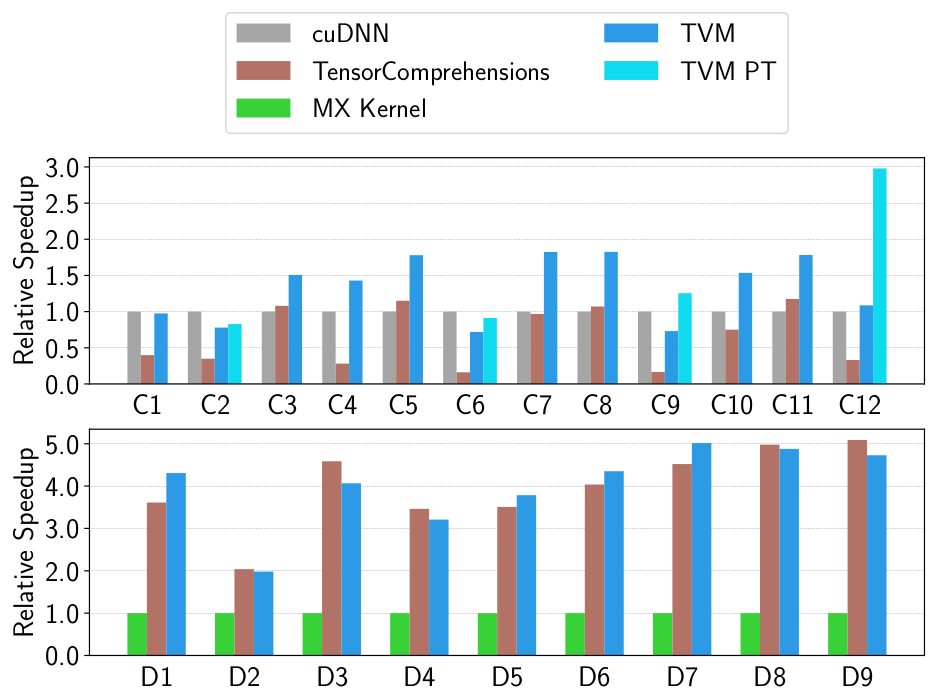

*图 15（原文 Figure 15，第 11 页）：ResNet-18 的全部 conv2d 算子与 MobileNet 的全部 depthwise conv2d 算子的相对加速比，在 TITAN X 上测试，算子配置见表 2。另包含对 3×3 conv2d 做权重预变换的 Winograd（TVM PT）。*

**图中文字翻译与读法**：上面板为 C1 至 C12，以 cuDNN 为 1.0（灰），对比 TensorComprehensions（棕）、TVM（蓝）和 TVM PT（青，仅在四个 3×3 步长 1 的层上）；下面板为 D1 至 D9，以 MX Kernel（MXNet 手写的 depthwise kernel，绿）为 1.0，对比 TensorComprehensions 与 TVM。纵轴 Relative Speedup（相对加速比，越大越好）。从图上量出的近似值（±0.02）：

| 层 | C1 | C2 | C3 | C4 | C5 | C6 | C7 | C8 | C9 | C10 | C11 | C12 |
|---|---:|---:|---:|---:|---:|---:|---:|---:|---:|---:|---:|---:|
| cuDNN | 1.00 | 1.00 | 1.00 | 1.00 | 1.00 | 1.00 | 1.00 | 1.00 | 1.00 | 1.00 | 1.00 | 1.00 |
| TensorComprehensions | 0.39 | 0.34 | 1.08 | 0.27 | 1.15 | 0.15 | 0.97 | 1.08 | 0.16 | 0.75 | 1.18 | 0.32 |
| TVM | 0.98 | 0.78 | 1.52 | 1.43 | 1.79 | 0.72 | 1.84 | 1.84 | 0.73 | 1.55 | 1.79 | 1.09 |
| TVM PT | 无 | 0.83 | 无 | 无 | 无 | 0.92 | 无 | 无 | 1.26 | 无 | 无 | 3.01 |

| 层 | D1 | D2 | D3 | D4 | D5 | D6 | D7 | D8 | D9 |
|---|---:|---:|---:|---:|---:|---:|---:|---:|---:|
| MX Kernel | 1.00 | 1.00 | 1.00 | 1.00 | 1.00 | 1.00 | 1.00 | 1.00 | 1.00 |
| TensorComprehensions | 3.65 | 2.06 | 4.65 | 3.51 | 3.56 | 4.09 | 4.58 | 5.05 | 5.17 |
| TVM | 4.37 | 2.00 | 4.12 | 3.24 | 3.84 | 4.42 | 5.09 | 4.96 | 4.81 |

**读图结论**：

- 2D 卷积是最重要的深度学习算子之一，cuDNN 对它做了大量优化。即便如此，TVM 仍能为**大多数层**生成更好的 GPU kernel：12 层里有 8 层的 TVM（不含 PT）高于 cuDNN（C3、C4、C5、C7、C8、C10、C11、C12），而 C1（约持平）、C2、C6、C9 低于 cuDNN；对 3×3 步长 1 的层，权重预变换 Winograd 版本（TVM PT）在 C9 与 C12 上进一步超过 cuDNN，C12 约 3×。
- depthwise 卷积是较新、结构更简单的算子：TVM 与 TC 都能比 MXNet 手写 kernel 快 2 到 5 倍左右，二者互有胜负（TVM 在 D1、D5、D6、D7 更好，TC 在 D3、D4、D9 更好，D2、D8 基本持平）。
- 论文的归因：TVM 的提升主要来自对**大 schedule 空间的探索**和**有效的基于 ML 的搜索算法**。
- **TensorComprehensions（TC）设置**：TC 的结果取其在每个算子上的最佳 kernel，搜索配置为 10 代 × 100 个个体 × 2 个随机种子（每个算子共 2000 次试验）。原文脚注：据与 TC 作者的私下交流，TC 尚不是为计算受限问题设计的，但仍是一个不错的参考基线。

### 7.2 嵌入式 CPU（原文 6.2）

论文在 ARM Cortex A53（四核 1.2 GHz）上评测 TVM，基线是 TensorFlow Lite（TFLite，commit 7558b085）。

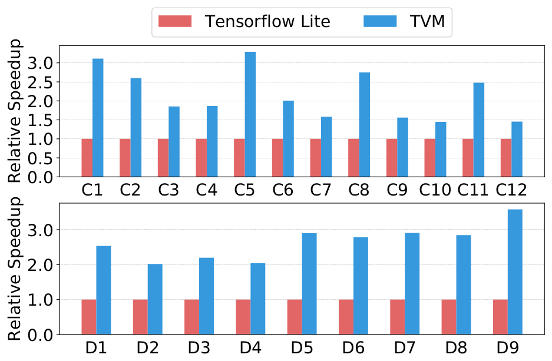

*图 17（原文 Figure 17，第 11 页）：ResNet-18 的全部 conv2d 算子与 MobileNet 的全部 depthwise conv2d 算子的相对加速比，在 ARM A53 上测试，算子配置见表 2。*

**图中文字翻译与读法**：纵轴为相对加速比，红柱 Tensorflow Lite（归一化为 1.0）、蓝柱 TVM。上面板 C1 至 C12，下面板 D1 至 D9。近似值（±0.02）：

| 层 | C1 | C2 | C3 | C4 | C5 | C6 | C7 | C8 | C9 | C10 | C11 | C12 |
|---|---:|---:|---:|---:|---:|---:|---:|---:|---:|---:|---:|---:|
| TVM 相对 TFLite | 3.14 | 2.63 | 1.87 | 1.88 | 3.32 | 2.02 | 1.60 | 2.78 | 1.57 | 1.46 | 2.49 | 1.46 |

| 层 | D1 | D2 | D3 | D4 | D5 | D6 | D7 | D8 | D9 |
|---|---:|---:|---:|---:|---:|---:|---:|---:|---:|
| TVM 相对 TFLite | 2.56 | 2.03 | 2.21 | 2.06 | 2.93 | 2.81 | 2.93 | 2.87 | 3.62 |

**读图结论**：在全部 21 个算子上 TVM 都快于手工优化的 TFLite（conv2d 约 1.5× 到 3.3×，depthwise 约 2.0× 到 3.6×）。论文称这也展示了 TVM 快速优化新兴张量算子（如 depthwise 卷积）的能力。

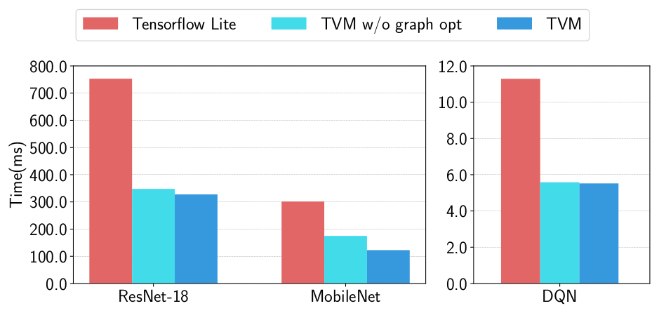

*图 16（原文 Figure 16，第 11 页）：TVM 与 TFLite 在 ARM A53 上的端到端评测。*

**图中文字翻译与读法**：纵轴 Time (ms)（越小越好）；左面板为 ResNet-18 与 MobileNet，右面板为 DQN（量程不同）。三根柱依次为 Tensorflow Lite（红）、TVM w/o graph opt（青）、TVM（蓝）。近似值（ms）：

| 负载 | TFLite | TVM 无图优化 | TVM |
|---|---:|---:|---:|
| ResNet-18 | 约 751 | 约 346 | 约 326 |
| MobileNet | 约 299 | 约 173 | 约 121 |
| DQN | 约 11.3 | 约 5.6 | 约 5.5 |

**读图结论**：TVM 在三个负载上都超过 TFLite（约 2.3×、2.5×、2.1×，笔者由读数计算）。图优化在这里的贡献因负载而异：MobileNet 约 1.4×，ResNet-18 约 1.1×，DQN 只有约 1.0×。原文脚注：DCGAN 和 LSTM 的结果没有给出，因为基线尚不支持。

**超低精度算子。** 论文展示了 TVM 支持超低精度推理的能力，为小于 8 位的定点数据类型生成高度优化的算子。低精度网络用向量化的 **bit-serial 乘法**（由按位与和 popcount 归约组成）取代昂贵的乘法；要高效地做低精度推理，需要把量化后的数据类型打包进更宽的标准数据类型（如 int8 或 int32）。论文生成的代码优于 Caffe2（commit 39e07f7）里手工优化的库。作者实现了一个面向 ARM 的 tensorization intrinsic，利用 ARM 指令构建高效的低精度矩阵-向量微内核，再用 TVM 的自动优化器探索 schedule 空间。

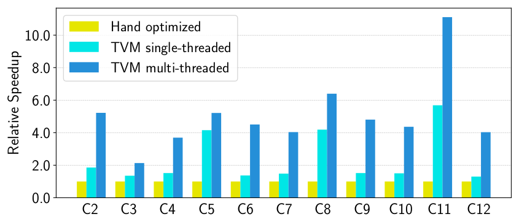

*图 18（原文 Figure 18，第 12 页）：ResNet 中低精度 conv2d 算子的单线程与多线程相对加速比。基线是 Caffe2（commit 39e07f7）里单线程、手工优化的实现。C5、C3 是 1×1 卷积，计算强度较低，多线程带来的加速较小。*

**图中文字翻译与读法**：设置为 2 位激活、1 位权重的推理。横轴为 C2 至 C12，纵轴 Relative Speedup；黄柱 Hand optimized（手工优化的基线，1.0）、青柱 TVM single-threaded（TVM 单线程）、蓝柱 TVM multi-threaded（TVM 多线程）。近似值（±0.05；C2 的多线程柱靠近图例，按柱高目测约 5.2）：

| 层 | C2 | C3 | C4 | C5 | C6 | C7 | C8 | C9 | C10 | C11 | C12 |
|---|---:|---:|---:|---:|---:|---:|---:|---:|---:|---:|---:|
| TVM 单线程 | 1.87 | 1.35 | 1.52 | 4.21 | 1.37 | 1.48 | 4.26 | 1.52 | 1.50 | 5.78 | 1.31 |
| TVM 多线程 | 5.2 | 2.15 | 3.76 | 5.30 | 4.58 | 4.10 | 6.51 | 4.87 | 4.43 | 11.32 | 4.08 |

**读图结论**：由于基线是单线程的，论文也与单线程 TVM 对比。单线程 TVM 优于基线，**尤其在 C5、C8、C11 三层**，它们是 1×1 卷积、步长 2，超低精度基线库没有对其做优化；论文还利用 TVM 的其他能力生成并行库实现，比基线又有提升。除 2 位加 1 位的配置外，TVM 还能为基线库不支持的其他精度配置生成并优化代码，灵活性更好。

### 7.3 嵌入式 GPU（原文 6.3）

移动 GPU 实验在一块 Firefly-RK3399 板上运行端到端流水线，板上有 ARM Mali-T860MP4 GPU。基线是厂商提供的库 ARM Compute Library（v18.03）。

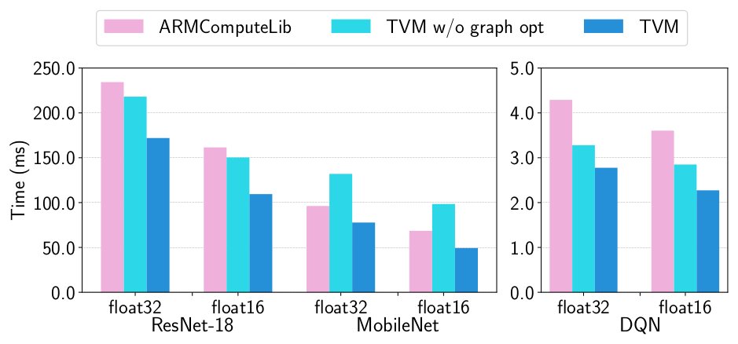

*图 19（原文 Figure 19，第 12 页）：Mali-T860MP4 上的端到端实验结果，评测了 float32 与 float16 两种数据类型。*

**图中文字翻译与读法**：纵轴 Time (ms)（越小越好）；左面板为 ResNet-18 与 MobileNet 各自的 float32 和 float16，右面板为 DQN 的 float32 和 float16。三根柱依次为 ARMComputeLib（粉）、TVM w/o graph opt（青）、TVM（蓝）。近似值（ms）：

| 负载与精度 | ARM Compute Library | TVM 无图优化 | TVM |
|---|---:|---:|---:|
| ResNet-18 float32 | 约 233 | 约 217 | 约 171 |
| ResNet-18 float16 | 约 161 | 约 149 | 约 109 |
| MobileNet float32 | 约 96 | 约 132 | 约 77 |
| MobileNet float16 | 约 68 | 约 98 | 约 49 |
| DQN float32 | 约 4.3 | 约 3.3 | 约 2.8 |
| DQN float16 | 约 3.6 | 约 2.8 | 约 2.3 |

**读图结论**：在三个可用的模型上，两种数据类型下 TVM 都超过基线，**加速比 1.2× 到 1.6×**（原文数字；读数计算分别约为 1.25 至 1.59）。（DCGAN 与 LSTM 在这里没有结果，因为基线尚不支持。）一个值得注意的现象：MobileNet 上**去掉图优化的 TVM 比厂商库还慢**（约 132 对 96 ms；约 98 对 68 ms），加上图优化后才反超，说明对 MobileNet 这类含大量小算子的网络，图层融合是胜负关键（这是读图观察，原文没有评论）。

### 7.4 FPGA 加速器（原文 6.4）

**Vanilla Deep Learning Accelerator（VDLA，“朴素深度学习加速器”）。** 论文接着讲 TVM 如何在一个自己在 FPGA 上原型化的通用推理加速器设计上完成加速器专用代码生成。VDLA 把此前几个加速器方案（论文引用 Eyeriss、TPU、PuDianNao 等）的特点提炼成一个极简的硬件架构，用来证明 TVM 能生成面向专用加速器的高效 schedule。

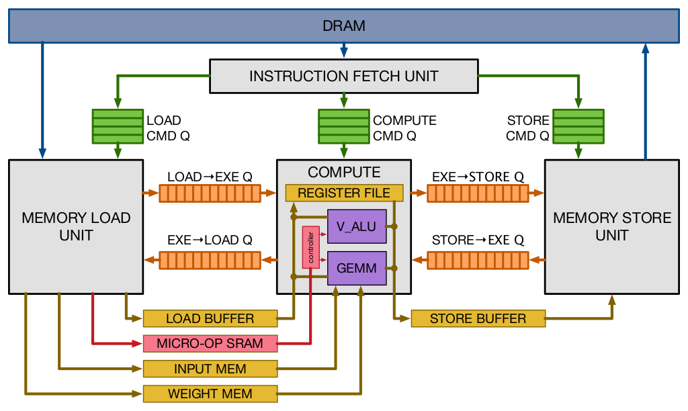

*图 20（原文 Figure 20，第 13 页）：VDLA 的硬件设计概览。*

**图中文字翻译与读法**：

- **顶部 DRAM（外部内存）**：与 Memory Load Unit（访存装载单元）和 Memory Store Unit（访存存储单元）之间有数据通路。
- **INSTRUCTION FETCH UNIT（取指单元）**：把指令分发到三条命令队列：LOAD CMD Q（装载命令队列）、COMPUTE CMD Q（计算命令队列）、STORE CMD Q（存储命令队列），分别交给装载、计算、存储三个模块。
- **COMPUTE（计算模块）**：内含 REGISTER FILE（寄存器堆）、V_ALU（向量 ALU）、GEMM（矩阵乘单元）和 controller（控制器）。
- **模块之间的四条依赖令牌队列**：LOAD→EXE Q、EXE→LOAD Q、EXE→STORE Q、STORE→EXE Q。按图读，它们应是第 5.6 节里 `push_dep_to` 与 `pop_dep_from` 所操作的依赖令牌的硬件载体：各模块独立执行，靠令牌队列保证先后依赖（原文正文没有逐句点明这一点）。
- **片上存储**：LOAD BUFFER（装载缓冲）、MICRO-OP SRAM（微操作 SRAM，对应正文所说的微码缓冲）、INPUT MEM（输入存储）、WEIGHT MEM（权重存储）、STORE BUFFER（存储缓冲）。
- **读图结论**：VDLA 是典型的 DAE 设计：取指后分成装载/计算/存储三个独立执行的模块，用显式的令牌队列同步；TVM 的虚拟线程降低生成的就是这些模块上的指令流。

**VDLA 的功能。** VDLA 被编程为一个张量处理器，高效执行计算强度高的运算（如矩阵乘、高维卷积）。它能执行装载/存储操作，把分块的三维张量从 DRAM 搬进 SRAM 中一段连续区域；还提供专用的片上存储，分别存放网络参数、层输入（窄数据类型）和层输出（宽数据类型）。最后，VDLA 对连续的装载、计算、存储提供显式的同步控制，以最大化内存与计算操作的重叠。

**实现与方法。** 论文把 VDLA 设计实现在一块低功耗的 PYNQ 板上，板上有双核 ARM Cortex A9（667 MHz）和基于 Artix-7 的 FPGA。在这些有限的 FPGA 资源上，论文实现了一个 16×16 的矩阵向量单元，时钟 200 MHz，每周期做 8 位值的乘积并累加到 32 位寄存器，理论峰值吞吐约 **102.4 GOPS/s**。资源分配：激活存储 32 kB、参数存储 32 kB、微码缓冲 32 kB、寄存器堆 128 kB。这些片上缓冲区远不足以容纳 ResNet 的单层，因此正好用来研究有效的内存复用和延迟隐藏。作者还为 VDLA 构建了一个带 C 运行时 API 的驱动库，用来构造指令并推给目标加速器执行；TVM 的代码生成算法把加速器程序翻译成一系列对运行时 API 的调用。添加这个专用加速器后端用了约 **2000 行 Python**。

**端到端 ResNet 评测。** 论文用 TVM 在 PYNQ 平台上生成 ResNet 推理 kernel，并把尽可能多的层卸载到 VDLA；同时生成纯 CPU 和 CPU+FPGA 两种实现。由于卷积深度较浅，ResNet 的第一个卷积层无法在 FPGA 上高效卸载，只能在 CPU 上算；ResNet 其余所有卷积层都适合高效卸载；残差层、激活等运算也在 CPU 上做，因为 VDLA 不支持。

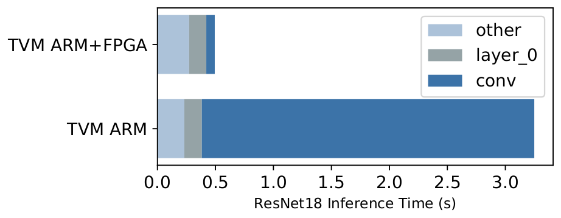

*图 21（原文 Figure 21，第 13 页）：把 ResNet 负载中的卷积卸载到基于 FPGA 的加速器。灰色柱对应无法被 FPGA 加速、只能在 CPU 上跑的层。对被卸载的卷积层，FPGA 相对 Cortex A9 提供了 40× 的加速。*

**图中文字翻译与读法**：横轴 ResNet18 Inference Time (s)（ResNet-18 推理时间，秒），上柱 TVM ARM+FPGA，下柱 TVM ARM。堆叠颜色：other（其他层，如残差、激活，在 CPU 上算，浅蓝灰）、layer_0（第一个卷积层，只能在 CPU 上算，灰）、conv（其余卷积层，深蓝）。近似值（秒）：

| 配置 | other | layer_0 | conv | 合计 |
|---|---:|---:|---:|---:|
| TVM ARM（纯 CPU） | 约 0.23 | 约 0.15 | 约 2.87 | 约 3.25 |
| TVM ARM+FPGA | 约 0.27 | 约 0.15 | 约 0.07 | 约 0.50 |

**读图结论**：被卸载的卷积层时间由约 2.87 s 降到约 0.07 s，约 **40×**（正文给出的数字）。但整体只快约 6.5×（笔者由读数计算，原文没给）：**Amdahl 定律**——第一层卷积、残差层、激活等必须在 CPU 上做的部分成了瓶颈。作者设想扩展 VDLA 以支持这些其他算子，进一步降低成本。这个 FPGA 实验展示了 TVM 适应新架构及其暴露的硬件 intrinsic 的能力。

## 八、相关工作（原文第 7 节）

- **深度学习框架**（论文引用 TensorFlow、MXNet 等）提供便利的接口表达与部署负载，但现在依赖厂商专属的张量算子库；它们可以借助 TVM 的栈为更多硬件设备生成优化代码。
- **高层计算图 DSL** 是表示并做高层优化的典型方式：TensorFlow 的 XLA 和较新的 DLVM 属于这一类，计算图表示相似，本文也用了一个高层计算图 DSL。图层表示适合高层优化，但对于在多样硬件后端上优化张量算子又太高层。已有工作依靠特定的降低规则直接生成低层 LLVM，或者求助于厂商库，需要为每个硬件后端和算子变体付出大量工程投入。
- **Halide** 提出了“计算与调度分离”；TVM 采纳其见解并复用它既有的有用调度原语。张量算子调度还与 GPU DSL（Futhark、Lift、Loo.py、OptiML）和基于多面体的循环变换（Pencil、Polyhedral parallel code generation）有关；TACO 提出了在 CPU 上生成稀疏张量算子的通用方式；Weld 是数据处理任务的 DSL。TVM 专注于解决深度学习负载在 GPU 与专用加速器上的新调度挑战，新原语可能被这些工作的优化流水线采用。
- **自动调优**：ATLAS 和 FFTW 等高性能库用自动调优取得最佳性能；Tensor Comprehensions 把黑盒自动调优与多面体优化结合来优化 CUDA kernel；OpenTuner 与已有的超参数调优算法应用与领域无关的搜索；Halide 里用预定义成本模型自动调度图像处理流水线。TVM 的 ML 模型使用考虑程序结构的、有效的领域感知成本建模，分布式 schedule 优化器可扩展到更大的搜索空间，并在大量支持的后端上找到最先进的 kernel；更重要的是，TVM 提供了端到端的栈，能直接接收深度学习框架的描述并与图层栈联合优化。
- **加速器**：尽管深度学习加速器越来越流行，仍不清楚怎样建立能有效面向这些设备的编译栈。VDLA 为总结类 TPU 加速器的特性提供了一种通用方式，使“如何为加速器编译代码”有了具体的案例；这种方法也可能使已有的“深度学习编译到 FPGA”的系统受益。论文通过 tensorization 与编译器驱动的延迟隐藏，给出了有效面向加速器的通用方案。

论文的结论：提出了一个端到端的编译栈，解决跨多样硬件后端的深度学习的基本优化挑战；系统包含自动化的端到端优化，而这历来是劳动密集型、高度专业化的工作；希望这项工作鼓励更多对端到端编译方法的研究，并为深度学习的软硬件协同设计开辟新机会。

## 九、局限、证据边界与时效性

- **基线是 2018 年的版本**：TensorFlow 1.7、MXNet 1.1、cuDNN 7、cuBLAS 8、XLA、TFLite 与 ARM Compute Library 的特定 commit/版本、Titan X。其后的 cuDNN、TensorRT、编译器和 GPU 架构变化很大，不能把“快 1.6× 到 3.8×”当作对今天库的结论。
- **只评测推理**，没有训练；原文没有写评测所用的 batch size，也没有说明计时方法（预热、重复次数等），读者无法据此复现测量方式。
- **调优预算只在个别地方给出**：图 12 是一个算子上的 800 次试验；TC 基线每个算子 2000 次试验。端到端各负载实际花了多少次试验、多长调优时间，原文没有给，因此“自动搜索的成本”没法与手写库的人力成本做完整对比。
- **假定形状已知**：论文利用深度学习负载 shape 固定的特点，为一组固定的输入 shape 做专门化优化；动态 shape、新算子带来的搜索空间扩大，不在这篇论文的范围内。
- **单算子最优不等于端到端最优**：图 14、16、19 里“TVM 无图优化”与“TVM”的差距说明，图层融合与算子层搜索缺一不可；而 FPGA 实验（图 21）显示，被加速的部分之外的 CPU 部分会按 Amdahl 定律成为瓶颈。
- **部分对比不完整**：DCGAN 和 LSTM 在 ARM 与 Mali 上因基线不支持而没有结果；TC 的作者说明 TC 不是为计算受限问题设计的。
- **读图近似**：本文的柱高读数是矢量图量取、按基线柱归一化后的近似值，不应被当作原文数据引用；需要引用时请用原文正文给出的数字（1.2× 到 3.8×、1.6× 到 3.8×、1.2× 到 1.6×、40×、70% 到 88%、1.5×、1.2× 到 2×、0.67 ms、约 5 万行 C++、约 2000 行 Python）。
- **与今天的 TVM 的距离**：（补充）原文 2018 年的接口（`tvm.compiler.build`、`t.compute` 等写法）与今天的 TVM 差别很大，后续演进出 Relay、TensorIR、MetaSchedule 和 Relax。请不要把本文的代码当作可直接运行的现行 API。

## 十、复现检查

- 保存每个算子的张量表达式、使用的 schedule 模板、测量数据库和目标平台描述；比较结果时，要同时记录调优预算（试验次数、时长）。
- 调优用的 runner 要隔离热身、频率调节（DVFS）、并发负载和计时噪声；嵌入式设备尤其要注意散热降频。
- 图融合之后要检查数值误差和内存峰值，不要只看速度。
- 比较基线时记录库的版本（cuDNN、cuBLAS、TFLite、ARM Compute Library 等）与硬件型号。
- 不要把 2018 年的 TE/自动调优接口与今天的 TensorIR、MetaSchedule 接口混写。

## 十一、常见误读

- **“TVM 就是一个自动搜索算法”**：TVM 是 IR、schedule 原语、代码生成、运行时和调优的整套栈；学习型成本模型只是其中让搜索可行的一个部件。
- **“学习到的成本模型代替了真机测量”**：不是。成本模型只做候选排序（rank 目标），最终仍要在真实设备上测量并用新数据更新模型。
- **“自动调优就不再需要专家”**：搜索空间与硬件规则（模板、可调旋钮、tensor intrinsic 的声明与降低规则）仍需要专家设计。
- **“图层优化与算子层优化是二选一”**：图 14、16、19 里“TVM 无图优化”的结果说明二者互补；MobileNet 在 Mali 上不开图优化甚至比厂商库慢。
- **“1.2× 到 3.8× 是某个单一设置的结果”**：它覆盖不同平台、不同基线和不同负载；3.8× 来自 DQN 这种 cuDNN 优化不好的非常规算子，1.2× 来自 Mali 上的对比。
- **“单个算子超过库，整个模型就同比例加速”**：不成立，图 21 的 Amdahl 定律例子说明了这一点。

## 十二、与本仓库其他论文的关系

- 同期的端到端编译器路线：[XLA / OpenXLA](../xla_compiler/论文中文解读.md)（图层 IR 与 fusion、多后端）和 [Glow](../glow_compiler/论文中文解读.md)（高低两级 IR 与显式 buffer）；论文也在图 14 里把 XLA 作为基线之一。
- 同期的 TC 基线：[Tensor Comprehensions](../tensor_comprehensions/论文中文解读.md)，数学 DSL 加多面体降低与自动调优。
- 后续对搜索与 schedule 表达的改造：[Ansor](../ansor/论文中文解读.md)（自动构造 schedule sketch）、[MetaSchedule](../metaschedule/论文中文解读.md)（可组合的概率程序）、[TensorIR](../tensorir/论文中文解读.md)（block 与 read-write region 连接循环调度和 tensor intrinsic）。
- 对 schedule 的另一种思路：[Roller](../roller/论文中文解读.md) 用硬件约束构造 tile，减少黑盒测量；[MLIR](../mlir/论文中文解读.md) 提供了多级 IR 的通用基础设施。

## 原文证据导航

- [原论文 PDF](paper.pdf)
- [原文提取文本](paper.txt)
- [论文概要](论文概要.md)
