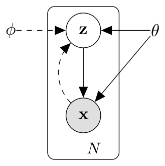
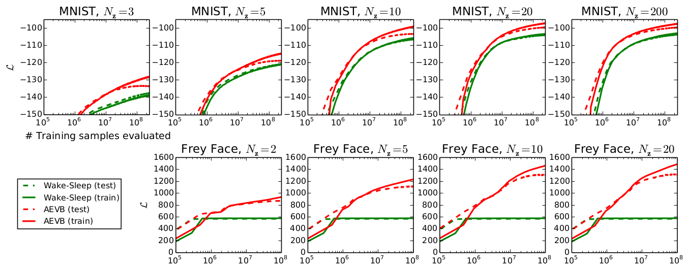
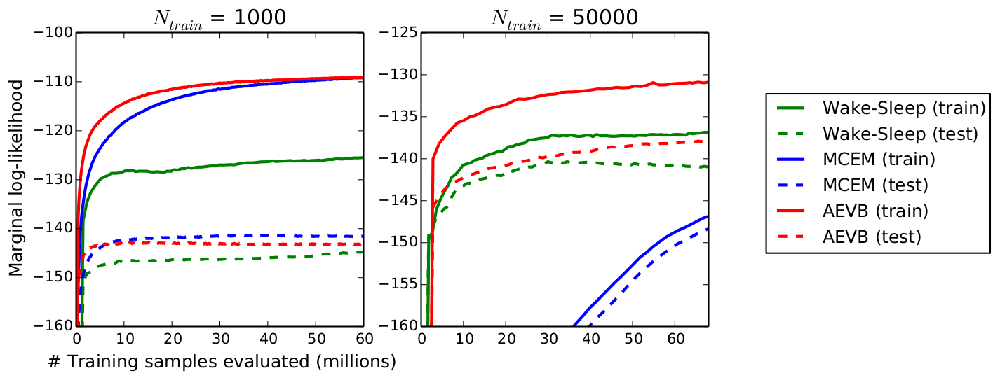
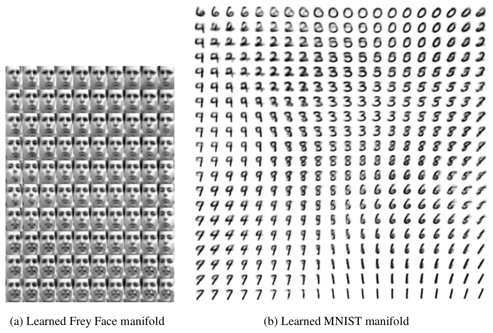
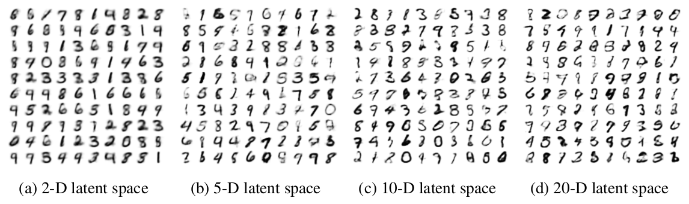

# 论文中文解读：《Auto-Encoding Variational Bayes》

> **基本信息**：Diederik P. Kingma、Max Welling（Universiteit van Amsterdam，Machine Learning Group），arXiv:1312.6114（2013 年 12 月首次提交，一般引用为 ICLR 2014；本地 PDF 为 2022 年 12 月的 v11，未标会议名）；论文原文 [官方页面](https://arxiv.org/abs/1312.6114)。
>
> **本文的读法**：本文按“问题设定 → 变分下界 → 重参数化与 SGVB 估计器 → AEVB 算法 → VAE 实例 → 实验 → 附录”的顺序，把原文的公式推导、算法和实验逐项讲清楚。图均取自论文原文（从 PDF 按图裁出），每张图后有中文图题、坐标轴和图例翻译与读图结论。原文**没有数据表格**，所以本文没有表格转录；文中少量表格是为了归纳原文内容而整理的，已注明。原文公式编号（1）–（24）在本文中沿用。

## 一、一句话结论

当生成模型含有连续隐变量 $z$，而边缘似然 $p_\theta(x)$ 与真实后验 $p_\theta(z\mid x)$ 都算不出来、数据集又很大时，怎样高效地做近似推断和参数学习？论文给出两个贡献：

1. 把变分下界中对 $q_\phi(z\mid x)$ 的期望，用**重参数化**（reparameterization）写成对“与参数无关的噪声 $\epsilon$”的期望，得到一个可以直接用标准随机梯度方法优化的下界估计器，称为 SGVB（Stochastic Gradient Variational Bayes）。
2. 对“每个数据点有一个连续隐变量”的 i.i.d. 数据集，用一个所有数据点共享参数的识别模型（recognition model，即编码器）$q_\phi(z\mid x)$ 去近似难解的后验，并和生成模型（解码器）$p_\theta(x\mid z)$ 一起用 SGVB 联合训练，称为 AEVB（Auto-Encoding VB）算法。识别模型取神经网络时，就是变分自编码器（VAE）。

实验在 MNIST 和 Frey Face 上进行：AEVB 在变分下界上比 wake-sleep 收敛更快、结果更好；在 3 维隐空间的边缘似然实验里，收敛速度也优于 Monte Carlo EM（MCEM）。

## 二、背景与动机

### 2.1 问题设定（原文 2.1 节，第 2 页）

数据集 $X=\{x^{(i)}\}_{i=1}^{N}$ 由 $N$ 个 i.i.d. 样本组成，$x$ 可以是连续或离散变量。假设数据由如下两步随机过程产生，其中 $z$ 是看不见的连续随机变量：

1. 从先验分布 $p_{\theta^*}(z)$ 采样得到 $z^{(i)}$；
2. 从条件分布 $p_{\theta^*}(x\mid z)$ 采样得到 $x^{(i)}$。

先验和似然属于参数族 $p_\theta(z)$、$p_\theta(x\mid z)$，且它们的概率密度对 $\theta$ 和 $z$ 几乎处处可微。真实参数 $\theta^*$ 和每个样本的隐变量 $z^{(i)}$ 都是未知的。

本文用到的符号如下（整理自原文，非原文表格）：

| 符号 | 含义 |
|---|---|
| $x^{(i)}$、$N$ | 第 $i$ 个数据点、数据集大小 |
| $z$、$J$ | 隐变量（latent variable / code）、隐变量维度（图中记作 $N_z$） |
| $\theta$ | 生成模型（解码器）的参数 |
| $\phi$ | 识别模型（编码器，变分近似）的参数，称变分参数 |
| $p_\theta(z)$、$p_\theta(x\mid z)$ | 先验、似然（概率解码器） |
| $p_\theta(z\mid x)$ | 真实后验（难解） |
| $q_\phi(z\mid x)$ | 近似后验（概率编码器） |
| $\epsilon$、$p(\epsilon)$ | 与参数无关的辅助噪声及其分布 |
| $g_\phi(\epsilon,x)$ | 把噪声变成 $z$ 的可微变换 |
| $L$、$M$ | 每个数据点的噪声样本数、小批量大小 |

### 2.2 为什么难：两个困难

论文强调**不做**对边缘概率或后验的常见简化假设，要得到一个在下面两种情形都有效的通用算法：

1. **不可解（intractability）**。边缘似然 $p_\theta(x)=\int p_\theta(z)p_\theta(x\mid z)\,dz$ 的积分不可解，因此无法对它求值或求导；真实后验 $p_\theta(z\mid x)=p_\theta(x\mid z)p_\theta(z)/p_\theta(x)$ 也不可解，所以 EM 算法用不了；任何合理的 mean-field VB 算法所需的积分同样不可解。似然函数只要稍复杂（例如解码器是带非线性隐层的神经网络）就会出现这种情况。
2. **数据集很大**。批量优化太贵，希望用小批量甚至单个数据点做参数更新。基于采样的方法（例如 Monte Carlo EM）要对每个数据点跑一个昂贵的采样循环，通常太慢。

### 2.3 论文要解决的三个问题

1. 对参数 $\theta$ 做高效的近似 ML 或 MAP 估计。参数本身可能有科学意义，也可以用来模拟隐藏的随机过程、生成与真实数据相似的人工数据。
2. 在给定参数 $\theta$ 时，对观测值 $x$ 的隐变量 $z$ 做高效的近似后验推断，用于编码或数据表示任务。
3. 对变量 $x$ 做高效的近似边缘推断，从而完成所有需要 $x$ 的先验的推断任务，例如图像去噪、补全（inpainting）和超分辨率。

### 2.4 识别模型、概率编码器与概率解码器（图 1）

为了解决这些问题，论文引入**识别模型** $q_\phi(z\mid x)$ 作为难解真实后验 $p_\theta(z\mid x)$ 的近似。它与 mean-field 变分推断里的近似后验有两点不同：不一定对各维因子分解；其参数 $\phi$ 不是由某个闭式期望算出来的，而是**与生成模型参数 $\theta$ 联合学习**。

从编码理论的角度，隐变量 $z$ 就是数据的潜在表示或“码”（code）。给定数据点 $x$，$q_\phi(z\mid x)$ 输出一个关于 $z$ 的分布（例如高斯），所以称为**概率编码器**；给定码 $z$，$p_\theta(x\mid z)$ 输出一个关于 $x$ 的分布，所以称为**概率解码器**。



*图 1（原文 Figure 1，第 2 页）：本文考虑的有向图模型。实线是生成模型 $p_\theta(z)p_\theta(x\mid z)$，虚线是对难解后验 $p_\theta(z\mid x)$ 的变分近似 $q_\phi(z\mid x)$；变分参数 $\phi$ 与生成模型参数 $\theta$ 一起学习。*

**图中文字翻译与读法**：

- **节点**：空心圆 $\mathbf z$ 是隐变量（看不见）；灰色实心圆 $\mathbf x$ 是观测变量；外面的圆角方框右下角标 $N$，表示这个结构（每个数据点一个 $z$ 和一个 $x$）重复 $N$ 次，即 i.i.d. 的 $N$ 个数据点。
- **实线箭头**：$\theta$ 指向 $\mathbf z$（先验 $p_\theta(z)$）和 $\mathbf x$（似然 $p_\theta(x\mid z)$），$\mathbf z$ 指向 $\mathbf x$：这是生成过程，先采 $z$ 再采 $x$。
- **虚线箭头**：$\phi$ 指向 $\mathbf z$，并且有一条从 $\mathbf x$ 绕回 $\mathbf z$ 的弯曲虚线：这是识别模型，从 $x$ 反推 $z$ 的分布 $q_\phi(z\mid x)$。
- **读图结论**：生成方向（实线）和推断方向（虚线）使用不同的参数 $\theta$ 与 $\phi$，两者在同一个目标函数下一起优化。

## 三、方法

论文第 2 节的推导适用于一大类含连续隐变量的有向图模型。这里限定在最常见的情形：i.i.d. 数据集、每个数据点一个隐变量，对全局参数 $\theta$ 做 ML/MAP，对隐变量做变分推断。对全局参数也做变分推断的版本放在附录 F（本文第七节概述），论文没有做实验。方法也可用于在线、非平稳（如流数据）场景，但文中为简单起见假设数据集固定。

### 3.1 变分下界（原文 2.2 节，第 3 页）

边缘似然是各数据点边缘似然之和，$\log p_\theta(x^{(1)},\dots,x^{(N)})=\sum_{i=1}^N\log p_\theta(x^{(i)})$，每一项都可以改写为

$$
\log p_\theta(x^{(i)})=D_{\mathrm{KL}}\big(q_\phi(z\mid x^{(i)})\,\Vert\,p_\theta(z\mid x^{(i)})\big)+\mathcal L(\theta,\phi;x^{(i)}).\qquad\text{(1)}
$$

等号右边第一项是近似后验与真实后验之间的 KL 散度，非负，所以第二项 $\mathcal L(\theta,\phi;x^{(i)})$ 是数据点 $i$ 的对数边缘似然的（变分）**下界**：

$$
\log p_\theta(x^{(i)})\ \ge\ \mathcal L(\theta,\phi;x^{(i)})=\mathbb E_{q_\phi(z\mid x)}\big[-\log q_\phi(z\mid x)+\log p_\theta(x,z)\big].\qquad\text{(2)}
$$

它还可以写成

$$
\mathcal L(\theta,\phi;x^{(i)})=-D_{\mathrm{KL}}\big(q_\phi(z\mid x^{(i)})\,\Vert\,p_\theta(z)\big)+\mathbb E_{q_\phi(z\mid x^{(i)})}\big[\log p_\theta(x^{(i)}\mid z)\big].\qquad\text{(3)}
$$

**补充推导**（原文只给出结果）：因为 $\log p_\theta(x)$ 不依赖 $z$，所以对任意 $q_\phi(z\mid x)$ 有

$$
\log p_\theta(x)=\mathbb E_{q_\phi(z\mid x)}\!\left[\log\frac{p_\theta(x,z)}{p_\theta(z\mid x)}\right]
=\underbrace{\mathbb E_{q_\phi}\!\left[\log\frac{p_\theta(x,z)}{q_\phi(z\mid x)}\right]}_{\mathcal L}+\underbrace{\mathbb E_{q_\phi}\!\left[\log\frac{q_\phi(z\mid x)}{p_\theta(z\mid x)}\right]}_{D_{\mathrm{KL}}\ge 0}.
$$

这就是式（1）和（2）。再把 $\log p_\theta(x,z)=\log p_\theta(x\mid z)+\log p_\theta(z)$ 代入式（2），把 $\mathbb E_{q}[\log q-\log p_\theta(z)]$ 合并成 KL 散度，就得到式（3）。

**两种写法的含义**：

- 式（2）是“联合分布的对数 $-$ 近似后验的对数”的期望，可以直接做 Monte Carlo 估计（对应下文 SGVB 的估计器 A）。
- 式（3）把下界拆成两项。$\mathbb E_q[\log p_\theta(x\mid z)]$ 是“从编码分布采样 $z$ 后解码器给真实数据 $x$ 的对数概率”，在自编码器语言里是**负的重构误差**；$-D_{\mathrm{KL}}(q_\phi(z\mid x)\Vert p_\theta(z))$ 把编码分布拉向先验，起正则化作用。它是下界而不是似然本身，$\mathcal L$ 与 $\log p_\theta(x)$ 之间差的正是式（1）里的 KL 项。（该下界后来常被称为 ELBO，原文没有使用这个名字。）

**要同时对 $\phi$ 和 $\theta$ 求导，但对 $\phi$ 的梯度有麻烦。** 对这类问题的常规（朴素）Monte Carlo 梯度估计器是

$$
\nabla_\phi\,\mathbb E_{q_\phi(z)}[f(z)]=\mathbb E_{q_\phi(z)}\big[f(z)\,\nabla_\phi\log q_\phi(z)\big]\ \simeq\ \frac1L\sum_{l=1}^{L}f(z^{(l)})\,\nabla_\phi\log q_\phi(z^{(l)}),\qquad z^{(l)}\sim q_\phi(z\mid x^{(i)}).
$$

（原文把梯度记作 $\nabla_{q_\phi(z)}$，含义即对 $\phi$ 求梯度。）这个估计器方差非常高（原文引用 Blei 等人 2012），不实用。直观上，它只用到“$f$ 的取值”乘以“分布的得分函数”，完全没有利用 $f$ 本身对 $z$ 的导数；下面的重参数化则恰好用上了这一点。

### 3.2 SGVB 估计器（原文 2.3 节，第 3–4 页）

在后文 2.4 节说明的温和条件下，对选定的近似后验 $q_\phi(z\mid x)$，可以用一个**可微变换**把随机变量 $\tilde z\sim q_\phi(z\mid x)$ 重参数化成辅助噪声 $\epsilon$ 的函数：

$$
\tilde z=g_\phi(\epsilon,x),\qquad \epsilon\sim p(\epsilon).\qquad\text{(4)}
$$

于是任意函数 $f(z)$ 关于 $q_\phi(z\mid x^{(i)})$ 的期望可以用 Monte Carlo 估计：

$$
\mathbb E_{q_\phi(z\mid x^{(i)})}[f(z)]=\mathbb E_{p(\epsilon)}\big[f(g_\phi(\epsilon,x^{(i)}))\big]\ \simeq\ \frac1L\sum_{l=1}^{L}f\big(g_\phi(\epsilon^{(l)},x^{(i)})\big),\qquad \epsilon^{(l)}\sim p(\epsilon).\qquad\text{(5)}
$$

把这个技巧用到式（2），得到**通用 SGVB 估计器**（原文记作 $\tilde{\mathcal L}^A$）：

$$
\tilde{\mathcal L}^{A}(\theta,\phi;x^{(i)})=\frac1L\sum_{l=1}^{L}\Big[\log p_\theta\big(x^{(i)},z^{(i,l)}\big)-\log q_\phi\big(z^{(i,l)}\mid x^{(i)}\big)\Big],\qquad z^{(i,l)}=g_\phi\big(\epsilon^{(i,l)},x^{(i)}\big),\ \ \epsilon^{(l)}\sim p(\epsilon).\qquad\text{(6)}
$$

这个技巧也可以用于不依赖 $x$ 的 $q_\phi(z)$。

**估计器 B：KL 项解析计算。** 式（3）里的 $D_{\mathrm{KL}}(q_\phi(z\mid x^{(i)})\Vert p_\theta(z))$ 常常可以解析积分（见本文 4.2 节和原文附录 B），这时只有“期望重构误差”需要靠采样估计。KL 项可以理解为对 $\phi$ 的正则化，鼓励近似后验接近先验 $p_\theta(z)$。由此得到第二个版本的估计器（对应式（3）），它通常比通用估计器方差更小：

$$
\tilde{\mathcal L}^{B}(\theta,\phi;x^{(i)})=-D_{\mathrm{KL}}\big(q_\phi(z\mid x^{(i)})\,\Vert\,p_\theta(z)\big)+\frac1L\sum_{l=1}^{L}\log p_\theta\big(x^{(i)}\mid z^{(i,l)}\big).\qquad\text{(7)}
$$

**小批量估计器。** 数据集有 $N$ 个点时，从中随机抽 $M$ 个点组成小批量 $X^M=\{x^{(i)}\}_{i=1}^M$，整个数据集下界的估计为

$$
\mathcal L(\theta,\phi;X)\ \simeq\ \tilde{\mathcal L}^{M}(\theta,\phi;X^M)=\frac NM\sum_{i=1}^{M}\tilde{\mathcal L}(\theta,\phi;x^{(i)}).\qquad\text{(8)}
$$

系数 $N/M$ 使它成为整个数据集“求和”形式下界的无偏估计。实验中作者发现，只要小批量够大（例如 $M=100$），每个数据点的采样数 $L$ 取 1 就够了。对 $\tilde{\mathcal L}^M$ 求关于 $\theta,\phi$ 的导数，就可以配合 SGD 或 Adagrad 等随机优化方法使用。

### 3.3 重参数化技巧（原文 2.4 节，第 4–5 页）

**一般形式。** 令 $z$ 是连续随机变量，$z\sim q_\phi(z\mid x)$。常常可以把它写成确定性函数 $z=g_\phi(\epsilon,x)$，其中 $\epsilon$ 是边缘分布 $p(\epsilon)$ 与 $\phi$ 无关的辅助变量，$g_\phi(\cdot)$ 是以 $\phi$ 为参数的向量值函数。

**为什么有用**：它把关于 $q_\phi(z\mid x)$ 的期望改写成关于 $p(\epsilon)$ 的期望，使 Monte Carlo 估计对 $\phi$ 可微。证明很短：由确定性映射 $z=g_\phi(\epsilon,x)$ 知 $q_\phi(z\mid x)\prod_i dz_i=p(\epsilon)\prod_i d\epsilon_i$，因此

$$
\int q_\phi(z\mid x)f(z)\,dz=\int p(\epsilon)f(z)\,d\epsilon=\int p(\epsilon)f\big(g_\phi(\epsilon,x)\big)\,d\epsilon\ \simeq\ \frac1L\sum_{l=1}^{L}f\big(g_\phi(x,\epsilon^{(l)})\big),\qquad \epsilon^{(l)}\sim p(\epsilon).
$$

随机性全部来自与 $\phi$ 无关的 $\epsilon$，参数 $\phi$ 只出现在确定性函数 $g_\phi$ 中，所以梯度可以直接穿过 $g_\phi$ 反向传播。

**一元高斯例子**：令 $z\sim\mathcal N(\mu,\sigma^2)$，一个合法的重参数化是 $z=\mu+\sigma\epsilon$，其中 $\epsilon\sim\mathcal N(0,1)$。于是

$$
\mathbb E_{\mathcal N(z;\mu,\sigma^2)}[f(z)]=\mathbb E_{\mathcal N(\epsilon;0,1)}\big[f(\mu+\sigma\epsilon)\big]\ \simeq\ \frac1L\sum_{l=1}^{L}f\big(\mu+\sigma\epsilon^{(l)}\big),\qquad \epsilon^{(l)}\sim\mathcal N(0,1).
$$

对于哪些 $q_\phi(z\mid x)$ 能找到可微变换 $g_\phi$ 和辅助变量 $\epsilon$，论文给出三种基本办法（整理自原文）：

| 方法 | 做法 | 原文举例的分布 |
|---|---|---|
| 1. 可解析求逆的 CDF（tractable inverse CDF） | 令 $\epsilon\sim\mathcal U(0,I)$，$g_\phi(\epsilon,x)$ 取 $q_\phi(z\mid x)$ 的逆累积分布函数 | Exponential、Cauchy、Logistic、Rayleigh、Pareto、Weibull、Reciprocal、Gompertz、Gumbel、Erlang |
| 2. 位置-尺度族 | 取标准分布（位置 0、尺度 1）作为 $\epsilon$，令 $g(\cdot)=\text{location}+\text{scale}\cdot\epsilon$ | Laplace、Elliptical、Student's t、Logistic、Uniform、Triangular、Gaussian |
| 3. 组合 | 把随机变量表示成若干辅助变量的不同变换 | Log-Normal（正态变量取指数）、Gamma（指数分布变量之和）、Dirichlet（Gamma 变量的加权和）、Beta、Chi-Squared、F |

三种办法都不行时，通常还存在计算复杂度与 PDF 相当的逆 CDF 近似方法（原文引用 Devroye 1986）。注意这里要求 $z$ 是**连续**变量，离散隐变量不能直接使用这个技巧。

### 3.4 AEVB 算法（原文 Algorithm 1，第 4 页）

**Algorithm 1：自编码变分贝叶斯（AEVB）算法的小批量版本**（译自原文；两种 SGVB 估计器任选其一，实验中取 $M=100$、$L=1$）

```text
θ, φ ← 初始化参数
repeat
    X^M ← 从完整数据集中随机抽取 M 个数据点（小批量）
    ε   ← 从噪声分布 p(ε) 中随机采样
    g   ← ∇_{θ,φ} L̃^M(θ, φ; X^M, ε)      （小批量估计器 (8) 的梯度）
    θ, φ ← 用梯度 g 更新参数（例如 SGD 或 Adagrad）
until 参数 (θ, φ) 收敛
return θ, φ
```

**逐行解释**：

1. 编码器参数 $\phi$ 与解码器参数 $\theta$ 一起初始化，之后用**同一个**随机梯度联合更新，不存在“先推断再学习”的两阶段交替。
2. 每一步抽一个小批量，并为其中每个数据点抽噪声 $\epsilon$（$L=1$ 时每个数据点抽一个）。噪声的分布 $p(\epsilon)$ 与参数无关。
3. 梯度来自小批量估计器（8），由于 $z=g_\phi(\epsilon,x)$ 可微，梯度既能到达解码器参数 $\theta$，也能穿过采样节点到达编码器参数 $\phi$。
4. 与每个数据点单独跑 MCMC 或变分迭代相比，每个数据点只需一次编码器前向传播（得到后验的参数）加一次采样，所以只用简单的 ancestral sampling 就能完成近似后验推断。训练好的识别模型还可用于识别、去噪、表示学习和可视化。

### 3.5 与自编码器的联系

看式（7）：第一项是近似后验与先验之间的 KL 散度，起正则化作用；第二项是期望的负重构误差。函数 $g_\phi(\cdot)$ 把数据点 $x^{(i)}$ 和随机噪声 $\epsilon^{(l)}$ 映射成该数据点近似后验的一个样本 $z^{(i,l)}=g_\phi(\epsilon^{(l)},x^{(i)})$，其中 $z^{(i,l)}\sim q_\phi(z\mid x^{(i)})$；随后这个样本被送入 $\log p_\theta(x^{(i)}\mid z^{(i,l)})$，其值等于生成模型在给定 $z^{(i,l)}$ 时数据点 $x^{(i)}$ 的概率密度（或概率质量），在自编码器的语言里就是负重构误差。

所以这个目标函数与普通自编码器的区别有两点：编码器输出的是**分布**而不是确定性的码，采样时带噪声；KL 项由变分下界推出，不是人为加上的正则化项。

## 四、VAE 实例（原文第 3 节与附录 B、C）

这一节给出一个具体模型，用神经网络做概率编码器 $q_\phi(z\mid x)$，参数 $\phi$ 与 $\theta$ 用 AEVB 联合优化。

### 4.1 模型设定

- **先验**：隐变量先验取中心化的各向同性多元高斯 $p_\theta(z)=\mathcal N(z;0,I)$，此时先验没有参数。
- **似然**：$p_\theta(x\mid z)$ 是多元高斯（实值数据）或 Bernoulli（二值数据），其分布参数由 $z$ 经 MLP（单隐层全连接网络，见附录 C）算出。此时真实后验 $p_\theta(z\mid x)$ 难解。
- **近似后验**：形式上有很大自由度，论文假设真实（难解）后验近似为对角协方差的高斯，于是取

$$
\log q_\phi(z\mid x^{(i)})=\log\mathcal N\big(z;\mu^{(i)},\sigma^{2(i)}I\big),\qquad\text{(9)}
$$

其中均值 $\mu^{(i)}$ 和标准差 $\sigma^{(i)}$ 是编码 MLP 的输出，即 $x^{(i)}$ 和变分参数 $\phi$ 的非线性函数。（原文脚注 2：这只是简化选择，不是方法的限制。）

- **采样**：按 3.3 节，$z^{(i,l)}=g_\phi(x^{(i)},\epsilon^{(l)})=\mu^{(i)}+\sigma^{(i)}\odot\epsilon^{(l)}$，$\epsilon^{(l)}\sim\mathcal N(0,I)$，$\odot$ 表示逐元素乘积。
- 此时先验与近似后验都是高斯，可以使用估计器（7），其中 KL 项能不靠采样地算出并求导（附录 B）。

### 4.2 本模型下的下界估计器

对数据点 $x^{(i)}$，得到的估计器为

$$
\mathcal L(\theta,\phi;x^{(i)})\ \simeq\ \frac12\sum_{j=1}^{J}\Big(1+\log\big((\sigma_j^{(i)})^2\big)-(\mu_j^{(i)})^2-(\sigma_j^{(i)})^2\Big)+\frac1L\sum_{l=1}^{L}\log p_\theta\big(x^{(i)}\mid z^{(i,l)}\big),\qquad\text{(10)}
$$

其中 $z^{(i,l)}=\mu^{(i)}+\sigma^{(i)}\odot\epsilon^{(l)}$，$\epsilon^{(l)}\sim\mathcal N(0,I)$；解码项 $\log p_\theta(x^{(i)}\mid z^{(i,l)})$ 是 Bernoulli 或高斯 MLP，取决于数据类型。

**第一项就是 $-D_{\mathrm{KL}}(q_\phi(z\mid x^{(i)})\Vert\mathcal N(0,I))$，下面按附录 B 推导**（原文只给出结果，中间步骤为补充）。设 $\mu,\sigma$ 为数据点 $i$ 处的变分均值与标准差，$\mu_j,\sigma_j$ 是它们的第 $j$ 个分量。对 $q=\mathcal N(\mu,\sigma^2 I)$：

- 先验项：$\log\mathcal N(z;0,I)=-\frac J2\log(2\pi)-\frac12\sum_j z_j^2$，而 $\mathbb E_q[z_j^2]=\mu_j^2+\sigma_j^2$，所以 $\int q(z)\log p(z)\,dz=-\frac J2\log(2\pi)-\frac12\sum_{j=1}^J(\mu_j^2+\sigma_j^2)$。
- 熵项：$\log\mathcal N(z;\mu,\sigma^2 I)=-\frac J2\log(2\pi)-\frac12\sum_j\log\sigma_j^2-\frac12\sum_j\frac{(z_j-\mu_j)^2}{\sigma_j^2}$，而 $\mathbb E_q\big[(z_j-\mu_j)^2/\sigma_j^2\big]=1$，所以 $\int q(z)\log q(z)\,dz=-\frac J2\log(2\pi)-\frac12\sum_{j=1}^J(1+\log\sigma_j^2)$。
- 两式相减，常数项 $-\frac J2\log(2\pi)$ 抵消：

$$
-D_{\mathrm{KL}}\big(q_\phi(z)\,\Vert\,p_\theta(z)\big)=\int q(z)\big(\log p(z)-\log q(z)\big)\,dz=\frac12\sum_{j=1}^{J}\Big(1+\log\sigma_j^2-\mu_j^2-\sigma_j^2\Big).
$$

**读法**：当 $\mu_j=0$、$\sigma_j=1$ 时每一项为 $1+0-0-1=0$，KL 为 0；均值离 0 越远，或方差偏离 1 越多，KL 越大。训练时最小化的损失 $-\mathcal L$ 因此就是“重构负对数似然 + KL”，并不是随意拼接的两项，而是负变分下界的两个部分。

### 4.3 MLP 编码器与解码器（附录 C，第 11 页）

论文用的都是最简单的网络：单隐层、tanh 激活的 MLP。

**Bernoulli MLP 作解码器**（二值数据）：$p_\theta(x\mid z)$ 是多元 Bernoulli，各像素的概率由 $z$ 经单隐层全连接网络算出：

$$
\log p(x\mid z)=\sum_{i=1}^{D}\Big[x_i\log y_i+(1-x_i)\log(1-y_i)\Big],\qquad y=f_\sigma\big(W_2\tanh(W_1z+b_1)+b_2\big),\qquad\text{(11)}
$$

其中 $f_\sigma$ 是逐元素的 sigmoid，$\theta=\{W_1,W_2,b_1,b_2\}$，$D$ 为数据维度。这个对数概率就是（负的）二元交叉熵。

**高斯 MLP 作编码器或解码器**（对角协方差）：

$$
\log p(x\mid z)=\log\mathcal N\big(x;\mu,\sigma^2I\big),\qquad \mu=W_4h+b_4,\quad \log\sigma^2=W_5h+b_5,\quad h=\tanh(W_3z+b_3).\qquad\text{(12)}
$$

$\{W_3,W_4,W_5,b_3,b_4,b_5\}$ 是该 MLP 的权重和偏置；用作解码器时它们属于 $\theta$。用作编码器 $q_\phi(z\mid x)$ 时，$z$ 与 $x$ 互换（输入是 $x$，输出是 $z$ 的均值和对数方差），这些权重属于变分参数 $\phi$。输出 $\log\sigma^2$ 而不是 $\sigma$，使方差自动为正。

### 4.4 一个训练步骤的完整数据流

按 Algorithm 1 与式（10），MNIST 上的一步训练（编码器是高斯 MLP，解码器是 Bernoulli MLP）为：

1. 取小批量 $x$（$M=100$）。
2. 编码器：$h=\tanh(W_3x+b_3)$，$\mu=W_4h+b_4$，$\log\sigma^2=W_5h+b_5$。
3. 采噪声 $\epsilon\sim\mathcal N(0,I)$（$L=1$），$z=\mu+\sigma\odot\epsilon$。
4. 解码器：$y=f_\sigma(W_2\tanh(W_1z+b_1)+b_2)$，重构项 $\sum_i x_i\log y_i+(1-x_i)\log(1-y_i)$。
5. KL 项 $-\frac12\sum_j(1+\log\sigma_j^2-\mu_j^2-\sigma_j^2)$，两项合成（负的）下界，按式（8）乘 $N/M$ 并求和。
6. 对 $\theta,\phi$ 一起反向传播，用 Adagrad 更新（并带一个小的权重衰减项，见 6.1 节）。

## 五、相关工作（原文第 4 节，第 6 页）

- **wake-sleep 算法**（Hinton 等 1995）：据作者所知是文献中唯一同样适用于这一大类连续隐变量模型的在线学习方法，也用识别模型近似真实后验。缺点：需要同时优化两个目标函数，它们合起来并不对应对边缘似然（或其下界）的优化。优点：也适用于离散隐变量模型。每个数据点的计算复杂度与 AEVB 相同。
- **随机变分推断**（Hoffman 等 2013）：近年受到关注。Blei 等 2012 引入控制变量（control variate）降低朴素梯度估计器的高方差，用于后验的指数族近似；Ranganath 等 2013 提出了降低原始梯度估计器方差的一般方法（包括控制变量）；Salimans 与 Knowles 2013 用了类似的重参数化，来学习指数族近似分布的自然参数。
- **与自编码器和 PCA 的联系**：线性自编码器与某类线性高斯生成模型的联系早已为人所知。Roweis 1998 证明：PCA 对应线性高斯模型（先验 $p(z)=\mathcal N(0,I)$，条件分布 $p(x\mid z)=\mathcal N(x;Wz,\epsilon I)$）在 $\epsilon$ 趋于无穷小时的最大似然解。
- **自编码器的正则化**：Vincent 等 2010 表明，无正则化自编码器的训练准则对应于最大化输入 $X$ 与潜在表示 $Z$ 之间互信息的下界（infomax 原理）；最大化互信息等价于最大化条件熵，其下界是自编码模型下数据的期望对数似然，即负重构误差。但众所周知，单靠重构准则不足以学到有用的表示（Bengio 等 2013），因而有去噪、收缩（contractive）、稀疏自编码器等正则化变体。SGVB 的目标函数里自带由变分界决定的正则项，**没有**通常必须调节的正则化超参数。
- **其他相关工作**：predictive sparse decomposition（PSD，原文说从中获得了一些灵感）；Generative Stochastic Networks（带噪自编码器学习采样数据分布的马尔可夫链的转移算子）；Salakhutdinov 与 Larochelle 2010 把识别模型用于 Deep Boltzmann Machines 的高效学习——这些方法针对无归一化模型（如 Boltzmann machine 之类的无向模型）或仅限于稀疏编码模型，而 AEVB 面向一般的有向概率模型。DARN（Gregor 等 2013）也用自编码结构学有向模型，但针对二值隐变量。Rezende 等 2014 与本文**独立**同时发现了自编码器、有向概率模型与随机变分推断之间用重参数化技巧建立的联系，提供了看待 AEVB 的另一个视角。

## 六、实验（原文第 5 节与附录 A、D、E）

### 6.1 实验设置

下表整理自原文第 5 节、算法 1 与图 2、图 3 的说明（非原文表格）。

| 项目 | 设置 |
|---|---|
| 数据集 | MNIST（手写数字）与 Frey Face（连续的人脸图像）；Frey Face 数据来自 `http://www.cs.nyu.edu/~roweis/data.html`（原文脚注 3） |
| 模型 | 第 4 节的模型：编码器与解码器是隐层单元数相同的单隐层 MLP |
| 解码器输出 | Frey Face 数据连续，用高斯输出解码器，结构与编码器相同，但均值用 sigmoid 约束到 $(0,1)$；MNIST 用 Bernoulli 输出（原文由“Frey Face 是连续数据所以用高斯输出”推出，没有单独明说） |
| 隐层单元数 | MNIST 为 500；Frey Face 为 200（数据集小得多，为防止过拟合）。原文说该选择参考自编码器的既有文献，各算法相对表现对此不敏感 |
| 初始化 | 变分参数和生成参数都从 $\mathcal N(0,0.01)$ 采样（原文未说明 0.01 是方差还是标准差） |
| 优化 | 随机梯度上升，梯度来自下界估计器 $\nabla_{\theta,\phi}\mathcal L(\theta,\phi;X)$，外加一个对应先验 $p(\theta)=\mathcal N(0,I)$ 的小权重衰减项，等价于近似的 MAP 估计（似然的梯度用下界的梯度近似） |
| 步长 | Adagrad；全局步长在 $\{0.01,0.02,0.1\}$ 中按训练集前几次迭代的表现选取 |
| 小批量 | $M=100$，每个数据点 $L=1$ 个样本 |
| 对比方法 | wake-sleep（使用与 VAE 相同的编码器和同样的初始化、MAP 准则联合优化）；边缘似然实验里还有 Monte Carlo EM |
| 计算开销 | 在 Intel Xeon CPU（有效约 40 GFLOPS）上，每百万个训练样本约 20–40 分钟（图 2 说明） |

### 6.2 似然下界（图 2）

**设置**：训练生成模型（解码器）与对应的编码器（识别模型），MNIST 用 500 个隐层单元，Frey Face 用 200 个。隐变量维度 $N_z$：MNIST 取 3、5、10、20、200，Frey Face 取 2、5、10、20。比较 AEVB 与 wake-sleep 优化下界的速度和结果；图中纵轴是每个数据点的平均变分下界估计，估计器方差很小（小于 1），所以省略。



*图 2（原文 Figure 2，第 7 页）：在不同隐空间维度 $N_z$ 下，AEVB 与 wake-sleep 在优化变分下界上的比较。*

**图中文字翻译与读法**：

- **布局**：上排 5 个小图是 MNIST（$N_z=3,5,10,20,200$），下排 4 个小图是 Frey Face（$N_z=2,5,10,20$）。每个小图的纵轴 $\mathcal L$ 是平均变分下界（越大越好），横轴 “# Training samples evaluated”（已评估的训练样本数，对数刻度，约从 $10^5$ 到 $10^8$）。按 $M=100$ 换算，$10^8$ 个样本约为 $10^6$ 次小批量更新。
- **图例**：绿色虚线 Wake-Sleep (test)（测试集）、绿色实线 Wake-Sleep (train)（训练集）、红色虚线 AEVB (test)、红色实线 AEVB (train)。
- **MNIST 读图**（数值为从图上读出的近似值）：所有 $N_z$ 下红线都在绿线上方，说明 AEVB 收敛更快、最终下界更高。以曲线末端计，$N_z=3$ 时 AEVB 约 $-128$（训练）与 $-133$（测试），wake-sleep 约 $-139$；$N_z=10$ 时 AEVB 约 $-99$ 与 $-103$，wake-sleep 约 $-105$；$N_z=20$ 与 $200$ 时 AEVB 约 $-97$ 与 $-99.5$，wake-sleep 约 $-103$。$N_z=200$ 的曲线与 $N_z=20$ 几乎一样，训练与测试下界之间的差距也没有变大。
- **Frey Face 读图**（数值为从图上读出的近似值）：wake-sleep 的曲线在约 $10^6$ 个样本后停在约 580 不再上升，而 AEVB 持续上升：$N_z=2$ 时训练约 930、测试约 870；$N_z=5$ 时约 1230 与 1110；$N_z=10$ 时约 1460 与 1310；$N_z=20$ 时约 1490 与 1315。Frey Face 是连续数据，用高斯解码器时对数概率密度可以大于 0，所以这里的下界是正数，与 MNIST 的负值数值尺度不可比。训练与测试曲线的差距随 $N_z$ 增大而变大，但测试曲线没有下降。
- **论文的结论**（图 2 图题与正文）：AEVB 在所有实验中都收敛得更快、解更好；更多的隐变量并没有造成更多的过拟合，作者把这一点解释为变分下界的正则化效应（多余的隐变量不会过拟合）。

### 6.3 边缘似然（图 3；附录 D、E）

**设置**：隐空间维度很低时，可以用 MCMC 估计器估计所学生成模型的边缘似然。这里编码器和解码器各用 100 个隐层单元、3 个隐变量（隐空间维度更高时，估计不可靠），数据仍为 MNIST；把 AEVB、wake-sleep 与 Monte Carlo EM（MCEM，使用 Hybrid Monte Carlo 采样器）比较，看小训练集和大训练集（$N_{train}=1000$ 与 $50000$）下的收敛速度。

**估计器（附录 D）**：在采样空间维度较低（少于 5 维）且样本足够时，下面的边缘似然估计器效果好。分三步：（1）用基于梯度的 MCMC（例如 Hybrid Monte Carlo）从后验采样 $L$ 个 $z^{(l)}$，用到 $\nabla_z\log p_\theta(z\mid x)=\nabla_z\log p_\theta(z)+\nabla_z\log p_\theta(x\mid z)$；（2）用这些样本拟合一个密度估计器 $q(z)$；（3）再从后验采 $L$ 个新样本，代入

$$
p_\theta(x^{(i)})\ \simeq\ \left(\frac1L\sum_{l=1}^{L}\frac{q(z^{(l)})}{p_\theta(z^{(l)})\,p_\theta(x^{(i)}\mid z^{(l)})}\right)^{-1},\qquad z^{(l)}\sim p_\theta(z\mid x^{(i)}).
$$

推导：$\dfrac1{p_\theta(x^{(i)})}=\dfrac{\int q(z)\,dz}{p_\theta(x^{(i)})}=\int\dfrac{p_\theta(x^{(i)},z)}{p_\theta(x^{(i)})}\cdot\dfrac{q(z)}{p_\theta(x^{(i)},z)}\,dz=\int p_\theta(z\mid x^{(i)})\dfrac{q(z)}{p_\theta(x^{(i)},z)}\,dz$，最后一步用后验样本做 Monte Carlo 平均。（这是一个“倒数”形式的估计器，因此在 $q$ 与后验差别大时不稳定，这是常识性的提醒，原文只说明了适用范围。）

**MCEM 细节（附录 E）**：MCEM 不用编码器，而是用后验的梯度从隐变量后验采样；每轮 10 步 HMC leapfrog（步长自动调到接受率 90%），然后用得到的样本做 5 次权重更新。所有算法的参数都用带退火计划的 Adagrad 步长更新。边缘似然的评估用训练集和测试集各自的前 1000 个数据点，每个数据点用 4 步 leapfrog 的 HMC 从隐变量后验采 50 个样本。



*图 3（原文 Figure 3，第 8 页）：在不同训练集大小下，AEVB、wake-sleep 与 Monte Carlo EM 的估计边缘似然比较。MCEM 不是在线算法，不能高效地用于完整 MNIST 数据集。*

**图中文字翻译与读法**：

- **左图 $N_{train}=1000$、右图 $N_{train}=50000$**：纵轴 Marginal log-likelihood（边缘对数似然，越大越好），横轴 “# Training samples evaluated (millions)”（已评估的训练样本数，单位百万）。图例：绿色 Wake-Sleep、蓝色 MCEM、红色 AEVB；实线为 train（训练集），虚线为 test（测试集）。
- **左图读图**（近似值，从图上读出）：训练集仅 1000 个样本时，AEVB 与 MCEM 的训练边缘似然最终都到约 $-109$，但 AEVB 上升得更快；wake-sleep 的训练值只到约 $-125$。测试曲线都在 $-141$ 到 $-145$ 之间，AEVB 与 MCEM 的训练值和测试值之间相差约 $33$，说明小训练集上明显过拟合；测试集上 MCEM（约 $-141.5$）与 AEVB（约 $-143$）接近，MCEM 略高，wake-sleep 约 $-145$（其训练—测试差距小一些，约 $20$，但训练值本身就低）。
- **右图读图**（近似值，从图上读出）：训练集 50000 个样本时，AEVB 的训练约 $-131$、测试约 $-138$，wake-sleep 的训练约 $-137$、测试约 $-141$；MCEM 在图中的范围内仍在缓慢爬升，终点只有约 $-147$（训练）与 $-148.5$（测试），明显落后。这就是图题所说 MCEM 不是在线算法、难以高效用于大数据集的原因。
- **读图结论**：AEVB 比 wake-sleep 一致地更好，并且在大训练集上比 MCEM 快得多。注意它们的边缘似然是在 3 维隐空间、100 个隐层单元的小模型上得到的，原文没有在更高维度隐空间上比较边缘似然（估计器不可靠）。

### 6.4 高维数据的可视化（图 4、图 5；原文附录 A，第 10 页）

隐空间取低维（例如 2 维）时，可以用学到的编码器把高维数据投影到低维流形（原文第 5 节末，指向附录 A）。



*图 4（原文 Figure 4，第 10 页）：用 AEVB 学到的二维隐空间生成模型的数据流形可视化。(a) 学到的 Frey Face 流形；(b) 学到的 MNIST 流形。*

**图中文字翻译与读法**：原文图题说明：因为隐空间的先验是高斯，所以把单位正方形上线性等间距的坐标经高斯分布的逆 CDF 变换，得到隐变量 $z$ 的取值；对每个 $z$，画出学到的参数 $\theta$ 下对应的生成分布 $p_\theta(x\mid z)$。

- **为什么要经过逆 CDF**：若直接在 $z$ 平面上等间距取点，会有很多点落在先验概率极低的边缘区域；经逆 CDF 后，格点在先验概率的意义下是均匀的。
- **(a) Frey Face**：每个小格是一张生成的人脸，相邻格子的表情和姿态连续渐变；原文没有说明两个隐变量轴各对应什么语义。
- **(b) MNIST**：从图上看，左上角是 6，上方偏右的一大片是 0；左侧自上而下依次是 4、9、7；中间依次出现 2、3、5、8；中下部是 6；下方偏右的一大片是 1（右下角是斜体的 1）。数字形状在相邻格点之间平滑过渡，同一类数字在隐空间里聚成连续的区域。
- **读图结论**：二维隐空间学到了平滑、有结构的数据流形。这只是定性展示，它不能单独证明高维密度估计的优越性。



*图 5（原文 Figure 5，第 10 页）：从学到的 MNIST 生成模型中，在不同隐空间维度下随机采样得到的图像。*

**图中文字翻译与读法**：(a) 2-D、(b) 5-D、(c) 10-D、(d) 20-D 隐空间（latent space），每组是从先验 $\mathcal N(0,I)$ 采 $z$ 再经解码器得到的随机样本。从图上看，2 维隐空间的样本笔画更模糊，不少数字难以辨认；维度增加后（5、10、20 维）笔画更清晰、写法更多样，但即使 20 维仍有一些形状怪异、难以辨认的数字。原文没有对这些样本做定量评价，这里只能作为定性证据。

## 七、附录 F：对参数 $\theta$ 也做变分推断（Full VB，概述）

正文只对隐变量做变分推断，附录 F 推广到对 $\theta$ 也做变分推断（原文说该情形的实验留给未来工作）。设参数有超先验 $p_\alpha(\theta)$，则

$$
\log p_\alpha(X)=D_{\mathrm{KL}}\big(q_\phi(\theta)\,\Vert\,p_\alpha(\theta\mid X)\big)+\mathcal L(\phi;X),\qquad\text{(13)}
$$

$$
\mathcal L(\phi;X)=\int q_\phi(\theta)\big(\log p_\theta(X)+\log p_\alpha(\theta)-\log q_\phi(\theta)\big)\,d\theta.\qquad\text{(14)}
$$

其中 $\log p_\theta(X)=\sum_i\log p_\theta(x^{(i)})$ 的每一项仍按式（15）、（16）分解（与式（1）相同）。除了 $z=g_\phi(\epsilon,x)$ 之外，再对参数的近似后验做重参数化 $\tilde\theta=h_\phi(\zeta)$，$\zeta\sim p(\zeta)$（式（19）），并引入简写

$$
f_\phi(x,z,\theta)=N\cdot\big(\log p_\theta(x\mid z)+\log p_\theta(z)-\log q_\phi(z\mid x)\big)+\log p_\alpha(\theta)-\log q_\phi(\theta),\qquad\text{(21)}
$$

则下界的 Monte Carlo 估计为 $\mathcal L(\phi;X)\simeq\frac1L\sum_{l=1}^{L}f_\phi\big(x^{(l)},g_\phi(\epsilon^{(l)},x^{(l)}),h_\phi(\zeta^{(l)})\big)$（式（22）），$\epsilon^{(l)}\sim p(\epsilon)$，$\zeta^{(l)}\sim p(\zeta)$。该估计器只依赖与 $\phi$ 无关的噪声样本，所以可以对 $\phi$ 求导。计算随机梯度的 Algorithm 2 的做法（译自原文）：

```text
Require: φ（变分参数的当前值）
g ← 0
for l = 1 .. L do
    x ← 从数据集 X 中随机抽一个样本
    ε ← 从 p(ε) 中随机抽样
    ζ ← 从 p(ζ) 中随机抽样
    g ← g + (1/L) ∇_φ f_φ( x, g_φ(ε, x), h_φ(ζ) )
end for
return g
```

示例（F.1）：取 $p_\alpha(\theta)=\mathcal N(0,I)$、$p_\theta(z)=\mathcal N(0,I)$，两个近似后验都取对角协方差高斯，用 $\tilde\theta=\mu_\theta+\sigma_\theta\odot\zeta$ 与 $\tilde z=\mu_z+\sigma_z\odot\epsilon$ 重参数化。此时 $f_\phi$ 中有四项可以解析求得，得到方差更低的估计器（式（24））：

$$
\mathcal L(\phi;X)\simeq\frac1L\sum_{l=1}^{L}N\cdot\left(\frac12\sum_{j=1}^{J}\Big(1+\log\big((\sigma_{z,j}^{(l)})^2\big)-(\mu_{z,j}^{(l)})^2-(\sigma_{z,j}^{(l)})^2\Big)+\log p_\theta\big(x^{(i)}\mid z^{(i)}\big)\right)+\frac12\sum_{j=1}^{J}\Big(1+\log\big((\sigma_{\theta,j}^{(l)})^2\big)-(\mu_{\theta,j}^{(l)})^2-(\sigma_{\theta,j}^{(l)})^2\Big).
$$

可以看到有 $N$ 倍权重的是隐变量的 KL 与重构项（每个数据点各一份），而对 $\theta$ 的 KL 项只出现一次。

## 八、局限、证据边界与常见误读

**原文自己交代的边界**：

- 第 7 节的未来工作：（i）用深度网络（如卷积网络）做编码器和解码器的层次化生成结构，用 AEVB 联合训练；（ii）时间序列模型（动态贝叶斯网络）；（iii）把 SGVB 用于全局参数；（iv）带隐变量的监督模型，用于学习复杂的噪声分布。
- 方法只适用于**连续**隐变量（重参数化要求 $z$ 能写成可微变换）；wake-sleep 的优势则在于也适用于离散隐变量（原文第 4 节）。
- 边缘似然估计器只在低维（少于 5 维）隐空间可靠，所以边缘似然实验只做了 3 维隐空间。
- 实验只有 MNIST 和 Frey Face，网络只有单隐层 MLP，对比方法只有 wake-sleep 和 MCEM；没有与其他生成模型在同一指标上比较，也没有生成图像质量的定量评价。

**不是原文的结论**：下面这些是后续文献里的观察，本文实验里没有证据，读的时候不要当成这篇论文的结果：简单高斯后验加逐像素似然容易产生模糊的样本；解码器很强时可能忽略隐变量（posterior collapse）；$\beta$-VAE 等对 KL 项加权的变体。

**常见误读**：

- 下界 $\mathcal L$ 不是似然本身，其与 $\log p_\theta(x)$ 之间差一项 $D_{\mathrm{KL}}(q_\phi\Vert p_\theta(z\mid x))$；下界更高首先意味着似然下界更好，不自动等于样本感知质量更好。
- 重参数化没有消除随机性，只是把随机性放进与参数无关的 $\epsilon$，使梯度能穿过 $\mu,\sigma$。
- “重构损失 + KL”不是经验性的拼接，而是同一个下界的两部分；原文还强调这个正则项不需要额外的权重超参数。
- AEVB 是学习算法，VAE 是用神经网络作识别模型时的具体实例（原文引言与第 3 节）。
- “摊销”（amortized）指所有数据点共用同一个编码器，省去了对每个数据点单独优化后验的过程；原文没有使用 amortized 这个词，它是后来文献的说法。

**原文的几处小笔误**（对照原文时容易困惑，不影响结论）：2.4 节高斯例子把 $q_\phi(z\mid x)$ 写成了 $p(z\mid x)$；第 5 节第一段把“生成模型”和“变分近似”分别标成 encoder 和 decoder，实际应为 decoder 和 encoder；附录 B 中 $q_\phi$ 多处写成 $q_\theta$；附录 F.1 里 $\theta$ 的先验写成关于 $z$ 的高斯；式（24）里的 $\log p_\theta(x^{(i)}\mid z^{(i)})$ 漏了竖线。

## 九、复现检查清单

- 编码器输出 $\mu$ 与 $\log\sigma^2$，采样用 $z=\mu+\exp(\tfrac12\log\sigma^2)\odot\epsilon$；先验为 $\mathcal N(0,I)$。
- KL 用解析式 $-\tfrac12\sum_j(1+\log\sigma_j^2-\mu_j^2-\sigma_j^2)$；单元测试：$\mu=0,\sigma=1$ 时为 0。
- 明确重构项与 KL 的求和/平均口径：论文的小批量估计器（8）是对整个数据集求和的形式（乘 $N/M$）；若改用平均，要整体除以 $N$。
- MNIST：Bernoulli 解码器（sigmoid + 交叉熵），单隐层 500 个 tanh 单元；Frey Face：高斯解码器、均值过 sigmoid、200 个隐层单元。
- 优化：Adagrad，全局步长从 $\{0.01,0.02,0.1\}$ 里选，$M=100$、$L=1$，参数初始化 $\mathcal N(0,0.01)$，带小权重衰减。
- 训练从 $q_\phi(z\mid x)$ 采样，生成从先验 $p(z)$ 采样，不要混用。
- 同时报告训练集和测试集的下界，检查更大的 $N_z$ 是否出现过拟合（论文的观察是没有明显恶化）。
- 对连续数据（如 Frey Face）的下界可以是正数，不能与 MNIST 的数值比较。

## 十、与相关论文的关系

- [GAN](../gan/论文中文解读.md)：同年代另一条生成建模路线，对抗训练，不显式写出似然。
- [DDPM](../ddpm/论文中文解读.md)：扩散模型的训练目标同样是变分下界，只是隐变量是整条逐步加噪链。
- [Latent Diffusion](../latent_diffusion/论文中文解读.md)：把图像先压缩到自编码器的潜空间再做扩散，其自编码器沿用了“编码器 + 解码器 + KL 正则”的设计。

## 原文证据导航

- [原论文 PDF](paper.pdf)
- [原文提取文本](paper.txt)
- [论文概要](论文概要.md)
- 关键位置（PDF 页码）：问题设定与图 1 在第 2 页；变分下界与 SGVB 估计器（式 1–6）在第 3 页；Algorithm 1 与式（7）（8）在第 4 页；重参数化与 VAE 实例（式 9、10）在第 4–5 页；相关工作与实验设置在第 6 页；图 2 在第 7 页；图 3 在第 8 页；附录 A 图 4、5 与附录 B 在第 10 页；附录 C、D 在第 11 页；附录 E、F 在第 12–14 页。
