# 论文中文解读：《An Image is Worth 16×16 Words: Transformers for Image Recognition at Scale》

> **基本信息**：Alexey Dosovitskiy、Lucas Beyer、Alexander Kolesnikov、Dirk Weissenborn、Xiaohua Zhai、Thomas Unterthiner、Mostafa Dehghani、Matthias Minderer、Georg Heigold、Sylvain Gelly、Jakob Uszkoreit、Neil Houlsby（Google Research, Brain Team），发表于 ICLR 2021，arXiv:2010.11929（v2，2021 年 6 月 3 日）。本地 PDF 即该版本，共 22 页：正文 9 页，其后是参考文献和附录 A–D。代码与预训练模型见 [google-research/vision_transformer](https://github.com/google-research/vision_transformer)；论文原文 [官方页面](https://arxiv.org/abs/2010.11929)。
>
> **本文的读法**：图是从 PDF 中按图裁出的原图，表是逐格核对后的中文转录（数字与原文一致，表头翻译为中文）；每张图后有中文图题、图中文字翻译和读图结论。公式右侧括号里的数字是原文的公式编号。附录里的训练超参数、补充结果和消融也一并整理，读完不必再翻英文原文。

## 一、一句话结论

Vision Transformer（ViT）把图像切成固定大小的小块（patch，如 $16\times16$ 像素），每个 patch 展平后用一个线性层映射成一个向量，当作 NLP 里的“词”；加上位置编码和一个额外的可学习 `[class]` 向量，直接送进**标准的** Transformer 编码器，用 `[class]` 位置的输出做分类。除了“切 patch”这一步，整个网络没有任何图像专用的结构（没有卷积，没有金字塔）。

结论是有条件的：

- 在 ImageNet 这类中等规模数据上从头训练（没有很强的正则化），ViT 比同量级的 ResNet 低几个百分点，因为缺少卷积自带的**平移等变**和**局部性**这两种归纳偏置；
- 预训练数据扩大到 1400 万（ImageNet-21k）到 3 亿张（JFT-300M）之后，情况反转，作者的说法是“**大规模训练胜过归纳偏置**”：最好的模型 ViT-H/14（JFT-300M 预训练）在 ImageNet 上 88.55%、ImageNet-ReaL 90.72%、CIFAR-100 94.55%、19 项 VTAB 平均 77.63%；
- 同时预训练算力更省：ViT-H/14 用 2.5k TPUv3-core-days，BiT-L（ResNet152x4）要 9.9k，Noisy Student（EfficientNet-L2）要 12.3k；在受控的缩放实验里，ViT 达到同样精度所需的预训练算力约少 $2$–$4$ 倍；
- 但在小数据（ImageNet 从头训练，或 JFT 的 9M 子集）上，ViT 反而不如 ResNet；这个“数据规模依赖”本身就是论文的核心结论之一。

## 二、背景与动机

### 2.1 为什么要把 Transformer 直接用到图像上

在 NLP 里，Transformer 已是事实标准：先在大语料上预训练，再在小的任务数据集上微调（BERT）；得益于计算效率和可扩展性，模型已经能训练到超过 1000 亿参数（GPT-3、GShard），而且“没有看到性能饱和的迹象”。

在计算机视觉里，卷积网络（LeCun 1989、AlexNet、ResNet）仍占主导。已有的尝试大致有两类：把 CNN 式结构与自注意力结合（non-local 网络、DETR 等），或者干脆完全用自注意力替代卷积（stand-alone self-attention、axial attention 等）。后者理论上高效，但因为使用了**专门设计的注意力模式**，还没能在现代加速器上有效地扩大规模；所以在大规模图像识别里，最强的仍是 ResNet 一类结构（BiT、Noisy Student 等）。

论文的做法是反过来：**用尽可能少的改动把标准 Transformer 直接用到图像上**。作者想验证的是：如果不加任何图像特有的结构，只靠足够大的数据，Transformer 能不能追上卷积网络。

### 2.2 相关工作（原文第 2 节）

- 朴素的做法是让每个像素关注所有其他像素，成本随像素数二次增长，无法用于真实尺寸的图像。因此过去尝试了各种近似：只在每个 query 像素的局部邻域内做自注意力（Image Transformer；局部多头点积自注意力块可以完全替代卷积）、Sparse Transformers（对全局注意力的可扩展近似）、在不同大小的块内做注意力，极端情况下沿单个坐标轴做（axial attention）。这些专用的注意力结构在视觉任务上结果不错，但需要复杂的工程才能在加速器上高效实现。
- 与本文最接近的是 Cordonnier 等人（2020）：从输入图像中提取 $2\times2$ 的 patch 再做全局自注意力，与 ViT 非常相似。区别在于：本文进一步证明大规模预训练能让**原版** Transformer 与最先进的 CNN 竞争甚至更好；而且他们用 $2\times2$ 的小 patch，只适用于小分辨率图像，本文还能处理中等分辨率。
- 另有大量工作把 CNN 与某种自注意力结合：增强特征图、或用自注意力进一步处理 CNN 的输出（目标检测、视频、图像分类、无监督目标发现、图文联合任务）。
- **iGPT**（image GPT）：把图像降低分辨率和色彩空间后，对像素序列用 Transformer 做生成式无监督训练，所得表示可微调或线性探测，ImageNet 最高 72%。
- 在比 ImageNet 更大的数据上探索图像识别的工作：用额外数据源能在标准基准上取得 SOTA；有研究 CNN 性能如何随数据规模变化，也有对 CNN 从 ImageNet-21k 和 JFT-300M 迁移的经验研究。本文也聚焦这两个数据集，但训练的是 Transformer 而不是 ResNet。

## 三、方法（原文第 3 节）

### 3.1 整体结构

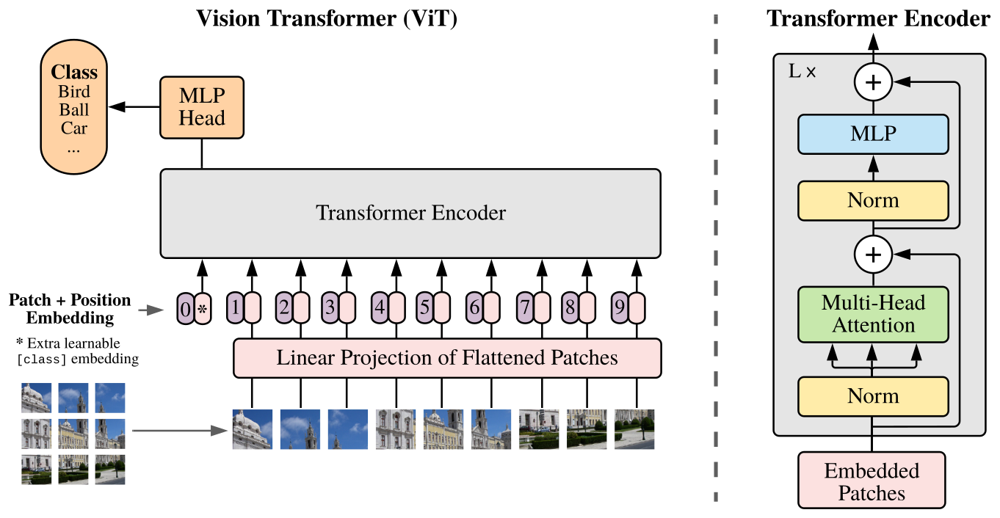

*图 1（原文 Figure 1，第 3 页）：把图像切成固定大小的 patch，对每个 patch 做线性嵌入，加上位置编码，把得到的向量序列送入标准 Transformer 编码器；为了做分类，采用标准做法，在序列前面加一个额外的可学习“分类 token”。右侧 Transformer 编码器的示意受 Vaswani 等人启发。*

**图中文字翻译与读法**：

- **左：Vision Transformer (ViT)**。底部是被切成 9 块的输入图像（示意图用 $3\times3$ 个 patch），每块展平后经 **Linear Projection of Flattened Patches**（展平 patch 的线性投影）得到 patch 向量；每个 patch 向量旁边带编号 1–9 的紫色小块是它的**位置编码**（图左标注 **Patch + Position Embedding**）；编号 0、带星号的那一格是额外的可学习 `[class]` 嵌入（图注 “* Extra learnable [class] embedding”）。所有向量一起送入 **Transformer Encoder**，取 `[class]` 位置的输出送给 **MLP Head**，输出类别（**Class**：Bird、Ball、Car 等）。
- **右：Transformer Encoder**。重复 $L$ 次的块（图中标 “L ×”），自下而上：输入 **Embedded Patches**（嵌入后的 patch）$\to$ **Norm** $\to$ **Multi-Head Attention**（Norm 下面分出的三条箭头表示同一个归一化后的输入同时作为 $q,k,v$）$\to$ 加号（残差连接）$\to$ **Norm** $\to$ **MLP** $\to$ 加号（残差连接）。
- **读图结论**：整条流水线是“切块 $\to$ 线性投影 $\to$ 加位置编码和 `[class]` $\to$ 若干层标准的 pre-norm Transformer 块 $\to$ 读 `[class]` 输出”，和 BERT 的结构几乎一样。

### 3.2 Patch 嵌入、位置编码与 `[class]` token

标准 Transformer 接收的是一维的 token 嵌入序列。为处理二维图像，把图像 $x\in\mathbb{R}^{H\times W\times C}$ 重塑为展平的二维 patch 序列 $x_p\in\mathbb{R}^{N\times(P^2\cdot C)}$：

- $(H,W)$ 是原图分辨率，$C$ 是通道数（RGB 图为 3）；
- $(P,P)$ 是每个 patch 的分辨率；
- $N=HW/P^2$ 是 patch 个数，也就是 Transformer 实际看到的**序列长度**。

Transformer 的所有层都使用恒定的隐向量维度 $D$，所以把每个展平的 patch 用一个可训练的线性投影 $E$ 映射到 $D$ 维（式 1），投影的输出叫**patch 嵌入**。

仿照 BERT 的 `[class]` token，在 patch 嵌入序列前面加一个可学习的嵌入 $z_0^0=x_{\text{class}}$，它在 Transformer 编码器输出处的状态 $z_L^0$ 作为整张图的表示 $y$（式 4）。预训练和微调时，分类头都接在 $z_L^0$ 上：**预训练时是带一个隐藏层的 MLP，微调时是单个线性层**。

**位置编码**加到 patch 嵌入上以保留位置信息。论文用标准的**可学习一维位置编码**，因为没有观察到更高级的二维感知位置编码带来明显提升（附录 D.4，见第六节）。得到的嵌入向量序列就是编码器的输入。

**Transformer 编码器**由多头自注意力（MSA，附录 A）与 MLP 块交替叠成（式 2、3）：每个块之前做 LayerNorm（LN），每个块之后做残差连接；MLP 含两层，中间用 GELU 非线性。完整的前向为

$$
z_0=[x_{\text{class}};\ x_p^1E;\ x_p^2E;\ \cdots;\ x_p^NE]+E_{\text{pos}},\qquad E\in\mathbb{R}^{(P^2\cdot C)\times D},\quad E_{\text{pos}}\in\mathbb{R}^{(N+1)\times D}\qquad(1)
$$

$$
z'_\ell=\mathrm{MSA}\big(\mathrm{LN}(z_{\ell-1})\big)+z_{\ell-1},\qquad \ell=1,\dots,L\qquad(2)
$$

$$
z_\ell=\mathrm{MLP}\big(\mathrm{LN}(z'_\ell)\big)+z'_\ell,\qquad \ell=1,\dots,L\qquad(3)
$$

$$
y=\mathrm{LN}\big(z_L^0\big)\qquad(4)
$$

逐项读法：

- 式 (1)：序列由 $N+1$ 个 $D$ 维向量组成——1 个 `[class]` 嵌入加 $N$ 个 patch 的线性投影；$E_{\text{pos}}$ 是形状 $(N+1)\times D$ 的可学习表，逐位置相加（`[class]` 也有自己的位置编码）。
- 式 (2)(3)：“先 LN、再子层、最后加残差”，即 **pre-norm** 结构；$\ell$ 是第几层，$z'_\ell$ 是注意力子层之后的中间量。
- 式 (4)：取最后一层 `[class]` 位置的向量做 LN，得到图像表示 $y$，分类头作用在 $y$ 上。

**多头自注意力（附录 A，式 5–8）**。对输入序列 $z\in\mathbb{R}^{N\times D}$（对 ViT 来说序列长度是 $N+1$），先投影出 $q,k,v$，注意力权重由 query 与 key 的两两相似度给出，输出是对 value 的加权和：

$$
[q,k,v]=zU_{qkv},\quad U_{qkv}\in\mathbb{R}^{D\times3D_h}\qquad(5)
$$

$$
A=\mathrm{softmax}\big(qk^\top/\sqrt{D_h}\big),\quad A\in\mathbb{R}^{N\times N}\qquad(6)
$$

$$
\mathrm{SA}(z)=Av\qquad(7)
$$

多头（MSA）是并行运行 $k$ 个自注意力（“头”），把它们的输出拼接后再做一次投影；为了在改变 $k$ 时保持计算量和参数量不变，$D_h$ 通常取 $D/k$：

$$
\mathrm{MSA}(z)=[\mathrm{SA}_1(z);\ \mathrm{SA}_2(z);\ \cdots;\ \mathrm{SA}_k(z)]\,U_{msa},\quad U_{msa}\in\mathbb{R}^{k\cdot D_h\times D}\qquad(8)
$$

**一个具体的数字例子**（ViT-B/16，输入 $224\times224$ RGB 图像）：

| 量 | 含义 | 形状或数值 |
|---|---|---|
| $P,\ C,\ N$ | patch 边长、通道数、patch 数 | $16,\ 3,\ N=(224/16)^2=196$ |
| $x_p$ | 展平的 patch 序列 | $196\times768$（$P^2C=16\cdot16\cdot3=768$） |
| $E$ | patch 线性投影 | $768\times768$（$D=768$） |
| $E_{\text{pos}}$、$z_0$ | 位置编码、编码器输入 | $197\times768$（196 个 patch + 1 个 `[class]`） |
| $U_{qkv}$ | $q,k,v$ 投影（12 个头 $\times$ 每头 $D_h=64$） | $768\times2304$ |
| $A$ | 每个头的注意力矩阵 | $197\times197$ |
| MLP | 两层、GELU | $768\to3072\to768$ |
| $y$ | 图像表示（`[class]` 位置） | 768 维 |

（本表为本文按原文定义代入数字得到。）微调时若把分辨率提到 $384$，patch 大小不变，则 $N=(384/16)^2=576$，序列长度 577。

### 3.3 归纳偏置

论文强调：ViT 的图像特有归纳偏置比 CNN 少得多。

- CNN 里，**局部性**、**二维邻域结构**和**平移等变性**被烘焙进整个网络的每一层。
- ViT 里，只有 MLP 层是局部且平移等变的（它逐个 token 独立作用），而自注意力层是**全局**的。二维邻域结构被“非常节制地”使用：只有开头把图像切成 patch，以及微调时为适应不同分辨率调整位置编码这两处。
- 除此之外，初始化时的位置编码不携带任何 patch 的二维位置信息，patch 之间所有的空间关系都要从零学起。

### 3.4 混合架构

作为原始图像 patch 的替代，输入序列也可以由 CNN 的特征图构成。在这种**混合模型**里，式 (1) 中的 patch 嵌入投影 $E$ 作用在从 CNN 特征图上取出的 patch 上。特例是 patch 大小为 $1\times1$：此时只需把特征图的空间维度展平，再投影到 Transformer 维度。`[class]` 嵌入和位置编码照旧加入。

### 3.5 微调与更高分辨率

通常先在大数据集上预训练 ViT，再微调到较小的下游任务：去掉预训练的预测头，接上一个**零初始化**的 $D\times K$ 前馈层（$K$ 是下游类别数）。微调时用比预训练更高的分辨率往往有益。喂入更高分辨率的图像时，**patch 大小保持不变**，所以序列变长。ViT 可以处理任意长度的序列（受显存限制），但预训练的位置编码可能不再有意义，所以论文对预训练位置编码按其在原图中的位置做**二维插值**。这一分辨率调整和 patch 提取，是整个 ViT 里手工注入图像二维结构的唯一两处。

### 3.6 模型规格

模型配置基于 BERT：“Base”和“Large”直接沿用 BERT，另外加了更大的“Huge”。记号 ViT-L/16 表示“Large”规模、输入 patch 为 $16\times16$。注意 Transformer 的序列长度与 patch 边长的平方成反比，所以 patch 越小，计算越贵。

**表 1：ViT 模型变体的细节。**

| 模型 | 层数 | 隐藏维度 $D$ | MLP 维度 | 头数 | 参数量 |
|---|---:|---:|---:|---:|---:|
| ViT-Base | 12 | 768 | 3072 | 12 | 86M |
| ViT-Large | 24 | 1024 | 4096 | 16 | 307M |
| ViT-Huge | 32 | 1280 | 5120 | 16 | 632M |

（原文表 1，第 5 页。）读法：MLP 维度恒为隐藏维度的 4 倍。每层约有 $12D^2$ 个权重（注意力 $4D^2$ + MLP $8D^2$），据此估算 $L\cdot12D^2$：Base 约 85M，Large 约 302M，Huge 约 629M；加上 patch 投影、位置编码、偏置和 1000 类分类头后，Base 约 86M、Huge 约 632M，与表 1 吻合；Large 的估算约 304M，比表中的 307M 少 3M 左右，原文没有说明参数量的统计口径（本段为本文估算）。

## 四、数据、基线与训练设置（原文第 4.1 节与附录 B）

### 4.1 数据集与基准

- **预训练数据**：ILSVRC-2012 ImageNet（1k 类、130 万张，下文简称 ImageNet）；它的超集 ImageNet-21k（21k 类、1400 万张）；JFT（18k 类、3.03 亿张高分辨率图像，Google 内部数据集）。预训练集都按 Kolesnikov 等人（2020）的做法针对下游任务的测试集做了去重。
- **迁移的下游任务**：ImageNet（原始验证集标签，以及清理过的 **ReaL** 标签）、CIFAR-10/100、Oxford-IIIT Pets、Oxford Flowers-102，预处理按 Kolesnikov 等人（2020）。
- **VTAB**（Visual Task Adaptation Benchmark）：19 项分类任务，考察**低数据**迁移——每项任务只用 1000 个训练样本。任务分三组：Natural（自然图像，如 Pets、CIFAR 等）、Specialized（医学和卫星图像）、Structured（需要几何理解的任务，如定位）。

### 4.2 模型变体与基线

- **ViT**：见表 1。
- **ResNet 基线**：用 ResNet，但把 Batch Normalization 换成 Group Normalization，并使用标准化卷积（standardized convolutions）；这些改动能提升迁移效果，修改后的模型记作 **ResNet (BiT)**。
- **混合模型**：把 ResNet 的中间特征图喂给 ViT，patch 大小取一个“像素”。为了试验不同的序列长度，有两种取法：（i）取普通 ResNet50 第 4 阶段的输出；（ii）去掉第 4 阶段，把同样数目的层放到第 3 阶段（总层数不变），取这个加长的第 3 阶段的输出。方式（ii）得到 4 倍长的序列，ViT 部分也更贵。

### 4.3 训练与微调

- **预训练**：所有模型（包括 ResNet）用 Adam（$\beta_1=0.9$、$\beta_2=0.999$），batch 4096，**权重衰减取较高的 0.1**（作者发现这对所有模型的迁移都有用）；线性学习率预热加线性衰减（预热 10k 步）。一反惯例，ResNet 也用 Adam 而不是 SGD，因为在这个设置下 Adam 略好（附录 D.1）。ImageNet 上还额外使用了全局范数 1 的梯度裁剪。预训练分辨率为 224。
- **正则化**：在 ImageNet 上从头训练时，强正则化是关键。Dropout（若使用）加在每个全连接层之后，但不包括 $q,k,v$ 投影，以及位置编码加到 patch 嵌入之后。混合模型的训练设置与对应的 ViT 完全相同。
- **微调**：所有模型用带动量 0.9 的 SGD，batch 512，余弦学习率衰减，无权重衰减，梯度裁剪（全局范数 1）。学习率在小范围内网格搜索（表 4）：用训练集的小子集当开发集（Pets 和 Flowers 取 10%，CIFAR 取 2%，ImageNet 取 1%），在剩余数据上训练；最终结果在整个训练集上训练、在各自的测试集上评测。ResNet 和混合模型用完全相同的设置，仅 ImageNet 的学习率扫描多加一个值 0.06；ResNet 还额外运行 Kolesnikov 等人（2020）的设置并在两者间取最好。除非另有说明，微调分辨率为 384。
- **ImageNet 上的最好结果（表 2）**：用更高的微调分辨率（ViT-L/16 用 512，ViT-H/14 用 518），并使用系数为 0.9999 的 Polyak 平均。
- **VTAB**：按 Kolesnikov 等人（2020）的协议，所有任务使用同一组超参：学习率 0.01、训练 2500 步（通过在两个学习率和两种训练计划上做小扫描，以 200 样本验证集上的 VTAB 得分选定）；不使用任务特定的输入分辨率，发现 ViT 在所有任务上都最受益于高分辨率（$384\times384$）。

**表 3：训练超参数。** 所有模型的 batch 为 4096，学习率预热 10k 步；在 ImageNet 上额外使用全局范数 1 的梯度裁剪；训练分辨率 224。

| 模型 | 数据集 | epoch | 基础学习率 | 学习率衰减 | 权重衰减 | dropout |
|---|---|---|---|---|---|---|
| ViT-B/{16,32} | JFT-300M | 7 | $8\cdot10^{-4}$ | 线性 | 0.1 | 0.0 |
| ViT-L/32 | JFT-300M | 7 | $6\cdot10^{-4}$ | 线性 | 0.1 | 0.0 |
| ViT-L/16 | JFT-300M | 7/14 | $4\cdot10^{-4}$ | 线性 | 0.1 | 0.0 |
| ViT-H/14 | JFT-300M | 14 | $3\cdot10^{-4}$ | 线性 | 0.1 | 0.0 |
| R50x{1,2} | JFT-300M | 7 | $10^{-3}$ | 线性 | 0.1 | 0.0 |
| R101x1 | JFT-300M | 7 | $8\cdot10^{-4}$ | 线性 | 0.1 | 0.0 |
| R152x{1,2} | JFT-300M | 7 | $6\cdot10^{-4}$ | 线性 | 0.1 | 0.0 |
| R50+ViT-B/{16,32} | JFT-300M | 7 | $8\cdot10^{-4}$ | 线性 | 0.1 | 0.0 |
| R50+ViT-L/32 | JFT-300M | 7 | $2\cdot10^{-4}$ | 线性 | 0.1 | 0.0 |
| R50+ViT-L/16 | JFT-300M | 7/14 | $4\cdot10^{-4}$ | 线性 | 0.1 | 0.0 |
| ViT-B/{16,32} | ImageNet-21k | 90 | $10^{-3}$ | 线性 | 0.03 | 0.1 |
| ViT-L/{16,32} | ImageNet-21k | 30/90 | $10^{-3}$ | 线性 | 0.03 | 0.1 |
| ViT-* | ImageNet | 300 | $3\cdot10^{-3}$ | 余弦 | 0.3 | 0.1 |

（原文表 3，第 13 页。“7/14”“30/90”表示该模型有两种训练长度；“ViT-*”指在 ImageNet 上训练的所有 ViT。）读法：ImageNet 从头训练用的正则化最强（权重衰减 0.3、dropout 0.1、300 个 epoch），JFT 上则不用 dropout；越大的模型基础学习率越小。

**表 4：微调超参数。** 所有模型用余弦学习率衰减，batch 512，无权重衰减，梯度裁剪全局范数 1；除非另有说明，微调分辨率 384。

| 数据集 | 步数 | 基础学习率（搜索集合） |
|---|---:|---|
| ImageNet | 20 000 | {0.003, 0.01, 0.03, 0.06} |
| CIFAR100 | 10 000 | {0.001, 0.003, 0.01, 0.03} |
| CIFAR10 | 10 000 | {0.001, 0.003, 0.01, 0.03} |
| Oxford-IIIT Pets | 500 | {0.001, 0.003, 0.01, 0.03} |
| Oxford Flowers-102 | 500 | {0.001, 0.003, 0.01, 0.03} |
| VTAB（19 项任务） | 2 500 | 0.01 |

（原文表 4，第 14 页。）注意：B.1.1 的文字说 ImageNet 的 0.06 只是给 ResNet 和混合模型额外加的学习率，而表 4 的 ImageNet 集合里已包含 0.06，两处表述略有出入，原文未解释。

**迁移时的头部处理**（附录 B.1.1）：把预训练头（两个线性层）整个去掉，换成一个零初始化的线性层，输出目标数据集需要的类别数；作者发现这比只重新初始化最后一层稍稳健。

### 4.4 评测指标

- **微调精度**：模型在各自数据集上微调之后的精度。
- **少样本（few-shot）线性精度**：求解一个正则化最小二乘回归问题，把一部分训练图像的（冻结的）表示映射到 $\{-1,1\}^K$ 的目标向量，可以闭式求得精确解。主要关注微调性能，但在微调成本太高、需要随训练在线快速评测时，会用线性少样本精度。

## 五、实验结果（原文第 4.2–4.6 节）

### 5.1 与最先进水平比较（表 2、图 2）

先把最大的两个模型——ViT-H/14 和 ViT-L/16——与文献里最先进的 CNN 比较。第一个比较对象是 **Big Transfer (BiT)**：用大型 ResNet 做有监督迁移学习；第二个是 **Noisy Student**：一个大型 EfficientNet，在 ImageNet 和去掉标签的 JFT-300M 上做半监督训练。当时 Noisy Student 是 ImageNet 上的 SOTA，BiT-L 是这里其他数据集上的 SOTA。所有模型都在 TPUv3 上训练，并报告预训练所花的 **TPUv3-core-days**（所用 TPUv3 核数——每块芯片 2 个核——乘以训练天数）。

**表 2：在常用图像分类基准上与最先进水平比较。** 数字为精度（%）的均值 ± 标准差，对三次微调取平均；粗体为原文标出的该行最好值；最后一行是预训练算力，越小越省。

| 数据集 | Ours-JFT（ViT-H/14） | Ours-JFT（ViT-L/16） | Ours-I21k（ViT-L/16） | BiT-L（ResNet152x4） | Noisy Student（EfficientNet-L2） |
|---|---|---|---|---|---|
| ImageNet | **88.55** ± 0.04 | 87.76 ± 0.03 | 85.30 ± 0.02 | 87.54 ± 0.02 | 88.4/88.5* |
| ImageNet ReaL | **90.72** ± 0.05 | 90.54 ± 0.03 | 88.62 ± 0.05 | 90.54 | 90.55 |
| CIFAR-10 | **99.50** ± 0.06 | 99.42 ± 0.03 | 99.15 ± 0.03 | 99.37 ± 0.06 | − |
| CIFAR-100 | **94.55** ± 0.04 | 93.90 ± 0.05 | 93.25 ± 0.05 | 93.51 ± 0.08 | − |
| Oxford-IIIT Pets | **97.56** ± 0.03 | 97.32 ± 0.11 | 94.67 ± 0.15 | 96.62 ± 0.23 | − |
| Oxford Flowers-102 | 99.68 ± 0.02 | **99.74** ± 0.00 | 99.61 ± 0.02 | 99.63 ± 0.03 | − |
| VTAB（19 项任务） | **77.63** ± 0.23 | 76.28 ± 0.46 | 72.72 ± 0.21 | 76.29 ± 1.70 | − |
| TPUv3-core-days | 2.5k | 0.68k | 0.23k | 9.9k | 12.3k |

（原文表 2，第 6 页。* 为 Touvron 等人（2020）报告的略有改进的 88.5% 结果。）读法：

- **用更少的算力做到更好**：ViT-L/16（JFT）只用 0.68k core-days，约为 BiT-L（9.9k）的 1/15，在 ImageNet、CIFAR-10/100、Pets、Flowers 上都高于 BiT-L；更大的 ViT-H/14（2.5k，约为 BiT-L 的 1/4、Noisy Student 的 1/5）在更难的数据集——ImageNet、CIFAR-100、VTAB——上进一步提升。
- **“在所有数据集上优于 BiT-L”要看细节**：原文正文说 ViT-L/16 在所有任务上优于 BiT-L；按表中数字，ImageNet ReaL 两者都是 90.54（持平），VTAB 是 76.28 对 76.29（BiT-L 高 0.01，且标准差分别是 0.46 和 1.70，在噪声之内）。更准确的说法是“持平或更好”。
- **ImageNet 上与 Noisy Student 基本打平**：ViT-H/14 的 88.55 对 Noisy Student 的 88.4/88.5，差距在 0.05–0.15 之内；这个 ViT 结果用了 518 的微调分辨率和 Polyak 平均。
- **只用公开数据也不差**：ImageNet-21k 预训练的 ViT-L/16 在 ImageNet 上 85.30、CIFAR-100 上 93.25，在多数数据集上仍然表现良好，只需约 0.23k core-days——原文说用一块标准的云 TPUv3（8 核）约 30 天即可训练完。
- 作者提醒：预训练效率不仅取决于架构，还取决于训练计划、优化器、权重衰减等其他参数，所以第 5.3 节另做了受控的算力对比。

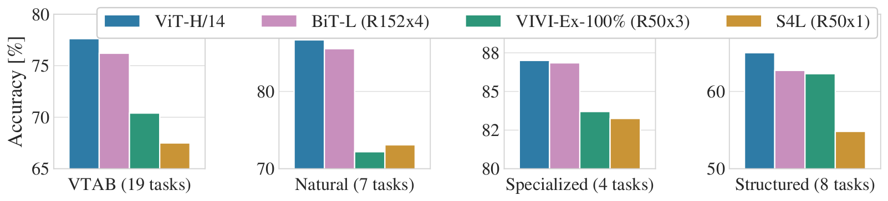

*图 2（原文 Figure 2，第 6 页）：VTAB 性能在 Natural、Specialized、Structured 三个任务组上的分解。*

**图中文字翻译与读法**：

- 四个子图依次是 **VTAB (19 tasks)**（19 项任务总平均）、**Natural (7 tasks)**、**Specialized (4 tasks)**、**Structured (8 tasks)**；纵轴 **Accuracy [%]**（准确率）。图例的四根柱子：**ViT-H/14**（蓝）、**BiT-L (R152x4)**（粉）、**VIVI-Ex-100% (R50x3)**（绿）、**S4L (R50x1)**（橙）。VIVI 是在 ImageNet 和 YouTube 上联合训练的 ResNet；S4L 是在 ImageNet 上做有监督加半监督学习。
- 从图上读出的近似值（依次对应 ViT-H/14、BiT-L、VIVI、S4L）：19 项总平均约 77.6、76.3、70、67；Natural 约 87、86、72、73；Specialized 约 87、87、83、83；Structured 约 65、63、62、55。
- **读图结论**：ViT-H/14 在 Natural 和 Structured 上优于 BiT-R152x4 和其他方法；在 Specialized 上前两名（ViT-H/14 与 BiT-L）表现相近。三组里 Structured（需要几何理解）最难，所有方法都最低。

### 5.2 预训练数据规模的要求（图 3、图 4、表 5）

ViT 在大的 JFT-300M 上预训练表现很好；但它的视觉归纳偏置比 ResNet 少，**数据集规模到底有多关键**？论文做了两组实验。

**第一组：在逐步增大的数据集上预训练**——ImageNet、ImageNet-21k、JFT-300M。为了提升小数据集上的性能，优化了三个基本正则化参数：权重衰减、dropout 和 label smoothing。图 3 给出微调到 ImageNet 后的结果（其他数据集的结果在表 5）。

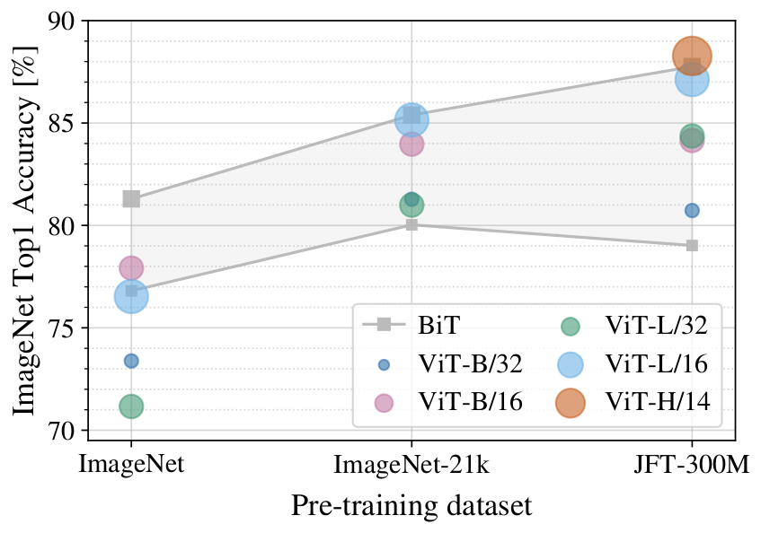

*图 3（原文 Figure 3，第 7 页）：迁移到 ImageNet。在小数据集上预训练时，大 ViT 模型比 BiT ResNet（阴影区域）更差；在更大的数据集上预训练时，它们大放异彩。同样，随着数据集增大，更大的 ViT 变体超过更小的变体。*

**图中文字翻译与读法**：

- 横轴 **Pre-training dataset**（预训练数据集）依次为 ImageNet、ImageNet-21k、JFT-300M；纵轴 **ImageNet Top1 Accuracy [%]**（70–90）。灰色方块折线 **BiT** 是不同大小的 BiT ResNet 的范围（灰色阴影是上下两条折线之间的区域）；彩色圆点是 ViT 各变体（**ViT-B/32、ViT-B/16、ViT-L/32、ViT-L/16、ViT-H/14**），圆点越大模型越大。
- 具体数值见表 5（微调分辨率 384，不含表 2 用的 Polyak 平均和 512 分辨率）。ImageNet 预训练时：ViT-B/16 为 77.91、ViT-L/16 为 76.53、ViT-L/32 只有 71.16；ImageNet-21k 预训练时 ViT-B/16 为 83.97、ViT-L/16 为 85.15；JFT-300M 预训练时 ViT-B/16 为 84.15、ViT-L/16 为 87.12、ViT-H/14 为 88.04。
- **读图结论**：（1）在最小的 ImageNet 上预训练时，ViT-Large 比 ViT-Base 更差（尽管做了中等程度的正则化）；（2）ImageNet-21k 预训练时两者表现相近；（3）只有在 JFT-300M 上才能看到更大模型的全部好处。BiT 在 ImageNet 上预训练时优于 ViT，随着数据集变大 ViT 反超。

**第二组：在 JFT-300M 的随机子集上训练**——9M、30M、90M 子集以及完整的 JFT-300M。**不对小子集做额外正则化，所有设置用相同的超参数**，这样评估的是模型的内在性质而不是正则化的效果；但使用早停，并报告训练中取得的最好验证精度。为节省算力，报告的是少样本线性精度而不是完整微调精度。

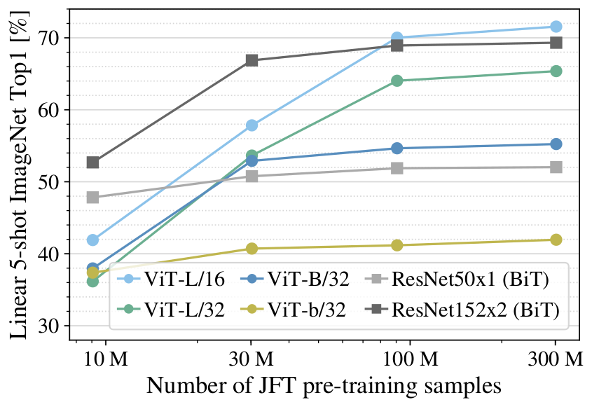

*图 4（原文 Figure 4，第 7 页）：线性少样本评测 ImageNet 与预训练规模的关系。ResNet 在较小的预训练数据集上表现更好，但更早进入平台期；而 ViT 在更大的预训练规模下表现更好。ViT-b 是所有隐藏维度减半的 ViT-B。*

**图中文字翻译与读法**：

- 横轴 **Number of JFT pre-training samples**（JFT 预训练样本数），刻度标为 10 M、30 M、100 M、300 M（对应正文所说的 9M、30M、90M 子集和完整 JFT-300M）；纵轴 **Linear 5-shot ImageNet Top1 [%]**（线性 5-shot ImageNet top-1，30–70）。图例：**ViT-L/16**（浅蓝）、**ViT-L/32**（绿）、**ViT-B/32**（深蓝）、**ViT-b/32**（黄绿）、**ResNet50x1 (BiT)**（浅灰方块）、**ResNet152x2 (BiT)**（深灰方块）。
- 从图上读出的近似值：ResNet152x2 在 10M/30M/100M/300M 约为 52.7、66.8、68.9、69.3；ViT-L/16 约为 41.9、57.8、70.0、71.5；ResNet50x1 约为 47.8、50.8、51.9、52.0；ViT-B/32 约为 37.9、52.9、54.6、55.2。
- **读图结论**：在较小的预训练集上，ViT 比计算量相近的 ResNet 过拟合更严重——例如 ViT-B/32 比 ResNet50 略快，在 9M 子集上差得多，但在 90M 以上的子集上更好；ResNet152x2 与 ViT-L/16 也是同样的关系（9M 时 ViT 约低 11 个点，90M 以上高 1–2 个点）。这印证了直觉：卷积归纳偏置对小数据集有用，但对大数据集，直接从数据里学相关模式就足够，甚至更好。论文认为 ImageNet 上的少样本结果以及 VTAB 上的低数据结果对极低数据迁移很有希望，把少样本性质的进一步分析留作未来工作。

**表 5：不同预训练数据集上 ViT 的 top-1 精度（%）。** 设置：模型在 ImageNet、ImageNet-21k 或 JFT-300M 上预训练，在 384 分辨率下微调；这些数值对应图 3；注意 ImageNet 一行不含表 2 用的 Polyak 平均和 512 分辨率；ViT-H/14 没有在 ImageNet 上预训练，记 -。

| 预训练数据集 | 下游数据集 | ViT-B/16 | ViT-B/32 | ViT-L/16 | ViT-L/32 | ViT-H/14 |
|---|---|---:|---:|---:|---:|---:|
| ImageNet | CIFAR-10 | 98.13 | 97.77 | 97.86 | 97.94 | - |
|  | CIFAR-100 | 87.13 | 86.31 | 86.35 | 87.07 | - |
|  | ImageNet | 77.91 | 73.38 | 76.53 | 71.16 | - |
|  | ImageNet ReaL | 83.57 | 79.56 | 82.19 | 77.83 | - |
|  | Oxford Flowers-102 | 89.49 | 85.43 | 89.66 | 86.36 | - |
|  | Oxford-IIIT-Pets | 93.81 | 92.04 | 93.64 | 91.35 | - |
| ImageNet-21k | CIFAR-10 | 98.95 | 98.79 | 99.16 | 99.13 | 99.27 |
|  | CIFAR-100 | 91.67 | 91.97 | 93.44 | 93.04 | 93.82 |
|  | ImageNet | 83.97 | 81.28 | 85.15 | 80.99 | 85.13 |
|  | ImageNet ReaL | 88.35 | 86.63 | 88.40 | 85.65 | 88.70 |
|  | Oxford Flowers-102 | 99.38 | 99.11 | 99.61 | 99.19 | 99.51 |
|  | Oxford-IIIT-Pets | 94.43 | 93.02 | 94.73 | 93.09 | 94.82 |
| JFT-300M | CIFAR-10 | 99.00 | 98.61 | 99.38 | 99.19 | 99.50 |
|  | CIFAR-100 | 91.87 | 90.49 | 94.04 | 92.52 | 94.55 |
|  | ImageNet | 84.15 | 80.73 | 87.12 | 84.37 | 88.04 |
|  | ImageNet ReaL | 88.85 | 86.27 | 89.99 | 88.28 | 90.33 |
|  | Oxford Flowers-102 | 99.56 | 99.27 | 99.56 | 99.45 | 99.68 |
|  | Oxford-IIIT-Pets | 95.80 | 93.40 | 97.11 | 95.83 | 97.56 |

（原文表 5，第 15 页。）读法：ImageNet 预训练时，ViT-B/16 在 6 个下游数据集中有 5 个不低于 ViT-L/16（Flowers-102 例外，89.49 对 89.66），如 ImageNet 77.91 对 76.53、CIFAR-100 87.13 对 86.35；换成 JFT-300M，ViT-L/16 在多数下游数据集上领先 ViT-B/16（ImageNet 87.12 对 84.15），ViT-H/14 在 6 个数据集上都高于 ViT-L/16（ImageNet 88.04 对 87.12）。这张表的 ViT-H/14 JFT 行与表 2 同模型的 CIFAR-10/100、Pets、Flowers 一致，但 ImageNet、ReaL 不同，因为表 2 用了 518 分辨率和 Polyak 平均。

### 5.3 缩放研究（图 5、表 6）

为了在数据规模不再是瓶颈的条件下比较不同模型，论文从 JFT-300M 迁移，对不同模型做了受控的缩放研究，评估性能与预训练成本。模型集合包括：

- **7 个 ResNet**：R50x1、R50x2、R101x1、R152x1、R152x2 预训练 7 个 epoch，外加 R152x2 与 R200x3 预训练 14 个 epoch；
- **6 个 ViT**：ViT-B/32、B/16、L/32、L/16 预训练 7 个 epoch，外加 L/16 和 H/14 预训练 14 个 epoch；
- **5 个混合模型**：R50+ViT-B/32、B/16、L/32、L/16 预训练 7 个 epoch，外加 R50+ViT-L/16 预训练 14 个 epoch（混合模型名字末尾的数字不是 patch 大小，而是 ResNet 骨干的总下采样率）。

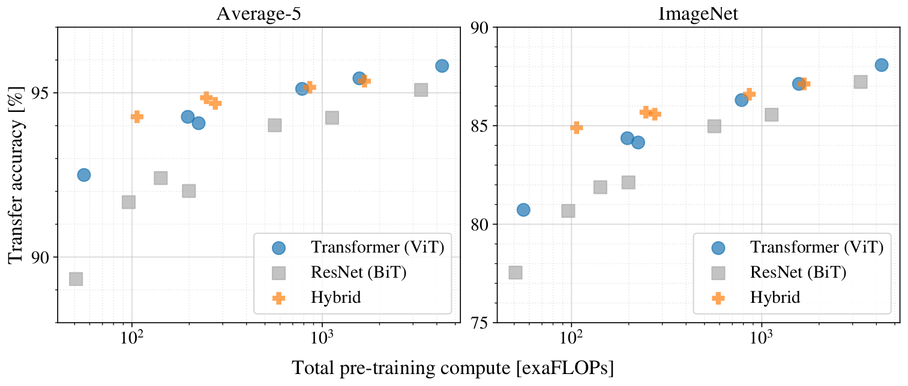

*图 5（原文 Figure 5，第 7 页）：不同架构——ViT、ResNet 和混合模型——的性能与预训练算力的关系。在相同算力预算下，ViT 总体上优于 ResNet；混合模型在较小的模型尺寸下优于纯 Transformer，但在更大的模型上差距消失。*

**图中文字翻译与读法**：

- 两个子图：**Average-5**（5 个数据集的平均）和 **ImageNet**；横轴 **Total pre-training compute [exaFLOPs]**（总预训练算力，对数刻度，$10^2$ 到 $10^3$ 以上）；纵轴 **Transfer accuracy [%]**（迁移精度）。图例：蓝色圆点 **Transformer (ViT)**、灰色方块 **ResNet (BiT)**、橙色加号 **Hybrid**（混合模型）。每个点对应表 6 的一行。
- **“Average-5”是哪 5 个数据集**：原文没有写明。把表 6 的 ImageNet、CIFAR-10、CIFAR-100、Pets、Flowers 取平均，得到的数值与图中各点吻合（如 ResNet50x1 为 89.33，与表 7 的平均一致；ViT-B/32 为 92.5），所以应是这 5 个（本文的反推）。
- **读图结论**：与论文正文的三点观察对应。（1）**ViT 在性能/算力上优于 ResNet**：达到同样精度所需算力约少 $2$–$4$ 倍（5 个数据集的平均）。（2）**混合模型在小算力时略优于 ViT**，差距随模型变大而消失；这有些出人意料，因为可能预期卷积式的局部特征处理在任何规模下都应帮助 ViT。（3）**ViT 在所试的范围内似乎没有饱和**，激励未来继续扩大规模。

**表 6：缩放实验的详细结果。** 对应图 5：在多个数据集上的迁移精度（%），以及预训练算力（exaFLOPs）。

| 模型 | epoch | ImageNet | ImageNet ReaL | CIFAR-10 | CIFAR-100 | Pets | Flowers | 预训练算力（exaFLOPs） |
|---|---:|---:|---:|---:|---:|---:|---:|---:|
| ViT-B/32 | 7 | 80.73 | 86.27 | 98.61 | 90.49 | 93.40 | 99.27 | 55 |
| ViT-B/16 | 7 | 84.15 | 88.85 | 99.00 | 91.87 | 95.80 | 99.56 | 224 |
| ViT-L/32 | 7 | 84.37 | 88.28 | 99.19 | 92.52 | 95.83 | 99.45 | 196 |
| ViT-L/16 | 7 | 86.30 | 89.43 | 99.38 | 93.46 | 96.81 | 99.66 | 783 |
| ViT-L/16 | 14 | 87.12 | 89.99 | 99.38 | 94.04 | 97.11 | 99.56 | 1567 |
| ViT-H/14 | 14 | 88.08 | 90.36 | 99.50 | 94.71 | 97.11 | 99.71 | 4262 |
| ResNet50x1 | 7 | 77.54 | 84.56 | 97.67 | 86.07 | 91.11 | 94.26 | 50 |
| ResNet50x2 | 7 | 82.12 | 87.94 | 98.29 | 89.20 | 93.43 | 97.02 | 199 |
| ResNet101x1 | 7 | 80.67 | 87.07 | 98.48 | 89.17 | 94.08 | 95.95 | 96 |
| ResNet152x1 | 7 | 81.88 | 87.96 | 98.82 | 90.22 | 94.17 | 96.94 | 141 |
| ResNet152x2 | 7 | 84.97 | 89.69 | 99.06 | 92.05 | 95.37 | 98.62 | 563 |
| ResNet152x2 | 14 | 85.56 | 89.89 | 99.24 | 91.92 | 95.75 | 98.75 | 1126 |
| ResNet200x3 | 14 | 87.22 | 90.15 | 99.34 | 93.53 | 96.32 | 99.04 | 3306 |
| R50x1+ViT-B/32 | 7 | 84.90 | 89.15 | 99.01 | 92.24 | 95.75 | 99.46 | 106 |
| R50x1+ViT-B/16 | 7 | 85.58 | 89.65 | 99.14 | 92.63 | 96.65 | 99.40 | 274 |
| R50x1+ViT-L/32 | 7 | 85.68 | 89.04 | 99.24 | 92.93 | 96.97 | 99.43 | 246 |
| R50x1+ViT-L/16 | 7 | 86.60 | 89.72 | 99.18 | 93.64 | 97.03 | 99.40 | 859 |
| R50x1+ViT-L/16 | 14 | 87.12 | 89.76 | 99.31 | 93.89 | 97.36 | 99.11 | 1668 |

（原文表 6，第 15 页。）读法（以下 Average-5 为本文依表中数字计算）：

- **2–4 倍的算力优势怎么来的**：ViT-B/16（224 exaFLOPs）的 Average-5 为 94.08，ResNet152x2（563）为 94.01，约少 2.5 倍算力；ViT-L/32（196）为 94.27，约少 2.9 倍；ViT-L/16（7 个 epoch，783）为 95.12，与 ResNet200x3（3306，95.09）相当，约少 4.2 倍。
- **混合模型的优势只在小算力**：R50x1+ViT-B/32（106）的 Average-5 是 94.27，高于 ViT-B/32（55）的 92.5，也和 ViT-L/32（196）持平；但在大算力处 R50x1+ViT-L/16（14 个 epoch，1668）为 95.36，与 ViT-L/16（1567）的 95.44 几乎没有差别。
- **最大的模型**：ViT-H/14（4262）ImageNet 88.08、Average-5 约 95.82，高于 ResNet200x3（3306）的 87.22 和 95.09。
- 表 6 中 ViT-H/14 的 CIFAR-100、Pets、Flowers 与表 2、表 5 中同一模型的数字略有不同（如 Pets 97.11 对 97.56），原文没有说明差异来源；引用时请注明出自哪张表。

### 5.4 检视 ViT 内部（图 6、图 7、图 10、图 11）

为了理解 ViT 如何处理图像数据，作者分析了它的内部表示。

**第一层的嵌入滤波器**：ViT 的第一层把展平的 patch 线性投影到低维空间（式 1）。图 7 左给出学到的嵌入滤波器的前几个主成分，它们像是对每个 patch 内部精细结构的低维表示的合理基函数。

**位置编码**：投影之后加上学到的位置编码。图 7 中间的子图给出结果：模型学会在位置编码的相似性里编码图像内的**距离**——越近的 patch 位置编码越相似；还出现了**行列结构**——同一行/列的 patch 嵌入相似；对更大的网格有时还能看到正弦结构（附录 D）。位置编码学到了二维图像的拓扑，这也解释了为什么手工设计的二维感知嵌入变体没有带来改进（附录 D.4）。

**注意力距离**：自注意力让 ViT 在最低层也能整合整张图的信息。作者据此计算注意力权重在图像空间里整合信息的**平均距离**（图 7 右）；它类似 CNN 中的感受野大小。发现：一些头在最低层就已关注图像的大部分，说明模型确实利用了全局整合信息的能力；另一些头在低层的注意力距离一直很小，这种高度局部化的注意力在先用 ResNet 处理的混合模型里没那么明显（图 11），暗示它可能起着类似 CNN 早期卷积层的作用。此外，注意力距离随网络深度增加。

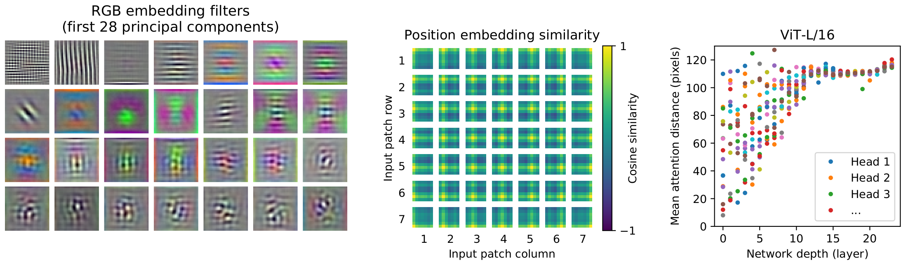

*图 7（原文 Figure 7，第 9 页）：左，ViT-L/32 初始线性嵌入的 RGB 滤波器；中，ViT-L/32 位置编码的相似性：每个小方块表示指定行列处 patch 的位置编码与所有其他 patch 位置编码之间的余弦相似度；右，按注意力头和网络深度分的被关注区域大小：每个点是某一层的 16 个头之一在多张图像上的平均注意力距离。详见附录 D.7。*

**图中文字翻译与读法**：

- **左 RGB embedding filters (first 28 principal components)**（RGB 嵌入滤波器，前 28 个主成分）：$4\times7$ 张小图，是对学到的嵌入滤波器做主成分分析、取前 28 个主成分得到的（ViT-L/32 的每个滤波器对应 $32\times32$ 像素的 RGB 区域）；可以看到不同朝向和疏密的条纹、色斑、边缘等，原文称它们像是对 patch 内部精细结构的低维表示的合理基函数。
- **中 Position embedding similarity**（位置编码相似性）：$7\times7$ 个小方块（ViT-L/32 对 224 输入有 $7\times7$ 个 patch）。横轴 **Input patch column**（patch 列）、纵轴 **Input patch row**（patch 行）标明每个小方块对应哪个位置的 patch；每个小方块内部是这个位置的编码与其余所有位置编码的余弦相似度（色标 **Cosine similarity**，从 $-1$ 到 $1$）。每个小方块里亮点（黄色）都落在对应的位置上，周围逐渐变暗，并呈现行、列方向的条纹。
- **右 ViT-L/16**：横轴 **Network depth (layer)**（网络深度，层号 0 到 23），纵轴 **Mean attention distance (pixels)**（平均注意力距离，像素，0 到约 120），每个点是某一层的 16 个头之一（图例 Head 1、Head 2、Head 3、…）。低层的点分布很散（约 10 到 125 像素），随深度增加，点向上聚拢，约第 12 层以后几乎所有头都在约 100–120 像素。
- **读图结论**：位置编码自己学出了二维结构；ViT 在最低层就既有局部头也有全局头，更深的层则普遍看得很远。

**注意力图**：作者还画了从输出 token 到输入空间的注意力图（图 6）：整体上模型关注与分类语义相关的图像区域。

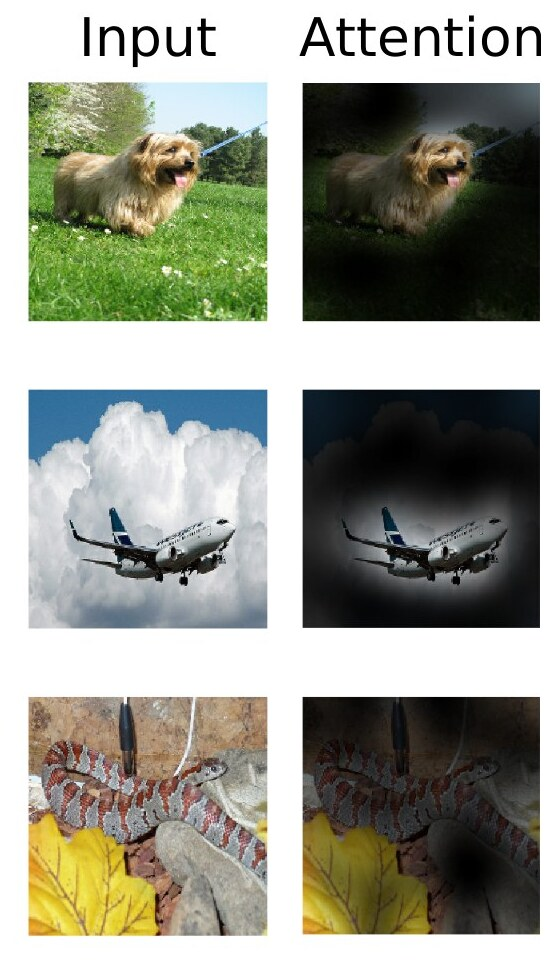

*图 6（原文 Figure 6，第 8 页）：从输出 token 到输入空间的注意力的代表性示例。详见附录 D.7。*

**图中文字翻译与读法**：左列 **Input**（输入图像），右列 **Attention**（注意力图，亮处是被关注的区域）。三个例子依次为一只狗、一架飞机、一条蛇。**读图结论**：注意力主要落在狗、飞机、蛇这些目标上，背景（草地、天空与云、石头）被压暗得更多，说明模型关注的是与分类语义相关的区域。这是 ViT-L/16 的注意力 rollout 图（附录 D.8）：把所有头的注意力权重取平均，再逐层递归相乘，以计入 token 间的注意力在各层中的混合；这类可视化只是定性的例证，不是因果证明（附录图 14 另有 128 张随机选取的例子）。

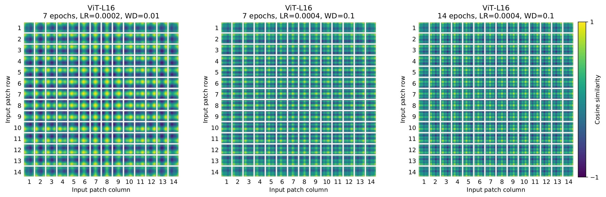

*图 10（原文 Figure 10，第 18 页）：用不同超参数训练的模型的位置编码。*

**图中文字翻译与读法**：三个子图都是 ViT-L/16 的位置编码相似性（$14\times14$ 个小方块，含义同图 7 中，色标是余弦相似度 $-1$ 到 $1$），训练设置分别是：**7 epochs, LR=0.0002, WD=0.01**（7 个 epoch，学习率 0.0002，权重衰减 0.01）、**7 epochs, LR=0.0004, WD=0.1**、**14 epochs, LR=0.0004, WD=0.1**。**读图结论**：三者都有“亮点在自身位置、行列条纹”的结构，但具体图案不同——第一个（学习率和权重衰减更小）图案更平滑、尺度更大，后两个更细密；论文据此说，网络学到的位置编码相似性的具体模式取决于训练超参数。

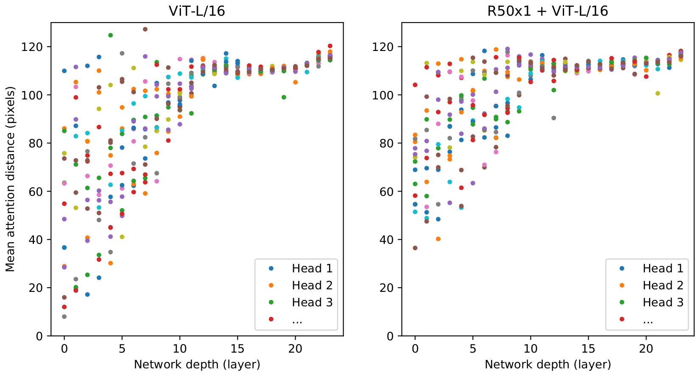

*图 11（原文 Figure 11，第 18 页）：按注意力头和网络深度分的被关注区域大小。注意力距离在 128 张示例图上计算，对 query 像素与所有其他像素之间的距离按注意力权重加权平均；每个点是某一层的 16 个头之一在这些图像上的平均注意力距离；图像宽度为 224 像素。*

**图中文字翻译与读法**：左图 **ViT-L/16**，右图 **R50x1 + ViT-L/16**；横轴 **Network depth (layer)**，纵轴 **Mean attention distance (pixels)**。**读图结论**：纯 ViT 的低层里头与头之间差别很大——有的头关注图像的大部分，有的只关注查询位置附近的小区域；随着深度增加，所有头的注意力距离都在变大，后半部分网络里多数头广泛地关注各处 token。混合模型（右）在最低层几乎没有注意力距离低于 30 像素的头（大多在 50–110 像素之间），而纯 ViT（左）低层有一批头在 10–30 像素；这与原文“混合模型里高度局部化的注意力没那么明显、可能起着类似早期卷积层的作用”的解读一致。

### 5.5 自监督（原文第 4.6 节、附录 B.1.2）

Transformer 在 NLP 里的成功不只来自可扩展性，也来自大规模自监督预训练。作者对**掩码 patch 预测**做了初步探索，模仿 BERT 的掩码语言建模。

- **做法**：把 50% 的 patch 嵌入破坏掉——其中 80% 替换为可学习的 `[mask]` 嵌入，10% 替换为随机的另一个 patch 嵌入，10% 保持不变（与 BERT 的做法很像）。然后用各个被破坏 patch 的表示去预测该 patch 的 **3 位平均颜色**（共 512 种颜色）。
- **训练设置**：在 JFT 上训练 100 万步（约 14 个 epoch），batch 4096，Adam，基础学习率 $2\cdot10^{-4}$，预热 10k 步，余弦衰减。
- **预测目标的尝试**：（1）只预测平均 3 位颜色（1 次 512 类预测）；（2）预测 patch 缩小成 $4\times4$ 后的 3 位颜色（16 次 512 类预测）；（3）用 L2 回归整个 patch（256 次对 3 个 RGB 通道的回归）。出人意料，这三种都表现不错，L2 略差；最终只报告方案（1），因为它的少样本性能最好。也试了 BERT 的 15% 破坏率，结果同样稍差。
- **结果**：自监督预训练后，较小的 ViT-B/16 在 ImageNet 上达到 79.9%，比从头训练（表 5 中 77.91）提高约 2 个点，但仍比有监督预训练低约 4 个点。对比学习预训练留作未来工作。
- 作者还指出，这种掩码 patch 预测不需要巨量预训练也不需要 JFT 这样的大数据集：10 万步之后收益递减，在 ImageNet 上预训练也看到类似的提升。

## 六、消融与补充分析（原文附录 D）

### 6.1 ResNet 预训练用 Adam 还是 SGD（D.1）

ResNet 通常用 SGD 训练，本文统一用 Adam 是非常规的选择。作者比较了在 JFT 上分别用 SGD 和 Adam 预训练的两个 ResNet（50x1 和 152x2）的微调性能；SGD 采用 Kolesnikov 等人（2020）推荐的超参数。

**表 7：用 Adam 与 SGD 预训练的 ResNet 的微调结果（精度 %）。**

| 数据集 | ResNet50 Adam | ResNet50 SGD | ResNet152x2 Adam | ResNet152x2 SGD |
|---|---:|---:|---:|---:|
| ImageNet | 77.54 | 78.24 | 84.97 | 84.37 |
| CIFAR10 | 97.67 | 97.46 | 99.06 | 99.07 |
| CIFAR100 | 86.07 | 85.17 | 92.05 | 91.06 |
| Oxford-IIIT Pets | 91.11 | 91.00 | 95.37 | 94.79 |
| Oxford Flowers-102 | 94.26 | 92.06 | 98.62 | 99.32 |
| 平均 | 89.33 | 88.79 | 94.01 | 93.72 |

（原文表 7，第 16 页。）读法：10 个对比里 Adam 赢 7 个；平均也是 Adam 更高（89.33 对 88.79，94.01 对 93.72）。作者据此认为 Adam 是 ResNet 在 JFT 上预训练的合理选择。注意绝对数字低于 Kolesnikov 等人（2020）报告的，因为这里只预训练 7 个 epoch 而不是 30 个。

### 6.2 Transformer 的形状：该加深还是加宽（D.2、图 8）

作者在 Transformer 架构的不同维度上做缩放，看哪种最适合扩展到很大的模型。所有配置都基于一个 8 层、$D=1024$、$D_{\text{MLP}}=2048$、patch 大小 32 的 ViT（图中所有线的交点，相对算力为 1）。

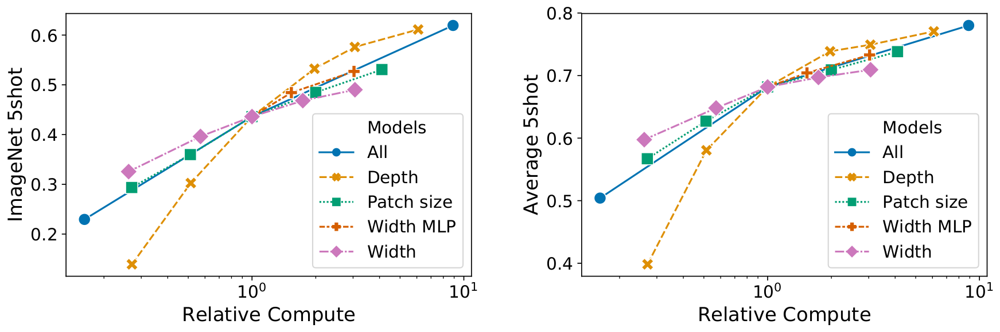

*图 8（原文 Figure 8，第 16 页）：沿不同的模型维度缩放 Vision Transformer。*

**图中文字翻译与读法**：

- 左图纵轴 **ImageNet 5shot**（ImageNet 5-shot 精度），右图纵轴 **Average 5shot**（平均 5-shot 精度）；横轴 **Relative Compute**（相对算力，对数刻度，$10^0$ 对应上述基准配置）。图例 **Models**：**All**（同比例缩放所有维度，蓝色圆点实线）、**Depth**（只加深，橙色叉号虚线）、**Patch size**（只减小 patch，绿色方块点线）、**Width MLP**（只加宽 MLP，橙红色加号）、**Width**（只加宽隐藏维度，粉色菱形点划线）。
- 从图上读出的近似值（ImageNet 5-shot，基准约 0.435）：加深一条在相对算力约 6 倍处达到约 0.61，在缩小一侧则掉得最快（约 0.27 倍算力处只有约 0.14）；加宽一条在约 3 倍处仅约 0.49，是五条里最平的；缩小 patch 在约 4 倍处约 0.53；同比例缩放所有维度，在约 9 倍处约 0.62。
- **读图结论**（对应原文文字）：加深带来的提升最大，在 64 层之内都清晰可见，但 16 层之后就已显出收益递减；加宽网络带来的变化最小；缩小 patch（等价于加长序列）带来出人意料地稳健的提升，而且不增加参数。这些发现暗示：**算力可能比参数量更能预测性能**，如果要缩放应当强调深度而不是宽度；总的来说，按比例同时缩放所有维度能带来稳健的提升。

### 6.3 预测头类型与 `[class]` token（D.3、图 9）

为了尽量贴近原版 Transformer，ViT 使用额外的 `[class]` token 作为图像表示，其输出经一个小 MLP（单个隐藏层，非线性为 tanh）变成类别预测。这一设计沿袭文本 Transformer，整篇文章都用它。

最初尝试过只用 patch 嵌入、做全局平均池化（GAP）后接线性分类器（就像 ResNet 的最后一层特征图），结果很差。但作者发现这既不是因为额外的 token，也不是因为 GAP，**差异完全可以用“需要不同的学习率”来解释**。

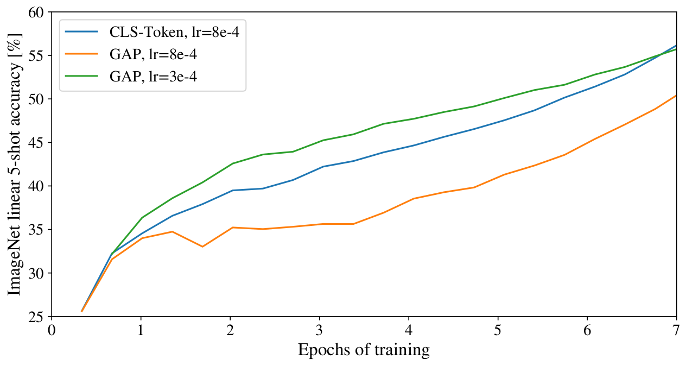

*图 9（原文 Figure 9，第 17 页）：class-token 与全局平均池化（GAP）分类器的比较。两者表现相近，但需要不同的学习率。*

**图中文字翻译与读法**：横轴 **Epochs of training**（训练 epoch，0 到 7），纵轴 **ImageNet linear 5-shot accuracy [%]**（ImageNet 线性 5-shot 精度，25–60）。三条曲线：**CLS-Token, lr=8e-4**（蓝）、**GAP, lr=8e-4**（橙）、**GAP, lr=3e-4**（绿）。**读图结论**：用同样的学习率 8e-4，GAP（橙）明显低于 `[class]`（蓝）——7 个 epoch 时约 50 对约 56；把 GAP 的学习率降到 3e-4（绿），就与 `[class]` 相当（7 个 epoch 时约 55.7 对约 56.1，训练中途还略高）。

### 6.4 位置编码（D.4、表 8）

作者比较了几种编码空间信息的方式：

- **无位置信息**：把输入当成“一袋 patch”；
- **一维位置编码**：把输入看成按光栅顺序排列的 patch 序列（本文所有其他实验的默认）；
- **二维位置编码**：把输入看成二维的 patch 网格，学习两组各 $D/2$ 维的嵌入（X 嵌入和 Y 嵌入，分别对应两个坐标轴），再按 patch 的坐标把两者拼成最终的位置编码；
- **相对位置编码**：用 patch 之间的相对距离代替绝对位置，做一维相对注意力：对任一对（query，key/value），有偏移 $p_q-p_k$，每个偏移对应一个嵌入；再跑一个额外的注意力，用原来的 query（内容），但以相对位置嵌入作 key，把这个相对注意力的 logits 作为偏置加到主（基于内容的）注意力的 logits 上，再做 softmax。

除了编码方式，还试了三种把位置信息放进模型的位置：（1）在模型的 stem 里、送入 Transformer 编码器之前加（**默认**）；（2）每一层开头都学习并加上位置编码；（3）每层开头加一份学到的位置编码，各层**共享**。

**表 8：位置编码消融（ViT-B/16，ImageNet 5-shot 线性精度，以小数表示）。**

| 位置编码类型 | 默认/Stem（输入处加一次） | 每层 | 每层（层间共享） |
|---|---:|---:|---:|
| 无位置编码 | 0.61382 | N/A | N/A |
| 一维位置编码 | 0.64206 | 0.63964 | 0.64292 |
| 二维位置编码 | 0.64001 | 0.64046 | 0.64022 |
| 相对位置编码 | 0.64032 | N/A | N/A |

（原文表 8，第 17 页。）读法：有位置编码与没有之间差距很大（0.614 对 0.640 以上，约 2.6–2.9 个点），但各种位置编码方式之间几乎没有区别（有位置编码的各格最大差 0.0033，约 0.3 个点）。作者推测，因为 Transformer 编码器处理的是 patch 级输入而不是像素级输入，空间维度小得多（如 $14\times14$ 而不是 $224\times224$），在这个分辨率下学习表示空间关系对各种编码都同样容易，所以编码方式不那么重要。这是一个模型、一个评测指标下的结果。即便如此，网络学到的位置编码相似性的具体图案仍取决于训练超参数（见图 10）。

### 6.5 真实速度与显存（D.5、图 12）

理论 FLOPs 并不总能预测真实速度（受 lane 宽度、缓存大小等影响），所以作者在 TPUv3 上对主要模型测了推理速度（推理与反向传播速度的差别是与模型无关的常数因子）。

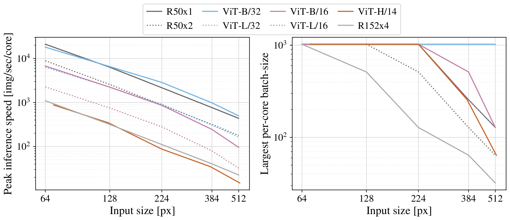

*图 12（原文 Figure 12，第 19 页）：左，不同架构在各种输入尺寸下的真实耗时：ViT 的速度与相近的 ResNet 相当。右，各种架构在不同输入尺寸下单个核能放下的最大 batch：ViT 明显更省显存。*

**图中文字翻译与读法**：

- 图例：**R50x1、R50x2、R152x4**（ResNet 系列）和 **ViT-B/32、ViT-L/32、ViT-B/16、ViT-L/16、ViT-H/14**。横轴 **Input size [px]**（输入尺寸，64、128、224、384、512）。
- **左：Peak inference speed [img/sec/core]**（峰值推理速度，每核每秒图像数，对数刻度）：每个点是在很宽的 batch 范围内测得的最高性能。所有曲线随输入尺寸增大而下降。
- **右：Largest per-core batch-size**（单核最大 batch，对数刻度）：越大越有利于扩展到大数据集。
- **读图结论**：（1）速度上，ViT 与同量级的 ResNet 相当（如 224 像素处 ViT-B/32 略快于 R50x1）；论文指出，ViT 随图像尺寸的理论“双二次”（边长的四次方：token 数随边长平方增长，注意力代价随 token 数平方增长）缩放，**只有在最大模型、最大分辨率时才刚刚显现**。（2）显存上，大 ViT 相对 ResNet 有明显优势：ViT-B/32 与 ViT-L/32 在所有尺寸下都能放到图中的最大 batch（约 $10^3$，水平线），而 R152x4 在 512 像素时只能放约几十张（从图上读出）。

### 6.6 轴向注意力（D.6）

轴向注意力（Axial Attention）沿多维张量的单个轴依次做多次注意力，而不是对展平后的输入做一维注意力：每次注意力只沿某一个轴混合信息，其他轴上的信息保持独立。

- **AxialResNet**（Wang 等 2020b）：把 ResNet50 里所有 $3\times3$ 卷积替换成轴向自注意力（先行注意力再列注意力），并加上相对位置编码；作者自己实现作为基线。
- **Axial-ViT**：把 ViT 改成处理二维形状的输入，并使用轴向 Transformer 块：不是“自注意力 + MLP”，而是“行自注意力 + MLP”接着“列自注意力 + MLP”。

结果（原文图 13，本文未转录）：在 JFT 预训练、ImageNet 5-shot 线性评测下，Axial-ViT-B/32 和 Axial-ViT-B/16 都比相应的 ViT-B 性能更好，**但算力更多**——因为每个全局自注意力块被两个轴向块（一行一列）取代，虽然每次注意力的序列更短，但每个 Axial-ViT 块多了一个 MLP。AxialResNet 在精度/算力权衡上看起来合理，但朴素实现在 TPU 上极慢，所以未能做大规模实验（原文脚注：基于开源的 PyTorch 实现，精度能复现原论文，但在 TPU 上很慢）。

### 6.7 注意力距离与注意力图（D.7、D.8）

- **注意力距离**：为了理解 ViT 如何用自注意力整合整张图的信息，作者分析了不同层注意力权重所跨的平均距离（图 11，已在 5.4 节讲）：它类似 CNN 的感受野大小。在较低的层，注意力距离在不同头之间差别很大（有的头关注图像的大部分，有的只关注查询位置及其附近的小区域）；随着深度增加，所有头的注意力距离都变大；在网络的后半部分，大多数头广泛地关注各处 token。
- **注意力图**（图 6 和图 14）：用 **Attention Rollout**（Abnar & Zuidema 2020）计算：把 ViT-L/16 所有头的注意力权重取平均，再递归地乘上各层的权重矩阵，以计入各层中 token 之间注意力的混合。

### 6.8 ObjectNet（D.9）

在 ObjectNet 基准上评测旗舰模型 ViT-H/14（评测设置同 Kolesnikov 等人 2020）：top-5 精度 82.1%，top-1 精度 61.7%。

### 6.9 VTAB 分项结果（D.10、表 9）

表 9 给出 19 项 VTAB-1k 任务上每一项的得分。原表是横排的（任务为列），这里转置成每行一个任务；任务组与顺序同原表：自然（7 项）、专业（4 项）、结构化（8 项），最后是 19 项的平均。

**表 9：VTAB-1k 各任务的性能分项（%）。**

| 任务组 | 任务 | ViT-H/14（JFT） | ViT-L/16（JFT） | ViT-L/16（I21k） |
|---|---|---:|---:|---:|
| 自然（Natural） | Caltech101 | 95.3 | 95.4 | 90.8 |
|  | CIFAR-100 | 85.5 | 81.9 | 84.1 |
|  | DTD | 75.2 | 74.3 | 74.1 |
|  | Flowers102 | 99.7 | 99.7 | 99.3 |
|  | Pets | 97.2 | 96.7 | 92.7 |
|  | Sun397 | 65.0 | 63.5 | 61.0 |
|  | SVHN | 88.9 | 87.4 | 80.9 |
| 专业（Specialized） | Camelyon | 83.3 | 83.6 | 82.5 |
|  | EuroSAT | 96.7 | 96.5 | 95.6 |
|  | Resisc45 | 91.4 | 89.7 | 85.2 |
|  | Retinopathy | 76.6 | 77.1 | 75.3 |
| 结构化（Structured） | Clevr-Count | 91.7 | 86.4 | 70.3 |
|  | Clevr-Dist | 63.8 | 63.1 | 56.1 |
|  | DMLab | 53.1 | 49.7 | 41.9 |
|  | dSpr-Loc | 79.4 | 74.5 | 74.7 |
|  | dSpr-Ori | 63.3 | 60.5 | 64.9 |
|  | KITTI-Dist | 84.5 | 82.2 | 79.9 |
|  | sNORB-Azim | 33.2 | 36.2 | 30.5 |
|  | sNORB-Elev | 51.2 | 51.1 | 41.7 |
| 平均 | Mean | 77.6 | 76.3 | 72.7 |

（原文表 9，第 22 页。）读法（组内平均为本文由表中数字计算）：ViT-H/14 的自然组平均约 86.7、专业组约 87.0、结构化组约 65.0；ViT-L/16（JFT）依次约 85.6、86.7、63.0；ViT-L/16（I21k）约 83.3、84.7、57.5。19 项总平均与表 2 一致（77.63、76.28、72.72，这里保留一位小数）。结构化组最难，且不同预训练的差距也最大：Clevr-Count 上 JFT 的 ViT-H/14 是 91.7，而 ImageNet-21k 的 ViT-L/16 只有 70.3；个别任务上较小模型反而更好（如 sNORB-Azim 上 ViT-L/16（JFT）36.2 对 ViT-H/14 的 33.2，dSpr-Ori 上 I21k 的 ViT-L/16 为 64.9，高于 JFT 的两个模型）。

## 七、局限、证据边界与常见误读

**论文自己指出的局限与开放问题**（原文第 5 节）：

- 要把 ViT 用到其他视觉任务，如检测和分割；本文结果加上 Carion 等人（DETR）的结果，表明这个方向有前景，但这里没有做；
- 继续探索自监督预训练：初步实验有提升，但自监督与大规模有监督预训练之间仍有很大差距（79.9% 对约 84%）；
- 进一步扩大 ViT 规模很可能继续提升性能（缩放研究里没有看到饱和）。

**证据边界（读数字时要注意）**：

- **最好的结果依赖 JFT-300M**，它是 Google 内部数据集，外部无法获得；公开的 ImageNet-21k 上预训练也能得到很强的结果（ViT-L/16 在 ImageNet 上 85.30），但没有达到最高水平（88.55）。
- **小数据上 ViT 更弱**：ImageNet 从头训练时，ViT-L 比 ViT-B 还差（表 5：76.53 对 77.91），图 3、图 4 里 ViT 在小数据时低于 ResNet。“ViT 优于 CNN”只在预训练数据足够大时成立。
- **算力对比的口径**：TPUv3-core-days 与 exaFLOPs 来自作者自己的实现与估计，硬件、实现、训练计划不同就不能直接外推；论文自己也提示预训练效率还取决于训练计划、优化器、权重衰减等。受控的缩放研究只用 JFT-300M 预训练、迁移到 5 个自然图像分类数据集，且各模型用的是各自的学习率（表 3）。
- **统计显著性**：表 2 是三次微调的均值 ± 标准差；其他表（表 5、6、7、8）是单次结果，没有方差。位置编码消融（表 8）的差异只有约 0.3 个点，只在 ViT-B/16 一个模型、一个指标上做。
- **表间的小不一致**：表 5 与表 6 中同名模型的数字大体相同，但 ViT-H/14 有差别；表 4 与 B.1.1 对 ImageNet 学习率 0.06 的描述略有出入；图 4 横轴刻度写 10M/100M，正文写 9M/90M；参数量 307M（表 1）与按结构估算的约 304M 有出入。原文都没有说明原因。
- **可视化是定性的**：注意力图、位置编码相似性图、注意力距离图支持“ViT 学到了二维结构、能整合全局信息”，但不是因果证明。
- **自监督实验是初步的**，只对 ViT-B/16、一种掩码目标做了对比。

**常见误读**：

- “ViT 证明图像不需要任何空间先验”：错。切 patch 和微调时对位置编码做二维插值，本身仍注入了二维结构；论文也没有声称小数据上 ViT 天然优于 CNN，相反，数据规模依赖正是它的重要结论。
- “ViT 一定更省算力”：只有在大规模预训练、控制好其他因素的受控比较里，才约省 $2$–$4$ 倍；在 ImageNet 上从头训练时，ViT 需要强正则化（权重衰减 0.3、dropout 0.1、300 epoch），ViT-B/16 也只有 77.9%（表 5），处在 BiT ResNet 范围（图 3 阴影区，约 76.8 到 81.3，从图上读出）的下半部。
- “全局注意力在高分辨率下必然昂贵得无法使用”：理论上注意力代价随图像边长四次方增长，但实测里只有最大模型、最大分辨率才刚刚出现这种趋势（图 12）；不过序列长度仍随分辨率平方增长，论文的实验也只到 512 左右的输入，检测、分割等更高分辨率的任务留作未来工作。
- “必须用 `[class]` token”：D.3 表明 GAP 配合合适的学习率同样可以，差别主要在学习率。
- “二维位置编码更好”：表 8 显示几乎没有差别。
- “Large 比 Base 总是更好”：在 ImageNet 预训练时反而更差（图 3、表 5）。

## 八、复现检查清单

- **输入与 patch**：patch 按光栅顺序展平并线性投影（实现上等价于核大小和步长都等于 patch 边长的卷积，这是实现提示，不是论文原话）；序列长度 $N+1$，位置编码形状 $(N+1)\times D$。
- **编码器**：pre-norm（LN 在子层之前）、残差、MLP 隐藏维度 $4D$、GELU；头数 $k$ 与 $D_h=D/k$；最终对 `[class]` 输出做 LN。
- **头**：预训练用带 tanh 隐藏层的 MLP 头，微调换成零初始化的单个线性层。
- **分辨率**：微调用更高分辨率时保持 patch 大小，对位置编码做二维插值，并记录插值方法。
- **优化**：预训练用 Adam（$\beta=(0.9,0.999)$）、权重衰减 0.1、batch 4096、预热 10k 步；微调用 SGD（动量 0.9）、batch 512、余弦衰减、不用权重衰减、梯度裁剪 1；ImageNet 从头训练要用强正则（权重衰减 0.3、dropout 0.1、300 epoch、梯度裁剪）。
- **评测口径**：区分表 2（518/512 分辨率 + Polyak 平均）与表 5/6（384 分辨率）；少样本线性评测用闭式的正则化最小二乘解；预训练集对下游测试集做去重。
- **基线**：ResNet 基线要用 BiT 变体（Group Norm + 标准化卷积）和 Adam 预训练，否则比较不公平。
- **报告项**：同时报告 patch 大小、输入分辨率、序列长度，以及预训练数据和算力。
- **数据**：JFT-300M 不可得，复现趋势可用 ImageNet-21k；注意小数据下结论会变。

## 九、与相关论文的关系

- **Transformer**（[../transformer/论文中文解读.md](../transformer/论文中文解读.md)）：ViT 的编码器就是原版 Transformer 编码器，只是输入换成 patch 嵌入。
- **BERT**（[../bert/论文中文解读.md](../bert/论文中文解读.md)）：`[class]` token、Base/Large 规模、掩码预测的自监督（5.5 节）都来自 BERT 的做法。
- **ResNet**（[../resnet/论文中文解读.md](../resnet/论文中文解读.md)）：本文的主要对照，BiT 是它的大规模迁移学习版本。
- **Swin Transformer**（[../swin_transformer/论文中文解读.md](../swin_transformer/论文中文解读.md)）：针对 ViT 的单一尺度和全局注意力的二次成本，改用分层结构与移位窗口，恢复局部性和多尺度。
- **CLIP**（[../clip/论文中文解读.md](../clip/论文中文解读.md)）：把 ViT 作为图像编码器之一，改变监督信号（图文对比学习）。
- **DiT**（[../dit/论文中文解读.md](../dit/论文中文解读.md)）：把 ViT 风格的块用在扩散模型的去噪主干上。

## 原文证据导航

- [原论文 PDF](paper.pdf)
- [原文提取文本](paper.txt)
- [论文概要](论文概要.md)
