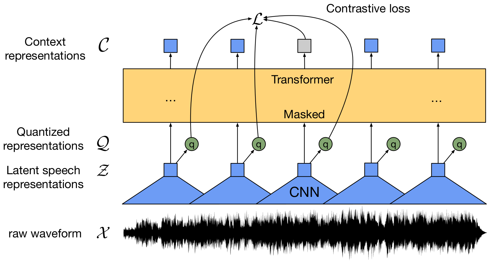
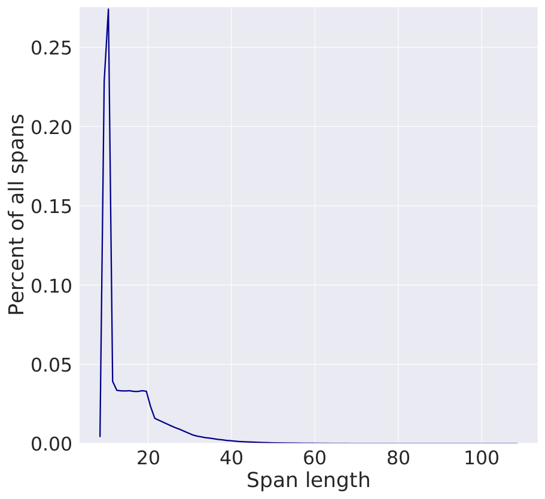
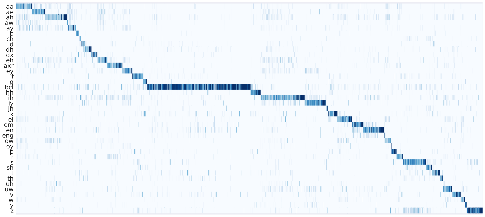

# 论文中文解读：《wav2vec 2.0: A Framework for Self-Supervised Learning of Speech Representations》

> **基本信息**：Alexei Baevski、Henry Zhou、Abdelrahman Mohamed、Michael Auli（Facebook AI），arXiv:2006.11477（本文依据 v3，2020 年 10 月）；论文原文 [官方页面](https://arxiv.org/abs/2006.11477)；代码与模型在 fairseq（github.com/pytorch/fairseq）。
>
> **本文的读法**：图为从论文 PDF 中按图裁出的原图，表为逐格核对后的中文转录（数字、模型名、数据集名保持原样，表头译成中文）；每张图后有中文图题、图中文字翻译和读图结论，因此不必再翻英文原文。附录里的遮蔽分布、微调设置、完整结果、离散单元分析、错误分析和超参数消融也一并整理在对应章节。

## 一、一句话结论

wav2vec 2.0 先用大量**没有转写的语音**做自监督预训练，再用很少的转写数据微调，得到很强的语音识别器。预训练的做法是：多层卷积网络把原始波形压成约每 20 ms 一帧的潜在表示 $z$；在潜在空间里成段遮住约 49% 的帧，把带遮蔽的序列送进 Transformer 得到上下文表示 $c$；同时用 product quantization 把（未遮蔽的）$z$ 离散成码字 $q$ 当作目标，要求每个被遮位置的 $c_t$ 在 $K+1$ 个候选里认出真正的 $q_t$（对比任务），再加一个鼓励码本被均匀使用的多样性损失。微调时在 Transformer 之上接一个线性层，用 CTC 损失训练字符识别。

主要结果（Librispeech 测试集 WER，clean/other，越低越好）：只用 10 分钟标注、预训练用 53.2k 小时无标注语音，并配 Transformer 语言模型，为 4.8/8.2；用 1 小时标注、预训练只用 Librispeech 的 960 小时（LS-960），为 3.9/7.6，已经优于用 100 小时标注的 noisy student（4.2/8.6）；用全部 960 小时标注为 1.8/3.3。TIMIT 音素错误率 dev/test 为 7.4/8.3，比此前最好的 vq-wav2vec（9.6/11.6）低很多。

## 二、背景与前置知识

### 2.1 要解决的问题

神经网络受益于大量标注数据，但很多场景里标注数据比无标注数据难得多：当前语音识别系统需要数千小时转写才能达到可用水平，而世界上近 7,000 种语言中的绝大多数没有这样的数据。人类婴儿学语言是靠“听”，需要先学到好的语音表示，而不是靠标注样本。自监督学习（self-supervised learning）先从无标注数据里学通用表示，再在标注数据上微调，在自然语言处理里已经很成功（BERT 等），论文要把它做到原始语音上。

### 2.2 读本文需要的基础概念

- **WER**（word error rate，词错误率）：参考转写与识别结果对齐后，用“替换、删除、插入的词数之和”除以参考转写的总词数；**PER**（phoneme error rate）同理，以音素为单位。越低越好。（通用定义，论文未展开。）
- **CTC**（Connectionist Temporal Classification）：不需要帧级对齐的序列损失。模型对每个时间步输出“某个字符或空白符”的概率分布，损失把所有能折叠成目标转写的对齐路径的概率加起来（折叠规则：先合并相邻重复，再去掉空白）。（通用背景，论文只引用。）
- **Librispeech**：英语有声书朗读语料，带转写的部分共 960 小时（简称 LS-960 时指其音频）；dev/test 各分 clean（较容易）与 other（更难）两档。**LibriVox** 是有声书来源网站，论文的 **LV-60k** 指 LibriVox 的无标注音频，按 Libri-light 的预处理流程处理后共 53.2k 小时。**Libri-light** 提供了从 Librispeech 抽取的低资源有标注子集：train-10h、train-1h、train-10min。
- **TIMIT**：约 5 小时、带详细音素标注的录音；用标准划分，音素合并为 39 类，指标是 PER。
- **语言模型（LM）解码**：声学模型输出字符概率后，可以接外部语言模型（4-gram 或 Transformer LM）做 beam search 来纠正拼写、词序。有无语言模型的 WER 相差很大，必须分开看。
- **SpecAugment**：对输入特征在时间和通道上做遮蔽的数据增强。本文在微调时用了它的一个变体。

### 2.3 与前作的区别

- **两步法的前作**（vq-wav2vec、Discrete BERT）：先学一个量化（离散化）的语音单元，再在离散单元序列上训练自注意力模型。
- **其他 Transformer 遮蔽预训练**：要么是两步流程，要么通过重建滤波器组（filter bank）输入特征来训练。
- **本文**：在潜在空间遮蔽，用对比任务训练，**目标是与模型一起联合学习出来的量化表示**，离散单元和上下文表示端到端同时学。并且 Transformer 的**输入保持连续**，只在对比任务的目标侧做量化（第 8.1 节的消融说明这一点很关键）。

## 三、模型

模型由三部分组成：多层卷积**特征编码器** $f:\mathcal{X}\to\mathcal{Z}$，把原始音频 $X$ 变成 $T$ 个时间步的潜在语音表示 $z_1,\dots,z_T$；**Transformer** $g:\mathcal{Z}\to\mathcal{C}$，建立能捕获整句信息的上下文表示 $c_1,\dots,c_T$；**量化模块** $\mathcal{Z}\to\mathcal{Q}$，把编码器输出离散化成 $q_t$，作为自监督目标。与 vq-wav2vec 相比，本模型在连续的语音表示上建立上下文表示，并且自注意力端到端地捕获整个潜在序列上的依赖。

*图 1（原文 Figure 1，第 2 页）：本文框架的示意，它联合学习上下文化的语音表示和一个离散化语音单元的库。*

**图中文字翻译与读法**：

- 自下而上的各层，左侧是层名：raw waveform $\mathcal{X}$（原始波形）；Latent speech representations $\mathcal{Z}$（潜在语音表示，由蓝色梯形的 CNN 产生，每个梯形对应一个时间步，相邻梯形的感受野相互重叠）；Quantized representations $\mathcal{Q}$（量化表示，绿色圆圈 q）；Transformer（橙色大框，框内标 Masked，表示送入它的部分位置被遮蔽）；Context representations $\mathcal{C}$（上下文表示，框上方的方块，其中灰色方块是被遮蔽位置的输出）；最上方是 Contrastive loss（对比损失 $\mathcal{L}$）。
- 数据流：波形经 CNN 得到每个时间步的 $z$（蓝色小方块，位于每个梯形顶端，共 5 个）；每个 $z$ 一方面（遮蔽后）向上进入 Transformer，另一方面经斜向箭头进入量化模块，得到右上方的绿色圆圈 $q$；Transformer 输出 5 个 $c$（蓝色方块，其中第 3 个是灰色，表示被遮蔽位置的输出）。图中有 3 个 $q$（第 1、2、3 个）和那个灰色方块通过曲线连到 $\mathcal{L}$：与灰色方块同一位置（第 3 个）的 $q$ 是真实目标 $q_t$，另外两个是干扰项（正文规定干扰项取自同一句话里其他被遮蔽的时间步）。对比损失就是让灰色方块的 $c_t$ 与真实的 $q_t$ 相似、与干扰项不相似。
- **读图结论**：目标 $q$ 来自没有被遮蔽的 $z$，输入 Transformer 的是被遮蔽的连续 $z$；离散化只发生在目标一侧。

### 3.1 特征编码器

由若干块组成，每块是“一维时间卷积 + 层归一化（LayerNorm）+ GELU 激活”。送入编码器的原始波形先归一化为零均值、单位方差。编码器的总步长决定了送进 Transformer 的时间步数 $T$。

具体配置（第 4.2 节）：7 个块，每块的时间卷积都是 512 个通道，步长依次为 (5, 2, 2, 2, 2, 2, 2)，卷积核宽度依次为 (10, 3, 3, 3, 3, 2, 2)。这使编码器输出频率约为 49 Hz，即相邻两个输出相隔约 20 ms，每个输出的感受野是 400 个输入采样点（25 ms 音频）。（由 250k 采样点对应 15.6 秒可推出采样率为 16 kHz。）

### 3.2 用 Transformer 建立上下文表示

编码器输出送入遵循标准 Transformer 结构的上下文网络。区别在于：不用编码绝对位置的固定位置嵌入，而用一个**卷积层充当相对位置嵌入**（卷积核大小 128，16 组）。把卷积输出经 GELU 后加到输入上，再做层归一化。

### 3.3 量化模块

自监督训练时，用 **product quantization**（乘积量化）把特征编码器输出 $z$ 离散化成有限个语音表示。做法：有 $G$ 个码本（也叫组），每个码本有 $V$ 个条目，条目 $e\in\mathbb{R}^{V\times d/G}$；从每个码本各选一个条目，把得到的 $G$ 个向量 $e_1,\dots,e_G$ 拼起来，再过一个线性变换 $\mathbb{R}^{d}\to\mathbb{R}^{f}$，得到 $q\in\mathbb{R}^{f}$。本文用 $G=2$、$V=320$，理论上最多 $320^2=102{,}400$ 个不同的码字。

**如何让“选条目”这个离散操作可训练**：用 Gumbel softmax（完全可微地选择离散码本条目）和 straight-through 估计器，并设置 $G$ 个硬（hard）Gumbel softmax 运算。编码器输出 $z$ 被映射成 logits $l\in\mathbb{R}^{G\times V}$，第 $g$ 组选第 $v$ 个条目的概率是

$$
p_{g,v}=\frac{\exp\big((l_{g,v}+n_v)/\tau\big)}{\sum_{k=1}^{V}\exp\big((l_{g,k}+n_k)/\tau\big)},
$$

其中 $\tau$ 是非负的温度，$n=-\log(-\log u)$，$u$ 从均匀分布 $\mathcal{U}(0,1)$ 中采样。**前向传播时**取 $i=\arg\max_j p_{g,j}$ 选定码字，**反向传播时**使用 Gumbel softmax 输出的真实梯度。

> **一处排版问题**：原文式 (1) 把“$/\tau$”写在了 exp 的外面（$\exp(l+n)/\tau$），按字面分子分母的 $\tau$ 会约掉，温度就没有作用；上面是按 Gumbel softmax 的标准定义（温度在 exp 里面）写的，应是原文的本意。

## 四、预训练

预训练分三件事：在潜在空间遮蔽一部分时间步（类似 BERT 的掩码语言建模）；要求对每个被遮蔽的时间步，从一组干扰项里认出正确的量化潜在表示；最后把模型在标注数据上微调。

### 4.1 遮蔽

把特征编码器输出的一部分时间步在送入上下文网络前遮蔽掉，并**替换成一个所有被遮蔽时间步共享的、训练得到的特征向量**；**量化模块的输入不被遮蔽**（目标来自未遮蔽的 $z$）。选择遮蔽位置的方法：不放回地随机采样所有时间步中比例为 $p$ 的位置作为**起点**，然后从每个起点开始遮蔽其后连续的 $M$ 个时间步；各段可以重叠。

本文取 $p=0.065$、$M=10$，这使约 **49%** 的时间步被遮蔽，被遮蔽的连续区间的平均长度是 14.7 个时间步，约 299 ms。可以自行验算：一个时间步不被遮蔽，当且仅当它和它前面 9 个时间步都不是起点，概率为 $(1-0.065)^{10}\approx0.51$，所以被遮蔽的比例约 $1-0.51=49\%$。

*图 2（原文 Figure 2，附录 A，第 12 页）：15 秒音频样本在 $p=0.065$、$M=10$ 时的遮蔽区间长度分布。*

**图中文字翻译与读法**：

- 横轴 Span length（遮蔽区间长度，单位是时间步），纵轴 Percent of all spans（该长度的区间占全部区间的比例；刻度 0.00–0.25，曲线峰值约 0.27，数值更像“比例”而不是“百分数”，原文没有说明）。
- 曲线在长度 10 处有一个极高的尖峰，从图上读出约为 0.27（图中 10 之前那一小段陡升很可能是绘图平滑所致；按 $M=10$，区间最短为 10 步，这是本文的判断）；紧接着在约 12 到 20 之间是一段近似平台，高度约 0.033；约 21 之后下降，到 30 左右约 0.005，50–60 之后几乎为 0；曲线一直延伸到约 108 步（原文给出的最大值约 100 步）。（以上数值均为从图上读出的近似值。）
- 原文数字：平均区间长度 14.7 个时间步（299 ms），中位数 10 个时间步，最大约 100 个时间步，约 49% 的时间步被遮蔽。
- **读图结论**：因为起点可以重叠，相邻的段会连成更长的区间，所以长度分布以 $M=10$ 为下限、带长尾：单独一段正好是 10 步（尖峰），多段首尾相接或重叠形成更长的区间（平台与长尾），因此平均长度（14.7）大于中位数（10）。

### 4.2 训练目标

预训练的目标是**对比损失** $\mathcal{L}_m$ 加上**码本多样性损失** $\mathcal{L}_d$：

$$
\mathcal{L}=\mathcal{L}_m+\alpha\,\mathcal{L}_d,
$$

其中 $\alpha$ 是调出来的超参数，本文取 $\alpha=0.1$。

**对比损失**。设上下文网络在被遮蔽时间步 $t$ 处的输出为 $c_t$。模型需要在 $K+1$ 个量化候选表示 $\tilde q\in Q_t$ 中认出真正的 $q_t$，候选里包含 $q_t$ 本身和 $K$ 个干扰项。**干扰项是从同一句话里其他被遮蔽的时间步中均匀采样的**。损失为

$$
\mathcal{L}_m=-\log\frac{\exp\big(\operatorname{sim}(c_t,q_t)/\kappa\big)}{\sum_{\tilde q\sim Q_t}\exp\big(\operatorname{sim}(c_t,\tilde q)/\kappa\big)},
\qquad
\operatorname{sim}(a,b)=\frac{a^{\top}b}{\lVert a\rVert\,\lVert b\rVert}.
$$

即对上下文表示和量化表示之间的余弦相似度除以温度 $\kappa$ 后做 softmax，让正确候选的概率尽量大。本文 $\kappa=0.1$，$K=100$。

**多样性损失**。对比任务要靠码本来表示正例和负例，所以要让码本里的条目被均衡地使用。做法是对每个码本，最大化它在一个 batch 的所有句子上平均后的 softmax 分布的熵：

$$
\mathcal{L}_d=\frac{1}{GV}\sum_{g=1}^{G}-H(\bar p_g)=\frac{1}{GV}\sum_{g=1}^{G}\sum_{v=1}^{V}\bar p_{g,v}\log\bar p_{g,v}.
$$

这里 $\bar p_g$ 是第 $g$ 个码本上 $V$ 个条目的平均选择概率，这个 softmax 分布**不含 Gumbel 噪声，也不含温度**。原文脚注说明：实际实现是通过最大化困惑度来达到同样的目的，对应的损失写法为 $\big(GV-\sum_{g=1}^{G}\exp(-\sum_{v=1}^{V}p_{gv}\log p_{gv})\big)/(GV)$，与上式等价。

**直觉小结**：遮蔽迫使模型靠上下文去“猜”被遮位置的内容；量化把目标变成有限个码字，既让任务更稳健，又让模型学出类似“语音单元”的离散库；多样性损失防止所有帧都挤到少数几个码字上（码本坍塌）。

### 4.3 预训练配置

下表据原文第 4.2 节整理（非原文表格）：

| 项目 | BASE | LARGE |
|---|---|---|
| 参数量（原文表 1 题注） | 95M | 317M |
| Transformer 层数 | 12 | 24 |
| 模型维度 | 768 | 1,024 |
| FFN 内部维度 | 3,072 | 4,096 |
| 注意力头数 | 8 | 16 |
| 每条样本裁剪长度 | 250k 采样点（15.6 秒） | 320k 采样点（20 秒） |
| 每 GPU 采样点上限 | 1.4M | 1.2M |
| GPU 与训练时间 | 64 块 V100，1.6 天 | 128 块 V100，Librispeech 上 2.3 天，LibriVox 上 5.2 天 |
| 总 batch（音频时长） | 1.6 小时 | 2.7 小时 |
| 峰值学习率 | $5\times10^{-4}$ | $3\times10^{-4}$ |
| 更新次数 | 400k | 250k（LS-960）；600k（LV-60k） |
| LayerDrop（预训练） | 0.05 | 0.2（LV-60k 上不用） |
| 码本条目维度 $d/G$ | 128 | 384 |
| Gumbel 温度 $\tau$ | 从 2 退火到最低 0.5 | 从 2 退火到最低 0.1 |

**两个模型共用的设置**：特征编码器为 7 个块（见第 3.1 节）；量化模块 $G=2$、$V=320$；Dropout 0.1（用在 Transformer 内、特征编码器输出处和量化模块输入处）；Adam 优化器，学习率前 8% 的更新次数线性预热到峰值，然后线性衰减；$\tau$ 每次更新乘以 0.999995 衰减；$\alpha=0.1$、$\kappa=0.1$、$K=100$；遮蔽 $p=0.065$、$M=10$；用验证集上 $\mathcal{L}_m$ 最低的检查点。

**仅在较小的 Librispeech 数据上的额外设置**：对特征编码器最后一层的激活加 L2 惩罚，并把编码器的梯度缩小为 1/10；编码器结构略有不同：不用层归一化，改为对第一层编码器的输出（而不是原始波形）做归一化。

## 五、微调与解码

### 5.1 微调

- **模型**：在上下文网络之上加一个随机初始化的线性投影，映射到 $C$ 个类别（任务词表）。Librispeech 用 29 个字符标记外加一个词边界标记；TIMIT 预测音素。
- **损失与增强**：最小化 CTC 损失；采用 SpecAugment 的修改版，在时间步和通道上做遮蔽，可延缓过拟合，在标注极少的 Libri-light 子集上改善尤其明显。
- **遮蔽细节**（附录 B）：随机选一些起点，把其后连续 10 个时间步的特征编码器输出替换成预训练时同一个遮蔽嵌入；通道上也选一些起点，各扩展成连续的 64 个通道，置零。段与段可以重叠。微调时用 LayerDrop：BASE 为 0.05，LARGE 为 0.1。
- **优化**：Adam，三段式学习率（前 10% 的更新预热，接下来 40% 保持不变，其余线性衰减）。BASE 每块 GPU 3.2M 个采样点，在 8 块 GPU 上微调，总 batch 为 1,600 秒；LARGE 每块 GPU 1.28M 个采样点，24 块 GPU，总 batch 为 1,920 秒。**前 10k 次更新只训练输出分类器，之后才更新 Transformer；特征编码器在微调时始终不训练。**
- **学习率与选择**：Libri-light 各子集都用 3 个随机种子、2 个学习率（2e-5 和 3e-5），按 dev-other 上的 WER（用官方 4-gram 语言模型、beam 50、固定语言模型权重 2、词插入惩罚 −1 解码）选配置；BASE 在 960 小时标注上用学习率 1e-4。

各设置的微调超参数：

| 标注量 | 时间步遮蔽概率 | 通道遮蔽概率 | 更新次数 |
|---|---:|---:|---:|
| 10 min | 0.075 | 0.008 | 12k |
| 1 hour | 0.075 | 0.004 | 13k |
| 10 hours | 0.065 | 0.004 | 20k |
| 100 hours | 0.05 | 0.008 | 50k |
| 960 hours | 0.05 | 0.0016 | 320k |
| TIMIT | 0.065 | 0.012 | 40k |

（原文表 6：微调超参数，附录 B，第 13 页。）

### 5.2 语言模型与解码

用了两类语言模型：一个 **4-gram** 和一个在 Librispeech 语言模型语料上训练的 **Transformer 语言模型**（结构与 Synnaeve 等人的工作相同：20 块、模型维度 1,280、FFN 内部维度 6,144、16 个头）。语言模型权重（搜索区间 [0, 5]）和词插入惩罚（[−5, 5]）用贝叶斯优化调：跑 128 次试验，4-gram 用 beam 500，Transformer 语言模型用 beam 50，按 dev-other 上的表现选权重。**测试**时 n-gram 用 beam 1,500，Transformer 语言模型用 beam 500；解码器采用 wav2letter++ 的 beam search 解码器。

## 六、实验设置：数据

- **无标注数据**：Librispeech 去掉转写后的音频，960 小时（LS-960）；或 LibriVox 的音频（LV-60k，按 Libri-light 的预处理后共 53.2k 小时）。
- **五档有标注数据**：960 小时转写的 Librispeech 全集；train-clean-100 子集（100 小时）；以及 Libri-light 的低资源训练子集 train-10h（10 小时）、train-1h（1 小时）、train-10min（10 分钟）。后三者按 Libri-light 的评测协议，在标准 Librispeech dev-clean/other 和 test-clean/other 上评测。10 分钟标注相当于 48 条录音，平均每条 12.5 秒。
- **TIMIT**：微调做音素识别，约 5 小时、带详细音素标注，用标准的训练/开发/测试划分，音素标签合并成 39 类。

## 七、实验结果

### 7.1 低资源标注：10 分钟到 100 小时

设置：预训练用 LS-960 或 LV-60k；多数结果用 Transformer 语言模型解码（不用语言模型和用 4-gram 的结果在附录表 9）。下面分四档标注量转录原文表 1：表中同一模型后续行省略了重复的模型名和无标注数据，这里已补全；“—”表示原文该格为空。

**10 分钟标注**

| 模型 | 无标注数据 | 语言模型 | dev clean | dev other | test clean | test other |
|---|---|---|---:|---:|---:|---:|
| Discrete BERT | LS-960 | 4-gram | 15.7 | 24.1 | 16.3 | 25.2 |
| BASE | LS-960 | 4-gram | 8.9 | 15.7 | 9.1 | 15.6 |
| BASE | LS-960 | Transf. | 6.6 | 13.2 | 6.9 | 12.9 |
| LARGE | LS-960 | Transf. | 6.6 | 10.6 | 6.8 | 10.8 |
| LARGE | LV-60k | Transf. | 4.6 | 7.9 | 4.8 | 8.2 |

**1 小时标注**

| 模型 | 无标注数据 | 语言模型 | dev clean | dev other | test clean | test other |
|---|---|---|---:|---:|---:|---:|
| Discrete BERT | LS-960 | 4-gram | 8.5 | 16.4 | 9.0 | 17.6 |
| BASE | LS-960 | 4-gram | 5.0 | 10.8 | 5.5 | 11.3 |
| BASE | LS-960 | Transf. | 3.8 | 9.0 | 4.0 | 9.3 |
| LARGE | LS-960 | Transf. | 3.8 | 7.1 | 3.9 | 7.6 |
| LARGE | LV-60k | Transf. | 2.9 | 5.4 | 2.9 | 5.8 |

**10 小时标注**

| 模型 | 无标注数据 | 语言模型 | dev clean | dev other | test clean | test other |
|---|---|---|---:|---:|---:|---:|
| Discrete BERT | LS-960 | 4-gram | 5.3 | 13.2 | 5.9 | 14.1 |
| Iter. pseudo-labeling | LS-960 | 4-gram+Transf. | 23.51 | 25.48 | 24.37 | 26.02 |
| Iter. pseudo-labeling | LV-60k | 4-gram+Transf. | 17.00 | 19.34 | 18.03 | 19.92 |
| BASE | LS-960 | 4-gram | 3.8 | 9.1 | 4.3 | 9.5 |
| BASE | LS-960 | Transf. | 2.9 | 7.4 | 3.2 | 7.8 |
| LARGE | LS-960 | Transf. | 2.9 | 5.7 | 3.2 | 6.1 |
| LARGE | LV-60k | Transf. | 2.4 | 4.8 | 2.6 | 4.9 |

**100 小时标注**

| 模型 | 无标注数据 | 语言模型 | dev clean | dev other | test clean | test other |
|---|---|---|---:|---:|---:|---:|
| Hybrid DNN/HMM | - | 4-gram | 5.0 | 19.5 | 5.8 | 18.6 |
| TTS data augm. | - | LSTM | — | — | 4.3 | 13.5 |
| Discrete BERT | LS-960 | 4-gram | 4.0 | 10.9 | 4.5 | 12.1 |
| Iter. pseudo-labeling | LS-860 | 4-gram+Transf. | 4.98 | 7.97 | 5.59 | 8.95 |
| Iter. pseudo-labeling | LV-60k | 4-gram+Transf. | 3.19 | 6.14 | 3.72 | 7.11 |
| Noisy student | LS-860 | LSTM | 3.9 | 8.8 | 4.2 | 8.6 |
| BASE | LS-960 | 4-gram | 2.7 | 7.9 | 3.4 | 8.0 |
| BASE | LS-960 | Transf. | 2.2 | 6.3 | 2.6 | 6.3 |
| LARGE | LS-960 | Transf. | 2.1 | 4.8 | 2.3 | 5.0 |
| LARGE | LV-60k | Transf. | 1.9 | 4.0 | 2.0 | 4.0 |

（原文表 1，第 6 页：Librispeech dev/test 上的 WER，在 Libri-light 低资源标注设置（10 分钟、1 小时、10 小时）和 Librispeech 的 clean 100 小时子集上训练；单位为 %，越低越好。BASE 为 95M 参数，LARGE 为 317M 参数。此前工作用的是 860 小时无标注数据（LS-860），加上有标注数据正好是 960 小时，与本文设置可比。表中 Discrete BERT 是两步法前作，Iter. pseudo-labeling 是迭代伪标注自训练，Noisy student 是迭代的 noisy student 自训练，Hybrid DNN/HMM 和 TTS data augm. 是传统混合系统和合成语音数据增强的基线。）

**读法**：

1. **联合学习优于两步法**：同样用 4-gram 语言模型、同样的 LS-960，BASE 比 Discrete BERT 的 WER 降低约三分之一（原文说法）。以 test 为例：10 分钟 16.3/25.2 降到 9.1/15.6，1 小时 9.0/17.6 降到 5.5/11.3，10 小时 5.9/14.1 降到 4.3/9.5，100 小时 4.5/12.1 降到 3.4/8.0。
2. **与此前最好的自训练方法比**（noisy student，100 小时 clean 子集上的 SOTA，需要多轮标注、过滤、重训，而本文只需预训练加微调）：它在 100 小时标注下 test 为 4.2/8.6，LARGE（LS-960）在同样设置下为 2.3/5.0，相对降低 45%/42%；LARGE 只用 10 小时标注（少一个数量级）为 3.2/6.1，相对降低 24%/29%；只用 1 小时标注（少两个数量级）为 3.9/7.6，相对降低 7%/12%。这些百分比用表中数字复算，与原文一致。
3. **模型与数据规模都有帮助**：BASE 到 LARGE（都是 LS-960）降低 WER，提升在 test-other 上最大；LS-960 到 LV-60k（都是 LARGE）也大幅降低 WER，例如 1 小时标注 test 从 3.9/7.6 降到 2.9/5.8。
4. **只用 10 分钟标注也能工作**：LARGE + LV-60k + Transformer 语言模型，test 为 4.8/8.2；10 分钟标注只有 48 条录音（平均 12.5 秒），这说明极低资源语音识别是可行的。
5. 原文补充说明：Libri-light 的低资源划分同时含 clean 与 noisy 数据，原文认为这使 test-other 上的准确率相对 test-clean 更好。

> **数字不一致**：原文第 5.1 节正文写“LARGE（LV-60k）只用 10 分钟标注，在 clean/other 测试集上 WER 为 5.2/8.6”，但摘要、引言、结论和表 1、表 9 都是 4.8/8.2。以表中数字（4.8/8.2）为准。

### 7.2 高资源标注：Librispeech 全部 960 小时

设置：把同样的模型在完整的 960 小时标注上微调（BASE 与 LARGE 预训练于 LS-960，LARGE 预训练于 LV-60k）。

| 模型 | 无标注数据 | 语言模型 | dev clean | dev other | test clean | test other |
|---|---|---|---:|---:|---:|---:|
| **有监督** | | | | | | |
| CTC Transf | - | CLM+Transf. | 2.20 | 4.94 | 2.47 | 5.45 |
| S2S Transf. | - | CLM+Transf. | 2.10 | 4.79 | 2.33 | 5.17 |
| Transf. Transducer | - | Transf. | - | - | 2.0 | 4.6 |
| ContextNet | - | LSTM | 1.9 | 3.9 | 1.9 | 4.1 |
| Conformer | - | LSTM | 2.1 | 4.3 | 1.9 | 3.9 |
| **半监督** | | | | | | |
| CTC Transf. + PL | LV-60k | CLM+Transf. | 2.10 | 4.79 | 2.33 | 4.54 |
| S2S Transf. + PL | LV-60k | CLM+Transf. | 2.00 | 3.65 | 2.09 | 4.11 |
| Iter. pseudo-labeling | LV-60k | 4-gram+Transf. | 1.85 | 3.26 | 2.10 | 4.01 |
| Noisy student | LV-60k | LSTM | 1.6 | 3.4 | 1.7 | 3.4 |
| **本文** | | | | | | |
| LARGE - from scratch | - | Transf. | 1.7 | 4.3 | 2.1 | 4.6 |
| BASE | LS-960 | Transf. | 1.8 | 4.7 | 2.1 | 4.8 |
| LARGE | LS-960 | Transf. | 1.7 | 3.9 | 2.0 | 4.1 |
| LARGE | LV-60k | Transf. | 1.6 | 3.0 | 1.8 | 3.3 |

（原文表 2，第 7 页：使用全部 960 小时标注数据时 Librispeech 上的 WER，参见表 1。CLM 在原文中未定义，指前作所用的另一种语言模型，这里保持原样；“PL”指伪标注。）

**读法**：

1. 最好的结果 LARGE（LV-60k）在 test-clean/other 上为 1.8/3.3。**要看清楚比较对象**：test-other（更难的一档）上，3.3 略优于此前最好的 noisy student（3.4）；但 test-clean 上 noisy student 的 1.7 仍略优于 1.8（dev-clean 两者同为 1.6，dev-other 上本文 3.0 优于 3.4），所以摘要里“超过最好的半监督方法”只在 other 档成立，原文结论里也只说在“噪声语音”（other）上达到新的最好结果。
2. 架构基线并不强：本文架构从头有监督训练（LARGE - from scratch）为 2.1/4.6，而 noisy student 所用的基线架构 ContextNet 为 1.9/4.1；本文用的是简单的 Transformer 加 CTC，不如 seq2seq 模型。
3. 原文提出三个可能让结果还有提升空间的因素：声学模型的词表是字符，而语言模型的词表是词，两者不匹配会延迟语言模型的反馈，近期工作大多对两者都用更好的词片（word pieces）；本文没有做 noisy student 那样的数据均衡；自训练很可能与预训练互补，两者结合也许更好。
4. 按表中数字看，在 960 小时标注下，预训练相对从头训练的提升不大：LARGE 从头训练 test 为 2.1/4.6，预训练于 LS-960 为 2.0/4.1，预训练于 LV-60k 为 1.8/3.3，收益主要体现在 test-other 上。

### 7.3 语言模型的影响（附录表 9、表 10）

上面表 1、表 2 主要给了用语言模型解码的结果。附录给出了完整结果：每个设置分别用“无语言模型”（None）、4-gram、Transformer 解码。下面转录全部行，用来看清语言模型的作用。

**表 9：低资源标注（原文表 9，附录 C，第 14 页）**

| 标注量 | 模型 | 无标注数据 | 语言模型 | dev clean | dev other | test clean | test other |
|---|---|---|---|---:|---:|---:|---:|
| 10 min | BASE | LS-960 | None | 46.1 | 51.5 | 46.9 | 50.9 |
| 10 min | BASE | LS-960 | 4-gram | 8.9 | 15.7 | 9.1 | 15.6 |
| 10 min | BASE | LS-960 | Transf. | 6.6 | 13.2 | 6.9 | 12.9 |
| 10 min | LARGE | LS-960 | None | 43.0 | 46.3 | 43.5 | 45.3 |
| 10 min | LARGE | LS-960 | 4-gram | 8.6 | 12.9 | 8.9 | 13.1 |
| 10 min | LARGE | LS-960 | Transf. | 6.6 | 10.6 | 6.8 | 10.8 |
| 10 min | LARGE | LV-60k | None | 38.3 | 41.0 | 40.2 | 38.7 |
| 10 min | LARGE | LV-60k | 4-gram | 6.3 | 9.8 | 6.6 | 10.3 |
| 10 min | LARGE | LV-60k | Transf. | 4.6 | 7.9 | 4.8 | 8.2 |
| 1 h | BASE | LS-960 | None | 24.1 | 29.6 | 24.5 | 29.7 |
| 1 h | BASE | LS-960 | 4-gram | 5.0 | 10.8 | 5.5 | 11.3 |
| 1 h | BASE | LS-960 | Transf. | 3.8 | 9.0 | 4.0 | 9.3 |
| 1 h | LARGE | LS-960 | None | 21.6 | 25.3 | 22.1 | 25.3 |
| 1 h | LARGE | LS-960 | 4-gram | 4.8 | 8.5 | 5.1 | 9.4 |
| 1 h | LARGE | LS-960 | Transf. | 3.8 | 7.1 | 3.9 | 7.6 |
| 1 h | LARGE | LV-60k | None | 17.3 | 20.6 | 17.2 | 20.3 |
| 1 h | LARGE | LV-60k | 4-gram | 3.6 | 6.5 | 3.8 | 7.1 |
| 1 h | LARGE | LV-60k | Transf. | 2.9 | 5.4 | 2.9 | 5.8 |
| 10 h | BASE | LS-960 | None | 10.9 | 17.4 | 11.1 | 17.6 |
| 10 h | BASE | LS-960 | 4-gram | 3.8 | 9.1 | 4.3 | 9.5 |
| 10 h | BASE | LS-960 | Transf. | 2.9 | 7.4 | 3.2 | 7.8 |
| 10 h | LARGE | LS-960 | None | 8.1 | 12.0 | 8.0 | 12.1 |
| 10 h | LARGE | LS-960 | 4-gram | 3.4 | 6.9 | 3.8 | 7.3 |
| 10 h | LARGE | LS-960 | Transf. | 2.9 | 5.7 | 3.2 | 6.1 |
| 10 h | LARGE | LV-60k | None | 6.3 | 9.8 | 6.3 | 10.0 |
| 10 h | LARGE | LV-60k | 4-gram | 2.6 | 5.5 | 3.0 | 5.8 |
| 10 h | LARGE | LV-60k | Transf. | 2.4 | 4.8 | 2.6 | 4.9 |
| 100 h | BASE | LS-960 | None | 6.1 | 13.5 | 6.1 | 13.3 |
| 100 h | BASE | LS-960 | 4-gram | 2.7 | 7.9 | 3.4 | 8.0 |
| 100 h | BASE | LS-960 | Transf. | 2.2 | 6.3 | 2.6 | 6.3 |
| 100 h | LARGE | LS-960 | None | 4.6 | 9.3 | 4.7 | 9.0 |
| 100 h | LARGE | LS-960 | 4-gram | 2.3 | 5.7 | 2.8 | 6.0 |
| 100 h | LARGE | LS-960 | Transf. | 2.1 | 4.8 | 2.3 | 5.0 |
| 100 h | LARGE | LV-60k | None | 3.3 | 6.5 | 3.1 | 6.3 |
| 100 h | LARGE | LV-60k | 4-gram | 1.8 | 4.5 | 2.3 | 4.6 |
| 100 h | LARGE | LV-60k | Transf. | 1.9 | 4.0 | 2.0 | 4.0 |

**表 10：全部 960 小时标注（原文表 10，附录 C，第 15 页）**

| 模型 | 无标注数据 | 语言模型 | dev clean | dev other | test clean | test other |
|---|---|---|---:|---:|---:|---:|
| LARGE - from scratch | - | None | 2.8 | 7.6 | 3.0 | 7.7 |
| LARGE - from scratch | - | 4-gram | 1.8 | 5.4 | 2.6 | 5.8 |
| LARGE - from scratch | - | Transf. | 1.7 | 4.3 | 2.1 | 4.6 |
| BASE | LS-960 | None | 3.2 | 8.9 | 3.4 | 8.5 |
| BASE | LS-960 | 4-gram | 2.0 | 5.9 | 2.6 | 6.1 |
| BASE | LS-960 | Transf. | 1.8 | 4.7 | 2.1 | 4.8 |
| LARGE | LS-960 | None | 2.6 | 6.5 | 2.8 | 6.3 |
| LARGE | LS-960 | 4-gram | 1.7 | 4.6 | 2.3 | 5.0 |
| LARGE | LS-960 | Transf. | 1.7 | 3.9 | 2.0 | 4.1 |
| LARGE | LV-60k | None | 2.1 | 4.5 | 2.2 | 4.5 |
| LARGE | LV-60k | 4-gram | 1.4 | 3.5 | 2.0 | 3.6 |
| LARGE | LV-60k | Transf. | 1.6 | 3.0 | 1.8 | 3.3 |

**读法**：

1. **语言模型在低资源下是决定性的**：LARGE（LV-60k）10 分钟标注，不用语言模型时 test 为 40.2/38.7，用 4-gram 降到 6.6/10.3，再用 Transformer 语言模型降到 4.8/8.2。所以摘要里的 4.8/8.2 是“10 分钟标注 + 大规模无标注预训练 + Transformer 语言模型 + beam search”的联合结果，不是单靠声学模型。
2. 标注越多，语言模型的相对贡献越小：同一个 LARGE（LV-60k），test-clean 在 1 小时、10 小时、100 小时、960 小时标注下，无语言模型的 WER 分别是 17.2、6.3、3.1、2.2，用 Transformer 语言模型后分别是 2.9、2.6、2.0、1.8。
3. 个别格子里 4-gram 比 Transformer 语言模型更好，例如 LARGE（LV-60k）在 960 小时标注下 dev-clean 的 1.4 对 1.6，也是原文表中的数字，不是转录错误。

### 7.4 TIMIT 音素识别

设置：按 Libri-light 10 小时子集的方式微调，**不用语言模型**；指标是音素错误率 PER，越低越好。

| 模型 | dev PER | test PER |
|---|---:|---:|
| CNN + TD-filterbanks | 15.6 | 18.0 |
| PASE+ | - | 17.2 |
| Li-GRU + fMLLR | - | 14.9 |
| wav2vec | 12.9 | 14.7 |
| vq-wav2vec | 9.6 | 11.6 |
| **本文（不用语言模型）** | | |
| LARGE（LS-960） | 7.4 | 8.3 |

（原文表 3，第 8 页：TIMIT 音素识别，以音素错误率 PER 衡量。）

**读法**：这是 TIMIT 上新的最好结果，相对此前最好的 vq-wav2vec，PER 在 dev/test 上相对降低 23%/29%（原文说法）。我用表中数字复算：dev 为 $(9.6-7.4)/9.6\approx22.9\%$，test 为 $(11.6-8.3)/11.6\approx28.4\%$，所以 test 上四舍五入应是 28%，原文写 29%，是小的取整出入。

## 八、消融与分析

### 8.1 输入与目标要不要量化（表 4）

与前作不同，本文**只在对比损失里量化（潜在表示用作目标时），潜在表示用作 Transformer 输入时不量化**。作者用一个缩小的训练设置来做这项消融以加快周转：在 LS-960 上预训练 BASE 共 250k 次更新，遮蔽概率取 $p=0.075$；在 train-10h 上微调 60k 次更新，单块 GPU、每个 batch 640k 个采样点（40 秒语音）。报告的是 dev-clean 与 dev-other 合并后、三个随机种子的平均 WER 及标准差。（原文没有说明这组消融解码时是否使用语言模型。）

| 设置 | 平均 WER | 标准差 |
|---|---:|---:|
| 连续输入、量化目标（基线） | 7.97 | 0.02 |
| 量化输入、量化目标 | 12.18 | 0.41 |
| 量化输入、连续目标 | 11.18 | 0.16 |
| 连续输入、连续目标 | 8.58 | 0.08 |

（原文表 4，第 8 页；这里“输入”指上下文网络（Transformer）的输入，“目标”指对比损失里的目标。）

**读法与论文的解释**：

- **连续输入、量化目标最好**：连续的潜在语音表示保留了更多信息，使上下文表示更好；量化目标使训练更稳健。
- **输入和目标都量化最差**：这也解释了前作（vq-wav2vec、Discrete BERT）为什么表现较差。
- **连续目标降低自监督训练的效果**：目标会捕获当前这段序列的细节伪迹，例如说话人和背景信息，使任务变得太容易，阻碍模型学到对语音识别有益的通用表示。证据之一是：从量化目标换成连续目标后，识别正确潜在表示的训练准确率从 62% 升到 78.0%。
- 连续输入加连续目标排第二；作者尝试了多种改进（见第 8.3 节），都没有带来更好结果。

### 8.2 遮蔽策略（表 5）

同一个缩小的设置下，改变遮蔽方式。“无重叠”的各行用 $p=0.037$ 选起点，使被遮蔽的总时间步数与基线相当。

| 遮蔽策略 | 平均 WER | 标准差 |
|---|---:|---:|
| 基线（$p=0.075$，$M=10$） | 7.97 | 0.02 |
| 遮蔽长度 $M=8$ | 8.33 | 0.05 |
| 遮蔽长度 $M=12$ | 8.19 | 0.08 |
| 遮蔽长度 $M=15$ | 8.43 | 0.19 |
| 遮蔽概率 $p=0.065$ | 7.95 | 0.08 |
| 遮蔽概率 $p=0.06$ | 8.14 | 0.22 |
| 无重叠，uniform(1,31) | 8.39 | 0.02 |
| 无重叠，uniform(10,30) | 9.17 | 0.05 |
| 无重叠，poisson(15) | 8.13 | 0.04 |
| 无重叠，normal(15, 10) | 8.37 | 0.03 |
| 无重叠，固定长度 10 | 9.15 | 0.02 |
| 无重叠，固定长度 15 | 9.43 | 0.26 |

（原文表 5，附录 A，第 12 页：预训练时遮蔽策略的消融。表里基线的 $M=10$ 是正文设定，表中未单独标出。）

**读法**：

1. 带重叠的“起点加固定长度 $M$”（基线）整体最好；无重叠的各种长度分布（均匀、泊松、正态、固定长度）都更差，其中 uniform(10,30)、固定长度 10 和固定长度 15 三行最差（9.17、9.15、9.43），poisson(15) 最接近基线（8.13）。
2. $M$ 取 10 附近比取 8、12、15 好；$p=0.065$ 与基线 $p=0.075$ 几乎一样（7.95 对 7.97）。主模型用的是 $p=0.065$。
3. 原文补充：减小 $M$ 会提高自监督任务的预测准确率，但当只遮蔽长度为 1 的区间时，任务变得平凡，下游语音识别的表现反而很差。这说明遮蔽区间不能太短：相邻帧高度相关，只遮一帧时靠邻居就能猜出来（后半句是本文的解释，原文只说任务变得平凡）。

### 8.3 其他超参数消融（表 13）

下表转录原文表 13（附录 F，第 19 页）：在同样的缩小设置下，对三个训练种子，报告 dev-clean/other 合并后的平均 WER 及标准差。

| 设置 | 平均 WER | 标准差 |
|---|---:|---:|
| 基线（$p=0.075$，$\alpha=0.1$） | 7.97 | 0.02 |
| 连续输入、连续目标 | 8.58 | 0.08 |
| + 在目标上加 MLP | 8.51 | 0.05 |
| + 输入与目标用各自独立的编码器（Separate encoders） | 8.90 | 0.01 |
| 感受野 30 ms | 7.99 | 0.06 |
| 多样性惩罚 $\alpha=0$ | 8.48 | 0.08 |
| 多样性惩罚 $\alpha=0.05$ | 8.34 | 0.08 |
| 多样性惩罚 $\alpha=0.2$ | 8.58 | 0.45 |
| 卷积位置嵌入核大小 256（基线为 128） | 8.14 | 0.05 |
| 量化器不向编码器回传梯度 | 8.41 | 0.08 |
| 负样本 $K=200$（同一句话内） | 8.12 | 0.05 |
| 负样本 $K=50$（同一句话内）加 $K=50$（来自整个 batch） | 8.79 | 0.06 |
| 负样本从任意时间步采样（遮蔽或未遮蔽） | 8.07 | 0.02 |
| 无 Gumbel 噪声 | 8.73 | 0.42 |
| 码本 $G=4$，$V=18$ | 9.02 | 0.38 |
| 码本 $G=8$，$V=8$ | 8.13 | 0.07 |
| 只预测每段遮蔽区间边缘的前 $U=1$ 个时间步 | 9.53 | 0.91 |
| 同上，$U=5$ | 8.19 | 0.07 |
| 同上，$U=10$ | 8.07 | 0.07 |
| 同上，$U=15$ | 7.89 | 0.10 |
| 同上，$U=20$ | 7.90 | 0.01 |

**读法**（原文附录 F 的结论加上本文对数字的核对）：

- 给连续目标加 MLP、或输入与目标用各自独立的编码器，都没有带来有意义的改进；感受野从 25 ms 增到 30 ms 影响很小。
- 多样性惩罚太小（$\alpha=0$ 或 0.05）会导致码本使用率低、性能差；太大（$\alpha=0.2$）会带来轻微的不稳定（标准差 0.45）。把相对位置卷积的核加倍到 256 也没有帮助。
- 停止量化器对编码器的梯度会变差（8.41），说明编码器也需要来自量化器的训练信号。
- 增加负样本数（$K=200$）没有更好；从整个 batch（含其他句子）采负样本会变差，推测原因是别的句子里的候选太容易区分。从任意时间步（遮蔽或未遮蔽）采负样本无益，而且计算更贵。
- Gumbel 噪声很重要；增加码本数量没有带来更好的性能。
- **只预测靠近未遮蔽边缘的 $U$ 个时间步**：这样可以更好地控制预训练任务的难度。$U=1$ 时每句话的训练信号太少，表现很差；预测更多时间步更好，但并没有显著超过“预测所有被遮蔽的时间步”（$U=15$、20 的 7.89、7.90 与基线 7.97 相差很小）。原文还指出增加训练更新次数有帮助，但会拉长训练时间。

### 8.4 离散单元与音素的关系（图 3）

问题：量化器学到的离散潜在表示 $q_t$ 是否对应音素信息？做法：用 LV-60k 预训练、**没有做任何微调**的 LARGE，对 TIMIT 训练集计算离散潜在表示，统计人工标注的音素与离散潜在表示的共现；若有并列则选在 $q_t$ 感受野中占比最多的那个音素。TIMIT 训练集共 3,696 条语句，平均长度 13.6 秒，共 563k 个离散潜在表示。

*图 3（原文 Figure 3，附录 D，第 15 页）：离散潜在语音表示与音素共现的可视化。在 TIMIT 训练数据上画出条件概率 $P(\text{phoneme}\mid q_t)$，纵轴是合并后的 39 类音素，横轴是不同的离散潜在表示（码字）。*

**图中文字翻译与读法**：

- 纵轴从上到下依次是 aa、ae、ah、aw、ay、b、ch、d、dh、dx、eh、axr、ey、f、g、bcl、hh、ih、iy、jh、k、el、em、en、eng、ow、oy、p、r、s、sh、t、th、uh、uw、v、w、y、z，共 39 类；横轴没有刻度标签，每一列是一个码字（各列看起来已按最相关的音素排序，原文没有说明排序方式）；颜色越深表示给定该码字时对应音素的条件概率越高。
- 图上呈现出一条自左上到右下的深色“阶梯”对角线：许多码字几乎只对应某一个特定音素。
- 其中 bcl（静音）占了很宽的一段：静音占全部人工标注语音数据的 22%，所以也由许多不同的码字来建模。
- **读图结论**：没有任何标注监督、仅凭对比任务，离散单元就自发地专门化到具体的语音（音素）上，说明学到的单元与音素信息有对应关系；这种对应是不完美的，图中也有不少浅色的杂散列。

### 8.5 错误分析（表 11、表 12）

原文附录 E 分析了不同标注量下最常见的错误，并展示了 dev-clean 里几个较难句子的转写。这里的解码**不使用语言模型和词典**（对应表 9、表 10 的 None 行）。

下表摘自原文表 11 每种设置下出现次数最多的前三个词错误（括号内是该错误在 dev-clean 上出现的总次数）：

| 设置 | 第 1 位 | 第 2 位 | 第 3 位 |
|---|---|---|---|
| 10 分钟（LARGE LV-60k） | all → al（181） | are → ar（115） | will → wil（100） |
| 1 小时（LARGE LV-60k） | too → to（26） | until → untill（24） | new → knew（22） |
| 10 小时（LARGE LV-60k） | in → and（15） | a → the（11） | o → oh（10） |
| 100 小时（LARGE LV-60k） | a → the（13） | and → in（10） | in → and（10） |
| 960 小时（LARGE LV-60k） | a → the（12） | and → in（9） | macklewain → mackelwaine（7） |
| 960 小时（LARGE，从头训练） | and → in（20） | a → the（16） | in → and（13） |

原文表 12 展示了几个被选出的句子，大写的词表示识别错误。下面转录其第一句：

| 模型 | 转写 |
|---|---|
| 参考答案（Reference） | i'm mister christopher from london |
| 10m LV-60k | IM mister CRESTIFER FROME LUNDEN |
| 1h LV-60k | IM mister CRISTIFFHER from LOUNDEN |
| 10h LV-60k | i'm mister CHRYSTEPHER from london |
| 100h LV-60k | i'm mister christopher from london |
| 960h LV-60k | i'm mister christopher from london |
| 960h scratch | I MISSTER christopher from london |

**读法**：

- **10 分钟标注时**：模型已经能识别基本的语音单元，错误主要是拼写，例如漏掉不发音的字母（could → coud、know → now）或忽略重复字母（still → stil、little → litle）；没有语言模型和词典时，这些模型倾向于按发音拼写。
- **随标注量增加**：拼写错误减少。1 小时时，稍不常见的词进入高频错误榜，例如 heaven、food 被按发音拼写；10 小时时，高频错误里出现冠词（a、the，语音识别中一贯的错误来源）、替代拼写（color 对 colour）和较少见的人名（phoebe → feeby）；100 小时时人名占主导（phoebe → phebe），还有错误的切分（anyone → any one、awhile → a while）；960 小时时词错误率降到约 2%，最常见的错误是冠词、错误切分，以及 deucalion、gryce 这类很稀有的词或人名。
- 从头训练的 960 小时模型与预训练的 100 小时模型的词错误率相近，错误模式也相近。
- 作者的总结：预训练的语音表示很容易适配去识别具体的声音，而微调把这些表示落实到真实的拼写上。
- **附录 E 里有两处数字与表 9 对不上**：正文说增加无标注数据后（10 分钟标注、无语言模型）dev-clean 的 WER 降到 33.8，而表 9 中 LARGE（LV-60k）对应的是 38.3（正文随后一句也写了 38.3）；正文说加 Transformer 语言模型后改善到 5.0，而表 9 中是 4.6。以表 9 为准。

## 九、局限、证据边界与常见误读

**原文承认的局限与未做的事**：

- 声学模型用字符作词表，而语言模型用词，两者不匹配会延迟语言模型的反馈；作者预期换成词片（word pieces）会更好。
- 使用的是简单的 Transformer 加 CTC，不如 seq2seq 模型；预期换成 seq2seq 架构和词片词表会提升。
- 没有做 noisy student 那样的数据均衡；自训练很可能与预训练互补，但本文没有尝试组合。

**证据边界**：

- 所有实验都是**英语**（Librispeech、Libri-light、TIMIT，主要是朗读的有声书）。“Broader Impact”里关于 7,000 种语言和低资源语言的设想，是作者的期望，不是本文实验验证过的结论。
- 低资源结果依赖强语言模型和大的 beam（见 7.3 节），比较时要区分“有无语言模型”“用哪种语言模型”。例如 noisy student 用 LSTM 语言模型，本文用 Transformer 语言模型。
- 低资源设置下，微调配置是用 dev-other 选的（3 个种子、2 个学习率），语言模型权重也按 dev-other 调，所以 dev 上的数字可能略偏乐观（本文的判断，原文没有这样说）。
- 最好的结果依赖 LV-60k（53.2k 小时）的更多无标注数据和 LARGE 模型，增益同时来自架构和数据，不能都归因于预训练方法本身。
- 论文中消融（表 4、5、13）是在缩小的设置（BASE、LS-960、250k 次更新、10 小时微调）下做的，结论是否在 LARGE 与全量设置下完全一致，原文没有验证。

**常见误读**：

- 模型**不是**把语音先“翻译成离散 token”再训练一个普通 BERT：输入 Transformer 的是连续的潜在表示，量化只在对比任务的目标一侧；模型也不是去重建被遮蔽的输入或预测词表里的某个类别，而是在候选里做对比识别。
- “标注越少，预训练相对优势越大”这样的说法，本文的表里**没有直接证据**：从头训练的基线（LARGE - from scratch）只在 960 小时标注下有，10 分钟到 100 小时都没有从头训练的对照；论文能说的是，用很少标注配合预训练就能达到可用的 WER，并且超过此前的半监督方法。
- 低标注 WER 不是“零标注语音识别”：最终仍要用转写数据微调，并且依赖语言模型解码。
- 对比任务里的干扰项来自**同一句话里其他被遮蔽的时间步**，而不是整个 batch 或所有位置。消融（表 13）显示从整个 batch 采样会变差。

## 十、复现检查清单

- **采样率与归一化**：采样率 16 kHz（由 250k 采样点对应 15.6 秒推出）；原始波形归一化为零均值、单位方差（仅 Librispeech 小数据的设置改为归一化第一层输出，并去掉层归一化）。
- **下采样与遮蔽尺度**：编码器总步长约 20 ms，感受野 25 ms；遮蔽区间 $M=10$ 步约 200 ms，要在这个尺度上设置。遮蔽值是一个共享的可学习向量，量化模块的输入不遮蔽。
- **码本**：$G=2$、$V=320$，Gumbel softmax 用 straight-through（前向取 argmax，反向用 Gumbel softmax 梯度）；温度从 2 退火，BASE 最低 0.5，LARGE 最低 0.1，每次更新乘 0.999995；监控码本使用的困惑度，过低通常意味着码本坍塌。
- **对比损失**：余弦相似度、$\kappa=0.1$、$K=100$，干扰项取自同句其他被遮蔽的时间步；$\alpha=0.1$；检查点按验证集上最低的 $\mathcal{L}_m$ 选。
- **微调**：线性层加 CTC（29 个字符标记加词边界标记）；前 10k 次更新只训练输出层；特征编码器不更新；三段式学习率；时间步与通道遮蔽的概率按表 6；LayerDrop 0.05（BASE）/ 0.1（LARGE）。
- **解码**：声明用什么语言模型（None、4-gram、Transformer）、beam 大小，语言模型权重和词插入惩罚的调参方式；WER 与有无语言模型分开报告。
- **不要混用设置**：缩小设置的消融数字（基线 7.97）与主结果不是同一个实验，不能互相比较。

## 十一、与其他论文的关系

- **BERT**：遮蔽预训练的来源，参见 [BERT 解读](../bert/论文中文解读.md)；本文把它搬到连续的语音上，用对比任务代替词表分类；
- **前作 wav2vec、vq-wav2vec、Discrete BERT**：先学量化单元再学上下文的两步法，是本文要超过的对象；
- **CPC 与对比学习**：本文的对比损失沿用 contrastive predictive coding 一类的思路，在视觉里的同类工作有 MoCo、SimCLR；
- **Whisper**：走另一条路线，用海量弱监督转写直接训练多任务编码器—解码器，不依赖自监督表征加 CTC，见 [Whisper 解读](../whisper/论文中文解读.md)。

## 原文证据导航

- [原论文 PDF](paper.pdf)
- [原文提取文本](paper.txt)
- [论文概要](论文概要.md)
