# 论文中文解读：《Weak-to-Strong Generalization: Eliciting Strong Capabilities With Weak Supervision》

> **基本信息**：Collin Burns、Pavel Izmailov、Jan Hendrik Kirchner、Bowen Baker、Leo Gao、Leopold Aschenbrenner、Yining Chen、Adrien Ecoffet、Manas Joglekar、Jan Leike、Ilya Sutskever、Jeff Wu（OpenAI，Superalignment Generalization 团队；除 Jan Leike 与 Ilya Sutskever 外均为主要作者），arXiv:2312.09390 v1，2023 年 12 月 14 日；论文原文 [官方页面](https://arxiv.org/abs/2312.09390)；代码见 github.com/openai/weak-to-strong。
>
> **本文的读法**：论文共 27 张图、3 张表。本文把正文的 11 张图和附录里承载证据的 15 张图（图 12–19、21–27）从原文 PDF 裁出，放在讲到它们的段落里，并配中文图题、图中文字翻译与读图结论；附录图 20（棋题由易到难的逐模型明细）只用文字概括。三张原文表（表 1 数据集清单、表 2 提示词、表 3 ImageNet 结果）逐格转录为 Markdown。论文的图几乎都是矢量图，所以本文把关键数据点读成了数值表；这类表不是原文的表，文中都有标注，凡写“约”的数是从图上读出的，原文正文给出的数字优先。读完本文不必再翻英文原文。

**阅读地图**：想抓主线，读第一至三节和第九节；想掌握方法与实验设置，读第三至五节；想看机制证据，读第六、七节；想核对附录细节，读第八节；想审查结论边界，读第十一节。

## 一、一句话结论

论文问的是：当模型比监督它的人更聪明时（超级对齐，superalignment），依赖人类评估的 RLHF 还管用吗？作者在今天做一个类比实验：用**小模型**（弱监督者）给出的、带错误的标签去微调**大模型**（强学生），看大模型能不能超过老师。三条主要发现：

1. 强预训练模型朴素微调弱标签后，几乎总是比弱监督者做得更好（弱到强泛化）。例如在 NLP 任务上用 GPT-2 级别的老师训练 GPT-4，通常能恢复两者性能差距的约一半。
2. 但朴素微调远远不够：与用真标签训练的强模型相比仍有很大差距，在 ChatGPT 奖励建模上只恢复约 10% 的差距。这是“朴素 RLHF 在超人模型上可能扩展得很差”的实证证据。
3. 改进是可行的：在 NLP 上加辅助置信度损失，GPT-2 级老师训练 GPT-4 时通常恢复近 80% 的差距（接近 GPT-3.5 水平）；棋题上的逐级自举、奖励建模上的生成式微调也有帮助。

作者同时强调：没有一种方法在所有设置下都有效，尤其在奖励建模上离恢复全部差距还很远，这些方法只是“弱到强泛化可处理”的概念验证；实验与真正的超人对齐之间还有重要的类比失真（第九节）。

## 二、背景与动机

### 2.1 为什么要研究“弱监督强模型”

今天的主流对齐方法是 RLHF：奖励人类评估者打高分的行为，惩罚打低分的行为。它在人类能判断模型行为好坏时非常有效，是 ChatGPT 这类助手的核心训练步骤。但超人模型会做出人类无法完全理解的复杂、有创造性的行为。论文的例子：一个超人助手生成了一百万行极其复杂的代码，人类就无法对关键的对齐相关问题提供可靠监督，比如代码是否遵循了用户意图、助手回答关于代码的问题是否诚实、代码执行起来是否安全。此时如果用人类监督去微调超人模型做奖励建模（RM）或安全分类，这个模型会怎样泛化到人类自己都无法可靠监督的复杂行为上，是不清楚的。这就是超级对齐的核心技术难题：弱监督者如何控制比它们聪明得多的模型？

此前的对齐研究要么正面面对这个难题，却局限在理论框架和玩具问题里；要么做了真实实验，却研究的是人类监督今天的模型，没有触及超人模型的核心挑战。作者想要一个既抓住核心难点、又能在今天迭代做实证的设定。

### 2.2 类比：弱模型监督强模型（图 1）

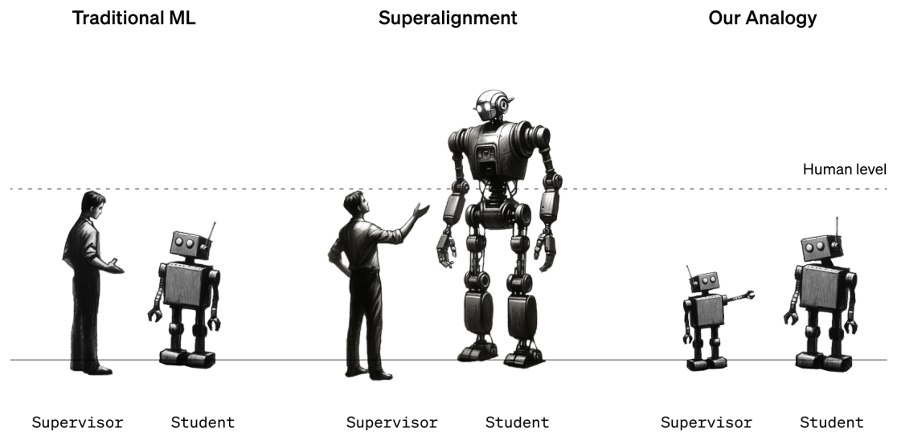

*图 1（原文 Figure 1，第 2 页）：我们方法的示意。传统机器学习关注人类监督比人类弱的模型；在最终的超级对齐问题中，人类要监督比自己聪明得多的模型；我们今天研究一个类似的问题：用弱模型监督强模型。*

**图中文字翻译与读法**：

- **三列** Traditional ML（传统机器学习）、Superalignment（超级对齐）、Our Analogy（我们的类比）。每列左边是 Supervisor（监督者），右边是 Student（学生）。虚线 Human level（人类水平）是水平参照。
- **传统机器学习**：监督者（人）比学生（机器人）高，学生弱于人类水平。
- **超级对齐**：学生是一个远高于人类水平线的巨型机器人，监督者仍是人类。
- **我们的类比**：监督者换成一个小机器人，学生是一个更大的机器人。两者都在人类水平线以下，但强弱关系与“人类对超人模型”相同。
- **读图结论**：论文把“人类监督超人模型”缩小为“小模型监督大模型”，研究的是一般的弱到强学习问题（weak-to-strong learning problem）。

### 2.3 为什么弱到强学习可能做得到

一方面，强学生可能简单地学着模仿弱监督者，包括它的错误，因为朴素训练的目标就是这个。另一方面，强预训练模型本来就应该对我们关心的对齐相关任务有很好的内部表征：如果一个模型能生成复杂代码，那它直觉上也应该知道这些代码是否忠实遵循了用户指令。所以为了对齐，我们不需要弱监督者教会强模型新能力，只需要弱监督者把强模型“已经知道的东西”引出来。这给了我们希望：强模型可以泛化到超出弱监督之外，解决弱监督者只能给出不完整或有缺陷标签的难题。论文把这种现象称为弱到强泛化。

### 2.4 论文做了什么（图 2）

作者用 GPT-4 家族的**基座（仅预训练）模型**做实验，这些模型与 GPT-4 共享同样的总体架构和预训练数据集，覆盖约 7 个数量级（OOM）的预训练计算量（该系列不包括 GPT-2、GPT-3、GPT-3.5，文中的“GPT-2 级”等只是按性能/计算量类比的说法）。三类任务：一大批流行 NLP 基准、国际象棋谜题（chess puzzles）、内部的 ChatGPT 奖励建模数据集。

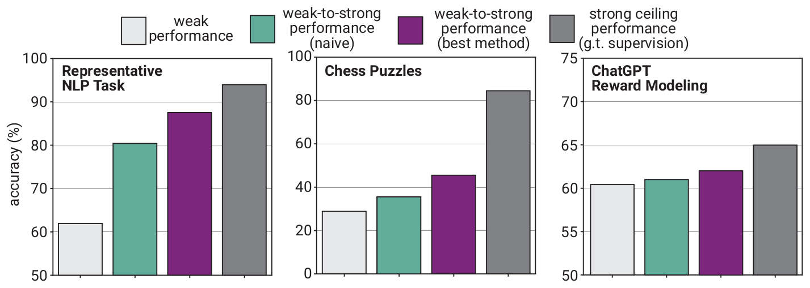

*图 2（原文 Figure 2，第 3 页）：用弱监督训练的强模型能泛化到超出其监督者之外，并且改进弱到强泛化是可行的。图中给出代表性 NLP 任务（左）、国际象棋谜题（中）和 ChatGPT 奖励建模任务（右）的测试准确率。对 NLP 和棋题，用 GPT-2 级监督来监督 GPT-4；对奖励建模，用 GPT-2 级监督来监督一个 3.5 级模型。*

**图中文字翻译与读法**：

- **图例**：weak performance（弱监督者的性能，浅灰；弱监督者用真标签训练）；weak-to-strong performance (naive)（朴素弱到强性能，绿；强学生朴素地用弱监督训练）；weak-to-strong performance (best method)（弱到强性能，最佳方法，紫）；strong ceiling performance (g.t. supervision)（强上限性能，深灰；真标签监督）。纵轴 accuracy (%)。
- **各任务的最佳方法**：NLP 为辅助置信度损失（本文 5.2 节），棋题为自举（本文 5.1 节），奖励建模为无监督的生成式微调（本文 6.2.2 节；强上限也用了生成式微调）。
- **读数**（由矢量图的柱高读出，保留一位小数；PGR 为本文按 3.1 节的公式用这些数估算）：

| 任务 | 弱监督者 | 朴素弱到强 | 最佳方法 | 强上限 | 朴素 PGR | 最佳方法 PGR |
|---|---:|---:|---:|---:|---:|---:|
| 代表性 NLP 任务（辅助置信度损失） | 62.0 | 80.4 | 87.6 | 94.0 | 约 58% | 约 80% |
| 国际象棋谜题（自举） | 28.9 | 35.5 | 45.5 | 84.5 | 约 12% | 约 30% |
| ChatGPT 奖励建模（生成式微调） | 60.4 | 61.0 | 62.0 | 65.0 | 约 13% | 约 35% |

（表由图 2 读出，非原文表格。）

- **读图结论**：三类任务里强学生都高于弱监督者（绿柱高于浅灰柱），也都低于强上限；换用最佳方法后紫柱高于绿柱。奖励建模三个任务里改进最小，棋题的强上限与朴素结果之间的缺口最大。注意奖励建模里弱监督者与强上限只差约 4.6 个点，所以 PGR 对小数点后的变化很敏感。

### 2.5 三条主要发现与论文的自我限定

原文引言的三条发现：

1. **强预训练模型自然地泛化到超出弱监督者**：朴素微调弱模型生成的标签，强模型一致地优于弱监督者（原文第 4.2 节，即本文第四节）。NLP 上用 GPT-2 级模型的标签微调 GPT-4，通常恢复这两个模型性能差距的约一半。
2. **朴素微调弱监督不够**：尽管弱到强泛化为正，强模型用弱监督微调与用真标签微调之间仍有很大差距；ChatGPT 奖励建模上的弱到强泛化尤其差。这些结果合起来给出实证证据：朴素 RLHF 在没有额外工作的情况下，很可能扩展到超人模型时效果很差。
3. **改进弱到强泛化是可行的**：用辅助损失鼓励强模型做出有把握的预测、用中间模型自举监督、用无监督微调改进模型表征，都能改进性能；NLP 上用辅助置信度损失，用 GPT-2 级模型监督 GPT-4 时，通常恢复弱强模型之间差距的近 80%。

作者自己的限定：没有一种方法在所有设置里都稳定有效，尤其是奖励建模上仍远没有恢复全部差距。所以这些方法更像概念验证，而不是建议今天就部署的实用方案；还有重要的类比失真没有处理（原文第 6 节，即本文第九节）。

## 三、方法设定与指标

### 3.1 三条性能线与 PGR

对一个给定任务（数据集加指标），作者分三步：

1. **造弱监督者**：绝大多数实验里，把小的预训练模型用真标签微调得到弱监督者；弱监督者的性能叫**弱性能**；弱标签是弱模型在一份留出样本上的预测。
2. **用弱监督训练强学生**：用生成的弱标签微调强模型，这个强学生的性能叫**弱到强性能**。
3. **用真标签训练强模型作为上限**：为了对比，用真标签微调同一个强模型，其性能叫**强上限性能**，直觉上对应“强模型的全部所知”。

三者的关系用**性能差距恢复比例**（performance gap recovered，PGR）度量：

$$
\mathrm{PGR}=\frac{\text{weak-to-strong}-\text{weak}}{\text{strong ceiling}-\text{weak}}
$$

PGR 度量的是：弱监督者与强上限之间的性能差距，有多大比例被弱监督恢复。完美的弱到强泛化时 PGR = 1；弱到强模型不比弱监督者好时 PGR = 0。弱到强性能通常介于弱性能与强上限之间；学生比老师还差时 PGR 为负（图 3 的 PGR 轴上就有负值），超过强上限时可大于 1。PGR 是一个比值，分母（弱监督者到强上限的距离）很小的时候会被放大，所以要同时看绝对准确率；本文引用 PGR 时也尽量给出对应的准确率。

两条脚注式的说明：（1）在真正由超人模型解决、人类无法评估的任务上不会有真标签；这里为了科学评估和分析而允许使用真标签。（2）作者在迭代方法时多次用真标签评估弱到强性能；不过整个项目期间始终保留（held out）最大的模型 GPT-4 和大约一半的 NLP 任务。

### 3.2 设定的优点与两个类比失真

优点：(1) 可以用任意一对弱、强模型，便于研究缩放规律，也不需要昂贵的最前沿模型；不需要人参与，反馈循环快。(2) 可以用于任何感兴趣的任务。(3) 即使在超人模型出现之前也有实用价值，例如找到只用弱人类监督或只用 GPT-3 级监督对齐 GPT-4 的办法，今天的对齐就更方便。

两个已知的类比失真（后文第九节会再讨论）：

- **模仿显著性（imitation saliency）**：未来的超人模型很可能对人类行为有显著的表征，而我们的强模型可能没有学到“模仿弱模型预测”所需的特征；所以今天的“简单模仿弱监督者”更容易避免。更一般地，今天的弱模型犯的错误类型，可能与人类监督超人模型时犯的错误不同。
- **预训练泄漏（pretraining leakage）**：预训练数据里隐含有人类的监督，所以在我们的设定里引出强模型的能力可能被人为地变容易了——它们在预训练里直接见过强（人类水平）表现；而超人水平的表现可能不会这样被直接观察到，超人知识可能更“潜在”（例如通过自监督学习获得），未来更难引出。

### 3.3 三类任务

- **22 个流行的 NLP 基准**：涵盖伦理、常识推理、自然语言推理、情感分析等；全部转换成二分类并近似平衡类别；弱模型产生的是软标签（soft label，类别概率）。数据集清单见表 1。
- **国际象棋谜题**：用 Schwarzschild et al. (2021b) 引入的数据集，来自 lichess.org。每道谜题含一个棋局和一串最优走法；评估时预测第一步（该局面的最佳走法）。弱标签是弱模型在温度 0 下的采样。与其他二分类任务不同，这是**生成式**任务。
- **ChatGPT 奖励建模**：RLHF 的关键一步是训练奖励模型预测人类对模型回答的偏好；奖励模型在人类与助手模型的对话数据上训练，对每个查询，人类比较多个候选回答，再训练奖励模型预测成对比较的结果。本文不研究后续的 RL 步骤，把目标设为最大化奖励模型的准确率。数据是训练 ChatGPT 奖励模型的专有数据集。

**表：三类任务的训练设置**（据原文附录 A 整理）

| 项目 | NLP（附录 A.1） | 国际象棋（附录 A.2） | ChatGPT 奖励建模（附录 A.3） |
|---|---|---|---|
| 数据处理 | 二分类；多选题把 (问题 Q, 候选 A_i) 展开成 k 条样本，错误答案标 0、正确答案标 1，并保持每个问题的对错数量相同；若某类别占比超过 55%，随机丢弃多数类样本使其完全平衡 | 预训练数据里有 PGN 格式的棋谱（只含 Elo 1800 及以上棋手的对局），但那是棋局里下的走法，而不是最佳走法；谜题按预训练格式转成“走法序列”（图 14，见 8.2 节） | 每条样本是 (对话 d, 回答 c1, 回答 c2, 标签 y)，y=1 表示标注者更喜欢 c2；用训练 ChatGPT 奖励模型的多个数据集的混合 |
| 模型头 | 把 unembedding 层换成 2 输出线性分类头，用 token “0”“1” 的 unembedding 权重初始化 | 语言模型本身生成走法 | 单输出线性头（权重用任意一个 token 的 unembedding 权重初始化）；对每个比较做两次前向，预测 σ(M(d,c2) − M(d,c1)) |
| 弱标签 | 数据集对半分（共享问题或前提的样本分在同一半），弱模型在前一半上用真标签训练，在后一半上预测，得到软标签；测试集上也保存弱标签（用于算一致率） | 5 万道谜题训练弱模型，另 5 万道谜题由弱模型 T=0 贪心解码给出标签，用来微调强模型；5 千道谜题评测 | 弱模型在一半比较数据上训练，对另一半预测 $y_w=\sigma(M_w(d,c_2)-M_w(d,c_1))$ 作软标签 |
| 训练 | 2 个 epoch，batch size 32；弱到强实验里按留出验证集上相对弱标签的准确率早停 | 5 个 epoch，batch size 32，不早停 | 1 个 epoch，batch size 220，不早停 |
| 评测 | 平衡测试集准确率，随机猜测为 50% | T=0 采样，首步走对的比例 | 比较准确率 |

另有两点：NLP 的方法超参数只在较小模型和 8 个数据集上调过（完整的 GPT-4 和大多数数据集被留出，除了数据集 [5]–[12]）；图中数据集名称被随机序号代替（见 8.1 节）。国际象棋的自举实验里，每一步都用同分布的一组新的 5 万道谜题。

## 四、朴素微调的结果

### 4.1 三个任务上的主结果（图 3）

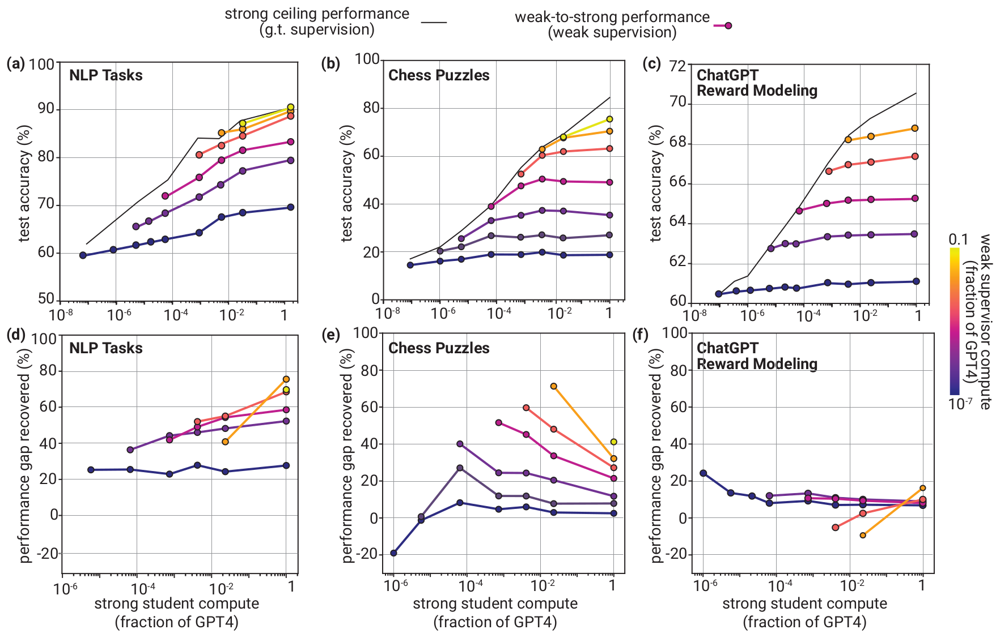

*图 3（原文 Figure 3，第 8 页）：NLP 和国际象棋上朴素微调的弱到强泛化很有希望，但 ChatGPT 奖励建模任务上泛化很差。（a,b,c）测试准确率随强学生规模的变化；（d,e,f）同样三个任务的性能差距恢复比例（PGR）。NLP 上取各任务的中位数（完整细节见图 12）。*

**图中文字翻译与读法**：

- **图例**：strong ceiling performance (g.t. supervision)（强上限性能，真标签监督，黑线）；weak-to-strong performance (weak supervision)（弱到强性能，弱监督，彩色线加圆点；色调表示弱监督者的大小）。
- **坐标轴**：横轴 strong student compute (fraction of GPT4)（强学生的预训练计算量，占 GPT-4 的比例，对数刻度）；上排纵轴 test accuracy (%)（测试准确率），下排纵轴 performance gap recovered (%)（PGR）。右侧色条 weak supervisor compute (fraction of GPT4)（弱监督者的计算量，占 GPT-4 的比例，由 10^-7 的深蓝到 0.1 的黄）。三列：(a)(d) NLP Tasks，(b)(e) Chess Puzzles（棋题），(c)(f) ChatGPT Reward Modeling。
- **NLP（a,d）**：彩色线都介于弱监督者与黑线之间，学生越大、老师越强，越接近黑线；最大学生配最强监督者时几乎追平上限（约 90%）。PGR 随强学生规模和弱监督者规模同时上升。原文正文：即使监督者很弱、强模型的计算量大出许多个数量级，也能恢复超过 20% 的差距；最大的学生上 PGR 经常超过 50%。读数（最大学生，GPT-4 级）：PGR 从最弱监督者的约 28% 到较强监督者的约 76%。
- **棋题（b,e）**：结果更复杂。最小的弱模型作监督者时 PGR 接近 0、准确率曲线几乎是平的；监督者变大后 PGR 明显上升，监督者与学生差距小时 PGR 可超过 40%（图上最高约 71%）。与 NLP 不同，对固定的监督者，PGR 随学生规模增大而下降；对应的准确率曲线呈凹形，作者称之为可能出现的“逆缩放（inverse scaling）”。读数：最大学生上 PGR 约 3%–41%。
- **奖励建模（c,f）**：默认弱到强泛化很差。通常只能恢复弱监督者与强学生之间约 10% 的差距；即使弱、强模型的计算量差距相对较小，PGR 也几乎从未超过 20%。读数：最大学生上 PGR 约 7%–16%。
- **读图结论**：在所有设定里，强学生一致地优于弱监督者；这本身并不显然（尤其只是朴素微调），给了作者“弱到强学习可处理”的信心。同时，朴素地使用弱的、人类水平的监督，很可能不足以对齐强的超人模型，需要性质上全新的技术。

读图提醒：（1）“PGR 为正”只说明学生超过老师，不说明学生接近上限；（2）棋题上 PGR 随学生变大而下降，意味着“更强的学生不一定更能被弱老师激发”；（3）NLP 的曲线是 22 个任务的中位数，会掩盖任务间差异（本文 5.2 节与 8.1 节）。

## 五、改进弱到强泛化的方法

### 5.1 自举：用中间规模的模型逐级监督（图 4）

自举（bootstrapping）是对齐里长期存在的想法：与其直接对齐一个远超人类的模型，不如先对齐一个只略强于人的模型，再用它去对齐更聪明的模型，如此继续。这里的做法是构造一串规模递增的模型 $\mathcal{M}_1\to\mathcal{M}_2\to\dots\to\mathcal{M}_n$：用 $\mathcal{M}_1$ 的弱标签微调 $\mathcal{M}_2$，再用 $\mathcal{M}_2$ 生成新的弱标签去微调 $\mathcal{M}_3$，依此类推。动机来自棋题：朴素微调时，跨越小的监督者—学生差距 PGR 高，跨越大差距 PGR 低，所以多走几个小步（PGR 高的步）可能优于一次走一大步。

具体做法：每轮自举做三次弱到强学习，也就是用两个中间规模的模型自举，最后才微调序列里最大的模型。

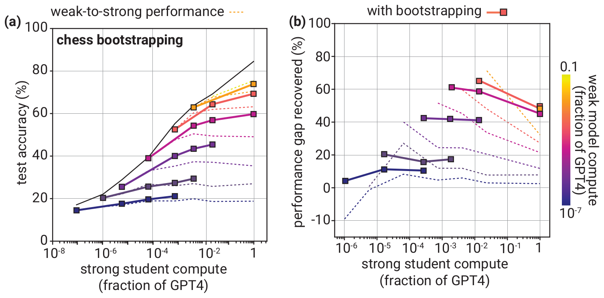

*图 4（原文 Figure 4，第 9 页）：自举改进了棋题上的弱到强泛化。（a）测试准确率随强学生规模的变化：黑色为真标签训练的学生，虚线为朴素地用弱监督训练的学生（色调表示弱监督者大小），彩色方块为自举训练的学生（包括最终的弱到强性能和自举过程中各中间模型的性能）。（b）同（a），但画的是 PGR。多走几个小步而不是一大步，泛化明显改善，对较大的学生尤其如此。*

**图中文字翻译与读法**：

- **左图 chess bootstrapping**：纵轴 test accuracy (%)；图例 weak-to-strong performance（虚线，朴素）。**右图**：纵轴 performance gap recovered (%)，图例 with bootstrapping（彩色线加方块）。色条 weak model compute (fraction of GPT4) 为弱模型计算量，由 10^-7 到 0.1。
- **读法**：每条彩色折线是一次自举序列：从弱模型出发，逐级经过中间模型，终点是最大学生；折线上的每个方块都是一个中间模型的性能。
- **读数（约，最大学生）**：自举后 PGR 约 45%–50%，而朴素微调同样监督者的 PGR 约 21%–32%（见图 3(e)）。
- **读图结论**：朴素方法下，随着弱—强差距变大，迁移准确率曲线趋于平坦；自举后准确率继续单调提高。
- **自举的适用边界**：在初步实验中，自举在 NLP 上只带来很小的改进，在奖励建模上没有改进。原因直觉上合理：棋题上朴素 PGR 随差距增大而下降，而 NLP 和奖励建模上朴素 PGR 随差距增大是上升或大致不变，所以没有“多走小步”的空间。结论是：自举可能是值得研究的方向，在某些设置有帮助，但单靠朴素自举不足以对齐远比其监督者聪明的模型。

### 5.2 辅助置信度损失：让学生敢于不同意老师（图 5、6）

朴素基线直接训练强学生模仿弱监督者，所以它也可能学会模仿监督者的错误（本文 6.1 节）。作者想避免这个失败模式，对强预训练模型已经内部知道的东西给予额外的正则：希望学生学到监督者的**意图**，而不是模仿它的**错误**。做法是在标准交叉熵上加一个辅助的置信度损失项，强化强模型对自己预测的信心，即使这些预测与弱标签不一致。它与半监督学习里的条件熵最小化（Grandvalet & Bengio, 2004）密切相关。

附录 A.4 的损失函数：

$$
\mathcal{L}_{\mathrm{conf}}(f)=(1-\alpha)\,\mathrm{CE}\big(f(x),f_w(x)\big)+\alpha\,\mathrm{CE}\big(f(x),\hat f_t(x)\big)
$$

其中 $\mathrm{CE}$ 是交叉熵，$f_w(x)\in[0,1]$ 是弱标签的预测分布，$f(x)\in[0,1]$ 是强学生的预测分布，$\alpha$ 是权重，$t$ 是阈值；$\hat f_t(x)=\mathbb{I}[f(x)>t]\in\{0,1\}$ 是用阈值 $t$ 硬化后的强模型预测（$\mathbb{I}$ 为指示函数）。阈值 $t$ 自适应地设置，使得一个 batch 里恰好有一半样本满足 $f(x)>t$。$\alpha_{\max}=0.75$（最大的学生模型）或 0.5（其余），并在训练最初的 20% 里把 $\alpha$ 从 0 线性升到 $\alpha_{\max}$。

上式可以改写成自举式的损失：

$$
\mathcal{L}_{\mathrm{conf}}(f)=\mathrm{CE}\big(f(x),(1-\alpha)\,f_w(x)+\alpha\,\hat f_t(x)\big)
$$

即交叉熵的目标是弱模型预测与学生自身（阈值化）预测的混合，这与 Reed et al. (2014) 与 Arazo et al. (2019) 处理标签噪声的自举方法相关，也类似自训练和条件熵最小化。作者说明：这种按“恰好一半”平衡的机制引入了类别先验，只在类别数很少的分类设置（原文写作 low-$n$ classification）里实际可行；对多数弱—强对和数据集影响很小或中性，少数设置里有明显改进；不平衡或非二分类时要显式从弱模型预测算出阈值比例。

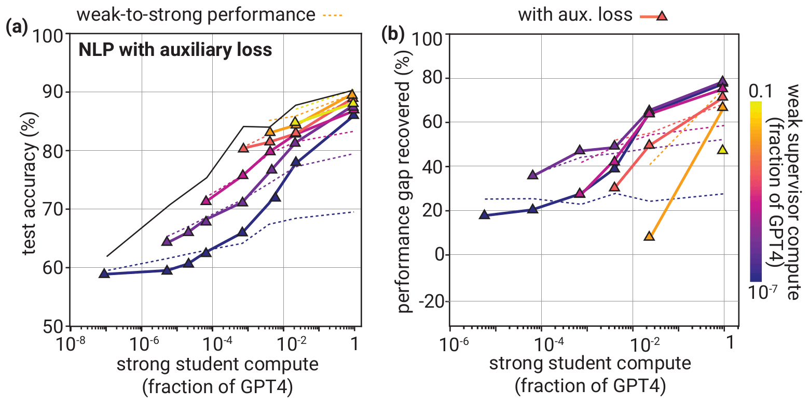

*图 5（原文 Figure 5，第 10 页）：一个简单的辅助损失显著改进了 NLP 数据集上的泛化。（a）测试准确率随强学生规模的变化：黑色为真标签训练的学生，虚线为朴素地用弱监督训练的学生，彩色三角为用辅助置信度损失训练的学生；取 22 个 NLP 任务的中位数（色调表示弱监督者的大小，逐数据集结果见图 6）。（b）同（a），但画的是 PGR。置信度损失可以大幅改进泛化，尤其在监督者与学生差距大的时候。*

**图中文字翻译与读法**：

- **左图 NLP with auxiliary loss**：纵轴 test accuracy (%)；图例 weak-to-strong performance（虚线）。**右图**：纵轴 performance gap recovered (%)，图例 with aux. loss（彩色线加三角）。横轴 strong student compute (fraction of GPT4)；色条 weak supervisor compute。
- **原文数字**：置信度损失在较小的强学生上略逊于朴素基线，但在监督者与学生计算量差距很大时大幅改进泛化；最小的弱监督者配最大的强学生时，置信度损失把 PGR 中位数从约 25% 提高到近 80%。
- **读数**（最大学生，GPT-4 级，由图 5(b) 与图 3(d) 的数据点读出，弱监督者按图中颜色由弱到强排序）：

| 弱监督者（由弱到强，颜色由深蓝到黄） | 朴素微调 PGR | 辅助置信度损失 PGR |
|---|---:|---:|
| 1（最弱，深蓝） | 约 28% | 约 78% |
| 2（紫） | 约 52% | 约 79% |
| 3（品红） | 约 58% | 约 75% |
| 4（橙红） | 约 68% | 约 72% |
| 5（橙） | 约 75% | 约 67% |
| 6（最强，黄） | 约 70% | 约 47% |

（表由图读出，非原文表格。）

- **读图结论**：辅助损失越是在差距大时越有用（最弱监督者上提高约 50 个百分点）；而在差距小的位置（最强的两个监督者）反而不如朴素微调。所以“置信度损失有益”要加上适用条件：监督者远弱于学生。
- **适用范围**：对前四个监督者，辅助损失把最大学生的 PGR 提到约 72%–79%；但图 3 里棋题（约 3%–41%）和奖励建模（约 7%–16%）的朴素结果没有这样的改进，原文只在 NLP 任务上报告了这个方法（图 2 里棋题与奖励建模的最佳方法分别是自举与生成式微调）。

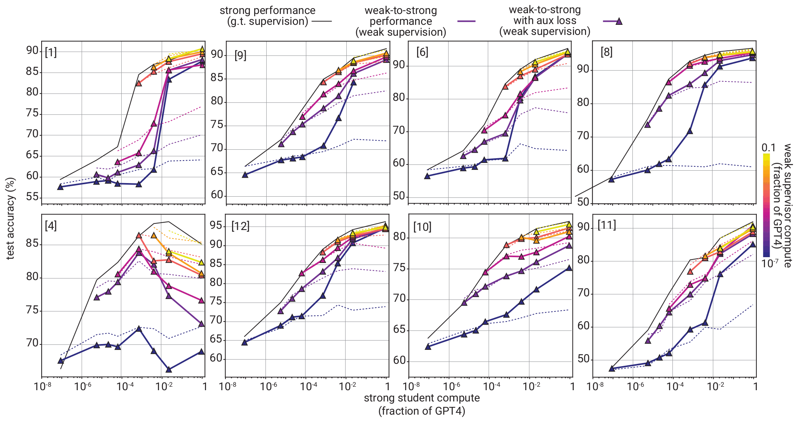

*图 6（原文 Figure 6，第 11 页）：简单的辅助损失在多数数据集上改进泛化。8 个代表性 NLP 任务上测试准确率随强学生计算量的变化。三角为辅助损失，虚线为基线；弱监督者大小用不同颜色表示，黑色为真标签监督。*

**图中文字翻译与读法**：

- **图例**：strong performance (g.t. supervision)（强性能，真标签监督，黑线）；weak-to-strong performance (weak supervision)（弱到强性能，弱监督，虚线）；weak-to-strong with aux loss (weak supervision)（弱到强，加辅助损失，三角）。方括号里的数字是数据集的匿名编号。
- **读法**：在 [1]、[9]、[6]、[8]、[12]、[10]、[11] 上，三角线（辅助损失）明显高于同色虚线，最弱监督者（深蓝）的改进最大；[1] 上最弱监督者的学生在约 10^-2 处出现陡增（从约 62% 到约 83%）；[4] 是反例：强上限自身在较大的模型上下降（逆缩放），辅助损失在大模型上也随之下降，部分颜色线低于基线。
- **原文说明**：在一些设置里置信度损失帮助不大甚至降低性能，例如弱监督者与强学生差距小时，或数据集即使用真标签监督也有逆缩放时；但在多数 NLP 数据集上置信度损失显著改进，许多数据集上几乎恢复强模型的全部性能，甚至用最小的弱监督者也是如此。
- **注意（调参范围）**：这 8 个数据集里有 6 个（[6]、[8]、[9]、[10]、[11]、[12]）属于方法超参数调整所用的数据集 [5]–[12]（只在较小模型上调；GPT-4 和大多数数据集被留出）。逐个数据集的完整 22 个任务见 8.1 节的图 12。

### 5.3 没有奏效的方法（附录 B）

作者对许多提升强模型表现的方法做了初步实验：许多对朴素微调没有帮助，另一些只在部分设置有有限改进，并说明没有对每个方法做最优调参，所以调好后不排除仍然有效。

| 方法 | 做法与动机 | 结果 |
|---|---|---|
| 置信度阈值（confidence thresholding） | 只选弱监督者最有把握的每类前 5%–20% 样本训练强模型，以过滤错误弱标签 | 弱标签通常校准良好，但只在弱标签很差（约 60% 准确率）时有帮助，弱标签约 70%–80% 准确率时不再有用；NLP 和棋题里都如此 |
| 置信度损失（l2 / 熵） | 辅助损失鼓励预测概率 $p$ 远离 0.5：l2 损失 $-(p-0.5)^2$ 或熵损失 $p\log p+(1-p)\log(1-p)$ | 线性探针设置的初步实验里有帮助，但在微调设置里一般不如公式 (1) 的置信度损失；训练数据严重类别不平衡或不做再平衡时有负面结果 |
| 乘积置信度损失 | 交叉熵目标正比于弱模型与强模型所给概率的乘积，类间重新归一化，不对目标回传梯度 | 在两个 NLP 任务上稳定优于基线，但不如主置信度损失；几何平均等变体无提升；优点是没有 batch 间依赖，可能可用于生成任务 |
| LP-FT | Kumar et al. (2022)：先在冻结表示上训练线性探针，再微调全部层，避免破坏预训练表示 | 无法超过微调基线 |
| 权重正则 | 更强的 weight decay、dropout，避免模仿弱标签 | 没有显著改进（脚注：由于本设定里强模型不擅长模仿弱标签，正则在强模型能拟合弱标签的设置里可能更重要） |
| LoRA | 只做低秩更新，扫描 LoRA 秩 | 没有改进 |
| 数据增强 | 用强学生改写输入，加一致性损失 | 在选取的 NLP 子集上没有改进 |
| 标签噪声与噪声鲁棒损失 | Zhang & Sabuncu (2018) 的广义交叉熵；给弱标签加随机噪声 | 广义交叉熵无改进；加噪声使强模型更难模拟弱标签（尤其训练早期），但最终没有提高性能 |
| 少样本提示 | 用上下文学习替代微调 | 见 6.2 节图 9 |
| 权重平均 | 对训练参数做指数滑动平均 | 与基线相比没有改进 |

## 六、理解弱到强泛化

这一节研究两个与泛化有关的现象：对监督者错误的**模仿**，以及任务对强学生表征的**显著性**。

### 6.1 模仿：学生是否把老师的错误学了去

如果弱标签含有容易学到的系统性错误，强模型可能学会模仿这些错误；理论工作里的“人类模拟器（human simulator）”失败模式也有这个意思：朴素人类监督可能让超人模型学会“人类会怎么说”，而不是输出自己最好的预测。

**6.1.1 对弱监督的过拟合（图 7、图 13）**。无限数据下朴素拟合弱标签应当得到完美模仿，PGR 为 0；实践中数据有限、只训练很少的 epoch，但与典型机器学习设定不同的是，即使训练不到一个 epoch 也可能过拟合：强模型过拟合弱监督者的标签及其错误，使真值测试准确率在训练过程中下降，即使没有经典意义上对具体训练样本的过拟合。

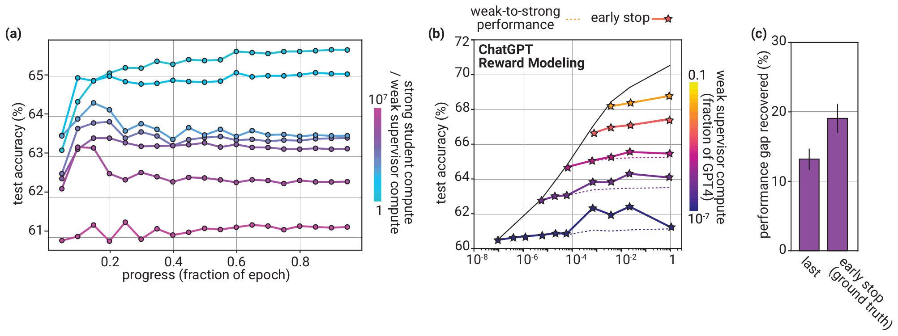

*图 7（原文 Figure 7，第 12 页）：强模型过拟合弱标签。所有图都是 ChatGPT 奖励建模任务。（a）训练过程中的弱到强性能，色调表示学生—监督者差距。（b）训练中的最佳弱到强性能（星）和训练结束时的弱到强性能（虚线），弱性能为黑色，色调表示弱监督者大小。（c）所有监督者—学生对上最佳与最终的 PGR 中位数。在较大的弱—强差距下我们看到对弱标签的过拟合，即使在一个 epoch 之内也是如此；这时训练中的最佳测试准确率可以比训练结束时的好很多。*

**图中文字翻译与读法**：

- **左图 (a)**：横轴 progress (fraction of epoch)（训练进度，占一个 epoch 的比例），纵轴 test accuracy (%)。色条标注 strong student compute / weak supervisor compute（强学生计算量与弱监督者计算量之比），由 1（青）到 10^7（品红）。
- **中图 (b)**：ChatGPT Reward Modeling；横轴 strong student compute (fraction of GPT4)，纵轴 test accuracy (%)；虚线 weak-to-strong performance（训练结束时），带星的实线 early stop（训练中的最佳点）。原文图注写“弱性能为黑色”，但图中黑线上升到约 70.5%，与图 3(c) 的强上限线相同，所以更像是强上限（这是本文的判断）。
- **右图 (c)**：纵轴 performance gap recovered (%)；两根柱子 last（训练最后）与 early stop (ground truth)（按真值早停）。
- **读数**：(c) 中 last 的 PGR 约 13.2（误差线约 ±1.5），按真值早停约 19.1（约 ±2.0）。(a) 中青色线（差距小，约 1）一路上升并保持，品红/紫色线（差距大）在训练约 0.15–0.2 个 epoch 时达到峰值，之后下降。
- **读图结论**：差距小时弱到强性能基本随训练单调上升；差距大时常常先升后降，下降发生在远不到一个 epoch 的时候。用真值做早停（“作弊”）在奖励建模上一般带来约 5 个百分点的 PGR 提升。这种早停依赖真标签，不构成可用的方法，但说明模仿弱监督者的错误在我们的设定里可能是重要现象，也说明更好的早停或正则可能显著改进弱到强泛化（作者注：最佳测试准确率因评估有噪声可能略有高估）。

NLP 上也有同样的现象（附录图 13）：

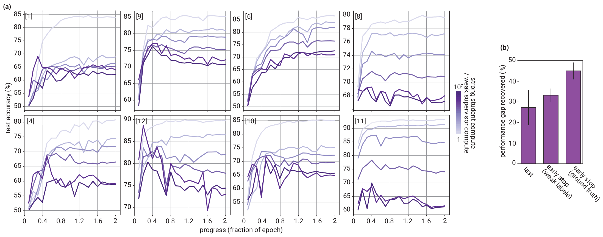

*图 13（原文 Figure 13，附录 A.1，第 31 页）：NLP 数据集训练过程中的过拟合：强模型过拟合弱标签。（a）若干 NLP 任务上强学生在训练过程中的真值测试准确率，色调表示弱监督者与强学生模型计算量之间的差距，方括号内是数据集编号（对照图 12）。（b）所有监督者—学生对、所有 NLP 任务上的最佳、按弱标签一致率早停、以及最终的 PGR 中位数；误差线为均值标准误。*

**图中文字翻译与读法**：

- **(a)**：8 个数据集（[1]、[9]、[6]、[8]、[4]、[12]、[10]、[11]）。横轴 progress (fraction of epoch)，纵轴 test accuracy (%)；色条 strong student compute / weak supervisor compute，由 1（浅）到 10^7（深紫）。浅色（差距小）曲线单调上升，深色（差距大）曲线在 0.2–0.5 个 epoch 附近达到峰值后下降（例如 [12]、[11]、[8]）。
- **(b)**：纵轴 performance gap recovered (%)，三根柱：last（最后）、early stop (weak labels)（按弱标签早停，“不作弊”）、early stop (ground truth)（按真值早停，“作弊”）。
- **读数**（由图读出）：last 约 27%（误差线约 ±8），弱标签早停约 33%（约 ±3），真值早停约 45%（约 ±4）。原文正文写“真值早停比训练结束时的模型高 15 个百分点、比按弱标签早停高 10 个百分点”；图上读数的差值约为 18 和 12，量级一致。
- **读图结论**：辅助置信度损失显著减少了 NLP 上对弱标签的过拟合；原文：差距大时，朴素方法下按真值早停（相对按弱标签早停）带来约 15% 的 PGR 提升，使用置信度损失时只有约 5%。

**6.1.2 学生—监督者一致率（图 8）**。另一种测量模仿的方法是直接测一致率：强学生与弱监督者在多大比例的测试输入上做出相同预测。若一致率为 100%，弱到强准确率就等于监督者准确率，PGR 为 0。原文观察：对朴素微调基线，学生—监督者一致率一直很高，常常明显高于弱监督者的准确率，这说明学生在模仿监督者的某些错误；这一现象在所有任务（NLP、棋题、奖励建模）和所有模型规模上，对朴素方法都成立。

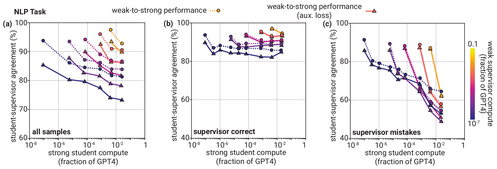

*图 8（原文 Figure 8，第 13 页）：学生—监督者一致率随学生—监督者差距增大而下降；置信度损失减少对监督者错误的模仿。（a）NLP 任务上一致率随强学生规模的变化；（b）同（a），但只看监督者正确的样本；（c）同（a），但只看监督者错误的样本。虚线表示朴素微调，三角表示辅助置信度损失的结果；线的色调表示弱监督者大小。奖励模型上的结果见图 16。*

**图中文字翻译与读法**：

- **三个面板**：(a) all samples（所有样本）；(b) supervisor correct（监督者正确的样本）；(c) supervisor mistakes（监督者出错的样本）。纵轴 student-supervisor agreement (%)（学生—监督者一致率）；横轴 strong student compute (fraction of GPT4)。图例：weak-to-strong performance（朴素，虚线加圆点）、weak-to-strong performance (aux. loss)（辅助损失，实线加三角）。
- **读数（约）**：(a) 所有样本上，朴素的一致率约 81%–97%；学生越大一致率越低。(b) 监督者正确时，一致率较平，约 83%–97%。(c) 监督者出错时，一致率随学生规模明显下降：最小学生约 91%，较大学生约 49%–64%。
- **读图结论**：辅助置信度损失显著降低一致率（三角低于圆点），主要是通过减少对监督者错误的模仿（图 (c)）；损失鼓励学生做出有把握的预测，包括与弱监督者矛盾的预测。在成功的少数设置里，置信度损失甚至使一致率低于强学生的测试准确率，也就是学生拟合真概念的程度好于拟合训练它的弱标签。

**6.1.3 模仿的逆缩放**。研究一致率与强模型规模的关系（图 8、图 16）：出人意料地，**更大的学生模型一致地更少同意监督者的错误**，尽管训练目标是模仿监督者、没有早停、容量比小学生更大。这个趋势在只看监督者出错的样本时尤其强（图 8c），看交叉熵损失而不是准确率时趋势依然存在。作者的解释倾向：预训练模型在有限数据的微调设置里可能很难拟合另一个（更小的）预训练模型的错误；Stanton et al. (2021) 与 Furlanello et al. (2018) 在知识蒸馏里报告过相关观察。

一个自然的假设是：（尤其朴素的）弱到强泛化高度依赖弱监督者的错误结构，以及这些错误有多容易被模仿（附录 E，见第七节）。

### 6.2 显著性：任务在强模型表征里有多突出

一种直觉：当我们想引出的任务或概念对强模型内部是“显著的（salient）”时，弱到强泛化更容易。

**6.2.1 用提示引出强模型的知识（图 9、表 2）**。前面第四节里高 PGR 的一个可能原因是：引出强模型已有的知识本来就容易，强预训练模型也许用一个简单提示就能零样本解决很多相关任务。图 9a 对 7 个代表性 NLP 任务比较微调、零样本和 5 样本提示（这个初步实验用真标签做微调和 5-shot）。零样本和 5 样本都使用表 2 的任务专用提示。

**表 2：零样本与少样本实验使用的自定义提示**（原文表 2，第 35 页；每个任务一段简单的提示，少样本时再附上带标签的示例，标签是真标签或弱标签）

| 数据集 | 自定义提示（英文原文） | 中文翻译 |
|---|---|---|
| CosmosQA | There is some context, followed by a question about the context, and an answer. Respond with 1 if the answer is correct, and 0 otherwise. | 先给一段上下文，接着是关于上下文的一个问题和一个答案。如果答案正确回答 1，否则回答 0。 |
| Deontology | There is a short scenario, consisting of a situation or request, followed by an excuse. Respond with 1 if the excuse is valid, and with 0 otherwise. | 先给一个简短的情景，由一个处境或请求构成，接着是一个借口。如果借口成立回答 1，否则回答 0。 |
| Justice | There is a statement. Respond with 1 if it is correct or just and with 0 otherwise. | 给出一条陈述。如果它正确或公正回答 1，否则回答 0。 |
| QuAIL | There is a news context, followed by a question about the context, and an answer to the question. Respond with 1 if the answer is correct, and with 0 otherwise. | 先给一段新闻上下文，接着是关于上下文的问题和该问题的一个答案。如果答案正确回答 1，否则回答 0。 |
| SciQ | There is a science knowledge question, followed by an answer. Respond with 1 if the answer is correct, and with 0 otherwise. | 先给一个科学知识问题，接着是一个答案。如果答案正确回答 1，否则回答 0。 |
| Social IQa | There is some context, followed by a social question, followed by an answer. Respond with 1 if the answer is correct, and 0 otherwise. | 先给一段上下文，接着是一个社会性问题，再接一个答案。如果答案正确回答 1，否则回答 0。 |
| Virtue | There is a short scenario, followed by a judgement of the person involved. Respond with 1 if the judgement is correct, otherwise respond with 0. | 先给一个简短的情景，接着是对所涉人物的一个评判。如果评判正确回答 1，否则回答 0。 |

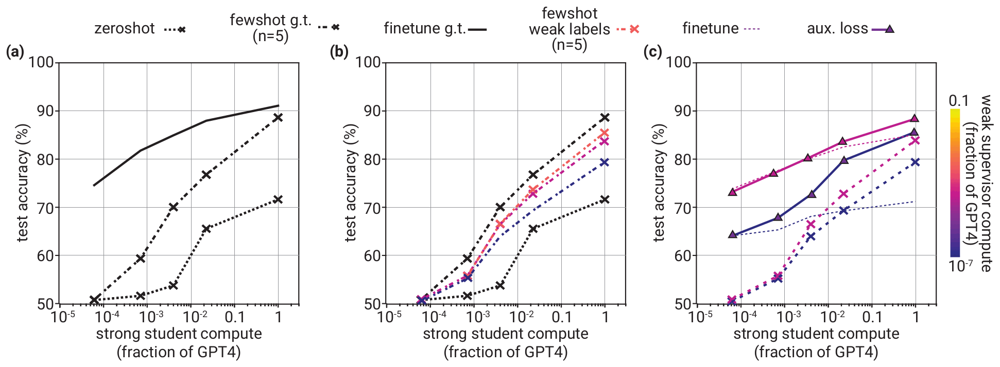

*图 9（原文 Figure 9，第 14 页）：对大模型，少样本提示已能与微调竞争；弱到强学习在提示设定里在性质上相似。（a）用真标签时的平均零样本（单虚线）、5 样本（双虚线）和微调（实线）准确率随强学生规模的变化。（b）用弱标签的 5 样本平均准确率（彩色虚线）随学生规模的变化，色调为弱监督者大小；零样本与 5 样本同（a）。（c）5 样本提示的弱到强性能（虚线加叉）、朴素微调（细虚线）和加置信度损失的微调（实线加三角）随学生计算量的变化。结果是 7 个 NLP 任务的平均。对最大的强学生，少样本的弱到强性能与微调相当或更好，但加置信度损失的微调表现更好。*

**图中文字翻译与读法**：

- **图例**：zeroshot（零样本，点线加叉）；fewshot g.t. (n=5)（5 样本，真标签示例，点划线加叉）；finetune g.t.（真标签微调，粗实线）；fewshot weak labels (n=5)（5 样本，弱标签示例，彩色点划线加叉）；finetune（朴素微调，细虚线）；aux. loss（辅助损失，实线加三角）。纵轴 test accuracy (%)，横轴 strong student compute (fraction of GPT4)。
- **读数**（最大学生，GPT-4 级，平均 7 个任务；弱监督者按颜色，深蓝为最弱、品红居中、橙红较强）：

| 设置（最大学生） | 准确率（%） |
|---|---:|
| 零样本 | 71.6 |
| 5 样本，真标签示例 | 88.6 |
| 微调，真标签 | 91.1 |
| 5 样本，弱标签示例（深蓝 / 品红 / 橙红监督者） | 79.3 / 83.8 / 85.4 |
| 朴素微调，弱标签（深蓝 / 品红监督者） | 71.1 / 85.0 |
| 辅助置信度损失微调（深蓝 / 品红监督者） | 85.6 / 88.3 |

（表由图 9 读出，非原文表格；橙红监督者在图 (c) 中没有对应的线。）

- **读图结论**：(1) 零样本和 5 样本准确率对多数模型规模很差，但与 Brown et al. (2020) 一致，随模型变大急剧提高；最大模型上 5 样本提示在许多任务上可与微调竞争，说明引出这些很大的模型与任务相关的知识相对容易。(2) 用弱标签做少样本示例，比用真标签差，说明弱到强学习在提示设定里也是非平凡的问题。(3) 与微调设定相似，少样本弱到强性能随监督者变强而提高；与朴素微调相比，少样本的弱到强性能对较小的学生很差，但对最大的学生可与微调相当甚至超过；不过用置信度损失的微调通常仍优于少样本弱到强提示。
- **作者的保留**：对提示来说，我们的设定可能比对微调更“不类比”：许多 NLP 任务在预训练里可能被隐含地见过，作者猜测这对提示的帮助大于对微调的帮助（原文第 6.1 节，即本文 9.1 节）。

**6.2.2 生成式监督改善奖励建模的弱到强泛化（图 10）**。如果任务在强模型表征里的显著性有助于弱到强泛化，那么提高任务对强模型的显著性就可能改进泛化。一种不需要真标签就能增加任务显著性的做法是：在与任务相关的数据上用语言建模目标做无监督微调。比如在网上评论上无监督微调语言模型，情感就会在模型内部被显著地表征。

作者在奖励建模里测试这个想法：RM 的标准做法本来就是先用示范数据微调出一个基线再初始化。这里重新使用 ChatGPT 比较数据，不引入新的监督数据：比较由前缀（一条请求或一段用户—助手对话）加至少两个候选回答组成。作者用语言建模损失在所有“前缀—回答”对上微调基座模型，忽略这些回答之间的人类偏好。因为这些对里也包括被人类评为最差的回答，所以原则上这个过程不会泄露弱到强模型不该拥有的真偏好标签；但由于回答可能来自人或更强的模型，可能存在与原文第 6.1 节（本文 9.1 节）所说“预训练泄漏”同类的泄漏。

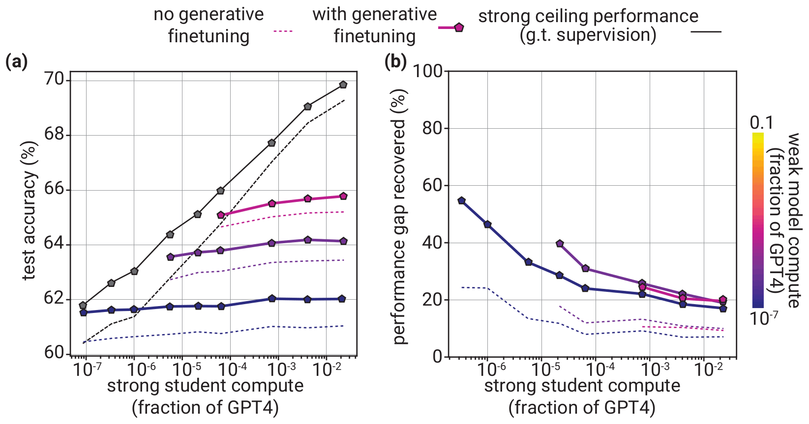

*图 10（原文 Figure 10，第 15 页）：在奖励建模数据上做生成式微调，改进了弱到强性能和 PGR。（a）奖励建模任务上的弱到强性能：强学生在多做一步生成式微调（实线）和不做（虚线）。黑色实线是同样经过生成式微调的强上限奖励模型；黑色虚线是没有做生成式微调的弱监督者奖励模型。（b）有无生成式微调的 PGR；有生成式微调的 PGR 使用同样做过这一步的强上限。即使做了这个上限调整，有额外生成式微调的 PGR 也更高。*

**图中文字翻译与读法**：

- **图例**：no generative finetuning（无生成式微调，细虚线）；with generative finetuning（有生成式微调，粗实线加五边形）；strong ceiling performance (g.t. supervision)（强上限，真标签监督，黑线）。(a) 纵轴 test accuracy (%)，(b) 纵轴 performance gap recovered (%)；横轴 strong student compute (fraction of GPT4)；色条 weak model compute (fraction of GPT4)。
- **读法**：(a) 同色的实线都高于虚线（例如品红线最大学生约 65.8% 对约 65.2%，深蓝线约 62.0% 对约 61.0%）；(b) 做生成式微调后 PGR 高出约 10–20 个百分点，且这是在上限也做了同样微调的前提下比较的。
- **原文数字**：生成式监督把 PGR 提高约 10–20%；这种改进可以与真值早停的改进叠加（“作弊”的方法，仅用于展示潜力），两者合起来 PGR 约 30%–40%，使奖励建模的结果可与 NLP 和棋题上的弱到强泛化相当（图 17，见下）。这个想法可以用于所有设定，作者认为是有前景的方向。

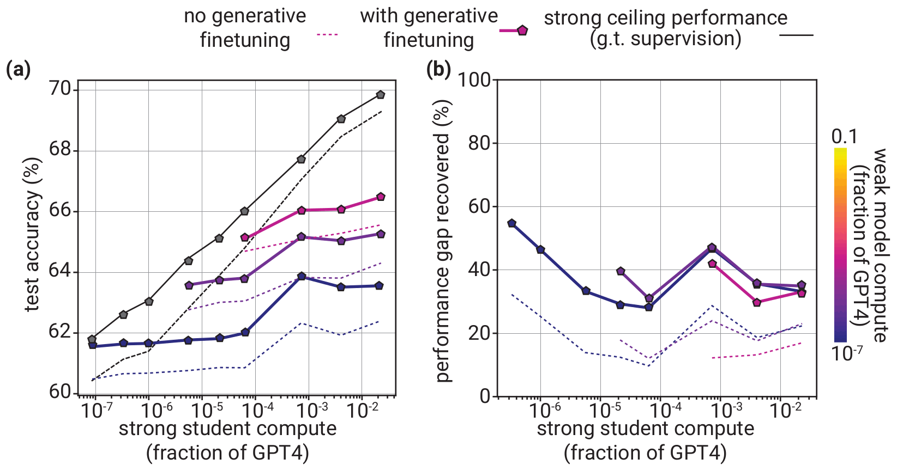

*图 17（原文 Figure 17，附录 A.3，第 34 页）：改进的任务特定微调与真值早停的收益叠加，使 PGR 更高。同图 10，但加上基于测试准确率的真值早停。*

**图中文字翻译与读法**：

- 布局同图 10：(a) 测试准确率，(b) PGR；有生成式微调（实线）、无生成式微调（虚线），强上限（黑线）。
- **读数（约）**：(b) 中较大的几个学生上，带生成式微调（并按真值早停）的 PGR 约 30%–47%，无生成式微调的虚线约 12%–29%；最小的学生处实线约 55%、虚线约 32%。
- **读图结论**：与正文“约 30%–40%”一致。这是真值早停带来的“上限式”结果，不是可实际使用的方法。

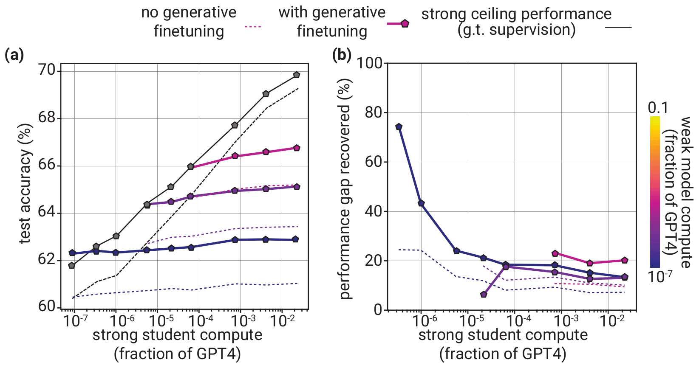

*图 18（原文 Figure 18，附录 A.3，第 34 页）：当监督者与学生都额外做一步生成式微调时 PGR 改进。同图 10，但“有生成式微调”表示监督者和学生都做了这一步；也就是在这个实验里，所有基座模型在预训练之后都额外做了一步生成式微调。*

**图中文字翻译与读法**：

- 布局同图 10。(b) 中最弱监督者对应的最小学生上 PGR 高达约 74%，随学生增大逐渐降到约 13%–20%。
- **读图结论**：原文只说明这个实验与图 10 相同，只是监督者和学生都多做了一步生成式微调，没有给出更多解释。图上看，对较大的学生，带生成式微调的 PGR（约 13%–20%）仍高于不做生成式微调的虚线（约 7%–10%），但优势比图 10 小。

**6.2.3 通过在弱监督上微调增加概念显著性：线性探针（图 11）**。概念显著性的一个度量是任务在表示里的线性程度：在模型冻结激活上训练的线性探针（逻辑回归）的性能。如果最优解能被线性探针近似恢复，问题就大大简化：可以只关注线性探针方法而不是微调方法，搜索空间可以大大缩小。作者只关注最终激活（unembedding 层之前）里任务有多线性。

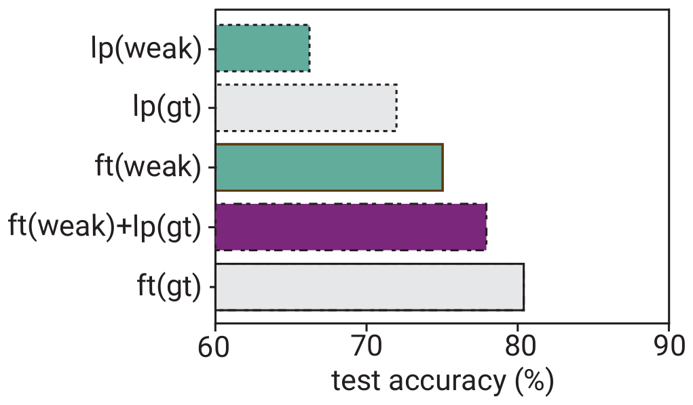

*图 11（原文 Figure 11，第 16 页）：在弱监督者的标签上微调，使期望的泛化更线性地被表示。图中画出 5 种策略在一组 NLP 任务上的平均测试准确率。lp(weak)：用弱标签在基座模型上训练线性探针；lp(gt)：用真标签在基座模型上训练线性探针；ft(weak)：用弱标签微调模型；ft(weak)+lp(gt)：先用弱标签微调模型，再用真标签训练线性探针；ft(gt)：用真标签微调模型。在弱标签上微调显著提高了真值概念的线性程度。*

**图中文字翻译与读法**：

- **五根横条**（横轴 test accuracy (%)，60–90）：lp(weak)、lp(gt)、ft(weak)、ft(weak)+lp(gt)、ft(gt)。
- **读数**（由矢量图读出）：

| 策略 | 测试准确率（%） |
|---|---:|
| lp(weak)：弱标签线性探针 | 66.2 |
| lp(gt)：真标签线性探针 | 72.0 |
| ft(weak)：弱标签微调 | 75.0 |
| ft(weak)+lp(gt)：先弱标签微调再真标签线性探针 | 77.9 |
| ft(gt)：真标签微调 | 80.4 |

（表由图 11 读出，非原文表格。）

- **读图结论**：(1) 真标签线性探针（正文写平均 72%）比真标签微调差（正文写平均 82%），说明多数任务的最优解在强模型最终激活里并不完全线性表示。(2) 先用弱标签微调、再用真标签做线性探针，达到约 78%：弱标签微调使表示对真标签也更线性了；这比朴素弱到强微调基线也明显更好。正文写这“弥合了真标签线性探针与微调之间 60% 的差距”。
- **数字出入**：图上 ft(gt) 约 80.4%，而正文写 82%；按图上数值，弥合的比例约为 (77.9−72.0)/(80.4−72.0)≈70%，按正文数字为 60%。两者都说明明显缩小，但具体数字以哪个为准原文没有交代。
- **解读**：这与 Kirichenko et al. (2023) 在伪相关文献里的发现密切相关：在有偏监督上微调可能得到输出有很强偏差、但对期望概念仍有出乎意料的强线性表示的模型。这提示另一条思路：先“线性化”期望概念（例如朴素地在弱标签上微调），再用更简单的线性探针式弱到强方法把它引出来。线性可读不等于最终预测因果地依赖该特征（这是本文的提醒）。

## 七、附录实验：易到难、其他设定与弱标签结构

### 7.1 由易到难泛化（附录 C）

弱监督者的一种自然的系统性错误是：容易的样本做得好，困难的样本做得差。作者因此单独研究**由易到难泛化（easy-to-hard generalization）**：只在容易样本上用真标签监督，评估对难样本的泛化。它是经典的协变量偏移问题，而主设定更关注概念偏移与噪声标签。

**棋题（C.1）**。每道谜题有一个自然的难度标签：Elo 分，描述它对人类的难度（lichess 上人类解题，谜题与人类玩家按标准 Elo 算法被赋分）。Elo 描述的是整个走法序列的难度，而训练只预测第一步，所以它是对人类难度的高质量但不完美的度量，对模型也可能不是好的难度度量（对人容易的谜题可能对模型难，反之亦然）。作者把 Elo > 2000 当作困难集，容易集取 Elo 阈值 {800, 900, 1000, 1100, 1200, 1300} 以下的谜题，另有不设限的全集；每个集合随机取 5 万道谜题微调（Elo ≤ 800 只有 2.5 万道，因为该难度范围内不够 5 万道）。

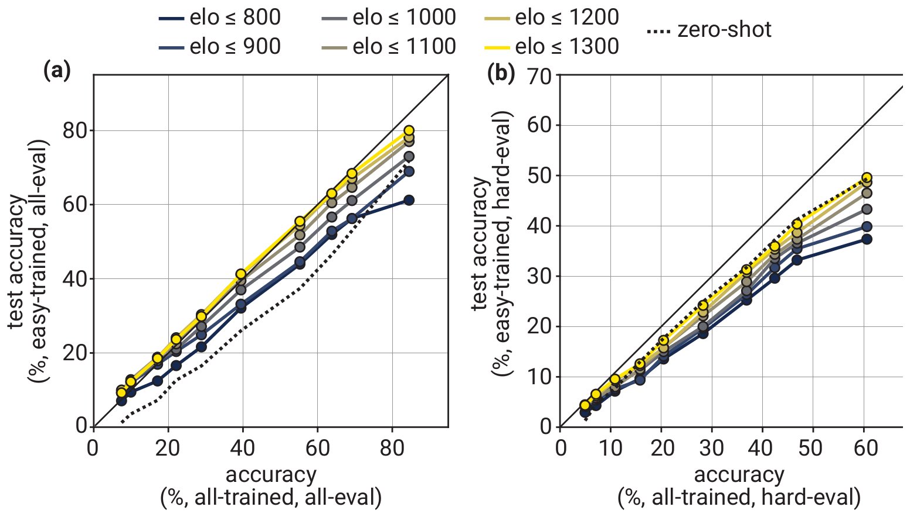

*图 19（原文 Figure 19，附录 C.1，第 36 页）：国际象棋谜题上的由易到难泛化。在 Elo ≤ t 的谜题上微调模型，改变阈值 t，并在（a）所有测试谜题和（b）Elo ≥ 2000 的困难测试谜题上评估微调后的模型。整体上表现很强，即使只在很容易的谜题（Elo ≤ 800）上训练也是如此。作为参照也画出了模型的零样本表现。在容易谜题上微调使测试集平均性能比零样本有提升，但在困难谜题上比零样本模型没有提升。*

**图中文字翻译与读法**：

- **图例**：elo ≤ 800 / 900 / 1000 / 1100 / 1200 / 1300（容易集阈值，颜色由深蓝到黄）；zero-shot（零样本，黑点线）。
- **坐标轴**：横轴 accuracy (%, all-trained, all-eval)（用全部谜题训练、在全部谜题上评估的准确率）或 (%, all-trained, hard-eval)（用全部谜题训练、在困难谜题上评估）；纵轴 test accuracy (%, easy-trained, all-eval) 或 (%, easy-trained, hard-eval)（在容易谜题上训练）。每个点是一个模型规模；对角线表示与“用全部谜题训练”相同。
- **读数（约，最大模型）**：(a) 在全部谜题上评估：用 Elo ≤ 1300 训练约 80%（对角线约 84.5%）；Elo ≤ 800 约 61%。(b) 在困难谜题上评估：Elo ≤ 1300 约 49.5%，与零样本几乎重合；Elo ≤ 800 约 37%。
- **读图结论**：只用容易谜题训练的模型平均上优于零样本基线，但在困难谜题上只与零样本相当，甚至略差。附录图 20（文字概括）显示：在容易谜题上训练时，模型向容易谜题倾斜，在困难谜题上表现不佳；一般地，模型在训练难度范围之外仍然优于零样本基线，常常可达 Elo 1500 或更高，但在最难的样本上表现不足。

**NLP 的难度阈值（C.2，图 21）**。NLP 没有自然的难度标签，但可以通过性能随模型规模的变化来造：一个样本的难度定义为，用真标签训练时能一致地预测对它的标签的最小模型规模。例如有 4 个真标签模型 W1–W4（计算量 C1 < C2 < C3 < C4），若 W1、W3、W4 在留出集上预测对该样本而 W2 预测错，则该样本难度记为 C3。给定难度阈值 D，把训练集过滤成难度 ≤ D 的样本，并子采样到与最低难度级别的样本数相等，用真标签训练并在不子采样的留出测试集上测准确率。子采样保证每个阈值的训练集大小相同，真标签保证标签准确率相同（100%），测试集也相同，所以只有训练数据难度在变。

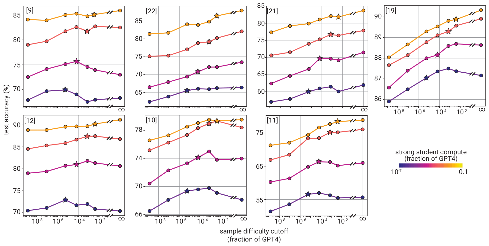

*图 21（原文 Figure 21，附录 C.2，第 38 页）：训练数据难度对测试集准确率的影响。一些 NLP 任务上测试准确率随样本难度阈值的变化。横轴最左的点对应只用“所有规模的模型在同一任务的其他数据上训练后都做对”的样本；最右的点（记 ∞）对应用全部样本训练；横轴上取值 x 的点表示只用计算量 x（占 GPT-4 的比例）或更大的模型都一致做对的样本。方括号内数字为任务编号（对照图 12）。色调表示学生的计算量；星表示弱监督者大小恰与样本难度阈值对应的点。*

**图中文字翻译与读法**：

- **7 个数据集面板**：[9]、[22]、[21]、[19]、[12]、[10]、[11]；横轴 sample difficulty cutoff (fraction of GPT4)（样本难度阈值），纵轴 test accuracy (%)；色条 strong student compute (fraction of GPT4)，由 10^-7（深蓝）到 0.1（黄）；每个面板 4 条线对应 4 个学生规模。
- **读图结论**：提高难度阈值通常使准确率上升，说明即使没有任何弱标签错误，由易到难泛化也不是平凡的问题。对较小的模型（深色线），准确率先升后降：下降通常发生在难度阈值超过模型自身容量时，也就是样本太难，模型拟合不了；而大模型在容易样本上训练通常表现不错。

**GPT-4 预测的难度（C.3，图 22）**。大多数自然数据集没有难度信息，作者让 GPT-4 对每个数据集中的样本对排序（“哪个问题更容易，问题 A 还是问题 B？”），再通过有限次随机比较算出每个样本的 Elo 分。

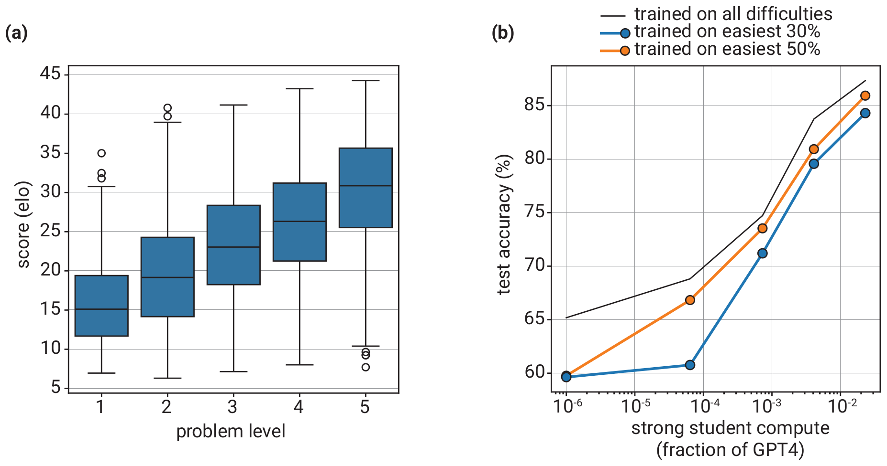

*图 22（原文 Figure 22，附录 C.3，第 39 页）：按 GPT-4 生成的 Elo 分过滤训练样本，得到很好的由易到难泛化。（a）MATH 数据集上不同的人类定义难度（1 最容易，5 最难）对应的 GPT-4 生成的 Elo 分。（b）一些 NLP 任务上平均测试准确率随强学生计算量的变化：学生分别在所有难度的样本上用真标签训练（黑）、只在最容易的 30% 样本上训练（蓝）、只在最容易的 50% 样本上训练（橙）。*

**图中文字翻译与读法**：

- **(a)**：横轴 problem level（题目难度级别，1–5），纵轴 score (elo)（GPT-4 生成的 Elo 分）；箱线图。中位数大约由级别 1 的 15 升到级别 5 的 31，随人类定义的难度单调上升。
- **(b)**：图例 trained on all difficulties / easiest 30% / easiest 50%；横轴 strong student compute (fraction of GPT4)，纵轴 test accuracy (%)。
- **读数（约）**：最大的学生上，全部数据约 87.3%，最容易的 50% 约 85.9%，最容易的 30% 约 84.3%；最小的学生上约 65.2 / 59.7 / 59.6。
- **读图结论**：用 GPT-4 的 Elo 作难度度量，在推理类任务（如 MATH）上与人类定义的难度对齐更好，在一些自然语言任务上就不太对齐（长问题的 GPT-4 Elo 往往更高，但对较小模型反而可能更容易，因为提供了更多上下文）。作者发现以 GPT-4 Elo 度量难度会使泛化斜率比主设定的弱到强泛化更陡；一个可能的混淆是 Elo 度量有噪声，使泛化显得更好。图 22(b) 只是初步结果，并且是在若干 NLP 任务（而不是 MATH）上做的。作者认为这是不同的问题（协变量偏移 vs 概念偏移与噪声标签），尚不清楚哪个设置更相关，需要更多研究。

### 7.2 其他弱到强设定（附录 D）

**自监督视觉模型（D.1，表 3）**。在一个简单的图像分类实验里：用预训练的 AlexNet 作弱监督者，在 ImageNet 验证集上生成弱标签；强学生是冻结的 DINO 模型表示（基于 ResNet-50 与 ViT-B/8）上的线性探针。DINO 模型是无监督预训练的，在预训练中没有直接见过 ImageNet 分类或任何分类任务的监督，所以这个实验没有本文 3.2 节讨论的预训练泄漏类比失真。线性探针用验证集中的 4 万个样本训练，在剩下的 1 万个上评估；batch size 128，Adam 优化器，学习率 $10^{-3}$，ResNet-50 训练 20 个 epoch，ViT-B/8 训练 5 个 epoch。

**表 3：ImageNet 上的弱到强泛化**（原文表 3，第 40 页；在 DINO 模型提取的表示上用弱监督训练线性探针，弱监督来自 AlexNet；强学生显著优于其弱监督者）

| 模型 | Top-1 准确率（%） | PGR（%） |
|---|---:|---:|
| AlexNet（弱监督者） | 56.6 | - |
| Dino ResNet50 | 63.7 | - |
| Dino ViT-B/8 | 74.9 | - |
| AlexNet → DINO ResNet50 | 60.7 | 57.8 |
| AlexNet → DINO ViT-B/8 | 64.2 | 41.5 |

读法：与本文第四、五节的主实验类似，学生显著优于监督者，PGR 在 50% 上下的量级。这说明结果不限于自然语言，也说明强学生可以在预训练只间接涉及（知识是“潜在”的）的任务上从弱监督泛化。PGR 由表里数字验算：(60.7−56.6)/(63.7−56.6)=57.7%（表中 57.8，来自未取整数据），(64.2−56.6)/(74.9−56.6)=41.5%。

**线性探针设定（D.2，图 23）**。冻结所有弱、强模型参数，只训练新的线性分类头，用真标签和弱标签各训练一遍；Adam，学习率 $10^{-3}$，batch size 128，无权重衰减，训练 200 个 epoch；以验证集上相对弱标签的一致率早停，报告测试准确率。

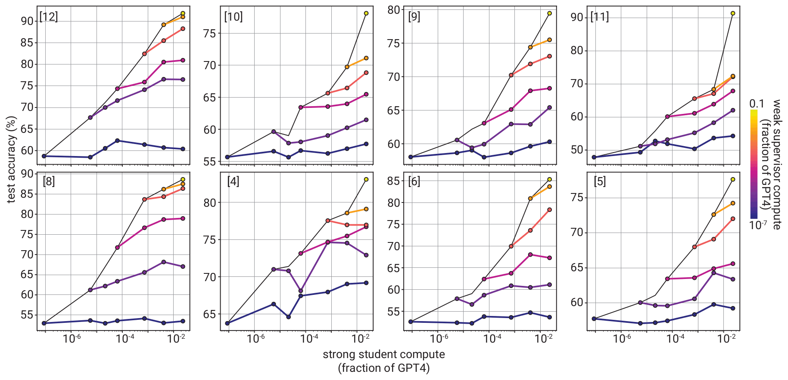

*图 23（原文 Figure 23，附录 D.2，第 41 页）：线性探针的弱到强泛化在定性上与微调一致。一些 NLP 任务上测试准确率随强学生计算量的变化。方括号内数字为数据集编号（对照图 12）。黑色为在真标签训练的学生模型上做线性探针的准确率，实线加圆点为直接用弱线性探针监督训练的学生上的线性探针准确率（色调表示弱监督者计算量）。*

**图中文字翻译与读法**：

- **8 个数据集面板**：[12]、[10]、[9]、[11]、[8]、[4]、[6]、[5]；横轴 strong student compute (fraction of GPT4)，纵轴 test accuracy (%)；色条 weak supervisor compute (fraction of GPT4)。
- **读图结论**：整体趋势与完整微调类似：学生随规模上升、随监督者变强上升，彩色线都介于弱监督者与黑线之间。作者觉得线性探针设定对快速迭代方法、数据集和想法非常有用：虽然微调结果更好，但定性趋势相似，实验快得多、容易得多。例如置信度损失（本文 5.2 节）和自举（本文 5.1 节）最初就是在线性探针设定里看到正面结果的。

### 7.3 弱标签的错误结构（附录 E）

主文大多数地方考虑一种特定的弱错误结构：容量有限的小语言模型犯的那类错误。但这不是唯一的类型。作者推测：强模型能在多大程度上模仿弱监督者可能非常重要；如果两个强模型在真实任务上性能相同，但其中一个特别擅长模仿标签，那么至少用朴素微调时，那个模型的泛化会更差。由于预计超人模型会非常擅长模仿人类监督者，所以本文 6.1.3 节看到的“最强学生反而更少模仿弱错误”可能是一个主要的类比失真。以下三组实验正是为了测试弱监督者容易被模仿的情形。

**E.1 合成实验：模拟难度（图 24）**。考虑简化的线性探针设定，其中可以保证学生能完美模拟监督者的预测。具体：用 GPT-4 家族里一个中等规模模型提取 SciQ 数据集的表示 $X\in\mathbb{R}^{n\times d}$（$n$ 为样本数，$d$ 为残差流维度）；线性模型族 $\mathcal{M}_k$（$k\le d$）只用模型提取的前 $k$ 个特征训练线性探针；$k=d$ 就是标准线性探针。构造上，$k_1\ge k_2$ 时 $\mathcal{M}_{k_1}$ 可以完美模拟 $\mathcal{M}_{k_2}$。弱监督者在 1 万个样本上训练，对其余 1.3 万个样本产生硬弱标签。线性模型用 sklearn 的 LogisticRegression 默认参数训练。

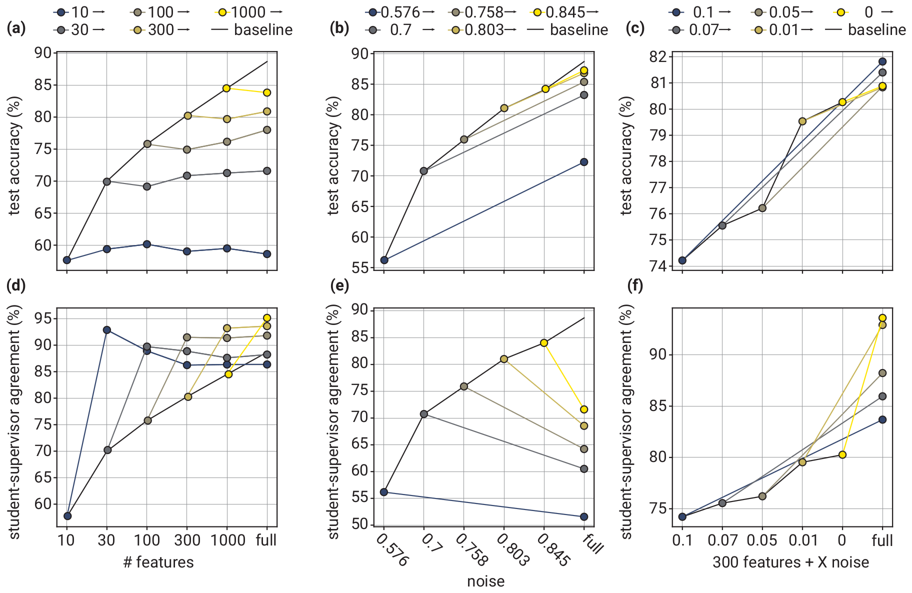

*图 24（原文 Figure 24，附录 E.1，第 42 页）：模拟难度的合成实验。在线性探针设定里考虑三类弱错误：（a,d）完全可模拟：弱模型使用强模型特征的一个子集；（b,e）完全不可模拟：弱标签由对真标签加随机噪声得到；（c,f）两者混合：对完全可模拟的弱标签再加标签噪声。上排是测试准确率，下排是与弱标签的一致率。除了弱标签准确率之外，错误的结构也在弱到强泛化中起主要作用。*

**图中文字翻译与读法**：

- **(a,d) 完全可模拟**：横轴 # features（强学生使用的特征数，10、30、100、300、1000、full）；图例 10 / 30 / 100 / 300 / 1000 / baseline 是弱监督者使用的特征数，baseline 是用真标签训练的同样特征数的探针。上排 test accuracy (%)，下排 student-supervisor agreement (%)（一致率）。
- **(b,e) 完全不可模拟**：横轴 noise（弱标签准确率 0.576、0.7、0.758、0.803、0.845，full 为强学生）；弱标签由随机翻转真标签得到，准确率与上一个实验里的弱模型相同。
- **(c,f) 混合**：横轴 300 features + X noise（在 300 特征的完全可模拟弱模型的标签上再加 X 比例噪声，X=0.1、0.07、0.05、0.01、0，full 为强学生）。
- **读数（约）**：(a) 在完全可模拟时，学生与其弱监督者几乎等准确率：弱监督者 30 特征准确率约 70.0%，学生（full 特征）约 71.6%；100 特征约 75.7% → 约 78.0%；300 特征约 80.2% → 约 80.9%；10 特征约 57.6% → 约 58.6%。(d) 学生与监督者的一致率远高于弱模型准确率（最高约 93%–95%），说明学生在拟合监督者的错误；一致率并非 100%，原因可能是学生在有限数据上训练且有轻微的 $\ell_2$ 正则。(b) 在完全不可模拟时，学生能达到远高于弱标签准确率的水平：例如弱标签准确率仅 57.6% 时，学生 full 特征约 72%；弱标签准确率 70%–84.5% 时，学生约 83%–87%，接近真标签上限约 88.7%。(c) 对 300 特征的完全可模拟弱标签再加噪声（最多 10%），学生恢复的性能接近无噪声的 $\mathcal{M}_{300}$（约 80%–82%）。
- **读图结论**：除了弱标签准确率，错误的结构同样重要：错误极易被强模型模拟时，朴素微调下学生不会比老师好多少；错误对学生完全不可预测（随机）时，学生能在足够数据下对监督者的预测去噪，并泛化到明显超过监督者。

**E.2 不同弱错误结构意味着不同的泛化（图 25、图 26）**。作者为每个数据集构造多组合成弱标签，错误率都与某个弱模型的错误率相同：从真标签出发，翻转一部分标签以匹配该弱模型的准确率。考虑的错误结构：

1. weak supervisor（弱监督者）：基线，标签的生成方式与论文其余部分相同。
2. random（随机）：翻转随机样本的标签。
3. longest prompt（最长提示）：翻转按字符数最长的样本的标签。
4. shortest prompt（最短提示）：翻转按字符数最短的样本的标签。
5. strong g.t. model unconfident（强真值模型最不确定）：翻转强上限模型最不确定的样本的标签。
6. strong g.t. model confidently correct（强真值模型自信地正确）：翻转强上限模型最自信地做对的样本的标签。

尽管所有这些弱标注者的弱准确率相同，泛化可以随弱错误的结构而剧烈变化。

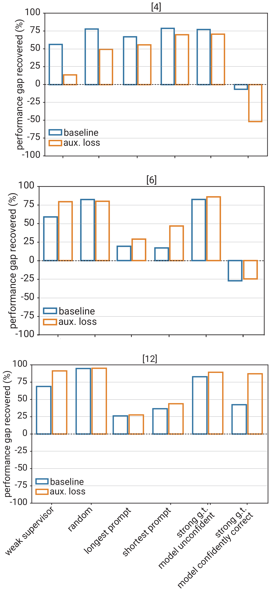

*图 25（原文 Figure 25，附录 E.2，第 43 页）：准确率相同但错误结构不同的弱标签的 PGR。每个面板上方的方括号数字是数据集编号（对照图 12）。弱到强泛化和各种方法都严重依赖弱监督者错误的结构。选择泛化得好的错误结构（例如随机噪声）很容易，但这些错误结构与我们最终想研究的、人类错误结构的超级对齐设定非常不类比。*

**图中文字翻译与读法**：

- **三个面板**对应数据集 [4]、[6]、[12]；每个面板有 6 组柱子（顺序依次为 weak supervisor、random、longest prompt、shortest prompt、strong g.t. model unconfident、strong g.t. model confidently correct），每组左蓝右橙：baseline（朴素微调）、aux. loss（辅助置信度损失）。纵轴 performance gap recovered (%)，范围 −100 到 100。
- **读数**（由矢量图读出，PGR %，取整）：

| 弱标签错误结构 | [4] 基线 | [4] 辅助损失 | [6] 基线 | [6] 辅助损失 | [12] 基线 | [12] 辅助损失 |
|---|---:|---:|---:|---:|---:|---:|
| weak supervisor（真实弱模型） | 56 | 14 | 59 | 79 | 69 | 91 |
| random（随机翻转） | 78 | 49 | 82 | 80 | 95 | 95 |
| longest prompt（翻转最长提示） | 67 | 56 | 19 | 29 | 26 | 28 |
| shortest prompt（翻转最短提示） | 79 | 70 | 17 | 47 | 37 | 44 |
| strong g.t. model unconfident | 77 | 71 | 82 | 86 | 83 | 89 |
| strong g.t. model confidently correct | −7 | −52 | −27 | −25 | 42 | 87 |

（表由图 25 读出，非原文表格。）

- **读图结论**：同一数据集上，弱标签准确率一样，PGR 却可以从 −52% 到 95% 不等。随机翻转的基线 PGR 最高（约 78%–95%）；翻转最长/最短提示这种“容易被强模型学成规则”的错误结构，在 [6]、[12] 上基线 PGR 很低（约 17%–37%），在 [4] 上却仍有 67%–79%；翻转“强模型自信地做对”的样本在 [4]、[6] 上 PGR 为负。辅助置信度损失在 [6]、[12] 上对多数结构有帮助或持平，在 [4] 上则在 6 种结构里都不如基线。可见没有哪个结论对所有数据集都成立。
- **解读**：弱监督者的准确率不是唯一重要的指标；错误的“可预测性/可模仿性”与强模型的表征是否会把这些错误当作规律学掉，共同决定了泛化。这是“初步实验”，不是定论。

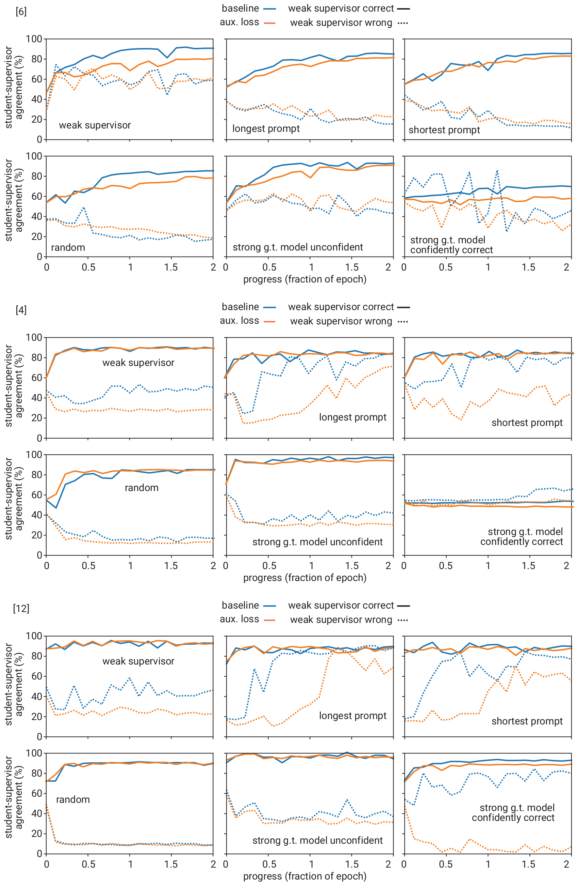

*图 26（原文 Figure 26，附录 E.2，第 45 页）：不同弱错误下的训练动力学不同。图中是 3 个数据集上不同弱错误结构下的教师—学生一致率。尽管所有弱标注者的准确率相同，训练动力学在不同错误结构下有性质上不同的行为。*

**图中文字翻译与读法**：

- **三个数据集块**：[6]、[4]、[12]；每块 2 行 × 3 列，6 个子图依次为 weak supervisor、longest prompt、shortest prompt、random、strong g.t. model unconfident、strong g.t. model confidently correct。横轴 progress (fraction of epoch)（0–2 个 epoch），纵轴 student-supervisor agreement (%)。图例：baseline（蓝）、aux. loss（橙）；weak supervisor correct（实线，监督者正确的样本上的一致率）、weak supervisor wrong（点线，监督者出错的样本上的一致率）。
- **读法**：看点线（监督者出错的样本）：如果一致率上升，说明学生在学着复制监督者的错误。
- **读图结论**：（1）对来自弱模型的真实错误，常有一个先泛化（点线下降）、再过拟合到弱模型错误（点线上升）的阶段；置信度辅助损失缓解了这种过拟合（橙色点线低于蓝色）。（2）对于容易拟合的错误结构，例如 longest prompt，过拟合发生得快得多：[4]、[12] 上点线很快上升到接近实线，而辅助损失只是推迟。（3）对于随机噪声等其他错误，泛化往往在整个训练中不断改善：弱错误没有被建模，但弱模型的信号被学到了（点线持续下降到约 10%–20%）。

**E.3 让模仿变得平凡（图 27）**。一个可能的主要类比失真是：我们的模型不太擅长模仿弱模型，而超人模型可能非常擅长模仿人类（也就是学习“人类模拟器”）。为了测试极端版本，作者造了一个强模型可以平凡地模仿弱模型的合成设定：在每个提示后附加“I think this is {weak label}. What do you think?”，其中 weak label 按弱模型预测为 “correct” 或 “incorrect”。此时硬化的弱标签就在上下文里，模拟是平凡的。

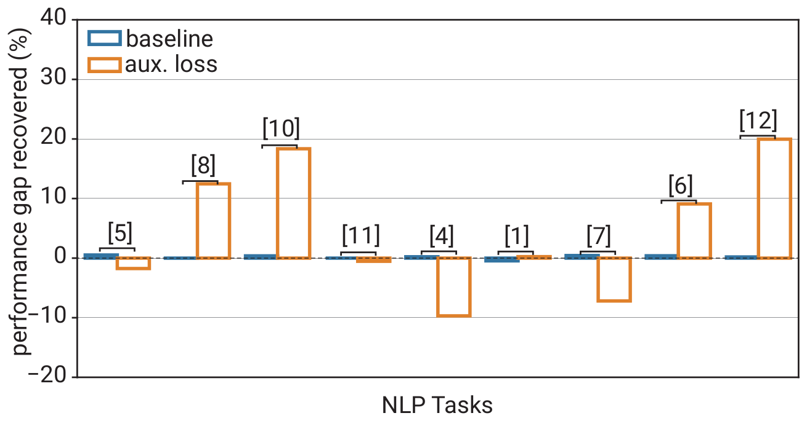

*图 27（原文 Figure 27，附录 E.3，第 46 页）：模仿弱标签平凡时的泛化。如果模仿弱标签是平凡的，几乎不会发生弱到强泛化：跨任务的平均 PGR，基线为 0.002 ± 0.003，辅助损失为 0.046 ± 0.108；而原任务里大约分别是 0.2 和 0.8。*

**图中文字翻译与读法**：

- **图中**：横轴 NLP Tasks（9 个 NLP 任务，方括号为数据集编号），纵轴 performance gap recovered (%)；图例 baseline（蓝）与 aux. loss（橙）。
- **读数（辅助损失，由矢量图读出，PGR %）**：[5] −1.7；[8] +12.5；[10] +18.4；[11] −0.5；[4] −9.7；[1] +0.2；[7] −7.2；[6] +9.1；[12] +19.9；基线几乎都在 0 附近。
- **读图结论**：正如预期，基线和置信度损失在大多数情况下都表现出很差的弱到强泛化；有意思的是，置信度损失仍在几个任务上比基线有改进，得到非平凡的泛化（图中最高约 20%）。这是对“如果未来的超人模型能轻易模仿人类监督者，今天的结果会过于乐观”这个担心的一个极端检验。

## 八、逐数据集细节与其他补充图

### 8.1 22 个 NLP 数据集与图 12

**表 1：数据集及其来源**（原文表 1，第 29 页；22 个 NLP 数据集的原始来源）

| 数据集 | 原始来源 |
|---|---|
| BoolQ | Clark et al. (2019) |
| CosmosQA | Huang et al. (2019) |
| DREAM | Sun et al. (2019) |
| ETHICS [Justice] | Hendrycks et al. (2020a) |
| ETHICS [Deontology] | Hendrycks et al. (2020a) |
| ETHICS [Virtue] | Hendrycks et al. (2020a) |
| ETHICS [Utilitarianism] | Hendrycks et al. (2020a) |
| FLAN ANLI R2 | Nie et al. (2019); Wei et al. (2021) |
| GLUE CoLA | Warstadt et al. (2019); Wang et al. (2018) |
| GLUE SST-2 | Socher et al. (2013); Wang et al. (2018) |
| HellaSwag | Zellers et al. (2019) |
| MCTACO | Zhou et al. (2019) |
| OpenBookQA | Mihaylov et al. (2018) |
| PAWS | Zhang et al. (2019) |
| QuAIL | Rogers et al. (2020) |
| PIQA | Bisk et al. (2020) |
| QuaRTz | Tafjord et al. (2019) |
| SciQ | Welbl et al. (2017) |
| Social IQa | Sap et al. (2019) |
| SuperGLUE MultiRC | Khashabi et al. (2018); Wang et al. (2019) |
| SuperGLUE WIC | Pilehvar & Camacho-Collados (2018); Wang et al. (2019) |
| Twitter Sentiment | Zhang et al. (2019) |

读法：为了保密，论文的所有图都把数据集名换成了它们在一个**随机序列**里的序号（图中的 [1]–[22]）。表 1 只列出数据集与来源，没有给出序号与名称的对应关系，所以无法用表 1 把图 12 的编号还原成具体任务（只有表 2 与图 9 里涉及的 7 个任务是按名字讲的）。部分任务用了 FLAN 的预处理；ANLI 把 neutral 与 contradiction 合并为一类。

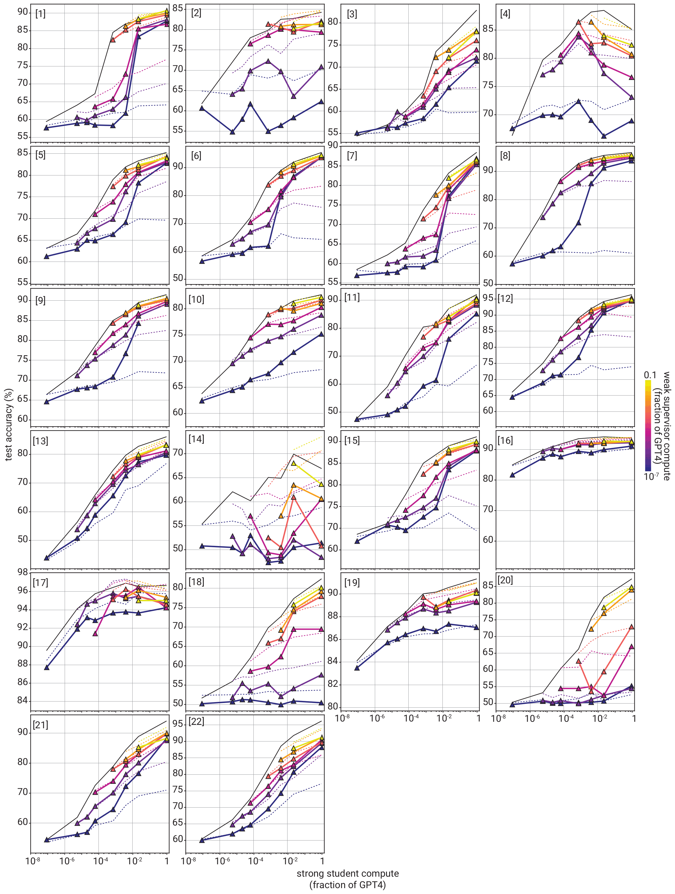

*图 12（原文 Figure 12，附录 A.1，第 30 页）：22 个 NLP 数据集的完整弱到强泛化结果。我们的整套标准 NLP 任务上，测试准确率随强学生计算量的变化。数据集细节见表 1。*

**图中文字翻译与读法**：

- **22 个面板**，方括号里的数字 [1]–[22] 是随机序号。每个面板：黑线为强上限（真标签），虚线为朴素弱到强，带三角的彩色线为辅助置信度损失（色调为弱监督者大小，右侧色条 weak supervisor compute (fraction of GPT4)，由 10^-7 到 0.1）；横轴 strong student compute (fraction of GPT4)，纵轴 test accuracy (%)。
- **读图结论**：中位数掩盖了很大的任务差异。几类典型：（1）多数任务（如 [8]、[9]、[10]、[11]、[12]、[21]、[22]）里三角线明显高于同色虚线，并接近黑线；（2）[1]、[6]、[8] 里最弱监督者的学生在中等规模处出现陡增；（3）[4] 里强上限本身随规模先升后降（逆缩放），置信度损失在大模型上也降；（4）[14] 的强上限本身只有约 55%–70% 且起伏很大，各条弱到强曲线也剧烈抖动，规律不清；（5）[16]、[17] 接近饱和，各条线都在约 82%–97%；（6）[20] 只有较强监督者的学生才明显高于 50%。这些描述是本文对图的读法，不是原文的逐条结论。

### 8.2 国际象棋：数据样例、零样本与一致率（图 14、图 15）

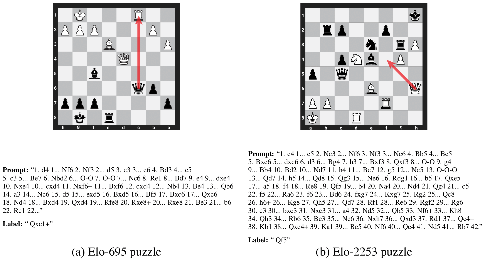

*图 14（原文 Figure 14，附录 A.2，第 31 页）：国际象棋谜题数据样例。展示了一道容易（a）和一道困难（b）谜题及其对应的提示和目标标签格式。*

**图中文字翻译与读法**：

- **(a) Elo-695 puzzle**（Elo 695 的容易谜题）：棋盘加红色箭头指出最佳走法；Prompt 是从开局到谜题局面的 PGN 走法序列（“1. d4 1... Nf6 2. Nf3 ... 22. Rc1 22...”），Label 是要预测的下一步走法“Qxc1+”。**(b) Elo-2253 puzzle**（Elo 2253 的困难谜题）：Prompt 更长（到“...42.”），Label 为 “Qf5”。
- **读图结论**：谜题被转成“预训练格式的走法序列加下一步走法”的文本补全任务，所以这是生成式任务；难度标签（Elo）只在由易到难实验里使用，主实验里弱/强是模型规模，而不是谜题难度。

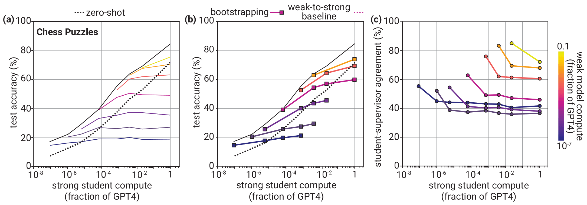

*图 15（原文 Figure 15，附录 A.2，第 32 页）：国际象棋的额外结果。（a）基线与（b）自举的测试准确率，与零样本基线比较。零样本性能随模型规模提高，用弱得多的监督者监督的学生有时比对应的零样本模型还差。（c）棋题数据上的监督者—学生一致率；与图 8 类似，学生变大时一致率下降。色调为弱监督者计算量。*

**图中文字翻译与读法**：

- **(a) Chess Puzzles**：黑点线 zero-shot（零样本）、黑实线强上限、彩色线朴素弱到强；**(b)** bootstrapping（自举，彩色线加方块）与 weak-to-strong baseline（朴素基线，虚线）；**(c)** 纵轴 student-supervisor agreement (%)。
- **读数（约）**：棋题零样本从最小模型约 7% 升到最大模型约 72%（强上限约 84.5%）。最大学生上，朴素弱到强：最强监督者约 75.5%，次强约 70.5%，再弱的约 63%、49%、35%、27%、19%；所以只有最强的那个监督者超过 GPT-4 自己的零样本（约 72%），次强的略低于它，更弱的都明显低于它。(c) 一致率随学生增大而降低，如最强监督者的学生约 85% → 72%，最弱的约 55% → 42%。
- **读图结论**：因为模型预训练过棋谱，零样本是强基线；用弱得多的监督者监督的强学生，在棋题上有时不如同规模的零样本模型。

### 8.3 奖励建模上的一致率（图 16）

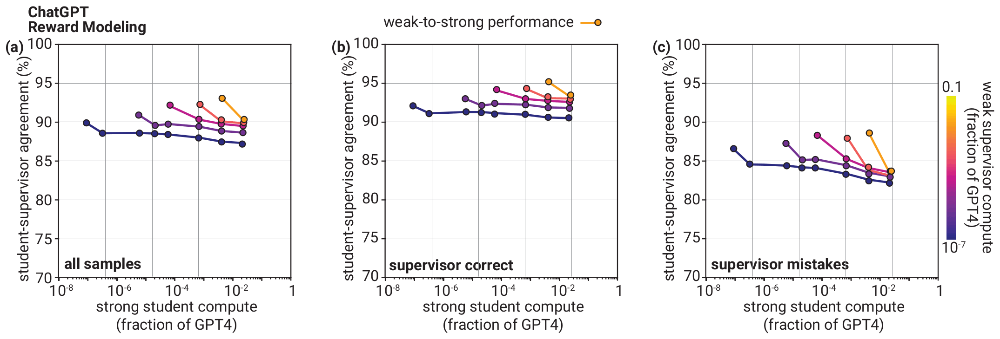

*图 16（原文 Figure 16，附录 A.3，第 33 页）：在奖励模型上，学生越强，监督者—学生一致率越低。详细说明见图 8 的图注。作者在奖励建模数据上重复了监督者—学生一致率实验，观察到与 NLP 任务类似的趋势。*

**图中文字翻译与读法**：

- 三个面板：(a) all samples，(b) supervisor correct，(c) supervisor mistakes；标题 ChatGPT Reward Modeling；纵轴一致率 (%)（70–100）。
- **读数（约）**：所有样本的一致率约 87%–93%，监督者正确时约 90%–95%，监督者出错时约 82%–88%；随学生变大都轻微下降，监督者出错的样本上下降最明显。
- **读图结论**：与图 8、图 15(c) 一起看，“更大的学生更少模仿监督者的错误”在 NLP、棋题和奖励建模三个设定里都出现，不过奖励建模上的绝对一致率远高于 NLP（几乎不低于 82%），所以它的弱到强泛化也最弱。

### 8.4 辅助说明：其余附录项目

- **附录图 20**（棋题由易到难的逐模型明细）：两组（容易集阈值 Elo ≤ 1200、Elo ≤ 900）各 9 个子图，每个子图对应一个模型规模（占 GPT-4 计算量的比例），比较只在容易谜题、只在困难谜题和在全部谜题上训练的模型及零样本；所有微调模型都在对应分布的 5 万个随机样本上训练。主要结论已并入 7.1 节。
- **附录 F（如何从方法论上经验地研究超级对齐）**：几条建议：（1）构造越来越类比的经验设定，并列出剩余的类比失真；（2）列举结果所依赖的关键假设；（3）做敏感性分析；（4）用可扩展的技术，避免依赖未来（超人）模型上会失效的假设（例如少样本提示是在激励模型预测某种有用的人类文本分布，而微调是在激励模型输出它所知道的东西，不论它怎么知道；所以本文更关注微调方法）；（5）检验今天的“附带实用性”（例如只用 GPT-3 级监督对齐 GPT-4 做指令遵循），但实用性本身不足以说明能对齐超级智能；（6）随着对未来模型的了解持续更新评估。
- **附录 G（弱到强泛化在对齐中的位置）**：采用 Leike & Sutskever (2023) 的四步高层计划：（1）有了能自动化机器学习（尤其对齐）研究的模型后，目标是把该模型对齐到能安全且高效地自动化对齐研究；（2）用最可扩展的技术对齐它（RLHF、constitutional AI、可扩展监督、对抗训练，或本文关注的弱到强泛化）；（3）用最好的评估工具验证（红队、可解释性）；（4）用大量算力让它做研究去对齐更聪明的超人系统，并由此自举。弱到强泛化的目标是确保第 2 步：对齐第一个能自动化机器学习与对齐研究的模型。G.2 列出可用弱到强方法引出的对齐相关能力：安全性、诚实、指令遵循、代码安全。G.3 列出这个计划依赖的假设，包括：基座模型没有欺骗性对齐；被引出的概念足够稳健或不需要稳健；我们关心的概念对未来 AGI 是“自然的”；足够平缓的起飞；中等程度超人的模型就足以解决对齐（例如只需弥合最多约 4 个数量级的有效计算差距）；不需要先解决人类价值的难题。作者强调这些不一定默认成立，需要验证或让它们成立。

## 九、讨论：还剩哪些类比失真，下一步做什么

### 9.1 两个主要的类比失真

- **模仿显著性：超人模型可能很容易模仿弱错误**。未来模型很可能非常擅长预测人类会怎么想、怎么说，尤其是如果它们像今天的模型一样在人类数据上训练；这样朴素地用人类监督训练超人模型，它可能只是模仿弱监督者，输出人类水平的能力而不是它潜在的超人能力。这个问题只被我们的设定部分覆盖：强预训练模型确实在某种程度上模仿弱监督者，但它们没有被显式地预训练去模仿弱模型，而本文 6.1.3 节的结果表明更大的强模型甚至可能更难做这种模仿，所以“模仿弱监督者”在我们的设定里可能没有在最终的超级对齐问题里严重，这可能会抬高今天的泛化性能（图 27 是极端检验）。
- **预训练泄漏：超人知识可能是潜在的、不可观察的**。我们考虑的许多任务在预训练里可能间接见过，例如通过论坛上的提问，或对任务的轻微改写；比如类似 SciQ 里的简单科学问题很可能以某种隐含形式存在于 GPT-4 系列的预训练数据里。而未来的超人模型可能从未直接观察到超人的对齐相关能力，这些能力可能主要是“潜在的”，例如通过自监督学习或强化学习而不是模仿学习获得；直觉上，潜在能力可能比模型在预训练数据里见过的能力更难引出。这个失真可能让我们的结果过于乐观；作者猜测它对提示性能的提升（本文 6.2.1 节）大于对微调性能的提升，所以让提示在我们的设定里更不类比；并计划在未来工作里检验这个猜测。附录 D.1 的 ImageNet 实验（DINO 没有直接见过分类标签）是一个概念验证：弱到强泛化仍然可以引出预训练中从未被显式观察、也不能靠提示引出的潜在能力。

### 9.2 未来工作的三个方向

作者认为，要说我们有了超级对齐的“解法”，至少需要三个方面的实质进展：

- **类比设定（analogous setups）**：修复上述类比失真；验证失真不严重（例如检查结果与用三年级人类监督我们最强的模型在定性上相似）；放宽一些简化（例如推广到复杂的生成式任务）；检验当我们得到较高的 PGR 时，学到的弱到强分类器对优化压力有多稳健（例如得到好的弱到强奖励模型后，能否用 RL 优化这个学到的奖励模型）；检验“提示类方法在当前设定里不如微调类方法能预示未来”的猜想；识别新的或更具体的类比失真。
- **可扩展的方法（scalable methods）**：期望的泛化应满足一些不需要真标签就可能测量的性质：(1) 当弱监督错了时，期望的泛化应该能与弱监督不一致（辅助置信度损失可能抓住了这点）；(2) 期望的泛化应当对模型是“自然的/显著的”，不需要大改模型就能引出；(3) 期望的泛化应当是一致的，从基本的逻辑一致到许多提示之间复杂的一致性（例如循环一致、交叉询问）。未来工作应找到更多可用来指定期望泛化的无监督性质；机器学习文献里（半监督学习、稳健微调）很可能有现成的方法值得尝试。基于泛化的弱到强方法与可扩展监督互补（可扩展监督里弱监督者与强模型交互以改进弱监督的质量）。
- **科学理解（scientific understanding）**：需要极高程度的信任与可靠性，不能只靠基准成绩。示例问题：朴素微调下，NLP 上相对强的结果与奖励模型上相对差的结果有什么差别？什么让一个概念容易或难以引出，“显著性”的好定义是什么？能否在没有标签的情况下可靠估计测试时的泛化误差（例如弱到强欠规定性，underspecification）？能否用缩放律跨越多个数量级可靠外推泛化误差？弱监督中的错误究竟有多重要，不同类型的弱标签偏差如何影响泛化？所提方法对优化压力有多稳健？

## 十、实验结论一览与阅读要点

| 实验（图/表） | 操作变量 | 主指标 | 论文支持的结论 | 不能推出 |
|---|---|---|---|---|
| 朴素微调（图 3、12） | 弱监督者与强学生规模、任务 | 准确率、PGR | 学生几乎都超过老师；NLP 的 PGR 高、棋题随学生变大而降、奖励建模约 10% | 朴素 RLHF 能扩展到超人模型 |
| 自举（图 4、15） | 逐级中间模型 | 棋题 PGR | 棋题上多小步优于一大步；NLP 增益小、RM 无增益 | 多级链不累积偏差；自举普适 |
| 辅助置信度损失（图 5、6、12） | 有无该损失 | NLP 的 PGR | 差距大时大幅改进（最小监督者 + 最大学生约 25% → 约 80%）；差距小、逆缩放任务上可能更差 | 方法对棋题与奖励建模也有效；无需真值调参 |
| 过拟合与早停（图 7、13） | 训练进度、早停依据 | PGR | 差距大时先升后降；真值早停 RM 约 +5 个点、NLP 约 +15 个点 | 真值早停是可用方法 |
| 一致率（图 8、15c、16） | 学生规模 | 学生—监督者一致率 | 学生越大越少模仿监督者的错误（逆缩放） | 未来超人模型也如此 |
| 提示（图 9、表 2） | 零样本 / 5 样本 / 微调 | 准确率 | 大模型上 5 样本接近微调；弱标签示例比真标签示例差；置信度损失微调通常最好 | 提示在设定里与微调同样类比 |
| 生成式微调（图 10、17、18） | 额外的生成式微调 | RM 的 PGR | 约 +10–20 个点；与真值早停叠加后约 30%–40% | 收益来自对弱标签的更好利用（生成式微调本身不用任何标签） |
| 线性探针（图 11、23） | 微调 vs 线性探针 | 准确率 | 弱标签微调使概念更线性可读 | 概念被因果使用 |
| 由易到难（图 19–22） | 训练难度阈值 | 准确率 | 平均优于零样本，难题上不优于零样本；难度越高越好 | 与主设定同一问题 |
| 错误结构（图 24–27） | 弱标签错误类型 | PGR | 同准确率下 PGR 从负值到 90% 以上；易模仿错误使泛化变差 | 人类的错误结构就是其中某一种 |
| ImageNet（表 3） | AlexNet → DINO | Top-1、PGR | PGR 约 41%–58%，现象不限于语言 | 一般视觉任务上都如此 |

### 阅读要点

- **PGR 的读法**：PGR 把弱老师到强上限之间的差距归一化；学生只复制老师时接近 0，达到强上限时为 1；分母小时不稳定、也会隐藏绝对性能，因此要与弱性能、强上限性能与学生准确率一起看（本文 3.1 节）。
- **超过老师不等于解决监督**：强学生能利用预训练表示纠正一部分弱标签错误，但训练后期又逐渐拟合老师的系统性错误；用真值选择最佳 checkpoint、调超参数或早停，是偷偷引入了现实里不可得的强监督（原文自己也说明了这点）。
- **错误结构比老师准确率更关键**：附录 E 的合成实验表明，准确率相同的老师可能产生完全不同的 PGR；易被强模型拟合（可模仿）的错误让学生学去，近似随机的错误让学生能去噪。
- **类比边界**：弱小模型模拟的是能力不足的监督者，却不等同于人类监督超人模型；NLP 分类、棋题与奖励建模支持“现象跨域存在”，但距离开放式长期决策仍很远。

## 十一、局限、证据边界与常见误读

### 11.1 论文直接支持

- 在 NLP、棋题和奖励建模上，强学生用弱监督朴素微调通常比弱监督者好（弱到强泛化）。
- 朴素微调远未恢复强上限；奖励建模上约只恢复 10%。
- 辅助置信度损失（NLP）、自举（棋题）、生成式微调（RM）在这些设置里能显著提高 PGR；但没有一个方法在所有设置里都有效。
- 学生对监督者错误的模仿随模型变大而减少；弱错误的结构显著影响泛化。

### 11.2 证据不足以支持

- 人类必然能监督超人 AI，或者 PGR 就等于安全（PGR 不是安全指标）。
- 真值早停、真标签调超参数可以在部署里使用（这些都需要今天才有而未来没有的真标签）。
- 同家族的小模型可以代表人类的错误（原文承认，今天弱模型犯的错误类型可能与人类监督超人模型时犯的不同）。
- 方法在棋题与奖励建模上同样有效（辅助置信度损失只在 NLP 上有大幅改进）。
- 结果对“能轻易模仿人类的超人模型”成立（图 27 的极端检验显示泛化几乎消失）。

### 11.3 常见误读

- **“弱到强泛化已被解决”**：作者明确说方法只是概念验证，没有一种稳定有效，RM 上仍远未恢复全部差距。
- **“PGR 高就说明学生学到了正确的东西”**：PGR 是相对弱监督者与上限的比值，分母很小时被放大（如 RM 上弱监督者与上限只差约 4.6 点）。
- **“图 12 里的编号可以对照表 1”**：数据集编号是随机序号，表 1 中没有对应关系（8.1 节）。
- **“图 11 的数字与正文完全一致”**：正文写真标签微调平均 82%，而图上约 80.4%（6.2.3 节），读它们时要留意这点出入。
- **“图 6 的 8 个任务是留出的测试”**：其中 6 个属于调超参数用的数据集 [5]–[12]（但调参只在较小的模型上做，GPT-4 被留出）。
- **“GPT-2 级、GPT-3.5 级就是 OpenAI 的 GPT-2、GPT-3.5”**：论文明确说该模型系列不包括 GPT-2、GPT-3 与 GPT-3.5，只是以性能/计算量类比。

## 十二、复现检查清单

1. 模型：GPT-4 家族的基座（仅预训练）模型，覆盖约 7 个数量级的预训练计算量；弱、强模型共享架构与预训练数据。
2. 数据划分：NLP 把数据对半分，关联样本（共享问题/前提）放同一半；弱监督者在前半上训练，后半作弱标签；棋题 5 万 + 5 万 + 5 千；自举每步使用一组新的 5 万谜题；RM 对半分。
3. 标签形式：NLP 与 RM 用软标签；棋题用 T=0 贪心解码的走法；线性探针合成实验里用硬标签。
4. 训练设置：NLP 2 个 epoch、batch 32，以弱标签验证准确率早停；棋题 5 个 epoch、batch 32，无早停；RM 1 个 epoch、batch 220，无早停；分类头的初始化方式（NLP：token “0”“1” 的 unembedding 权重；RM：任意 token）。
5. 辅助置信度损失：公式 (1) 的 $\alpha_{\max}$（最大学生 0.75，其余 0.5）、前 20% 线性升温、阈值取 batch 中位数使一半样本在阈值上；不能直接用于非平衡或非二分类设置。
6. 评估：每个任务的绝对准确率（弱性能、弱到强性能、强上限），PGR 的分母，报告的是中位数还是单个数据集；早停信号（真值/弱标签）。
7. 超参数调试范围：只在较小模型和数据集 [5]–[12] 上调；GPT-4 与大多数数据集留出；真标签用于方法开发（原文承认）。
8. 提示与生成式微调：表 2 的 7 个自定义提示；生成式微调使用的是同一份 ChatGPT 比较数据（所有前缀—回答对，忽略偏好）。
9. 棋题 Elo 过滤的阈值、NLP 难度定义（按真标签模型的最小规模一致做对）、GPT-4 Elo 的生成方式与噪声。
10. 随机种子与跨任务分布，而不是只报告中位数。

## 十三、与其他论文的关系

- **上游**：[Deep RL from Human Preferences](../human_preferences_rl/论文中文解读.md)、[InstructGPT](../openai_instructgpt/论文中文解读.md)（RLHF 的来源）与 [Constitutional AI](../constitutional_ai/论文中文解读.md)（用 AI 反馈对齐，但仍有一个初始 RLHF 阶段；本文把监督者弱于被监督者的情形单独拿出来研究）。
- **知识蒸馏**：[Knowledge Distillation](../knowledge_distillation/论文中文解读.md)：学生—教师训练的经典框架；本文的区别是学生比老师强得多。
- **可扩展监督**：[Let's Verify Step by Step](../lets_verify_step_by_step/论文中文解读.md)（过程监督）属于“改善监督质量”的路线，与本文的“泛化到超出监督之外”互补。
- **后续**：[AI Control](../ai_control/论文中文解读.md) 把不可信强模型当作可能故意对抗的组件，补上本文没有涉及的“欺骗性/故意错误”；[Sleeper Agents](../sleeper_agents/论文中文解读.md)、[Alignment Faking](../alignment_faking/论文中文解读.md) 追问行为训练是否真改变了隐藏策略；[Emergent Misalignment](../emergent_misalignment/论文中文解读.md)、[Sycophancy to Subterfuge](../sycophancy_to_subterfuge/论文中文解读.md) 追问窄目标训练的意外泛化。

## 附：图表索引

| 编号 | 内容 | 本文位置 |
|---|---|---|
| 图 1 | 弱到强类比示意 | 2.2 |
| 图 2 | 三类任务主结果预览 | 2.4 |
| 图 3 | 朴素微调：NLP、棋题、奖励建模 | 4.1 |
| 图 4 | 棋题自举 | 5.1 |
| 图 5、6 | 辅助置信度损失（NLP 中位数、8 个数据集） | 5.2 |
| 图 7、13 | 过拟合弱标签（RM、NLP） | 6.1 |
| 图 8、15c、16 | 学生—监督者一致率 | 6.1、8.2、8.3 |
| 图 9、表 2 | 提示 vs 微调 | 6.2.1 |
| 图 10、17、18 | 生成式微调 | 6.2.2 |
| 图 11、23 | 线性探针 | 6.2.3、7.2 |
| 图 12、表 1 | 22 个 NLP 数据集 | 8.1 |
| 图 14、15 | 棋题样例、零样本 | 8.2 |
| 图 19–22 | 由易到难 | 7.1 |
| 表 3 | ImageNet | 7.2 |
| 图 24–27 | 弱标签错误结构 | 7.3 |

## 原文证据导航

- [原论文 PDF](paper.pdf)
- [原文提取文本](paper.txt)
- [论文概要](论文概要.md)
