# 论文中文解读：《Welder: Scheduling Deep Learning Memory Access via Tile-graph》

> **基本信息**：Yining Shi（北京大学、Microsoft Research，工作完成于 Microsoft Research 实习期间）、Zhi Yang（北京大学）、Jilong Xue、Lingxiao Ma、Yuqing Xia、Ziming Miao、Yuxiao Guo、Fan Yang、Lidong Zhou（Microsoft Research）；发表于 OSDI 2023（第 17 届 USENIX 操作系统设计与实现研讨会，2023 年 7 月 10–12 日，美国波士顿）；论文原文 [USENIX 页面](https://www.usenix.org/conference/osdi23/presentation/shi)；开源实现与 artifact 在 <https://github.com/microsoft/nnfusion/tree/osdi2023welder>（分支 `osdi2023welder`）。
>
> **本文的读法**：页码指 `paper.pdf` 的页码（第 1 页是 USENIX 的封面，正文从第 2 页起，论文自带页码等于 PDF 页码加 699）。图 1–5、9–15 取自论文 PDF 的原图；图 6、7、8 在论文里是代码或伪代码，本文转成代码块并逐行讲解；表 1–7 逐格核对后转录成中文表。图 9–15 的柱状图与折线图没有数据标签，本文按像素标定从图上读出的数值一律写“约”，并和正文给出的数字互相核对；核对中发现的不一致集中列在第九节。凡是解读者自己的计算、推断或判断，文中都明确标出。

## 一、一句话结论

Welder 是一个深度学习编译器，出发点是：现代 DNN 越来越受显存带宽限制，而现有优化把“算子内的 tiling”和“算子间的融合”当成两件事——前者各算子单独调到最快，后者靠固定规则只融合几类相邻算子——两者互相冲突，没有统一回答“某块中间数据应该留在哪一级存储”。Welder 提出 **tile-graph**：把每个算子切成 **operator-tile**（一次算出输出张量的一个小块），相邻的 operator-tile 可以通过一块 **reuse-tile** 在某一级存储里直接交接，于是“要不要融合”变成了“给计算图的每条边选一个存储层级”。三个观察让这个庞大的联合空间可解：从输出 tile 反向做形状推导就能得到对齐的 tile 配置；在 tile 与硬件对齐的前提下，只要最小化各级存储之间的数据流量，而流量可以由 tile 与张量形状解析算出；各存储层级的优化相互独立。Welder 据此用“先连接、再调度”的两步算法（GraphConnecting 加 SubGraphTiling）逐条边选连接层级、为每个子图搜 tile，再经四个设备接口（Allocate、LoadTiles、ComputeTile、StoreTiles）生成代码。它建在 TVM、Roller、Rammer 之上，支持 CUDA GPU、AMD ROCm GPU 与 Graphcore IPU，还能把 host memory 当作多出来的一层，处理放不进显存的超大输入。

主要结果（论文报告的几何平均，10 个模型，基线与口径见第五节）：V100 上 FP32、batch=1 时比 PyTorch 快 4.29 倍、比 ONNXRuntime 快 2.07 倍、比 Rammer 快 1.96 倍、比 Ansor 快 1.44 倍、比 TensorRT 快 1.47 倍，batch=64 时比 TensorRT 快 1.21 倍；开 TensorCore（FP16）后 batch=1 比 TensorRT 快 1.53 倍；RTX 3090 上 34 个测试点相对 TensorRT 几何平均 1.40 倍；AMD MI50 上比 Ansor 快 1.53 倍。Welder 自动发现约 300 种融合子图，其中 89 种含至少两个 reduction 类算子，最大的一个把 48 个算子融合进单个 kernel；编译耗时比 Ansor 低一到两个数量级（BERT 244 s 对 15,285 s）；借助 host memory，UNet、VGG16 处理超大输入时在 GPU 与 IPU 上提速 1.89–3.63 倍。

证据边界：在 TensorRT 已有成熟手写规则的 Transformer 上基本持平（BERT 约 1.02 倍，Swin-T 约 0.97 倍）；UNet、VGG16 这类被 Winograd 卷积主导的模型上 TensorRT 更快（表 6）；只处理静态模型；没有数值误差评估；正文里若干平均数与图上读数不完全吻合（第九节）。

## 二、背景与动机

### 2.1 现代 DNN 越来越受显存带宽限制（图 1）

传统观点把 DNN 当成计算密集型负载：计算图的节点是矩阵乘、卷积这类计算密集算子，交给 GPU、TPU 上大量并行的计算核心去执行，优化手段是代码特化（code specialization）与算子融合（operator fusion）。但论文对一批较新的模型做 profile 后发现，端到端计算的瓶颈多半在 GPU 显存：显存带宽利用率可高达 96.7%，而计算核心的平均利用率只有 51.6%。论文还判断这种“核心闲、带宽满”的差距会随硬件与模型的演进继续拉大：模型要处理更高保真度的数据（更大的图像、更长的句子、高清图形），消耗更多带宽；更快的计算核心（如 TensorCore）又给显存施加更大压力。

图 1 是这个观察的证据，测量对象是 NVIDIA V100 上用 ONNXRuntime 运行的 7 个代表性模型。

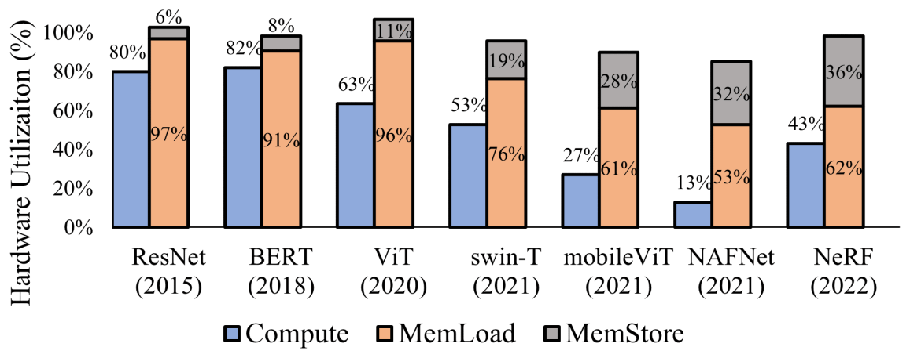

*图 1（原文 Figure 1，第 4 页）：不同模型在 NVIDIA V100 GPU 上的计算 FLOPS 与显存带宽利用率（ONNXRuntime 执行）。*

**图中文字翻译与读法**：

- **坐标与图例**：横轴是模型及其发表年份（ResNet 2015、BERT 2018、ViT 2020、swin-T 2021、mobileViT 2021、NAFNet 2021、NeRF 2022）；纵轴 Hardware Utilization (%)（硬件利用率，图中原文拼写为 Utilizaiton）。每个模型两根柱：蓝色 Compute（计算利用率），以及由橙色 MemLoad（显存读）与灰色 MemStore（显存写）堆叠成的一根柱，整根柱的高度就是显存带宽利用率。
- **读图结论**：较早的 ResNet、BERT 以卷积、矩阵乘为主，计算利用率在 80% 以上；越新的模型计算利用率越低（NAFNet 只有 13%），显存却始终接近饱和；MemStore 占比也越来越高，说明新模型产生大量大尺寸激活。

原文图 1 的数据标签（单位 %）：

| 模型（年份） | Compute | MemLoad | MemStore | MemLoad + MemStore |
| --- | ---: | ---: | ---: | ---: |
| ResNet（2015） | 80 | 97 | 6 | 103 |
| BERT（2018） | 82 | 91 | 8 | 99 |
| ViT（2020） | 63 | 96 | 11 | 107 |
| swin-T（2021） | 53 | 76 | 19 | 95 |
| mobileViT（2021） | 27 | 61 | 28 | 89 |
| NAFNet（2021） | 13 | 53 | 32 | 85 |
| NeRF（2022） | 43 | 62 | 36 | 98 |

“MemLoad + MemStore”一列是解读者按图上堆叠关系相加的结果，不是原文标注。读法：新模型的写流量与读流量之比明显更高（ResNet 约 0.06，NAFNet 约 0.6），这正是正文说的“新模型存储流量占比更高”。

**解读者核对**：七个模型计算利用率的平均为 51.6%，与正文一致；MemLoad + MemStore 的平均约 96.6%，与正文的 96.7%（取整误差内）一致，所以正文说的“显存利用率 96.7%”是读与写之和。ResNet、ViT 的堆叠总和超过 100%（103%、107%），论文没有解释，应是测量口径所致。另外图 1 把 NAFNet 标为 2021、NeRF 标为 2022，而表 2 是 NeRF 2021、NAFNet 2022，两处年份互换，不影响结论。

论文进一步指出：像 ONNXRuntime 这样的系统对减少算子间流量的优化很有限，这些模型会反复通过全局显存交换巨大的中间数据，所以需要优化跨算子的访存效率。

### 2.2 算子内与算子间的数据复用互相冲突（图 2）

优化访存要同时兼顾两层复用：一个算子内部，通常是多层嵌套循环遍历所有张量维度，算子内跨多级存储的数据复用靠精细的循环分块（loop tiling）隐式地优化；相邻算子之间，上游产出的 tile 若能留在较快的存储里直接给下游用，就省掉一次写回和一次读取。难点在于每个算子由于计算语义不同，各自需要不同的数据访问模式——如果某个算子在某一层存储上的最优 tile 形状与下游算子不匹配，这一层就没法复用它的输出。

论文用相邻的 Matmul 与 Softmax 举例（论文没有写明这个例子的 GPU，按上下文推测是 V100；元素类型为 FP32）：两者独立优化时，共享内存里的最优 tile 不同，Matmul 是 [32×64]，Softmax 是 [4×128]；于是 Softmax 无法在共享内存里复用 Matmul 的中间结果，总延迟 0.36 ms。若强制两者同时考虑算子内与算子间的复用，对齐后的 tile 是 [16×128]，融合算子延迟降到 0.29 ms，加速 1.26 倍；代价是两个算子各自都做了让步，单独运行时分别慢 15% 和 4%（因为这个 tile 对算子内复用不是最优）。

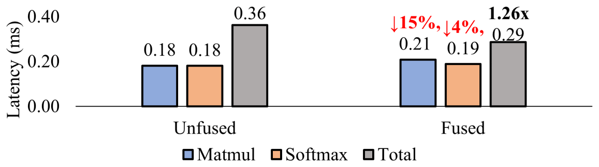

*图 2（原文 Figure 2，第 4 页）：未融合与融合情形下，Matmul、Softmax 以及二者合计的延迟。*

**图中文字翻译与读法**：

- **坐标与图例**：纵轴 Latency (ms)（延迟，毫秒）；两组柱：Unfused（未融合）与 Fused（融合）；每组三根柱：蓝色 Matmul、橙色 Softmax、灰色 Total（合计）。
- **Unfused 组**：Matmul 0.18 ms，Softmax 0.18 ms，合计 0.36 ms（各用自己最优的 tile）。
- **Fused 组**：Matmul 0.21 ms（红字 ↓15%，即比自己的最优慢约 15%），Softmax 0.19 ms（红字 ↓4%），合计 0.29 ms（黑粗体 1.26x，即比未融合快 1.26 倍）。这里 Matmul 与 Softmax 两根柱是它们在对齐 tile [16×128] 下单独运行的延迟，Total 柱是融合 kernel 的延迟。
- **读图结论**：局部各自最优不等于整体最优；为了跨算子复用，需要联合调整两侧的 tile，接受局部略微变差。

### 2.3 三个关键观察

论文由图 2 的例子提炼出三个观察，Welder 的设计建立在它们之上：

1. **对齐的 tile 配置可以由输出 tile 反向推导。** 只要算子的计算逻辑能被准确保留（如用张量表达式描述），就可以从下游的输出 tile 形状一路向前做 shape 推导。例如要算 Softmax 的一块 [4×128] 输出，由它的计算逻辑可知所依赖的输入 tile 也是 [4×128]；再把 [4×128] 当作 Matmul 的输出 tile，可以推出 Matmul 的输入 tile 是 [4×k] 与 [k×128]，其中 k 是归约维的块大小，可取不超过 Matmul 归约维长度的任意值。这样两个算子就能通过共享内存里的 [4×128] 中间 tile 融合起来。
2. **给定对齐的 tile 配置和原始张量形状，总流量可以解析地算出。** 只要计算模式与硬件特性（如 TensorCore）对齐，就可以只最小化各级存储之间的数据流量。
3. **流量计算只取决于所关心那一层存储里的 tile 配置。** 例如上例里只由共享内存中的输出 tile [4×128] 或 [16×128] 决定。所以可以独立地为每一层选择 tile 大小，去优化来自下一层存储的流量（论文称 inter-layer independence，层间独立性）。

**第 2 个观察的数值例子**（原文第 4 页）：Matmul 的输入 A 形状 [98304×64]、B 形状 [64×128]，输出 C 形状 [98304×128]；Softmax 以 C 为输入，输出 D（形状同 C）；元素为 FP32（4 字节）；A、B、D 在全局显存里，中间结果 C 只在共享内存里，不产生全局显存流量。

- 取输出 tile 为 [4×128]：算一个输出 tile 要读 A 的 [4×64] 块（归约维 k 取整个 64）、B 的 [64×128] 块，写 D 的 [4×128] 块，所以单个 tile 的全局显存流量是 $(4\times 64 + 64\times 128 + 4\times 128)\times 4\,\text{B} = 35{,}840\,\text{B} \approx 35\,\text{KB}$；
- 输出 tile 个数为 $(98304\times 128)/(4\times 128) = 24{,}576$，总流量 $24{,}576\times 35{,}840\,\text{B} \approx 840\,\text{MB}$；
- 改取输出 tile 为 [16×128]，同样的算法得到每 tile $(16\times 64 + 64\times 128 + 16\times 128)\times 4\,\text{B} = 45{,}056\,\text{B}$，tile 数 6,144，总流量降到约 264 MB。

**解读者核算**：论文的“MB”按 $2^{20}$ 字节算，上面两个总流量恰好是 840 MiB 与 264 MiB。还可以把总流量拆成三项：A 全部读一遍（$98304\times 64\times 4\,\text{B}=24$ MiB），D 全部写一遍（$98304\times 128\times 4\,\text{B}=48$ MiB），而 B（32 KiB）每个输出 tile 都要完整地读一遍。[4×128] 时 B 被读 24,576 次，共 768 MiB，加起来 24 + 48 + 768 = 840 MiB；[16×128] 时 B 被读 6,144 次，共 192 MiB，加起来 24 + 48 + 192 = 264 MiB。所以输出 tile 的行数越大，第二个输入矩阵 B 被重复读取的次数越少，总流量越低。

把三个观察合起来，论文得到一套方法：用一个输出 tile 形状把一组相邻算子对齐，再按显存流量决定最好的 tile 形状，并对每一层存储独立优化。这样 Welder 能把原本粗粒度的算子间依赖改写成细粒度的 tile 级依赖，这实际上去掉了算子之间的一些“假屏障”，带来更多并发。

## 三、Welder 的设计

### 3.1 总体架构（图 3）

Welder 把一个完整的 DNN 模型转换成由 operator-tile 组成的数据流图，即 **tile-graph**；tile-graph 对 tile 的配置与存储位置提供细粒度的控制。Welder 用“先连接、再调度（first-connect-then-schedule）”的方式化解算子内与算子间复用的冲突：先假设两个相邻算子可以在某一层存储里复用数据 tile（连接），再推导它们最好的公共 tile 形状，看总流量能否降低。为此它提供两个 tile-graph 调度接口：SetConnect（设置连接层级）与 Propagate（做形状推导链）。在此基础上设计了两步调度算法（graph connecting 与 sub-graph scheduling），递归地为多层存储决定高效的执行计划，称为**分层 tile-graph**（hierarchical tile-graph）。最后这个计划通过硬件层定义的四个计算接口（Allocate、LoadTiles、ComputeTile、StoreTiles）映射成特定加速器上的可执行代码；抽象加速器的存储规格（层数、容量、事务宽度等）则反过来指导调度。

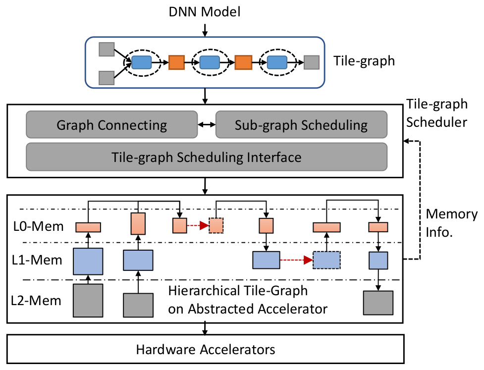

*图 3（原文 Figure 3，第 5 页）：Welder 系统总览。*

**图中文字翻译与读法**：

- **自上而下的流水**：DNN Model（DNN 模型）→ Tile-graph（蓝色圆角框：灰色方块是两端的输入、输出 tile，蓝色圆角块是 operator-tile，橙色方块是相邻 operator-tile 之间的中间 tile，虚线圈把相邻节点圈成一组；颜色含义是解读者的理解，原文没有逐一说明）→ Tile-graph Scheduler（tile-graph 调度器，含 Graph Connecting（图连接）与 Sub-graph Scheduling（子图调度）两个互相配合的模块，下面是 Tile-graph Scheduling Interface（调度接口））→ Hierarchical Tile-Graph on Abstracted Accelerator（抽象加速器上的分层 tile-graph）→ Hardware Accelerators（硬件加速器）。
- **分层 tile-graph 的内部**：L0-Mem、L1-Mem、L2-Mem 三层存储，L0 在最上、L2 在最下；越往下的方块越大，表示低层存储里的 tile 更大；方块间的黑色箭头是 tile 在层间的搬运，红色虚线箭头是同层相邻节点之间的 tile 传递（解读者的理解）。
- **右侧虚线箭头 Memory Info.（存储信息）**：从抽象加速器回到调度器，表示调度器要用加速器的存储规格来指导优化。
- **读图结论**：Welder 的核心是中间那个调度器——它同时决定“哪些相邻算子在哪一层连接”和“每个子图用什么 tile”，两个模块互相配合。

**层号约定的提醒**：论文里层号有两套相反的写法。图 3、图 5 与第 3.2 节开头的举例里，L0 是最靠近计算的最快层，L2 是最底层（容量最大、最慢，如 device memory）；而图 7、图 8 与第 3.2 节算法部分明确说“用 0 表示最低的存储层，数字越大层级越高”。本文讲图 3、图 5 时沿用图的写法，讲算法时沿用算法的写法，并尽量用“最低层 / 更高层”这样的说法避免混淆。

### 3.2 operator-tile 与 tile-graph（图 4）

**operator-tile**：Welder 用一种细粒度的任务单位 operator-tile 来定义 DNN 计算。一个算子（如卷积）可以被实现成多个同构的 operator-tile，它们以流式或并行的方式执行，算出输出张量的全部数据块。每个 operator-tile 从输入张量里切出一个数据 tile 作为输入，算出输出张量里的一个数据 tile，计算逻辑用基于下标的张量表达式（index-based tensor expression）描述。

**reuse-tile 与 tile-graph**：为了利用共享内存这类层次化存储，Welder 允许两个相邻的 operator-tile 通过一块共同的中间数据 tile “连接”起来，这块中间 tile 叫 reuse-tile。后一个 operator-tile 可以直接消费前一个产出的数据，而不必先把它物化成完整的中间张量。沿着每条相邻的边把多个 operator-tile 连起来，就得到由 operator-tile 组成的数据流图，即 tile-graph。

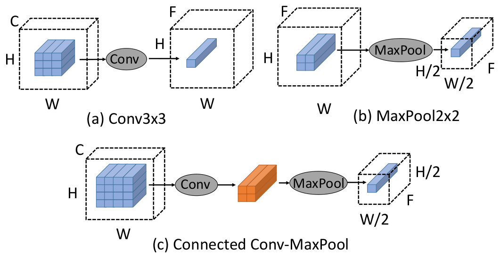

*图 4（原文 Figure 4，第 5 页）：两个 operator-tile：(a) Conv 与 (b) MaxPool，以及 (c) 把它们连接成 tile-graph（为简化略去了 Conv 的权重张量）。*

**图中文字翻译与读法**：

- **(a) Conv3x3（3×3 卷积）**：左边是 H×W×C 的输入张量（虚线立方体），其中蓝色小方块组成的 3×3 块是一个输入 tile；经过 Conv 算出右边 H×W×F 输出张量里的一个细长条（只有 1×1 的空间位置、F 个通道）。即一个 [3×3×C] 的输入 tile 对应一个 [1×1×F] 的输出 tile（正文把输出 tile 写成 [1×1×C]，图里输出通道标为 F；卷积的输出通道数可以与输入不同，这里以图为准）。
- **(b) MaxPool2x2（2×2 最大池化）**：输入 H×W×F 张量里一个 2×2 的 tile，输出 H/2×W/2×F 张量里的一个 1×1 的 tile。
- **(c) Connected Conv-MaxPool（连接后的 Conv 与 MaxPool）**：Conv 的输入 tile 变成 4×4（蓝色小方块组成 4×4 块），Conv 的输出是橙色的 2×2 块，它就是 reuse-tile，直接作为 MaxPool 的输入；MaxPool 最终输出一个 1×1 的 tile。图 5 的编号里同样写作输入 [4,4,C]、reuse-tile [2,2,F]、输出 [1,1,F]。
- **读图结论**：连接之后，卷积不必先算出整张 H×W×F 的特征图再交给池化，而只要算出池化所需的那一小块；两个算子的 tile 形状由输出 tile 反推得到（3×3 卷积需要 4×4 输入才能算出 2×2 输出）。

**tile 传播（tile propagation）**：连接之后，tile-graph 里的大多数 tile 彼此相关，可以从输出 tile 形状出发，沿输出到输入的方向做一连串 shape 推导，自动推出整张图的 tile 形状。对每个 operator-tile，分析其张量表达式与输出 tile 大小，就能准确确定它在输入张量上依赖的区域。当输入区域可能有不规则访问（如稀疏、不连续的 Gather，或带步长的卷积）时，表达式分析给出一个保守的上界作为输入 tile 形状。如果 tile-graph 有多个输出节点（它们可能共享某个祖先节点，输出形状相关联），则传播完第一个输出 tile 之后，再为其余输出节点单独传播形状并与第一个对齐；如果两次传播得到的 tile 形状不一致，就不把后一个输出节点连进当前这张图。

**访存流量与存储占用**：tile 传播之后，一个 tile-graph 的访存流量与占用就确定了。

- **流量**：单个 tile-graph 的流量等于它所有输入 tile 与输出 tile 的大小之和（连接两个算子的 reuse-tile 留在更高一层，不产生向低层的流量）；总流量再乘以算出整个输出张量所需的 tile-graph 个数（张量大小除以输出 tile 大小）。
- **最小占用（footprint）**：按拓扑序为所有数据 tile 分配空间，用 bestfit 之类的内存分配算法算出最小占用。作为占用优化，含归约轴的输入 tile 还可以再切成更小的块，依次加载、把结果累加到输出 tile 上；传播时的某个策略会自动尝试沿归约轴的不同切分大小。

### 3.3 tile-graph 调度（图 5、图 6、图 7）

#### 3.3.1 多层存储上的递归映射（图 5）

要把用初始数据流图表示的 DNN 映射到一个加速器上，可以递归地把每个算子切成多个 operator-tile，使它们放得进各层存储；并在较高（更快）的存储层把 operator-tile 连起来，以利用算子间的数据复用。这样整个 DNN 计算就被建模成二维空间里的数据流水线：数据 tile 在存储层次上纵向上下搬动，并在不同层水平地传给后继算子。

图 5 是三个连续算子（Conv、ReLU、MaxPool）映射到三层存储的例子。

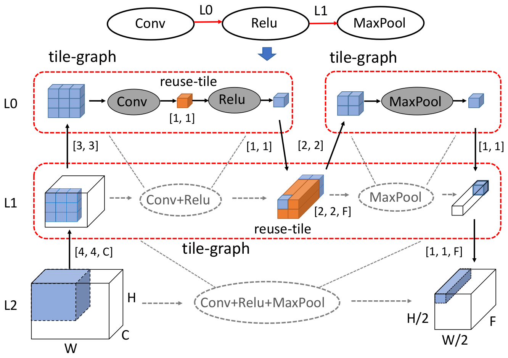

*图 5（原文 Figure 5，第 6 页）：把三个连续算子映射到三层存储层次（略去了 Conv 的权重）。*

**图中文字翻译与读法**（本图沿用图的层号写法：L0 最快最小，L2 最低、最大）：

- **最上一行**：Conv —L0→ Relu —L1→ MaxPool，红色箭头上的 L0、L1 是用 SetConnect 为两条边设置的连接层级：Conv 与 ReLU 在 L0 连接，ReLU 与 MaxPool 在 L1 连接。
- **L0 层**（左右两个红色虚线框，标 tile-graph）：左边的 tile-graph 里，一个 [3,3] 的输入 tile 经 Conv 算出 [1,1] 的 reuse-tile，再经 Relu 得到 [1,1] 的输出；右边的 tile-graph 里，[2,2] 的输入 tile 经 MaxPool 得到 [1,1] 的输出。
- **L1 层**（中间红色虚线框，标 tile-graph）：左边的虚拟节点 Conv+Relu（把 L0 的 Conv-ReLU 整体看成一个节点）、右边的虚拟节点 MaxPool，它们之间的橙色块是 reuse-tile [2,2,F]；输入 tile 是 [4,4,C]，输出是 [1,1,F]。图里 L0 与 L1 之间箭头上的 [3,3]、[1,1]、[2,2]、[1,1] 是 tile 在两层之间传递的形状。
- **L2 层**（最下）：整个 Conv+Relu+MaxPool 作为一个虚拟节点，输入是 H×W×C 的张量（其中取 [4,4,C] 的 tile），输出是 H/2×W/2×F 的张量（其中取 [1,1,F] 的 tile）。
- **读图结论**：通过在 L0 连接 Conv 与 ReLU，Conv 的输出直接给 ReLU 用，两者在 L0 形成一个 tile-graph，同时在 L1 里合并成虚拟节点 Conv+ReLU；ReLU 的输出持续落进 L1 的数据 tile，再在 L1 连接给 MaxPool，于是三个算子在 L1 形成一个 tile-graph，在 L2 里是虚拟节点 Conv+ReLU+MaxPool。递归完成后，所有算子在最低层连成单个 tile-graph。

#### 3.3.2 解耦优化空间

既然 DNN 计算大多受访存限制，数据流水线的主要优化目标就可以归结为**最小化访存流量**。再利用“跨存储层优化流量的内在独立性”，可以把整个优化空间分解成若干子空间：对给定的 tile-graph，从低一层存储读入、写回的数据总流量，只由它的输出 tile 形状就能估算（因为输出 tile 形状可以推出全部输入、输出 tile 形状）。因此，来自同一层或不同层的 tile-graph 可以各自独立地搜索最优 tile 形状来优化自己的访存流量。

以图 5 为例：L0 的 Conv 与 ReLU 的 tile-graph，可以独立于 L1 的 tile-graph（由 Conv+ReLU 与 MaxPool 构成）去优化，这叫 **inter-layer independence（层间独立）**；进一步，L0 上子图 Conv-Relu 与 MaxPool 的最优 tile 配置彼此也独立，因为它们各自与 L1 上的 tile-graph 独立，这叫 **intra-layer independence（层内独立）**。实践中唯一的约束是：低层存储里的 tile 必须比上层存储里的 tile 大——这通常自然满足，因为低层存储的容量更大。有了这两条性质，只要给定一份图连接方案，就可以独立调度每个 tile-graph。

#### 3.3.3 调度接口（图 6）

Welder 提供两个调度接口来控制图连接与子图 tiling，另有两个代价接口。图 6 给出它们的签名：

```text
void SetConnect(Edge *edge, MemLevel level);
TileConfig Propagate(TileGraph g, Map<Axis, Dim> config);
size_t MemFootprint(TileGraph g);
size_t MemTraffic(TileGraph g);
```

*图 6（原文 Figure 6，第 6 页）：Welder 的调度接口（原图是一个代码框，本文转成代码块）。*

- `SetConnect`：给 tile-graph 里的一条边指定一层存储作为连接层级（默认是最低层）。
- `Propagate`：连接之后，通过指定输出 tile 各维度的大小（以及输入 tile 里可选的归约轴切分），推出整张 tile-graph 的 tile 形状。
- `MemFootprint`、`MemTraffic`：两个代价接口，分别计算一张 tile-graph 的存储占用与总流量，作为调度的代价模型。

以图 5 为例：先用 SetConnect 在 L0 连接 Conv 与 Relu、在 L1 连接 Relu 与 MaxPool；连接后，对子图 Conv+Relu，给定输出 tile [1,1]，用 Propagate 推出中间 reuse-tile 形状是 [1,1]；同样，对子图 Conv+Relu+MaxPool，给定输出 tile [1,1,F]，推出中间 reuse-tile 形状为 [2,2,F]。SetConnect 用来增加两个节点间的连接，Propagate 用来设定节点的 tile 配置，二者合起来是更新 tile-graph 的边与顶点的完整接口。这些原语只供 Welder 自己的调度策略使用，对最终用户透明。

#### 3.3.4 两步调度算法（图 7）

Welder 采用两步调度算法：**图连接调度器**（graph-connecting scheduler）先通过为每条边设置不同的存储复用层级来枚举各种图连接方案；然后**子图调度器**（sub-graph scheduler）为图连接调度器切分出来的每个子图快速搜索高效的 tile 配置。图 7 是它的伪代码（原文带行号，下面保留行号，本文把原图的 `Propogate` 写为 `Propagate`；层号约定：0 表示最低层，数字越大层级越高）：

```text
 1  Func GraphConnecting(g:Graph, d:Device):
 2    for node : TopologySort(g.nodes()) do
 3      for edge : node.out_edges() do
 4        for level : d.MemLevels() do
 5          SetConnect(edge, level);
 6          s = ExtractSubgraph(node, 0);
 7          configs = SubGraphTiling(s, 0, tensor_shapes);
 8          if t = Min(d.Profile(configs)) < best_latency
 9            best_latency = t;
10            best_level = level;
11        SetConnect(edge, best_level);
12  Func SubGraphTiling(g:Graph, level:Memory, c: Config)
13    configs = PriorityQueue();
14    for subtile : EnumerateSubtiles(g, c) do
15      config = Propagate(g, subtile);
16      if MemFootprint(g) > level.capacity
17        continue;
18      configs.push(config, priority=MemTraffic(g));
19    results = Dict();
20    for config : TopK(configs, k) do
21      // return empty sub-graph at top level to exit recursion
        subgraphs = unique([ExtractSubgraph(node, level+1)
                            for node in g.nodes()]);
22      for subgraph : subgraphs do
23        subgraph_configs = SubGraphTiling(subgraph,
                               level+1, config);
24        results[config].append(subgraph_configs);
25    Return results;
26  Func ExtractSubgraph(node:Node, level:Memory)
27    nodes = Set();
28    for edge : node.InOutEdges() do
29      if edge.connect_level > level
30        nodes.insert(ExtractSubgraph(edge.node, level));
31    return SubGraph(nodes);
```

*图 7（原文 Figure 7，第 7 页）：两步 tile-graph 调度算法。*

**逐行读法**：

- **GraphConnecting（第 1–11 行，图连接调度器）**：给定数据流图 g 与设备 d，按拓扑序遍历所有节点及其输出边（第 2–3 行）；对每条边尝试设备上的每一个存储层级作为连接层级（第 4–5 行，SetConnect）；然后用 ExtractSubgraph 取出该节点所在的、所有边的连接层级都高于 0 的连通子图（第 6 行），调用 SubGraphTiling 得到若干高效的 tile 配置，并在硬件上 profile，保留延迟最低的那个配置与对应层级（第 7–10 行）；比较完所有连接层级后，把这条边的连接层级定为最好的那个（第 11 行）。层级为 0（默认的最低层）表示这条边的中间张量要落到最低层，也就是不融合。
- **SubGraphTiling（第 12–25 行，子图调度器）**：输入一个子图与上一层选定的 tile 配置 c，搜索当前层的高效 tile 配置。先用 EnumerateSubtiles 枚举输出维度上的 tile 大小（第 14 行），用的是类似 Roller 的“tile 形状扩张”：从初始 tile（如大小为 1）出发，朝能降低总流量、并与硬件特性对齐的形状放大；对每个输出 tile 形状，用 Propagate 推出完整 tile 配置，用 MemFootprint 检查是否超出该层容量，超出就丢弃，否则以 MemTraffic 为优先级加入排序队列（第 15–18 行）；最后挑出流量最小的前 K 个配置（第 20 行），对每个配置提取上一层（level+1）的子图，递归调用 SubGraphTiling（第 21–24 行）；到最高层时 ExtractSubgraph 返回空子图，递归就此结束。
- **ExtractSubgraph（第 26–31 行）**：从一个节点出发，沿着输入、输出边把“连接层级大于当前层级”的邻居节点递归收集起来，组成一个子图（第 28–31 行）。

**解读者说明**：

- GraphConnecting 是按拓扑序、逐条边做的贪心决策：每条边选定连接层级后就固定下来，再处理下一条边；论文没有给出全局最优性的分析，它依赖的是上面的独立性性质与 top-K 剪枝。
- 总流量是解析算出来、用来排序并剪掉候选的；真正在候选里挑最终方案时用的是硬件 profile（第 8 行的 `d.Profile`）。论文第 5.2 节说每个子图的试验次数是 20（表 5 里 Welder 的试验总数是 651、927，远少于 Ansor 的 8,000、25,600）。
- 该算法对各层存储大小不做假设，只靠算法自己去找放中间数据的最佳层与 tile 大小以最小化总体延迟；但 Welder 总是偏好拥有大容量更高层快速存储（如共享内存）的硬件，因为 tile 太小会让算子内的数据复用变差。
- 调度结果是**分层 tile-graph**：它在最低存储层是完整的图，向上递归地被拆成若干子图，一直到最高层。

### 3.4 映射到硬件加速器（表 1、图 8）

分层 tile-graph 是一个抽象的执行计划，要映射成特定加速器上的可执行代码。为此 Welder 提供一个带层次化存储的抽象加速器设备；存储配置（层数、各层容量、事务宽度）可以通过 `MemLevels` 接口取得（如图 7 里使用的）。有了这个抽象，就很容易给现有加速器再加存储层（如 host memory、SSD），当作一个新设备，用来处理放不进单个设备显存的大张量（第 5.4 节）。论文说 Welder 的性能收益主要来自存储层之间的带宽差：只要低层存储成了瓶颈、而高层存储装得下中间数据 tile，Welder 就能自动在更快的高层存储上把算子间的数据传输流水化。

执行分层 tile-graph 用四个计算接口，加上 `MemLevels` 共五个设备接口（表 1）：

**表 1：抽象硬件加速器上的设备接口**

| 接口 | 作用 |
| --- | --- |
| `Allocate` | 在某一层存储中分配工作空间 |
| `LoadTiles` | 从更低一层存储载入输入 tile |
| `ComputeTile` | 在最高层计算一个 operator-tile |
| `StoreTiles` | 把结果 tile 写回更低一层存储 |
| `MemLevels` | 查询存储层次的配置 |

原文表 1，第 7 页。执行的递归例程见图 8。

```cpp
void ExecuteGraph(TileGraph g, MemLevel level,
                  void *in, void *out) {
  void *mem = Allocate(g.MemFootprint(), level);
  LoadTiles(in, mem);
  for (auto n : g.nodes())
    if (level == MemLevel.top)
      ComputeTile(n, mem.in[n], mem.out[n]);
    else
      ExecuteGraph(n.TileGraph(), level+1,
                   mem.in[n], mem.out[n]);
  StoreTiles(mem, out);
}
// execute a full DNN graph at memory level 0
ExecuteGraph(graph, 0, inputs, outputs);
```

*图 8（原文 Figure 8，第 8 页）：分层 tile-graph 的编译例程（原图是代码框，本文转成代码块并补全了原图 `for` 行漏写的右括号）。*

**逐行读法**：

1. 从最低层的 tile-graph（即完整的 DNN 图）开始执行（最后一行 `ExecuteGraph(graph, 0, ...)`）；
2. 对每个 tile-graph，先用 `Allocate` 在对应存储层里申请所需的工作空间（大小由图 7 里也用到的 `MemFootprint` 给出），再用 `LoadTiles` 把输入 tile 载入这块空间；
3. 按拓扑序执行子图里的每个节点：如果当前层已是最高层，就直接在计算核心上执行（`ComputeTile`）；否则递归调用，执行节点在更高一层的 tile-graph（`level+1`）；
4. 最后用 `StoreTiles` 把当前空间里的结果 tile 写回更低一层存储。

这套例程既可以当作代码生成过程，也可以当作运行时过程，取决于具体加速器把这些接口实现成代码发射器（code emitter）还是可执行的函数调用。Welder 目前把它们实现成代码发射器，用来生成面向特定加速器的计算逻辑；把这个递归例程展开，整个分层 tile-graph 就被展开成带有全部必要优化的整模型计算程序。

## 四、实现

Welder 建立在三个开源 DNN 编译器之上：用 **TVM** 写 kernel 的 schedule，用 **Roller** 枚举高效的 tile 配置，用 **Rammer** 做端到端的图优化。Welder 自己的核心机制——tile-graph、tile 传播、调度算法、代码生成等——总共约 5.2k 行代码。它以 ONNX 图为输入，先做常量折叠、简单的逐元素融合等常规图优化，再把优化后的图转成 tile-graph 做整体的存储调度优化。通过统一的设备接口（表 1），Welder 同时实现了 CUDA GPU、ROCm GPU 与 Graphcore IPU 三类后端。对 CUDA 与 ROCm GPU，Welder 在三层存储上调度数据 tile：全局显存（DRAM）、共享内存、寄存器；为处理大图像，CUDA GPU 与 Graphcore IPU 还额外加上一层 host memory 来扩展设备存储。

### 4.1 与硬件对齐的 tile 搜索

**枚举高效的数据 tile 大小**：Welder 在流量代价模型里加入“惩罚系数”，反映几项影响访存效率的硬件因素。第一，若有未合并的访存（uncoalesced access），总流量要加上这些访问额外需要的事务数；在 CUDA GPU 上，连续 128 字节的数据（一次事务）总是应优先使用合并访存。第二，若 tile 太大导致并行度不足，流量按计算核心的利用率比例相应增加。第三，若某个 tile 配置的总存储占用超出该层容量，就加上无穷大的惩罚。为了避免枚举低效的候选，Welder 只在按代价模型最能降低流量的那些维度上枚举输出 tile，并且只保留流量最小的前 k 个候选。

**确定对齐的计算并行度**：在 GPU 上，同一个 thread block 里执行的顶层 operator-tile 必须统一 block 大小（如线程数）。为保证对齐，Welder 先在寄存器层强制保证有足够多的并行 tile 以匹配硬件并行度（即枚举与硬件对齐的 tile）；例如在 NVIDIA V100 上，tile 数应大于 128，因为每个 SM 有 4 个 warp 调度器、每个 warp 有 32 个线程。然后取所有算子的 tile 数的最大公约数作为公共的 thread block 大小，条件是它大于硬件并行度（如 128）且小于最大限制（如 1024）；否则就把 block 大小设为硬件并行度。block 大小确定后，把寄存器层的所有 operator-tile 绑定到这些线程上；若单个线程要跑多个 tile，就用 TVM 的虚拟线程（virtual thread）绑定，使得对所有存储 bank 的访问可以并发进行、避免 bank conflict。

**支持 TensorCore**：Welder 利用 TensorCore 加速 GEMM、BatchMatmul 以及卷积（用隐式 GEMM [28]）等算子。它给这些算子加标注，指明哪些轴绑定到 CUDA 的 warp 级矩阵操作（WMMA）；顶层 operator-tile 绑定到 warp（而不是线程）来执行 MMA；在枚举 tile 大小时再加几条约束：线程数必须是 warp 大小的整数倍，每个 tile 里的 M、N、K 轴必须是 MMA 片段（fragment）大小的整数倍。

### 4.2 代码生成与编译

Welder 的 kernel 生成基于 TVM：

- **寄存器层的连接**用 TVM 的 `compute_inline` 调度原语实现；
- **共享内存层的连接**只用 TVM 为共享内存之上每个连通的部分生成独立的 kernel，再用几个额外的 pass 把这些独立 kernel 组合成单个融合 kernel。

这几个 pass 是：

- **load/store 重写**：TVM 生成的独立 kernel 从全局显存读写数据，Welder 在 TVM 的 lowering 流程里加一个 TIR pass，把这些全局显存访问改写成共享内存访问；同时加内存栅栏（memory fence）防止竞争，并做 padding 处理 bank conflict。这样，原来的全局 kernel 就变成一个设备函数，被包含进最终的融合 kernel；
- **block/thread 下标重映射**：有些算子不能直接与别的算子连接，需要重映射 `blockIdx` 与 `threadIdx`。`blockIdx` 重映射用于 Transpose 之类的算子，映射关系由张量表达式推出；`threadIdx` 重映射用于把二维 thread block 接到一维 thread block 上——当线程间归约或 TensorCore 原语需要二维 thread block（同时用 `threadIdx.x` 与 `threadIdx.y`），而其他算子只用一维（只用 `threadIdx.x`）时，只要总线程数相等，二维块就可以映射成一维块；
- **存储管理**：统一管理所有共享内存，包括每个独立 kernel 内部分配的和算子间复用的缓冲区。先按拓扑执行顺序分析每个缓冲区的生命周期，转成一串分配与释放操作，再用 bestfit 算法为每次共享内存分配算出偏移量，同时考虑数据类型与 TensorCore 操作的对齐要求（如按 32 字节对齐以避免未对齐的地址访问）。

**编译提速**：Welder 用并行编译与子图缓存来优化编译速度。一方面，利用各配置之间的独立性，用多进程并行构建并评估每个配置；另一方面，多数 DNN 模型里某些子图模式会重复出现，Welder 用子图签名（sub-graph signature）缓存每种唯一的图模式。例如 12 层 BERT 里，可以缓存第 1 层的优化结果（kernel 代码与 profile 得到的延迟），并复用到其余 11 层。

## 五、实验

### 5.1 实验设置

**硬件与软件环境**（原文第 5.1 节，第 10 页；下表是解读者整理，不是原文表格）：

| 平台 | 配置 |
| --- | --- |
| NVIDIA V100 服务器 | Azure NC24s_v3 虚拟机；Intel Xeon E5-2690v4；NVIDIA Tesla V100（16 GB）；Ubuntu 16.04，CUDA 11.0 |
| NVIDIA RTX 3090 工作站 | 本地工作站；Intel Xeon E5-2678 v3；NVIDIA GeForce RTX 3090；Ubuntu 18.04，CUDA 11.3 |
| AMD GPU 服务器 | Intel Xeon E5-2640 v4；AMD Radeon Instinct MI50（16 GB）；Ubuntu 18.04，ROCm 5.2.3 |
| Graphcore IPU 服务器 | Azure ND40s_v3 虚拟机；Intel Xeon Platinum 8168；16 块 IPU；Poplar-sdk 3.0 |

**工作负载**：10 个 DNN 模型，涵盖 CNN、Transformer、CNN+Transformer 与多层感知机（MLP），多数是各自任务里的先进模型。所有模型都用官方 PyTorch 实现，不做修改。

**表 2：Welder 评测的 DNN 模型**

| 模型 | 类型 | 任务 | 年份 |
| --- | --- | --- | ---: |
| MobileNet [41] | CNN | 图像分类 | 2018 |
| BERT [16] | Transformer | 自然语言处理 | 2018 |
| ViT [17] | Transformer | 图像分类 | 2020 |
| Conformer [20] | CNN+Transformer | 语音识别 | 2020 |
| MobileViT [32] | CNN+Transformer | 图像分类 | 2021 |
| Swin-Transformer [30] | Transformer | 图像分类 | 2021 |
| NeRF [33] | MLP | 3D 场景生成 | 2021 |
| NAFNet [14] | CNN | 图像复原 | 2022 |
| Restormer [48] | CNN+Transformer | 图像复原 | 2022 |
| BSRN [29] | CNN | 图像超分辨率 | 2022 |

原文表 2，第 10 页（任务名由英文译出：Image Classification、NLP、Speech Recognition、3D-scene Generation、Image Restoration、Image Super-resolution）。论文说表 2 的最后三个模型输入尺寸很大，batch=64 时无法在 PyTorch 上 trace，所以 batch=64 的实验只有 7 个模型。但图 9 右图实际保留的是 MobileNet、NAFNet、ViT、BERT、MobileViT、Swin-T、Conformer，去掉的是 BSRN、Restormer、NeRF——这是图 9 左图模型顺序里的最后三个，而不是表 2 行序里的最后三个（表 2 的最后三行是 NAFNet、Restormer、BSRN），两处说法不一致（第九节）。

**基线**：深度学习框架 PyTorch（v1.12）、ONNXRuntime（v1.12）；DNN 编译器 Ansor（v0.9）、Rammer；NVIDIA 的厂商推理库 TensorRT（v8.4）；针对 Transformer 模型，再比较 NVIDIA 手写 C++ 库 FasterTransformer（v5.2）；此外还有 BladeDISC（v0.3.0，实现了最新的用于 kernel 融合的 AStitch [51]）和 Nimble [25]（多 stream 调度，NVIDIA GPU 上的基线）。

**测量方法**：先在 PyTorch 里 trace 模型并导出成 ONNX 格式，再把这个 ONNX 模型作为输入交给 Welder、Ansor、ONNXRuntime 与 TensorRT。ONNXRuntime 用其 CUDA execution provider，图优化级别设为 "ALL"；TensorRT 用 Python API 为输入 ONNX 构建 engine；Ansor 的总调优试验次数设为每个模型里任务数的 800 倍。所有框架的输入、输出张量都放在 GPU 显存里，避免额外的数据搬运开销。评测时先做一些热身迭代，再把每个负载重复跑至少 5 秒；只报告每个模型的平均速度，因为各情形的波动都很小。模型间的平均性能（如加速比）一律用几何平均。

### 5.2 在 NVIDIA GPU 上的评测

这一节回答五个问题：1) 与最先进的 DNN 框架、编译器相比表现如何？2) 用上 TensorCore 能进一步提升多少？3) 能否自动发现超出以往专家设计融合规则的新优化模式？4) 对访存与计算效率的提升程度如何？5) 整体优化的搜索效率如何？

#### 5.2.1 V100 上的端到端性能（图 9）

图 9 是 V100 上 FP32、只用 SIMT 核心（不用 TensorCore）的端到端推理性能。

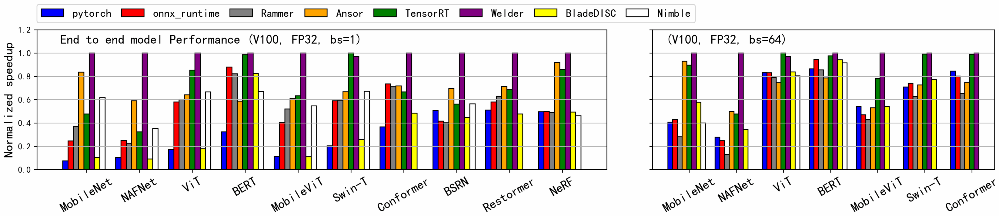

*图 9（原文 Figure 9，第 10 页）：NVIDIA V100 GPU（仅用 SIMT 核心）上的端到端模型推理性能；左图 batch size 为 1，右图 batch size 为 64。*

**图中文字翻译与读法**：

- **图例**：pytorch（蓝）、onnx_runtime（红）、Rammer（灰）、Ansor（橙）、TensorRT（绿）、Welder（紫）、BladeDISC（黄）、Nimble（白）。有的基线在个别模型上跑不起来，该柱缺失。
- **左图 End to end model performance (V100, FP32, bs=1)**：横轴 10 个模型（MobileNet、NAFNet、ViT、BERT、MobileViT、Swin-T、Conformer、BSRN、Restormer、NeRF）；**右图 (V100, FP32, bs=64)**：只有前 7 个模型。纵轴 Normalized speedup（归一化加速比，对每个模型而言，最快的那个系统记为 1.0），所以柱越高越快；Welder 的柱在多数模型上正好是 1.0，意味着它在该模型上最快；Welder 柱低于 1.0 时说明有基线更快（如 batch=1 的 Swin-T 上 TensorRT 是 1.0，Welder 约 0.97；batch=64 的 ViT 上同样是 TensorRT 最快）。
- **读图结论**：batch=1 时 PyTorch、BladeDISC 等的柱都很矮；Ansor 与 TensorRT 是最强的两个基线，但 Welder 在 10 个模型里的 9 个超过它们，在 Swin-T 上略落后于 TensorRT。

**论文报告的几何平均加速比（表格为解读者整理自第 5.2 节正文，第 10–11 页）**：Welder 相对各基线的几何平均加速比（V100、FP32、SIMT）：

| 基线 | batch=1（10 个模型） | batch=64（7 个模型） |
| --- | ---: | ---: |
| PyTorch | 4.29× | 1.83× |
| ONNXRuntime | 2.07× | 1.90× |
| Rammer | 1.96× | 2.1× |
| BladeDISC | 2.70×（只统计不报错的 BERT、MobileNet、BSRN、NeRF） | 1.57× |
| Nimble | 1.79×（排除 Nimble 无法运行的模型） | 1.49× |
| Ansor | 1.44× | 1.47× |
| TensorRT | 1.47× | 1.21× |

论文对各基线的解释：

- **PyTorch**：batch=1 时因计算图里的 Python 开销大而表现不佳；ONNXRuntime 去掉了 Python 开销并实现了基于模式的图优化，更强一些；batch 变大后，用 CUDA 库的框架表现好得多，所以 Welder 对 PyTorch、ONNXRuntime、TensorRT 的加速比变小，而对 Ansor 的加速比与 batch=1 相近；
- **Rammer**：只能融合相互独立的并行 kernel，而不能融合有依赖、要通过共享内存传数据的 kernel；
- **BladeDISC**（实现 AStitch）：遇到“不支持的算子”报错并回退到 PyTorch 运行时的模型占大多数，所以只统计了无失败的 4 个模型；
- **Ansor**：用生成高性能张量程序加寄存器层的规则融合（如 Matmul+BiasAdd、Conv2D+ReLU），但无法利用进一步的存储复用机会，平均落后 Welder 1.44 倍。落后最明显的是主要由小通道卷积构成的 CNN：NAFNet（1.70×）、BSRN（1.43×）；在 Transformer 类模型上也明显落后：BERT（1.71×）、Swin-Transformer（1.45×）、ViT（1.56×），因为 Ansor 不能融合注意力块里 LayerNorm、Softmax 这类模式；CNN+Transformer 类模型 MobileViT、Conformer、Restormer 上是 1.64×、1.39×、1.29×，因为 Welder 既能覆盖 CNN 部分也能覆盖 Transformer 部分的融合机会；NeRF 上只有 1.09×，因为计算密集的 MLP 占主导，没有进一步优化的空间；
- **TensorRT**：在 BERT（1.02×）、Swin-T（0.97×）这类热门 Transformer 上与 Welder 相当，因为 TensorRT 已经内置了专家设计的融合规则和针对热门模型（含基于 Transformer 的模型）的自研 kernel，留给进一步优化的空间有限；Welder 靠自动发现优化模式达到与之相当的水平，尽管它在计算密集算子上用的 kernel 性能不如 TensorRT 的（论文强调 kernel 优化与 Welder 互补，更优的 kernel 能带来更大收益）。对更新、更多样的模型，如 NAFNet，Welder 比 TensorRT 最高快 3.09 倍；总体平均 1.47 倍。

**图 9 逐模型读数（解读者读数，表中“Welder ÷ X”的意思是 Welder 比 X 快几倍）**：下表按图上归一化柱高估算，读数误差约 ±0.02，应以正文数字为准；表中还列出了正文给出的 Ansor 倍数以便核对。

| 模型 | batch=1：Welder ÷ Ansor（读数 / 正文） | batch=1：Welder ÷ TensorRT（读数） | batch=64：Welder ÷ Ansor（读数） | batch=64：Welder ÷ TensorRT（读数） |
| --- | --- | ---: | ---: | ---: |
| MobileNet | 约 1.20 / 未给出 | 约 2.10 | 约 1.08 | 约 1.12 |
| NAFNet | 约 1.69 / 1.70 | 约 3.10（正文：最高 3.09） | 约 2.01 | 约 2.10 |
| ViT | 约 1.56 / 1.56 | 约 1.17 | 约 1.30 | 约 0.97 |
| BERT | 约 1.71 / 1.71 | 约 1.01（正文：1.02） | 约 1.27 | 约 1.03 |
| MobileViT | 约 1.64 / 1.64 | 约 1.58 | 约 1.89 | 约 1.28 |
| Swin-T | 约 1.45 / 1.45 | 约 0.97（正文：0.97） | 约 1.38 | 约 1.01 |
| Conformer | 约 1.39 / 1.39 | 约 1.50 | 约 1.34 | 约 1.01 |
| BSRN | 约 1.44 / 1.43 | 约 1.78 | — | — |
| Restormer | 约 1.40 / **1.29** | 约 1.46 | — | — |
| NeRF | 约 1.09 / 1.09 | 约 1.17（正文：1.16） | — | — |

读表：batch=1 的读数与正文几乎处处吻合，唯一例外是 Restormer 相对 Ansor：读数约 1.40，正文写 1.29；10 个模型读数的几何平均约 1.44（对 TensorRT 约 1.49，正文 1.47），与正文平均数吻合，倾向于认为正文的 1.29 是笔误或与图不一致（第九节）。batch=64 时 TensorRT 在 ViT 上反而略快于 Welder（约 0.97）。batch=64 的平均数读数约为 Ansor 1.43、TensorRT 1.17，PyTorch 与 ONNXRuntime 各约 1.7，比正文的 1.47、1.21、1.83、1.90 略低，其中 PyTorch、ONNXRuntime 偏差达 8%–10%，原因不明（第九节）。

#### 5.2.2 TensorCore 上的性能（图 10）

更快的 TensorCore 给显存带来更大压力。为了考察 TensorCore 下的优化行为，论文用 PyTorch 把基准模型（权重和激活）都转成半精度 FP16（TensorCore 只支持 FP16），用 `onnxconverter_common` 包里的工具转换；TensorRT 例外，用它自己的转换器，因为它的转换结果通常更好。

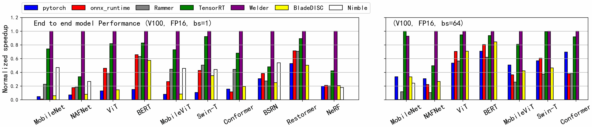

*图 10（原文 Figure 10，第 12 页）：NVIDIA V100 GPU（启用 TensorCore）上的端到端模型推理性能；左图 batch size 为 1，右图 batch size 为 64。*

**图中文字翻译与读法**：与图 9 相同的坐标与归一化方式，标题改为 (V100, FP16, bs=1) 与 (V100, FP16, bs=64)；图例没有 Ansor（Ansor 不支持 TensorCore），其余有 pytorch、onnx_runtime、Rammer、TensorRT、Welder、BladeDISC、Nimble。

**论文报告的平均加速比（第 5.2 节正文，第 11 页）**：

| 基线 | batch=1（10 个模型）：平均（最高） | batch=64（7 个模型）：平均 |
| --- | --- | ---: |
| PyTorch | 7.18×（MobileNet 最高 21.4×） | 1.98× |
| ONNXRuntime | 3.08×（Conformer 最高 8.72×） | 2.13× |
| BladeDISC | 5.29×（MobileNet 最高 16.9×） | 1.97× |
| Nimble | 2.72×（NeRF 最高 5.58×） | 3.84× |
| Rammer | 2.76×（NAFNet 最高 5.42×） | 3.45× |
| TensorRT | 1.53×（NAFNet 最高 2.98×） | 1.16× |

其中有些加速比比 SIMT 核心上大得多。尤其是 NeRF：Welder 在 TensorCore 上比 TensorRT 快 2.34 倍，而在 SIMT 核心上只有 1.16 倍。论文的解释是 TensorCore 能大幅加速模型里的计算密集部分，于是剩余的访存密集部分的优化就更重要。

**图 10 逐模型读数（Welder ÷ TensorRT，解读者读数，约，误差约 ±0.02）**：

| 模型 | batch=1 | batch=64 |
| --- | ---: | ---: |
| MobileNet | 约 1.35 | 约 0.93 |
| NAFNet | 约 2.99 | 约 2.02 |
| ViT | 约 1.22 | 约 1.06 |
| BERT | 约 1.21 | 约 1.07 |
| MobileViT | 约 1.37 | 约 1.25 |
| Swin-T | 约 1.08 | 约 1.01 |
| Conformer | 约 1.47 | 约 1.09 |
| BSRN | 约 2.08 | — |
| Restormer | 约 1.12 | — |
| NeRF | 约 2.37 | — |

读表：batch=1 的读数几何平均约 1.53，与正文一致；NAFNet 约 2.99 与正文的 2.98 吻合，NeRF 约 2.37 与正文的 2.34 吻合；batch=64 的读数平均约 1.16，也与正文一致，但 MobileNet 上 Welder 反而比 TensorRT 慢（约 0.93）。

**FP16、关闭 TensorCore 时与 Ansor 对比（图 11）**：由于 Ansor 不支持 TensorCore，为公平比较，论文关掉 Welder 的 TensorCore 功能，在 SIMT 核心上用 FP16 模型与 Ansor 比较。

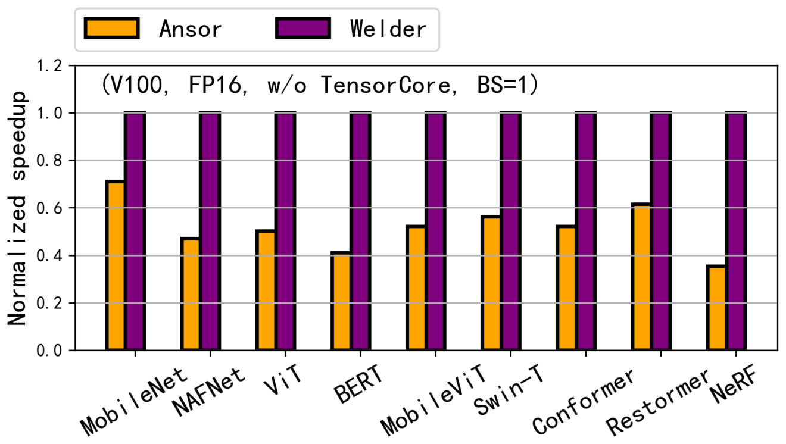

*图 11（原文 Figure 11，第 12 页）：FP16、不用 TensorCore 时与 Ansor 的对比（V100，batch=1）。*

**图中文字翻译与读法**：图例 Ansor（橙）与 Welder（紫）；标题 (V100, FP16, w/o TensorCore, BS=1)（V100、FP16、不用 TensorCore、batch size=1）；横轴 9 个模型（MobileNet、NAFNet、ViT、BERT、MobileViT、Swin-T、Conformer、Restormer、NeRF，没有 BSRN）；纵轴 Normalized speedup，Welder 都是 1.0。读数：Ansor 的柱高约 0.35–0.70，即 Welder 约快 1.4–2.9 倍（MobileNet 约 1.42，NAFNet 约 2.15，ViT 约 2.01，BERT 约 2.51，MobileViT 约 1.93，Swin-T 约 1.79，Conformer 约 1.93，Restormer 约 1.64，NeRF 约 2.86）。论文正文：平均 1.74 倍，最高 2.82 倍，比 FP32 的结果略高。读数的最大值（约 2.86）与正文的 2.82 吻合，但读数的几何平均约 2.0，高于正文的 1.74（第九节）。

#### 5.2.3 另一块 NVIDIA GPU：RTX 3090（图 12）

RTX 3090 采用不同的 Ampere 架构，相比 V100 在存储加载与 TensorCore 指令上有新特性，SM 数量也不同。为简洁起见，只与 TensorRT 比较，因为在 NVIDIA GPU 上 TensorRT 始终比其他基线更好。

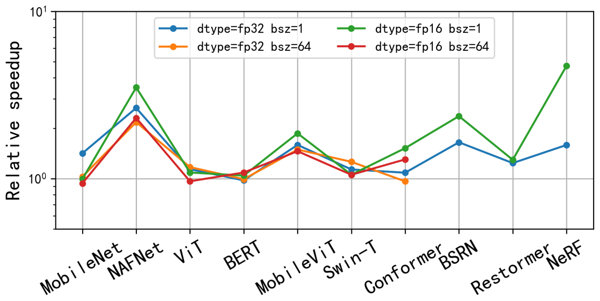

*图 12（原文 Figure 12，第 12 页）：NVIDIA RTX 3090 上与 TensorRT 的对比。*

**图中文字翻译与读法**：

- **坐标与图例**：纵轴 Relative speedup（相对加速比，Welder 相对 TensorRT 的倍数，**对数刻度**，范围约 0.5–10，粗灰线是 $10^0$ 即持平）；横轴 10 个模型；四条线：dtype=fp32 bsz=1（蓝）、dtype=fp32 bsz=64（橙）、dtype=fp16 bsz=1（绿）、dtype=fp16 bsz=64（红）。batch=64 的两条线只有前 7 个模型。
- **读图结论**：多数点在 1 以上；NeRF 与 NAFNet 的 fp16 batch=1 最高；个别点略低于 1。

下表是解读者按对数坐标标定从标记位置读出的近似值（Welder ÷ TensorRT）。个别点被其他曲线的标记遮挡，按可见部分推算，误差更大，已标注：

| 模型 | fp32 batch=1 | fp32 batch=64 | fp16 batch=1 | fp16 batch=64 |
| --- | ---: | ---: | ---: | ---: |
| MobileNet | 约 1.42 | 约 1.02 | 约 1.00 | 约 0.94 |
| NAFNet | 约 2.65 | 约 2.2（部分遮挡） | 约 3.5 | 约 2.3 |
| ViT | 约 1.1–1.2（被遮挡） | 约 1.17 | 约 1.09 | 约 0.97 |
| BERT | 约 0.98 | 约 0.99 | 约 1.04（部分遮挡） | 约 1.09 |
| MobileViT | 约 1.6 | 约 1.5 | 约 1.86 | 约 1.47 |
| Swin-T | 约 1.14 | 约 1.26 | 约 1.05（被遮挡） | 约 1.05 |
| Conformer | 约 1.09 | 约 0.97 | 约 1.52 | 约 1.30 |
| BSRN | 约 1.65 | — | 约 2.36 | — |
| Restormer | 约 1.24 | — | 约 1.30 | — |
| NeRF | 约 1.59 | — | 约 4.7 | — |

论文报告：Welder 相对 TensorRT 的平均加速是 1.40 倍（对全部 34 个测试点取几何平均），与 V100 上的 1.36 倍相近，说明 Welder 对不同 GPU 架构有适应性。解读者核算：V100 上的 10、7、10、7 个点（FP32 batch=1、FP32 batch=64、FP16 batch=1、FP16 batch=64）的平均 1.47、1.21、1.53、1.16 加权几何平均约 1.36，与正文吻合；上表读数的几何平均约 1.40，也与正文吻合。

#### 5.2.4 自动发现的融合模式（表 4）

Welder 自动发现了约 300 种不同的融合子图（按算子类型的唯一组合，在 10 个模型的 34 个编译测试用例上统计）。其中有 89 种含至少两个基于 reduction 的算子，是 Ansor 的简单逐元素融合规则覆盖不了的。论文说据作者所知，其中很多是此前手写规则或自动融合优化都没有探索过的非常规融合模式。

**表 4：Welder 发现的融合模式示例**

| 融合的算子序列 | 算子个数 |
| --- | ---: |
| `DepthwiseConv2dNative` → 块 → `Convolution` → 块 → `Convolution` → 块 → `Convolution` → 块 → `Concat` → `Convolution` → `Broadcast` → `Add`（其中“块”指 10 个算子：`Broadcast Add Broadcast Divide Erf Broadcast Add Multiply Broadcast Multiply`） | 48 |
| `Dot` `Relu` `Dot` `Relu` `Dot` `Relu` `Dot` `Relu` `Dot` `Relu` `Dot` `Relu` `Dot` | 13 |

原文表 4，第 12 页；原表里每行的算子序列是一整段空格分隔的英文算子名，其中 `DepthwiseConv2dNative`、`Convolution`、`Dot` 用粗体标出；上面把第一行里重复出现的 10 个算子记作“块”，所以第一行共 1 个 `DepthwiseConv2dNative`、4 个块（40 个算子）、4 个 `Convolution`、1 个 `Concat`，加上最后的 `Broadcast`、`Add`，合计 48 个（解读者逐个数过）。

读法：第一行里“Broadcast Add”是加偏置，“Broadcast Divide Erf Broadcast Add Multiply Broadcast Multiply”按算子顺序看是 GELU 激活展开后的计算（解读者的判断）；整行把多个卷积与大量逐元素算子融成一个 kernel。第二行是 NeRF 的 7 层 MLP（7 个 Dot 与 6 个 Relu），被融成一个 kernel。原文没有说第一行来自哪个模型。论文说各个融合模式里的算子个数从 2 到 48，与 Ansor 那样的基础融合方法相比，平均加速 1.87 倍（最高 5.4 倍）；最常见的模式在所有模型里一共被使用了 191 次。

注意：论文正文写“Figure 4 illustrates two examples of such patterns”，但图 4 是 operator-tile 的示意图，这两个例子实际在表 4（交叉引用写错，第九节）。

**与 FasterTransformer 的比较（表 3）**：这种通用的融合能力常让 Welder 超过专家针对特定模型优化的实现。FasterTransformer 是 NVIDIA 针对 Transformer 手工优化的基准，支持 BiasAdd+Transpose 这样的逐元素融合，也支持 Layernorm+Softmax 这样的非逐元素融合；这些模式 Welder 都能自动融合。Welder 甚至能在序列不长时进一步把注意力块里的 Q×K 与后面的 Softmax 融合（BERT 序列长度 128 时融合，而 Conformer 序列长度 512 时不融合，这由 Welder 自动决定）。

**表 3：Welder 与 FasterTransformer 的性能（V100，延迟，单位 ms，越小越好）**

| 模型 | 数据类型 | batch size | Welder（ms） | FT-CPP（ms） |
| --- | --- | ---: | ---: | ---: |
| BERT | FP32 | 1 | 3.13 | 3.15 |
| BERT | FP32 | 64 | 118.6 | 119.8 |
| BERT | FP16 | 1 | 1.49 | 1.50 |
| BERT | FP16 | 64 | 24.82 | 22.29 |
| ViT | FP32 | 1 | 1.33 | 1.96 |
| ViT | FP32 | 64 | 15.29 | 15.68 |
| ViT | FP16 | 1 | 1.09 | 1.89 |
| ViT | FP16 | 64 | 4.79 | 5.15 |
| swin-T | FP32 | 1 | 2.59 | 2.38 |
| swin-T | FP32 | 64 | 66.13 | 72.62 |
| swin-T | FP16 | 1 | 1.43 | 1.60 |
| swin-T | FP16 | 64 | 23.12 | 28.67 |
| 几何平均 | | | 6.71 | 7.46 |

原文表 3，第 11 页；DT = 数据类型，FT-CPP = FasterTransformer 的 C++ 实现；“几何平均”行里 6.71 与 7.46 是 12 个延迟各自的几何平均。读法：Welder 平均比 FasterTransformer 快 1.11 倍（最高 1.73 倍，在 ViT FP16 batch=1）。解读者核算：把表中延迟比（FT÷Welder）求几何平均得 1.11，与正文一致；但有两个点 Welder 反而更慢：BERT FP16 batch=64（24.82 对 22.29 ms，慢约 11%）与 swin-T FP32 batch=1（2.59 对 2.38 ms，慢约 9%）。论文把 ViT batch=1 上的显著加速归因于一个形状非常规的卷积算子，其步长与卷积核大小都是 32（ViT 的 patch 大小），就这一个算子，Welder 生成的 kernel 快 4.4 倍。

**NeRF 与 CNN 模型上的融合**：NeRF 是流行的 3D 场景生成模型，通常实现成 7 层 MLP；为了充分用好 GPU，领域专家往往要从头实现这类模型来获得更好的融合效果（如文献 [35] 的 fully-fused MLP）。用 Welder 可以把这 7 层 MLP 自动融合成单个 GPU kernel：前 6 层用 TensorCore，输出层用 SIMT 核心，全部中间结果存在共享内存里。论文称自动融合的结果取得了与文献 [35] 报告的值相近的加速（超过 5 倍）——因为作者的 V100 不支持 [34] 的代码，没法直接对比。原文没有说这个“5 倍”相对什么；解读者核对图 10，NeRF 的 PyTorch 柱高约 0.20，Welder ÷ PyTorch 约 5 倍，所以大概是相对 PyTorch（推断）。

对 NAFNet、BSRN、MobileNet 这类 CNN，Welder 能把不同类型的卷积与其他算子（池化、PixelShuffle 等）融合。例如在 NAFNet 里，可以把前后相接的逐点卷积（pointwise convolution）与它们之间的归一化操作融合起来。在含多个可分离卷积层（每层是一个 depthwise 卷积 DWConv 加一个 pointwise 卷积 PWConv）的模型里，Welder 会根据算子配置自行决定最佳的融合顺序：靠前的层特征图大、通道数少，Welder 构造 DWConv+PWConv 的融合组，因为把整张特征图缓存在共享内存里更划算；靠后的层特征图变小，Welder 构造 PWConv+DWConv 的融合组，缓存完整的一个通道供 DWConv 复用。

#### 5.2.5 消融与敏感性（图 13、图 14）

为证明整体存储优化的收益，论文构造了 Welder 的两个变体：**Welder-none**：关掉所有算子间的 tile 连接，只搜索算子内的 schedule；**Welder-base**：只在寄存器层启用算子间的 tile 连接。同时把 Ansor 也加入这个实验，因为它也是类似的基于代码生成的方法。

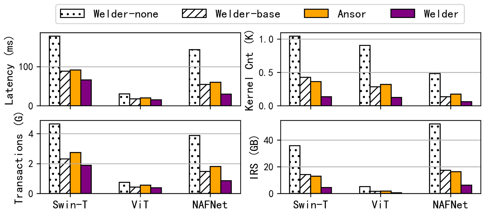

*图 13（原文 Figure 13，第 13 页）：3 个选定模型上的延迟、GPU kernel 个数、执行的全局显存事务数、中间结果大小（IRS）（FP32，batch size 64；论文没有在图题里写 GPU，按上下文是 V100）。*

**图中文字翻译与读法**：

- **图例**：Welder-none（点状填充）、Welder-base（斜线填充）、Ansor（橙）、Welder（紫）。
- **四个子图**：左上 Latency (ms)（延迟）；右上 Kernel Cnt (K)（kernel 个数，单位千）；左下 Transactions (G)（全局显存事务数，单位 G，十亿）；右下 IRS (GB)（intermediate result size，中间结果大小，单位 GB）。每个子图的横轴是三个模型：Swin-T、ViT、NAFNet。
- **读图结论**：从 Welder-none 到 Welder-base 到 Welder，四项指标依次大幅下降；Welder-base 的各项指标与 Ansor 相近，说明 Welder 通用的基于 tile 的存储调度能达到 Ansor 基于规则的融合效果；再在共享内存层启用 tile 连接（Welder）后进一步下降，kernel 个数下降尤其明显。

**图 13 读数**（解读者按坐标标定读出的近似值，FP32、batch=64，三个模型；延迟与单位同上，读数误差：延迟约 ±1 ms，kernel 数约 ±0.01 K，事务数约 ±0.03 G，IRS 约 ±0.3 GB）：

| 模型 | 指标 | Welder-none | Welder-base | Ansor | Welder |
| --- | --- | ---: | ---: | ---: | ---: |
| Swin-T | 延迟（ms） | 约 178 | 约 89 | 约 92 | 约 66 |
| Swin-T | kernel 个数（K） | 约 1.04 | 约 0.43 | 约 0.36 | 约 0.14 |
| Swin-T | 全局显存事务（G） | 约 4.7 | 约 2.3 | 约 2.7 | 约 1.9 |
| Swin-T | IRS（GB） | 约 36 | 约 14 | 约 13 | 约 4.4 |
| ViT | 延迟（ms） | 约 31 | 约 18 | 约 20 | 约 15 |
| ViT | kernel 个数（K） | 约 0.91 | 约 0.29 | 约 0.32 | 约 0.13 |
| ViT | 全局显存事务（G） | 约 0.74 | 约 0.42 | 约 0.55 | 约 0.38 |
| ViT | IRS（GB） | 约 5.1 | 约 1.5 | 约 1.8 | 约 0.4 |
| NAFNet | 延迟（ms） | 约 144 | 约 55 | 约 60 | 约 30 |
| NAFNet | kernel 个数（K） | 约 0.48 | 约 0.14 | 约 0.18 | 约 0.06 |
| NAFNet | 全局显存事务（G） | 约 3.9 | 约 1.5 | 约 1.8 | 约 0.86 |
| NAFNet | IRS（GB） | 约 52 | 约 17 | 约 16 | 约 6.2 |

读表与核对：Swin-T、ViT 两个模型的 Welder 延迟约 66、15 ms，与表 3 里的 66.13、15.29 ms（FP32、batch=64）一致。论文正文给出的平均值：Welder-base 相对 Welder-none 平均降低延迟 52%（即 2.08 倍加速）、kernel 启动次数 67%、全局显存事务 52%、中间结果大小 66%；在共享内存层再启用 tile 连接（Welder）后相对 Welder-base 又平均降低延迟 29%（最高 1.82 倍加速）、kernel 启动 60%、事务 25%、IRS 65%。按上表读数计算：Welder-none 对 Welder-base 的延迟比几何平均约 2.08，三个模型的 kernel 数、事务数、IRS 平均降幅约 66%、52%、66%；Welder 对 Welder-base 的 NAFNet 延迟加速约 1.83、平均延迟降幅约 28%、kernel 降幅约 60%，均与正文吻合（事务数、IRS 的降幅读数约 23%、68%，与正文的 25%、65% 略有出入，在读数误差内）。论文还指出：显存事务的降幅小于 IRS 的降幅，因为模型权重部分的访存无法靠融合优化。

**敏感性（图 14）**：论文还通过改变输入尺寸做敏感性研究，选三个模型：BERT（文本长度 128–512）、Conformer（音频帧数 128–512）、NAFNet（图像输入 256×256–1024×1024）。

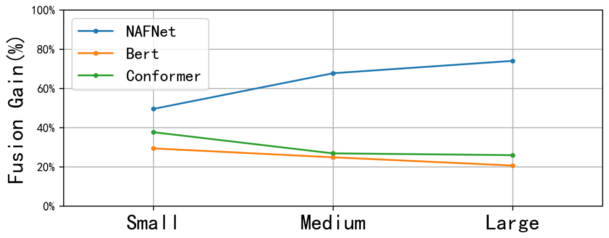

*图 14（原文 Figure 14，第 13 页）：改变输入尺寸，与 Welder-base 比较的融合增益。*

**图中文字翻译与读法**：纵轴 Fusion Gain (%)（融合增益，0%–100%）；横轴 Small、Medium、Large（输入尺寸小、中、大）；三条线：NAFNet（蓝）、Bert（橙）、Conformer（绿）。读数（约）：NAFNet 从约 50% 升到约 68%，再到约 74%；Bert 从约 29% 降到约 25%，再到约 21%；Conformer 从约 38% 降到约 27%，再到约 26%。论文没有定义“融合增益”的计算公式（是延迟降低百分比，还是加速比减一），也没有给出 Small/Medium/Large 的具体尺寸（只给出各模型的区间）。

**读图结论**：NAFNet 用更大的图像时融合增益显著上升；另外两个基于 Transformer 的模型增益则下降。论文的解释是 Transformer 类模型的计算量随输入序列长度呈二次增长，从而降低了它们的访存密集程度。

#### 5.2.6 编译时间（表 5）

表 5 比较 Welder 与 Ansor（基于搜索的编译器，需要大量调优与 profile 试验）的编译时间。论文没有包含其他基线，因为它们直接调用库 kernel，没有额外的调优与代码生成时间。

**表 5：Ansor 与 Welder 的编译时间**

| 模型 | Ansor 时间（s） | Ansor 试验次数 | Welder 时间（s） | Welder 试验次数 |
| --- | ---: | ---: | ---: | ---: |
| BERT | 15285 | 8000 | 244 | 651 |
| MobileNet | 45527 | 25600 | 561 | 927 |

原文表 5，第 13 页。读法：Welder 的端到端编译速度比 Ansor 快一个数量级以上（解读者核算：BERT 约 63 倍，MobileNet 约 81 倍）。论文的解释：Ansor 为所有算子生成非常大的搜索空间，靠基于机器学习的调优隐式地优化数据复用，需要大量调优试验（评测中每个算子 800 次），还要在线训练代价模型；而 Welder 用分层调度策略分解优化空间，并用解析的代价模型估计流量代价，所以所需调优试验少得多（评测中每个子图 20 次）。Ansor 的试验数 8,000、25,600 分别是 800 的 10 倍与 32 倍，即 BERT、MobileNet 分别被切成约 10 个、32 个调优任务（解读者由“每个任务 800 次”反推）。

#### 5.2.7 计算密集型模型上的表现（表 6）

对 ResNet [21]、VGG [43]、UNet [40] 这类传统模型，主要由卷积等大算子主导。虽然 Welder 主要关注访存优化，在这类计算密集型模型上多数情况下仍能与 TensorRT 这样的最先进基线取得相当的性能，因为 Welder 仍能生成高性能的单个算子（用与 Ansor、Roller 类似的多级 tiling 抽象），尽管在更高存储层上连接 tile 的机会很少。然而对一些卷积算子，cuDNN 等库用经过优化的数值算法（如 Winograd [26]）实现，很难从张量表达式自动推导出来；如果没有额外的存储优化空间来弥补这个差距，Welder 就会比 TensorRT 差。

**表 6：计算密集型模型上的性能**

| 模型 | Ansor | Welder | TensorRT |
| --- | ---: | ---: | ---: |
| Resnet50 | 2.403 | 2.327 | 2.351 |
| Resnet18 | 1.071 | 1.094 | 1.158 |
| UNet | 8.670 | 9.251 | 4.429 |
| VGG16 | 4.267 | 4.123 | 2.584 |

原文表 6，第 13 页。表和正文都没有写明单位、batch、精度；由正文“UNet、VGG16 上 TensorRT 更好”可知数值越小越好，应是延迟（单位可能是 ms，解读者推断）。读法：ResNet 上三者相当——因为这个模型里多数卷积用 DirectConv 算法实现得更好（Ansor 与 Welder 都支持），而不是 Winograd；UNet 与 VGG16 里主导的卷积算子在 TensorRT 里多数用 Winograd 实现，Welder 没有进一步的融合机会可用，所以 TensorRT 更快（UNet 上 Welder 的延迟是 TensorRT 的约 2.09 倍，VGG16 上约 1.60 倍，解读者核算）。论文把支持 Winograd（通过改写张量表达式）留作未来工作。

### 5.3 AMD ROCm GPU 上的评测（图 15）

论文在 AMD ROCm GPU（Radeon Instinct MI50，16 GB）上把 Welder 与 PyTorch、ONNXRuntime、Rammer 和 Ansor 比较；TensorRT 与 AStitch 只支持 NVIDIA GPU，所以不在其中。

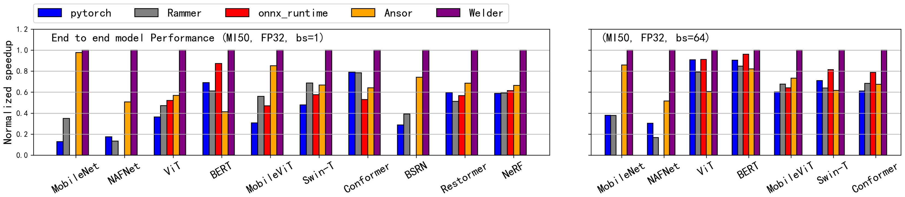

*图 15（原文 Figure 15，第 14 页）：AMD ROCm MI50 GPU 上的端到端模型推理性能；左图 batch size 为 1，右图 batch size 为 64。*

**图中文字翻译与读法**：

- **图例**：pytorch（蓝）、Rammer（灰）、onnx_runtime（红）、Ansor（橙）、Welder（紫）；注意图例顺序与图 9 不同（Rammer 在 onnx_runtime 前）。
- **左图 End to end model Performance (MI50, FP32, bs=1)**：10 个模型；**右图 (MI50, FP32, bs=64)**：7 个模型（MobileNet、NAFNet、ViT、BERT、MobileViT、Swin-T、Conformer）。纵轴同样是相对于每个模型最快系统的 Normalized speedup，Welder 在所有模型上都是 1.0（即最快）。部分 CNN 模型（MobileNet、NAFNet、batch=1 时还有 BSRN）没有 onnx_runtime 的柱，因为 ONNXRuntime 在这些模型上无法运行（正文：“excluded some CNN models for ONNXRuntime as they fail to execute on it”）。
- **读图结论**：在 MI50 上，Welder 对所有基线、所有模型都不慢于对手。

**论文报告的平均加速比（第 5.3 节，第 14 页；MI50、FP32、几何平均）**：

| 基线 | batch=1（10 个模型） | batch=64（7 个模型） |
| --- | ---: | ---: |
| PyTorch | 2.62× | 1.69× |
| ONNXRuntime | 1.71× | 1.23× |
| Rammer | 2.14× | 1.86× |
| Ansor | 1.53× | 1.47× |

**图 15 逐模型读数（Welder ÷ Ansor，解读者读数，约，误差约 ±0.03）**：

| 模型 | batch=1 | batch=64 |
| --- | ---: | ---: |
| MobileNet | 约 1.02 | 约 1.17 |
| NAFNet | 约 1.97 | 约 1.94 |
| ViT | 约 1.76 | 约 1.67 |
| BERT | 约 2.42 | 约 1.22 |
| MobileViT | 约 1.18 | 约 1.36 |
| Swin-T | 约 1.50 | 约 1.62 |
| Conformer | 约 1.56 | 约 1.48 |
| BSRN | 约 1.35 | — |
| Restormer | 约 1.46 | — |
| NeRF | 约 1.51 | — |

读表：读数的几何平均 batch=1 约 1.53、batch=64 约 1.47，与正文一致；MI50 上这些模型相对 PyTorch、ONNXRuntime、Rammer 的读数平均也与正文吻合（解读者验证过）。

论文说 Welder 在 MI50 上的加速比比在 V100 上略小，原因是按官方数据手册，MI50 的峰值 FLOPS 比 V100 弱，而峰值带宽更高；这使得同一负载在 MI50 上更偏计算密集，访存优化的空间就更小。

### 5.4 借助 host memory 扩展：处理超大输入（表 7）

Welder 的抽象设备层允许把存储层次向外扩展来支持大的 DNN 任务。例如用 UNet、VGG16 这类经典 CNN 处理高分辨率医学图像时，某些层的单个张量往往大到放不进 GPU 显存；这时 SwapAdvisor [22]、Capuchin [37] 这类以张量为粒度的换入换出优化因为粒度太大而可能无效。Welder 的做法是在扩展后的存储层次上，通过整体的流量优化生成基于 tile 的执行计划：从 host memory 载入一个数据 tile，在设备存储里复用数据计算若干相连的 operator-tile，再把结果写回，就像在单个设备上处理一样。为评估这种调度的效果，论文比较了 Welder 与一个只关闭设备存储层数据复用的变体。

**表 7：把大 DNN 模型扩展到 host memory 的性能（耗时，单位 s，越小越好）**

| 模型 | 图像尺寸 | 设备 | Welder Base（s） | Welder（s） |
| --- | --- | --- | ---: | ---: |
| UNet | 8k×8k | GPU | 38.2 | 14.5 |
| VGG16 | 8k×8k | GPU | 15.7 | 8.30 |
| UNet | 2k×2k | IPU | 31.1 | 8.56 |
| VGG16 | 2k×2k | IPU | 4.98 | 1.61 |

原文表 7，第 14 页；“Welder Base”是只关闭设备存储层数据复用的变体（与第 5.2.5 节消融里“只在寄存器层连接”的 Welder-base 是同名不同义的两个变体）。论文没有写明 GPU 的型号。

读法：

- **GPU**：启用设备存储层的 tile 连接后，UNet、VGG16 分别加速 2.63 倍（38.2→14.5）、1.89 倍（15.7→8.30），并把 host 内存传输量分别减少 3.11 倍与 2.90 倍。流量降幅比实际加速比大，是因为实现了双缓冲（配合 pinned memory 与 CUDA stream）让部分内存传输与计算重叠。
- **Graphcore IPU**：IPU 是 MIMD 大规模并行处理器，设备存储相对很小（300 MB），连中等规模的任务都会遇到挑战。同样的 tile 调度用在这两个模型上，输入图像设为 2048×2048 以适应 IPU 容量；平均加速 3.63 倍（31.1→8.56）与 3.09 倍（4.98→1.61）。IPU 上的提升比 GPU 更高，主要因为 IPU 上关掉了双缓冲优化（容量有限）。
- 论文称这只是初步实验。以上加速倍数都是相对 Welder Base 的，不是相对别的系统。

## 六、讨论、相关工作与结论

**讨论（静态模型）**：Welder 的设计与实现主要面向静态模型。对动态模型，论文提出两种实际办法：第一，通过 JIT 编译（如 PyTorch 的 JIT compile，在 PyTorch 2.0 里已成标准做法）把动态图转成静态子图，Welder 专注优化其中通常占计算主导的静态子图；第二，即使张量形状是动态的，每个算子内部的 tile 也可以静态确定，这就给了 Welder 机会生成静态的 tile 级融合方案，只让并行任务的个数由输入张量形状决定。

**相关工作**：

- **算子融合**：TVM、Ansor、XLA、DNNfusion 都支持寄存器层的算子融合；另一些编译器进一步在共享内存层融合算子，但要么依赖针对一组已知算子类型的融合规则（AStitch、Apollo、DeepCuts），要么依赖针对少数算子组合的专用模板（Bolt）。TensorRT、ONNXRuntime 等专用 DNN 运行时对热门模型（如基于 Transformer 的模型）里的一些常见模式内置了专家设计的融合规则。相比之下，Welder 面向任意用张量表达式实现的算子，不假设算子类型，并自动决定最佳的融合存储层——因为算子的资源使用特性（访存密集还是计算密集）往往取决于它的形状，融合决策也因此取决于形状；
- **并行度与启动开销**：Rammer、HFuse、Nimble 等通过水平融合或在多 stream、CUDA graph 上调度并行任务，来更好地利用硬件并行度、减少 kernel 启动。Welder 在这些系统之上进一步探索与之互补的、以垂直融合为手段的整体存储优化，对访存密集模型带来额外加速；
- **算子内优化**：Ansor 与 Roller 是代表性的张量编译器，分别通过循环优化与 tiling 优化专注于算子内优化；Roller、Triton 也用 tile 的概念来优化 kernel 性能（算子内数据复用）。Welder 与它们互补，同时优化算子内与算子间的访存；它把 Roller 的 tile 概念推广为 tile-graph 抽象，暴露出整体的 tile 级调度空间，并提出面向这个整体空间与显式存储层次的高效调度机制；
- **针对特定模式的手工融合**：如针对 NeRF 的 fully-fused MLP [35]、针对 CNN 的手工融合 kernel [46]、针对 Transformer 的注意力融合 [2, 18]。论文的评测表明 Welder 能自动达成其中大部分融合，甚至产出新的融合模式；
- **其他领域**：传统图像处理 [38, 39]、HPC [45] 里也用 kernel 融合，通常依赖领域特定的融合规则；Welder 面向 DNN 负载，但适用于一般用张量表达式表示的算子，对其他领域里可用张量表达式实现的负载也可能有帮助。

**结论（论文第 8 节）**：观察到现代 DNN 越来越访存密集后，论文提出基于新的 tile-graph 抽象的编译器 Welder，能在多级存储层次上整体地优化算子内与算子间的高效数据复用。Welder 是第一个把所有常见算子融合统一到一个框架里的工作，能发现 89 种非常规融合模式，其中最大的一个把 48 个算子融进单个 kernel；这种通用性使它明显超过最先进的基线。更重要的是，Welder 提供了一种系统的方式，来利用存储层次的新趋势，如未来 AI 加速器上更大、连接更紧密的片上存储。

## 七、局限与证据边界

- **只面向静态模型**：动态模型要先转成静态子图，或只静态确定算子内部 tile；论文没有实验验证这两种办法。
- **依赖底层 kernel 质量**：在计算密集算子上 Welder 用的 kernel 不如 TensorRT 的库实现，Winograd 这类数值算法 Welder 没有；UNet、VGG16 上因此明显落后于 TensorRT（表 6），论文把它留给未来工作。
- **在成熟手工库面前收益有限**：BERT、Swin-T 这类 TensorRT 已有手写规则与自研 kernel 的 Transformer 上，Welder 只是持平（约 1.02 倍与 0.97 倍）；最高的 3.09 倍来自 NAFNet 这类较新的、库覆盖不足的模型。
- **只报告平均速度**：每个模型只报告平均速度（论文说波动很小），没有方差，也没有逐模型的绝对数据（除动机图 1、图 2 的数据标签外，表 3 和表 5–7 是仅有的绝对数）；图 9–12、15 都是归一化图，没有数据标签，数值只能读图。
- **平台覆盖不均**：端到端的主结果在 V100 上；RTX 3090 只与 TensorRT 比较；AMD MI50 只与 PyTorch、ONNXRuntime、Rammer、Ansor 比较；IPU 只做 host memory 扩展实验，且只对比自己的一个变体。
- **基线的可运行性不一**：BladeDISC 在大多数模型上报错并回退到 PyTorch，只有 4 个模型可统计；Nimble、ONNXRuntime 在部分模型上无法运行；这些基线的平均值是各自在不同模型子集上算的，不能与 Welder 的 10 模型平均直接并列。
- **没有数值正确性评估**：融合会改变中间结果的物化方式与归约顺序（如 tile 级的 reduction），论文没有报告融合前后的数值误差或精度。
- **搜索是贪心的**：图连接调度器按拓扑序逐条边决定连接层级（图 7），没有最优性分析；算法的有效性依赖层间、层内独立性的近似，以及 top-K 剪枝与 profile。
- **“与存储带宽差有关”的收益模型**：论文自己说 Welder 的收益主要来自存储层之间的带宽差，所以在计算更密集的硬件（如 MI50 相对 V100）或计算密集的模型上，收益会缩小。

## 八、常见误读

- **“Welder 比 TensorRT 快 3 倍”**：3.09 倍是 V100、FP32、batch=1、NAFNet 这一点；BERT 约 1.02 倍、Swin-T 约 0.97 倍；batch=64 的平均只有 1.21 倍；UNet、VGG16 上 TensorRT 更快。引用任何加速比都要同时写明模型、batch、精度、GPU 与是否开 TensorCore。
- **“tile 越大，复用越多，所以越快”**：Welder 的代价模型里，tile 太大会因并行度不足而被惩罚，超出存储容量会被无穷大惩罚，也会增加占用；而 tile 太小又让算子内的复用变差。图 2 里最优的是 [16×128]，不是最大的 tile。
- **“流量降低就等于延迟降低”**：只在访存受限的区域近似成立。图 13 里从 Welder-none 到 Welder-base，三个模型的全局显存事务降幅（读数约 50%、43%、62%）与延迟降幅（约 50%、42%、62%）几乎同步，是因为这些模型受访存限制；计算、同步或 host 调度占主导时，降低流量就不会线性转成加速（如表 6 里计算密集的 ResNet，几乎没有融合机会）。另外，论文指出事务数的降幅小于中间结果大小的降幅，因为权重部分的访存无法靠融合优化。
- **“Welder 就是一个融合规则库”**：恰恰相反，Welder 不预设哪些算子能融合，而是用“连接层级 + 流量代价”的搜索自动决定；表 4 里 48 个算子的融合模式不是人写的规则。
- **“Welder 解决了动态形状”**：论文只说可以通过 JIT 转静态子图或静态 tile 加动态并行任务数来应对，并未实验。
- **“Welder 的编译很慢”**：与同类的搜索式编译器 Ansor 相比，Welder 快一到两个数量级（BERT 244 s 对 15,285 s）；当然相对直接调用库的 TensorRT 之类，仍要付出编译时间。

## 九、论文内部的不一致与待核对点

| 位置 | 现象 | 解读者判断 |
| --- | --- | --- |
| 图 3、图 5 与图 7、图 8 | 图 3、图 5 把最快的层记作 L0、最底层记作 L2；图 7、图 8 及第 3.2–3.3 节算法部分说“0 是最低层，数字越大层级越高” | 同一篇里两套相反的层号；读算法时以 0=最低层为准 |
| 第 5.2 节（Patterns automatically discovered） | 正文写“Figure 4 illustrates two examples of such patterns”，但图 4 是 operator-tile 示意 | 应为表 4，交叉引用写错 |
| 图 1 与表 2 | 图 1：NAFNet 2021、NeRF 2022；表 2：NeRF 2021、NAFNet 2022 | 两处年份互换，不影响结论 |
| 第 5.2 节与图 9 右图 | 正文说“表 2 的最后三个模型”无法在大 batch 下 trace；图 9 右图实际去掉的是 BSRN、Restormer、NeRF，保留 NAFNet，而表 2 的最后三行是 NAFNet、Restormer、BSRN | “最后三个”按图 9 左图顺序成立，按表 2 行序不成立 |
| 第 5.2 节（Ansor 对比）与图 9 左图 | 正文：Restormer 相对 Ansor 为 1.29×；读图：Welder ÷ Ansor 约 1.40；正文给出数值的其余 8 个模型读数与正文吻合，10 个读数的几何平均约 1.44 | 1.29 与图不一致，可能是笔误 |
| 第 5.2 节（batch=64）与图 9 右图 | 正文平均加速：PyTorch 1.83×、ONNXRuntime 1.90×、Ansor 1.47×、TensorRT 1.21×；按图读数估算约 1.7×、1.7×、1.43×、1.17× | PyTorch、ONNXRuntime 偏差 8%–10%，Ansor、TensorRT 约 2%–3%；batch=1、图 10、图 15 的读数都与正文吻合，唯独这一组偏低，原因不明 |
| 第 5.2 节（图 11）与图 11 | 正文：平均 1.74×、最高 2.82×；读图：最高约 2.86，几何平均约 2.0 | 最大值吻合，平均数不吻合 |
| 第 1 节与第 5.2 节 | 引言写对 TensorRT 最高 3.0×；第 5.2 节正文最大值是 NAFNet 的 3.09×（TensorCore 下为 2.98×） | 引言是取整的写法，影响很小 |
| 第 5.4 节与第 5.2.5 节 | 表 7 的“Welder Base”是关闭设备存储层数据复用的变体；消融里的“Welder-base”是只在寄存器层连接的变体 | 同名不同义，读表 7 时不要与图 13 混淆 |
| 表 6 | 没有标注单位、batch、精度 | 由正文可推断是越小越好的延迟，但具体口径未知 |
| 排印笔误 | 图 7 第 15 行 `Propogate`、图 8 的 `for` 行漏右括号、图 1 纵轴 `Utilizaiton`、附录的 `GPU stale out experiments`（应是 scale-up） | 不影响内容 |

## 十、复现检查

- **artifact**（论文附录 A，第 16 页）：代码在 <https://github.com/microsoft/nnfusion/tree/osdi2023welder>（分支 `osdi2023welder`），带 Dockerfile 搭环境；要求 NVIDIA V100 GPU 与支持 CUDA 11.0 以上运行时的驱动。复现全部结果要编译 50 多个模型测试用例，很耗时（尤其是 Ansor 基线），所以 artifact 还提供了 V100 上的预编译日志与模型。每个图表有对应脚本，覆盖图 9、图 10、图 11、表 3、表 6，动机实验图 1、图 2，消融图 13，编译时间表 5，以及表 7 的 GPU 扩展实验。
- 固定软件版本：PyTorch 1.12、ONNXRuntime 1.12、Ansor 0.9、TensorRT 8.4、FasterTransformer 5.2、BladeDISC 0.3.0；记录 Ansor 的调优预算（每个任务 800 次）与 Welder 的 top-K（每个子图 20 次试验）。
- 区分 SIMT 与 TensorCore、FP32 与 FP16、batch=1 与 batch=64；FP16 模型的转换方式（TensorRT 用自带转换器，其余用 `onnxconverter_common`）要保持一致。
- 逐层记录各级存储的读写字节数、kernel 个数、IRS，而不只记录延迟（图 13 的做法）；验证 Welder 的解析流量模型与 profiler 实测流量是否吻合。
- 单独报告编译（搜索与 profile）时间，并记录子图缓存是否命中（如 BERT 12 层只编译一层）。
- 验证不同融合方案的数值误差，特别是 reduction 的重排与 FP16 下的累加；论文没有这类数据。
- 对动态形状，检查是否触发重新编译或方案缓存失效。
- 把 BladeDISC、Nimble、ONNXRuntime 的失败情形列出来，并说明平均数所用的模型子集，避免与 10 模型的平均数混用。

## 十一、与本仓库相关论文的关系

- **Roller**（[`../roller/论文中文解读.md`](../roller/论文中文解读.md)）：Welder 用 Roller 枚举 tile 配置（EnumerateSubtiles 的 tile 形状扩张），并把 Roller 的 tile 概念推广成 tile-graph。
- **Rammer**（[`../rammer/论文中文解读.md`](../rammer/论文中文解读.md)）：Welder 用 Rammer 做端到端的图优化；Rammer 通过水平方向调度并行任务，Welder 补上垂直方向的整体存储优化。
- **Ansor**（[`../ansor/论文中文解读.md`](../ansor/论文中文解读.md)）、**TVM**（[`../tvm_compiler/论文中文解读.md`](../tvm_compiler/论文中文解读.md)）、**TensorIR**（[`../tensorir/论文中文解读.md`](../tensorir/论文中文解读.md)）：Ansor 是主要对照基线；TVM 提供 kernel 的 schedule 与代码生成，Welder 的 load/store 重写在 TVM 的 TIR 上加 pass。
- **Bolt**（[`../bolt/论文中文解读.md`](../bolt/论文中文解读.md)）：论文把它列为依赖专用模板的共享内存层融合；**FusionStitching**（[`../fusion_stitching/论文中文解读.md`](../fusion_stitching/论文中文解读.md)）：Welder 没有引用它，只引用了其后继 AStitch；两者的对照是解读者的补充——FusionStitching 把依赖关系与并行方式各异的访存密集算子“缝合”进一个 kernel，并用代价模型估计 kernel 延迟，重点是拼接合法性与组合方式；Welder 则以 tile 为优化单位，联合决定算子内 tiling 与算子间复用，目标是全图的存储流量。二者并非替代关系。
- **今天的系统**（解读者的联想，论文没有涉及）：TorchInductor（[`../pytorch_2/论文中文解读.md`](../pytorch_2/论文中文解读.md)）、Triton（[`../triton_compiler/论文中文解读.md`](../triton_compiler/论文中文解读.md)）、CuTe DSL（[`../cutedsl_torchinductor/论文中文解读.md`](../cutedsl_torchinductor/论文中文解读.md)）以及 MegaKernel 类系统（[`../mirage_persistent_kernel/论文中文解读.md`](../mirage_persistent_kernel/论文中文解读.md)、[`../ada_mk/论文中文解读.md`](../ada_mk/论文中文解读.md)）仍在不同层次上面对 Welder 提出的问题：tile 形状、存储放置与跨算子边界不能独立决策。

## 原文证据导航

- [原论文 PDF](paper.pdf)
- [原文提取文本](paper.txt)
- [论文概要](论文概要.md)
- 图表页码：图 1、图 2 第 4 页；图 3、图 4 第 5 页；图 5、图 6 第 6 页；图 7、表 1 第 7 页；图 8 第 8 页；图 9、表 2 第 10 页；表 3 第 11 页；图 10、图 11、图 12、表 4 第 12 页；图 13、图 14、表 5、表 6 第 13 页；图 15、表 7 第 14 页；附录 A（artifact）第 16 页；参考文献第 17–19 页。
