# 论文中文解读：《Robust Speech Recognition via Large-Scale Weak Supervision》

> **基本信息**：Alec Radford、Jong Wook Kim（两人为共同一作）、Tao Xu、Greg Brockman、Christine McLeavey、Ilya Sutskever（OpenAI），arXiv:2212.04356（本文依据 v1，2022 年 12 月）；论文原文 [官方页面](https://arxiv.org/abs/2212.04356)；模型与推理代码见 github.com/openai/whisper。系统名为 Whisper；原文脚注说，若需要缩写含义，可理解为 WSPSR（Web-scale Supervised Pretraining for Speech Recognition）。
>
> **本文的读法**：图为从论文 PDF 中按图裁出的原图，表为逐格核对后的中文转录（数字、模型名、数据集名保持原样，表头译成中文）；从图上读出的近似数值都标了“约”。每张图后有中文图题、图中文字翻译和读图结论，因此不必再翻英文原文。原文中的特殊 token 一律写在反引号里，例如 `<|startoftranscript|>`。附录里的数据统计、文本规范化、详细结果表和训练超参数也并入对应章节。

## 一、一句话结论

Whisper 要回答的问题是：不靠自监督预训练，也不对每个评测集单独微调，只把互联网上现成的“音频加文字稿”做大做杂（68 万小时），用最普通的 encoder–decoder Transformer 直接去预测原始文字稿，能不能得到“开箱即用”、对口音、噪声和领域变化都鲁棒的语音识别系统？论文的回答是：基本可以，而且有清楚的边界。

- **数据**：共 681,070 小时音频—文本对（正文简称 68 万小时）：英语识别 438,218 小时、非英语识别 117,113 小时（74 种语言）、从其他语言翻译到英语（X→en）125,739 小时（98 种源语言）。只做很少的清洗：剔除疑似机器生成的文字稿、检查音频语言与文字稿语言是否一致、模糊去重；不做文本规范化。
- **模型**：标准的 encoder–decoder Transformer，共 5 档规模（Tiny 39M 到 Large 1550M，另有训练更久的 Large V2）；输入是 30 秒音频的 80 通道 log-Mel 谱；解码器用一串特殊 token 指定“语言、任务、是否带时间戳”，同一个模型完成多语言识别、语音翻译、语言识别、语音活动检测和带时间戳转写。
- **主要证据**：（1）在 LibriSpeech 上与 Whisper 表现相当的监督模型（wav2vec 2.0 Large，不用语言模型），在其他数据集上的错误率高得多，Whisper Large V2 的相对错误率下降平均为 55.2%（表 2）；（2）CoVoST2 的 X→en 翻译零样本达到 29.1 BLEU；（3）多语言识别的 WER 与该语言的训练小时数近似幂律关系，每增加 16 倍数据 WER 约减半；（4）长音频转写在 7 个数据集上与商用系统可比；（5）在 25 段 Kincaid46 录音上，Whisper 的聚合 WER 为 8.81，落在 4 家纯人工转写服务的 8.14–10.5 之间，计算机辅助转写服务最低（7.61）。
- **边界**：不是所有基准的最好成绩（LibriSpeech test-clean 为 2.5–2.7，此前最好为 1.4；VoxPopuli 13.6 对 Maestro 的 8.1；语言识别 64.5% 对 77.7%）；WER 依赖作者自己写的文本规范化；解码会出现重复循环、漏掉开头结尾的词、编造与音频无关的文字（原文第 6 节承认）。

## 二、背景与动机

### 2.1 无监督预训练留下的缺口

以 wav2vec 2.0 为代表的无监督预训练（见本仓库的 [wav2vec 2.0 解读](../wav2vec2/论文中文解读.md)）直接从原始音频学习，不需要人工标注，已经能放大到 100 万小时（Zhang 等，2021），远超学术监督数据集常见的约 1,000 小时；微调后刷新了许多基准，在数据少的场景尤其明显。但原文指出两个问题：

1. 这些预训练只得到高质量的**编码器**，没有同样高质量的预训练**解码器**，因此必须再经过微调阶段才能真正做识别，而微调本身是个需要熟练从业者的复杂过程，限制了它的可用性和影响力。
2. 微调有风险：机器学习方法擅长发现训练集里能提高同分布留出集表现的模式，而其中一些模式是脆弱的伪相关，不能泛化到别的数据集。原文引用 Radford 等（2021，即 CLIP）的例子：在 ImageNet 上微调视觉模型，ImageNet 分类准确率提高了 9.2%，但在另外 7 个自然图像数据集上对同类物体的平均准确率没有任何提高。

因此作者认为，语音识别系统的目标应该是在各种环境下“开箱即用”，而不是为每个部署分布各做一次有监督微调。

### 2.2 有监督的多数据集训练与弱监督的先例

已有工作（Narayanan 等 2018；Likhomanenko 等 2020；Chan 等 2021）表明，在许多数据集或领域上做有监督预训练的识别系统更鲁棒，对没见过的数据集泛化得更好。做法是尽量多地合并现有高质量语音识别数据集，但这类数据量有限：SpeechStew 混合 7 个已有数据集，共 5,140 小时监督数据，与前面提到的 1,000,000 小时无标注语音相比很小。

近期的工作放宽了“人工校对过的金标准文字稿”这一要求，用复杂的自动流水线把弱监督语音识别扩到 10,000 小时（Chen 等 2021）和 30,000 小时（Galvez 等 2021）的噪声更大的数据。原文认为“质量换数量”这个取舍往往是对的：计算机视觉里，从 ImageNet 这样的众包金标数据集走向大得多、但弱监督的数据集，显著提高了模型的鲁棒性和泛化（Mahajan 等 2018；Kolesnikov 等 2020）。

### 2.3 本文的选择

上述新数据集也只比现有高质量数据集的总和大几倍，仍远小于无监督工作使用的数据量。本文把弱监督语音识别扩大到下一个数量级：680,000 小时有标注音频。同时拓宽范围：不只是英语识别，而是**多语言**加**多任务**。原文给出：这 68 万小时里有 117,000 小时覆盖另外 96 种语言，还有 125,000 小时 X→en 翻译数据；对足够大的模型，联合训练多语言和多任务没有缺点，甚至有好处。整个过程不需要近年大规模语音识别里的主力手段：自监督或自训练。

### 2.4 读本文需要的概念

- **WER**（word error rate，词错误率）：参考文字稿与识别结果对齐后，（替换、删除、插入的词数之和）除以参考文字稿的总词数，基于字符串编辑距离，越低越好。中文、日文、泰文、老挝文、缅甸文不用空格分词，本文把每个字母/字符之间插入空格后再算，相当于字符错误率（原文附录 C）。
- **零样本（zero-shot）评测**：不使用评测数据集自己的训练集做任何训练或微调，直接评测，用来衡量广义的泛化能力，而不是“在某个数据集的训练分布上做得多好”。
- **域内与域外泛化**：作者认为人类在测试集上的成绩衡量的是域外泛化（人通常没有在该数据分布上受过监督），而机器学习模型通常在评测分布上经过大量有监督训练，成绩衡量的是域内泛化；二者混在一起比较，会让“机器超过人类”的说法显得夸大。
- **有效鲁棒性**（effective robustness，Taori 等 2020）：一个模型在参照数据集（通常是域内）上的表现，通常能预测它在其他数据集上的表现；比这个预期好多少，就是有效鲁棒性。理想情况是所有数据集上表现相同。
- **弱监督**：监督信号存在，但噪声较大、没有经过人工逐条校对。本文的“弱监督”就是互联网上的音频和文字稿配对。
- **log-Mel 谱**：把波形按短时窗口做傅里叶变换，再映射到 Mel 频率刻度并取对数得到的二维特征；这里为 80 个 Mel 通道、25 ms 窗口、10 ms 步长。
- **BPE**（byte-pair encoding）：子词分词算法；本文英语模型沿用 GPT-2 的字节级 BPE。
- **VAD**（voice activity detection，语音活动检测）：判断一段音频里有没有人说话。**语言识别**（language identification，LID）：判断说的是哪种语言。**BLEU**：机器翻译评价指标，越高越好。

## 三、数据

### 3.1 数据怎么来、怎么清洗（原文第 2.1 节与附录）

**极简预处理**。模型被训练去预测文字稿的**原始文本**，不做显著的标准化，依赖序列到序列模型的表达能力去学习“话语”到“书写形式”的映射。好处是整个流水线更简单：不需要单独的逆文本规范化（inverse text normalization，把口语形式转成书面形式）步骤，就能得到自然的转写。

**数据来源**是互联网上与文字稿配对的音频，覆盖很多不同环境、录音条件、说话人和语言。音频质量的多样性有助于训练鲁棒的模型，但文字稿质量的多样性没有同样的好处；初查发现原始数据里有大量低质量文字稿，于是做了几类自动过滤：

1. **剔除机器生成的文字稿**。网上很多文字稿其实是现有 ASR 系统的输出；混合人工与机器生成的数据会显著损害翻译系统的性能（Ghorbani 等 2021）。为了避免模型学到“transcript-ese”（机器文字稿的风格），作者设计了许多启发式规则来检测并去掉机器生成的文字稿。线索包括：很多 ASR 系统只输出书面语言的有限子集，把难以仅从音频预测的内容去掉或规范化掉，例如复杂的标点（感叹号、逗号、问号）、段落之类的格式空白、大小写等风格因素；全大写或全小写的文字稿几乎不可能是人写的；一些系统带有简单的、基于规则的逆文本规范化，也能从别的未处理的方面看出来，比如从不出现逗号。
2. **语言匹配检查**。用一个音频语言检测器（由在数据集原型上训练的原型模型，再在 VoxLingua107 上微调得到），检查说话的语言与按 CLD2 判定的文字稿语言是否一致；不一致就不把这对数据作为语音识别样本。**例外**：若文字稿语言是英语，则把它作为 X→en 语音翻译样本加入数据集。
3. **模糊去重**。对文字稿文本做模糊去重，减少重复和自动生成内容。
4. **切成 30 秒片段**。音频文件被切成 30 秒的片段，与出现在该时间段内的那部分文字稿配对。训练使用所有音频，包括没有语音的片段（以子采样的概率），这些片段用作语音活动检测的训练数据（附录表 17 给出“无语音音频的子采样因子”为 10×）。
5. **第二轮过滤**。先训一个初始模型，汇总它在各个训练数据源上的错误率，按“错误率高且数据源大”排序做人工检查，识别并剔除低质量数据源。检查发现大量只被部分转写、或对齐不好/错位的文字稿，以及启发式没有检测出的机器生成字幕。
6. **防止评测污染**。在文字稿层面与评测数据集做去重，重点针对重叠风险较高的评测集，即 TED-LIUM 3。

### 3.2 数据构成（图 11）

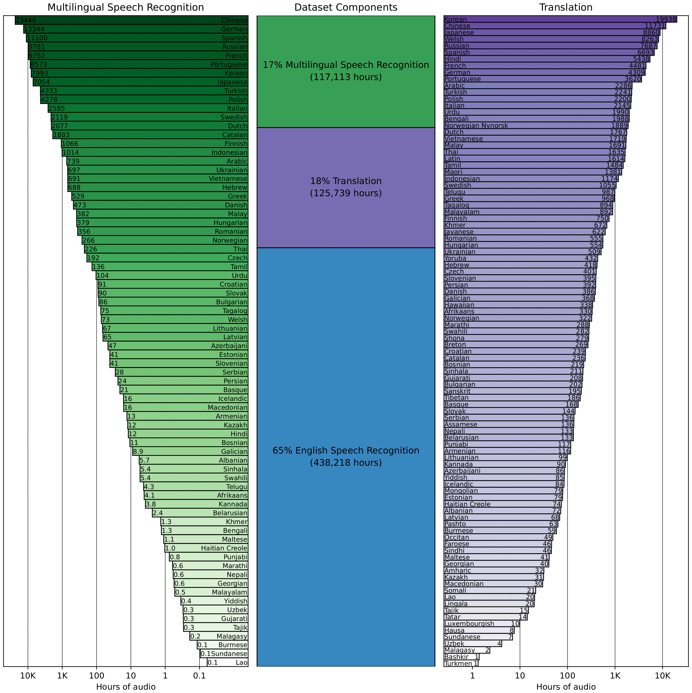

*图 11（原文 Figure 11，附录 E，第 27 页）：训练数据集统计。左：多语言语音识别各语言的音频小时数；中：数据集组成；右：翻译各源语言的小时数。*

**图中文字翻译与读法**：

- **左栏 Multilingual Speech Recognition（多语言语音识别，不含英语）**：横轴 Hours of audio（音频小时数，对数刻度，向左变大）；每行是一种语言，条上标有小时数。前几位：Chinese 23446、German 13344、Spanish 11100、Russian 9761、French 9752、Portuguese 8573、Korean 7993、Japanese 7054、Turkish 4333、Polish 4278；末尾：Burmese、Sundanese、Lao 各 0.1 小时。共 74 种非英语语言（逐行数过；加上英语共 75 种，与正文第 3.4 节“75 种语言有语音识别训练数据”一致）。
- **中栏 Dataset Components（数据集组成）**：三块：17% Multilingual Speech Recognition（117,113 hours）、18% Translation（125,739 hours）、65% English Speech Recognition（438,218 hours）。三者之和为 681,070 小时，与表 6 中“完整数据集”的 681070 一致；按小时数相除分别约为 17.2%、18.5%、64.3%，图中取整凑成 100%。
- **右栏 Translation（翻译，源语言为各语言、目标均为英语）**：每行是一种源语言，条上标有小时数。前几位：Korean 19938、Chinese 11731、Japanese 8860、Welsh 8263、Russian 7687、Spanish 6693、Hindi 5438、French 4481、German 4309、Portuguese 3620；末尾为 Bashkir、Turkmen 各 1 小时。共 98 种源语言（逐行数过），与“99 个语言 token”（98 种加英语）吻合。
- **读图结论**：数据高度偏向英语（65%）；非英语语言里，不同语言相差几个数量级：多语识别 74 种语言中有 16 种超过 1,000 小时，其余大多数不足 1,000 小时，最少的只有 0.1 小时。这解释了后面第 6.2 节“语言的训练小时数能很好地预测该语言的 WER”。另外，翻译数据里威尔士语有 8,263 小时、排第 4，按原文第 3.5 节的说法，这批数据大部分其实是被语言识别误判为威尔士语的英语音频加英语字幕，被当成了翻译数据，属于噪声。

## 四、模型

### 4.1 结构（图 1、表 1）

因为本文要研究的是大规模有监督预训练的能力，所以作者采用现成的结构，避免把结论与模型改进混在一起；选了编码器—解码器 Transformer（Vaswani 等 2017），因为它被充分验证能可靠地扩展。

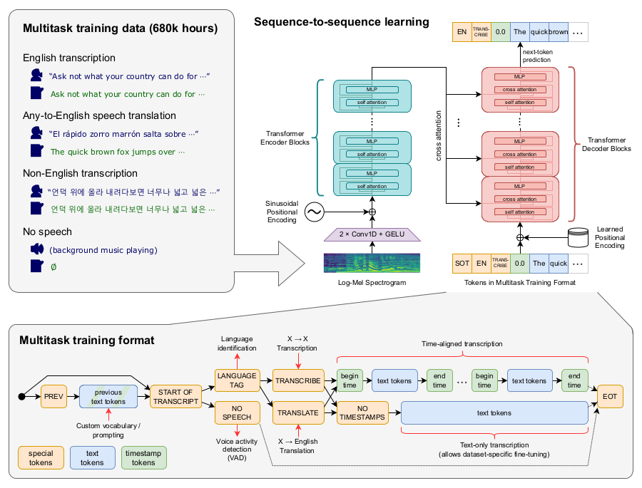

*图 1（原文 Figure 1，第 4 页）：方法总览。一个序列到序列的 Transformer 在许多不同的语音处理任务上训练，包括多语言语音识别、语音翻译、口语语言识别和语音活动检测。所有这些任务都被表示成由解码器预测的 token 序列，因此一个模型可以取代传统语音处理流水线中的许多不同阶段。多任务训练格式使用一组特殊 token，充当任务说明符或分类目标。*

**图中文字翻译与读法**：

- **左上灰框 Multitask training data (680k hours)（多任务训练数据，68 万小时）**：四类样本，每类上行是音频内容，下行是目标文字稿：English transcription（英语转写）：音频 “Ask not what your country can do for ⋯” 对应同样的英文文字；Any-to-English speech translation（任意语言到英语的语音翻译）：西班牙语音频 “El rápido zorro marrón salta sobre ⋯” 对应英文 “The quick brown fox jumps over ⋯”；Non-English transcription（非英语转写）：韩语音频 “언덕 위에 올라 내려다보면 너무나 넓고 넓은 ⋯” 对应同样的韩语文字；No speech（无语音）：(background music playing)（背景音乐）对应空文本 ∅。
- **右侧 Sequence-to-sequence learning（序列到序列学习）**：下方 Log-Mel Spectrogram（对数 Mel 频谱）先过 2 × Conv1D + GELU（两层一维卷积加 GELU），与 Sinusoidal Positional Encoding（正弦位置编码）相加，送入 Transformer Encoder Blocks（编码器块，青色，每块含 self attention 和 MLP）；编码器的输出以 cross attention（交叉注意力）送入 Transformer Decoder Blocks（解码器块，红色，每块含 self attention、cross attention 和 MLP）。解码器的输入是 Tokens in Multitask Training Format（多任务训练格式的 token）：SOT、EN、TRANSCRIBE、0.0、The、quick ⋯，与 Learned Positional Encoding（学习的位置编码）相加；输出是 next-token prediction（下一个 token 的预测）：EN、TRANSCRIBE、0.0、The、quick、brown ⋯，即输入序列向后错一位。
- **下方灰框 Multitask training format（多任务训练格式）**：从起点出发，可选地先给 PREV（前文标记）和 previous text tokens（前一段文字的 token，图中标注 Custom vocabulary / prompting，可用于自定义词表或提示），然后是 START OF TRANSCRIPT（转写开始）。之后分两条路：一条经 LANGUAGE TAG（语言标记，对应 Language identification 语言识别）再选 TRANSCRIBE（X→X Transcription，同一语言转写）或 TRANSLATE（X → English Translation，译成英语），之后要么是 begin time、text tokens、end time 的循环（Time-aligned transcription，带时间戳转写），要么是 NO TIMESTAMPS 加 text tokens（Text-only transcription，纯文本转写，图中注明 allows dataset-specific fine-tuning，便于按数据集微调），最后以 EOT（结束）收尾；另一条是 NO SPEECH（无语音，对应 Voice activity detection (VAD) 语音活动检测）直接到 EOT（虚线）。图例：special tokens（特殊 token，橙色）、text tokens（文字 token，蓝色）、timestamp tokens（时间戳 token，绿色）。
- **读图结论**：所有任务（识别、翻译、语言识别、语音活动检测、是否输出时间戳）都被写成“解码器要预测的一串 token”，区别只在前缀的特殊 token；因此一个模型就能取代传统流水线里的多个阶段。

**结构细节**（原文第 2.2 节）：

- **输入**：所有音频重采样到 16,000 Hz，计算 80 通道的对数幅度 Mel 谱，窗口 25 毫秒、步长 10 毫秒。特征归一化：在整个预训练数据集上把输入整体缩放到 −1 到 1 之间，并使均值约为零。
- **编码器**：先过一个小的“stem”：两层卷积（滤波器宽度 3，GELU 激活），第二层的步长为 2；然后加上正弦位置嵌入，再经过编码器 Transformer 块。块使用**预激活残差块**（pre-activation，Child 等 2019），编码器输出再加一层最终的层归一化。
- **解码器**：使用学习的位置嵌入和绑定的输入输出 token 表示（tied input-output token representations，Press & Wolf 2017，即输入嵌入与输出分类层共享参数）。**编码器和解码器的宽度与层数相同**。
- **分词器**：英语专用模型使用 GPT-2 的字节级 BPE 分词器；多语言模型重新拟合词表（词表大小不变），以免其他语言被切得过碎（GPT-2 的 BPE 词表只针对英语）。
- **由这些数字推出的形状**（本文推算，原文没有这样写）：30 秒音频按 10 ms 步长是 3000 帧，经过步长为 2 的卷积后为 1500 个编码器位置，每个位置对应 20 毫秒，这与原文说的“时间戳量化到最近的 20 毫秒，与 Whisper 模型的原生时间分辨率一致”相符。

**表：Whisper 模型家族的结构**（编码器与解码器各自层数相同、宽度相同）：

| 模型 | 层数 | 宽度 | 注意力头数 | 参数量 |
|---|---:|---:|---:|---:|
| Tiny | 4 | 384 | 6 | 39M |
| Base | 6 | 512 | 8 | 74M |
| Small | 12 | 768 | 12 | 244M |
| Medium | 24 | 1024 | 16 | 769M |
| Large | 32 | 1280 | 20 | 1550M |

（原文表 1，第 5 页。）另外：英语专用的 `.en` 模型有 tiny.en、base.en、small.en、medium.en 四档（见附录表 8、9）；Large V2 与 Large 结构相同，但训练更久并加了正则化（见 4.3 节）。图 8 的横轴把五档标为 38M、73M、244M、768M、1549M，与表 1 略有差异。

### 4.2 多任务格式（原文第 2.3 节）

**为什么需要**。预测一段音频里说了哪些词只是完整语音识别问题的核心部分，完整系统还可能包含语音活动检测、说话人分离（speaker diarization）、逆文本规范化等组件，分别处理会形成围绕核心识别模型的、相当复杂的系统。作者希望单个模型完成整个语音处理流水线。同一段音频可以做的任务很多：转写、翻译、语音活动检测、对齐、语言识别。要让这种“一对多”的映射在单个模型里工作，需要某种任务说明形式。

**做法**：用一种简单格式，把所有任务和条件信息表示成**解码器的输入 token 序列**。因为解码器是一个以音频为条件的语言模型，作者也训练它**以前文文字稿为条件**，希望它学会用更长程的文字上下文来消解模糊的音频：以一定概率（附表 17 为 50%）把当前音频片段之前的文字稿文本加入解码器的上下文。

**序列的逐步构成**：

1. 以 `<|startoftranscript|>` token 标志预测开始。
2. 先预测说的是**哪种语言**：训练集中每种语言对应一个唯一的 token（共 99 个），语言标签来自前述 VoxLingua107 模型。如果音频片段里没有语音，模型被训练为预测一个 `<|nospeech|>` token。
3. 下一个 token 指定**任务**：`<|transcribe|>`（转写）或 `<|translate|>`（翻译成英语）。
4. 然后指定**是否预测时间戳**：不预测时就加一个 `<|notimestamps|>` token。到这一步，任务和期望格式已完全指定，输出开始。
5. **时间戳预测**：预测相对于当前音频片段的时间，所有时间都量化到最近的 20 毫秒（与 Whisper 模型的原生时间分辨率一致），并在词表里为每个时间点增加相应的 token。时间戳 token 与字幕文字 token **交错**预测：每条字幕的**开始时间** token 在其文字之前预测，**结束时间** token 在其文字之后预测。
6. 如果当前 30 秒音频块里只包含了最后一条文字稿片段的一部分：在时间戳模式下，只预测该片段的**开始时间** token，以表示后续解码应该在与该时间对齐的音频窗口上进行；否则就把音频截短，不包含该片段。
7. 最后加一个 `<|endoftranscript|>` token。
8. **损失**：只把**前文文字**部分的训练损失遮住，对其余所有 token（包括语言、任务、时间戳、结束符）都训练预测。

下面用代码块展示几种典型序列。方括号里是占位符（语言 token 在图 1 中写作 EN 等；时间戳 token 的具体写法原文未给出）；时间数字是示意，并非原文数据：

```text
英语转写，不带时间戳：
<|startoftranscript|> [EN] <|transcribe|> <|notimestamps|> Ask not what your country can do for ... <|endoftranscript|>

西班牙语译成英语，带时间戳：
<|startoftranscript|> [ES] <|translate|> [0.0 秒] The quick brown fox jumps over ... [3.2 秒] <|endoftranscript|>

带前文条件（以一定概率在 <|startoftranscript|> 之前加入前一段文字）：
[PREV] 前一段文字的 token ... <|startoftranscript|> [EN] <|transcribe|> ...

无语音（按图 1 的虚线路径直接结束）：
<|startoftranscript|> <|nospeech|> <|endoftranscript|>
```

### 4.3 训练细节（原文第 2.4 节与附录 F）

- **训练一组不同规模的模型**以研究缩放特性（表 1）。数据并行；FP16 加动态损失缩放；激活检查点（activation checkpointing）。
- **优化器与调度**：AdamW、梯度范数裁剪；在前 2048 次更新里学习率预热，然后线性衰减到零；batch size 为 256 个片段；训练 $2^{20}$ 次更新（1,048,576），原文说这相当于数据集的两到三遍。（按每段 30 秒粗算，$2^{20}\times256$ 个片段约合 224 万小时，约为 681,070 小时的 3.3 倍，与“两到三遍”略有出入，原文没有说明差异来源。）
- **不使用任何数据增强和正则化**：只训练几个 epoch，过拟合不是大问题，依靠大数据集本身的多样性来鼓励泛化和鲁棒性。
- **说话人名字问题**：早期开发中发现模型倾向于给出说话人名字的“看似合理但几乎总是错误”的猜测，因为预训练数据里很多文字稿含有说话人名字，鼓励模型去预测，而这种信息很少能从最近 30 秒音频里推断出来。解决办法是在**不含说话人标注的文字稿子集**上对 Whisper 做短暂微调，消除这种行为。
- **Large V2**：Whisper 首次发布后，又训练了一个 Large 模型（记为 V2），训练的 epoch 多 2.5 倍，同时加入 SpecAugment、Stochastic Depth 和 BPE Dropout 作为正则化。原文称，除非另有说明，所报告的结果都已更新为这个改进的模型。

**表：Whisper 训练超参数**

| 超参数 | 取值 |
|---|---|
| 更新次数 | 1048576 |
| Batch size | 256 |
| 预热更新次数 | 2048 |
| 最大梯度范数 | 1.0 |
| 优化器 | AdamW |
| β1 | 0.9 |
| β2 | 0.98 |
| ε | 10⁻⁶ |
| 权重衰减 | 0.1 |
| 权重初始化 | Gaussian Fan-In |
| 学习率调度 | 线性衰减 |
| 无语音音频的子采样因子 | 10× |
| 以前文文字为条件的比例 | 50% |

（原文表 17，第 28 页。）

**表：Whisper Large V2 改动的超参数**

| 超参数 | 取值 |
|---|---|
| 更新次数 | 655360 |
| Batch size | 1024 |
| BPE Dropout | 0.1 |
| Stochastic Depth | 0.1 |
| SpecAugment 策略 | LibriSpeech Basic |

（原文表 18，第 28 页。$655360\times1024$ 约为 $2^{20}\times256$ 的 2.5 倍，与脚注“多训 2.5 倍 epoch”吻合。）

**表：各模型的最大学习率**

| 模型 | 最大学习率 |
|---|---|
| Tiny | 1.5 × 10⁻³ |
| Base | 1 × 10⁻³ |
| Small | 5 × 10⁻⁴ |
| Medium | 2.5 × 10⁻⁴ |
| Large | 1.75 × 10⁻⁴ |
| Large V2 | 2.0 × 10⁻⁴ |

（原文表 19，第 28 页。）

## 五、评测协议

### 5.1 零样本评测（原文第 3.1 节）

Whisper 的目标是单个鲁棒的语音处理系统，无需针对数据集的微调就能在各种分布上可靠工作。为了研究这种能力，作者复用了一大批现有的语音处理数据集，检查 Whisper 能否跨领域、跨任务、跨语言泛化。**不采用这些数据集的标准评测协议（含训练集和测试集）**，而是在零样本设置下评测：不使用各数据集的任何训练数据，以此衡量广义的泛化能力。

### 5.2 指标与文本规范化（原文第 3.2 节与附录 C）

语音识别研究通常以 WER 评价，但 WER 基于字符串编辑距离，会惩罚输出与参考文字稿之间的**所有**差异，包括无害的风格差异。结果是：人会判为正确的转写，仍可能有很大的 WER，原因只是细微的格式差异。这对所有转写系统都是问题，对 Whisper 这种从未见过具体数据集文字稿格式的零样本模型尤其突出。

作者的办法是在计算 WER 之前做**大量的文本标准化**，尽量少惩罚非语义差异。文本规范化器是通过反复的人工检查开发的，用来找出“朴素 WER 因为无害差异而惩罚 Whisper”的常见模式。对若干数据集，WER 下降最多达 50%，通常是因为数据集参考文字稿里的某种怪癖，例如把缩略形式与单词用空格分开。作者提醒，这种开发流程有对 Whisper 的转写风格过拟合的风险，并在第 4.4 节（本文第 7.4 节）做了检验，同时发布了规范化器的代码。

**英语规范化的 12 步**（附录 C）：

1. 删除成对方括号 [ ] 之间的短语；
2. 删除成对圆括号 ( ) 之间的短语；
3. 删除这些词：hmm、mm、mhm、mmm、uh、um；
4. 删除撇号 ’ 之前的空白字符；
5. 把标准或非正式的英语缩略形式转换回原形；
6. 删除数字之间的逗号；
7. 删除后面不跟数字的句号；
8. 删除符号和变音符号（符号指 Unicode 类别以 M、S、P 开头的字符），但保留下一步可能要检测的句号、百分号和货币符号；
9. 检测数字和货币表达，替换成阿拉伯数字形式，例如 “Ten thousand dollars” 变成 `$10000`；
10. 把英式拼写转成美式拼写；
11. 删除不属于任何数字表达的剩余符号；
12. 把连续的空白字符替换为一个空格。

**非英语的基本规范化 5 步**（因为缺乏为所有语言构建规范化器的语言学知识）：删除方括号内短语；删除圆括号内短语；把标记、符号和标点（NFKC 规范化后 Unicode 类别以 M、S、P 开头的字符）替换为空格；转小写；把连续空白替换为一个空格。此外，对不用空格分词的语言（中文、日文、泰文、老挝文、缅甸文）在每个字符之间加空格，实际测的是字符错误率。作者强调这是不完美的方案，不声称输出的文本格式在任何意义上更“正确”，只是用来更好地区分无害的措辞差异和真正的转写错误。

### 5.3 评测数据集与对比模型（附录 A、B）

- **短音频英语数据集**：LibriSpeech（test-clean、test-other）、TED-LIUM 3（test，用其分段的人工转写）、Common Voice 5.1（英语子集）、Artie bias corpus（Common Voice 的一个子集）、CallHome 与 Switchboard（LDC2002S09、LDC2002T43）、WSJ（LDC93S6B、LDC94S13B，按 s5 配方预处理）、CORAAL（231 次访谈）、CHiME-6（按 s5 track1 配方的 stage 0 生成，用双耳录音）、AMI-IHM 和 AMI-SDM1（按 s5b 配方的 stage 0 与 2 预处理）。此外表 2 里还有 Fleurs En 和 VoxPopuli En。
- **长音频英语数据集**（共 7 个）：TED-LIUM 3 的长篇版本（测试集里 11 场完整 TED 演讲）、Meanwhile（《斯蒂芬·科尔伯特晚间秀》里 64 个片段，富含专业术语和罕见词）、Rev16（Rev.AI 播客转写基准的 30 集中挑出的 16 集）、Kincaid46（博客文章里汇编的 46 个音频文件，另选其中 25 个做人类对比）、Earnings-21 与 Earnings-22（财报电话会议）、CORAAL（231 次完整访谈）。
- **多语言数据集**：Multilingual LibriSpeech（MLS）、Fleurs、VoxPopuli（16 种语言含英语）、Common Voice 9、CoVoST 2（X→en）。
- **对比模型（附录 B）**：14 个来自 HuggingFace 的模型（2022 年 9 月下载）：wav2vec2-large-960h-lv60-self、wav2vec2-large-robust-ft-libri-960h、wav2vec2-base-100h、wav2vec2-base-960h、wav2vec2-large-960h、hubert-large-ls960-ft、hubert-xlarge-ls960-ft、s2t-medium-librispeech-asr、s2t-large-librispeech-asr、unispeech-sat-base-100h-libri-ft、nvidia/stt_en_conformer_ctc_large、nvidia/stt_en_conformer_transducer_xlarge、speechbrain 的 asr-crdnn-rnnlm-librispeech 和 asr-transformer-transformerlm-librispeech。原文说明：这些模型全部或部分用 LibriSpeech 训练。

## 六、实验结果

### 6.1 英语语音识别：鲁棒性（原文第 3.3 节）

**要回答的问题**。2015 年 Deep Speech 2 报告其系统在 LibriSpeech test-clean 上达到人类水平（5.3% 对人类 5.8%），并预言“在没有进一步领域适配的情况下，通用语音系统在干净朗读语音上几乎没有再提高的空间”；七年后该集上的最好 WER 又下降了 73%，到 1.4%（Zhang 等 2021），远低于其报告的人类水平错误率。但用 LibriSpeech 训练的识别模型在其他场合仍远高于人类错误率。同分布上“超人”、域外却“不如人”，原因何在？作者的怀疑是：人和机器在测试集上的表现衡量的其实是不同的能力（见 2.4 节“域内与域外泛化”）。Whisper 在广泛多样的音频分布上训练、在零样本设置下评测，可能比现有系统更接近人类行为。

**评测方法**：以 LibriSpeech 为参照数据集（因为它在现代语音识别研究中的核心地位，并且有许多发布的、在其上训练的模型可供分析鲁棒性行为），再用 12 个其他学术语音识别数据集研究域外行为，比较总体鲁棒性（跨多个分布的平均表现）与有效鲁棒性。

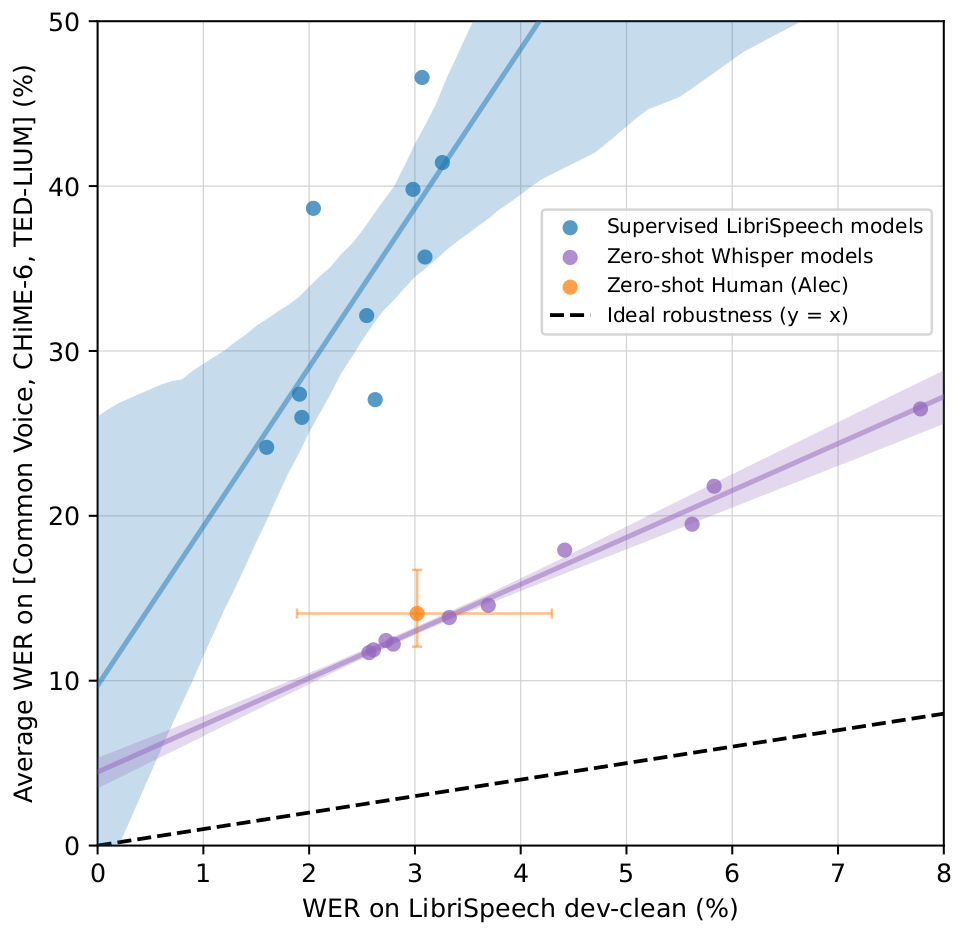

*图 2（原文 Figure 2，第 6 页）：零样本 Whisper 模型缩小了与人类鲁棒性的差距。尽管在 LibriSpeech dev-clean 上达到或超过人类，监督的 LibriSpeech 模型在其他数据集上的错误数大约是人类的两倍，显示出它们的脆弱和缺乏鲁棒性；而零样本 Whisper 模型估计的鲁棒性前沿包含了这位人类的 95% 置信区间。*

**图中文字翻译与读法**：

- 横轴 WER on LibriSpeech dev-clean (%)（在参照数据集 LibriSpeech dev-clean 上的 WER），纵轴 Average WER on [Common Voice, CHiME-6, TED-LIUM] (%)（在 Common Voice、CHiME-6、TED-LIUM 三个域外数据集上的平均 WER）。
- 图例：蓝点 Supervised LibriSpeech models（监督的 LibriSpeech 模型）；紫点 Zero-shot Whisper models（零样本 Whisper 模型，共 10 个点，对应 10 个 Whisper 模型）；橙点 Zero-shot Human (Alec)（作者之一 Alec 本人零样本转写，带横纵误差棒）；黑色虚线 Ideal robustness (y = x)（理想鲁棒性：域外 WER 等于参照集 WER）。蓝色、紫色直线和浅色带是各自点的线性拟合及其置信带。
- 蓝点集中在横轴约 1.6–3.3、纵轴约 24–47；紫点从约 (2.6, 12) 到约 (7.8, 26.5)；人类点约在 (3.0, 14)，横向误差棒约 1.9–4.3，纵向约 12–17（以上均为从图上读出的近似值）。
- **读图结论**：横轴上两类模型的 LibriSpeech 成绩可以相近甚至监督模型更好，但纵轴上监督模型的域外 WER 高得多；紫色拟合线比蓝色线更靠近 y = x 的理想线，说明 Whisper 的有效鲁棒性高。人类点落在 Whisper 的拟合带里。

**主要发现**（原文）：最好的零样本 Whisper 模型在 LibriSpeech test-clean 上的 WER 为 2.5，这相当于现代监督基线或 2019 年中的最好水平，并不突出；但零样本 Whisper 模型的鲁棒性性质与监督的 LibriSpeech 模型非常不同，在其他数据集上大幅超过所有被测的 LibriSpeech 模型。甚至最小的零样本 Whisper 模型（只有 3,900 万参数，LibriSpeech test-clean 的 WER 为 6.7）在其他数据集上也与最好的监督 LibriSpeech 模型大致相当。与人类比较时，最好的零样本 Whisper 模型的准确率和鲁棒性大致与人相当。

**表：有效鲁棒性的详细比较（WER %，两个模型都在文本规范化之后；越低越好）**

| 数据集 | wav2vec 2.0 Large（无语言模型） | Whisper Large V2 | RER (%) |
|---|---:|---:|---:|
| LibriSpeech Clean（参照集） | 2.7 | 2.7 | 0.0 |
| Artie | 24.5 | **6.2** | 74.7 |
| Common Voice | 29.9 | **9.0** | 69.9 |
| Fleurs En | 14.6 | **4.4** | 69.9 |
| Tedlium | 10.5 | **4.0** | 61.9 |
| CHiME6 | 65.8 | **25.5** | 61.2 |
| VoxPopuli En | 17.9 | **7.3** | 59.2 |
| CORAAL | 35.6 | **16.2** | 54.5 |
| AMI IHM | 37.0 | **16.9** | 54.3 |
| Switchboard | 28.3 | **13.8** | 51.2 |
| CallHome | 34.8 | **17.6** | 49.4 |
| WSJ | 7.7 | **3.9** | 49.4 |
| AMI SDM1 | 67.6 | **36.4** | 46.2 |
| LibriSpeech Other | 6.2 | **5.2** | 16.1 |
| 平均 | 29.3 | **12.8** | 55.2 |

（原文表 2，第 6 页。RER 为相对错误率下降，等于（wav2vec 的 WER 减 Whisper 的 WER）除以 wav2vec 的 WER，例如 Artie：$(24.5-6.2)/24.5=74.7\%$。）

**读法与核对**：

1. 两个模型在 LibriSpeech Clean 上的 WER 都是 2.7（原文说二者相差不到 0.1%），所以“在参照集上表现一样”这个前提成立；在其他数据集上 Whisper 平均少出 55.2% 的错误。
2. “平均”行是对表中 13 个非参照行（正文所说的 12 个其他数据集，再加 LibriSpeech Other；不含 LibriSpeech Clean）取的平均。用表中数字复算：wav2vec 为 29.3、Whisper 为 12.8、RER 的平均为 55.2，与表一致。注意 RER 的平均（各数据集 RER 的均值，55.2）不等于“平均 WER 的相对下降”（$(29.3-12.8)/29.3\approx56.3\%$）。
3. 除参照集自身（0.0）外，增益最小的是 LibriSpeech Other（16.1%），它与参照集同属 LibriSpeech，分布最接近；增益最大的是 Artie（74.7%）。原文没有逐个数据集分析原因。
4. 表 2 里 Whisper Large V2 的数字与附录表 8（贪心解码）逐项一致（我核对过 14 项），而正文里“test-clean 为 2.5”和“最小模型为 6.7”来自附录表 9（beam search 加温度回退）。引用时要注明解码方式。

**附录表 8：英语转写 WER（%，贪心解码）**。下面转录全部 Whisper 模型行，以及对比模型里 4 个有代表性的行（原文共 24 行，其余 10 个对比模型行未转录）。列为 14 个数据集，分成两张表。

| 模型 | LibriSpeech test-clean | LibriSpeech test-other | TED-LIUM3 | WSJ | CallHome | Switchboard | CommonVoice5.1 |
|---|---:|---:|---:|---:|---:|---:|---:|
| Whisper tiny.en | 5.6 | 14.6 | 6.0 | 5.0 | 24.1 | 17.8 | 26.3 |
| Whisper tiny | 7.6 | 16.9 | 7.0 | 6.7 | 30.0 | 22.8 | 29.6 |
| Whisper base.en | 4.2 | 10.2 | 4.9 | 4.6 | 20.9 | 15.2 | 19.0 |
| Whisper base | 5.0 | 12.4 | 5.5 | 5.1 | 23.0 | 16.8 | 21.6 |
| Whisper small.en | 3.1 | 7.4 | 4.0 | 3.3 | 18.2 | 15.7 | 13.1 |
| Whisper small | 3.4 | 7.6 | 4.3 | 4.0 | 17.5 | 14.5 | 13.5 |
| Whisper medium.en | 3.1 | 6.3 | 4.1 | 3.3 | 16.2 | 14.1 | 10.6 |
| Whisper medium | 2.9 | 5.9 | 3.8 | 2.9 | 16.4 | 14.0 | 10.3 |
| Whisper large | 2.7 | 5.6 | 4.0 | 3.1 | 15.8 | 13.1 | 9.5 |
| Whisper large-v2 | 2.7 | 5.2 | 4.0 | 3.9 | 17.6 | 13.8 | 9.0 |
| wav2vec2-large-960h-lv60-self | 1.8 | 3.8 | 7.4 | 4.4 | 29.1 | 22.2 | 19.9 |
| hubert-xlarge-ls960-ft | 1.9 | 3.5 | 8.3 | 5.4 | 29.3 | 22.2 | 19.8 |
| stt_en_conformer_ctc_large | 2.1 | 4.2 | 4.4 | 2.1 | 11.3 | 8.2 | 7.4 |
| stt_en_conformer_transducer_xlarge | 1.5 | 2.8 | 4.3 | 1.2 | 12.0 | 7.4 | 4.3 |

| 模型 | Artie | CORAAL | CHiME6 | AMI-IHM | AMI-SDM1 | VoxPopuli.en | Fleurs.en_us |
|---|---:|---:|---:|---:|---:|---:|---:|
| Whisper tiny.en | 20.0 | 23.9 | 41.3 | 23.7 | 50.3 | 11.7 | 11.6 |
| Whisper tiny | 23.9 | 31.0 | 49.6 | 27.6 | 58.1 | 12.7 | 13.7 |
| Whisper base.en | 13.4 | 22.6 | 36.4 | 20.5 | 46.7 | 10.0 | 7.6 |
| Whisper base | 16.9 | 26.0 | 40.2 | 22.0 | 49.9 | 10.0 | 10.1 |
| Whisper small.en | 9.7 | 20.2 | 27.6 | 17.5 | 38.0 | 8.1 | 6.0 |
| Whisper small | 10.3 | 18.1 | 29.3 | 19.0 | 39.6 | 8.3 | 6.6 |
| Whisper medium.en | 7.6 | 17.5 | 25.3 | 16.4 | 37.2 | 7.4 | 5.0 |
| Whisper medium | 7.2 | 16.6 | 26.4 | 16.6 | 36.0 | 7.4 | 5.4 |
| Whisper large | 6.7 | 19.4 | 25.6 | 16.4 | 36.9 | 7.3 | 4.6 |
| Whisper large-v2 | 6.2 | 16.2 | 25.5 | 16.9 | 36.4 | 7.3 | 4.4 |
| wav2vec2-large-960h-lv60-self | 15.8 | 29.2 | 56.3 | 30.8 | 57.0 | 13.0 | 10.2 |
| hubert-xlarge-ls960-ft | 14.8 | 31.5 | 58.5 | 33.3 | 58.9 | 14.2 | 10.5 |
| stt_en_conformer_ctc_large | 4.0 | 13.5 | 30.5 | 15.9 | 39.9 | 6.7 | 8.2 |
| stt_en_conformer_transducer_xlarge | 1.5 | 19.9 | 36.8 | 20.5 | 48.6 | 6.0 | 6.3 |

（原文表 8，附录 D.1.1，第 22 页。数据集说明：AMI-IHM 与 AMI-SDM1 分别是会议语音的个人头戴麦克风和单个远场麦克风版本，这是通用背景，原文未展开；其余见 5.3 节。）

**表 8 的读法**：

1. **规模效应**：Whisper 各数据集上的 WER 大体随模型变大而下降，例如 test-other 从 tiny.en 的 14.6 降到 large-v2 的 5.2；CHiME6 从 41.3 到 25.5；AMI-SDM1 从 50.3 到 36.4。但不是处处单调，例如 CORAAL 上 large（19.4）比 medium（16.6）更差，WSJ 上 large-v2（3.9）比 large（3.1）更差。
2. **`.en` 与多语言模型**：小模型（tiny、base、small）上英语专用的 `.en` 版本在多数列上更好，例如 base.en 对 base：test-clean 4.2 对 5.0，test-other 10.2 对 12.4；到 medium 差距缩小甚至反转，多语言 medium 在 test-clean、test-other、TED-LIUM3、WSJ 上分别为 2.9、5.9、3.8、2.9，优于 medium.en 的 3.1、6.3、4.1、3.3。这与第 7.3 节“小模型有负迁移、大模型有正迁移”的结论一致。
3. **LibriSpeech 本身（域内）**：监督模型更好。wav2vec2-large-960h-lv60-self 为 1.8/3.8，hubert-xlarge 为 1.9/3.5，conformer-transducer-xlarge 为 1.5/2.8，而 Whisper large-v2 为 2.7/5.2。
4. **其他数据集（域外）**：仅用 LibriSpeech 训练或微调的模型差得多，例如 CHiME6 上 wav2vec2-large-960h-lv60-self 为 56.3、hubert-xlarge 为 58.5，Whisper large-v2 为 25.5。但原文第 3.7 节说明，两个 NVIDIA STT 模型是用类似 SpeechStew 的混合数据集训练的（包含 LibriSpeech），原文没有列出具体构成；它们在 WSJ（2.1/1.2 对 3.9）、CallHome（11.3/12.0 对 17.6）、Switchboard（8.2/7.4 对 13.8）、CommonVoice5.1（7.4/4.3 对 9.0）、Artie（4.0/1.5 对 6.2）、VoxPopuli.en（6.7/6.0 对 7.3）上都优于 Whisper large-v2；而在 TED-LIUM3（4.4/4.3 对 4.0）、CHiME6（30.5/36.8 对 25.5）、AMI-SDM1（39.9/48.6 对 36.4）、Fleurs.en_us（8.2/6.3 对 4.4）上 Whisper 更好；CORAAL（13.5/19.9 对 16.2）和 AMI-IHM（15.9/20.5 对 16.9）上互有胜负。所以“Whisper 在所有零样本数据集上都优于监督模型”并不成立；表 2 只与仅用 LibriSpeech 的 wav2vec 2.0 比较。

**beam search 加温度回退（附录表 9）对 Whisper large-v2 的影响**：下表列出同一模型在两种解码方式下的 14 个 WER。

| 数据集 | 贪心解码（表 8） | beam search 加温度回退（表 9） |
|---|---:|---:|
| LibriSpeech test-clean | 2.7 | 2.5 |
| LibriSpeech test-other | 5.2 | 4.9 |
| TED-LIUM3 | 4.0 | 3.7 |
| WSJ | 3.9 | 2.6 |
| CallHome | 17.6 | 16.4 |
| Switchboard | 13.8 | 13.6 |
| CommonVoice5.1 | 9.0 | 8.2 |
| Artie | 6.2 | 5.7 |
| CORAAL | 16.2 | 14.2 |
| CHiME6 | 25.5 | 24.9 |
| AMI-IHM | 16.9 | 17.4 |
| AMI-SDM1 | 36.4 | 39.9 |
| VoxPopuli.en | 7.3 | 7.0 |
| Fleurs.en_us | 4.4 | 4.2 |

（原文表 8、表 9 中 Whisper large-v2 的行，第 22 页。）读法：14 个数据集里有 12 个变好，AMI-IHM（16.9 到 17.4）和 AMI-SDM1（36.4 到 39.9）变差。

### 6.2 多语言语音识别（原文第 3.4 节）

**设置**：为了与已有的多语言识别工作比较，先在两个低数据量的基准 Multilingual LibriSpeech（MLS）和 VoxPopuli 上报告结果（表 3）。

**表：多语言语音识别性能（WER %，越低越好）**

| 模型 | MLS | VoxPopuli |
|---|---:|---:|
| VP-10K + FT | - | 15.3 |
| XLS-R (1B) | 10.9 | 10.6 |
| mSLAM-CTC (2B) | 9.7 | 9.1 |
| Maestro | - | **8.1** |
| Zero-Shot Whisper | **7.3** | 13.6 |

（原文表 3，第 7 页。）读法与原文的解释：

- Whisper 在 MLS 上表现好，零样本就超过 XLS-R、mSLAM 和 Maestro（Maestro 在 MLS 上没有数字）。作者提醒：这一结果用的是简单文本规范化器，因此不能直接比较，也不能声称达到最好水平。
- 在 VoxPopuli 上 Whisper 明显落后，只赢了原论文的 VP-10K+FT 基线。原文猜测原因：其他模型把这个分布作为无监督预训练数据的主要来源之一，并且该数据集的监督数据多得多，对微调有利；MLS 每种语言有 10 小时训练数据，而 VoxPopuli 每种语言的平均训练数据大约是它的 10 倍。

**附录表 10：MLS 各语言 WER（%）**

| 模型 | Dutch | English | French | German | Italian | Polish | Portuguese | Spanish |
|---|---:|---:|---:|---:|---:|---:|---:|---:|
| Whisper tiny | 39.4 | 15.7 | 36.8 | 24.9 | 41.7 | 34.2 | 31.3 | 19.2 |
| Whisper base | 28.4 | 11.7 | 26.6 | 17.7 | 31.1 | 22.8 | 21.9 | 12.8 |
| Whisper small | 17.2 | 8.3 | 16.2 | 10.5 | 21.4 | 11.2 | 13.0 | 7.8 |
| Whisper medium | 11.7 | 6.8 | 8.9 | 7.4 | 16.0 | 6.5 | 9.0 | 5.3 |
| Whisper large | 10.2 | 6.3 | 8.9 | 6.6 | 14.3 | 6.6 | 9.2 | 5.4 |
| Whisper large-v2 | 9.3 | 6.2 | 7.3 | 5.5 | 13.8 | 5.0 | 6.8 | 4.2 |

（原文表 10，附录 D.2.1，第 23 页。）核对：large-v2 一行 8 个语言的平均为 $(9.3+6.2+7.3+5.5+13.8+5.0+6.8+4.2)/8\approx7.26$，与表 3 中的 7.3 一致。其余逐语言结果（Common Voice 9、VoxPopuli、Fleurs 的 WER 与 BLEU、CoVoST2 的 BLEU，原文表 11–15）本文不逐格转录。

**Fleurs 上的分析（图 3）**。这两个基准只涵盖 15 种语言，而且几乎都是印欧语系、多为高资源语言，而 Whisper 有 75 种语言的语音识别训练数据。为了更广泛地研究，作者还在 Fleurs 数据集上评测，并特别想研究“某种语言的训练数据量”与“该语言的零样本性能”的关系。

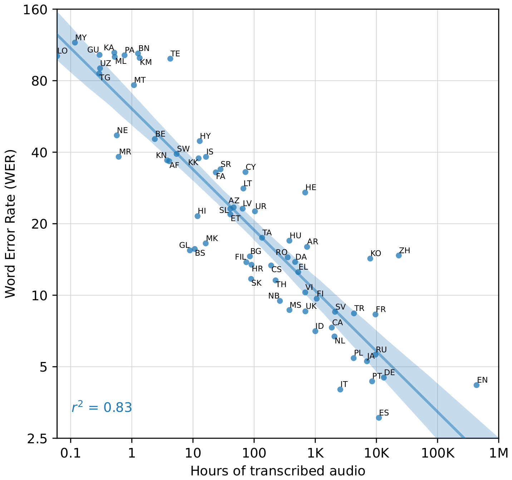

*图 3（原文 Figure 3，第 7 页）：预训练监督数据量与下游语音识别性能的相关。某种语言的预训练语音识别数据量，对 Whisper 在 Fleurs 上该语言的零样本性能有很强的预测力。*

**图中文字翻译与读法**：

- 横轴 Hours of transcribed audio（转写音频小时数，对数刻度，从 0.1 到 1M），纵轴 Word Error Rate (WER)（对数刻度，2.5 到 160）；每个点是一种语言，旁边标语言代码（如 EN 英语、ES 西班牙语、ZH 中文、KO 韩语、HE 希伯来语、TE 泰卢固语、LO 老挝语、MY 缅甸语）；蓝线与浅蓝带是对数—对数线性回归及其置信带；左下角标 $r^2 = 0.83$。
- **读图结论**：点大致沿一条下降的直线分布：训练小时数越多 WER 越低。原文数字：WER 的对数与每种语言训练数据量的对数之间平方相关系数为 0.83；对这些对数—对数点做线性拟合，估计出**训练数据每增加 16 倍，WER 减半**（由此可写成 $\mathrm{WER}\propto \mathrm{hours}^{-1/4}$，这是本文由“每 16 倍减半”推出的写法，原文没有直接写这个式子）。
- **离群点**：按这个趋势，比预期差得最多的大多是有独特文字系统、与占数据集大多数的印欧语系距离较远的语言，如希伯来语（HE）、泰卢固语（TE）、中文（ZH）、韩语（KO）：图上 ZH、KO 的训练小时数很多（各约 2.3 万、8,000 小时）却仍有约 15% 的 WER。原文给出的可能原因：语言距离导致迁移不足、字节级 BPE 分词器与这些语言匹配较差、或数据质量差异。中文等语言的“WER”按字符计算（见 2.4 节）。

### 6.3 语音翻译（原文第 3.5 节）

**设置**：在 CoVoST2 的 X→en 子集上评测 Whisper 的翻译能力，与已有最好的 Maestro、mSLAM、XLS-R 比较。语言按资源量分为 High、Mid、Low 三组。

**表：X→en 语音翻译性能（BLEU，越高越好）**

| X→English | High | Mid | Low | All |
|---|---:|---:|---:|---:|
| XMEF-X | 34.2 | 20.2 | 5.9 | 14.7 |
| XLS-R (2B) | 36.1 | 27.7 | 15.1 | 22.1 |
| mSLAM-CTC (2B) | 37.8 | 29.6 | 18.5 | 24.8 |
| Maestro | **38.2** | 31.3 | 18.4 | 25.2 |
| Zero-Shot Whisper | 36.2 | **32.6** | **25.2** | **29.1** |

（原文表 4，第 8 页。）读法：

- Whisper 在零样本、没有使用任何 CoVoST2 训练数据的情况下取得 29.1 BLEU 的新最好成绩。原文归因于其预训练数据里有这些语言的 68,000 小时 X→en 翻译数据，虽然有噪声，但远大于 CoVoST2 自己的 861 小时 X→en 训练数据。
- 因为评测是零样本，Whisper 在最低资源的一组上尤其好，比 mSLAM 高 6.7 BLEU（25.2 对 18.5）；相反，在最高资源语言上，最好的 Whisper 并没有超过 Maestro 和 mSLAM（36.2 对 38.2 和 37.8）。

**Fleurs 上的翻译分析（图 4）**。作者把本来是语音识别数据集的 Fleurs 改造成翻译数据集：因为每种语言转写的是同样的句子，就拿英语转写当参考译文。

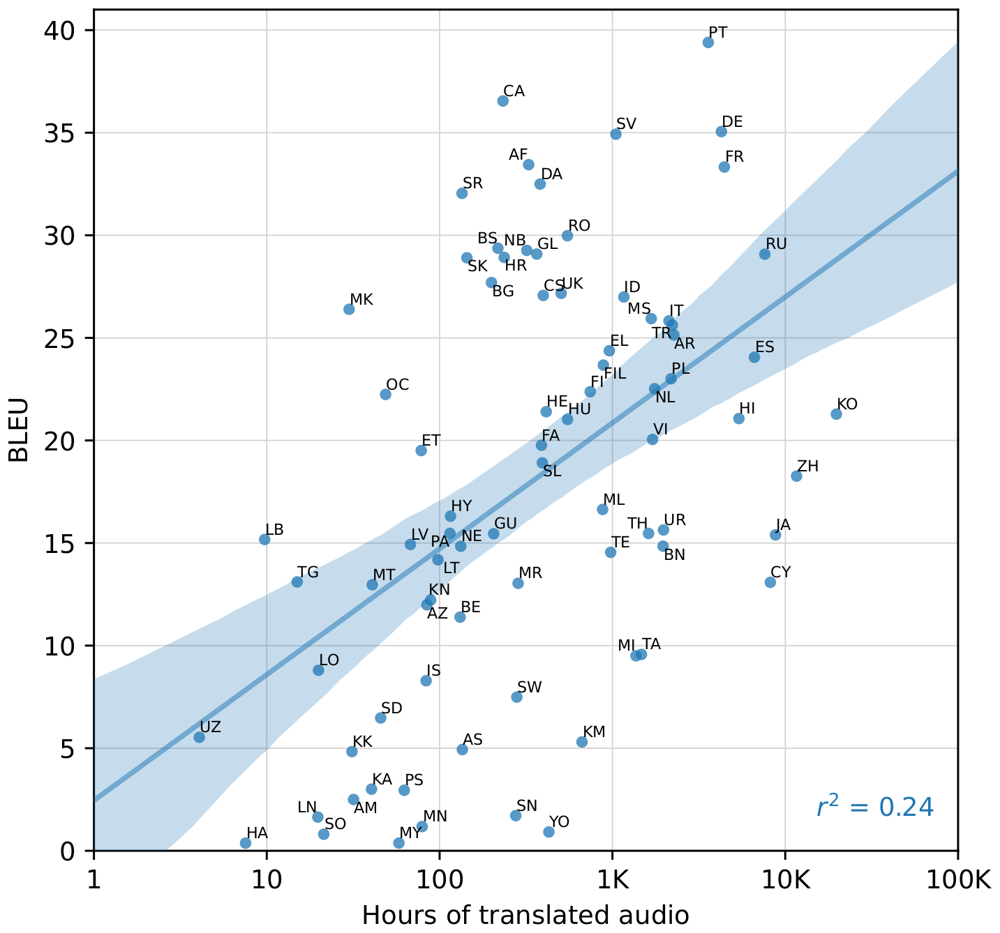

*图 4（原文 Figure 4，第 7 页）：预训练监督数据量与下游翻译性能的相关。某种语言的预训练翻译数据量，只能中等程度地预测 Whisper 在 Fleurs 上该语言的零样本性能。*

**图中文字翻译与读法**：

- 横轴 Hours of translated audio（翻译音频小时数，对数刻度，1 到 100K），纵轴 BLEU（0 到 40）；每个点是一种语言（旁标语言代码）；蓝线是回归线；右下角标 $r^2 = 0.24$。
- **读图结论**：训练数据越多 BLEU 总体越高，但散点很分散，平方相关系数只有 0.24，远低于语音识别的 0.83。作者怀疑部分原因是翻译训练数据因音频语言识别的错误而噪声更大。
- **例子**：威尔士语（CY）是离群点，BLEU 只有约 13（图上约 8,000 小时处），尽管名义上有大量翻译数据（原文写“9,000 小时”，图 11 标的是 8263 小时），在翻译数据量中排第 4，超过法语、西班牙语、俄语等世界上使用最广的语言。检查发现，所谓的威尔士语翻译数据大部分其实是英语音频配英语字幕，英语音频被语言识别系统误判成威尔士语，按数据集构建规则被当成翻译训练数据而不是转写数据。

### 6.4 语言识别（原文第 3.6 节）

**表：语言识别性能（Fleurs 上的准确率 %，越高越好）**

| 语言识别 | Fleurs |
|---|---:|
| w2v-bert-51 (0.6B) | 71.4 |
| mSLAM-CTC (2B) | **77.7** |
| Zero-shot Whisper | 64.5 |

（原文表 5，第 8 页。）读法：Whisper 的零样本语言识别不如此前的监督结果。但它在 Fleurs 上吃了亏：Whisper 数据集对 Fleurs 的 102 种语言里的 20 种没有任何训练数据，准确率上限被限制为 80.4%（$(102-20)/102\approx80.4\%$）；在重叠的 82 种语言上，最好的 Whisper 模型准确率为 80.3%。

> **一处原文数字出入**：正文写 Whisper 比监督最好成绩低 13.6%，而表 5 里 77.7 与 64.5 之差是 13.2 个百分点。本文以表中数字为准。

### 6.5 加性噪声下的鲁棒性（原文第 3.7 节）

**设置**：测试 Whisper 和 14 个用 LibriSpeech 训练的模型在加入白噪声（white noise）或酒吧噪声（pub noise，取自 Audio Degradation Toolbox，代表更自然的嘈杂环境：拥挤餐厅或酒吧里的环境声和模糊的人声）后的 WER。14 个模型中 12 个在 LibriSpeech 上预训练和/或微调，另外 2 个是 NVIDIA STT 模型，在类似 SpeechStew 的、包含 LibriSpeech 的混合数据集上训练。给定信噪比（SNR）对应的噪声强度，按每条样本自身的信号功率计算。

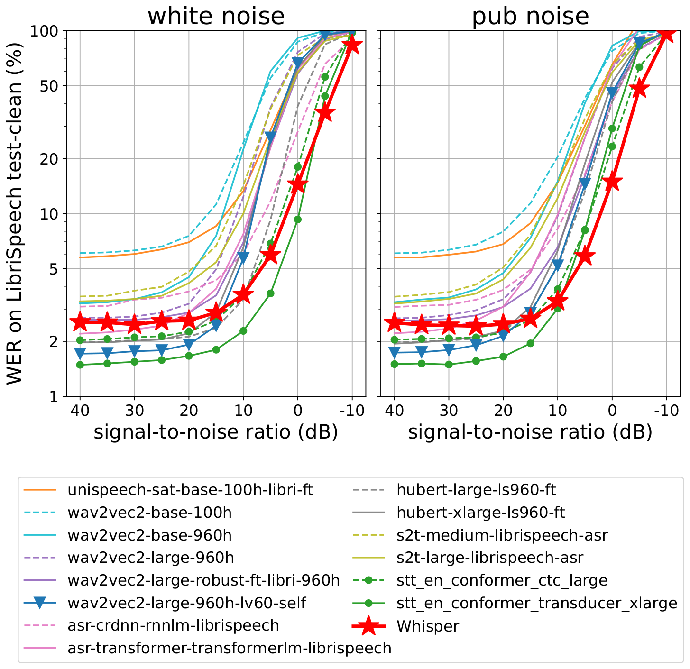

*图 5（原文 Figure 5，第 8 页）：LibriSpeech test-clean 的 WER 随信噪比（SNR）变化，左为加性白噪声，右为酒吧噪声。LibriSpeech 训练的模型的准确率比最好的 Whisper 模型（红星）下降得更快。NVIDIA STT 模型（绿色圆点）在低噪声下表现最好，但在高噪声（SNR 低于 10 dB）下被 Whisper 超过。低噪声下第二好的模型（蓝色倒三角）只在 LibriSpeech 上微调，退化得更快。*

**图中文字翻译与读法**：

- 两个子图 white noise（白噪声）和 pub noise（酒吧噪声）；横轴 signal-to-noise ratio (dB)（信噪比，分贝，从 40 到 −10，噪声逐渐增强），纵轴 WER on LibriSpeech test-clean (%)（对数刻度，1 到 100）。
- 图例（共 15 条线）：粗红线五角星为 Whisper；其余为 14 个对比模型：unispeech-sat-base-100h-libri-ft、wav2vec2-base-100h、wav2vec2-base-960h、wav2vec2-large-960h、wav2vec2-large-robust-ft-libri-960h、wav2vec2-large-960h-lv60-self（蓝色倒三角）、asr-crdnn-rnnlm-librispeech、asr-transformer-transformerlm-librispeech、hubert-large-ls960-ft、hubert-xlarge-ls960-ft、s2t-medium-librispeech-asr、s2t-large-librispeech-asr、stt_en_conformer_ctc_large（绿色虚线圆点）、stt_en_conformer_transducer_xlarge（绿色实线圆点）。
- **读图结论**（以下为从图上读出的近似值）：酒吧噪声下，40 dB 时 Whisper 约 2.6%，高于 NVIDIA STT（约 1.5–2.0%）和蓝色倒三角（约 1.7%）；SNR 降到 10 dB 时 Whisper 约 3.3%，与 NVIDIA STT 相当、低于蓝色倒三角（约 5%）；到 0 dB 时 Whisper 约 15%，而蓝色倒三角约 47%，NVIDIA 两个模型约 23–29%。白噪声下 NVIDIA transducer 模型（绿色实线）在 0 dB 时约 9%，仍好于 Whisper（约 14.5%），到 −5 dB 时 Whisper（约 36%）才好于两个 NVIDIA 模型（约 44–55%）；也就是说白噪声下 Whisper 的优势出现得更晚。

**原文结论**：许多模型在低噪声（40 dB SNR）下优于 Whisper 的零样本表现，这不奇怪，因为它们主要在 LibriSpeech 上训练；但所有模型都随噪声增强而快速退化，在酒吧噪声 SNR 低于 10 dB 时都比 Whisper 差。这显示了 Whisper 对噪声的鲁棒性，尤其是在酒吧噪声这类更自然的分布偏移下。

### 6.6 长音频转写（原文第 3.8 节、第 4.5 节）

**问题**：Whisper 用 30 秒音频块训练，不能一次处理更长的输入。这对由短话语构成的学术数据集不是问题，但现实应用常常要转写几分钟甚至几小时的音频。作者设计了**缓冲式转写**策略：连续转写 30 秒的片段，并根据模型预测的时间戳移动窗口。观察到要可靠地转写长音频，必须有按预测的重复性和对数概率调节的 beam search 和温度调度，完整流程在 7.5 节。

**评测**：在 7 个长音频数据集上评测（见 5.3 节），与开源模型以及 4 个商用 ASR 服务比较；商用服务按其 2022 年 9 月 1 日的默认英语转写设置调用，开源模型里表现最好的是 NeMo 的 NVIDIA STT Conformer-CTC Large（用其 FrameBatchASR 类的缓冲推理实现长音频转写）。

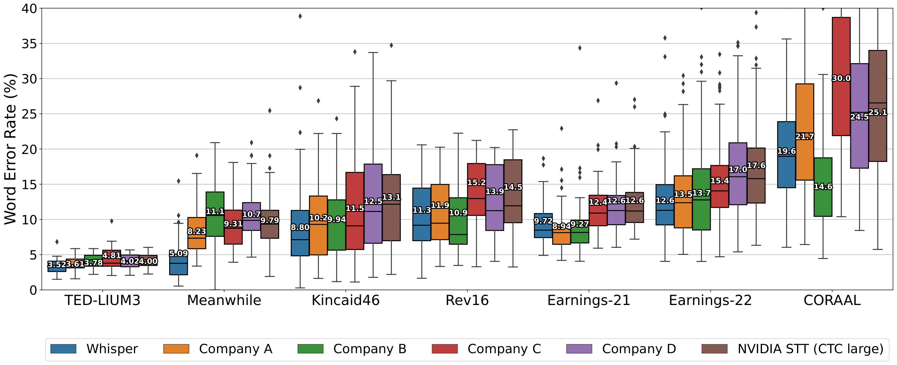

*图 6（原文 Figure 6，第 9 页）：在长音频转写上，Whisper 与最先进的商用和开源 ASR 系统相当。图中比较 6 个 ASR 系统在 7 个长音频数据集上的 WER 分布，输入长度从几分钟到几小时。箱体表示各样本 WER 的四分位数，每个箱体上标有该数据集的聚合 WER。Whisper 在所有数据集上优于最好的开源模型（NVIDIA STT），在大多数情况下也优于商用系统。*

**图中文字翻译与读法**：

- 横轴是 7 个数据集：TED-LIUM3、Meanwhile、Kincaid46、Rev16、Earnings-21、Earnings-22、CORAAL；纵轴 Word Error Rate (%)（0 到 40）；每个数据集有 6 个箱形图，图例：Whisper（蓝）、Company A（橙）、Company B（绿）、Company C（红）、Company D（紫）、NVIDIA STT (CTC large)（棕）。箱内数字为聚合 WER。
- 把图上标注的聚合 WER 转录如下（粗体是本文按数字标出的该行最小值，原图没有粗体）：

| 数据集 | Whisper | Company A | Company B | Company C | Company D | NVIDIA STT (CTC large) |
|---|---:|---:|---:|---:|---:|---:|
| TED-LIUM3 | **3.52** | 3.61 | 3.78 | 4.81 | 4.02 | 4.00 |
| Meanwhile | **5.09** | 8.23 | 11.1 | 9.31 | 10.7 | 9.79 |
| Kincaid46 | **8.80** | 10.2 | 9.94 | 11.5 | 12.5 | 13.1 |
| Rev16 | 11.3 | 11.9 | **10.9** | 15.2 | 13.9 | 14.5 |
| Earnings-21 | 9.72 | **8.94** | 9.27 | 12.4 | 12.6 | 12.6 |
| Earnings-22 | **12.6** | 13.5 | 13.7 | 15.4 | 17.0 | 17.6 |
| CORAAL | 19.6 | 21.7 | **14.6** | 30.0 | 24.5 | 25.1 |

- **读图结论**：7 个数据集里，Whisper 在 4 个（TED-LIUM3、Meanwhile、Kincaid46、Earnings-22）取得六个系统中最低的聚合 WER；在 Earnings-21 上 Company A（8.94）、B（9.27）更低，在 Rev16 上 Company B（10.9）更低，在 CORAAL 上 Company B（14.6）明显更低。Whisper 在 7 个数据集上都优于 NVIDIA STT。Whisper 的优势在富含罕见词的 Meanwhile 上最明显（5.09 对 8.23–11.1）。原文提醒：一些商用 ASR 系统有可能已经用这些公开数据集训练过，因此这些结果未必准确反映各系统的相对鲁棒性。

**附录表 16：长音频英语转写 WER（%）**

| 模型 | TED-LIUM3 | Meanwhile | Kincaid46 | Rev16 | Earnings-21 | Earnings-22 | CORAAL |
|---|---:|---:|---:|---:|---:|---:|---:|
| Whisper tiny.en | 5.5 | 12.8 | 13.8 | 15.1 | 17.0 | 22.0 | 30.3 |
| Whisper tiny | 6.8 | 15.5 | 16.7 | 17.0 | 18.7 | 24.4 | 33.1 |
| Whisper base.en | 4.6 | 9.4 | 11.2 | 13.2 | 12.5 | 16.6 | 25.2 |
| Whisper base | 4.8 | 12.2 | 12.2 | 14.5 | 13.5 | 18.4 | 26.9 |
| Whisper small.en | 4.6 | 6.0 | 9.4 | 12.0 | 10.8 | 14.0 | 21.9 |
| Whisper small | 4.2 | 6.9 | 10.1 | 12.1 | 11.1 | 14.3 | 22.3 |
| Whisper medium.en | 3.6 | 5.2 | 8.9 | 11.9 | 10.2 | 13.3 | 20.6 |
| Whisper medium | 3.8 | 5.4 | 8.6 | 11.4 | 10.3 | 13.2 | 20.3 |
| Whisper large | 3.8 | 5.3 | 8.8 | 11.0 | 10.3 | 13.4 | 20.4 |
| Whisper large-v2 | 3.5 | 5.1 | 8.8 | 11.3 | 9.7 | 12.6 | 19.6 |
| wav2vec2-base-100h | 17.6 | 27.7 | 39.3 | 35.2 | 45.7 | 57.1 | 55.4 |
| wav2vec2-base-960h | 12.8 | 19.7 | 32.9 | 29.8 | 37.3 | 46.8 | 49.1 |
| wav2vec2-large-960h-lv60-self | 7.2 | 11.4 | 21.1 | 21.3 | 21.7 | 28.0 | 36.7 |
| wav2vec2-large-960h | 10.1 | 16.4 | 27.4 | 26.4 | 30.4 | 40.1 | 43.5 |
| wav2vec2-large-robust-ft-libri-960h | 8.8 | 15.2 | 22.9 | 23.4 | 23.0 | 31.0 | 36.8 |
| hubert-large-ls960-ft | 8.1 | 12.9 | 22.4 | 23.4 | 23.0 | 30.6 | 37.9 |
| hubert-xlarge-ls960-ft | 8.1 | 12.5 | 22.9 | 23.2 | 23.1 | 31.3 | 38.1 |
| stt_en_conformer_ctc_large | 4.0 | 9.8 | 13.1 | 14.5 | 12.6 | 17.6 | 25.1 |
| stt_en_conformer_transducer_xlarge | 5.3 | 10.6 | 17.1 | 19.8 | 16.2 | 19.7 | 38.9 |

（原文表 16，附录 D.4，第 26 页。）读法：Whisper large-v2 一行与图 6 的 Whisper 箱上标注一致（3.5、5.1、8.8、11.3、9.7、12.6、19.6），NVIDIA STT CTC 一行也与图 6 一致；用 LibriSpeech 训练的 wav2vec 2.0、HuBERT 等在长音频上的 WER 比 Whisper 高出一倍以上（例如 Kincaid46：21.1–39.3 对 8.8）。长音频场景里 Whisper 从 tiny.en 到 large-v2 同样随规模变好。

### 6.7 与人类转写的比较（原文第 3.9 节）

**为什么要比**。由于有含糊或不清晰的语音以及标注错误，每个数据集都有不同程度的不可约错误，单看 ASR 的 WER 很难判断还有多大改进空间。为量化 Whisper 离人类水平有多近，作者从 Kincaid46 里挑了 25 段录音（覆盖有脚本和无脚本的广播、电话和 VoIP 通话、会议等录音条件），用 5 个服务获得专业转写员的转写：其中 1 个是计算机辅助转写，另外 4 个完全由人工转写。

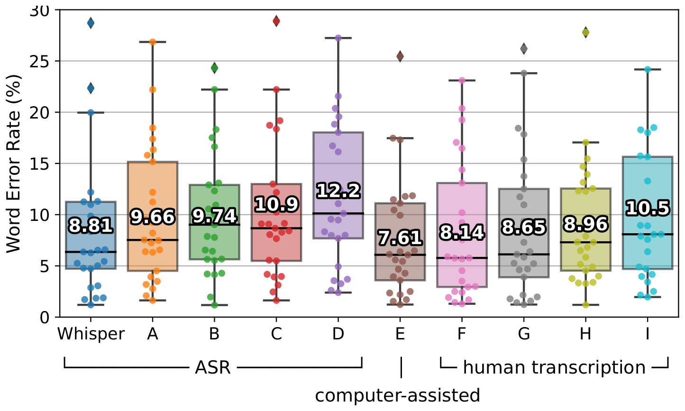

*图 7（原文 Figure 7，第 10 页）：Whisper 的表现接近专业人工转写员。图中是 Kincaid46 数据集 25 段录音的 WER 分布，转写者包括 Whisper、图 6 里同样的 4 个商用 ASR 系统（A–D）、1 个计算机辅助转写服务（E）和 4 个人工转写服务（F–I）。箱形图上叠加了每段录音 WER 的点，每个箱上标有 25 段录音的聚合 WER。*

**图中文字翻译与读法**：

- 横轴自左到右：Whisper、A、B、C、D（括号标 ASR）、E（computer-assisted，计算机辅助）、F、G、H、I（human transcription，人工转写）；纵轴 Word Error Rate (%)（0 到 30）。
- 各箱聚合 WER（图上标注）：

| 系统 | 类型 | 聚合 WER |
|---|---|---:|
| Whisper | ASR | 8.81 |
| A | 商用 ASR | 9.66 |
| B | 商用 ASR | 9.74 |
| C | 商用 ASR | 10.9 |
| D | 商用 ASR | 12.2 |
| E | 计算机辅助人工转写 | 7.61 |
| F | 纯人工转写 | 8.14 |
| G | 纯人工转写 | 8.65 |
| H | 纯人工转写 | 8.96 |
| I | 纯人工转写 | 10.5 |

- **读图结论**：Whisper 的 8.81 优于 4 个商用 ASR（9.66–12.2）；与人工转写相比，F（8.14）和 G（8.65）略好，H（8.96）和 I（10.5）略差；计算机辅助的 E（7.61）最好。原文的说法是：计算机辅助服务的聚合 WER 最低，比 Whisper 好 1.15 个百分点（按图上数字相减为 1.20，原文没有说明差异来源），纯人工转写“只比 Whisper 好不到一个百分点”（按图上数字，只有 F、G 比 Whisper 好，分别好 0.67 和 0.16 个百分点；H、I 反而比 Whisper 差）；结论是 Whisper 的英语 ASR 表现不完美，但非常接近人类水平。
- 注意这个结论只基于 25 段录音和 5 家转写服务。

## 七、分析与消融

### 7.1 模型规模（原文第 4.1 节，图 8）

**问题**：弱监督训练的潜力在于能用比传统监督学习大得多的数据集，代价是数据可能噪声更大、质量更低。担心：性能可能在数据集的固有质量水平上饱和（可能远低于人类水平）；相关的担心是随着容量和训练算力增加，模型可能学会利用数据集的特有怪癖，对域外数据的泛化反而变差。为此研究零样本泛化随模型规模的变化。

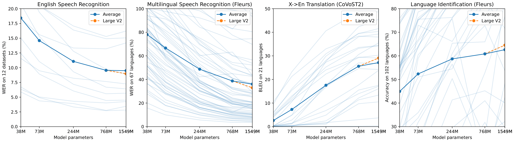

*图 8（原文 Figure 8，第 11 页）：零样本 Whisper 的性能随模型规模增大，在各任务和语言上可靠地提升。浅色细线表示单个数据集或语言，说明实际表现比汇总趋势的平滑曲线更多样。Large V2 用橙色虚线单独标出，因为它包含了此分析中较小模型没有的若干改动。*

**图中文字翻译与读法**（以下数值是从图上读出的近似值）：

- 四个子图，横轴均为 Model parameters（模型参数量：38M、73M、244M、768M、1549M），蓝色粗线为 Average（平均），橙色虚线为 Large V2，浅蓝细线为各个数据集或语言：
  - English Speech Recognition（英语语音识别）：纵轴 WER on 12 datasets (%)（12 个数据集上的 WER）。平均约从 18.4 降到 14.6、11.1、9.6，最大两档几乎持平（约 9.6 和 9.5），Large V2 约 9.0。
  - Multilingual Speech Recognition (Fleurs)（多语言语音识别）：纵轴 WER on 67 languages (%)。平均约从 78 降到 67、49、39、36，Large V2 约 33。
  - X->En Translation (CoVoST2)（X 到英语翻译）：纵轴 BLEU on 21 languages。平均约从 2.7 升到 7.3、17.5、25.6、27.1，Large V2 约 29。
  - Language Identification (Fleurs)（语言识别）：纵轴 Accuracy on 102 languages (%)。平均约从 45 升到 52、59、61、63，Large V2 约 64.5（与表 5 的 64.5 相符）。
- **读图结论**：除英语语音识别之外，多语言识别、翻译和语言识别的性能都随模型规模继续提高。英语识别的收益递减，原文认为可能是接近人类水平带来的饱和效应（见第 6.7 节的分析）。单个数据集或语言的曲线比平均曲线更不规则，说明汇总趋势掩盖了很大的个体差异。

### 7.2 数据规模（原文第 4.2 节，表 6）

**设置**：68 万小时有标注音频使 Whisper 数据集成为有监督语音识别里最大的数据集之一。原始数据量到底有多重要？作者在数据集的 0.5%、1%、2%、4%、8% 的子采样版本上训练一系列中等大小（medium）的模型，与在完整数据集上训练的同一模型比较。每个数据量用基于验证损失的早停来选检查点；评测使用参数的指数滑动平均（平滑率 0.9999），以减小因早停而学习率没有完全衰减到零的影响。

**表：性能随数据集大小提升**

| 数据集大小（小时） | 英语 WER (↓) | 多语言 WER (↓) | X→En BLEU (↑) |
|---|---:|---:|---:|
| 3405 | 30.5 | 92.4 | 0.2 |
| 6811 | 19.6 | 72.7 | 1.7 |
| 13621 | 14.4 | 56.6 | 7.9 |
| 27243 | 12.3 | 45.0 | 13.9 |
| 54486 | 10.9 | 36.4 | 19.2 |
| 681070 | **9.9** | **29.2** | **24.8** |

（原文表 6，第 11 页。英语为 12 个数据集的平均；多语言为 Fleurs 中重叠语言子集上的表现；X→en 为 CoVoST2 上的平均 BLEU。）

**读法**：

- 数据集越大，三项任务都变好，但提升速度因任务和规模而异。
- **英语识别**：从 3,000 到 13,000 小时快速改善，在 13,000 到 54,000 小时之间明显放缓；用完整数据集（又增大 12.5 倍）只让 WER 再降约 1 个点（10.9 到 9.9）。这与模型规模上的收益递减一致，同样可能是接近人类水平的饱和效应。
- **多语言识别**：到 54,000 小时之前，WER 的改善遵循幂律；之后偏离这个趋势，用完整数据集只多改善了约 7 个点（36.4 到 29.2）。
- **X→en 翻译**：训练数据 7,000 小时或更少时性能几乎为零（0.2、1.7），之后到 54,000 小时大致呈对数线性提升，随后用完整数据集时也出现收益递减（19.2 到 24.8）。
- 从 54,000 小时到 680,000 小时这一普遍的收益递减，可能意味着当前最好的 Whisper 模型相对于数据集大小是“训练不足”的，更久的训练和更大的模型可能进一步改进；也可能意味着数据规模扩展带来的提升快到头了。原文说需要进一步分析语音识别的“缩放定律”才能判断是哪一种。

### 7.3 多任务与多语言迁移（原文第 4.3 节，图 9）

**担心**：把单个模型联合训练在许多任务和语言上，可能出现**负迁移**：不同任务的学习相互干扰，导致比只训练单一任务或语言更差。

**做法**：比较只训练英语语音识别的模型与标准的多任务多语言训练设置，在零样本英语语音识别基准套件上比较平均表现。因为在联合训练里只有 65% 的算力花在英语语音识别上，所以按“花在英语语音识别上的 FLOPs”做校正；否则会因为相对同尺寸英语专用模型训练不足而混淆结论。

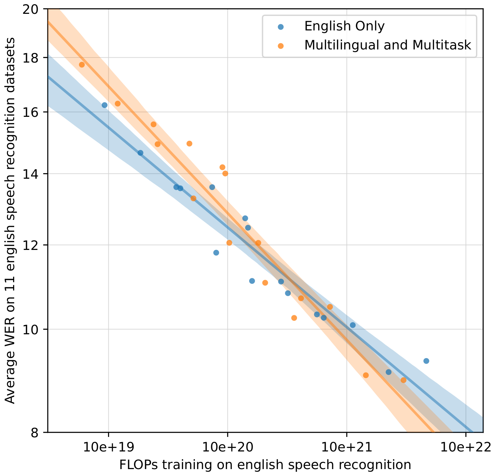

*图 9（原文 Figure 9，第 12 页）：多任务与多语言迁移随规模改善。对小模型，联合多任务多语言训练会使英语语音识别性能下降；但多语言多任务模型从规模中获益更多，最终超过只用英语数据训练的模型。图中是 95% bootstrap 估计的置信区间。*

**图中文字翻译与读法**：

- 横轴 FLOPs training on english speech recognition（训练英语语音识别所花的 FLOPs，对数刻度，刻度写作 10e+19、10e+20、10e+21、10e+22，是原图的写法），纵轴 Average WER on 11 english speech recognition datasets（11 个英语语音识别数据集上的平均 WER，对数刻度，8 到 20）。蓝点和蓝线为 English Only（只用英语）；橙点和橙线为 Multilingual and Multitask（多语言加多任务）；浅色带是 95% bootstrap 置信区间。
- **读图结论**：在算力小的一端（左侧），橙色拟合线在蓝色线之上（WER 更高），即联合模型不如同算力的英语专用模型：负迁移；随着算力增加，两条线在横轴标注 10e+20 刻度的约 3 倍处（图上读出，原图刻度写法特殊，这里不换算成绝对 FLOPs）交叉，之后橙线在下，联合模型更好：正迁移。原文还说，在最大的实验里，即使不对每个任务花的算力做校正，联合模型也略优于英语专用模型。
- 注：图 8 的纵轴写“12 个数据集”，图 9 的纵轴写“11 个”，这是原文图中两处写法不同，本文照录。

### 7.4 文本规范化的检验（原文第 4.4 节，图 10）

**担心**：规范化器是与 Whisper 一起开发的，目的是抵消无害的词错误，所以可能过拟合于修正 Whisper 的特殊习惯，而不是处理一般的转写差异。**检验**：比较 Whisper 使用本文规范化器与使用 FairSpeech 项目（Koenecke 等 2020）独立开发的规范化器的结果。

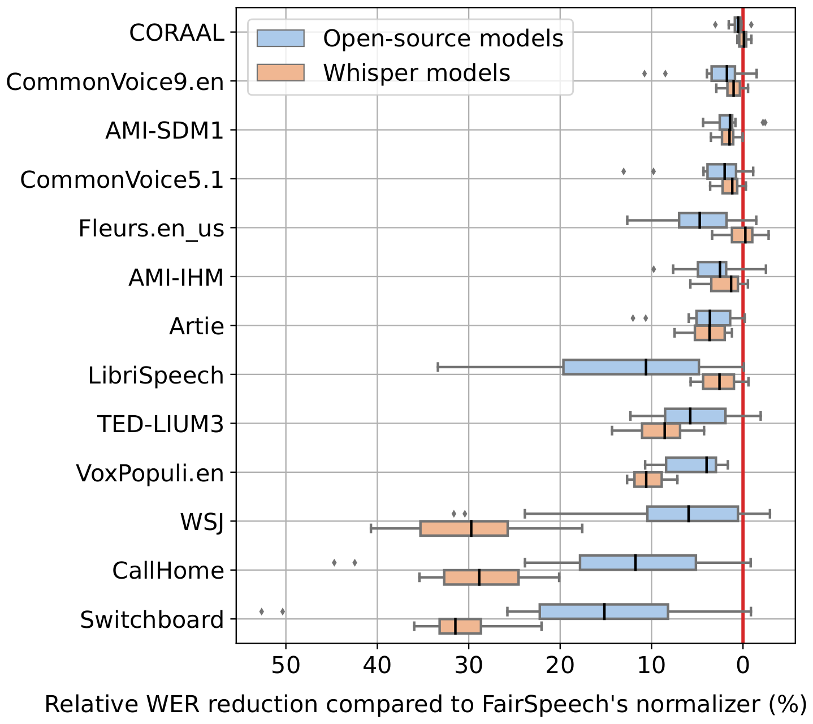

*图 10（原文 Figure 10，第 12 页）：在大多数数据集上，相比 FairSpeech 的规范化器，本文的规范化器对 Whisper 模型和其他开源模型的 WER 降低效果相近。对每个数据集，箱形图显示评测套件中不同模型的相对 WER 降低分布，说明使用本文规范化器通常得到比 FairSpeech 的更低的 WER。在少数数据集上，本文规范化器使 WER 明显降低，对 Whisper 模型尤其如此，例如 CallHome 与 Switchboard（参考文字里有很多缩略形式）以及 WSJ（含很多数字表达）。*

**图中文字翻译与读法**：

- 横轴 Relative WER reduction compared to FairSpeech's normalizer (%)（相对 FairSpeech 规范化器的 WER 相对降低，%，从 50 到 0，向右为 0），纵轴自上而下是 13 个数据集：CORAAL、CommonVoice9.en、AMI-SDM1、CommonVoice5.1、Fleurs.en_us、AMI-IHM、Artie、LibriSpeech、TED-LIUM3、VoxPopuli.en、WSJ、CallHome、Switchboard；每个数据集两个箱：蓝色 Open-source models（开源模型）、橙色 Whisper models（Whisper 模型）；红色竖线是 0。
- 读图（以下为从图上读出的各箱中位数近似值）：CORAAL、CommonVoice9.en、AMI-SDM1、CommonVoice5.1、AMI-IHM、Artie 上两类模型的降低都只有约 0–4%，彼此接近；Fleurs.en_us 上开源模型约 5%、Whisper 约 0；LibriSpeech 上开源模型约 10.5%、Whisper 约 2.5%；TED-LIUM3 上 Whisper 约 8.5%、开源模型约 6%；VoxPopuli.en 上 Whisper 约 10.5%、开源模型约 4%；WSJ、CallHome、Switchboard 上 Whisper 分别约 30%、29%、31%，开源模型约 6%、12%、15%。
- **读图结论与原文解释**：多数数据集上两种规范化器表现相近，没有显著的 Whisper 对开源模型 WER 降低的差异；仅在 WSJ、CallHome、Switchboard 上本文规范化器对 Whisper 的降低显著更多。差异可追溯到真实文字稿的格式与两个规范化器处理方式的不同：在 CallHome 和 Switchboard 里，本文规范化器不惩罚常见的英语缩略形式差异（如 “you’re” 与 “you are”）；在 WSJ 里，本文规范化器统一了书面和口语的数字与金额表达（如 “sixty-eight million dollars” 与 `$68 million`）。

### 7.5 可靠长音频转写的策略（原文第 4.5 节，表 7）

长音频转写依赖准确预测时间戳 token，以决定把模型的 30 秒音频窗口移动多少；某个窗口里的转写不准，也会影响后续窗口。作者开发了一组启发式规则，避免长音频转写的失败情形，并应用在第 6.6、6.7 节的结果中：

1. **beam search**：用 5 个 beam、以对数概率作为打分函数，减少贪心解码中更常发生的**重复循环**。
2. **温度回退**：从温度 0（总是取概率最高的 token）开始；当生成 token 的平均对数概率低于 −1，或生成文本的 gzip 压缩率高于 2.4 时，把温度每次增加 0.2，直到 1.0 为止。（压缩率高说明文本重复。）
3. **前文条件**：当所用温度低于 0.5 时，把前一个窗口的转写文字作为条件（previous-text conditioning），进一步改善性能。
4. **语音活动检测**：发现单靠 `<|nospeech|>` token 的概率不足以区分无语音片段，但把“无语音概率阈值 0.6”与“平均对数概率阈值 −1”结合起来，使 Whisper 的语音活动检测更可靠。
5. **初始时间戳约束**：为避免模型忽略输入开头几个词这种失败模式，把初始时间戳 token 限制在 0.0 到 1.0 秒之间。

**表：长音频转写性能随解码启发式的叠加而逐步改善（WER %）**

| 解码策略 | TED-LIUM3 | Meanwhile | Kincaid46 | Rev16 | Earnings-21 | Earnings-22 | CORAAL | 平均 |
|---|---:|---:|---:|---:|---:|---:|---:|---:|
| 仅贪心解码 | 3.95 | 5.16 | 9.69 | 11.7 | 10.7 | 14.0 | 22.0 | 11.0 |
| + beam search | 4.16 | 5.71 | 9.42 | 11.5 | 10.2 | 13.4 | 20.0 | 10.6 |
| + 温度回退 | 4.16 | 5.71 | 9.42 | 11.5 | 10.2 | 13.4 | 20.0 | 10.6 |
| + 语音活动检测 | 3.56 | **4.61** | 9.45 | 11.4 | 10.1 | 13.2 | 19.4 | 10.2 |
| + 前文条件 | **3.42** | 6.16 | 8.72 | **11.0** | **9.63** | 13.3 | **18.1** | 10.0 |
| + 初始时间戳约束 | 3.51 | 5.26 | **8.41** | 11.5 | 9.73 | **12.6** | 19.1 | 10.0 |

（原文表 7，第 13 页；粗体为原文所标各列最好结果。）读法：

- 平均 WER 从 11.0 降到 10.0。原文说每一项干预都逐步降低整体 WER，但并不均匀：同一个数据集上，加某一项可能变差，例如 Meanwhile 在加“前文条件”时从 4.61 变差到 6.16；按表中的“平均”列，“温度回退”一行与上一行数字完全相同（10.6 对 10.6），最后的“初始时间戳约束”一行的平均值也与上一行相同（10.0 对 10.0），即这两步在这些数据集上没有带来平均意义上的可见变化。
- 原文强调这些启发式只是对模型噪声预测的权宜之计，要进一步提高长音频解码的可靠性还需要更多研究。
- 注意表 7 的题注没有说明用的是哪个模型，它的最后一行（3.51、5.26、8.41、11.5、9.73、12.6、19.1）与附录表 16 的 Whisper large-v2 行（3.5、5.1、8.8、11.3、9.7、12.6、19.6）不完全相同，不应当当作同一个结果引用。

## 八、局限、证据边界与常见误读

### 8.1 原文承认的局限与未来方向（第 6 节）

1. **改进解码策略**：随着 Whisper 的放大，更大的模型在减少感知类错误（如混淆发音相似的词）上稳步取得进展；剩下的错误，尤其是长音频转写里的，更顽固、明显不是人类或感知性的。它们是 seq2seq 模型、语言模型和文本—音频对齐的失败模式的组合，包括陷入重复循环、漏转一段音频开头或结尾的几个词、以及**完全幻觉**（输出与实际音频完全无关的文字）。第 4.5 节的解码细节有明显帮助，作者猜测在高质量监督数据集上微调 Whisper，和/或用强化学习更直接地优化解码表现，可能进一步减少这些错误。
2. **为低资源语言增加训练数据**：图 3 显示 Whisper 在许多语言上的表现仍很差；同一分析也指出了明确的改进路线，即语言表现可被其训练数据量很好地预测。由于数据收集管线主要来自互联网上以英语为中心的部分，预训练数据集目前非常偏向英语，大多数语言的训练数据不到 1,000 小时。有针对性地增加这些少见语言的数据，即使只让总数据集大小略增，也可能显著提升平均语音识别性能。
3. **研究微调**：本文只研究了零样本迁移（对鲁棒性这是关键设置），但在有高质量监督语音数据的领域，微调很可能进一步提升结果；研究微调也能与以往工作直接比较。
4. **研究语言模型对鲁棒性的影响**：作者怀疑 Whisper 的鲁棒性部分来自它强大的解码器（一个以音频为条件的语言模型），但目前不清楚收益在多大程度上来自训练编码器、解码器或二者；可以通过消融（例如训练一个无解码器的 CTC 模型）或研究现有语音识别编码器（如 wav2vec 2.0）与语言模型结合时的变化来回答。
5. **加入辅助训练目标**：Whisper 与近年多数最先进系统的明显区别是没有无监督预训练或自教方法；虽然作者认为没有必要，但结合它们也许能进一步改善结果。

### 8.2 证据边界与常见误读

- **Whisper 不是自监督模型**：它用的是海量的音频—文本监督（弱监督）；“弱”指文字稿质量噪声大、没有逐条人工校对，而不是没有监督。需要注意，论文的数据管线恰恰在设法**剔除**机器生成的文字稿，并承认没有完全剔除干净（第 3.1 节说第二轮过滤中仍发现启发式没检测出的机器生成字幕）。
- **“零样本”是指评测数据集没有被用来微调**，不是“没有 ASR 标注数据”，也不是“与训练数据分布无关”：训练集含海量互联网音频，评测集中的内容可能与训练数据有某种重叠；作者只对 TED-LIUM 3 做了文字稿级去重。
- **不是每个基准上的最好成绩**：LibriSpeech test-clean（域内）上最好的几个监督模型更好（表 8：1.5–2.1 对 Whisper large-v2 的 2.7）；VoxPopuli 上落后于 Maestro 等；语言识别比监督最好结果低；高资源语言的 X→en 翻译没有超过 Maestro 和 mSLAM；混合多数据集训练的 NVIDIA STT 在 WSJ、CallHome、Switchboard 等上仍好于 Whisper（表 8）。
- **WER 数字依赖文本规范化器**：规范化器是与 Whisper 一起迭代开发的，对 Whisper 的风格可能有利；论文用 FairSpeech 的规范化器做了检验（图 10），在多数数据集上差异不大，在 WSJ、CallHome、Switchboard 上差异大。跨论文比较必须用同一规范化器。
- **“接近人类”的证据较窄**：只用 Kincaid46 的 25 段录音、5 个转写服务；且部分纯人工转写服务（F、G）比 Whisper 好。
- **55.2% 的相对错误率下降**是 Whisper Large V2 对一个特定的、仅用 LibriSpeech 训练的 wav2vec 2.0 模型（无语言模型）在 12 个域外数据集加 LibriSpeech test-other 上的平均，不是对所有监督模型的结论。
- **长音频结果依赖解码启发式**（表 7）：beam 5、温度回退、无语音阈值、初始时间戳约束等；换一套解码设置，数字会变。
- **会幻觉**：原文第 6 节明确承认重复循环、漏词和与音频无关的完整幻觉；零样本鲁棒性不等于不会出这类错误。
- **多语言的公平性有限**：数据 65% 是英语；74 种非英语语言里大多数语言不足 1,000 小时；拥有独特文字系统、与印欧语系较远的语言（中文、韩语、希伯来语、泰卢固语）表现低于趋势；低资源语言的 WER 可能很高。
- **数据不可复现**：论文发布了模型与推理代码，训练数据本身没有发布（原文只说“发布模型和推理代码”）。

### 8.3 本文核对时发现的原文内部数字小出入

下面这些是我用原文其他位置的数字或图表交叉核对时发现的，不影响结论，引用时要留意：

1. 引言说多语言识别的 117,000 小时“覆盖另外 96 种语言”，而图 11 左栏逐行列出的是 74 种非英语语言（加英语共 75 种，与第 3.4 节一致）。
2. 语言识别：正文写比监督最好成绩低 13.6%，表 5 的差是 13.2 个百分点。
3. 与人工转写的比较：正文写计算机辅助服务比 Whisper 好 1.15 个百分点，图 7 的数字相减为 1.20。
4. 威尔士语翻译数据：正文写约 9,000 小时，图 11 标 8263 小时。
5. 训练遍数：表 17 的 $2^{20}$ 次更新、batch 256 按每段 30 秒粗算约为数据集的 3.3 遍，正文写“两到三遍”。
6. 图 8 与图 9 纵轴分别写 12 个和 11 个数据集。
7. 表 7 的最后一行与表 16 的 Whisper large-v2 行不完全一致，题注没有说明所用模型。

## 九、复现检查清单

- **输入处理**：16,000 Hz；80 通道对数幅度 Mel 谱，25 ms 窗口、10 ms 步长；在预训练数据集上全局缩放到 −1 到 1 之间；音频切成 30 秒的块。
- **模型**：编码器 stem 为两层卷积（宽度 3，GELU，第二层步长 2）；正弦位置嵌入；预激活残差块；编码器输出末尾加层归一化；解码器用学习的位置嵌入并与输出层共享 token 表示；编码器和解码器的层数、宽度相同；英语模型用 GPT-2 的字节级 BPE，多语言模型重拟合同样大小的词表。
- **token 序列与损失**：`<|startoftranscript|>`，语言 token（99 个）或 `<|nospeech|>`，`<|transcribe|>` 或 `<|translate|>`，可选 `<|notimestamps|>`，输出，`<|endoftranscript|>`；时间戳量化到 20 ms，开始时间在文字前、结束时间在文字后；半截片段只给开始时间；只遮住前文文字的损失，其余 token 全部训练；以 50% 的比例加入前文条件。
- **数据**：去掉机器生成文字稿（全大写或全小写、缺逗号等线索）；音频语言与文字稿语言（CLD2）不一致的丢掉，英语文字稿作为 X→en 翻译样本；模糊去重；无语音片段子采样 10×；用初始模型的错误率做第二轮数据源筛选；与评测集去重（至少 TED-LIUM 3）。
- **训练**：AdamW（β1 0.9、β2 0.98、ε 1e-6、权重衰减 0.1）、梯度范数裁剪 1.0、预热 2048 次更新后线性衰减到零、batch 256、1,048,576 次更新、FP16 加动态损失缩放加激活检查点、Gaussian Fan-In 初始化、不使用数据增强或正则化（Large V2 例外：655,360 次更新、batch 1024、BPE Dropout 0.1、Stochastic Depth 0.1、SpecAugment）；各模型最大学习率见表 19；训练后用无说话人标注的子集短暂微调以消除猜说话人名字。
- **解码（长音频）**：beam 5；温度从 0 起每次加 0.2 到 1.0（平均对数概率低于 −1 或 gzip 压缩率高于 2.4 时回退）；温度低于 0.5 时加入前一窗口文字作为条件；无语音概率阈值 0.6 加平均对数概率阈值 −1；初始时间戳限制在 0.0–1.0 秒；按预测的时间戳移动 30 秒窗口。
- **评测**：用同一个文本规范化器（英语 12 步、非英语 5 步，CJK 等按字符）；报告贪心还是 beam search；多语言 WER 里中文、日文、泰文、老挝文、缅甸文实际是字符错误率；不要拿 Whisper 的 WER 与别人未经同一规范化的 WER 直接比。
- **不要混用**：表 2 用的是贪心解码（表 8），正文的 2.5 和 6.7 来自 beam search（表 9）；Large 与 Large V2 的结果不能混为一谈。

## 十、与其他论文的关系

- **wav2vec 2.0**：本文引言的出发点。wav2vec 2.0 走的是“自监督预训练编码器，再用标注数据加 CTC 微调”的路线（见 [wav2vec 2.0 解读](../wav2vec2/论文中文解读.md)）；Whisper 走另一条路线：不用自监督，直接用海量弱监督转写训练多任务 encoder–decoder，并且在零样本设置下评测。表 2 和图 5 里 wav2vec 2.0 模型正是作为被比较的监督基线出现。
- **Transformer**：模型结构沿用标准的 encoder–decoder Transformer（见 [Transformer 解读](../transformer/论文中文解读.md)），区别只在输入端的卷积 stem 和正弦位置编码。
- **GPT-2**：英语模型直接使用 GPT-2 的字节级 BPE 分词器（见 [GPT-2 解读](../gpt2/论文中文解读.md)）；“以前文为条件、用 token 前缀指定任务”也与语言模型里的提示做法相呼应。
- **CLIP**：同一作者团队的零样本迁移思路；本文引言引用 CLIP 论文里“ImageNet 微调不改善域外准确率”的例子，说明数据集特定微调对鲁棒性的风险（见 [CLIP 解读](../clip/论文中文解读.md)）。

## 原文证据导航

- [原论文 PDF](paper.pdf)
- [原文提取文本](paper.txt)
- [论文概要](论文概要.md)
