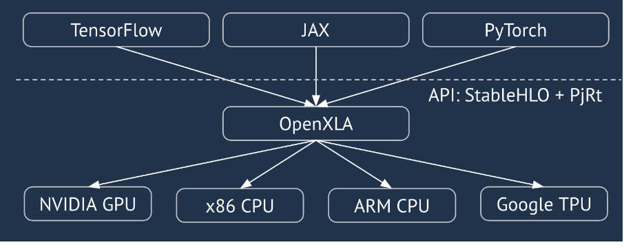
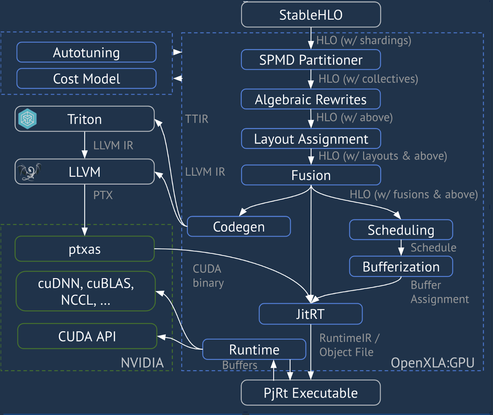
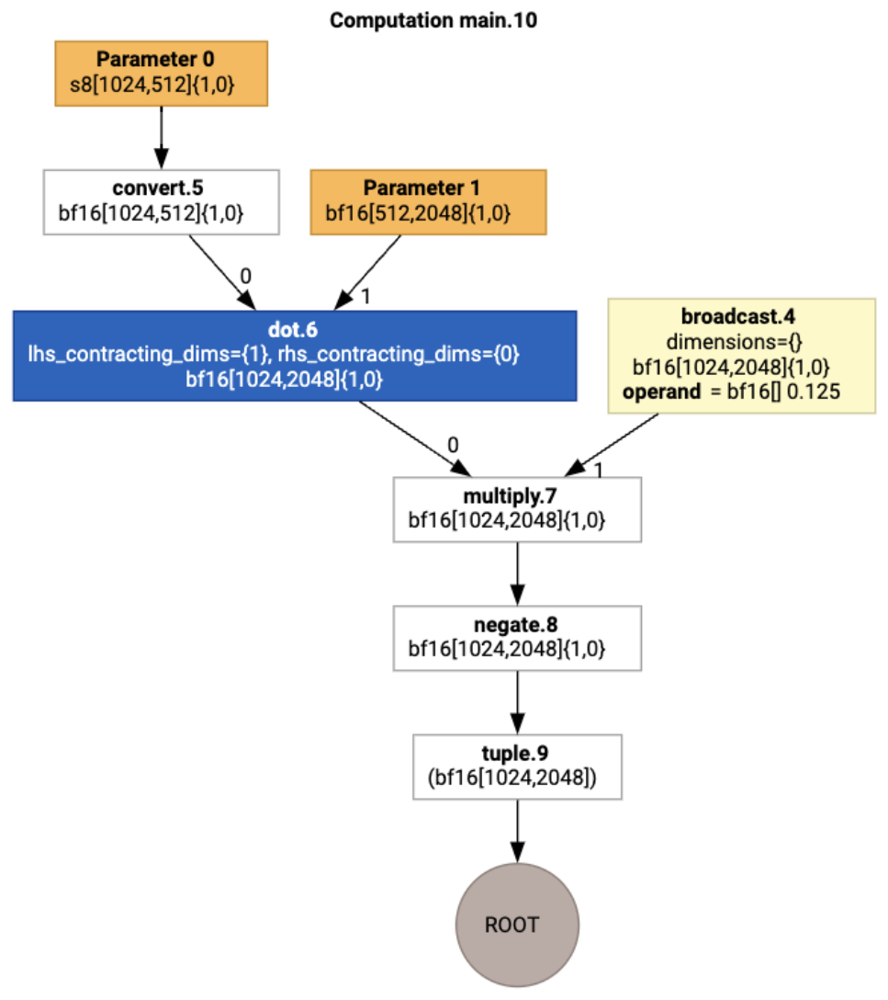
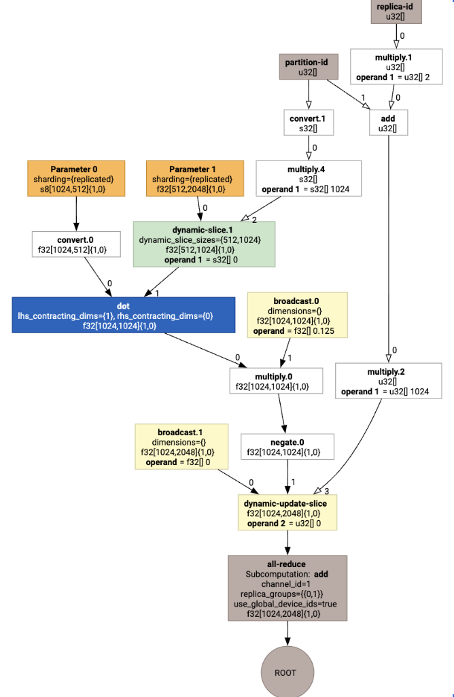
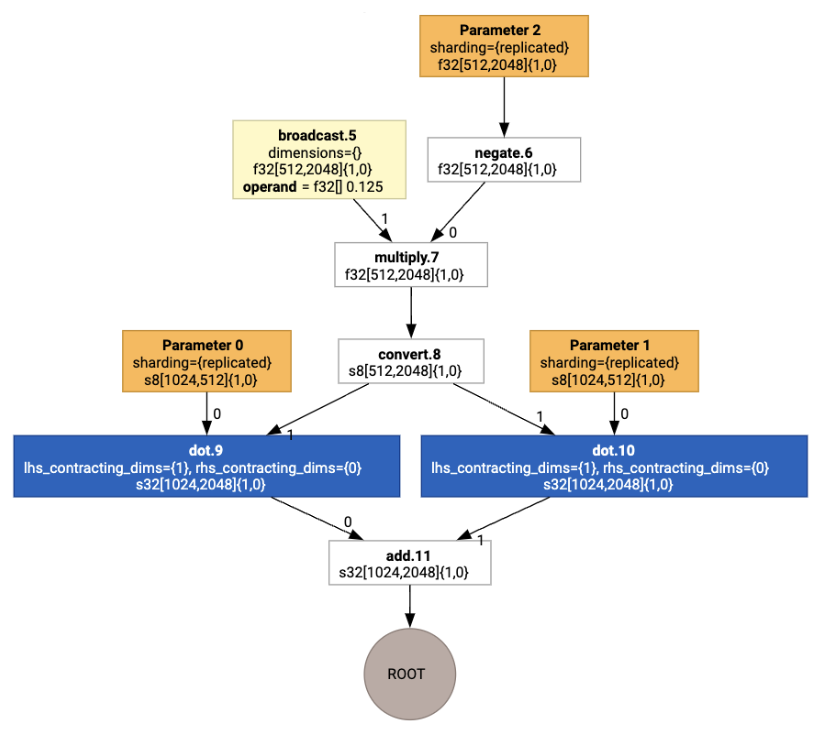
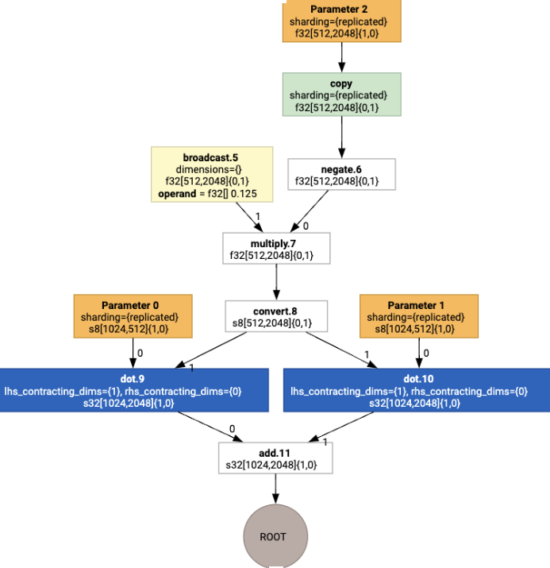
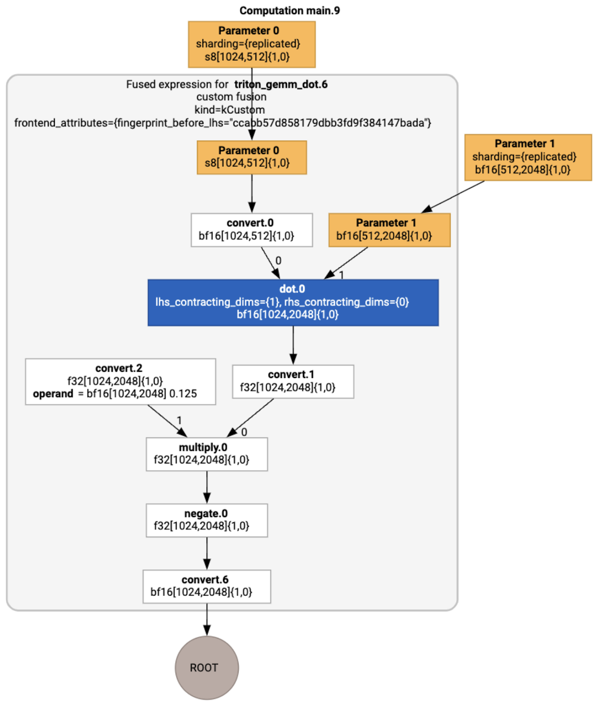
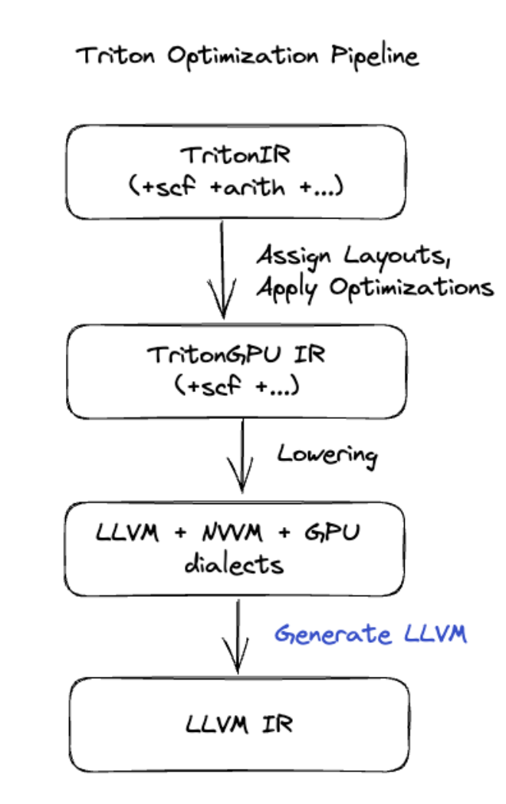

# 论文中文解读：《XLA architecture》与《XLA:GPU Architecture Overview》

> **基本信息**：OpenXLA 项目官方文档的两个页面：[XLA architecture](https://openxla.org/xla/architecture)（页脚标注 Last updated 2024-01-10 UTC）和 [XLA:GPU Architecture Overview](https://openxla.org/xla/gpu_architecture)（页脚标注 Last updated 2025-06-19 UTC）。本目录的 `paper.pdf` 是这两个页面在 2026-10-05 的文本快照，**不是同行评审论文**，没有作者署名，也没有实验和数据表。
>
> **本文的读法**：`paper.pdf` 是用 GNU Enscript 生成的纯文本 PDF，里面没有任何图片。图 1 至图 9 取自 `source_gpu_architecture.html` 中 `` 所指向的 openxla.org 官方配图，原页面没有图号，图号是本文按出现顺序加的；我只擦掉了截图里的浏览器查看器按钮和选区手柄，没有改动图本身。代码清单逐字转录自页面，随后用中文逐行解释。标注“（补充）”的段落不在页面里，是为了读懂而加的背景知识，或笔者在本机的验证（CPU 版 JAX 0.11.2，2026-10-12）。

## 一、一句话结论

XLA（Accelerated Linear Algebra）是一个机器学习编译器。框架（JAX、TensorFlow、PyTorch 等）把模型子图以 StableHLO 的形式交给它；它在整张子图上先后做与硬件无关和与硬件相关的 HLO 到 HLO 优化（公共子表达式消除 CSE、代数重写、SPMD 切分、layout 分配、fusion、调度与 buffer 分配），再由后端生成机器码。在 NVIDIA GPU 上，每个算子要么交给 cuBLAS、cuDNN、NCCL 等库，要么经 LLVM 直接生成 PTX，要么（含矩阵乘或 softmax 的 fusion）交给 Triton 生成 kernel，最后由 PJRT 运行时执行。这两页文档讲清楚的是“架构与流水线”，**不提供任何性能数字**。

## 二、这份资料是什么，怎么读

### 2.1 两个页面

| 项目 | XLA architecture | XLA:GPU Architecture Overview |
|---|---|---|
| 官方链接 | openxla.org/xla/architecture | openxla.org/xla/gpu_architecture |
| 页脚更新日期 | 2024-01-10 UTC | 2025-06-19 UTC |
| 正文在 paper.pdf 的页码 | 第 3–4 页（其余是网站导航栏、页脚文字） | 第 7–9 页（第 10 页是页脚） |
| 内容 | 目标、三步编译流程、后端可插拔 | 框架与后端的关系、XLA:GPU 流水线、JAX 运行示例、SPMD、layout、fusion、buffer assignment、codegen 与库选择、Triton、runtime |
| 图 | 无 | 9 张（本文图 1 至图 9） |

paper.pdf 的第 1–2、5–6 页基本是导航菜单文字，可以跳过。菜单里能看到 Journey from HLO to executable、HLO Passes、Shapes and layout、GPU Emitters、Persisted autotuning、LHS Cost Model、Write custom calls 等专题标题，以及 StableHLO、Shardy、PJRT、XProf、Tokamax 等子项目名，但这份快照没有收录它们的内容，本文也不展开。

### 2.2 证据等级

- 两页都是官方的设计说明，讲的是“XLA 打算怎么做、流水线由哪些阶段组成”，没有基线、没有硬件配置、没有测量数据。
- 唯一与性能有关的话是定性的：GPU 页第一句称 XLA 提供 best-in-class performance；Triton 一节称“在 Ampere 上、tile 大小调好时，生成的代码接近 roofline”。两句都没有给数字，所以本文不会、也不能给出“XLA 比某某快多少倍”。
- 两页的更新日期相差一年半，内容层次也不同：第一页是 2024 年初的概述，第二页是 2025 年中的 GPU 专题。不要把后者的组件（例如 Triton emitter）倒推成 XLA 最初就有的东西。

## 三、先补背景：为什么要“编译”一张模型图（补充）

**逐算子执行的代价**。框架的 eager 执行里，每个算子通常对应一次（或多次）GPU kernel 启动，算子之间的中间张量写回显存（HBM），下一个算子再读出来。对逐元素运算、归约这类 memory-bound 算子，时间主要花在显存读写和 kernel 启动上，而不是算术上（这一点在 [FlashAttention 解读](../flash_attention/论文中文解读.md)里讲得很透）。内存分配器也只能“走一步看一步”，它事先不知道后面的图长什么样。

**编译器想做的事**。先拿到整张子图以及每个张量的 shape 和 dtype，然后：把相邻算子融合成一个 kernel，让中间值留在寄存器或共享内存里；预先规划每块缓冲区何时分配、何时复用；在 shape 已知的前提下做常量传播；最后为目标硬件生成代码。

**代价**。编译本身耗时；shape 和控制流越动态，编译越难。页面只用 “statically shaped instructions”（静态 shape 的指令）一词点到了这个前提，本文第十三节再谈边界。

## 四、XLA 的四个目标（原文 Objectives，paper.pdf 第 3 页）

页面先交代：XLA 今天支持多个框架前端（页面点名 PyTorch、TensorFlow、JAX），并且是 OpenXLA 项目的一部分——这是一个由领先的 ML 硬件和软件机构共同开发的开源 ML 编译技术生态。OpenXLA 成立之前，XLA 在 TensorFlow 项目内部开发，但基本目标没有变。四个目标如下。

| 目标（原文） | 页面的具体说法 |
|---|---|
| Improve execution speed（提升执行速度） | 编译子图，缩短“短命算子”（short-lived ops）的执行时间并消除运行时开销；融合流水化的算子以减少内存开销；利用已知的 tensor shape 做特化，使常量传播更激进 |
| Improve memory usage（改善内存使用） | 分析并调度内存使用，消除许多中间存储缓冲区 |
| Reduce reliance on custom ops（减少对自定义算子的依赖） | 提高“自动融合的低层算子”的性能，使其追平原本靠手工融合出来的 custom op，从而不再需要许多 custom op |
| Improve portability（提升可移植性） | 让为新硬件写后端相对容易，使大部分 ML 模型无需修改就能在新硬件上运行；对比的做法是为新硬件逐个特化“整块的”（monolithic）算子，这要求模型被改写成使用这些算子 |

读法：前两条是“更快、更省显存”，第三条说的是工程成本（手写 fused kernel 的人力），第四条说的是生态结构：框架一侧只需产出统一的程序表示，硬件一侧只需实现一个后端。后面的图 1 画的正是这个结构。

## 五、编译流程：三步与可插拔后端（原文 How it works，paper.pdf 第 3–4 页）

XLA 接收框架以 StableHLO 描述的模型图，把它编译成面向各种架构的机器指令。StableHLO 定义了一个带版本的算子集合（HLO 即 high level operations，高层算子），作为框架与编译器之间的可移植层。从模型图到“针对目标优化的可执行文件”，一般分三步：

1. **与目标无关的优化和分析**。XLA 在 StableHLO 图上运行若干内置的、与目标无关的优化与分析 pass，例如 CSE、与目标无关的算子融合，以及为计算分配运行时内存所需的 buffer 分析。这一阶段 XLA 还把 StableHLO dialect 转换成内部的 HLO dialect（dialect 一词来自 MLIR，见 [MLIR 解读](../mlir/论文中文解读.md)）。
2. **带目标信息的 HLO 级优化**。XLA 把 HLO 计算送到某个后端做进一步的 HLO 级优化，这次带着目标相关的信息和需求。例如 GPU 后端可能做对 GPU 编程模型有利的算子融合，并决定如何把计算划分到多个 stream；后端在这一步也可能把某些算子或算子组合模式匹配成优化过的库调用。
3. **目标相关的代码生成**。XLA 自带的 CPU 和 GPU 后端用 LLVM 来做低层 IR、优化与代码生成：先发出能高效表示这段 HLO 计算的 LLVM IR，再调用 LLVM 从中生成本机代码。

页面最后强调模块化：想针对新硬件，只要换一个后端即可。GPU 后端当前通过 LLVM 的 NVPTX 后端支持 NVIDIA GPU，CPU 后端支持多种 CPU 指令集。

对照后面 GPU 页的流水线图：architecture 页第 1、2 步里“fusion”各出现一次（与目标无关的、GPU 专用的），而图 2 里只画了一个 Fusion 方框，页面没有说明它对应哪一次；第 3 步的代码生成在 GPU 页里被扩成了三条路径（库、直接 LLVM、Triton）。两页并不矛盾，只是细节层次不同。

## 六、XLA:GPU 页面：框架、StableHLO 与 PJRT（paper.pdf 第 7 页）

GPU 页的开头说：XLA 是面向线性代数的领域专用编译器（页面原话 hardware- and framework- domain-specific），号称性能一流。JAX、TF、PyTorch 等先把用户输入转成 StableHLO（“high-level operation”，约 100 条静态 shape 的指令，如加、减、matmul 等），XLA 再从中为多种后端产出优化后的代码（图 1）。执行时框架调用 PJRT 运行时 API，让框架能完成这样一个操作：“在指定设备上，用给定的 StableHLO 程序填充指定的 buffer”。



*图 1（原文 GPU 页 Introduction 一节的配图，无编号；对应 paper.pdf 第 7 页）：多个框架通过统一接口接入 OpenXLA，再生成面向多种硬件的代码。*

**图中文字翻译与读法**：

- **最上层三个框**：TensorFlow、JAX、PyTorch，即前端框架。
- **虚线与右侧标注 “API: StableHLO + PjRt”**：虚线以上是框架，虚线以下是编译器；两者之间的接口由两部分组成，StableHLO 是程序的表示，PjRt（即 PJRT）是运行时 API。
- **中间的框 OpenXLA**：三个框架各有一条箭头汇入。
- **最下层四个框**：NVIDIA GPU、x86 CPU、ARM CPU、Google TPU，即四类硬件目标，各有一条箭头从 OpenXLA 指出。
- **读图结论**：框架一侧只需产出 StableHLO，硬件一侧只需实现后端，不必每个“框架乘硬件”的组合都单独适配（这是对第四节“可移植性”目标的图示；“乘积变成求和”是笔者的归纳，补充）。

## 七、XLA:GPU 流水线总图（paper.pdf 第 7 页）

页面接着给出 XLA:GPU 的整条流水线，并说明：XLA:GPU 同时使用“原生”（经 LLVM 生成 PTX）的 emitter 和 TritonIR emitter 来生成高性能 GPU kernel。（页面说“蓝色表示第三方组件”，但图里的颜色并不是这样用的，见第十三节。）



*图 2（原文 GPU 页 XLA:GPU Pipeline 一节的配图，无编号；对应 paper.pdf 第 7 页）：XLA:GPU 的编译流水线与外部组件。*

**图中文字翻译与读法**：

- **右侧大虚线框 OpenXLA:GPU** 是 XLA:GPU 自己的部分，**左下绿色虚线框 NVIDIA** 是 NVIDIA 提供的组件（ptxas；cuDNN、cuBLAS、NCCL 等库；CUDA API），**左侧灰白边框的 Triton 与 LLVM** 是另外两个外部项目。
- **主干（右列自上而下）**：StableHLO，经标注为 “HLO (w/ shardings)”（带 sharding 标注的 HLO）的箭头进入 SPMD Partitioner；其输出标注 “HLO (w/ collectives)”（带集合通信的 HLO）；进入 Algebraic Rewrites（代数重写），输出标注 “HLO (w/ above)”（带以上所有信息的 HLO）；进入 Layout Assignment（layout 分配），输出标注 “HLO (w/ layouts & above)”；进入 Fusion（融合），输出标注 “HLO (w/ fusions & above)”。可以看到，同一份 HLO 一路被叠加上 sharding、通信、layout、fusion 等信息。
- **Fusion 之后分三路**：
  - 向左到 **Codegen**，再分别用 “TTIR”（Triton IR）送往 **Triton**、用 “LLVM IR” 送往 **LLVM**；Triton 经 “LLVM IR” 进入 LLVM，LLVM 输出 “PTX” 给 **ptxas**，ptxas 输出 “CUDA binary”（CUDA 二进制）送到 JitRT。
  - 向右到 **Scheduling**（调度），输出 “Schedule”（调度结果）进入 **Bufferization**，输出 “Buffer Assignment”（buffer 分配结果）送到 JitRT。
  - 中间一条竖线直达 **JitRT**（按图读，是 HLO 计算本身，包含要调用的库与 kernel 的信息；页面没有展开）。
- **JitRT** 汇总三路输入，输出 “RuntimeIR / Object File” 给 **PjRt Executable**（PJRT 可执行文件）。
- **运行期**：PjRt Executable 与 **Runtime** 之间有一进一出两条箭头，标注 “Buffers”，表示二者交换 buffer；Runtime 向左调用 **cuDNN, cuBLAS, NCCL, …** 和 **CUDA API**。
- **左上虚线框 Autotuning 与 Cost Model**：两个小箭头方向相反，一个从 Autotuning 指向右侧的 OpenXLA:GPU 虚线框，一个从 OpenXLA:GPU 虚线框指向 Cost Model，但图并没有把它们连到某个具体的 pass，页面正文也没有解释。它们大概对应“选 tiling 参数、决定怎么融合”之类需要估价或试跑的决策（这是推测，页面未写）。
- **读图结论**：XLA:GPU 把“图级重写”（上半）、“kernel 生成”（Codegen 分支）与“内存和执行计划”（Scheduling 与 Bufferization 分支）分成三条线，最后由 JitRT 合成一个可执行文件。

下表把图中每个阶段与页面正文的说明对上号（“页面说明”一列只写页面里有的内容）。

| 阶段（图中方框） | 页面说明 | 本文章节 |
|---|---|---|
| SPMD Partitioner | 读入带 sharding 标注的 HLO（例如由 `jax.pjit` 产生），产出可在多台主机、多个设备上运行的切分后 HLO；同时尽量优化执行时间表，让节点间的计算与通信重叠 | 9.1 |
| Algebraic Rewrites | 页面没有单独说明 | 无 |
| Layout Assignment | 为每个算子选择最优的内存 layout，在图中传播 layout，冲突处插入 copy | 9.2 |
| Fusion | XLA 最重要的优化：把多个算子合并成一个 kernel，中间结果不落 HBM | 9.3 |
| Scheduling 与 Bufferization | 根据 shape 信息规划缓冲区，最小化中间内存；调度器能“看到未来” | 9.4 |
| Codegen（库 / LLVM / Triton） | 对每条 HLO 指令选择：调用库，或生成 PTX | 十 |
| JitRT、PjRt Executable、Runtime | RuntimeIR、CUDA graph 提取、编译成 CPU 可执行文件 | 十一 |

Algebraic Rewrites 在页面里只有图中的一个方框名。一般意义上，这类 pass 做的是代数化简，例如把乘 1、加 0 之类的恒等运算去掉（补充）；具体规则页面没写，不要把它想成某个特定的算法。

## 八、运行示例：`-((a @ b) * 0.125)`（paper.pdf 第 7 页）

页面用一个贯穿全文的 JAX 例子展示流水线：一个矩阵乘，再乘一个常数，再取负。

### 8.1 JAX 代码与导出 HLO

```python
def f(a, b):
    return -((a @ b) * 0.125)
```

```python
M = 1024
K = 512
N = 2048
key = jax.random.PRNGKey(1701)
a = jax.random.randint(key, (M, K), dtype=jax.numpy.int8, minval=0, maxval=255)
b = jax.random.normal(key, (K, N), dtype=jax.dtypes.bfloat16)

print(jax.xla_computation(f)(a, b).as_hlo_text())
```

输入 `a` 是 1024×512 的 int8 矩阵，`b` 是 512×2048 的 bfloat16 矩阵。页面给出的输出如下。

```text
HloModule xla_computation_f, entry_computation_layout={(s8[1024,512]{1,0}, bf16[512,2048]{1,0})->(bf16[1024,2048]{1,0})}

ENTRY main.10 {
  Arg_0.1 = s8[1024,512]{1,0} parameter(0)
  convert.5 = bf16[1024,512]{1,0} convert(Arg_0.1)
  Arg_1.2 = bf16[512,2048]{1,0} parameter(1)
  dot.6 = bf16[1024,2048]{1,0} dot(convert.5, Arg_1.2), lhs_contracting_dims={1}, rhs_contracting_dims={0}
  constant.3 = bf16[] constant(0.125)
  broadcast.4 = bf16[1024,2048]{1,0} broadcast(constant.3), dimensions={}
  multiply.7 = bf16[1024,2048]{1,0} multiply(dot.6, broadcast.4)
  ROOT negate.8 = bf16[1024,2048]{1,0} negate(multiply.7)
}
```

### 8.2 怎么读 HLO 文本

HLO 文本的每一行是“`名字 = 结果类型 算子(操作数), 属性`”。类型写作“元素类型[各维大小]{layout}”，例如 `s8[1024,512]{1,0}`。几个记号：

- **元素类型**：`s8` 是 8 位有符号整数，`bf16` 是 bfloat16，`f32` 是 32 位浮点，`u32`、`s32` 分别是无符号和有符号 32 位整数。`bf16[]` 的空方括号表示标量（零维）。
- **`{1,0}` 是 layout**：页面在 Layout Assignment 一节解释说，`f32[32, 64]` 可以按行主序或列主序存放，分别记作 `{1,0}` 和 `{0,1}`；layout 是 shape 的一部分，是对维度的一个排列，表示物理内存中的顺序。（补充：XLA 按“minor-to-major”记法，列表里排在最前面的维度变化最快，所以 `{1,0}` 是第 1 维连续存放，即行主序。）
- **`parameter(0)`**：入口计算的第 0 个参数。**`ROOT`** 标出整个计算的结果指令。名字末尾的数字（`convert.5`、`dot.6`）是 id，保证唯一。
- **`dot(lhs, rhs), lhs_contracting_dims={1}, rhs_contracting_dims={0}`**：通用矩阵乘，对左操作数的第 1 维和右操作数的第 0 维求和（缩并）。左边是 1024×512，右边是 512×2048，缩并掉 512，结果 1024×2048。
- **`broadcast(constant.3), dimensions={}`**：把标量常数 0.125 广播成 1024×2048 的矩阵；`dimensions={}` 表示被广播的操作数没有任何维度要映射。

逐行解读：

| 行 | 含义 |
|---|---|
| `HloModule xla_computation_f, entry_computation_layout=...` | 模块名；入口计算的参数和返回值的类型与 layout。注意返回值写成带括号的 `(bf16[1024,2048]{1,0})`，是只含一个元素的 tuple |
| `Arg_0.1 = s8[1024,512]{1,0} parameter(0)` | 参数 `a`：int8，1024×512，行主序 |
| `convert.5 = bf16[1024,512]{1,0} convert(Arg_0.1)` | 把 `a` 转成 bf16，使两个操作数类型一致（JAX 对 int8 与 bf16 做类型提升的结果，补充） |
| `Arg_1.2 = bf16[512,2048]{1,0} parameter(1)` | 参数 `b`：bf16，512×2048 |
| `dot.6 = ... dot(convert.5, Arg_1.2)` | 矩阵乘，结果 bf16[1024,2048] |
| `constant.3 = bf16[] constant(0.125)` 与 `broadcast.4` | 标量 0.125 及其广播 |
| `multiply.7 = ... multiply(dot.6, broadcast.4)` | 逐元素乘以 0.125 |
| `ROOT negate.8 = ... negate(multiply.7)` | 逐元素取负，作为结果 |

### 8.3 HLO 图（图 3）

页面接着说，也可以用 `jax.xla_computation(f)(a, b).as_hlo_dot_graph()` 把这个 HLO 计算画成图。



*图 3（原文 GPU 页 Running Example 一节的配图，无编号；对应 paper.pdf 第 7 页）：运行示例在优化之前的 HLO 数据流图。*

**图中文字翻译与读法**：

- **图标题 Computation main.10**：计算 `main.10`，即上面文本里的 `ENTRY main.10`。
- **节点**：橙色是 Parameter（参数），蓝色是 `dot.6`，浅黄色是 `broadcast.4`（标量常数 `operand = bf16[] 0.125` 直接写在节点里），白色是普通算子（`convert.5`、`multiply.7`、`negate.8`、`tuple.9`），底部灰褐色圆是 ROOT。颜色按算子类别着色，页面没有给图例，这是从图上归纳的。
- **边上的数字 0、1**：操作数序号。`dot.6` 的操作数 0 是 `convert.5`（左矩阵），操作数 1 是 Parameter 1；`multiply.7` 的操作数 0 是 `dot.6`，操作数 1 是 `broadcast.4`。
- **每个节点上的 `bf16[1024,2048]{1,0}`** 等是该节点输出的类型与 layout，与文本逐一对应。
- **与文本清单的一处出入**：图中比文本清单多一个 `tuple.9`（类型 `(bf16[1024,2048])`），再连到 ROOT；文本清单里没有这一行，尽管其 `entry_computation_layout` 的返回值是单元素 tuple。
- **读图结论**：这就是“优化之前”的原始数据流图：5 个计算节点（convert、dot、broadcast、multiply、negate），每个都可能被当作一个独立的 kernel。后面的 fusion 要做的，就是把它们压成一个。

### 8.4 如果不做 fusion，要搬多少数据？（补充：笔者的纸面估算，不是页面数据）

为了理解“为什么 fusion 最重要”，对这个例子算一笔显存读写账。各张量的大小：`a` 为 int8 1024×512，共 0.5 MiB；转成 bf16 后 1 MiB；`b` 为 bf16 512×2048，2 MiB；矩阵乘的结果和最终输出各 4 MiB。假设每个算子是一个独立 kernel，每个张量读写各一次，忽略缓存与矩阵乘分块带来的重复读取：

| 方案 | 各 kernel 的读写量（MiB） | 合计（MiB） |
|---|---|---|
| 逐算子（convert、matmul、乘常数、取负共 4 个 kernel，类似 eager 的写法） | convert：读 0.5 写 1；matmul：读 1 与 2，写 4；乘常数：读 4 写 4；取负：读 4 写 4 | 24.5 |
| 逐 HLO 指令（上面再加一个把标量广播成 4 MiB 矩阵的 kernel，且乘法多读一份） | 在上一行基础上，广播写 4，乘法多读 4 | 32.5 |
| 全部融合成一个 kernel | 只读 `a`（0.5）和 `b`（2），只写输出（4） | 6.5 |

融合后的 6.5 MiB 是下界：它只保留图的输入和输出，转换结果、矩阵乘结果、乘法结果这些中间值（逐算子方案里合计 1+4+4=9 MiB）都留在寄存器或共享内存中。真实 kernel 因分块还会重复读取操作数，所以实际流量会高一些，但量级上的差别（这里约为 3.8 到 5 倍）正是页面说 fusion 对 memory-bound 负载“大幅加速”的原因。

## 九、HLO 上的关键优化（原文 Optimizations on HLO: Key Components）

页面说明：流水线里有许多值得一提的优化 pass，它们都是“HLO 到 HLO”的重写。

### 9.1 SPMD Partitioner（paper.pdf 第 7–8 页）

**页面的说明**：XLA 的 SPMD partitioner（出自论文 GSPMD: General and Scalable Parallelization for ML Computation Graphs，本仓库有[解读](../gspmd/论文中文解读.md)）读入带 sharding 标注的 HLO（例如由 `jax.pjit` 产生），输出可在多台主机、多个设备上运行的切分后 HLO。除了切分，SPMD 还会尝试优化 HLO，使执行时间表最优，让节点之间的计算与通信重叠。

SPMD 是“单程序多数据”：所有设备运行同一份程序，各自处理数据的一个分片，需要时通过集合通信（collective）交换（补充）。

页面给出的例子：一个在两个设备上切分的简单 JAX 程序。

```python
# Defines a mesh with two axes called ‘x’ and ‘y’,
# sharded across two devices: first and second CPU.
with jax.sharding.Mesh(
      [['cpu:0', 'cpu:1']], ('x', 'y')):

    @pjit
    def f(a, b):
        out = -((a @ b) * 0.125)
        # Shard output matrix access across ‘x’
        # and ‘y’ respectively. Generates ‘Sharding’
        # custom call.
        out = with_sharding_constraint(
          out, jax.lax.PartitionSpec('x', 'y'))
        return out

# Random inputs to call our function.
a = jax.random.randint(key, (1024, 512), jnp.int8)
b = jax.random.normal(key, (512, 2048), jnp.float32)

print(f.lower(a, b).compiler_ir())
```

代码要点：mesh（设备网格）有两条轴 `x` 和 `y`，设备数组 `[['cpu:0', 'cpu:1']]` 的形状是 1×2，所以轴 `x` 大小为 1、轴 `y` 大小为 2。`PartitionSpec('x', 'y')` 要求输出矩阵的第 0 维沿 `x` 切、第 1 维沿 `y` 切；由于 `x` 只有 1 份，实际效果是第 1 维（2048 列）被切成两半，每台设备管 1024 列。这个约束在 HLO 里表现为一个 `Sharding` custom call（图 4）。


*图 4（原文 GPU 页 SPMD Partitioner 一节的配图，无编号；对应 paper.pdf 第 8 页）：sharding 标注在 HLO 里是一个 custom call。*

**图中文字翻译与读法**：

- **输入**：`Parameter 0`（`sharding={replicated}`，`s8[1024,512]`）与 `Parameter 1`（`sharding={replicated}`，`f32[512,2048]`）。`replicated` 表示每台设备都持有完整张量。
- **计算链**：`convert.5` 把 `a` 转成 `f32[1024,512]`（因为 `b` 是 f32），`dot.6` 得到 `f32[1024,2048]`，再经 `multiply.7`（乘 `broadcast.4` 的 `f32[] 0.125`）、`negate.8`。
- **`custom-call.9`（绿色）**：`custom_call_target="Sharding"`，`sharding={devices=[1,2]0,1}`。含义是：把输出按形状为 [1,2] 的设备网格切分，第 0 维切成 1 份、第 1 维切成 2 份，设备 0 和设备 1 各拿一份（`devices=[1,2]0,1` 的写法是补充解释）。这就是 `with_sharding_constraint` 的落点。
- **结尾**：`tuple.10` 连到 ROOT，另有一个 `get-tuple-element.11`（`index=0`，`sharding={replicated}`），页面没有解释它的作用。
- **读图结论**：此时程序还是“单设备视角”的：只有一个 `dot`，输出尺寸仍是完整的 1024×2048，切分信息只是挂在 custom call 上的标注。

页面接着说：要看 SPMD partitioner 如何展开这个 custom call，可以看优化之后的 HLO：

```python
print(f.lower(np.ones((8, 8)).compile().as_text())
```

它会生成带集合通信（collective）的 HLO（图 5）。



*图 5（原文 GPU 页 SPMD Partitioner 一节的配图，无编号；对应 paper.pdf 第 8 页）：切分后每台设备运行的 HLO，其中出现了集合通信。*

**图中文字翻译与读法**：

- **设备编号**：`partition-id`（`u32[]`）和 `replica-id`（`u32[]`）这两个灰褐色节点是每台设备自己的编号，同一份程序在不同设备上取到不同的值，这就是 SPMD 的“同程序不同数据”。
- **取本机那半列的 `b`**：`partition-id` 经 `convert.1`（转 `s32`）、`multiply.4`（乘 `s32[] 1024`）得到列偏移；`dynamic-slice.1` 从 `Parameter 1`（`f32[512,2048]`）里切出 `dynamic_slice_sizes={512,1024}` 的一块，即 `f32[512,1024]`，行偏移 `operand 1 = s32[] 0`，列偏移就是上面算出的值。设备 0 取前 1024 列，设备 1 取后 1024 列。
- **本机的计算**：`convert.0`（`a` 转 `f32[1024,512]`）与切出的 `b` 做 `dot`，得到 `f32[1024,1024]`；再经 `multiply.0`（乘 `broadcast.0` 的 `f32[] 0.125`）、`negate.0`，得到本机负责的那一半输出块。注意现在 `dot` 的尺寸只有原来的一半。
- **把块放回全尺寸矩阵**：`broadcast.1` 生成全零的 `f32[1024,2048]`（`operand = f32[] 0`），`dynamic-update-slice` 把本机的输出块写到这块全零矩阵的对应位置。写入的列偏移来自 `replica-id` 乘 `u32[] 2`（`multiply.1`）、加 `partition-id`（`add`）、再乘 `u32[] 1024`（`multiply.2`）；图中的常数 2 与 2 个设备对应，故这是“全局设备号乘每列块宽”（按图推断）。
- **`all-reduce`**（灰褐色）：`Subcomputation: add`（求和）、`channel_id=1`、`replica_groups={{0,1}}`、`use_global_device_ids=true`，结果 `f32[1024,2048]`，连到 ROOT。两台设备各自只在自己那一半写了数据、另一半是 0，求和之后每台设备都得到完整的 1024×2048 输出。
- **读图结论**：partitioner 把“一个大 dot 加一个 sharding 标注”改写成了“每台设备做一个一半大小的 dot，再用集合通信把结果拼起来”。

（补充：笔者验证。图 4 里最终输出标成 `replicated`，所以需要把按列切分的结果还原成每台设备都有完整矩阵，图 5 的“填零后求和”就是在做这件事。在 CPU 版 JAX 0.11.2 与 2 个虚拟 CPU 设备上复现同一个例子：当要求输出 replicated 时，编译后的入口计算同样包含 `partition-id`、对 `b` 的 `dynamic-slice`（`dynamic_slice_sizes={512,1024}`）和一个集合通信，但集合通信是 `all-gather` 而不是“填零后 all-reduce”；当输出不要求 replicated 时，每台设备直接返回自己的 `f32[1024,1024]`，完全没有集合通信。可见图 5 的具体写法属于当时的实现，原理（切分、本地计算、必要时通信）不变。）

### 9.2 Layout Assignment（paper.pdf 第 8 页）

**页面的说明**，按顺序是：

1. HLO 把逻辑 shape 和物理 layout（张量在内存中的排布）解耦。例如 `f32[32, 64]` 可以按行主序或列主序表示，分别记作 `{1,0}` 和 `{0,1}`。一般地，layout 作为 shape 的一部分，是对维度个数的一个排列，说明物理内存中的顺序。
2. 对 HLO 里的每个算子，Layout Assignment pass 选择最优的 layout，例如 Ampere 上的卷积选 NHWC。又如 int8×int8→int32 的矩阵乘偏好右操作数用 `{0,1}`。用户插入的“transpose”会被忽略，并编码成一次 layout 的改变。
3. layout 随后沿图传播，layout 之间的冲突，或者图的端点处的冲突，会被实体化为 copy 算子，由它们完成真正的物理转置。

（补充）NHWC 即 batch、高、宽、通道，通道维在最里层；NVIDIA Tensor Core 上的卷积通常偏好这种排布。int8 矩阵乘偏好右操作数 `{0,1}`，常见原因是 Tensor Core 或库内核要求两个操作数都沿缩并维连续；页面只给了结论。“transpose 被编码成 layout 改变”的意思是：很多转置不需要真的搬数据，只要把后面的算子改成按转置后的顺序读即可。

页面用一个例子演示：先给出 layout 分配之前的图，再给出之后的图。



*图 6（原文 GPU 页 Layout Assignment 一节的第一张配图，无编号；对应 paper.pdf 第 8 页）：示例图，所有张量都是默认的 `{1,0}`。*

**图中文字翻译与读法**：这张图和运行示例不是同一个程序。`Parameter 2`（`sharding={replicated}`，`f32[512,2048]{1,0}`）依次经 `negate.6`、乘 `broadcast.5`（`f32[] 0.125`）的 `multiply.7`、`convert.8` 转成 `s8[512,2048]{1,0}`；这个 int8 矩阵同时作为 `dot.9` 和 `dot.10` 的右操作数（边上的 1），左操作数分别是 `Parameter 0` 和 `Parameter 1`（都是 `s8[1024,512]`）；两个 `dot` 的结果都是 `s32[1024,2048]`，由 `add.11` 相加。图里所有 layout 都是 `{1,0}`。



*图 7（原文 GPU 页 Layout Assignment 一节的第二张配图，无编号；对应 paper.pdf 第 8 页）：同一个图在 layout 分配之后，出现了 `copy`，部分张量改成了 `{0,1}`。*

**图中文字翻译与读法**：

- **新增的绿色 `copy`**：紧跟在 `Parameter 2` 之后，类型是 `f32[512,2048]{0,1}`，作用是把行主序的参数物理转置成列主序。`Parameter 2` 自己仍是 `{1,0}`，它处在图的端点，与下游想要的 `{0,1}` 冲突，这正是页面所说“图的端点处的冲突被实体化为 copy”的情形（按图推断；页面没有讨论 copy 为什么放在这个位置）。
- **`{0,1}` 的区域**：`negate.6`、`broadcast.5`、`multiply.7`、`convert.8`（`s8[512,2048]{0,1}`）都改成了 `{0,1}`。也就是说，两个 `dot` 对右操作数的偏好 `{0,1}` 沿着逐元素链条一路向上传播，直到遇到参数才停下。
- **不变的部分**：两个参数 `Parameter 0`、`Parameter 1`（`s8[1024,512]{1,0}`），两个 `dot`（`s32[1024,2048]{1,0}`）与 `add.11` 保持 `{1,0}`。
- **读图结论**：这对应页面说的“int8×int8→int32 的矩阵乘偏好右操作数 `{0,1}`”：`dot.9` 与 `dot.10` 的右操作数 `convert.8` 是 `{0,1}`。layout 分配的任务就是在“每个算子想要的 layout”与“参数和输出被固定的 layout”之间找一致的分配，不得已时插入 copy。

### 9.3 Fusion（paper.pdf 第 8–9 页）

**页面的说明**：fusion 是 XLA 最重要的单项优化，它把多个算子（页面的例子是把加法并进指数运算、再并进矩阵乘）合并到一个 kernel 里。许多 GPU 负载是 memory-bound，fusion 通过避免把中间张量写到 HBM 再读回来，显著加速执行，中间值改走寄存器或共享内存。

被融合的 HLO 指令会成块放进一个 fusion computation，它保证两条不变量：

1. fusion 内部没有任何中间存储被实体化到 HBM（必须全部经由寄存器或共享内存传递）；
2. 一个 fusion 总是被编译成**恰好一个** GPU kernel。

（HBM 即 GPU 的高带宽显存；寄存器与共享内存是片上存储，速度比 HBM 高一个量级以上，补充。）

**在运行示例上的结果**：页面用 `jax.jit(f).lower(a, b).compile().as_text()` 查看优化后的 HLO，并验证“只生成了一个 fusion”。

```text
HloModule jit_f, is_scheduled=true, entry_computation_layout={(s8[3,2]{1,0}, bf16[2,3]{1,0})->bf16[3,3]{1,0} }, allow_spmd_sharding_propagation_to_output={true}

%triton_gemm_dot.6_computation (parameter_0: s8[3,2], parameter_1: bf16[2,3]) -> bf16[3,3] {
  %parameter_0 = s8[3,2]{1,0} parameter(0)
  %convert.0 = bf16[3,2]{1,0} convert(s8[3,2]{1,0} %parameter_0)
  %parameter_1 = bf16[2,3]{1,0} parameter(1)
  %dot.0 = bf16[3,3]{1,0} dot(bf16[3,2]{1,0} %convert.0, bf16[2,3]{1,0} %parameter_1), lhs_contracting_dims={1}, rhs_contracting_dims={0}
  %convert.1 = f32[3,3]{1,0} convert(bf16[3,3]{1,0} %dot.0)
  %constant_0 = bf16[] constant(0.125)
  %broadcast.0 = bf16[3,3]{1,0} broadcast(bf16[] %constant_0), dimensions={}
  %convert.2 = f32[3,3]{1,0} convert(bf16[3,3]{1,0} %broadcast.0)
  %multiply.0 = f32[3,3]{1,0} multiply(f32[3,3]{1,0} %convert.1, f32[3,3]{1,0} %convert.2)
  %negate.0 = f32[3,3]{1,0} negate(f32[3,3]{1,0} %multiply.0)
  ROOT %convert.6 = bf16[3,3]{1,0} convert(f32[3,3]{1,0} %negate.0)
}

ENTRY %main.9 (Arg_0.1: s8[3,2], Arg_1.2: bf16[2,3]) -> bf16[3,3] {
  %Arg_1.2 = bf16[2,3]{1,0} parameter(1), sharding={replicated}
  %Arg_0.1 = s8[3,2]{1,0} parameter(0), sharding={replicated}
  ROOT %triton_gemm_dot.6 = bf16[3,3]{1,0} fusion(s8[3,2]{1,0} %Arg_0.1, bf16[2,3]{1,0} %Arg_1.2), kind=kCustom, calls=%triton_gemm_dot.6_computation, backend_config={"kind":"__triton_gemm","triton_gemm_config":{"block_m":"64","block_n":"64","block_k":"64","split_k":"1","num_stages":"2","num_warps":"4"} }
}
```

逐段解读：

- **`is_scheduled=true`**：模块已经排好了指令执行顺序，说明调度已完成（补充：带这个标记的模块按调度顺序打印指令，所以入口里 `Arg_1.2` 排在 `Arg_0.1` 之前）。参数上的 `sharding={replicated}` 表示每台设备都持有完整参数，页面没有进一步解释。
- **`%triton_gemm_dot.6_computation`**：被融合进去的整个子计算。里面是：`convert.0`（int8 转 bf16）、`dot.0`（矩阵乘，bf16）、`convert.1`（结果转 f32）、常数及其广播 `convert.2`（转 f32）、`multiply.0` 与 `negate.0`（在 f32 下做）、最后 `convert.6` 转回 bf16。整条 convert、dot、乘常数、取负的链都在里面；页面没有解释为什么逐元素部分改在 f32 下算、最后再转回 bf16，只是呈现了这个结果。
- **入口只剩一条 `fusion` 指令**：`ROOT %triton_gemm_dot.6 = ... fusion(...)`，`kind=kCustom`（自定义 fusion，由后端自己生成代码，补充），`calls=` 指向上面的子计算。
- **`backend_config`**：`"kind":"__triton_gemm"` 表示这个 fusion 用 Triton 生成矩阵乘 kernel；`triton_gemm_config` 给出选定的 tiling。页面只说“它指明将用 Triton 作为代码生成策略，并给出所选的 tiling”，没有解释各字段（补充：`block_m`、`block_n`、`block_k` 是每个线程块在 M、N、K 三个维度上处理的块大小，这里都是 64；`split_k` 是把缩并维 K 拆给多个线程块并行的份数，1 表示不拆；`num_stages` 是软件流水线的级数；`num_warps` 是每个线程块使用的 warp 数）。

页面最后用 fusion 之后的图把这个模块画了出来（图 8）。



*图 8（原文 GPU 页 HLO Optimizations on Running Example 一节的配图，无编号；对应 paper.pdf 第 9 页）：优化后的模块 `main.9`，所有算子被包进一个 custom fusion。*

**图中文字翻译与读法**：

- **图标题 Computation main.9**。图的外层是入口计算：`Parameter 0`（`sharding={replicated}`，`s8[1024,512]`）和 `Parameter 1`（`sharding={replicated}`，`bf16[512,2048]`）两个参数，一个灰色大框，一个 ROOT。
- **灰色大框的标题 “Fused expression for triton_gemm_dot.6”**（`triton_gemm_dot.6` 的融合表达式），下写 custom fusion（自定义融合）、`kind=kCustom`，并带有 `frontend_attributes={fingerprint_before_lhs=...}`，后面是一串哈希值，本文不抄录。
- **框内的数据流**：`Parameter 0` 经 `convert.0`（`bf16[1024,512]`）与 `Parameter 1`（`bf16[512,2048]`）一起进入蓝色的 `dot.0`（`bf16[1024,2048]`）；`dot.0` 经 `convert.1`（`f32[1024,2048]`）与 `convert.2`（`f32[1024,2048]`，`operand = bf16[1024,2048] 0.125`，即广播后的常数 0.125）一起进入 `multiply.0`，再经 `negate.0`，最后 `convert.6` 转回 `bf16[1024,2048]` 连到 ROOT。
- **读图结论**：图 3 里 5 个相互独立的计算节点，现在全部在一个 fusion 内，对应一个 Triton GEMM kernel。dot 结果和乘法、取负的中间值只在寄存器里存在。**注意**：文字清单用的是 3×2 与 2×3 的小形状，图 8 是 1024×512 与 512×2048 的形状，二者不是同一次运行的输出，但结构一致，请把清单当作“结构样例”来读。

这也体现了库与 Triton 两条路径的区别：页面说库“常常排除复杂的融合机会”，而 Triton 路径可以把矩阵乘之前的类型转换和之后的逐元素运算一起放进同一个 kernel（补充：业内常把前者叫 prologue 融合，后者叫 epilogue 融合）。

（补充：笔者验证。把同一个 `f` 在 CPU 版 JAX 0.11.2 上编译，优化后的入口计算里有 3 个 fusion（一个 int8 到 bf16 的转换、一个 `kind=kCustom` 的矩阵乘 fusion、一个“转 f32、乘常数、转回 bf16、取负”的逐元素 fusion），而不是页面里 GPU 上的 1 个 Triton fusion。同一份 HLO 在不同后端上，fusion 的结果不同，这正是第五节“第 2 步：带目标信息的优化”的含义。）

### 9.4 Buffer Assignment and Scheduling（paper.pdf 第 9 页）

页面的说明：buffer assignment pass 利用 shape 信息，目标是为程序产出最优的缓冲区分配，使中间内存的消耗最小。与 TF 或 PyTorch 的立即执行（非编译）不同，那里的内存分配器事先不知道整张图，而 XLA 的调度器能够“看到未来”，产出最优的计算调度。

怎么理解：调度决定指令的执行顺序（顺序不同，同一时刻“活着”的张量不同）；buffer assignment 给每个张量分配缓冲区，生命周期不重叠的张量可以共用同一块内存（补充）。页面用的是 optimal（最优）一词；一般情况下精确最优的内存规划是困难问题，实际实现靠启发式，所以读作“比逐步分配好得多”更稳妥（补充）。

（补充：笔者验证。把运行示例在 CPU 版 JAX 0.11.2 上编译并 dump 出 buffer assignment（用到的开关见第十四节），结果只有 4 个 allocation：输出缓冲区 4,194,304 字节（4 MiB，bf16[1024,2048]），参数 `b` 为 2,097,152 字节（2 MiB），参数 `a` 为 524,288 字节（0.5 MiB），以及一个 1,048,576 字节（1 MiB）的临时缓冲区，存放 `a` 转成 bf16 之后的 `bf16[1024,512]`。矩阵乘的 4 MiB 结果和最终输出共用同一个 offset 0，即矩阵乘的结果缓冲区被原地复用为最终输出。总临时内存只有 1 MiB，印证了第四节“消除许多中间存储缓冲区”这一目标。CPU 与 GPU 的具体分配会不同，这里只用来说明概念。）

## 十、编译器后端：库、直接 codegen 与 Triton（paper.pdf 第 9 页）

页面先交代总原则：对计算里的每条 HLO 指令，XLA 选择是用链接进 runtime 的库来运行，还是为它生成 PTX。

| 路径 | 适用范围（页面） | 页面给出的特点 |
|---|---|---|
| 库选择（Library Selection） | 许多常见算子；XLA:GPU 使用 NVIDIA 的高性能库，如 cuBLAS、cuDNN、NCCL | 优点是性能经过验证；缺点是常常排除复杂的融合机会 |
| 直接代码生成（Direct code generation） | 一批算子，例如归约（reduction）、转置（transpose） | XLA:GPU 后端直接生成高性能的 LLVM IR |
| Triton 代码生成 | 更高级的融合，包括矩阵乘或 softmax | 把 HLO fusion 转成 TritonIR，选定 tiling 参数，再调用 Triton 生成 PTX；页面称在 Ampere 上、tile 调好时观察到接近 roofline 的性能 |

TritonIR 是 MLIR 的一个 dialect，是 Triton 的输入。也就是说，XLA 直接产出 Triton 编译器能吃的 IR，而不是先写一份 Python 版的 Triton 程序（这一点按页面措辞读出；Triton 本身见 [Triton 解读](../triton_compiler/论文中文解读.md)）。页面用下面这张图说明 Triton 内部的流水线。



*图 9（原文 GPU 页 Triton code generation 一节的配图，无编号；对应 paper.pdf 第 9 页）：Triton 把 TritonIR 逐级降到 LLVM IR。*

**图中文字翻译与读法**：

- **图标题 Triton Optimization Pipeline**（Triton 优化流水线）。
- **四个方框自上而下**：TritonIR（附带 scf、arith 等 dialect）；TritonGPU IR（附带 scf 等）；LLVM、NVVM 与 GPU 三个 dialect；LLVM IR。
- **三条箭头的标注**：TritonIR 到 TritonGPU IR 是 “Assign Layouts, Apply Optimizations”（分配 layout、应用优化）；TritonGPU IR 到 LLVM+NVVM+GPU dialects 是 “Lowering”（降低）；最后一步 “Generate LLVM”（生成 LLVM，图中蓝色字）得到 LLVM IR。
- **读图结论**：Triton 内部也是多级 IR 逐步降低（lowering）的结构；LLVM IR 之后接图 2 里的 LLVM、ptxas，最终得到 CUDA 二进制。（补充：这里的 layout 指 Triton 把张量元素分配给线程、warp 的方式，和 HLO 的内存 layout 不是一回事。）

页面最后一句：“我们观察到，生成的代码在 Ampere 上表现很好，tile 大小调好时接近 roofline 性能。”这是一句没有数据支撑的定性断言，只能当作作者的经验陈述。

## 十一、Runtime（paper.pdf 第 9 页）

XLA Runtime 把最终得到的一串 CUDA kernel 调用和库调用转换成 RuntimeIR（XLA 里的一个 MLIR dialect），并在其上提取 CUDA graph（把一串 kernel 启动录成一张图，一次提交，减少逐个启动的 CPU 开销，补充）。页面明确说 CUDA graph 仍是进行中的工作，目前只支持部分结点。确定 CUDA graph 的边界之后，RuntimeIR 经 LLVM 编译成一个 CPU 可执行文件，它可以被保存或传输，用于提前编译（Ahead-Of-Time，AOT）。

对照图 2：这一段描述的是 JitRT 之后的部分。图里 JitRT 输出 “RuntimeIR / Object File”，正对应“编译成 CPU 可执行文件”；Runtime 与 PjRt Executable 之间交换 buffer，Runtime 去调用 cuDNN、cuBLAS、NCCL 和 CUDA API。页面正文用的名字是 “XLA Runtime”，图里是 “JitRT”，页面没有说明二者的关系，本文按位置把它们对应起来，不能保证完全等同。

## 十二、把整条链再串一遍

下表以运行示例 `-((a @ b) * 0.125)` 为线索，把页面各节串成一条从框架到 GPU 的路径（表中“页面”指有原文依据，“笔者”指推断或补充）。

| 步骤 | 做了什么 | 输出 | 依据 |
|---|---|---|---|
| 1 | JAX 把 `f` 转成 StableHLO | 带静态 shape 的 StableHLO 程序 | 页面 |
| 2 | 转成内部 HLO，做与目标无关的优化（CSE、融合、buffer 分析） | HLO | 页面（architecture 页） |
| 3 | 若有 sharding 标注，SPMD Partitioner 切分并插入集合通信 | 带 collective 的 HLO | 页面 |
| 4 | 代数重写 | 简化后的 HLO | 图 2 方框名，细节笔者补充 |
| 5 | Layout Assignment：选 layout，冲突处插 copy | 带 layout 的 HLO | 页面 |
| 6 | Fusion：矩阵乘加逐元素算子并成一个 `kCustom` fusion | `triton_gemm_dot.6` | 页面 |
| 7 | Codegen：该 fusion 走 Triton，经 TTIR、LLVM IR、PTX、ptxas 得到 CUDA 二进制 | CUDA binary | 页面与图 2 |
| 8 | 调度与 buffer assignment | 指令顺序与缓冲区分配 | 页面 |
| 9 | JitRT 汇总，编译成 CPU 可执行文件 | PjRt Executable | 页面与图 2 |
| 10 | 执行时 PJRT 填充 buffer，Runtime 启动 kernel、调用库 | 输出张量 | 页面 |

## 十三、证据边界、页面里的小出入与时效性

### 13.1 页面没有回答的问题

- **没有任何测量**：没有基线、没有 batch size 或硬件配置、没有编译时间。所以不能由这两页得出“XLA 让某模型快多少”。
- **没有讲 pass 的内部算法**：fusion 如何决定合并哪些算子、layout 分配如何求解、调度器用什么启发式、Triton 的 tiling 如何选择，页面都只写结果和接口。
- **几乎没有讨论局限**：只有两处带有限制的措辞，一是 StableHLO 被描述为“静态 shape 的指令”集合，二是 CUDA graph 提取“仍在进行中，目前只支持部分结点”。动态 shape、编译延迟、不被支持的算子、图切分带来的开销等，页面都没有提。

### 13.2 页面内部的小出入

| 位置 | 出入 | 怎么处理 |
|---|---|---|
| GPU 页 XLA:GPU Pipeline | 文字说“蓝色表示第三方（3P）组件”，但图 2 里蓝色边框的是 OpenXLA:GPU 自己的组件，第三方的 Triton、LLVM 是灰白边框，NVIDIA 组件是绿色虚线框 | 以图中的框线和分组为准 |
| 运行示例的文字清单与图 3 | 清单的 `entry_computation_layout` 返回值是单元素 tuple，但清单里的 ROOT 是 `negate.8`；图 3 多一个 `tuple.9` | 读作“清单省略了 tuple 这一行” |
| Fusion 之后的文字清单与图 8 | 清单用 3×2、2×3 的形状，图 8 用 1024×512、512×2048 | 清单只当结构样例 |
| SPMD 例子的代码 | `print(f.lower(np.ones((8, 8)).compile().as_text())` 少一个右括号，且只传一个 (8, 8) 参数，而 `f` 需要 `a` 与 `b` 两个参数，图 5 的形状也不是 (8, 8) | 看作示意 |
| 运行示例的输入 | `jax.random.randint(..., dtype=int8, minval=0, maxval=255)` 的上界 255 超出 int8 的最大值 127 | 只是造输入，不影响对 HLO 的理解 |
| SPMD 例子的 mesh | `Mesh([['cpu:0', 'cpu:1']], ...)` 里写的是设备名字符串，实际应传 JAX 设备对象构成的数组 | 看作示意 |

### 13.3 时效性核对（补充：笔者验证，CPU 版 JAX 0.11.2，2026-10-12）

页面里的代码有些已经过时，直接复制会报错。

| 页面写法 | 现状 | 依据 |
|---|---|---|
| `jax.xla_computation(f)(a, b)` | 已不存在（`hasattr(jax, 'xla_computation')` 为 False）。JAX 更新日志：0.4.30 起弃用，0.4.34 删除，改用 `jax.jit(f).lower(a, b).compiler_ir('hlo')` | 本机验证 + JAX CHANGELOG |
| `.as_hlo_text()`、`.as_hlo_dot_graph()` | 仍可用：作用在 `compiler_ir('hlo')` 返回的对象上，前者是 HLO 文本，后者是 Graphviz DOT 文本 | 本机验证 |
| 导出 HLO 的返回值是单元素 tuple（图 3 的 `tuple.9`） | 新写法导出的 HLO 没有 tuple 包装，ROOT 直接是 `negate`，与页面文字清单一致 | 本机验证 |
| sharding 标注是 `custom_call_target="Sharding"`（图 4） | JAX 0.11.2 导出的 StableHLO 里写成 `sdy.sharding_constraint`，并带 `sdy.mesh`（Shardy dialect） | 本机验证 |
| SPMD 切分结果里的“填零后 all-reduce”（图 5） | 当前 CPU 编译结果里，还原 replicated 输出用 `all-gather` | 本机验证 |
| 一个 Triton fusion（图 8） | 本机无 GPU，无法验证；CPU 上得到的是 3 个 fusion | 本机验证 |
| GPU 页中的 XLA Runtime、JitRT、CUDA graph 提取 | 页面自己说 CUDA graph 仍在进行中；之后的实现是否变化，这份快照无法回答 | 页面 |

结论：读这两页学的是“架构的骨架与概念”，细节要以所用版本的源码和文档为准。

## 十四、动手复现（补充）

下面的写法在 CPU 版 JAX 0.11.2 上验证过；在 GPU 上才会看到页面里的 Triton fusion。

```python
import jax, jax.numpy as jnp

def f(a, b):
    return -((a @ b) * 0.125)

a = jnp.ones((1024, 512), jnp.int8)
b = jnp.ones((512, 2048), jnp.bfloat16)

lowered = jax.jit(f).lower(a, b)
hlo = lowered.compiler_ir('hlo')
print(hlo.as_hlo_text())            # 优化前的 HLO（对应页面的第一份清单）
dot_graph = hlo.as_hlo_dot_graph()  # Graphviz DOT 文本，可用 dot -Tpng 渲染成图 3 那样的图
print(lowered.as_text())            # StableHLO（MLIR 文本）
print(lowered.compile().as_text())  # 优化之后的 HLO（对应页面的 fusion 清单）
```

要看每个 pass 之后的 HLO，可以在运行前设置环境变量，这些开关本机验证过：

```text
XLA_FLAGS="--xla_dump_to=/tmp/xla_dump --xla_dump_hlo_as_text --xla_dump_hlo_pass_re=.*"
```

目录里会出现 `before_optimizations.txt`、按 pass 顺序编号的各阶段 HLO（文件名里能看到 layout-assignment、copy-insertion 等 pass 名），以及（CPU 后端下）`cpu_after_optimizations-buffer-assignment.txt`。拿它们对照本文的第九节，可以亲眼看到 layout、fusion 与 buffer 分配的变化。

检查清单：

- 先固定框架、JAX 和 XLA 版本，再保存 HLO dump；不同版本的 pass 顺序与结果会不同（第 13.3 节）。
- 比较“有无 XLA”时，要同时记录 shape、dtype、batch size、硬件、warmup 以及首次编译的耗时；首次编译延迟和缓存命中后的稳态速度不能混在一起比。
- 看 fusion 效果不要只数 HLO 指令，要看 fusion 个数、实际启动的 kernel 数、HBM 流量和峰值显存。
- 注意图断点、host 回调和 device 间传输，它们会让编译收益被稀释。

## 十五、常见误读

- **“XLA 是 TensorFlow 的一部分”**：页面说 XLA 起初在 TensorFlow 项目里开发，现在是 OpenXLA 项目的一部分，支持 JAX、PyTorch、TensorFlow 等多个前端。
- **“fusion 减少了计算量”**：fusion 不减少算术运算，减少的是中间张量对 HBM 的读写与 kernel 启动次数（第 8.4 节的估算）。
- **“一条 HLO 指令就是一个 kernel”**：恰恰相反，页面保证的是“一个 fusion 恰好编译成一个 kernel”；另外库调用、集合通信和 copy 各是各的运行时动作。
- **“XLA 总能比手写 kernel 或厂商库更快”**：页面只说目标是追平手写融合 op 的性能，且只对 Triton 路径在 Ampere 上、tile 调好时说“接近 roofline”；对库而言，页面反而承认它们的优点是“性能经过验证”。
- **“页面里的代码可以直接运行”**：见第 13.2、13.3 节，有过时的 API，也有示意性的写法。
- **“Triton emitter 就是 Triton 论文里的 Python DSL”**：页面只写 XLA 把 HLO fusion 转成 TritonIR（MLIR dialect）再调用 Triton 生成 PTX，没有提到生成 Python 版的 Triton 程序（按页面措辞的读法）。
- **“这两页是 XLA 的学术论文”**：不是。它们是官方设计说明，没有同行评审，也没有实验。

## 十六、与本仓库其他资料的关系

- [MLIR](../mlir/论文中文解读.md)：页面里反复出现的 dialect（StableHLO、HLO、TritonIR、RuntimeIR）都是 MLIR 的概念。
- [GSPMD](../gspmd/论文中文解读.md)：SPMD Partitioner 一节的论文来源，讲 sharding 标注如何传播并改写成每设备程序。
- [Triton](../triton_compiler/论文中文解读.md)：XLA:GPU 把含矩阵乘、softmax 的 fusion 交给 Triton 生成 kernel。
- [TVM](../tvm_compiler/论文中文解读.md)、[Glow](../glow_compiler/论文中文解读.md)：同时代另外两条端到端深度学习编译器路线，可与 XLA 的 HLO、fusion、后端模式对照。
- [FlashAttention](../flash_attention/论文中文解读.md)：memory-bound 与 kernel 融合的经典案例，帮助理解为什么 fusion 是 XLA“最重要的优化”。

## 原文证据导航

- [原论文 PDF（官方页面快照，纯文本）](paper.pdf)
- [原文提取文本](paper.txt)
- [XLA architecture 页面 HTML 快照](source_architecture.html)
- [XLA:GPU Architecture Overview 页面 HTML 快照](source_gpu_architecture.html)
- [论文概要](论文概要.md)
